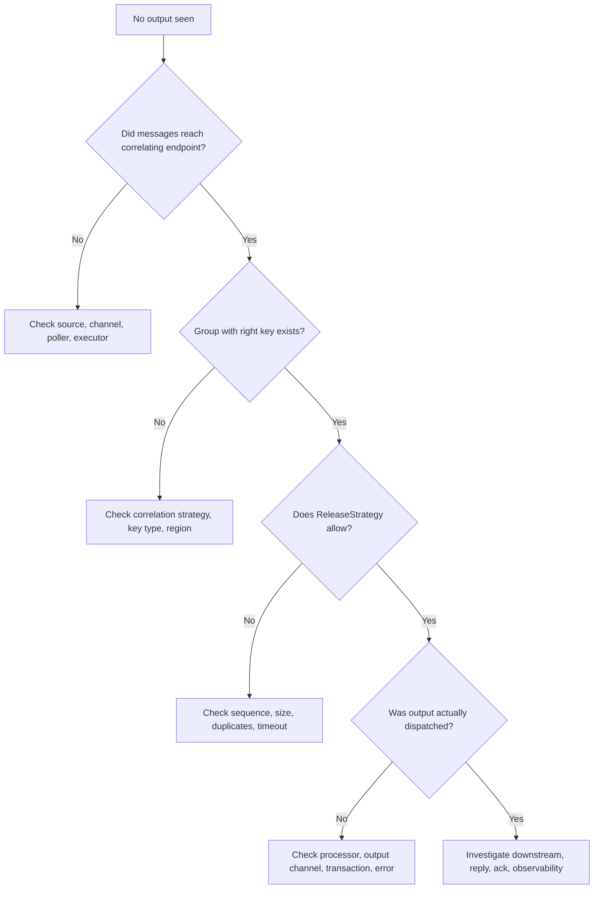
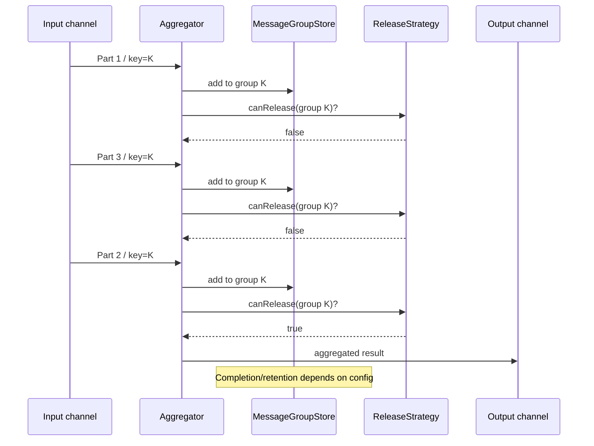
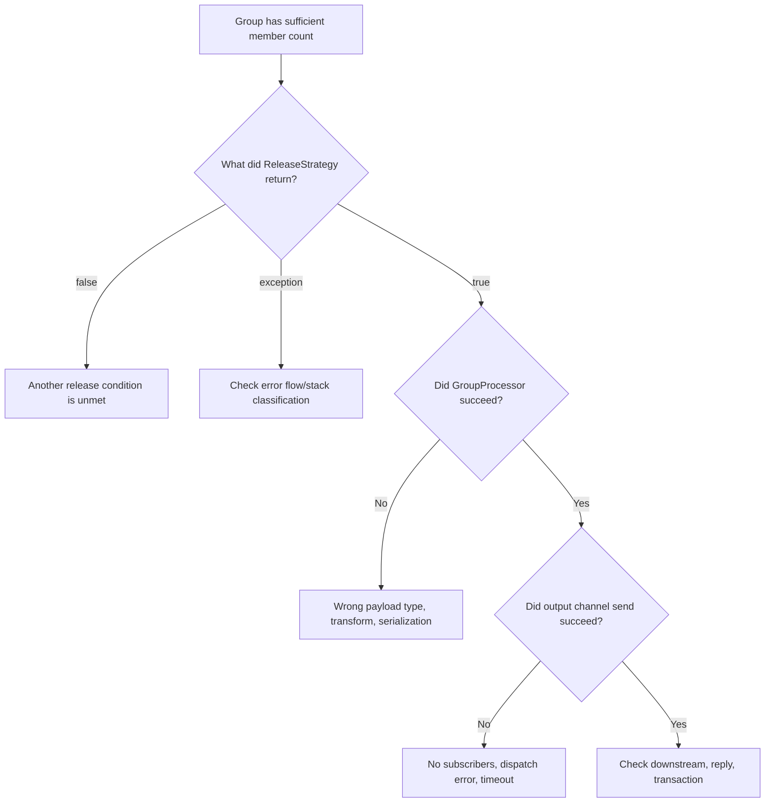
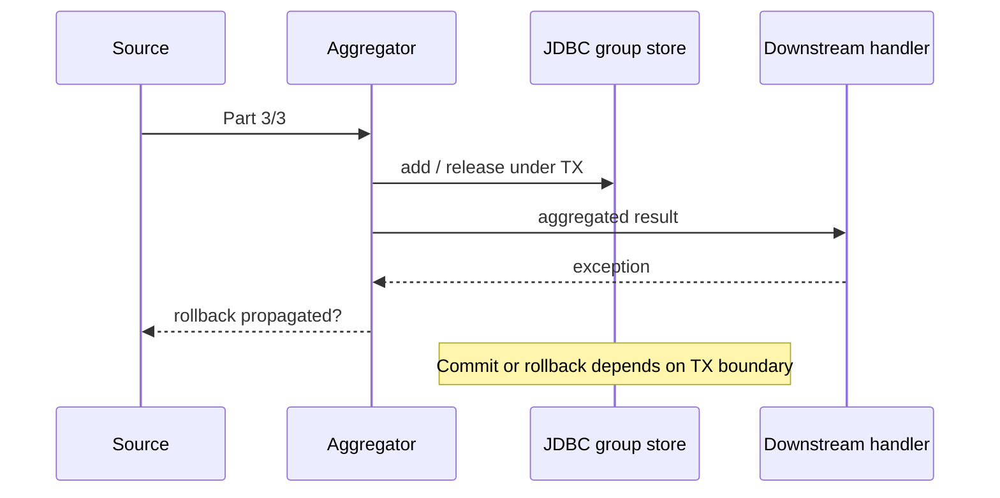
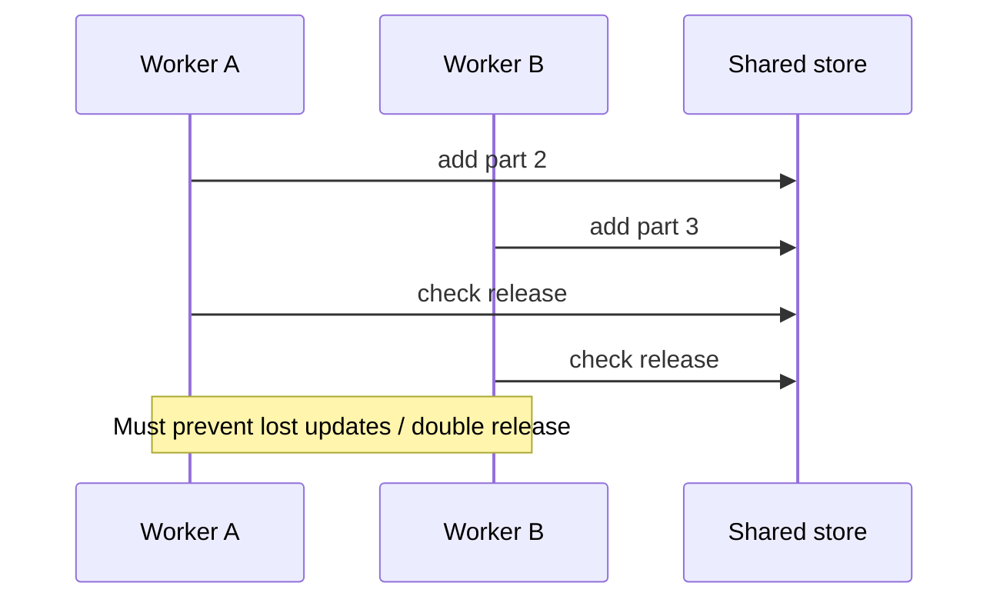
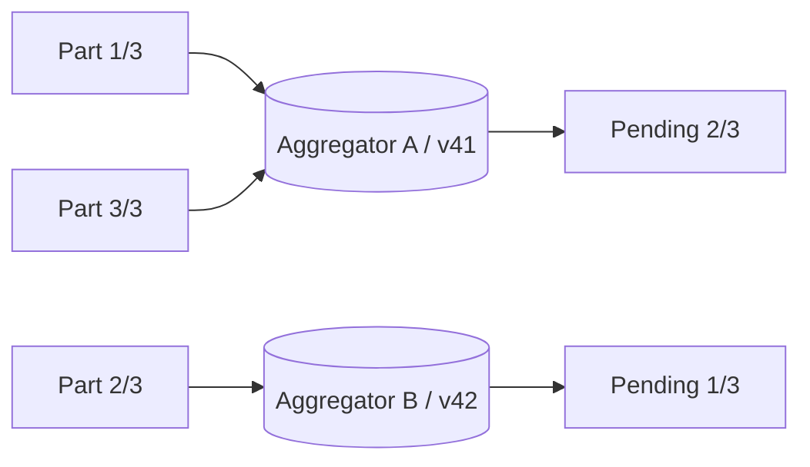

# Inspecting Correlation Groups That Do Not Release

In the **Spring Integration runtime**, a message can traverse multiple channels, pollers, executors, and endpoints before being assembled into a result. With an **aggregator** or **resequencer**, messages sharing a correlation key are placed into a `MessageGroup`, and a `ReleaseStrategy` decides whether a result may be emitted. When downstream sees no output, the group may simply still be waiting validly—or there may be a **wrong correlation key, missing sequence headers, a message never reaching the endpoint, stale store state, misunderstood timeouts, or an output that released yet failed downstream**.

This lesson belongs to the **Debugging** chapter of the `SPRING_INTEGRATION_RUNTIME` module. Its focus is a practical procedure for investigating **"correlation group not releasing,"** grounded in evidence along source → channel → consumer/poller → correlating endpoint → message group store → release strategy → output. It also covers transactions, retries/redeliveries, locking, threading, persistent message stores, error flows, observability, and restarts or topology changes.

> **First principle:** "no output seen" does not prove "the group has not released." You must pinpoint exactly **where** messages are stuck and which operation **has not happened**.

## 1. Understand the Symptom Before Changing Configuration

Suppose a batch `ORDER-42` is split into three parts:

| Part | `correlationId` | `sequenceNumber` | `sequenceSize` |
| --- | --- | --- | --- |
| `line-A` | `ORDER-42` | 1 | 3 |
| `line-B` | `ORDER-42` | 2 | 3 |
| `line-C` | `ORDER-42` | 3 | 3 |

If all members arrive at the right endpoint with the same key and the group satisfies the release strategy, the aggregator produces an output message. Yet when the downstream handler fails to run, at least five distinct possibilities must be separated:

1. `line-B` **never reached** the correlating endpoint.
2. `line-B` arrived but carried a **different key** and went into another group.
3. The group has enough messages, yet the **release strategy returns `false`** because another condition is unmet.
4. The group did release, yet the **processor, output channel, or downstream handler failed**.
5. The group had already completed, and a new message hit the **completed-group/late-arrival policy** without producing a new result.



**Do not raise `groupTimeout` or delete the group right away.** If the cause is a wrong key or an output channel with no subscribers, raising the timeout merely prolongs the incident; deleting the group can lose already-received data or trigger reprocessing.

## 2. Group Structure and Related Lifecycle

In correlating endpoints, a `CorrelationStrategy` computes the **group key** for each message, a `MessageGroupStore` holds state, and a `ReleaseStrategy` decides when the endpoint may emit.



Inspect a group via these properties:

| Property | What does it answer? |
| --- | --- |
| `groupId` | Does it match the business batch key? |
| `size` | How many messages has the store accepted? |
| Member list | Are the expected business members/sequences present? |
| `sequenceNumber` / `sequenceSize` | Any missing, duplicated, mistyped, or conflicting values? |
| Created / last modified | How long has the group waited, and have new messages arrived recently? |
| Completed/expired metadata | Is the group still waiting, already released, or terminated per policy? |
| Store/region | Is the endpoint actually reading the same store you are inspecting? |
| Release/expiry policy | Which condition allows completion or cleanup? |

Never use a single signal such as "size = 3" to conclude release must happen; also check the **release strategy**, member quality, and duplicate policy.

## 3. Distinguishing Aggregator, Resequencer, and Barrier

All three mechanisms involve correlation yet behave differently:

| Component | Purpose | What might "not releasing" mean? |
| --- | --- | --- |
| **Aggregator** | Combines multiple messages into one result | Missing members or custom release condition unmet |
| **Resequencer** | Reorders messages within each sequence and emits them individually | Missing prior sequence, invalid sequence data, or release policy not satisfied yet |
| **Barrier** | Waits for a trigger with a matching correlation key | Trigger missing/wrong key or waiting for timeout; not an aggregator member count |

In this lesson, **group release** primarily refers to aggregators/resequencers backed by `MessageGroupStore`. If the actual endpoint is a `BarrierMessageHandler`, inspect waiting messages, trigger keys, timeouts, and blocked threads; **do not apply aggregator `sequenceSize` rules to a barrier**.

A resequencer can also be configured to release a **contiguous sequence range** as soon as eligible, rather than waiting for the entire group to emit once. Tests and logs must match the exact endpoint type.

## 4. Five-Minute Runbook: Gathering Minimal Evidence

Before changing code or metadata, record the context of **one specific batch**:

1. **Business key and correlation key** (use tokens/HMAC in logs if values are sensitive).
2. **Flow/endpoint ID**, deployment version, and handling instance/pod.
3. **Expected member count** and observed sequence numbers.
4. **Source delivery/handler attempts**: was the message redelivered or retried?
5. **Store implementation and namespace/region**.
6. **Group size, age, and completion flag** at failure time.
7. **Active release strategy** (default or custom).
8. **Output/error channel** and transaction/ack boundaries.

A safe diagnostic record looks like:

```json
{
  "event": "correlation_group_inspected",
  "flow": "orders-v42",
  "endpoint": "orderAggregator",
  "group_key_ref": "hmac:abc123example",
  "store_type": "JdbcMessageStore",
  "member_count": 2,
  "expected_count": 3,
  "observed_sequence_numbers": [1, 3],
  "completed": false,
  "group_age_ms": 12500,
  "last_message_age_ms": 8500,
  "release_decision": "WAITING_FOR_MEMBER",
  "instance": "worker-2"
}
```

Values are illustrative, **not default Spring Integration metrics**. You must instrument or query via the appropriate API to collect them. Never dump full payloads or headers into production logs just to find a key.

## 5. First Checkpoint: Did Every Message Reach the Endpoint?

An often-overlooked hypothesis is that a message got stuck **before** the aggregator:

```text
Source
  -> inbound adapter
  -> filter/router
  -> QueueChannel
  -> poller
  -> ExecutorChannel
  -> aggregator
  -> output
```

| Location | Evidence to Look For | Typical Cause |
| --- | --- | --- |
| Source/broker | Delivery, offsets, unacked/prefetch, selected files | Not read yet, adapter error, filtered out |
| Router/filter | Route decisions, discard counts | Wrong condition or key |
| `DirectChannel` | Subscribers present and any send exceptions? | Endpoint unstarted, unsubscribed |
| `QueueChannel` | Depth, receive count, poller status | Poller stopped, thread starvation, backlog |
| `ExecutorChannel` | Executor queue, rejections, active workers | Pool saturated, task not yet run |
| Correlating endpoint input | Count of messages actually entering endpoint | Message stopped at an earlier step |

**A successful `send()` on an upstream channel does not always mean the aggregator received the message.** With `ExecutorChannel`, the task may merely be queued. With `QueueChannel`, a poller still has to dequeue it.

### 5.1. Drawing a Single-Message Timeline

```text
10:00:00.100  source_received          M2
10:00:00.105  router_selected          aggregateOrders
10:00:00.107  queue_enqueued           M2
10:00:15.220  poller_received          M2
10:00:15.224  aggregator_input_seen    M2
```

If you waited 3 seconds for output while the queue took 15 seconds to be polled, that is **poller lag**, not a group release bug. Measure real timestamps at every boundary before tweaking `ReleaseStrategy`.

## 6. Second Checkpoint: Do Correlation Keys Match Strictly?

A group is keyed by the **exact key value returned by the correlation strategy**, not necessarily what a dashboard displays.

```text
Message A: correlationId = "ORDER-42"  (String)
Message B: correlationId = "ORDER-42 " (String with trailing space)
Message C: correlationId = 42          (Integer)
```

These three messages **do not automatically land in the same group**. Comparisons depend on key equality and type. Common mistakes:

- Producer uses `orderId` for one message and `batchId` for another.
- A serializer converts numbers to strings or vice versa.
- Keys have inconsistent uppercase/lowercase normalization.
- One branch's transformer strips the `correlationId` header.
- Using each message's `MessageHeaders.ID` as the group key.
- A retry builds a new message with a different correlation key.
- Multiple tenants share the same order ID without namespacing.
- Old and new flow versions use different store regions or collide on incompatible group IDs.

### 6.1. Comparing Key Values and Types

In tests or via safe instrumentation, print the **type** and a safe reference of the key without printing raw sensitive business IDs:

```java
Object key = message.getHeaders().get("correlationId");

String type = key == null
        ? "missing" : key.getClass().getSimpleName();

log.debug("correlation_key_type={} correlation_key_present={}",
        type, key != null);
```

This snippet checks only type and presence. When correlating across a group, add an HMAC token computed from **contract-normalized, namespaced values**—do not use weak hashes for emails or phone numbers.

**Important:** if you use `.aggregate(spec -> spec.correlationStrategy(...))`, the `correlationId` header may **not** be the actual key. Read the strategy configured on that exact endpoint and test what it returns.

## 7. Missing Correlation Header or Wrong Key Type

Some `split → aggregate` flows rely on the framework to generate correlation and sequence headers. However, when messages arrive independently from HTTP, JMS, Kafka, file adapters, or custom producers, never assume those headers are always present.

A validation boundary can enforce:

```java
import org.springframework.messaging.Message;

void validateSequenceHeaders(Message<?> message) {
    Object correlation = message.getHeaders().get("correlationId");
    Object number = message.getHeaders().get("sequenceNumber");
    Object size = message.getHeaders().get("sequenceSize");

    if (!(correlation instanceof String key) || key.isBlank()) {
        throw new IllegalArgumentException("Missing correlation key");
    }
    if (!(number instanceof Integer n) || n < 1) {
        throw new IllegalArgumentException("Invalid sequenceNumber");
    }
    if (!(size instanceof Integer expected) || expected < 1 || n > expected) {
        throw new IllegalArgumentException("Invalid sequenceSize");
    }
}
```

This is an **example contract for a flow expecting `String` and `Integer`**, not a rule that Spring Integration supports only one key type. If your system intentionally uses `UUID` or numeric keys, validate against the approved types.

Never assign one shared fallback key to all messages missing correlation: doing so will **merge unrelated batches** into a single group. Validation failures should go to an explicit error/recovery policy.

## 8. Third Checkpoint: sequenceNumber and sequenceSize

For aggregators releasing by sequence size, these headers directly control behavior:

- `sequenceNumber`: position of the message in the sequence, typically 1-based.
- `sequenceSize`: expected total number of members.
- `correlationId`: identifies the group containing messages of the same batch.

Mismatches to test:

| Case | Example | Possible Consequence |
| --- | --- | --- |
| Missing size | Message 2 lacks `sequenceSize` | Default strategy may fail to determine total expected parts |
| Size too large | Three real parts yet `sequenceSize=4` | Group waits forever for a nonexistent fourth part |
| Size too small | Batch has four parts yet `sequenceSize=3` | Risk of premature release before business completion |
| Conflicting sizes | Some parts report 3, others report 4 | Unreliable release behavior; needs validation |
| Duplicate sequence | Two messages both carry `sequenceNumber=2` | Group count alone does not prove all parts arrived |
| Gap in sequence | Received 1, 2, 4 out of 4 | Part 3 missing; resequencer may wait |
| Zero-based numbering | 0, 1, 2 | Breaks standard sequence contract |

**Separate "enough count" from "all right parts."** A custom release strategy checking only `group.size() >= expected` can be fooled by duplicates carrying new message IDs. If business rules require unique positions 1..N, add corresponding member validation/idempotency.

### 8.1. Minimal Sequence Inspection Summary

```text
group:             ORDER-42
expected sequence: [1, 2, 3]
observed sequence: [1, 3]
missing:           [2]
duplicate:         []
release:           WAIT
```

The observed set must come from **messages actually present in the store**, not just producer "sent" logs. A message logged by the producer that failed before the endpoint is still absent from the group.

## 9. Fourth Checkpoint: What Does ReleaseStrategy Actually Decide?

`ReleaseStrategy` answers "is the group eligible for the endpoint to emit?". Spring Integration provides sequence-header-based strategies as well as custom business strategies.

Simple custom policy example:

```java
// Java DSL fragment inside an IntegrationFlow definition.
.aggregate(spec -> spec
        .correlationStrategy(m -> m.getHeaders().get("batchId"))
        .releaseStrategy(group -> group.size() >= 3))
```

This snippet is **neither** a universal configuration nor a duplicate-proof strategy. It merely states: once the group holds three or more messages, the size condition is true. It does not check for three distinct business members, an end-of-batch marker, or upstream success.

A real business policy may also require:

- `expectedCount` confirmed from separate metadata.
- No duplicate or skipped sequence numbers.
- An "end-of-batch marker" having arrived.
- Validated results on every member.
- Timeout expiration permitting partial results.

### 9.1. Check Whether a Custom Strategy Throws Exceptions

If a custom strategy casts payloads to the wrong type or calls external APIs, it may throw an exception instead of returning `false`. Such failures show up in exception/error flows, not as "waiting for more messages."

Avoid heavy remote/blocking I/O inside `ReleaseStrategy` when it runs repeatedly inside the group's critical section. Doing so holds locks longer, spikes contention, and delays other messages.

### 9.2. Practice: Extract Strategy Logic for Unit Testing

```java
import org.springframework.integration.store.MessageGroup;

final class GroupReleaseRules {
    boolean hasAtLeastThree(MessageGroup group) {
        return group.size() >= 3;
    }
}
```

Isolating the rule lets you test size=0, 1, 2, 3, duplicates, and invalid metadata without booting a full Spring context. Yet unit-testing the rule alone does not prove the endpoint **actually wires that strategy instance**; you still need an integration test on the final wiring.

## 10. Fifth Checkpoint: What Is Actually Inside MessageGroupStore?

A `MessageGroupStore` persists groups in memory or an external backend. Common implementations:

| Implementation | Environment | Debugging Risks |
| --- | --- | --- |
| `SimpleMessageStore` | In-memory, easy to test | State lost on restart; each JVM holds separate groups |
| `JdbcMessageStore` | JDBC database | Check schema, region, transactions, serializers, lock contention |
| Other distributed/persistent stores | Multi-instance | Backend-specific consistency, serialization, partitioning, lifecycle |
| `JdbcChannelMessageStore` | Backing store for queue channels | **Not identical** to an aggregator's `MessageGroupStore` |

Verify **which exact bean instance the endpoint uses**. Sometimes an app defines a `JdbcMessageStore` bean yet leaves the aggregator unconfigured, causing state to stay in the default in-memory store.

### 10.1. Read Groups via API Instead of Guessing Schema

The following Java code illustrates a **read-only** inspector using `MessageGroupStore`:

```java
import org.springframework.integration.store.MessageGroup;
import org.springframework.integration.store.MessageGroupStore;

public final class GroupInspector {
    private final MessageGroupStore store;

    public GroupInspector(MessageGroupStore store) {
        this.store = store;
    }

    public GroupSnapshot inspect(Object groupId) {
        MessageGroup group = store.getMessageGroup(groupId);
        return new GroupSnapshot(
                group.getGroupId(),
                group.size(),
                group.isComplete());
    }

    public record GroupSnapshot(
            Object groupId, int memberCount, boolean completed) {}
}
```

Pass a `groupId` object whose type **matches the correlation strategy**; passing `"42"` instead of integer `42` can look up a different group. In production debug tools, never print raw `groupId` if it contains sensitive data; pseudonymize at the log/UI output layer.

Note that how empty/nonexistent groups and completion metadata are returned can vary by store and version. A `size=0` result **does not prove a group existed and vanished**; check completion state and lifecycle too.

### 10.2. If the Store Returns size=2, Keep Asking

- Which `sequenceNumber`s do those two messages carry?
- Are remaining parts still sitting in an upstream queue or poller?
- Was the group updated recently?
- Was a duplicate rejected by message ID?
- Did a message arrive with the wrong key and land in another group?
- Is another flow version reading/writing a separate store or region?

**Never edit store tables directly to "insert" a missing message.** Because backends store serialized messages and endpoint metadata, manually adding rows can break invariants or fail transactions.

## 11. Observing Group State Without Mutating Data

Some management APIs have side effects; expire, remove, and force-complete are not pure read operations. During a live incident:

1. Prefer a **read-only inspector** against the endpoint's exact `MessageGroupStore` bean.
2. Snapshot tokenized group ID, size, sequence set, age, and completion state.
3. Also snapshot upstream queue depth and handler error counts.
4. Avoid calling mutating methods like `removeMessageGroup` or `expireMessageGroups` just to experiment.
5. If intervention is unavoidable, log a change request, verify transactions/idempotency, and prepare a recovery plan.

With JDBC, you can inspect the database using restricted read-only `SELECT` queries, though **Spring Integration's physical schema varies by version and database**. Never copy an assumed `INT_MESSAGE_GROUP` SQL query and run it against production without verifying the deployed version's schema.

## 12. Why Is Output Still Missing When Group Size Is Sufficient?

This is the most critical branch once you confirm the group exists:



Common causes:

- Custom `ReleaseStrategy` also requires a `batchClosed` flag in addition to size.
- `MessageGroupProcessor` throws an exception while aggregating payloads.
- Output channel has no subscribers, endpoint is stopped, or flow was removed.
- Downstream handler fails and the transaction rolls back.
- `ExecutorChannel` accepted output, yet worker execution is delayed by backlog/pool saturation.
- `errorChannel` or a recovery callback handled the exception, hiding errors from the caller.
- Output actually emitted earlier, yet debug logging/instrumentation sits **after** a later failure point.

### 12.1. Separate Release Decisions from Output Delivery

Emit separate logs/metrics for:
- `group_release_decision_true`;
- `group_processor_completed`;
- `result_channel_accepted`;
- `downstream_handler_started`;
- `business_committed`;
- `source_acknowledged`.

These are **suggested application-instrumented metric names**, not built-in framework meters. They tell whether a group truly released or is still waiting.

## 13. Retries, Rollbacks, and Transactions Can "Rewind" State

Suppose an aggregator runs inside a transaction, the store persists the third part, the release strategy returns true, and the next handler throws:



If the group write and downstream handler share **the same JDBC transaction**, a rollback can revert the group back to its state before the third part committed. If the source does not support redelivery or the exception gets swallowed, that third part may **lose its chance to be redelivered**.

| Observation | Hypothesis |
| --- | --- |
| Group size rises and then drops back | Transaction writing the group rolled back |
| Handler logged all three messages yet store shows two | One message rolled back or wrong store/region inspected |
| Output produced before source ack, followed by duplicates | Output/ack not atomic with group completion |
| No producer exception yet error channel shows errors | Async boundary, error recovery, or gateway semantics |
| Third message loops endlessly | Poison message, error strategy, nack/redelivery loop |
| DB group shows completed yet business result missing | Downstream failed after completion; misaligned tx/ack boundary |

**There is no "whole-flow transaction" just from putting `@Transactional` on one handler.** Pollers, channels, executors, and JDBC/brokers each have their own boundaries. Crossing threads via an `ExecutorChannel` generally does not carry over the caller thread's transaction.

### 13.1. Error Flows Can Mask Failure Trails

An `ErrorMessage` may be routed to `errorChannel` on failures in async endpoints, whereas synchronous `DirectChannel` failures propagate to the sender. If the error handler **logs and returns normally**, upstream may treat processing as finished under the source contract even though business output never existed.

When debugging, log the **exception type/error code** and recovery outcome; never dump raw `ErrorMessage` instances since they can include `failedMessage`, payloads, or secrets.

## 14. Timeouts and Expiry: Not Equivalent to Normal Release

An incomplete group can be handled by timeout/expiry mechanisms. Depending on configuration and endpoint type, the system may:
- Keep waiting.
- Expire and discard the group.
- Emit a partial result when policy permits.
- Route failed data to recovery/quarantine.
- Retain completed metadata to handle late arrivals.

```text
Group ORDER-42:
  expected = 3
  received = [1, 3]
  time waiting = 60 seconds

Policy A: continue waiting
Policy B: expire -> discard / audit
Policy C: expire -> partial result with incomplete=true
Policy D: durable recovery job
```

**Raising timeouts will not make part 2 appear.** Timeouts only govern when to act on incomplete state. If business rules forbid partial data, never enable `sendPartialResultOnExpiry` just to make dashboards show output.

### 14.1. Scheduler Questions to Check

- Is `groupTimeout` or a suitable `MessageGroupStoreReaper` actually configured?
- Is the scheduler/poller driving expiry still running?
- From what timestamp is timeout measured—does it reset on last message?
- Are multiple nodes scanning expiry on the same shared store?
- Does the expiry/partial-output handler fail?
- Does the store retain completed groups and run cleanup in the right region?

Exact scheduler timing and expiry details vary by version and implementation. Avoid `Thread.sleep(50)` in tests; await an outcome with a bounded deadline.

## 15. Completed Groups and Late Arrivals Are a Separate Diagnostic Branch

A message arriving after a group already released may be treated as a **late arrival**, especially if the store retains completed-group markers. If the group was deleted, reusing the same key can start a brand-new group depending on policy.

```text
T0  ORDER-42: 1/3, 2/3, 3/3 -> release
T1  source redelivers message 2/3
T2  producer sends a new batch reusing key ORDER-42
```

Questions to answer:
1. Has group `ORDER-42` **already released** once before?
2. How long are completed markers retained, and in which store/region?
3. Are late-arriving messages discarded, errored, or creating a new group?
4. Did a producer **reuse a correlation key** for a different batch?
5. Is there deduplication by business member ID when messages carry fresh Message IDs?

If a new task still relates to an old order, the key should scope by **batch/run/version**, not bare `orderId` alone. Never reset completed markers casually in production: stale redeliveries can emit duplicate outputs.

## 16. Multi-Instance: "Two Parts per Node" Differs from "One Group of Four Parts"

In a cluster, two instances might each use an independent `SimpleMessageStore`:

```text
Node A — group ORDER-42: [1, 3]
Node B — group ORDER-42: [2]
```

The cluster received all three messages, yet **neither node holds a complete group**. Adding a distributed lock across the two nodes will not merge two separate local states. You need:
- A shared `MessageGroupStore`; or
- Message partitioning by correlation key so one owner receives all parts; or
- An explicit state-handoff protocol.

### 16.1. A Shared Store Is Not Enough Without Lock/Transaction Semantics

When two consumers for the same key write to a shared JDBC store, verify group coordination, transaction isolation, and locking strategy. If two workers inspect the group concurrently right after adding, races can occur at **release/complete/output** unless configured properly.



Verify the group lock registry, backend lock lease duration, transaction length, and retry behavior on concurrency errors. **Do not treat one successful three-sender test as proof that races cannot happen**; run stress tests and fault injection.

## 17. When Groups "Stall" Due to Locks, Threads, or Executors

Not every delay sits inside `ReleaseStrategy`:

| Symptom | Hypothesis | How to Verify |
| --- | --- | --- |
| Thread stacks waiting on group lock | Lock contention or deadlock | Thread dumps, lock wait metrics |
| Poller not executing | Endpoint stopped, scheduler busy, task exception | Lifecycle, poller active/schedule |
| Executor queue growing | Worker pool saturated, blocking I/O | Active threads, queue depth, rejections |
| Slow store reads/writes | DB locks, exhausted connection pool | DB waits, query latency, pool metrics |
| High group age yet recent last-modified | Messages arrive yet strategy keeps returning false | Sequence/member inspection |
| Group absent in current JVM | Wrong node/store/region or messages haven't arrived | Compare instances and backing store |
| Group complete yet output slow | Processor or downstream blocking | Traces/spans and handler latency |

A `LockRegistry` protects group state, yet **cannot fix a broken release condition**. Raising lock timeouts only makes threads wait longer when keys are wrong or long transactions stall the store.

### 17.1. Thread Dumps

In environments where you have authorized access, capture thread dumps using the appropriate JVM tool, e.g., `jcmd <pid> Thread.print`. Look for threads waiting on DB connections, `java.util.concurrent.locks`, schedulers, or blocked handlers. Do not inspect CPU alone: an I/O- or lock-bound system can have low CPU while queues back up.

Never paste secrets, full payloads, or raw thread dumps containing sensitive data into public tickets.

## 18. Dynamic Flows: Changing Topology While Groups Are Incomplete

Applications can register/remove `IntegrationFlow`s at runtime via `IntegrationFlowContext`. If flow A holds a 2/3 group and routing switches to flow B, the third part may route to B while A never releases.



Remediation requires **group ownership/versioning**:
- Pin messages of older groups to A until completion or expiry.
- Quiesce/drain A before removing it.
- Migrate group state to B under a tested protocol, including serializers and schemas.
- Do not remove A's store/region while pending groups remain.

"Flow B is running" does not prove pending groups on A migrated automatically. If B shares a store with A using a different release strategy, verify compatibility and prevent both endpoints from racing on the same group.

## 19. Java DSL: Minimal Flow to Reproduce the Failure

When production is too complex, build a **small test flow** with the same correlation/release/store config and test-controlled inputs. Java 17+ example with Spring Integration Java DSL:

```java
import org.springframework.context.annotation.Bean;
import org.springframework.context.annotation.Configuration;
import org.springframework.integration.annotation.EnableIntegration;
import org.springframework.integration.channel.DirectChannel;
import org.springframework.integration.channel.QueueChannel;
import org.springframework.integration.dsl.IntegrationFlow;
import org.springframework.integration.store.MessageGroupStore;
import org.springframework.integration.store.SimpleMessageStore;
import org.springframework.messaging.MessageChannel;

@Configuration
@EnableIntegration
class CorrelationDebugConfig {

    @Bean
    MessageChannel orderParts() {
        return new DirectChannel();
    }

    @Bean
    QueueChannel orderResults() {
        return new QueueChannel();
    }

    @Bean
    MessageGroupStore orderGroupStore() {
        return new SimpleMessageStore();
    }

    @Bean
    IntegrationFlow orderAggregationFlow(MessageGroupStore orderGroupStore) {
        return IntegrationFlow.from("orderParts")
                .aggregate(spec -> spec.messageStore(orderGroupStore))
                .channel("orderResults")
                .get();
    }
}
```

This example intentionally uses `SimpleMessageStore` and `DirectChannel` to reproduce grouping **inside one JVM** without poller/executor noise. It does **not** verify restarts, broker acks, or JDBC transactions. If production uses a custom correlation or release strategy, configure **that exact same strategy** in the reproduction; otherwise the test only exercises default behavior.

### 19.1. Sending Two Parts via MessageBuilder and Inspecting

```java
import org.springframework.integration.IntegrationMessageHeaderAccessor;
import org.springframework.messaging.Message;
import org.springframework.messaging.support.MessageBuilder;

Message<String> part(String group, int sequence, int size, String value) {
    return MessageBuilder.withPayload(value)
            .setHeader(IntegrationMessageHeaderAccessor.CORRELATION_ID, group)
            .setHeader(IntegrationMessageHeaderAccessor.SEQUENCE_NUMBER, sequence)
            .setHeader(IntegrationMessageHeaderAccessor.SEQUENCE_SIZE, size)
            .build();
}

// Inside a test method with orderParts, orderResults, and orderGroupStore beans:
String key = "test:ORDER-42";
orderParts.send(part(key, 1, 3, "line-A"));
orderParts.send(part(key, 3, 3, "line-C"));

var group = orderGroupStore.getMessageGroup(key);
assertEquals(2, group.size());
assertNull(orderResults.receive(0));
```

This is a **JUnit test fragment**: `part()` is a helper method and `assertEquals`/`assertNull` are JUnit assertions; beans must be injected beforehand. A pending group of size=2 with null output is the **expected result** while waiting for the second part.

### 19.2. Adding the Final Part and Verifying Release

```java
orderParts.send(part(key, 2, 3, "line-B"));

var result = orderResults.receive(2_000);
assertNotNull(result);
// Result payload structure depends on the flow's GroupProcessor.
// Assert members/contract; do not blindly cast to one specific DTO.
assertNull(orderResults.receive(0));
```

If no output appears, inspect the group after the third input and check exceptions/error channels. Do not jump to modifying `SimpleMessageStore`; the source may not actually be sending all parts or the strategy may be misconfigured.

## 20. Custom Release Strategy: Reproducing "Sufficient Size Yet Condition False"

A realistic scenario is a release strategy requiring a `batchClosed` flag in addition to message count:

```java
// Illustrative strategy fragment inside a dedicated bean.
boolean canRelease(MessageGroup group) {
    boolean enoughMessages = group.size() >= 3;
    boolean closed = group.getMessages().stream()
            .anyMatch(m -> Boolean.TRUE.equals(
                    m.getHeaders().get("batchClosed")));
    return enoughMessages && closed;
}
```

If three parts arrive yet **none carries `batchClosed=true`**, size=3 still yields `canRelease == false`. That is expected policy behavior, not a store bug.

Tests must cover at least:
- 2 parts, not closed → false.
- 3 parts, not closed → false.
- 3 parts, with closed marker → true.
- Duplicates reaching count while missing unique business members → must not count as complete if business rules require distinct members.

In production, avoid logging the entire group inside `canRelease`. Log `group size` and sanitized enum/boolean condition flags instead.

## 21. Unit-Test Release Strategy Before Integration Testing

When using custom rules, isolate logic for pure Java unit tests:

```text
Case 1: size=2, expected=3       -> WAIT
Case 2: size=3, expected=3       -> RELEASE
Case 3: size=3, has duplicate    -> WAIT if policy requires 3 unique members
Case 4: size=4, conflicting size -> VALIDATION_ERROR
Case 5: closed=true, size=2      -> WAIT if partials disallowed
```

Unit-testing the strategy in isolation confirms whether the fault lies in the **condition**, yet does not prove the endpoint wired that exact bean. Integration tests must confirm:

1. Messages enter the right group.
2. The strategy is invoked per test scenario.
3. The strategy returns the expected decision.
4. Output is produced and dispatched.
5. Group completion/cleanup follows policy.

Never rely on a single `System.out.println()` inside the strategy to assert invocations in multithreaded runs; use counters, test spies, or structured metrics.

## 22. Testing Timeouts and Late Arrivals Deterministically

For groups missing a part, write tests using a real scheduler/timeout rather than arbitrary `Thread.sleep` calls.

```java
import static org.awaitility.Awaitility.await;
import java.time.Duration;

// Fragment in an integration test with helper outcomeOf(...).
await().atMost(Duration.ofSeconds(5))
        .until(() -> outcomeOf("ORDER-42")
                .equals("EXPIRED_OR_RECOVERED"));
```

`outcomeOf` is a test-provided helper, not a built-in Spring Integration API. Assert not just elapsed time, but **policy-compliant outcomes**:
- Group retained if required.
- Expired group discarded with audit trail.
- Partial result flagged incomplete if permitted.
- Recovery record durably persisted.
- Late-arriving messages do not duplicate business effects.

Reactor virtual time does not automatically drive Spring Integration's expiry scheduler unless sharing the same clock/scheduler. Verify your exact version and setup.

## 23. JDBC Backend: Debugging Persistent State and Transactions

When using `JdbcMessageStore`, check in order:

1. Which `JdbcMessageStore` bean is the aggregator actually using?
2. Do regions/namespaces match across deployments and nodes?
3. Was the JDBC schema initialized for the exact Spring Integration version?
4. Did group writes **commit**, or are they still inside an uncommitted transaction?
5. Can the serializer deserialize older payloads/headers?
6. Are DB connection pools or group locks waiting/timing out?
7. After restart, does the new app read the existing group or create a new one?

```text
Context A:
  add ORDER-42 parts 1 and 3
  commit group state
  close context

Context B:
  open with same DB + compatible store region
  read group ORDER-42 -> size=2
  add part 2
  release result
```

A **`JdbcChannelMessageStore`** for queue-backed channels has a separate receive contract; do not conflate it with `JdbcMessageStore` in your reasoning just because both use JDBC. One governs **whether a message stays in a queue after rollback**, while the other governs **whether members belong to a correlation group**.

### 23.1. Never Edit Store Tables Manually to Force Release

Message store tables may store serialized messages, group memberships, group metadata, and row locks. Manual `DELETE` or `UPDATE` statements can:
- Wipe unprocessed data.
- Break links between groups and messages.
- Trigger duplicate redeliveries.
- Leave nodes seeing inconsistent state.
- Make the bug vanish temporarily only to reappear after restart.

If replay is needed, build a **dedicated recovery runbook** with state backups, business idempotency, and change controls. The safest fix is resolving the root cause and re-injecting missing messages through a **controlled source**, rather than mutating serialized stores directly.

## 24. Minimal Logging and Observability for Debugging

In production, avoid `log.info("group={}", group)` because it can expose payloads and headers of every member. Use a safe observation record instead:

```json
{
  "event": "group_release_checked",
  "endpoint": "orderAggregator",
  "group_key_ref": "hmac:abc123example",
  "member_count": 2,
  "expected_count": 3,
  "missing_sequences": [2],
  "release_policy": "SEQUENCE_SIZE",
  "decision": "WAIT",
  "flow_version": "orders-v42",
  "trace_id": "opaque-trace-123"
}
```

Valuable metrics to have:
- Input count at correlating endpoints.
- Pending/completed/expired group counts per endpoint.
- Group size and group age histograms.
- Release success/failure counts.
- Timeout/discard/partial counts.
- Message store read/write latency.
- Group lock wait duration.
- Poller lag, queue depth, and executor saturation.
- Retry attempts, redeliveries, and business commit counts.

This is a **suggested signal set**, not a guarantee every metric exists out of the box. Never use raw correlation keys as metric labels: one key per order explodes cardinality and leaks data. Put safe detailed IDs in logs/traces when needed, and aggregate metrics by endpoint and outcome.

## 25. Decision Table: From Symptom to Action

| Symptom | Likely Cause | Next Check | Do NOT Do |
| --- | --- | --- | --- |
| No group at all | Messages never arrived, wrong key, wrong store | Input counts, router, store bean | Raise timeout |
| Separate size=1 group per part | Key changes per message | Correlation strategy, key types | Force-release each group |
| Group size=2, expected=3 | Part genuinely missing | Source/queue/delivery of missing part | Blindly enable partial results |
| Group size=3, no release | Custom strategy false or throwing | Strategy decision/exceptions | Wipe the store |
| Group already completed | Late arrival / completion marker | Release history, retention | Reuse keys carelessly |
| Group grows then shrinks after error | Group write rolled back | TX manager, exception path | Assume every save committed |
| Release=true, no output | Processor/output/downstream failed | Error channel, subscribers, handlers | Tweak `correlationId` alone |
| One node has 2/3, another has 1/3 | Fragmented in-memory state | Shared store/partition ownership | Add local locks |
| High group age, threads waiting on lock | DB/lock contention | Thread dumps, lock waits | Raise global lock timeout infinitely |
| Result exists yet client times out | Reply channel/gateway/callback failed | Reply correlation and async boundary | Duplicate the aggregate |
| Fails only after deploying new version | Store region/serializer/correlation changed | Diff config/version | Bulk-delete completed groups |

## 26. Step-by-Step Production Runbook

### Phase A — Isolate

1. Pick **one representative correlation key**; confirm tenant/batch/version scope.
2. Gather timestamps and safe trace IDs for all parts.
3. Confirm all parts reached the **endpoint input**, not merely the broker.
4. Record the actual release/correlation strategy configuration.

### Phase B — Inspect Group State

5. Inspect the endpoint's **exact `MessageGroupStore` bean/region**.
6. Record size, sequence set, expected size, completion flag, and age.
7. Compare message IDs and **business member IDs** to spot duplicates.
8. Check late-arrival/completed/expiry/timeout policies.

### Phase C — Release and Output Point

9. Observe whether the release strategy returns false, true, or throws an exception.
10. If true, inspect the group processor and output dispatch.
11. Inspect error/recovery flows, transaction commit/rollback, and source acks.
12. For async channels, measure queue backlogs and in-flight handlers.

### Phase D — Safe Remediation

13. If a part is missing, recover **that exact message** from a durable source/recovery store.
14. If keys/sequences are wrong, fix the producer/transformer and assess data already in the store.
15. If strategy logic is wrong, fix the policy and add regression tests before rollout.
16. If old state is incompatible post-deploy, pin/migrate/expire with an audit trail.
17. Never delete groups or force-complete without verifying business idempotency.
18. Re-run duplicate, restart, concurrency, and timeout tests; watch post-deploy metrics.

**A group released by force does not prove data was complete or output was right.** Force-completion is an operational option only when business policy accepts partial results with explicit auditing and reconciliation.

## 27. Regression Testing Matrix

| Test | Input Data | State to Assert | Outcome |
| --- | --- | --- | --- |
| Happy path | 1, 2, 3 same key, size=3 | Pending→complete | One valid output |
| Out-of-order | 3, 1, 2 | Group holds right members | Aggregator completes |
| Missing member | 1, 3 | Size=2, missing=2 | No complete result |
| Wrong key | Part 2 has another key | Two separate groups | No mixing |
| Wrong type | `"42"` and `42` | Two groups by equality | Validation error |
| Missing header | Missing `sequenceSize` | Error/conditional wait per policy | No silent corruption |
| Conflicting size | 3 and 4 in same group | Explicit validation/strategy | No bad completion |
| Duplicate | 1, 2, 2, 3 | Business member deduplication | No double effect |
| Release strategy false | Enough count, missing marker | Group remains pending | No output |
| Strategy exception | Bad payload/header type | Explicit error path | Recovery or rollback |
| Expiry | Only 2/3 before deadline | Expired/partial/discard | Matches policy |
| Late arrival | Extra part after complete | Completed marker/retention | No duplication |
| Two groups | A/B interleaved | Isolated state | Two valid results |
| JDBC restart | Persist 2/3, restart, send part 3 | Durable pending group | Releases cleanly |
| Transaction rollback | Exception before commit | Save rolls back per boundary | Redelivery if source supports |
| Multi-node | Parts split across two instances | Shared store/right owner | Does not stall |
| Executor saturation | Queued tasks backed up | Input arrival delay | Do not blame strategy |
| Dynamic cutover | A pending, B active | Clear group ownership | Clean pin/migrate/recover |

When using `@Transactional` in tests, remember Spring Test may roll back transactions at test end. Restart tests must guarantee **context A committed state**, and context B uses a fresh connection/context against the same database. Merely querying a new store bean inside the same context does not fully prove recovery across restarts.

## 28. Practice Exercises

### Exercise 1 — Three Parts Sent yet Only Two in the Group

Build an aggregator flow with `SimpleMessageStore`. Send three messages at the producer and have a router intentionally drop the second part. Capture logs at each boundary plus store state, showing why "producer sent three" does not mean "aggregator saw three."

### Exercise 2 — Mistyped Correlation Keys

Send part 1/3 with `correlationId="42"` (`String`), part 2/3 with `correlationId=42` (`Integer`), and part 3/3 as `String`. Inspect each group and add validation to reject inputs violating the contract.

### Exercise 3 — SequenceSize Larger Than Reality

Send three messages with size=4. Confirm the group stays waiting; then send the real fourth part or handle via timeout/expiry policy. Do not force-complete and treat the input as valid.

### Exercise 4 — Custom Release Strategy Requiring a Marker

Define strategy `group.size()>=3 && hasBatchClosed`. Send three parts without the marker and verify false. Next send the marker per contract and inspect the output and post-completion state.

### Exercise 5 — Duplicates with Fresh Message IDs

Send `part-2` twice with two distinct message IDs yet the same business part ID. Prove size alone does not prove all positions arrived. Design member-based deduplication or pre-aggregator validation.

### Exercise 6 — Failure After Release

Connect an aggregator to a handler that intentionally throws. Record the release decision, group completion, output send, transaction rollback, and error channel. Explain why the client saw no output even though the release strategy returned true.

### Exercise 7 — Timeouts, Expiry, and Partial Results

Send only 1/3 and 3/3 to a group. Configure expiry, choosing discard or partial emission per business requirements. Use Awaitility with a deadline to assert the outcome instead of sleeping a fixed duration.

### Exercise 8 — Persistent Groups Across Restarts

Use `JdbcMessageStore` with PostgreSQL/Testcontainers, persist 2/3 of a group, commit, and close context A. Open context B with the same store/region, send the missing part, and verify release. Try changing the serializer or payload type between two versions.

### Exercise 9 — Splitting Messages Across Two Instances

Run two consumers with separate `SimpleMessageStore`s and split parts A1/A3 and A2 between them. Observe the stuck group. Switch to a shared store or correlation-ID partition routing and verify proper group ownership.

### Exercise 10 — Lock Contention

Drive multiple senders on the same key with a handler simulating slow I/O inside the critical section. Measure lock wait, queue depth, and handler duration; show how lock delays differ from a false release condition.

### Exercise 11 — Dynamic Topology Cutover

While flow A holds a pending group, register flow B via `IntegrationFlowContext` and switch routing. Determine whether new messages belong to A or B, and design safe group pinning or migration before removing A.

### Exercise 12 — Incident Rehearsal

Simulate a production issue combining missing messages, a custom strategy, an error handler, a JDBC store, and retries. Require each participant to diagnose using **read-only evidence**, write a recovery runbook, and add a regression test before changing configuration.

## 29. Mistakes to Avoid

| Mistake | Consequence | Fix |
| --- | --- | --- |
| Assuming no output means release never fired | Investigating the wrong layer | Separate arrival, group, release, processor, output |
| Looking only at producer logs | Unclear if messages entered the endpoint | Log safely at the input boundary |
| Assuming all messages with the same business ID share a group | Key scope may include batch/run | Read the actual correlation strategy |
| Comparing keys by display string, ignoring type | `"42"` differs from `42` | Validate types and normalization |
| Checking only group size | Duplicates can fake full count | Validate member identities/sequences |
| Assuming missing output means timeout is too short | Delays diagnosis | Check keys, sequences, and strategy |
| Enabling partial results just to get output | Business receives incomplete data | Define explicit partial policies and audits |
| Deleting the group store in production | Loses pending/serialized state | Diagnose read-only; recover durably |
| Inspecting the wrong store/region or node | Snapshot misrepresents real endpoint | Verify bean, namespace, and instance |
| Treating successful `send()` as saved in group | Async queue hasn't delivered to handler yet | Track hops and in-flight work |
| Forgetting completed-group/late-arrival policies | Duplicates discarded or create odd groups | Test completion retention |
| Thinking DB rollback auto-requeues in-memory `QueueChannel` | Messages can be lost | Test source transactions/redelivery |
| Adding locks to cure wrong group keys | Bad groups simply serialize | Fix correlation/release strategy |
| Skipping serializer tests after version upgrades | Pending groups become unreadable | Two-version restart tests |
| Logging whole groups/payloads during incidents | Data leaks | Allowlisted projections and HMAC group keys |
| Single-threaded test passes ⇒ production is safe | Races/locking go untested | Concurrency, stress, and fault-injection tests |

## 30. Knowledge Self-Check

1. **Does missing output prove the group did not release?** No; the failure could be in the processor, output channel, or downstream handler.
2. **Do three messages sharing `orderId` yet having different `correlationId`s enter the same group?** Not automatically; it depends on the correlation strategy.
3. **Is `MessageHeaders.ID` a good default group key?** No; it identifies each individual message.
4. **What happens if `sequenceSize=4` while only three parts exist?** The group may keep waiting per the release strategy rather than automatically becoming size=3.
5. **Does `group.size()==3` prove three distinct business parts arrived?** No, unless duplicates are blocked.
6. **Does `ReleaseStrategy` returning true mean the business DB committed?** Not yet; the group processor, output channel, and transactions still have to succeed.
7. **Where should you look if `ReleaseStrategy` throws an exception?** Exception propagation, error channels, and transaction outcomes.
8. **Do `SimpleMessageStore` instances across two JVMs automatically share groups?** No.
9. **Do `JdbcMessageStore` and `JdbcChannelMessageStore` serve the same role?** No; group stores and queue-backed channel stores solve different problems.
10. **Does a timeout always emit a partial result?** No; it depends on expiry, partial, and discard policies.
11. **Must a completed group always disappear?** No; it depends on retention and completion policies.
12. **Does a message arriving after completion always start a new group?** No; late-arrival policies may discard it.
13. **Why must you know the correlation key's type?** Equality can distinguish different types even when they render identically.
14. **Why does `ExecutorChannel.send()` returning not prove the aggregator received the message?** It may only have enqueued the task.
15. **Can swallowing a handler error on an error channel affect redelivery?** Yes, depending on the source and exception propagation.
16. **Why must JDBC restart tests commit context A?** Without committing, context B has no durable persisted state to read.
17. **Should you delete a group when production stalls?** Not before verifying outcomes, idempotency, and recovery policies.
18. **Which metrics separate lock contention from missing members?** Lock wait duration alongside group size, sequence set, and arrival counts.
19. **Can trace IDs substitute for correlation IDs?** Only when scoped identically to the group; usually they serve different purposes.
20. **What is the most accurate investigation path when a group fails to release?** Source → channel/endpoint input → correlation key → group store → release strategy → processor/output → transactions/errors/recovery.

## 31. Version-Specific Reference Documentation

- [Spring Integration Reference](https://docs.spring.io/spring-integration/reference/): fundamentals of message flows, channels, endpoints, stores, and error handling.
- [Spring Integration — Aggregator](https://docs.spring.io/spring-integration/reference/aggregator.html): `CorrelationStrategy`, `ReleaseStrategy`, group timeouts, partial release, and completion.
- [Spring Integration — Message Store](https://docs.spring.io/spring-integration/reference/message-store.html): stores and message/group lifecycles (check paths matching your version).
- [Spring Integration — Testing](https://docs.spring.io/spring-integration/reference/testing.html): test utilities and integration testing.
- [Spring Integration — Transaction Support](https://docs.spring.io/spring-integration/reference/transactions.html): transaction boundaries and rollbacks in message flows.

Certain APIs, JDBC schemas, metrics, scheduler configurations, and default policies vary across Spring Integration and adapter versions. **Cross-check your exact deployed library version** before writing runbooks that mutate production state.

## 32. Summary

**Debugging a correlation group that does not release is an exercise in tracing state and state-transition conditions, not merely counting messages sent by producers.** Start by confirming whether messages reached the correlating endpoint; next check **correlation keys, sequence headers, group membership, release strategy, and completion policy**. Once the strategy allows release, inspect the **group processor, output channel, and downstream transactions/error flows** rather than tweaking `sequenceSize` without evidence.

A sound runbook always combines **read-only evidence from the store**, structured logs without leaking payloads, poller/executor/lock health, transaction commits/rollbacks, and retries/redeliveries. With JDBC, clusters, or dynamic topologies, also verify **store regions, owner versions, completed markers, serializers, and restart recovery**. Remediate only after pinpointing exactly where data is missing and whether business rules permit partial results or replay. **Proper group release is one milestone; an accurate, recoverable business outcome is the final goal.**
