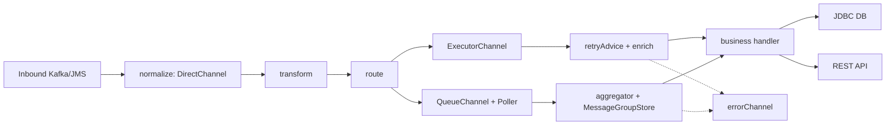
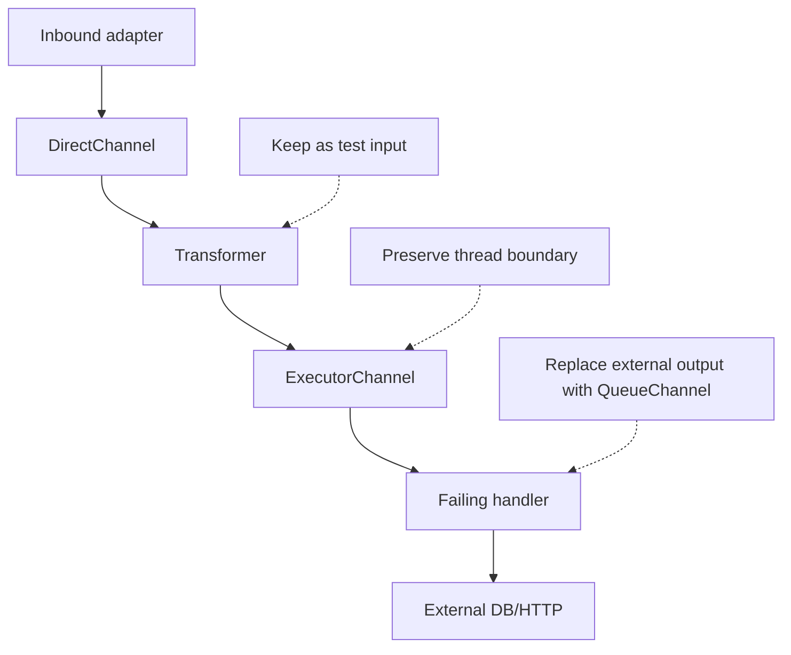
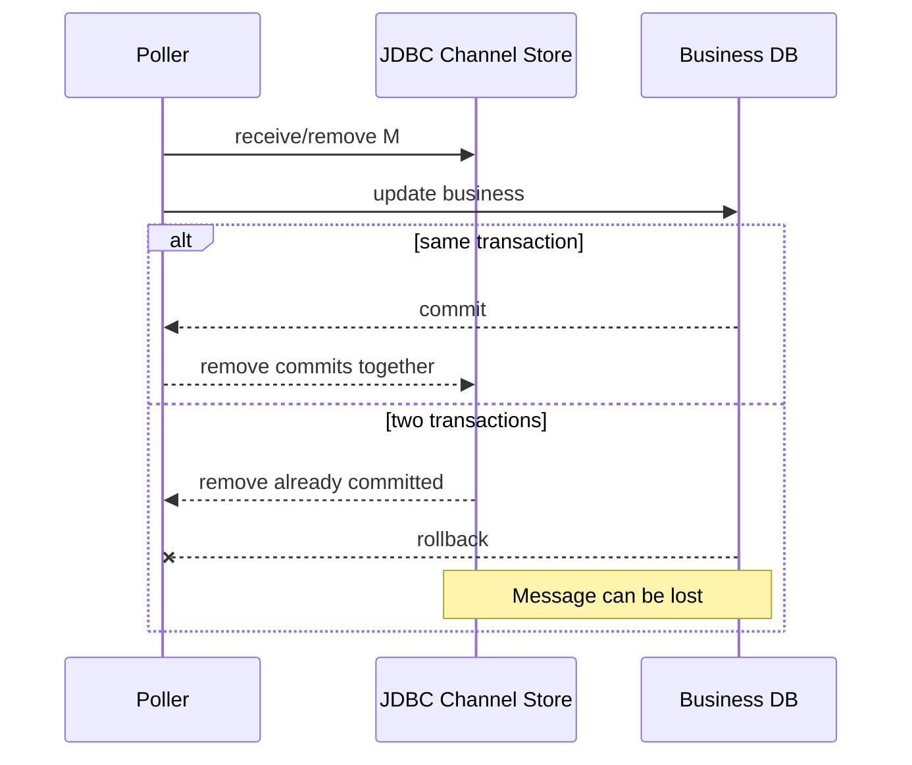
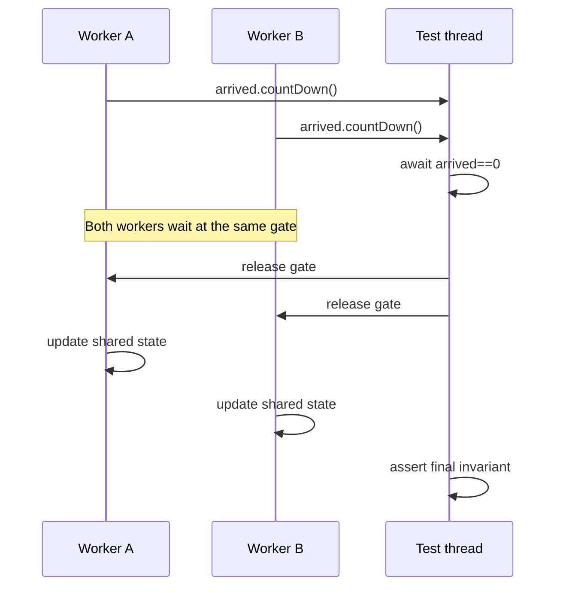
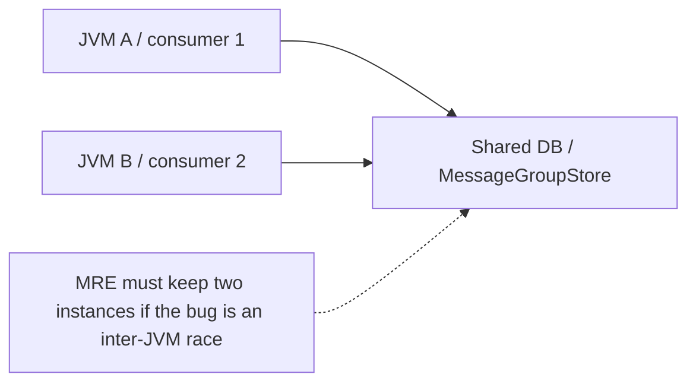

# Minimizing a Flow to Build a Reproducible Test Case in Spring Integration

## Objectives and Scope

In the **SPRING_INTEGRATION_RUNTIME** module, an incident can span many components: messages arrive via HTTP/JMS/Kafka, enter channels, traverse routers/filters, cross pollers or executors, wait inside an aggregator, and then reach handlers calling databases or external APIs. The symptom is usually easy to spot—lost messages, duplicate outputs, wrong correlation, timeouts, deadlocks—yet the **root fault** may sit many steps away.

The **Debugging** chapter includes the topic **"Minimizing a Flow to Build a Reproducible Test Case"**: turning a complex runtime incident into a **minimal reproducible example** (MRE) that executes, fails on an explicit assertion, and supplies enough evidence to fix the bug without standing up the entire production stack.

This lesson covers the minimization workflow, boundary-selection strategy, Java DSL/JUnit examples, async and transactional scenarios, and how to hand off a test case to teammates or maintainers. It is **not** intended to replace full end-to-end test suites, chaos testing, or dedicated content QA.

After this lesson, you will be able to:

- Turn a vague report like "messages sometimes never reach the handler" into concrete **inputs, preconditions, actions, expected results, actual results**, and a failure oracle.
- Map message paths while separating the **data plane** (messages in flight) from the **control plane** (start/stop/dynamic registration).
- Shrink a flow slice-by-slice while **preserving channel types, thread boundaries, pollers, transactions, retries, message stores, and correlation** whenever they relate to the failure.
- Build compact fixtures using `@SpringJUnitConfig`, `@EnableIntegration`, `DirectChannel`, and `QueueChannel`.
- Write test cases that separate synchronous from asynchronous errors using `receive(timeout)`, `CountDownLatch`, `Future.get(timeout)`, and output assertions.
- Use `@SpringIntegrationTest(noAutoStartup=...)`, `MockIntegrationContext`, `IntegrationFlowContext`, fake `MessageSource`s, and test doubles at external boundaries.
- Reproduce a post-restart or broker-redelivery failure window without conflating it with an in-memory test.
- Package an MRE into a reproducible report: versions, configuration, data, run commands, expected/actual outcomes, scrubbed logs, and "red → green" evidence.

Examples target **Spring Integration 6.x (illustrated with 6.5.x), Spring Framework 6.x, Java 17+, JUnit Jupiter 5**. Some DSL overloads vary across versions; examples explicitly state when they are pseudocode or test sketches.

## 1. What Makes a "Minimal Reproducible Test Case"?

A good reproducible test case satisfies five criteria simultaneously:

1. **Self-contained context:** Includes inputs, flow configuration, initial state, and run instructions; nobody has to ask "what secret settings are on your laptop?"
2. **Minimal:** Retains only components truly needed for the failure to appear. Unrelated components are removed or replaced with fakes.
3. **Semantically faithful:** Preserves the boundaries that cause the bug: sync/async, pollers, acks, transactions, races, message groups, etc.
4. **Has an oracle:** Explicit assertions separate expected from actual behavior, rather than "eyeballing logs for anything weird."
5. **Repeatable:** Runs reliably across repeats, in CI, or in a clean test process; if nondeterministic, controls interleaving or reports reproduction rate.

The last two criteria matter especially. A 3-line flow with no assertions **is not yet a test case**; and a test case that "passes" because its author deleted the `ExecutorChannel` is a **false negative**.

### Parts of an MRE

| Part | Question | Example |
|---|---|---|
| Input | Which message triggers the fault? | `payload="ORD-7"`, header `batchId=B-42` |
| Topology | Minimal channels/handlers? | `DirectChannel → ExecutorChannel → handler` |
| Runtime condition | Any special thread/tx/timing state? | Producer sets `ThreadLocal`, handler runs on another worker |
| External resource | Real broker/DB needed? | No; fake outbound service if the race is in-memory |
| Expected | Business/technical invariant? | Handler receives the right tenant ID |
| Actual | Observed failure? | Handler sees `tenant=null` |
| Oracle | Which assertion fails/passes? | `assertThat(actual).isEqualTo("tenant-A")` |
| Cleanup | Which state must be reset? | Clear `ThreadLocal`, shut down executor, drain output |
| Version | Enough environment details for others to run? | Java 17, Spring Integration 6.5.x, Spring Test, JUnit 5 |

You do not have to keep original raw payloads: **anonymize data** while preserving schema, null/empty values, encoding, ordering, header values, or sizes if they trigger the bug.

## 2. Start from a Measured Symptom, Not a Guessed Cause

Initial reports are often too vague:

> "Messages are occasionally lost."

> "The aggregator keeps hanging."

> "Sometimes output still appears after stopping the flow."

Before deleting components, convert them into verifiable observations:

| Raw Symptom | Testable Statement | What to Record |
|---|---|---|
| Lost message | For message ID `M1`, after `send()` succeeds, output queue lacks `M1` within 3 seconds | IDs, channel types, handler state, timeouts, errors |
| Duplicate | One event ID `E7` creates 2 business records after redelivery | Event ID, transaction outcomes, broker ack |
| Wrong correlation | Two parts sharing `batchId` do not release when size=2 | Headers, release strategy, store state |
| "Runs after stop" | After `endpoint.stop()` and quiescence, message `M2` is still processed by handler `X` | Endpoint ID, channel subscribers, in-flight status |
| Lost `ThreadLocal` | Worker behind `ExecutorChannel` reads `tenant=null` | Thread boundary, `ThreadLocal` owner, task decorator |
| Random timeout | With 2 messages sharing a key, worker B waits on lock over 500 ms | Lock key, thread order, critical section duration |
| Reappearing message | DB committed, broker ack not sent, event `E7` redelivered | Commit/ack sequence, inbox idempotency |

**Separate two questions:** "what happened" (factual observation) and "why it happened" (hypothesis). A minimized test case must be driven by **observation**; picking an unproven hypothesis upfront makes it easy to delete the very piece causing the bug.

### Expressing a Scenario as GIVEN–WHEN–THEN

```text
GIVEN
  Flow has ExecutorChannel; producer attaches tenantId to ThreadLocal
  Worker is not configured with ContextPropagatingTaskDecorator

WHEN
  Producer sends Message payload="ORD-7"
  Worker processes Message on another thread

THEN (business expectation)
  Handler reads tenantId="tenant-A"

ACTUAL
  Handler reads tenantId=null

ORACLE
  assertThat(output).isEqualTo("tenant=tenant-A")
  yet actual output is "tenant=null"
```

That way, someone else can write the test and confirm the bug reproduces before debating fixes.

## 3. Draw the Topology Once Before Minimizing

Initial application example:



This model must be verified at runtime, not just by reading one Java DSL file. You can use:

- `IntegrationGraphServer.getGraph()` to view the cached topology snapshot; `rebuild()` after dynamic registrations.
- Channel names, endpoint IDs, `SmartLifecycle.isRunning()`.
- Message history, trace IDs, channel metrics, and `errorChannel`.
- Thread dumps if failures happen during stalls or lock waits.
- Message store and broker state if commits/acks/restarts are suspected.

### Draw "Cut Lines" Around Where the Error Appears



If the bug is **headers missing after `ExecutorChannel`**, start the test case at the channel right before the thread boundary, keep `ExecutorChannel`, and read output at the handler. The Kafka topic, upstream router, and downstream HTTP service may be unnecessary.

Conversely, if the bug is **JDBC dequeue + business transaction**, never replace the JDBC store with an in-memory `QueueChannel`: you would delete the commit/rollback ordering—the exact condition needed to reproduce.

## 4. Controlled Minimization Workflow: 7 Steps

### Step 1 — Pin Baseline and Oracle

Record the minimal inputs and conditions for the bug to surface. Run the original case at least once and confirm failure. Assert on a **meaningful output**: record counts, message payload/headers, root-cause exception, or presence/absence of an event in a store.

If the bug is probabilistic, record the rate—e.g., "7/50 runs fail with 8 workers"; never declare it "fixed" after one passing run.

### Step 2 — Keep the Actual Message Path

Distinguish the paths:

- `DirectChannel`: same thread in the common case; exceptions can propagate back to the caller.
- `ExecutorChannel`: different worker thread; `send()` does not mean the handler finished.
- `QueueChannel`: enqueue followed by poll/receive at a later time.
- `FluxMessageChannel`/reactive handler: subscribe/`onError`/backpressure can form their own boundaries.
- Inbound adapter/`MessageSource`: acks and retries belong to the source; mocking a source is valid only if the fault does not depend on the broker.

Preserve **the channel type involved in the failure** instead of turning everything into `DirectChannel` to make testing "easy."

### Step 3 — Trim Upstream of the Failure

Replace inbound Kafka/HTTP/JMS with `MessageBuilder.withPayload(...).setHeader(...).build()` or `GenericMessage` if the bug does not depend on transport, acks, or serializers. Retain headers actually used: `correlationId`, `sequenceNumber`, `sequenceSize`, reply/error channels, business keys, tenant, and tracing carriers (if relevant).

When the bug involves transport-created headers, reproduce **the exact difference** between the raw record and the Spring `Message`; an overly "clean" fixture can mask serializer/mapping bugs.

### Step 4 — Trim Downstream of the Failure

Replace outbound REST/JDBC downstream of the failure site with a `QueueChannel` or a handler recording into `AtomicInteger`/`CountDownLatch`, provided external resources do not cause the bug.

However, if the bug requires transaction rollbacks, DB constraints, HTTP timeouts, or broker redeliveries, **do not replace the resource with a trivial mock**. Use a real DB/broker via Testcontainers or a fake replicating the exact failure behavior.

### Step 5 — Remove One Component at a Time, Re-Run the Test

Apply "delta debugging": remove one contiguous slice, run the test, and check whether the failure persists.

```text
Original flow: A → B → C → D → E → F

Try removing A, B:
  input → C → D → E → output
  If it still fails: A/B are not needed for the MRE.

Try removing D:
  input → C → E → output
  If it stops failing: D likely preserves a critical boundary.

Restore D and try removing C:
  input → D → E → output
  If it still fails: C is likely unnecessary.
```

**Do not conclude "D is the bug" solely because removing D makes the error vanish**; D might simply create the async boundary that exposes a bug inside E. After each reduction step, record what changed and the result.

### Step 6 — Prove the Test Case Is Not a "False Pass"

Run a **negative control**:

- Remove `ExecutorChannel` and observe the `ThreadLocal` bug disappear: proves the async boundary is required.
- Add the `tenantId` header and update the handler to read from the header so the test flips from fail to pass: proves the fix direction.
- Drop the unique constraint on the inbox table and verify redelivery creates duplicates; restore the constraint and verify duplicates stop.
- For an aggregator, change `batchId` on the second part and confirm it **does not** release; restore it and confirm the group releases properly.

Negative controls are valuable, yet insufficient alone: verify with real config or at least integration tests at project boundaries.

### Step 7 — Package the Test Case and Run Instructions

A solid MRE includes:

```text
Case: SI-MRE-202
Spring Integration: 6.5.x
Java: 17
Input: declared message payload + headers
Precondition: endpoint auto-start, worker pool size=2
Run: run JUnit class XxxReproTest (no external broker required)
Expected: output tenant-A
Actual: output tenant=null
Assertion: specify test/method name
Negative control: replacing ExecutorChannel with DirectChannel passes
Proposed fix: use MessageHeaders or configured context propagation
Cleanup: close ApplicationContext, shut down executor, clear ThreadLocal
```

There is no need to bundle the entire production repository. What matters is that the recipient can **re-run the failure** with explicit dependencies and versions.

## 5. Before Writing Code: Control Environment and Variables

| Variable | What Breaks If Miscontrolled? | How to Control |
|---|---|---|
| Spring Integration / Spring Boot / Reactor versions | APIs/behavior differ across versions | Pin a concrete dependency BOM/version set |
| JDK version | Alters scheduling, serialization, thread behavior | State Java 17+ and exact build/runtime version |
| Endpoint/bean names | Tests look up wrong beans, graph differs | Set explicit endpoint IDs when inspecting |
| Thread pool size | Races never appear with only 1 thread | Keep minimum concurrency needed for interleaving |
| Poller delay/`maxMessagesPerPoll` | Polling order changes | Use fixed settings, plus triggers/latches when needed |
| Transaction manager | Mocks do not roll back DBs | Wire real `DataSource`/tx manager and verify commits |
| Retry/backoff | Failures get masked by auto-retries | Pin attempt counts and recovery behavior |
| Message IDs/headers | Aggregator groups collide across tests | Generate per-test business keys; preserve required headers |
| TestContext cache | State from prior tests leaks | Clean up / use `@DirtiesContext` selectively |
| Executor shutdown | Thread leaks hang CI | Spring-managed executors, `finally`, and await termination |
| External services | Flaky network causes false failures | Deterministic fakes/stubs or Testcontainers |
| Time zone/clock | Timeouts/expiries drift | Inject a `Clock` if app logic depends on wall-clock time |

### The "One Change at a Time" Rule

If you simultaneously delete the router, swap the channel to `DirectChannel`, strip retries, and replace the real DB with a `HashMap`, a passing test **gives zero evidence** of which factor mattered. Shrink one slice at a time and note whether the bug persists or disappears.

## 6. MRE #1: A Synchronous Flow with Easy Assertions

Start from a minimal flow: input channel → normalizing handler → output queue. It rapidly tests hypotheses about payloads, headers, filters/routers, or custom transformations—it is **not** meant for reproducing async bugs.

### Flow Configuration

```java
package example.mre;

import java.util.Locale;

import org.springframework.context.annotation.Bean;
import org.springframework.context.annotation.Configuration;
import org.springframework.integration.channel.DirectChannel;
import org.springframework.integration.channel.QueueChannel;
import org.springframework.integration.config.EnableIntegration;
import org.springframework.integration.dsl.IntegrationFlow;
import org.springframework.messaging.MessageChannel;

@Configuration
@EnableIntegration
public class SyncReproConfig {

    @Bean
    public MessageChannel reproInput() {
        return new DirectChannel();
    }

    @Bean
    public QueueChannel reproOutput() {
        return new QueueChannel(8);
    }

    @Bean
    public IntegrationFlow reproFlow() {
        return IntegrationFlow.from("reproInput")
                .handle((payload, headers) ->
                        payload.toString()
                                .trim()
                                .toUpperCase(Locale.ROOT))
                .channel("reproOutput")
                .get();
    }
}
```

Having a `QueueChannel` at the end lets the test **receive output with a timeout** without needing an HTTP listener, broker, or external service. `DirectChannel` at the front makes the handler run synchronously on the caller thread here, so exceptions surface at `send()`.

### JUnit 5 Test Case

```java
package example.mre;

import static org.assertj.core.api.Assertions.assertThat;

import org.junit.jupiter.api.Test;
import org.springframework.beans.factory.annotation.Autowired;
import org.springframework.beans.factory.annotation.Qualifier;
import org.springframework.integration.channel.QueueChannel;
import org.springframework.messaging.Message;
import org.springframework.messaging.MessageChannel;
import org.springframework.messaging.support.MessageBuilder;
import org.springframework.test.context.junit.jupiter.SpringJUnitConfig;

@SpringJUnitConfig(SyncReproConfig.class)
class SyncReproTest {

    @Autowired
    @Qualifier("reproInput")
    MessageChannel input;

    @Autowired
    @Qualifier("reproOutput")
    QueueChannel output;

    @Test
    void keepsCaseIdAndTransformsPayload() {
        Message<String> request = MessageBuilder
                .withPayload("  ord-17 ")
                .setHeader("caseId", "CASE-17")
                .build();

        assertThat(input.send(request)).isTrue();

        Message<?> actual = output.receive(1_000);
        assertThat(actual).isNotNull();
        assertThat(actual.getPayload()).isEqualTo("ORD-17");
        assertThat(actual.getHeaders().get("caseId"))
                .isEqualTo("CASE-17");

        assertThat(output.receive(0)).isNull();
    }
}
```

In Spring Integration, reply-producing handlers typically preserve appropriate request headers per the handler contract; that is a **test expectation** in this fixture, not a guarantee for every custom transformer or external transport.

The test checks three key assertions: send accepted, expected payload, and preserved header; plus `receive(0)==null` to ensure no extra output exists **at check time**. It still does not prove a late duplicate cannot arrive from an async producer; that requires a separate quiescence test.

### How to Use This Fixture to Shrink a Real Bug

- If the bug is **payload transformation**, replace the `.handle(...)` lambda with the suspected production method.
- If the bug is **header propagation**, inspect request/reply headers and how new messages are constructed.
- If the bug is **routing/filtering**, add only the suspected router/filter and a discard output.
- If the bug involves **threading**, this fixture is **not enough**—move to section 7.

**Do not let the assumption "the framework lost headers" obscure the root issue**: a custom handler may construct a brand-new payload/message, or a transport adapter may apply a different header-mapping strategy.

## 7. MRE #2: Keeping ExecutorChannel to Reproduce Lost ThreadLocals

A common bug in asynchronous flows:

```text
Thread A:
  TENANT.set("tenant-A")
  asyncInput.send(message)
    -> executor worker B

Thread B:
  handler calls TENANT.get()
  returns null (no propagation mechanism)
```

If a tester swaps `ExecutorChannel` for `DirectChannel` to shrink the flow, the handler runs on Thread A and the bug vanishes. That is **semantically invalid minimization**.

### Reproduction Configuration

```java
package example.mre;

import org.springframework.context.annotation.Bean;
import org.springframework.context.annotation.Configuration;
import org.springframework.integration.channel.ExecutorChannel;
import org.springframework.integration.channel.QueueChannel;
import org.springframework.integration.config.EnableIntegration;
import org.springframework.integration.dsl.IntegrationFlow;
import org.springframework.messaging.MessageChannel;
import org.springframework.scheduling.concurrent.ThreadPoolTaskExecutor;

@Configuration
@EnableIntegration
public class AsyncContextReproConfig {

    static final ThreadLocal<String> TENANT = new ThreadLocal<>();

    @Bean
    public ThreadPoolTaskExecutor reproExecutor() {
        ThreadPoolTaskExecutor executor = new ThreadPoolTaskExecutor();
        executor.setCorePoolSize(1);
        executor.setMaxPoolSize(1);
        executor.setQueueCapacity(8);
        executor.setThreadNamePrefix("mre-worker-");
        return executor;
    }

    @Bean
    public MessageChannel asyncInput(
            ThreadPoolTaskExecutor reproExecutor) {
        return new ExecutorChannel(reproExecutor);
    }

    @Bean
    public QueueChannel asyncOutput() {
        return new QueueChannel(8);
    }

    @Bean
    public IntegrationFlow asyncReproFlow() {
        return IntegrationFlow.from("asyncInput")
                .handle((payload, headers) ->
                        "tenant=" + TENANT.get())
                .channel("asyncOutput")
                .get();
    }
}
```

The Spring-managed `ThreadPoolTaskExecutor` shuts down with the context. No `TaskDecorator`, `ThreadLocalAccessor`, or context propagation hook is configured here, because the demo proves that a **plain `ThreadLocal` does not automatically propagate to worker threads**.

### Test Exposing the Bug

```java
package example.mre;

import static org.assertj.core.api.Assertions.assertThat;

import org.junit.jupiter.api.Test;
import org.springframework.beans.factory.annotation.Autowired;
import org.springframework.beans.factory.annotation.Qualifier;
import org.springframework.integration.channel.QueueChannel;
import org.springframework.messaging.Message;
import org.springframework.messaging.MessageChannel;
import org.springframework.messaging.support.GenericMessage;
import org.springframework.test.annotation.DirtiesContext;
import org.springframework.test.context.junit.jupiter.SpringJUnitConfig;

@SpringJUnitConfig(AsyncContextReproConfig.class)
@DirtiesContext(classMode = DirtiesContext.ClassMode.AFTER_CLASS)
class AsyncContextReproTest {

    @Autowired
    @Qualifier("asyncInput")
    MessageChannel input;

    @Autowired
    @Qualifier("asyncOutput")
    QueueChannel output;

    @Test
    void exposesMissingThreadLocalAfterExecutorHandoff() {
        AsyncContextReproConfig.TENANT.set("tenant-A");
        try {
            assertThat(input.send(new GenericMessage<>("ORD-1")))
                    .isTrue();

            Message<?> reply = output.receive(3_000);
            assertThat(reply).isNotNull();
            assertThat(reply.getPayload())
                    .isEqualTo("tenant=null");
        }
        finally {
            AsyncContextReproConfig.TENANT.remove();
        }
    }
}
```

**Special note:** this test **passes** when the lost-`ThreadLocal` bug reproduces; this assertion is a **reproduction/characterization test** of the buggy behavior. When turning it into a **regression test** after fixing, change the expectation to `tenant=tenant-A` and fix the flow to propagate context properly.

### Fixing and Verifying with a Negative Control

A simple approach when `tenantId` is authorized business data: attach it to a **message header** at send time and read it from headers in the handler.

```java
// Producer:
Message<String> request = MessageBuilder
        .withPayload("ORD-1")
        .setHeader("tenantId", "tenant-A")
        .build();
input.send(request);

// Handler:
.handle((payload, headers) ->
        "tenant=" + headers.get("tenantId"))
```

If `tenantId` governs authorization, never trust an unauthenticated client-supplied header. For tracing/MDC/Observation, use Micrometer Context Propagation or task decorators at the proper boundaries instead of stuffing an entire `SecurityContext` into headers.

Once fixed, **keep `ExecutorChannel` in the test case**. "Fixing" by switching back to `DirectChannel` avoids the bug rather than proving async execution works.

## 8. MRE #3: Keeping Poller and QueueChannel Instead of Calling receive() Manually in Tests

Issues that appear only when a poller runs can depend on:

- `fixedDelay`/`fixedRate`, `maxMessagesPerPoll`, task scheduler.
- Transaction advice wrapping both `receive` and the handler.
- Stopping/starting `PollingConsumer`.
- Handoff from queue to worker.
- Retries/recovery inside the poller-managed endpoint.

If a test calls `QueueChannel.receive()` directly and passes the result to a handler, you test **message transformation**, not polling or lifecycle.

### Fixture with an Explicitly Named Poller

```java
package example.mre;

import org.springframework.context.annotation.Bean;
import org.springframework.context.annotation.Configuration;
import org.springframework.integration.channel.QueueChannel;
import org.springframework.integration.config.EnableIntegration;
import org.springframework.integration.dsl.IntegrationFlow;
import org.springframework.integration.dsl.Pollers;

@Configuration
@EnableIntegration
public class PollerReproConfig {

    @Bean
    public QueueChannel workQueue() {
        return new QueueChannel(8);
    }

    @Bean
    public QueueChannel polledOutput() {
        return new QueueChannel(8);
    }

    @Bean
    public IntegrationFlow reproPollerFlow() {
        return IntegrationFlow.from("workQueue")
                .bridge(e -> e
                        .poller(Pollers.fixedDelay(50)
                                .maxMessagesPerPoll(1))
                        .id("reproPoller"))
                .handle((payload, headers) ->
                        "processed:" + payload)
                .channel("polledOutput")
                .get();
    }
}
```

This keeps **one `QueueChannel`, one named `PollingConsumer`/bridge endpoint, and one handler**, with no external adapters. Using `bridge` on a pollable channel is a valid way to forward messages into a downstream flow via a poller.

### Cold-Start and Resume Test

```java
package example.mre;

import static org.assertj.core.api.Assertions.assertThat;

import org.junit.jupiter.api.Test;
import org.springframework.beans.factory.annotation.Autowired;
import org.springframework.beans.factory.annotation.Qualifier;
import org.springframework.context.SmartLifecycle;
import org.springframework.integration.channel.QueueChannel;
import org.springframework.integration.test.context.SpringIntegrationTest;
import org.springframework.messaging.Message;
import org.springframework.messaging.support.GenericMessage;
import org.springframework.test.context.junit.jupiter.SpringJUnitConfig;

@SpringJUnitConfig(PollerReproConfig.class)
@SpringIntegrationTest(noAutoStartup = "reproPoller")
class PollerReproTest {

    @Autowired
    @Qualifier("workQueue")
    QueueChannel input;

    @Autowired
    @Qualifier("polledOutput")
    QueueChannel output;

    @Autowired
    @Qualifier("reproPoller")
    SmartLifecycle poller;

    @Test
    void keepsMessageUntilPollerStarts() {
        assertThat(poller.isRunning()).isFalse();

        assertThat(input.send(new GenericMessage<>("M-1"))).isTrue();
        assertThat(output.receive(0)).isNull();

        try {
            poller.start();
            assertThat(poller.isRunning()).isTrue();

            Message<?> received = output.receive(3_000);
            assertThat(received).isNotNull();
            assertThat(received.getPayload())
                    .isEqualTo("processed:M-1");
        }
        finally {
            poller.stop();
        }
    }
}
```

**Test operation note:** `@SpringIntegrationTest` belongs to `spring-integration-test`; `noAutoStartup` matches **endpoint bean IDs**, not handler class names. Here, `reproPoller` is the bridge consumer endpoint's ID. Give tests isolated contexts when multiple cases mutate the same endpoint so Spring TestContext caching does not bleed state across tests.

**What the test verifies:** messages stay in the input queue while the poller is stopped and are processed once started. It does **not** test JDBC persistence, post-crash acks, or exactly-once business effects. To reproduce rollback/ack failures, swap in real stores or sources with the required transaction advice.

### When a Poller Fires Before Mocks Are Installed

`@SpringIntegrationTest(noAutoStartup=...)` lets fixtures wire mocks before starting endpoints. `MockIntegrationContext` can also replace a managed endpoint's `MessageSource`/`MessageHandler`; always call `mockIntegrationContext.resetBeans()` after each test using substitution.

Since Spring Integration 6.3, `MockIntegrationContext.substituteTriggerFor(...)` can replace a polling endpoint's `Trigger` for deterministic schedule control. That is far better than sleeping 2 seconds when bugs involve long crons or scheduler timing.

## 9. MRE #4: Keeping Correlation Keys and Group Lifecycle When Shrinking an Aggregator

An aggregator may "fail to release" because parts have differing correlation keys, the release strategy requires more parts, the message group store retains stale state, or the group expired. An MRE needs at least:

- Parts sharing the same key per `CorrelationStrategy`.
- The exact `ReleaseStrategy`/`sequenceSize` tied to the failure.
- The `MessageGroupStore` (in-memory or JDBC) matching the failure condition.
- An output channel and assertions verifying **no premature release**, followed by **timely release**.

### Fixture for Size=2 Group Logic

```java
@Configuration
@EnableIntegration
class AggregatorReproConfig {

    @Bean
    MessageChannel partInput() {
        return new DirectChannel();
    }

    @Bean
    QueueChannel groupedOutput() {
        return new QueueChannel(8);
    }

    @Bean
    IntegrationFlow aggregatorReproFlow() {
        return IntegrationFlow.from("partInput")
                .aggregate(spec -> spec
                        .correlationExpression("headers['batchId']")
                        .releaseStrategy(group -> group.size() >= 2))
                .channel("groupedOutput")
                .get();
    }
}
```

Corresponding imports include `@Configuration`, `@Bean`, `@EnableIntegration`, `MessageChannel`, `DirectChannel`, `QueueChannel`, and `IntegrationFlow`. You can use `@SpringJUnitConfig(AggregatorReproConfig.class)` as in earlier examples.

### Key Assertions

```java
String key = "batch-" + java.util.UUID.randomUUID();

Message<String> first = MessageBuilder.withPayload("part-A")
        .setHeader("batchId", key)
        .build();

Message<String> second = MessageBuilder.withPayload("part-B")
        .setHeader("batchId", key)
        .build();

input.send(first);
assertThat(output.receive(0)).isNull();

input.send(second);
Message<?> released = output.receive(1_000);
assertThat(released).isNotNull();

// With default aggregation, payload is typically a collection of parts.
// Exact assertions must match the configured MessageGroupProcessor.
```

This is a **method-level snippet**: `input` and `output` are channels injected from the fixture. Using `UUID` minimizes cross-test collisions, though production should use stable business correlation keys.

### When Is This MRE Too Small?

If the original bug is "after restart, a 2/3 group fails to release," an in-memory store removes the crucial condition. You must use `JdbcMessageStore` or a real store, **close/restart the context**, and keep persistent rows. If the bug involves timeouts/orphans, include `groupTimeout`/`MessageGroupStoreReaper`/a controlled scheduler. If the bug appears only under two concurrent consumers, single-threaded runs are insufficient.

**Do not equate:** a misbehaving group release is not necessarily a Spring Integration bug. It may be missing headers, keys mutated by transformers, stale message store data, late arrivals, or a misconfigured release strategy.

## 10. Preserving Transactions, Retries, and External Side Effects

Minimizing a flow must **never** erase the core failure window.

### When the Bug Is in Transactions



An in-memory fake `QueueChannel` cannot prove atomicity between JDBC dequeue and business updates. A proper MRE must preserve:

1. The real `JdbcChannelMessageStore`/message store implementation.
2. `DataSource`/transaction managers for both the integration store and business DB.
3. Properly scoped poller advice or transaction boundaries.
4. Fault injection before/after update/commit.
5. Assertions inspecting both the message store and business rows.

Never put `@Transactional` on the **test method** to wrap the entire test if your goal is verifying whether another worker thread or poller commits separately; test-level transactions can hide the failure window.

### When the Bug Is in Retries

```text
input E7 → handler attempt #1 → timeout
            handler attempt #2 → duplicate insert
            handler attempt #3 → success/recover
```

Removing `RequestHandlerRetryAdvice` from the flow can make the duplicate disappear. The MRE must keep **attempt count**, necessary **backoff**, and **advice ordering**. You can replace the remote API with a fake:

```java
final class FailingOnceService {

    private final AtomicInteger calls = new AtomicInteger();

    String invoke(String eventId) {
        int attempt = calls.incrementAndGet();
        if (attempt == 1) {
            throw new IllegalStateException("transient failure");
        }
        return "processed:" + eventId;
    }

    int calls() {
        return calls.get();
    }
}
```

This is a deterministic test double **at the business layer**, not wired into Spring Retry by itself. Tests must configure the advice or invoke through the real endpoint so retries actually happen. Assertions cover attempt count, final output, exception/recovery path, and business side-effect count.

A "fail once, succeed next" fake is great for isolating retry mechanics. Yet if the real bug stems from HTTP socket reuse timeouts or DB deadlocks, that fake **is insufficient**; use a mock server or real resource reproducing that mechanism.

### When the Bug Is in Broker Ack/Redelivery

Broker acknowledgements and local database commits are usually two separate resources. An in-memory MRE cannot represent post-crash redelivery. When reproduction requires it:

- Run a broker/Testcontainer with the real ack mode.
- Keep event IDs stable.
- Let the business update commit, then block ack or kill the consumer inside the failure window.
- Restart the consumer, verify broker redelivery, and verify inbox idempotency prevents duplicate business effects.
- Distinguish "message received twice" from "business effect applied twice."

This is an **integration/process-level MRE**: it uses more infrastructure than a unit test, yet remains minimal **for a broker-dependent bug**.

## 11. Minimizing Flows with errorChannel and Asynchronous Errors

With synchronous `DirectChannel`, exceptions can propagate back to `send()`. With `ExecutorChannel`/pollers, exceptions can become `ErrorMessage` instances per error handler or endpoint configuration.

```text
DirectChannel:
test thread → send → handler throws
                        ↳ exception returns to caller

ExecutorChannel:
test thread → send accepted
worker thread → handler throws
                  ↳ async error handling / errorChannel
```

**Broken test case:**

```java
assertThatThrownBy(() -> asyncInput.send(message))
        .isInstanceOf(MessagingException.class);
```

If `asyncInput` is genuinely an `ExecutorChannel`, `send()` may return before the worker throws. This assertion does not match the real error path.

**Right approach:** attach a `QueueChannel` as an error receiver configured appropriately for the endpoint/source; await the `ErrorMessage` with `receive(timeout)`, inspect `MessagingException.failedMessage`/cause, and confirm no erroneous business output appeared.

### Separating "No Output" from "Error Handled"

`output.receive(0)==null` only says **no output existed at that instant**. For async flows, it does not prove the handler finished or recovered. Use explicit completion/error signals from workers, such as latches, futures, error channels, or per-event status.

### Preserving Reply/Error Header Conditions

A request-reply gateway carries `replyChannel`, timeout, and correlation semantics that differ from sending straight to a `DirectChannel`. If an MRE investigates a reply timeout, never delete the gateway or replace it with a direct-returning handler and claim the bug vanished.

## 12. Concurrency MRE: Control Interleaving Instead of Guessing Sleeps

A race condition may surface only when two threads enter a critical section simultaneously. Re-running 1,000 times with `Thread.sleep(10)` does not guarantee hitting the race and slows down CI.

### Two-Phase Gate Pattern



Control code:

```java
import java.util.concurrent.CountDownLatch;
import java.util.concurrent.TimeUnit;

CountDownLatch arrived = new CountDownLatch(2);
CountDownLatch release = new CountDownLatch(1);

// Inside each worker:
arrived.countDown();
if (!release.await(3, TimeUnit.SECONDS)) {
    throw new IllegalStateException("Gate timed out");
}

// Inside the test:
try {
    assertThat(arrived.await(3, TimeUnit.SECONDS)).isTrue();
}
finally {
    release.countDown(); // never leave workers hanging
}
```

This snippet illustrates **separate scopes** (workers and test), not a single standalone Java method. In real tests, use `ExecutorService`/`Future.get(timeout)` or `ExecutorChannel` with output/error receivers. If both workers **cannot reach the barrier** because only one executor thread exists, the test times out: that proves the fixture lacked required concurrency, not that the app has a deadlock.

### Lock/Transaction Races Must Keep the Right Keys

When reproducing a race on an aggregator or message store:

- Keep the same `correlationId` across two parts if the race is **within one group**.
- Keep the same `LockRegistry` instance if production shares one registry.
- Across multiple JVMs, a local `DefaultLockRegistry` does not substitute for a distributed lock.
- Keep database isolation/version/unique constraints if the bug is a lost update.
- Never slap `synchronized` around a handler just to stabilize a test: that can mask the real race.

### Deadlock Tests Must Have a Watchdog

If two threads acquire locks in opposite orders, tests must enforce timeouts and clean up threads. Never run a deadlock test with an unbounded `Future.get()`; when it fails in CI, it hangs the entire suite. Use a managed daemon/test executor, timeouts, controlled thread dumps, and task cancellation on completion.

## 13. When to Fake an Adapter vs. Keep Real Infrastructure

| Incident | Can Replace with Fake? | What Must Be Preserved |
|---|---|---|
| Wrong payload/header transform | Yes, inject `Message` directly into flow | Message structure, transformer/filter |
| Header-based routing | Yes | Routing expression, channel mapping, default/discard logic |
| Lost `ThreadLocal` on async | Yes | `ExecutorChannel`/thread boundary, context mechanism |
| Poller fires before fixture ready | Yes | `PollingConsumer`, scheduler/trigger, lifecycle |
| Handler retry logic | Can fake remote failing on first call | Advice chain, attempt count, recovery |
| HTTP read timeout | Prefer fake HTTP server with socket/delay semantics | Client timeouts, connections, error mapping |
| JDBC transaction rollback | Do not replace with in-memory map | Real DB, transaction manager, store |
| Broker ack/redelivery | No | Broker adapter/container, ack mode, restarts |
| Serialization/deserialization | Do not replace with direct Java objects | Converters, codecs, content-type, schemas |
| Aggregator group logic | Can use in-memory store if restart-unrelated | Correlation/release/timeout semantics |
| Orphaned aggregator after restart | No | Persistent group store, restart, reaper |
| Reactive context propagation | Yes if network-unrelated | Reactor subscription/context/async boundary |
| Distributed lock failure | Single JVM is insufficient | Multi-instance resources, leases, ownership/fencing |

**Do not treat "an MRE must run in one JVM" as a rule.** Minimal means **the smallest set of components that still triggers the failure**. For distributed races or broker acknowledgements, minimal may require two JVMs or a broker/container.

## 14. Spring Integration Test Utilities for Minimization

### @SpringJUnitConfig

Conveniently combines `@ExtendWith(SpringExtension.class)` and `@ContextConfiguration`; boots a Spring context containing only the needed fixture.

```java
@SpringJUnitConfig(MinimalFlowConfig.class)
class MinimalFlowTest {
    // @Autowired channels, handlers, stores...
}
```

### @SpringIntegrationTest

`@SpringIntegrationTest` in `org.springframework.integration.test.context` provides `MockIntegrationContext` and `noAutoStartup` to stop message sources from running before the test installs mocks.

```java
@SpringJUnitConfig(MinimalPollerConfig.class)
@SpringIntegrationTest(noAutoStartup = "sourceEndpoint")
class MinimalSourceTest {

    @Autowired
    MockIntegrationContext mockIntegrationContext;
}
```

`sourceEndpoint` is the **actual endpoint bean name** in the test fixture, not an arbitrary generic string. `noAutoStartup` patterns support exact names or simple wildcards per the Javadoc.

### MockIntegrationContext

Use when you want to keep most wiring while swapping one endpoint dependency:

```java
// Call after the corresponding endpoint is declared per API requirements.
mockIntegrationContext.substituteMessageSourceFor(
        "sourceEndpoint",
        () -> new GenericMessage<>("only-this-message"));
```

Or replace a handler:

```java
mockIntegrationContext.substituteMessageHandlerFor(
        "outboundEndpoint",
        message -> observedMessages.add(message));
```

`observedMessages` is a test-prepared collection/captor. Endpoint IDs must refer to matching endpoint beans/wrappers; the API does not search for a Java method of the same name. After the test:

```java
@AfterEach
void restoreMocks() {
    mockIntegrationContext.resetBeans();
}
```

Do not assume `MockIntegrationContext` replaces every bean everywhere. When testing broker serialization or JDBC transactions, simple handler test doubles are not enough.

### Message History and WireTap

`@EnableMessageHistory` can record the list of named components a message traversed in the `MessageHistory` header. `WireTap` can send message copies to an observation channel.

Use them to find **exact cut points**:

```text
receivedAt:
  inboundAdapter
  normalizeEndpoint
  routeEndpoint
  (no paymentHandler)

Cut the flow before paymentHandler, attach an output QueueChannel,
then inspect route → executor → payment boundary
```

Never enable message history/taps for sensitive payloads across production. History adds overhead and can affect serialization/header sizes; wiretaps may alter threading/error propagation depending on channel type. They are diagnostic tools, not replacements for test assertions.

### IntegrationGraphServer

After registering/destroying dynamic flows, call `IntegrationGraphServer.rebuild()` to read updated topology; `getGraph()` may return a stale cached graph. Tests should assert **meaningful component/link names**, never hardcoded `nodeId` values across rebuilds.

## 15. Cutting Right at Lifecycle and Dynamic Registration Failures

Bugs appearing only after `stop()/start()` or dynamic flow registration require an MRE that keeps the control plane:

```java
IntegrationFlow flow = IntegrationFlow.from(new DirectChannel())
        .handle((payload, headers) -> "echo:" + payload)
        .channel(testOutput)
        .get();

var registration = flowContext.registration(flow)
        .id("repro-flow")
        .autoStartup(false)
        .register();

try {
    assertThat(registration.isRunning()).isFalse();
    registration.start();
    assertThat(registration.isRunning()).isTrue();

    // Send message and observe output.
    registration.stop();
    assertThat(registration.isRunning()).isFalse();
}
finally {
    registration.destroy();
}
```

This is a **method-level snippet**, assuming `flowContext`, `testOutput`, `DirectChannel`, and `assertThat` are declared/imported. Use `autoStartup(false)` when the failure depends on manual start actions.

Variables to preserve:

- Endpoint `autoStartup` and `SmartLifecycle.phase`.
- Are producers still sending while consumers are stopped?
- Does `DirectChannel` have other subscribers?
- Does `QueueChannel` still hold messages awaiting a poller after restart?
- Was the dynamic flow `destroy()`ed or only `stop()`ped?
- Was the same flow ID registered twice?
- Does an in-flight handler keep running after stop?

If an MRE turns a dynamic flow into a static `@Bean IntegrationFlow`, bean-collision or registration-order bugs may vanish. The test would then cover the wrong scope.

## 16. Case Walkthrough: Shrinking from 12 Components Down to 3

**Symptom:** an event occasionally runs under the wrong tenant when traffic rises; the bug occurs only on the flow using `ExecutorChannel`.

### Original Flow

```text
HTTP inbound
  → header enricher
  → validation
  → router
  → ExecutorChannel
  → enrich TenantContext from ThreadLocal
  → retry advice
  → order service
  → DB
  → outbound event
```

### Reduction 1: Remove External Services

Replace HTTP inbound with `GenericMessage`; replace DB/outbound with `QueueChannel`. Keep `ExecutorChannel` and the handler reading `ThreadLocal`.

Result: bug persists.

### Reduction 2: Remove Validation, Routing, and Retries

Input → `ExecutorChannel` → handler reading `ThreadLocal` → output queue.

Result: bug persists.

### Reduction 3: Swap ExecutorChannel to DirectChannel as a Control

Input → `DirectChannel` → handler → output queue.

Result: bug disappears.

**Correct interpretation:** the thread boundary creates the condition for the bug; it does not mean `ExecutorChannel` "lost messages" or that the framework itself is broken.

### Minimal Evidence

```text
Reproduced with executor:
  input thread = junit-test-thread
  worker thread = mre-worker-1
  TENANT on producer = tenant-A
  TENANT in handler = null

Control with DirectChannel:
  caller and handler share the same thread
  TENANT in handler = tenant-A

Fix:
  Input header tenantId=tenant-A
  Handler reads from headers
  still using ExecutorChannel
  output = tenant-A
```

`AsyncContextReproConfig` in section 7 is the exact kind of test case ready to hand off to the owning team. In production, deciding **which data may enter headers** and **how tenants are authenticated** must still follow your security model rather than copying `ThreadLocal` indiscriminately.

## 17. Symptom-by-Symptom Minimization Guide Table

| Symptom | Keep in MRE | Usually Safe to Drop | Easy Mistake to Make |
|---|---|---|---|
| Message never reaches consumer | Channel, endpoint registration, subscriber state | External logging/outbound | Replacing `DirectChannel` with direct handler call |
| Send succeeds yet no output | `ExecutorChannel`/queue, worker, output wait | Unrelated inbound transport | Treating `send(true)` as handler completed |
| Poller not running | Source/queue, poller trigger, lifecycle | Unrelated routers/transformers | Calling `source.receive()` manually and claiming poller is tested |
| Wrong headers/correlation | Headers, transformers, aggregator key | DB/API after aggregator | Creating test messages missing the header causing the original bug |
| Duplicates after retry | Retry advice, attempt count, side-effect boundary | UI/REST frontend | Removing retries and declaring duplicates fixed |
| Fails only after restart | Persistent store, schema, transactions, recovery | Unrelated handlers | Substituting in-memory store for JDBC |
| `ThreadLocal`/MDC leaks | Thread boundaries, reuse, accessors/decorators | Broker/DB if unneeded | Running everything on one thread |
| Two-flow deadlock | Lock ordering, nested sends, executor model | Large business payloads | Using one thread so deadlock cannot occur |
| Reactive context failure | Context/subscribe boundaries | Unrelated HTTP sources | Creating a purely synchronous `Mono.just` |
| Dynamic registration bug | `IntegrationFlowContext`, IDs, lifecycle | Outbound clients | Converting to a static `@Bean` flow |
| Errors missing from `errorChannel` | Async endpoint/error handler, error header | Remote I/O when properly faked | Asserting sync exceptions on `ExecutorChannel.send` |
| Message lost after rollback | JDBC store, poller transactions, DB | Tracing/UI | Pulling `receive` and handler out of the transaction |

## 18. Separating "Reproduced" from "Root Cause Proven"

An MRE supports root-cause analysis, yet not every observation is a final conclusion:

```text
Observed:
  With ExecutorChannel, worker sees tenant=null.

Hypothesis:
  ThreadLocal is not propagated.

Control:
  Read tenantId header instead of ThreadLocal -> tenant-A.

Conclusion:
  Failure stems from a context boundary; context propagation must be fixed.

Not concluded:
  All ExecutorChannels lose all context.
  The framework has a bug.
  Copying an entire SecurityContext through message headers is safe.
```

This distinction matters when filing public issues. Present an **evidence-backed mechanism** and its scope, avoiding overbroad claims before testing other observation, task-decorator, or reactive context propagation setups.

## 19. Writing Solid Assertions for Asynchronous Cases

### 19.1. Use Deadlines Instead of Guessing Sleeps

```java
Message<?> actual = outputQueue.receive(3_000);
assertThat(actual).isNotNull();
```

This is a **bounded wait**: if the flow emits nothing, the test fails on timeout instead of hanging forever. It still does not prove a second output will not arrive after 3 seconds; to check for duplicates, use durable counts, quiescence, or barriers.

### 19.2. Establish State Before Sending

Tests often fail because observers are attached **after** the producer sends. For async flows:

1. Create `CountDownLatch` or error receivers.
2. Start endpoints if needed.
3. Send the message.
4. Wait for completion/error with a timeout.
5. Assert outputs and clean up.

Never rely on ordering assumptions like "messages will probably arrive within 100 ms."

### 19.3. Use One Case ID Across Every Observation Point

```text
caseId = CASE-711
eventId = E-711

input Message: caseId=CASE-711
handler log:   caseId=CASE-711
output:        caseId=CASE-711
error:         failedMessage.headers.caseId=CASE-711
```

IDs filter logs and traces, yet **never** attach a new per-message value as a metric tag due to cardinality. In concurrent tests, generate distinct IDs and isolate test outputs.

### 19.4. Handle Exceptions at the Right Layer

- `DirectChannel`: `assertThatThrownBy(() -> input.send(...))` works.
- `ExecutorChannel`: await `ErrorMessage` or endpoint-configured futures/outputs.
- Poller: errors may route through the poller error handler; check transactions/rollbacks.
- Reactor: use `StepVerifier.expectError(...)`/`verifyComplete()` for `Mono`/`Flux`; do not call `subscribe()` and assert before signals arrive.

### 19.5. Testing Timeouts and Cancellation

A timeout may come from a gateway, poller receive, `tryLock`, HTTP client, Reactor operator, or test wait assertion. Name them clearly:

```text
Gateway replyTimeout = 500 ms
HTTP responseTimeout = 400 ms
Test awaitTimeout = 3 s

The first two timeouts are application behavior.
The third timeout is only a guardrail so the test does not hang.
```

Avoid setting a test timeout shorter than the application's required deadline and calling that a bug.

## 20. Shrinking While Still Testing Error/Transaction Rollback

Suppose a report says "after an exception, the message vanished and the DB was not updated."

**Inadequate MRE:**

```java
try {
    handler.handleMessage(message);
}
catch (Exception ignored) {
}
// assert DB unchanged
```

This skips the polling endpoint, skips persistent dequeue, and **swallows the exception** needed to trigger rollback.

**Faithful MRE:**

```text
JdbcChannelMessageStore + QueueChannel
  → PollingConsumer with transaction advice
  → Business JdbcTemplate update
  → inject RuntimeException before commit
  → assert DB unchanged
  → assert message is received again after rollback
```

Although it carries more dependencies, it is the minimum required to verify atomicity between **store dequeue** and the business DB. If the stack includes an external broker and ack semantics, preserve the adapter/container too.

### Crash Windows to Place Before Changing Code

| Fault Injection Point | What to Observe |
|---|---|
| Before receive | Message remains in source |
| After receive, before handler | Message may requeue/roll back per adapter |
| After business update, before commit | Business rolls back if sharing transaction |
| After DB commit, before broker ack | Redelivery may occur; idempotency blocks duplicates |
| After aggregator group complete, before persistent output | Neither group nor output lost per chosen architecture |
| After REST side effect succeeds, before recording state | Retries may duplicate; requires idempotency/reconciliation |

A test throwing `RuntimeException` must inject it at the **exact failure window**. Throwing earlier than the production failure point proves nothing about atomicity at the target step.

## 21. MREs for Restarts and Distributed Runtimes

Two levels are frequently confused:

**Context recreation:**

```text
Context A close()
Context B start() against the same JDBC store
```

Suited for checking certain persistence semantics, yet does not simulate full process crashes or network outages.

**Process-level restart:**

```text
Process A runs up to failure point
Kill/stop Process A
Process B starts against the same DB/broker
Observe redelivery/recovery
```

Use Testcontainers or equivalent test infrastructure when bugs involve brokers, JDBC, or distributed locks. Never use `SimpleMessageStore` or a static `HashMap` to claim data survives restarts.

### Multi-Instance Races



Two local `DefaultLockRegistry` instances do not coordinate with each other. If production fails because two pods release the same group, shrinking to **one JVM** can erase the bug. The MRE must keep at least two workers sharing the resource with controlled interleaving, or prove it via equivalent DB constraint/concurrency tests.

## 22. Standardizing a Test-Case Handoff Dossier

Use this template in issues or PR descriptions:

```markdown
# SI-MRE: <short symptom>

## Environment
- Java:
- Spring Framework:
- Spring Integration:
- Spring Boot (if used):
- Database/broker:
- Channel/endpoint types:
- Runtime mode: single JVM / 2 pods / reactive

## Reproduction
1. Initialize <fixture/state>.
2. Send <payload/headers>.
3. Trigger <start/stop/timeout/crash/action>.
4. Run <JUnit test name or exact test command>.

## Expected
- <business/runtime invariant>

## Actual
- <measured output/exception/record count>

## Oracle
- <specific assertion and failure message>

## Why minimal
- Kept: <runnable pieces>
- Removed: <independent pieces>
- Negative control: <change that makes the failure disappear>

## Logs and metrics
- <secrets/PII scrubbed>
- <caseId/correlationId, thread names, error cause>

## Cleanup
- <close context, destroy dynamic registration,
   clear ThreadLocal, release latches, stop containers>

## Verification
- Baseline: FAIL
- Candidate fix: PASS
- Regression tests: PASS
```

Never paste sensitive environment details such as passwords, tokens, internal hostnames, or PII payloads into issues. Substitute dummy values while keeping data structure, encoding, timing, and permissions needed to reproduce.

### Why Is This Template Enough for Teammates?

Readers never have to guess:

- Was the "lost message" at send, queue, handler, or business commit?
- Did failure happen before or after a thread switch?
- Were retries or transactions involved?
- Did the test fail simply because a dependency was turned off?
- Are reproduction and fix/regression clearly separated?

An issue containing a stack trace without **input + topology + oracle** is usually harder to fix than a 30-line MRE with sharp assertions.

## 23. Anti-Patterns When Minimizing Flows

### Anti-Pattern A — Replacing Every Channel with DirectChannel

**Harm:** erases executor/poller/reactive boundaries, eliminating races and context loss. Only do this if the bug is truly thread-independent.

### Anti-Pattern B — Calling Handler Methods Directly

**Harm:** bypasses endpoint lifecycle, advice, interception, conversion, error channels, and transaction boundaries. Use for pure unit logic, never as a substitute for an integration MRE when the fault is in runtime behavior.

### Anti-Pattern C — Using Thread.sleep to "Force" Races

**Harm:** depends on scheduler/JIT/CI timing. Use latches, barriers, or simulated clocks/triggers wherever possible. When sleep is part of the buggy logic, document why it must exist.

### Anti-Pattern D — Replacing the DB with a HashMap When Debugging Rollbacks

**Harm:** lacks database transactions, isolation, commits, and constraints. Use an embedded/Testcontainer DB or real test resources.

### Anti-Pattern E — Stripping Headers to Make Tests Shorter

**Harm:** routers, gateways, aggregators, and reply/error flows may rely on headers. Drop a header only after testing and proving it is irrelevant.

### Anti-Pattern F — Mixing Multiple Changes and Multiple Hypotheses

**Harm:** impossible to tell what made the bug vanish. Keep a `"removed / kept / still fails?"` log for each reduction step.

### Anti-Pattern G — Asserting Only Immediate Absence of Output

**Harm:** workers may not have run yet. Await completion/error signals and separate temporary absence from quiescence.

### Anti-Pattern H — Running the MRE Against a Polluted Context

**Harm:** leftover endpoints from prior tests, stale message groups, static counters, mock substitutions, or dynamic registrations contaminate results. Enforce isolation and cleanup.

### Anti-Pattern I — Providing a Repro Without Expected Behavior

**Harm:** reviewers cannot tell whether the current result is a bug or a framework contract. Write tests with explicit expectations and record actuals separately.

### Anti-Pattern J — "Fixing" by Turning Off Retries or Async

**Harm:** merely sidesteps the failing path without proving production invariants after a real fix. Keep critical boundaries intact in regression tests.

## 24. End-of-Lesson Checklist

- [ ] Symptom is written in GIVEN–WHEN–THEN form with a measurable oracle.
- [ ] Message path, input headers, channel types, and endpoint IDs are verified.
- [ ] Failure is classified as **runtime/framework wiring**, business logic, or external resource boundary.
- [ ] Each reduction step removes only one slice, re-runs assertions, and records results.
- [ ] Did not accidentally drop `ExecutorChannel`, pollers, transactions, retries, correlation, or message stores when involved in the failure.
- [ ] Every async test uses bounded timeouts; none rely on arbitrary sleeps.
- [ ] A negative-control test proves the required boundary.
- [ ] Expected and actual outcomes are explicit, separating characterization tests from regression tests.
- [ ] External fakes preserve required semantics; real DBs/brokers are used for rollback/ack cases.
- [ ] Test messages keep essential headers without sensitive data.
- [ ] Error tests observe synchronous exceptions or async `ErrorMessage`s appropriately.
- [ ] Cleanup covers `ThreadLocal`s, latches, executors, message stores, and dynamic registrations.
- [ ] `@SpringIntegrationTest(noAutoStartup)` is used when pollers/adapters could fire before fixture setup.
- [ ] Tests are isolated from other tests and do not depend on dirty cached contexts.
- [ ] Verified baseline **FAIL**, candidate fix **PASS**, and regression suite passes.
- [ ] For restart/distributed bugs, tests preserve persistent/shared resources and true failure windows.
- [ ] MRE dossier includes versions, dependencies, run commands, sample data, redacted logs, and verification results.

## References

- [Spring Integration Reference 6.5 — Testing Support](https://docs.spring.io/spring-integration/reference/6.5/testing.html): `spring-integration-test`, `@SpringIntegrationTest`, `MockIntegrationContext`, and trigger replacement.
- [Spring Integration Reference — Java DSL Runtime Flows](https://docs.spring.io/spring-integration/reference/dsl/java-runtime-flows.html): registering and controlling dynamic flows via `IntegrationFlowContext`.
- [Spring Integration 6.5 Javadoc — IntegrationFlowContext](https://docs.spring.io/spring-integration/docs/6.5.0/api/org/springframework/integration/dsl/context/IntegrationFlowContext.html): registration API and lifecycle.
- [Spring Integration 6.5 Javadoc — RegistrationBuilder](https://docs.spring.io/spring-integration/docs/6.5.0/api/org/springframework/integration/dsl/context/IntegrationFlowContext.IntegrationFlowRegistrationBuilder.html): `id`, `autoStartup`, `register`, and `useFlowIdAsPrefix`.
- [Spring Integration Reference — Messaging Channels](https://docs.spring.io/spring-integration/reference/channel.html): `DirectChannel`, `QueueChannel`, `ExecutorChannel`, sync/async behavior.
- [Spring Integration Reference — Poller/Consumer Endpoints](https://docs.spring.io/spring-integration/reference/endpoint.html): poller lifecycle, scheduling, and task executors.
- [Spring Integration Reference — Message History](https://docs.spring.io/spring-integration/reference/message-history.html): `@EnableMessageHistory`, tracked components, and message paths.
- [Spring Integration Reference — Messaging Bridge](https://docs.spring.io/spring-integration/reference/bridge.html): bridging pollable channels with Java DSL `Pollers.fixedDelay(...)`.
- [Spring Integration Reference — Error Handling](https://docs.spring.io/spring-integration/reference/error-handling.html): synchronous/asynchronous error behavior.
- [Spring Integration Reference — Message Store](https://docs.spring.io/spring-integration/reference/message-store.html): channel and aggregator state/durability.
- [Spring Framework — TestContext Framework](https://docs.spring.io/spring-framework/reference/testing/testcontext-framework.html): `@SpringJUnitConfig`, context caching, isolation, `@DirtiesContext`.
- [JUnit 5 User Guide](https://junit.org/junit5/docs/current/user-guide/): assertions, execution model, timeouts, and lifecycle.
- [Testcontainers for Java](https://java.testcontainers.org/): reproducing JDBC/brokers in integration tests.

**Remember:** A great Spring Integration test case **is not the shortest flow at any cost**, but **the smallest flow that still preserves the mechanism causing the failure**. Start by locking down inputs, topology, expected/actual outcomes, and assertions; then strip unnecessary components one by one while keeping thread, poller, transaction, retry, and correlation boundaries when relevant, and verify with controls. A test is truly useful only when someone else can re-run the failure, understand its scope, and validate the fix with a regression test.
