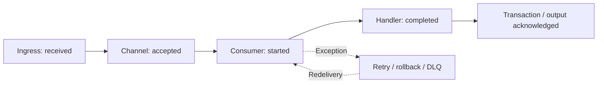
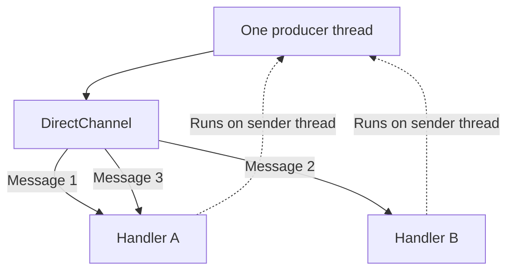
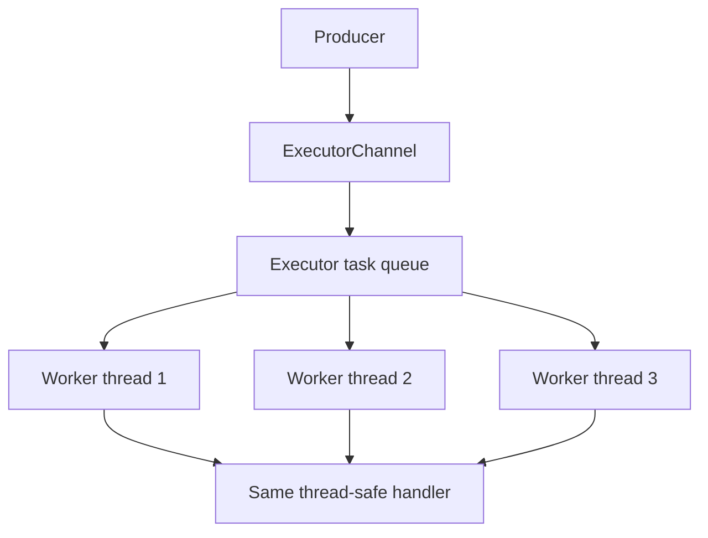
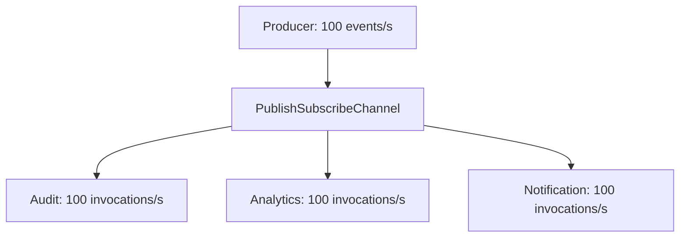
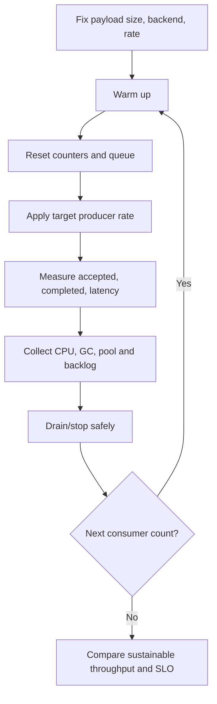
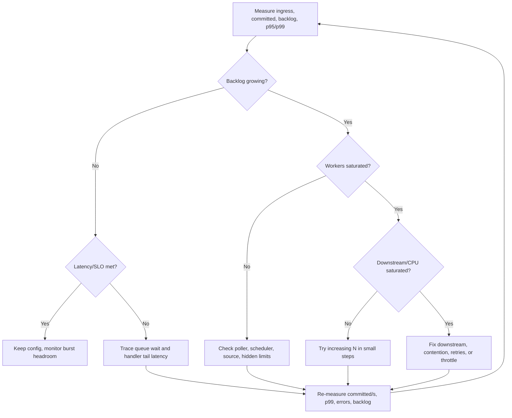

# Throughput by channel and consumer count in Spring Integration

## 1. Why does the same message volume produce different throughput?

Suppose a system receives 300 order-processing commands per second. A handler takes an average of 40 ms to call a downstream service. With only one worker processing sequentially, the handler's theoretical capacity is around 25 messages/second; if the producer keeps sending 300 messages/second, backlog will grow. Adding consumers can improve processing speed, but only until hitting limits in CPU, database connection pools, external APIs, schedulers, locks, or the channel structure itself.

The article **“Throughput by channel and consumer count”** belongs to the **Performance** chapter of the **SPRING_INTEGRATION_RUNTIME** module. The module studies message flows, channels, endpoints, consumers, pollers, and executors; IntegrationFlow lifecycle, transactions, retries, message stores, errors, correlation, and threading diagnostics. Here, the focus is on **measuring accurately** and **scaling processing capacity in a controlled way** — not assuming that adding more threads automatically makes an application faster.

After this lesson, you will be able to:

1. Distinguish **producer send rate**, **channel acceptance rate**, **handler completion rate**, and **business effect commit rate**.
2. Understand the impact of `DirectChannel`, `ExecutorChannel`, `QueueChannel`, `PublishSubscribeChannel`, and `PartitionedChannel` on threading, ordering, and backpressure.
3. Distinguish **subscribed handler count**, **polling consumer count**, **executor thread count**, and **transport adapter concurrency**.
4. Use throughput-bound formulas, Little's Law, and queue-growth equations to choose an initial consumer count.
5. Configure bounded queues, thread pools, pollers, `maxMessagesPerPoll`, and measure end-to-end latency meaningfully.
6. Locate bottlenecks via Micrometer, queue depth, p95/p99, retries, rollbacks, and downstream system limits.

> **API Scope:** Examples use Spring Integration **6.5.x**, Spring Framework 6.x, and Java 17+. Performance numbers in this article are **hypothetical for calculation**, not actual benchmark results of a Spring Integration release.

## 2. Define throughput properly before optimizing

A pipeline has several distinct milestones:



| Metric | Definition | When is it misleading? |
| --- | --- | --- |
| `ingressRate` | Number of new messages entering the application/second. | Excludes broker-redelivered messages if only counting new upstream events. |
| `acceptedRate` | Number of `send()` calls accepted by the channel/second. | `QueueChannel.send()` may only **enqueue**, not process yet. |
| `startRate` | Number of times a handler starts/second. | Retries give one business event multiple invocations. |
| `completionRate` | Number of handler invocations completing/second. | The handler may return normally while the transaction rolls back in a later step. |
| `businessCommitRate` | Number of **unique** business events committed/acknowledged per contract per second. | Requires business keys and commit state; cannot be measured from a channel counter alone. |
| `error/retryRate` | Number of exceptions/retry attempts/second. | Not new traffic; if too high, useful throughput drops. |

**Preferred throughput KPI:** the number of **valid business events successfully processed and confirmed** per unit of time, alongside error rate, latency, and backlog depth. If a consumer invokes a handler three times due to retries and commits once, do not report triple throughput.

### 2.1. Fundamental formulas

Let:

- `λ` (lambda): rate at which messages **enter** the queue, in messages/second.
- `μ` (mu): rate at which **one consumer** can complete messages, in messages/second, with no resource contention.
- `N`: number of consumers able to work concurrently.
- `C_downstream`: practical limit of the database/API/broker or slowest stage.
- `B(t)`: backlog length at time `t`.

Given mean service time `S` (seconds/message), if a consumer processes sequentially without major overhead:

\[
\mu \approx \frac{1}{S}
\]

**Simplified** sustainable throughput bound:

\[
T_{\mathrm{useful}} \lesssim
\min(\lambda,\;N\mu,\;C_{\mathrm{downstream}},\;
C_{\mathrm{CPU}},\;C_{\mathrm{connection}},\ldots)
\]

When the arrival rate is steady and exceeds the completion rate:

\[
\frac{dB}{dt} \approx \lambda - T_{\mathrm{useful}}
\]

This bound is only a **capacity estimate**; it does not precisely model dispatcher overhead, service-time distributions, contention, batching, retries, or per-key ordering. Adding threads can cause `S` to **increase** due to resource contention.

### 2.2. Little's Law: throughput, concurrency, and latency

In a steady-state system:

\[
L = \lambda_{\mathrm{effective}} W
\]

Where `L` is the average number of work items in the system, `λ_effective` is the steady-state completed throughput, and `W` is the average time a work item spends in the system (including queueing + processing).

For example, a system completing 100 events/second with a mean end-to-end time of 0.2 seconds has an average of about 20 events in the pipeline. Little's Law does **not** let you plug an ingress rate of 300/second into a system accumulating an unbounded backlog and conclude latency is simply in-flight count divided by 300. It requires steady state and consistent observation.

**p95/p99 latency** is especially important: a 40 ms mean with a 1,000 ms p99 holds many workers busy for long periods; actual capacity then diverges sharply from `1/mean` when resources are scarce or queues are long.

## 3. Same message: how do different channel types handle it?

| Channel | Delivery and threading | How do multiple consumers affect it? | Backpressure or risks |
| --- | --- | --- | --- |
| `DirectChannel` | Point-to-point, calls **one** subscribed handler on the **sender thread**; no internal queue. | Multiple subscribed handlers are selected by the dispatcher (round-robin by default); **does not create multiple threads**. | Producer is blocked by slow handlers; caller bears latency, and exceptions/transactions share the same thread. |
| `ExecutorChannel` | Point-to-point; submits tasks to a `TaskExecutor` and processes asynchronously. | A single subscriber can still run in parallel across multiple executor threads if the handler is thread-safe; multiple subscribers are target selection, **not broadcast**. | Executor queue full/rejection, lost transaction boundary, successful send does not mean processing finished. |
| `QueueChannel` | Point-to-point with a queue; producer enqueues and consumer/poller receives later. | Multiple polling consumers compete to dequeue; each message is normally delivered to **one** consumer. | Unbounded queues easily cause OOM; bounded queues may block sender/timeout; persistent stores incur I/O cost. |
| `RendezvousChannel` | Direct handoff between sending and receiving threads, no buffer. | Multiple receivers can wait for handoff; does not become broadcast. | Producer must wait for a receiver; throughput is limited by matching. |
| `PublishSubscribeChannel` | Broadcasts one message to **all** subscribers (synchronous by default, or via an executor). | Adding subscribers **increases total work**, rather than load-sharing each event. | Fan-out increases total work and latency; failure in one branch impacts others depending on error handling. |
| `PartitionedChannel` (since 6.1) | Point-to-one; dispatches by partition key to a partition's single-thread executor. | Adding partitions lets different keys run in parallel while **preserving order per key within a partition**. | Hot keys/partition skew limit throughput; unstable partition keys can break ordering. |

It is essential to distinguish:

- **Competing consumers:** multiple workers pull work from **the same queue** or multiple handlers subscribe to a `DirectChannel`; one event picks one processing target.
- **Fan-out subscribers:** multiple handlers subscribe to a `PublishSubscribeChannel`; **each event triggers multiple branches**. With 3 subscribers and 100 events/s, total handler invocations may be ~300/s, while new event throughput remains 100/s.
- **Executor concurrency:** the number of threads in an executor determines how many handler invocations run concurrently, even with only one subscribed handler.
- **Transport concurrency:** JMS/AMQP/Kafka adapters typically have their own listener/container concurrency and partition/ack semantics; do not infer it from the number of `MessageHandler` beans in Spring Integration.

## 4. DirectChannel: multiple handlers do not mean multiple threads

`DirectChannel` uses a point-to-point dispatcher; by default when multiple handlers subscribe, it uses a round-robin strategy with failover support. Each `send()` picks one handler and executes it on the calling `send()` thread. If a single producer sends sequentially, it **cannot dispatch the next message** while the current handler is still running.



The diagram only illustrates **sequential** ordering; H1 and H2 are not running in parallel on two threads.

### 4.1. Example counting invocations across two subscribers

```java
import java.util.concurrent.atomic.AtomicInteger;
import org.springframework.integration.channel.DirectChannel;
import org.springframework.messaging.support.GenericMessage;

public class DirectChannelDispatchExample {
    public static void main(String[] args) {
        DirectChannel input = new DirectChannel();
        AtomicInteger handledByA = new AtomicInteger();
        AtomicInteger handledByB = new AtomicInteger();

        input.subscribe(message -> handledByA.incrementAndGet());
        input.subscribe(message -> handledByB.incrementAndGet());

        for (int i = 0; i < 100; i++) {
            boolean accepted = input.send(new GenericMessage<>(i));
            if (!accepted) {
                throw new IllegalStateException("Dispatch failed");
            }
        }

        int total = handledByA.get() + handledByB.get();
        if (total != 100) {
            throw new AssertionError("One message must reach one handler");
        }
        // With both handlers succeeding and default round-robin,
        // typically A=50, B=50; do not treat this as a 200-call fan-out.
    }
}
```

If the dispatcher has failover enabled and handler A throws an exception, the dispatcher may try handler B **for the same message** depending on the strategy. When measuring throughput, distinguish between handler A/B invocations and unique completed business events; side effects that occurred before the exception might be repeated in the other handler.

### 4.2. When is DirectChannel an effective choice?

- Short, CPU-light handlers that need no buffering and want minimal scheduling/queue overhead.
- Preserving an active transaction on the producer thread for **synchronous** downstream steps.
- Needing synchronous error feedback to a gateway or caller and natural backpressure (the producer is blocked inside the handler).

**Do not expect speedup just by adding two subscribers** if the producer still has one thread and every handler runs synchronously. For real parallelism, you need multiple producer threads, `ExecutorChannel`, polling consumer concurrency, or controlled partitioning.

### 4.3. Impact on transactions and latency

If a producer opens a transaction and sends via `DirectChannel`, a synchronous handler can participate in the same transaction when using compatible managers/resources. This aids atomicity but also lengthens transaction hold times if the handler is slow. Increasing producer concurrency without increasing the connection pool may simply move the bottleneck from threads to the DB.

## 5. ExecutorChannel: a single handler can still run on multiple workers

`ExecutorChannel` uses a `TaskExecutor` for asynchronous point-to-point dispatch. Unlike `DirectChannel`, `send()` typically returns after submitting the task to the executor, **before the handler finishes**.



**One subscriber + three worker threads** can process three different messages concurrently. **Three subscribers + one worker thread** will not execute three messages in parallel. Adjust the *pool concurrency* appropriately, and do not confuse it with *subscriber count*.

### 5.1. Bounded executor example measuring completion, not just send

The plain Java example below uses the Spring Integration channel API. It creates a simulated 10 ms/message workload to show the boundary; **it is not a production benchmark**.

```java
import java.util.concurrent.CountDownLatch;
import java.util.concurrent.TimeUnit;
import java.util.concurrent.ThreadPoolExecutor;
import java.util.concurrent.atomic.AtomicInteger;
import java.util.concurrent.locks.LockSupport;

import org.springframework.integration.channel.ExecutorChannel;
import org.springframework.messaging.support.GenericMessage;
import org.springframework.scheduling.concurrent.ThreadPoolTaskExecutor;

public class ExecutorThroughputDemo {
    public static void main(String[] args) throws InterruptedException {
        int messages = 200;
        AtomicInteger completed = new AtomicInteger();
        CountDownLatch allDone = new CountDownLatch(messages);

        ThreadPoolTaskExecutor pool = new ThreadPoolTaskExecutor();
        pool.setThreadNamePrefix("orders-worker-");
        pool.setCorePoolSize(4);
        pool.setMaxPoolSize(4);
        pool.setQueueCapacity(256);
        pool.setRejectedExecutionHandler(
                new ThreadPoolExecutor.AbortPolicy());
        pool.initialize();

        try {
            ExecutorChannel channel = new ExecutorChannel(pool);
            channel.subscribe(message -> {
                try {
                    // Simulates I/O latency only: do not use to measure CPU.
                    LockSupport.parkNanos(TimeUnit.MILLISECONDS.toNanos(10));
                    completed.incrementAndGet();
                }
                finally {
                    allDone.countDown();
                }
            });

            long started = System.nanoTime();
            for (int i = 0; i < messages; i++) {
                if (!channel.send(new GenericMessage<>("order-" + i))) {
                    throw new IllegalStateException("Channel rejected message");
                }
            }

            if (!allDone.await(10, TimeUnit.SECONDS)) {
                throw new IllegalStateException(
                        "Some accepted messages are still in-flight");
            }
            double elapsed = (System.nanoTime() - started) / 1_000_000_000.0;
            double completedPerSecond = completed.get() / elapsed;

            System.out.printf(
                    "completed=%d, elapsed=%.3fs, throughput=%.1f msg/s%n",
                    completed.get(), elapsed, completedPerSecond);
        }
        finally {
            pool.shutdown();
        }
    }
}
```

Measuring from before the first send until **after the last message finishes** avoids confusing “time to enqueue 200 tasks” with “time to process 200 tasks”. In a real application, handler success does not guarantee business commit; add transaction/ack metrics.

**Do not assert a fixed throughput number in CI** for the example above: CI machine CPU, JIT, GC, scheduler, container quota, and I/O vary. The goal is to measure with the same protocol while varying worker count from 1 → 2 → 4 → 8 and inspect the **empirical** scaling ratio.

### 5.2. Why might max=20 not run 20 threads?

With `ThreadPoolTaskExecutor` using a positive queue capacity, the thread pool typically prioritizes:

1. Creating up to `corePoolSize` threads.
2. Putting tasks into the executor queue while space remains.
3. Scaling up toward `maxPoolSize` only when the queue is full.
4. Applying the rejection policy when both pool and queue are full.

For example, with `corePoolSize=4, maxPoolSize=20, queueCapacity=10_000`: under many load levels, the application may still only have four active workers because the task queue has not filled up. Do not look at `maxPoolSize=20` and conclude actual concurrency is 20; measure `activeCount`, pool size, and executor queue depth.

### 5.3. Backpressure and rejection policies

| Policy when executor is full | Impact | Risks to test |
| --- | --- | --- |
| `AbortPolicy` | Rejects task and usually throws `TaskRejectedException`/wrapper. | Producer/adapter must have retry, rollback, or error reporting; never silently drop messages. |
| `CallerRunsPolicy` | Caller executes the task itself when the pool is full. | Creates backpressure but shifts processing onto the producer thread, changing latency and **transaction boundaries** unpredictably. |
| `DiscardPolicy` / `DiscardOldestPolicy` | May drop tasks according to configuration. | **Not** suitable for business messages requiring durable processing unless intentional loss is part of the contract. |
| Custom policy/blocking queue | Throttles according to capacity. | Requires timeouts, avoiding upstream/downstream deadlocks, and monitoring. |

Never design a flow with the absolute assumption that “ExecutorChannel is always asynchronous”; `CallerRunsPolicy` can run handler calls on the sender thread when resources are exhausted. Spring Integration does not guarantee transactions span across an executor consistently.

## 6. QueueChannel: buffering and competing polling consumers

`QueueChannel` holds messages for a consumer to retrieve later. A producer can send quickly, but **queue length only masks the gap between producer and consumer temporarily**—it does not increase processing capacity on its own.

### 6.1. Bounded and unbounded queues

```java
import org.springframework.integration.channel.QueueChannel;
import org.springframework.messaging.Message;
import org.springframework.messaging.support.GenericMessage;

QueueChannel queue = new QueueChannel(100); // Bounded capacity.

Message<String> event = new GenericMessage<>("order-42");
boolean accepted = queue.send(event, 500); // Wait up to 500 ms if queue is full.
if (!accepted) {
    // Caller must have an explicit retry/timeout/rollback policy.
}
```

When the queue is below capacity, `send()` can return very quickly without any handler running yet. When full, `send(message, timeout)` blocks until space is available or the timeout expires; with timeout 0 it can return immediately if there is no space. The constructor without capacity creates a queue with a very large default limit, easily causing out-of-memory errors when consumers are slow. To survive restarts, use a persistent backing store; the default in-memory queue does not guarantee message retention across crashes.

**Backpressure can be beneficial:** slowing down the producer when receivers are overloaded instead of growing an unbounded backlog. However, you must measure producer latency, `send() == false` rates, and decide whether upstream can retry or must signal overload.

### 6.2. Two polling consumers competing on one queue

Java DSL example with **two distinct endpoints**, both receiving from `ordersQueue`. Each endpoint has its own poller, making these genuinely **two competing polling consumers**:

```java
import java.time.Duration;
import java.util.concurrent.atomic.AtomicInteger;

import org.springframework.context.annotation.Bean;
import org.springframework.context.annotation.Configuration;
import org.springframework.integration.annotation.EnableIntegration;
import org.springframework.integration.channel.QueueChannel;
import org.springframework.integration.dsl.IntegrationFlow;
import org.springframework.integration.dsl.Pollers;
import org.springframework.messaging.PollableChannel;

@Configuration
@EnableIntegration
class CompetingPollersConfiguration {

    static class Worker {
        final AtomicInteger completed = new AtomicInteger();

        public void process(String payload) {
            // Real logic might write to DB or perform I/O then return.
            completed.incrementAndGet();
        }
    }

    @Bean
    PollableChannel ordersQueue() {
        return new QueueChannel(500);
    }

    @Bean
    Worker ordersWorker() {
        return new Worker();
    }

    @Bean
    IntegrationFlow consumerA(Worker ordersWorker) {
        return IntegrationFlow.from("ordersQueue")
                .handle(ordersWorker, "process",
                        e -> e.id("consumerAEndpoint")
                                .poller(Pollers
                                        .fixedDelay(Duration.ofMillis(100))
                                        .maxMessagesPerPoll(20)
                                        .receiveTimeout(0)))
                .get();
    }

    @Bean
    IntegrationFlow consumerB(Worker ordersWorker) {
        return IntegrationFlow.from("ordersQueue")
                .handle(ordersWorker, "process",
                        e -> e.id("consumerBEndpoint")
                                .poller(Pollers
                                        .fixedDelay(Duration.ofMillis(100))
                                        .maxMessagesPerPoll(20)
                                        .receiveTimeout(0)))
                .get();
    }
}
```

Key points:

- Two `PollingConsumer` instances on **the same queue** compete for messages; each message is returned by one `receive()` call to one consumer, not broadcast to both.
- Each endpoint has `maxMessagesPerPoll(20)`, so it can process up to 20 messages in **a single poll cycle of that endpoint**; total throughput still depends on cycle duration, scheduler, and handler.
- The `Worker` handler is a shared singleton. `AtomicInteger` is thread-safe for counting; real business logic must likewise avoid unsynchronized mutable state.
- `receiveTimeout(0)` prevents each poller from holding a thread when the queue is temporarily empty.
- Each poller runs on its own schedule; **an exact 50/50 split is not guaranteed** due to scheduler timing, processing duration, contention, and uneven message arrivals.

### 6.3. Poller limit does not equal messages/second

Suppose a `PollingConsumer` sequentially processes 20 messages, each handler taking 10 ms, with `fixedDelay(500 ms)`. Ignoring overhead:

\[
\text{poll duration} \approx 20 \times 0.010 = 0.200\text{ s}
\]

\[
\text{cycles per second} \approx
\frac{1}{0.500 + 0.200} \approx 1.43
\]

\[
\text{throughput} \approx 20 \times 1.43 = 28.6\text{ msg/s}
\]

You cannot mechanically compute `20 / 0.5 = 40 msg/s` because fixed delay starts after the poll cycle completes. Two pollers could ideally raise throughput toward 57 msg/s, but **only if** each poller actually has scheduler capacity, DB/APIs have enough capacity, there is no lock contention, and workload is always available.

When the queue is often empty, the poller may stop its `receive()` loop early; `maxMessagesPerPoll` is only an **upper bound**, not a guaranteed number of messages received.

### 6.4. Consumer count and poller thread pool are two different concepts

A polling endpoint can use `PollerSpec.taskExecutor(executor)` to dispatch poll tasks. However, simply adding a multi-threaded executor **does not by itself prove** that multiple poll cycles or multiple messages run concurrently: you must inspect the Trigger, `TaskScheduler`, `maxMessagesPerPoll`, task duration, and overlap behavior. Conversely, two endpoints with separate pollers on one queue are genuinely two **competing consumers**, though they can still be constrained by the scheduler thread pool.

For broker listener concurrency (JMS/AMQP/Kafka), tune container/partition concurrency on **the specific adapter**, rather than assuming the same syntax/polling behavior as `QueueChannel`.

### 6.5. Persistent queues trade off performance

When a `QueueChannel` is backed by `JdbcChannelMessageStore` or a persistent broker:

- Enqueue/dequeue requires DB/broker I/O, serialization, indexing, and transactions; latency differs from an in-memory queue.
- A poller transaction can wrap `receive()` + DB writes so rollbacks restore the message; this improves safety but increases connection/lock hold duration.
- Multiple consumers can contend on the same DB locks/partitions; past a threshold, throughput **drops** due to contention.
- Crashes/redeliveries can invoke the handler multiple times; you must measure **unique business commits**, not just dequeue counts.

Therefore, in-memory QueueChannel benchmarks serve only as orchestration baselines; they cannot directly predict throughput for JDBC stores or production JMS/AMQP.

## 7. PublishSubscribeChannel and PartitionedChannel: different load-sharing problems

### 7.1. Publish–subscribe multiplies work rather than adding load-sharing consumers

With `PublishSubscribeChannel`, **each message** is sent to multiple subscribers. If there are three handlers `Audit`, `Analytics`, and `Notification`, then 100 business events/second can produce 300 handler invocations/second. Reporting “throughput 300/s” is wrong when the goal is **100 inbound events completed**.



By default without an executor, `PublishSubscribeChannel` dispatches to subscribers on the sender thread. One slow subscriber can prolong `send()` and increase end-to-end latency. Adding a `TaskExecutor` lets subscribers run asynchronously, but a successful `send()` no longer proves all branches have completed.

```java
import java.util.concurrent.atomic.AtomicInteger;
import org.springframework.integration.channel.PublishSubscribeChannel;
import org.springframework.messaging.support.GenericMessage;

PublishSubscribeChannel events = new PublishSubscribeChannel();
AtomicInteger audit = new AtomicInteger();
AtomicInteger notify = new AtomicInteger();

events.subscribe(message -> audit.incrementAndGet());
events.subscribe(message -> notify.incrementAndGet());

for (int i = 0; i < 10; i++) {
    events.send(new GenericMessage<>("event-" + i));
}
// In the synchronous example: audit=10, notify=10.
// Business events are still 10, despite 20 handler invocations.
```

**MinSubscribers:** on `PublishSubscribeChannel`, `minSubscribers` defaults to 0. Thus a producer may consider a send successful even if no subscriber received the event, depending on configuration. If all branches are mandatory, you need a delivery/error contract and an appropriate `minSubscribers`; when using an executor, confirming subscriber count **does not** mean they processed successfully.

**Fan-out throughput** depends on the definition of completion:

- If only branch A is required, measure A's completion; other branches have their own SLAs.
- If A/B/C are all required, end-to-end latency is typically governed by the slowest branch when running in parallel, or the sum of durations when running sequentially.
- If branch B retries multiple times, total handler invocations rise while inbound event count remains unchanged.

### 7.2. PartitionedChannel when ordering by business key is required

Since Spring Integration 6.1, `PartitionedChannel` supports dispatching to single-thread executors partitioned by key. Messages with **the same partition key** go to the same thread, preserving processing order within the partition while different keys can run in parallel.

```java
import org.springframework.integration.channel.PartitionedChannel;
import org.springframework.messaging.SubscribableChannel;

SubscribableChannel byCustomer = new PartitionedChannel(
        4, message -> message.getHeaders().get("customerId"));
```

Suppose there are four partitions: if 80% of traffic belongs to a single `customerId`, that partition can bottleneck while the other three remain idle. Increasing the partition count sometimes reduces collisions between keys, **but it cannot split a hot key across multiple workers** when per-key sequential ordering is required.

**Measuring total threads alone is not enough**. With partitioning, monitor backlog/latency per partition or bounded-cardinality key group, load skew (*skew*), and hot-key ratios. Avoid putting raw customerIds directly into metric labels.

### 7.3. FixedSubscriberChannel: overhead optimization for very narrow cases

Spring Integration provides `FixedSubscriberChannel` for cases with **a single fixed subscriber** that do not need dynamic subscriber management or channel interceptors. It can reduce dispatcher overhead on hot paths. Do not apply it mechanically: if the flow needs interceptors, specialized tracing, or runtime consumer changes, verify required functionality before swapping channels for small throughput gains. **Run actual benchmarks** before optimizing this part.

## 8. How far should you scale consumer count?

Increasing `N` only helps when **handler concurrency itself** is the throughput bottleneck, downstream still has headroom, and the workload can run concurrently without violating ordering/transaction/idempotency guarantees.

### 8.1. Initial estimate from service time and utilization

If the target is `λ_target` events/s, mean service time is `S` seconds/event, and you want to use no more than `U_target` of worker capacity to keep headroom:

\[
N_{\mathrm{estimate}} =
\left\lceil \frac{\lambda_{\mathrm{target}} S}
{U_{\mathrm{target}}} \right\rceil
\]

For example, `λ_target=100/s`, `S=40 ms = 0.04s`, and `U_target=0.7`:

\[
N_{\mathrm{estimate}}=
\left\lceil \frac{100\times0.04}{0.7}\right\rceil
= 6
\]

Six workers is a **hypothesis to benchmark**, not a configuration guaranteed to meet the SLA. If the external API only accepts 50 requests/s, or the DB pool allows only 4 busy connections at once, adding workers will not achieve 100 successful events/s.

**Practical rule:** choose the smallest N that meets the target throughput and p95/p99 latency with stable error/retry rates and backlog. Sustaining 100% CPU continuously is not a good target when bursts or GC must be absorbed.

### 8.2. CPU-bound and I/O-bound workloads do not scale the same way

| Workload | Symptoms | Tuning direction |
| --- | --- | --- |
| CPU-bound (parse, transform, encrypt) | CPU cores busy; adding threads increases context switching and flattens throughput. | Worker count near CPU quota/usable cores; profiling/hotspots/algorithms; avoid allocations. |
| I/O-bound (HTTP, JDBC, file) | Threads waiting on I/O, CPU mostly idle. | Can increase concurrency while respecting connection pools, rate limits, timeouts, downstream quotas. |
| Lock/contention-bound | Lock waits/deadlocks rise, high p99, CPU not necessarily saturated. | Shrink critical sections, partition by key, shorten transactions, change store/indexes. |
| Scheduler-bound | Pollers run few cycles, backlog remains despite fast handlers. | Check `fixedDelay`, `maxMessagesPerPoll`, scheduler pool, and `receiveTimeout`. |
| Persistence-bound | Slow JDBC/broker inserts/deletes/commits. | Appropriate batching, indexes, DB tuning, connection pool, transaction design. |
| Retry-bound | Many attempts per business event, workers held by backoff. | Cap retries, circuit breakers, DLQ/quarantine, error classification. |

### 8.3. When a pipeline has multiple stages

A flow with three sequential stages:

```text
Validate  ->  Enrich from DB  ->  Send external API
  600/s           250/s               400/s
```

For stages with independent capacities and no message multiplication/splitting, sustainable end-to-end throughput cannot exceed **the slowest stage**: here ~250/s. Adding consumers to Validate (already at 600/s) may cause the queue before Enrich to grow faster without increasing the business completion rate.

For aggregators, resequencers, and flows with release/correlation conditions, output throughput does not necessarily equal input throughput (many input messages → one result). Measure in **corresponding business units** rather than comparing two raw counters without accounting for grouping ratios.

### 8.4. Does batching help or hurt?

A consumer processing 100 messages as a batch can reduce network/DB transaction overhead, but:

- Overly large batches increase latency for the first message and lengthen transactions and connection/lock hold times.
- A single error can roll back the whole batch and retry all 100 messages; duplicate handling becomes more complex.
- If only one partition has data, batching may not increase parallelism.
- `maxMessagesPerPoll=100` does not automatically combine 100 messages into one SQL batch. It only lets the polling endpoint **loop up to 100 receive/process operations in one cycle**. For JDBC batching, you must explicitly design the store/handler accordingly.

Measure batch size alongside commits, business outcomes, p95/p99, lock wait, and rollback amplification before concluding it is better.

## 9. Designing a fair benchmark

A benchmark of throughput by channel and consumer count should answer: **holding the same workload and downstream system constant, how do changing channel/N affect completed business events per second, latency, and resource consumption?**

### 9.1. Before running

1. **Fix the workload:** payload/header sizes, per-key message distribution, CPU/I/O split, error rates, timeouts, and retry policy.
2. **Fix the system:** Java/JVM/GC, Spring Integration version, CPU cores/container quota, heap, DB pool, network, broker partitions, scheduler, and executor settings.
3. **Choose measurement points:** from ingress accepted to business commit/ack for end-to-end; also measure queue wait and handler execution to pinpoint bottlenecks.
4. **Choose load model:** fixed input rate (*open-loop*) or workers waiting for results before sending next (*closed-loop*). The two can yield different throughput/latency profiles.
5. **Bound the load:** finite queue/executor capacities and timeouts; do not trigger `OutOfMemoryError` just to find saturation.
6. **Isolate the environment:** use a stable mock source for baselines and a real test backend for I/O conclusions; never hit a production payment API.
7. **Warm up and repeat:** let JIT, pools, and caches stabilize, run multiple times, record distributions and variance; never rely on a single nice sample.

### 9.2. Suggested test matrix

| Scenario | Channel/consumer | Independent variable | Metrics to collect |
| --- | --- | --- | --- |
| D1 | `DirectChannel` + 1 handler | Producer threads 1, 2, 4, 8 | Completed/s, sender latency, handler p99, CPU. |
| D2 | `DirectChannel` + 2 subscribed handlers | Fixed producers | Dispatcher distribution, failover, actual concurrency. |
| E1 | `ExecutorChannel` + 1 handler | Executor core threads 1, 2, 4, 8 | Completed/s, queue wait, active count, rejected tasks. |
| E2 | `ExecutorChannel` | Queue capacity 32, 128, 512 | Producer blocking/rejection, p99, and memory. |
| Q1 | Bounded `QueueChannel` + poller | 1, 2, 4, 8 competing endpoints | Receive/commit rate, backlog, oldest age, scheduler CPU. |
| Q2 | Poller | `maxMessagesPerPoll` 1, 10, 50, 100 | Throughput, fairness, poll duration, lock hold time. |
| P1 | `PublishSubscribeChannel` | Subscribers 1, 2, 3 | Business events/s **and** handler invocations/s. |
| K1 | `PartitionedChannel` | Partitions 2, 4, 8; key skew | Per-partition lag, ordering, and throughput. |
| S1 | JDBC-backed queue | N consumers + pool size + transaction | DB commits/s, lock wait, redelivery, I/O. |

### 9.3. Measurement sequence at each N



To avoid measuring only how fast messages are pushed into a buffer, **do not end the benchmark when the producer finishes sending**; wait until every message is processed, intentionally rejected, or past its deadline with outcomes recorded. For continuous-load benchmarks, record both send and completion rates within a steady-state window alongside backlog change. Never treat `accepted/s` as `completed/s` while `B(t)` is growing.

### 9.4. Illustrative data (not an actual benchmark)

With a 40 ms I/O latency workload, fast-enough downstream, and no initial contention:

| N workers | Theoretical capacity `N / 0.04` | Measured throughput | Assessment |
| ---: | ---: | --- | --- |
| 1 | 25 msg/s | *Must measure* | Baseline. |
| 2 | 50 msg/s | *Must measure* | May nearly double if purely I/O-bound. |
| 4 | 100 msg/s | *Must measure* | Watch DB pool and rate limits. |
| 8 | 200 msg/s | *Must measure* | May hit downstream capacity before 200. |
| 16 | 400 msg/s | *Must measure* | May increase contention/retries and even lower throughput. |

Never fill in “actual” throughput numbers without running the benchmark. The gap between theoretical capacity and measured numbers reveals whether you are hitting scheduler, contention, network, or downstream limits.

## 10. Observing throughput and consumer count with Micrometer

Spring Integration 6.5 provides metrics and observations to monitor channels, handlers, and message sources. Distinguish **legacy Micrometer meters** from **Micrometer Observation** (used for metrics and tracing depending on configuration).

### 10.1. Common Spring Integration meters

According to Spring Integration 6.5 documentation, when a `MeterRegistry` is in the application context, the framework supports:

| Meter | Type | Interpretation |
| --- | --- | --- |
| `spring.integration.send` with tag `type=channel` | Timer | Channel `send()` duration, tagged with component name, result, exception. |
| `spring.integration.send` with `type=handler` | Timer | Processing time in instrumented framework handlers. |
| `spring.integration.receive` with `type=channel` | Counter | Receive count from pollable channels, categorized by success/failure. |
| `spring.integration.receive` with `type=source` | Counter | Number of messages returned successfully by a message source. |
| `spring.integration.channel.queue.size` | Gauge | Current number of messages waiting in a `QueueChannel`. |
| `spring.integration.channel.queue.remaining.capacity` | Gauge | Remaining queue capacity. |
| `spring.integration.channels`, `handlers`, `sources` | Gauges | Count of respective components in the application context. |

Do not infer that `spring.integration.send{type="channel"}` measures **full end-to-end handler time**: with `ExecutorChannel` or `QueueChannel`, `send()` usually measures dispatch/enqueue while the handler runs later. Likewise, `receive{type="channel"}` increments on retrieval and does not automatically confirm a business commit.

When reading timers/counters on a dashboard, pay attention to:

- **Rate**: event count growth per unit time, not just cumulative total since process start.
- **Result and exception tags**: separate successful sends, failed sends, handler errors, and successful receives.
- **Queue size and remaining capacity**: see whether backlog is growing/shrinking or full.
- **Handler duration p50/p95/p99**: tell whether workers are being held by tail latency.
- **Custom business commit counter**: unique successes by business key, which cannot be replaced by channel send counts.

### 10.2. Micrometer Observation and tracing

Since Spring Integration 6.0, `ObservationRegistry` is supported. To instrument components via Observation, you need an `ObservationRegistry` and `@EnableIntegrationManagement` configured with appropriate `observationPatterns`. By default, not all `IntegrationManagement` components are instrumented via Observation. Example:

```java
import org.springframework.context.annotation.Configuration;
import org.springframework.integration.annotation.EnableIntegration;
import org.springframework.integration.config.EnableIntegrationManagement;

@Configuration
@EnableIntegration
@EnableIntegrationManagement(observationPatterns = "*")
class IntegrationObservabilityConfiguration {
    // Application needs an ObservationRegistry bean and appropriate handlers/exporters.
}
```

When using Micrometer Observation, the 6.5 documentation describes timers such as `spring.integration.handler`, `spring.integration.producer`, and `spring.integration.gateway`, along with `.active` long-task timers following current conventions. **Do not double-count** totals from both legacy meters and observations to report double throughput; they may reflect the same invocation.

**Tracing:** enabling observation on producers/channels and appropriate consumers helps track messages across executors or persistent stores because trace context can travel in headers. However, tracing adds overhead and does not replace business idempotency/commit evidence. With fan-out, one trace can contain multiple handler spans; do not mistake span counts for unique event counts.

### 10.3. Custom metrics for business throughput

A counter placed right **after commit/ack** or derived from a committed outbox/inbox table is far clearer than a counter at the start of the flow:

```text
business_events_committed_total{
  flow="orders",
  outcome="success"
}

business_events_failed_total{
  flow="orders",
  category="validation"
}
```

These are **application-defined metric names**, not built-in framework metrics. Count according to the event's uniqueness contract; with JDBC transactions, be careful if incrementing a counter before commit and then rolling back (the counter incremented while the business record did not commit). You can emit measurements via a transactional outbox or define separate “attempt succeeded” and reconciled commit-rate counters.

**Cardinality:** do not put `eventId`, `orderId`, `correlationId`, or every individual tenant into metric labels if the value set is large. Use controlled traces/logs to trace individual events; aggregate metrics by flow, endpoint, error category, and tier.

### 10.4. Observation table from symptom to bottleneck

| Symptom | Metric signal | Hypothesis to test |
| --- | --- | --- |
| High ingress, low completion, steadily growing queue | Accepted/s > committed/s; queue size rising. | Too few consumers or downstream bottleneck. |
| Increasing N does not increase commits | Active workers rise; DB wait/CPU/retries rise. | Downstream or contention is already saturated. |
| Producer send fast but SLA slow | Channel send p95 low, queue wait/handler p99 high. | Measuring only enqueue time. |
| Producer blocks or send=false | Bounded queue full, remaining capacity=0. | Backpressure active; upstream needs throttling/proper retry. |
| Executor max high but active low | Deep executor queue, pool stays at core size. | Core/queue tuning; max threads not engaged yet. |
| Poller runs infrequently, queue stays long | Large poll interval, low maxMessagesPerPoll, or too few scheduler threads. | Poller/scheduler limit. |
| Handler processing surges, commits do not | Retries/errors/deadlocks rising. | Retry amplification or poison events. |
| One partition has large backlog | Skewed key distribution, other partitions idle. | Hot key/ordering constraint, not lack of global threads. |
| Fan-out total handler calls grow | More subscribers, business event count flat. | Metric is counting invocations instead of events. |
| Increasing concurrency spikes p99 sharply | Locks, GC, connection pool waits, rate limiting. | Past saturation point; reduce N. |

## 11. Transactions, retries, and error handling alter useful throughput

A high thread count can increase **attempts** while reducing **successful commits** due to DB deadlocks, upstream retries, and downstream timeouts.

### 11.1. Retry amplification

Suppose a business event averages 1.5 attempts before succeeding. To complete 100 events/second, the handler must handle at least ~150 attempts/second, excluding side effects, transactions, and backoff. If 10% of events retry three times and 90% succeed immediately:

\[
E[\mathrm{attempts}] = 0.9\times1+0.1\times3=1.2
\]

To finish 100 **events/s**, the handler may need roughly 120 **attempts/s**. If both broker redelivery and `RequestHandlerRetryAdvice` retry, total attempts can be even higher. Therefore, when scaling consumer count, keep the retry policy identical for a fair throughput comparison.

### 11.2. Where does backoff consume resources?

With synchronous retries, a worker can hold its thread during backoff. If a handler spends 20 ms processing followed by three backoffs of 100, 200, and 400 ms, total worker hold time far exceeds CPU time. Adding workers may help somewhat, but when downstream is overloaded, retrying faster can worsen failures.

Consider error classification:

| Error type | Retry/backoff | Throughput observation |
| --- | --- | --- |
| Transient timeout while downstream recovers | Bounded attempts + backoff/jitter. | Useful throughput, waiting workers, and backlog. |
| Validation/permanent schema error | Do not retry pointlessly; quarantine/DLQ. | Keep a poison message from consuming poll cycles. |
| DB deadlock from too many consumers | Can retry transaction, but must reduce contention. | Error/rollback rates and lock wait. |
| External API outcome unknown | Idempotency + reconciliation before retrying. | One business effect, not just one reply. |

### 11.3. Transaction boundaries can be changed by the channel

`DirectChannel` keeps processing on the same thread, so the producer's transaction can cover synchronous downstream steps. `ExecutorChannel` introduces an async boundary; the sender's transaction **does not automatically propagate** to the worker. With a JDBC-backed `QueueChannel`, the transaction should wrap `receive()` and business data updates if rollbacks must restore the message. That is usually configured on the poller and must use the proper DataSource/transaction manager.

When using `PublishSubscribeChannel` with an executor or `PartitionedChannel`, branches may run on different threads; do not assume one transaction/JDBC connection automatically covers the entire fan-out. Throughput optimization must not break required atomicity contracts.

### 11.4. Correlation, ordering, and idempotency are real concurrency limits

An aggregator may need to wait for all messages sharing a `correlationId`; adding consumers will not complete groups faster if an upstream event has not arrived. When multiple threads update the same message group, the lock registry, store, and release strategy can become bottlenecks.

A workflow requiring **strict ordering per accountId** should not simply distribute messages for the same account across 16 arbitrary workers. Use key-based partitioning or per-key serialization, then measure key distribution and hot partitions. For message redelivery, use a stable idempotency key so side effects are not duplicated when an event is processed more than once.

### 11.5. IntegrationFlow lifecycle and scaling dynamics

When registering flows dynamically with `IntegrationFlowContext` or adding listeners/consumers at runtime, track **how many endpoints are actually running**. A registration that exists but is not started adds no processing capacity. Stopping a consumer can drop throughput immediately, though in-flight tasks may not stop instantaneously. When scaling down, drain/rebalance and inspect queues/transactions/acks instead of removing endpoints abruptly.

## 12. Case study: backlog grows even after scaling to 12 consumers

A system receives `λ=300 orders/s`, and the handler has mean service time `S=40 ms` without contention. Initially there are four workers; the database can commit at most ~180 orders/s under the current configuration. The bounded queue holds at most 2,000 messages.

**Step 1 — Compute theoretical worker ceiling:**

\[
\mu = 1/0.04 = 25\text{ orders/s/worker}
\]

With four workers:

\[
T_{\mathrm{workers}}(4) \approx 4\times25=100/s
\]

Useful ceiling:

\[
T_{\mathrm{useful}}(4)
\lesssim \min(300,100,180)=100/s
\]

**Step 2 — Estimate initial backlog growth:**

\[
\Delta B \approx 300-100=200\text{ messages/s}
\]

Starting from an empty queue and considering only the ideal average gap, time to fill the 2,000-message queue is roughly:

\[
t_{\mathrm{full}} \approx 2000/200=10\text{ s}
\]

In reality, overhead, bursts, p99 latency, and retries apply; this is not a guarantee the queue takes exactly 10 seconds to fill.

**Step 3 — Scale to 12 workers:**

Theoretical worker capacity is `12 × 25 = 300/s`, but the DB only achieves ~180/s:

\[
T_{\mathrm{useful}}(12)
\lesssim \min(300,300,180)=180/s
\]

The backlog still grows by about `300 - 180 = 120 messages/s`, and an empty queue could ideally fill in `2000/120 ≈ 16.7 seconds`. **12 workers do not meet the 300/s requirement** because the bottleneck shifted to the database.

**Step 4 — Choose a data-driven fix:**

- Measure `DB commit/s`, wait time, deadlocks, connection pool, and individual SQL durations. If the DB is truly saturated, shorten transactions, optimize queries/indexes, apply appropriate batching, or scale DB capacity.
- If the source supports backpressure, rate-limit input or use a bounded queue and return an overload signal that can be safely retried.
- If this is only a short burst, size queue capacity from **burst duration** and post-burst drain rate, along with required memory/durability.
- Do not blindly scale to 24 workers: it can worsen lock contention, retries, and p99, dropping useful throughput below 180/s.
- Under any strategy, prevent duplicate business event processing via idempotency keys or proper transaction/outbox patterns.

**Little's Law check after stabilization:** if ingress is throttled down to 150/s and the system steadily completes 150/s with a mean end-to-end time of 0.2 s, average in-flight work is around `L = 150 × 0.2 = 30`. While ingress remains 300/s, output is 180/s, and backlog grows indefinitely, do not apply Little's Law as though the system were in steady state.

### 12.1. Queue capacity and memory pressure

Suppose an average payload is 16 KiB/message; 2,000 messages take ~31.25 MiB for payload bytes alone; **headers, object overhead, queue nodes, GC metadata, and serializer buffers** make the real footprint larger. With an unbounded in-memory queue, a few minutes of backlog growth can cause GC pressure and OOM. With a persistent queue, instead of OOM this shifts into storage I/O/DB table growth and higher latency.

**A large queue absorbs bursts; it does not raise the sustainable throughput ceiling.** If `λ > T_useful` persists, every finite capacity eventually fills up.

## 13. Step-by-step tuning workflow in a real environment

### 13.1. Find the real bottleneck instead of guessing N



**Step 1:** confirm how many new events/second the source sends, message sizes, and error rates. Distinguish new ingress events from redelivery attempts.

**Step 2:** check channel semantics. If each event should be processed by only one handler, do not use `PublishSubscribeChannel`. If you want fast processing with synchronous backpressure, `DirectChannel` may fit. If buffering is required, queues must be bounded with an overflow policy.

**Step 3:** measure handler service time, queue depths, and thread counts. Compute an initial N from the formula while checking DB/API rate limits.

**Step 4:** increase N in small increments (1, 2, 4, 8...) while holding input rate, payload profile, and retry policy constant. Stop scaling when committed throughput stops improving or p99/errors breach the SLO.

**Step 5:** check scheduler/poller settings. Changing `maxMessagesPerPoll=1` to 20 can help if trigger overhead dominates, but it will not fix slow handler I/O or DB locks.

**Step 6:** verify failure handling. A fast configuration that loses messages on executor rejection, or reports success when recovery swallows errors, is **not** a valid optimization.

**Step 7:** document decisions and operational limits: optimal N, queue cap, send timeout, CPU quota, DB pool, max allowed input rate, alert thresholds, and load-shedding plan.

### 13.2. Adjusting configuration by signal

| If you observe... | Try adjusting | Do not overlook |
| --- | --- | --- |
| High DirectChannel sender latency | Inspect handler/blocking I/O; consider queue/executor if async is needed. | Transaction boundaries and reply/exception semantics will change. |
| Low executor active count, long queue | Core pool, queue capacity, rejection; verify which executor is in use. | More threads may hit downstream limits. |
| Poller has backlog but polls infrequently | Fixed delay/rate, `maxMessagesPerPoll`, `receiveTimeout`, scheduler threads. | Avoid unbounded poll loops monopolizing threads. |
| High JDBC queue latency | SQL plan, DB indexes, batching, transaction scope, lock wait. | Read/write consistency, redelivery, serialization. |
| Handler p99 climbs as N increases | Reduce concurrency; inspect API rate limits, locks, GC. | Do not optimize on mean throughput alone. |
| Partition skew | Pick appropriate partition key/partition count. | Per-key ordering; hot keys cannot be split arbitrarily. |
| Fan-out causes unexpected load spike | Inspect subscribers, async branches, error policies. | Unique events ≠ total handler invocations. |
| High retry rate | Error classification, backoff, circuit breaker, DLQ. | Retrying consumes capacity needed for new events. |
| Queue frequently full | Throttle producer, compute higher capacity carefully, scale downstream. | Capacity only absorbs bursts; it never cures sustained overload. |

## 14. Safe testing and exercises

### 14.1. Functional correctness tests before measuring throughput

A good benchmark needs a **functional check** step:

- Send 100 messages with distinct business IDs; prove exactly 100 business outcomes with no loss or duplicates in the error-free case.
- On `DirectChannel` with two subscribers, verify total handler invocations equal 100, not 200.
- On `PublishSubscribeChannel` with two subscribers, verify each subscriber receives 100 if that is the contract.
- On `QueueChannel` with two competing pollers, prove each business ID completes once when there are no retries; also test that under rollbacks, invocations may increase without duplicating commits.
- On `ExecutorChannel`, wait for ***completed*** via latch/counter/ack; do not end the check when the `send()` loop finishes.
- When the queue/executor is full, test overflow/rejection and recovery. Every event must reach a defined terminal state: success, retriable, quarantine, or failed with alert.

In CI, use assertions for **correctness and reasonably generous deadlines**; do not assert throughput higher than a fixed production benchmark number on shared runners. Measure performance/SLOs in a controlled benchmark environment with multiple runs and representative data.

### 14.2. Practice exercises

**Exercise 1 — Varying subscriber count:** run `DirectChannelDispatchExample` with one and two subscribers; increase producer threads from one to four. Record total invocations and thread IDs to prove adding subscribers does not automatically add execution threads.

**Exercise 2 — Executor concurrency:** run `ExecutorThroughputDemo` with core/max both set to 1, 2, 4, 8. Record completed/s, active threads, and queue wait. Try `corePoolSize=2`, `maxPoolSize=8`, `queueCapacity=10_000` to explain why concurrency does not automatically rise to 8.

**Exercise 3 — Bounded queue:** create `QueueChannel(3)`, send three messages with no receiver; on the fourth send, test timeout 0 and timeout 100 ms. Observe backpressure, then let a receiver consume a message and send again.

**Exercise 4 — Two competing pollers:** run `CompetingPollersConfiguration` and send 200 messages. Count total results, invocations per endpoint, and completed/s throughput; change `maxMessagesPerPoll` from 1 to 20 while keeping the schedule fixed.

**Exercise 5 — Poller math:** handler takes 10 ms/message; poller uses `fixedDelay=500 ms`, `maxMessagesPerPoll=20`. Calculate estimated throughput when the queue is always full. Change to `maxMessagesPerPoll=1`; predict the difference, then measure it.

**Exercise 6 — Publish-subscribe:** two subscribers, each producing a simulated side effect. Send 100 business events; prove total calls are 200 while event count stays 100. Add an executor and distinguish send latency from fan-out completion.

**Exercise 7 — Partition skew:** use `PartitionedChannel` with four partitions; send 90% of messages for one customer ID and 10% evenly distributed. Measure queue wait and throughput per partition; change the key strategy while still preserving ordering requirements.

**Exercise 8 — JDBC store:** replace the in-memory queue with a persistent `JdbcChannelMessageStore`, transactional poller, and JDBC business write sharing the DataSource. Run 1/2/4/8 consumers, inject rollbacks, and compare business commits, duplicates, and DB lock wait.

**Exercise 9 — Retry amplification:** 10% of events fail twice before succeeding, 90% succeed immediately. Calculate average attempts/event, measure the effect on throughput and worker utilization; add backoff and observe the queue.

**Exercise 10 — End-to-end SLO:** define 150/s input for 5 minutes, p95 end-to-end ≤ 500 ms, zero lost business events, error rate under 0.5%. Test N=2/4/8 with bounded queues and a mock backend, then choose the smallest configuration meeting every criterion.

### 14.3. Self-check questions

1. Why does `QueueChannel.send() == true` not prove an event has been completed by a handler?
2. Do two subscribers on `DirectChannel` automatically create two worker threads? Why?
3. Can an `ExecutorChannel` with one subscriber and eight pool threads process in parallel?
4. Why might `corePoolSize=4, maxPoolSize=20` use only four workers when the queue still has plenty of space?
5. How does adding four more subscribers to `PublishSubscribeChannel` affect total work and event throughput?
6. Does `maxMessagesPerPoll=20` mean 20 messages are guaranteed to be processed every second?
7. Does Little's Law apply when a queue keeps growing indefinitely without reaching steady state?
8. What happens to useful throughput if a handler retries three times for the same event?
9. Why can adding consumers worsen DB deadlocks and p99 latency?
10. What distinguishes `PartitionedChannel` when per-customerId ordering is required?
11. Why can't an in-memory queue benchmark replace a JDBC queue benchmark for production decisions?
12. Which metric proves **committed business events**, rather than mere dispatch counts?

## 15. Official references

- Spring Integration **6.5** — [Message Channel Implementations](https://docs.spring.io/spring-integration/reference/6.5/channel/implementations.html): `DirectChannel`, `ExecutorChannel`, `QueueChannel`, `PublishSubscribeChannel`, `PartitionedChannel`, `FixedSubscriberChannel`.
- Spring Integration **6.5** — [Configuring Message Channels](https://docs.spring.io/spring-integration/reference/6.5/channel/configuration.html): round-robin/failover dispatcher, bounded/persistent queues, executor settings.
- Spring Integration **6.5** — [Message Endpoints](https://docs.spring.io/spring-integration/reference/6.5/endpoint.html): `PollingConsumer`, `maxMessagesPerPoll`, `receiveTimeout`, and `TaskExecutor`.
- Spring Integration **6.5** — [Metrics and Management](https://docs.spring.io/spring-integration/reference/6.5/metrics.html): Micrometer meters, queue gauges, Observation, and tracing.
- Spring Integration **6.5** — [Transaction Support](https://docs.spring.io/spring-integration/reference/6.5/transactions.html): transaction boundaries of polling consumers and channels.
- Spring Integration **6.5** — [JDBC Message Store](https://docs.spring.io/spring-integration/reference/6.5/jdbc/message-store.html): queue persistence, SQL providers, concurrency, and transactions.
- Spring Integration **6.5** — [Thread Barrier](https://docs.spring.io/spring-integration/reference/6.5/barrier.html), [Aggregator](https://docs.spring.io/spring-integration/reference/6.5/aggregator.html): ordering, correlation, and stateful coordination.
- Spring Framework **6.x** — [ThreadPoolTaskExecutor API](https://docs.spring.io/spring-framework/docs/6.2.6/javadoc-api/org/springframework/scheduling/concurrent/ThreadPoolTaskExecutor.html): core/max pool size, queue capacity, and rejection.
- Micrometer — [Concepts](https://docs.micrometer.io/micrometer/reference/concepts.html): counters, timers, gauges, low-cardinality tags.

**Conclusion:** the throughput of a Spring Integration flow is governed by **the dispatch path, effective concurrency, and the slowest resource**, not just the consumer count shown in configuration. Clearly distinguish point-to-point from fan-out, configure bounded backpressure, measure business commits/s alongside backlog and p95/p99, and scale consumers based on measured data — while preserving transactions, ordering, and idempotency.
