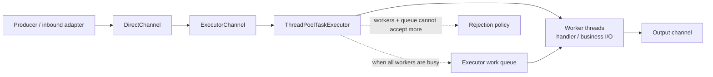
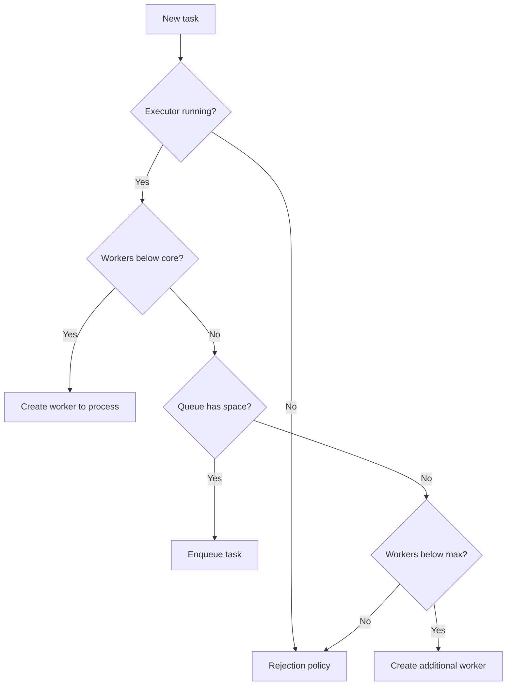
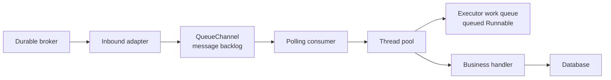
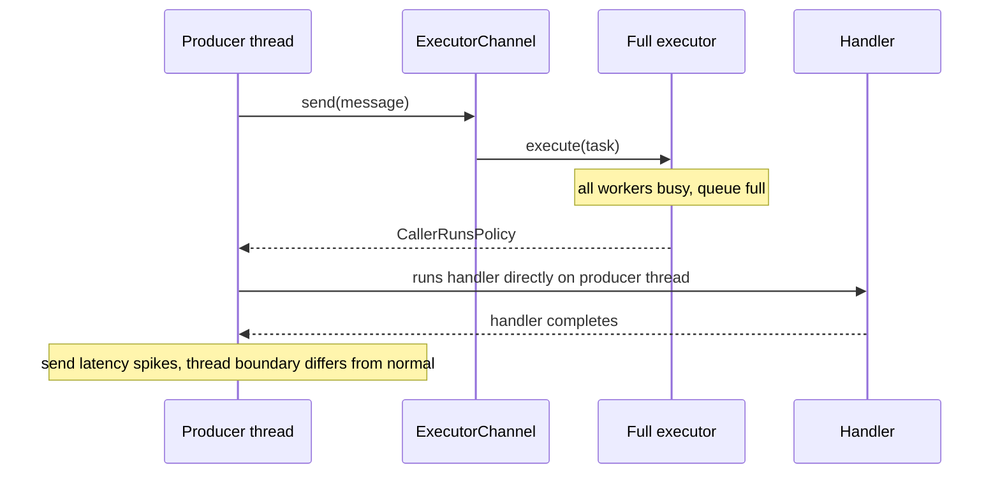
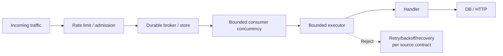

# Executor pool, queue capacity, and rejection

## 1. The performance problem: how much concurrency is enough?

A Spring Integration `IntegrationFlow` can receive messages from HTTP, a broker, a file adapter, or a `MessageChannel`, then forward them to a consumer endpoint and handler. When processing is slower than the incoming message rate, backlog grows. If an `ExecutorChannel` or a task executor on a poller is used, latency and work intake depend on the **thread pool**, **work queue**, and **rejection policy**.

Suppose an order-sync system receives 90 messages/second. Each handler takes an average of 120 ms to process, mostly waiting on HTTP/JDBC. A pool of eight workers has a theoretical capacity of about 67 messages/second. When incoming load remains higher than processing capacity, the system can:

- Increase the time messages wait in the executor queue before the handler starts.
- Exhaust queue capacity and reject new tasks.
- Cause timeouts at the API/gateway even when CPU is low because workers are waiting on I/O.
- Trigger a retry storm if the producer or broker retries immediately while the pool is still overloaded.
- Change the thread executing the handler when `CallerRunsPolicy` is used.
- Create the risk of lost or duplicated side effects when acknowledgements/transactions do not align with the asynchronous processing path.

This topic belongs to the **Performance** chapter of the **SPRING_INTEGRATION_RUNTIME** module. The goal is to learn how to **design, measure, select, and verify** `corePoolSize`, `maxPoolSize`, `queueCapacity`, and rejection policies; and to understand their impact on channels, endpoints, pollers, retries, transactions, message stores, correlation, and runtime state.

> **Design principle:** do not raise thread counts or queue sizes to “mask” overload beyond capacity. First establish sustainable processing capacity, downstream resource limits, wait budgets, and the message delivery contract; only then choose the executor configuration.

## 2. Where do executors appear in Spring Integration?

Not every message flow creates tasks that run asynchronously. Key characteristics of several components:

| Component | Typical processing thread | Performance impact |
| --- | --- | --- |
| `DirectChannel` | Executes subscriber on the sending thread, if the endpoint is synchronous | Low thread-switching cost, but the producer can be blocked by a slow handler. |
| `ExecutorChannel` | Hands off dispatch to an `Executor`; handler typically runs on a worker | Decouples receiving and processing threads; requires controlling pool and queue. |
| `QueueChannel` | Stores messages waiting for a polling consumer to call `receive` | It is a **message queue**, not an executor task queue. |
| Polling endpoint | Triggered by scheduler/trigger; may combine with a task executor | Poll schedule, messages per poll, transactions, and concurrency jointly affect throughput. |
| `PublishSubscribeChannel` with executor | Subscribers may run on separate workers | Fan-out, errors, and completion order differ from the synchronous path. |
| Handler calling HTTP/JDBC | Runs on the thread supplied by the endpoint/channel | Thread stays occupied during I/O waits when using blocking APIs. |



On `ExecutorChannel`, `send(message)` can return once the task is **accepted** by the executor, before the handler completes. This is an **asynchronous boundary**. Some exceptions can occur immediately on submission; exceptions thrown later in the handler usually follow the worker's error handling rather than returning to the producer by default.

**Key takeaway:** `send()==true` does not prove data was committed, output was published, or the broker safely acked. Throughput measurements must be based on **business completion**, not merely submitted message counts.

## 3. Lifecycle of a task in `ThreadPoolTaskExecutor`

`ThreadPoolTaskExecutor` is Spring's wrapper around the JDK's `ThreadPoolExecutor`, suited for configuring an executor managed by the Spring container. Key parameters:

| Property | Meaning | Common misconception |
| --- | --- | --- |
| `corePoolSize` | Core worker level the pool prefers scaling up to when receiving tasks | Does not mean all core threads are pre-created as soon as the bean starts. |
| `maxPoolSize` | Maximum number of workers for the pool | Setting max high does not scale the pool to max while the queue still has space. |
| `queueCapacity` | Capacity of the queue holding tasks waiting for workers | An overly large queue inflates latency even before rejections appear. |
| `keepAliveSeconds` | Idle window for workers above core before being reclaimed per config | Does not limit how long a handler can stay stuck in I/O. |
| `threadNamePrefix` | Thread naming prefix for diagnostics | Does not affect capacity, but should be unique per flow. |
| `RejectedExecutionHandler` | Policy when a task cannot be accepted | Can alter thread behavior and message retention. |
| Shutdown/lifecycle settings | Behavior when the context closes while tasks are queued/running | Rejections can also occur **during shutdown**, not only when the pool is full. |

With standard `ThreadPoolExecutor` mechanics and a running executor, a new task follows roughly this sequence:



Because **the queue is checked before scaling workers beyond core**, a configuration like `core=4, max=32, queueCapacity=10000` can keep most work sitting in the queue with only four workers, even if you expect 32 concurrent threads. Conversely, an overly small queue spins up workers quickly and may push too many concurrent queries to the database.

### The `queueCapacity=0` case

With standard `ThreadPoolTaskExecutor`, a capacity of 0 results in a direct handoff without queuing waiting tasks (`SynchronousQueue`). When no idle worker is available to take the task, the pool can create workers up to `maxPoolSize`, then reject according to policy.

This can be useful for workloads that want **minimal queue wait** and accept early rejection, but it does not fit bursty producers without an upstream buffer. This configuration is **not** a `QueueChannel` with capacity 0.

### Defaults are not production configurations

Specific defaults can vary across framework/library versions. Do not rely on defaults when choosing performance limits; explicitly configure `core/max/queue/rejection` and verify which executor bean **endpoints actually use**.

## 4. Three types of queues that should not be conflated

In a system with a broker, `QueueChannel`, and `ExecutorChannel`, a message may involve three distinct queues:

| Queue | What does it hold? | Who consumes from it? | Durable across JVM crash? |
| --- | --- | --- | --- |
| Broker queue/topic/partition | Messages/events in the source system | Spring Integration adapter/consumer | Depends on durability config, ack/offset, and the broker itself. |
| `QueueChannel` | `Message<?>` | Polling consumer calling `receive` | No with in-memory store; can use an appropriate persistent channel message store. |
| Executor work queue | Submitted `Runnable`/tasks | Worker threads of `ThreadPoolExecutor` | **No**, an in-RAM task queue is not a persistent message store. |



If an executor accepted a task and the JVM dies before a worker runs it, the task in RAM is lost. Whether the message is redelivered depends on **the source, acknowledgements, transactions, and durable storage**. Raising executor `queueCapacity` does not create message durability.

**Architecture tip:** for heavy bursts or zero-message-loss requirements, keep **durable backlogs** in a broker or persistent message channel; use a **bounded** executor queue only to regulate work within a single JVM.

## 5. Estimating capacity from arrival rate and service time

To size a pool, start with measurable quantities:

- `λ` (*lambda*): message arrival rate, in messages/second.
- `S`: average time one message occupies a worker, in seconds.
- `n`: number of workers that can process concurrently.
- `μ`: ideal pool capacity, roughly `n / S` messages/second when workers stay busy and workload is fairly uniform.
- `ρ`: estimated utilization, roughly `λS / n` in steady state.

Basic formulas:

```text
capacity ≈ n / S                (message/s)
utilization ρ ≈ λ × S / n      (when arrival and workload are steady)
require λ < capacity           (so backlog does not grow indefinitely)
```

### Calculation example

Suppose measurements show `λ = 90 msg/s` and `S = 0.120 s` (120 ms/message):

- With `n = 8`: `capacity ≈ 8 / 0.12 = 66.7 msg/s`. Arrival rate exceeds capacity by about **23.3 msg/s**; backlog will grow if this persists.
- To keep `ρ ≤ 0.70` by the theoretical formula: `n ≥ 90 × 0.12 / 0.70 ≈ 15.43`, so you need **at least 16 workers** by this estimate.
- With `n = 16`: ideal capacity `≈ 133.3 msg/s` and theoretical utilization `≈ 67.5%`.

**This formula does not guarantee an SLO.** Service times have long-tailed distributions, especially during HTTP timeouts or DB lock waits. CPU, connection pools, downstream rate limits, and contention make real capacity much lower. The `ρ≤70%` target is only an example assumption to leave headroom, not a fixed Spring Integration threshold.

### Why measure p95/p99?

Two workloads with the same `S=120 ms` can have very different latency profiles:

- Workload A: most messages take around 120 ms.
- Workload B: many messages finish in 10 ms while a few hang for several seconds.

In workload B, slow requests still **occupy workers** and can build large queues at unfavorable moments. Sizing a pool solely from `mean S` misses tail latency. Measure `p50/p95/p99` and worker occupancy by I/O type.

## 6. Choosing `queueCapacity` from a wait budget, not RAM size

If messages must not wait too long, queue capacity needs a clear rationale. Use **Little's Law** as a steady-state estimate:

```text
L = λ × W

L: average number of work items in a stage of the system
λ: steady completion/arrival rate (job/s)
W: average time spent in that stage (s)
```

Considering only **the queue before workers**, we have `Lq = λ × Wq`. For example, with steady throughput around `80 msg/s` and an **average** wait target `Wq=0.25 s`, the **average** queued task count is roughly `80×0.25 = 20`.

**Caution:** getting **20** does not mean “set `queueCapacity=20` and you will get p99 ≤ 250 ms”. Little's Law describes **steady-state averages**; it does not guarantee latency distributions, burst bounds, or p99. You must load test and leave margin based on traffic characteristics.

### Sizing for time-bounded bursts

Suppose:

- Actual worker capacity is **130 msg/s**.
- For **3 seconds**, the source pushes **180 msg/s**.
- The queue starts empty with no other load sources.

Backlog accumulates at roughly `180 − 130 = 50 msg/s`, so queued messages grow by roughly `50 × 3 = 150`. A queue capacity of **64** will fill during this burst; a queue capacity of **200** can absorb the burst if real capacity holds at 130 msg/s and the producer does not overload downstream. After the burst, the queue must **drain** before the next spike.

For batch/seasonal traffic, you need to know **burst duration**, not just peak QPS. An overly deep queue absorbs bursts at the cost of lengthening wait times for messages at the tail; queue limits must go hand in hand with **deadlines and backpressure**.

## 7. Designing for CPU-bound vs. I/O-bound workloads

| Workload | Signals | How to reason about worker count |
| --- | --- | --- |
| CPU-bound | CPU near ceiling; handlers compute heavily, wait little | Worker count usually starts near usable core count; going too high causes context-switch/cache contention. |
| I/O-bound | CPU stays low; many threads wait on JDBC/HTTP | Concurrency higher than core count may be needed, bounded by connection pools, rate limits, and timeouts. |
| Mixed | Combines computation, serialization, and I/O | Measure phases separately or apply bulkheads if hot paths differ. |
| Key-serialized | Multiple messages sharing `accountId`/`correlationId` must run sequentially | Adding workers cannot safely parallelize the same key; requires partition/key-aware design. |
| Downstream quota | API allows only a fixed request/s rate | Concurrency does not replace rate limiting; requires throttling/buffering. |
| Long-running job | Each task takes tens of seconds or minutes | Avoid occupying workers shared with short-lived flows when a separate scheduler/job executor can be isolated. |

**External limit example:** if the executor has 32 workers while the JDBC connection pool has only 8 connections and each handler holds a connection most of the time, many workers sit idle waiting for connections. Raising 32 to 64 does not make the database serve 32 more concurrent queries; it can simply raise memory usage, lock contention, and latency.

Prioritize measuring **downstream saturation** before expanding the executor.

## 8. Java DSL example: dedicated executor for a flow

The following example uses Spring Integration DSL, Java 17+, and `ThreadPoolTaskExecutor`. It **does not call a real external API**; the goal is to demonstrate wiring and the asynchronous boundary.

```java
package example.runtime.performance;

public record OrderJob(String jobId, String customerId) {}
```

A small service:

```java
package example.runtime.performance;

public final class OrderProcessor {

    public String process(OrderJob job) {
        if (job.jobId() == null || job.jobId().isBlank()) {
            throw new IllegalArgumentException("Missing jobId");
        }
        // In production: database/HTTP and idempotency per business requirements.
        return "PROCESSED:" + job.jobId();
    }
}
```

Configuration:

```java
package example.runtime.performance;

import java.util.concurrent.ThreadPoolExecutor;

import org.springframework.beans.factory.annotation.Qualifier;
import org.springframework.context.annotation.Bean;
import org.springframework.context.annotation.Configuration;
import org.springframework.integration.channel.DirectChannel;
import org.springframework.integration.channel.ExecutorChannel;
import org.springframework.integration.channel.QueueChannel;
import org.springframework.integration.config.EnableIntegration;
import org.springframework.integration.dsl.IntegrationFlow;
import org.springframework.messaging.MessageChannel;
import org.springframework.messaging.PollableChannel;
import org.springframework.scheduling.concurrent.ThreadPoolTaskExecutor;

@Configuration
@EnableIntegration
public class OrderPerformanceConfiguration {

    @Bean("orders.executor")
    public ThreadPoolTaskExecutor ordersExecutor() {
        ThreadPoolTaskExecutor executor = new ThreadPoolTaskExecutor();
        executor.setCorePoolSize(8);
        executor.setMaxPoolSize(16);
        executor.setQueueCapacity(64);
        executor.setKeepAliveSeconds(30);
        executor.setThreadNamePrefix("orders-worker-");
        executor.setRejectedExecutionHandler(
            new ThreadPoolExecutor.AbortPolicy());
        return executor;
    }

    @Bean("orders.in")
    public MessageChannel input() {
        return new DirectChannel();
    }

    @Bean("orders.async")
    public MessageChannel async(
            @Qualifier("orders.executor")
            ThreadPoolTaskExecutor executor) {
        return new ExecutorChannel(executor);
    }

    @Bean("orders.results")
    public PollableChannel results() {
        return new QueueChannel(100);
    }

    @Bean
    public OrderProcessor orderProcessor() {
        return new OrderProcessor();
    }

    @Bean
    public IntegrationFlow orderFlow(OrderProcessor processor) {
        return IntegrationFlow.from("orders.in")
            .channel("orders.async")
            .handle(processor, "process")
            .channel("orders.results")
            .get();
    }
}
```

**Explanation of each boundary:**

1. `orders.in` receives messages synchronously from the producer.
2. `orders.async` is an `ExecutorChannel` that submits tasks to `orders.executor`.
3. The executor has **8 core workers**, up to **16 workers**, and a queue of **64 tasks**. Under queue-before-grow, tasks can wait in the queue before the pool expands past 8 workers.
4. `OrderProcessor.process` is invoked on a worker when the task starts running; results go to `orders.results`.
5. The output `QueueChannel(100)` is only used for observation in this example. If output is not drained, it can also fill up and block/fail workers; this is a **different** bottleneck from the executor queue.

`AbortPolicy` explicitly reports an error when it cannot accept a task; it does not by itself decide whether the message is redelivered by a broker. Overload handling must be placed at the producer/adapter while ensuring proper acknowledgements.

The Spring container manages initializing/closing the `ThreadPoolTaskExecutor` bean. When writing plain Java outside Spring with `new ThreadPoolTaskExecutor()`, you must explicitly call `initialize()` and `shutdown()` according to lifecycle.

### Sending messages and observing results

```java
import org.springframework.context.ApplicationContext;
import org.springframework.messaging.Message;
import org.springframework.messaging.MessageChannel;
import org.springframework.messaging.PollableChannel;
import org.springframework.messaging.support.GenericMessage;

MessageChannel input =
    context.getBean("orders.in", MessageChannel.class);
PollableChannel output =
    context.getBean("orders.results", PollableChannel.class);

boolean accepted = input.send(new GenericMessage<>(
    new OrderJob("O-101", "C-7")));

Message<?> reply = output.receive(2_000);
System.out.println("accepted=" + accepted);
System.out.println("reply=" +
    (reply == null ? "timed out" : reply.getPayload()));
```

`context` is a started `ApplicationContext`. `accepted==true` does not mean the result has arrived in `orders.results`; because of the async boundary, you must wait for the reply within a finite timeout. Two different messages may complete **out of send order**.

## 9. Rejection policies: choices that affect semantics

When the pool/queue runs out of capacity or the executor is no longer running, `RejectedExecutionHandler` decides what happens to new tasks.

| Java Policy | Core behavior | Trade-offs in a message flow |
| --- | --- | --- |
| `AbortPolicy` | Throws `RejectedExecutionException` (Spring may wrap as `TaskRejectedException` or a messaging exception) | **Fail-fast, observable**; caller must have a retry/nack/backpressure policy. |
| `CallerRunsPolicy` | When executor is not shut down, runs task on the thread calling `execute` instead of submitting to a worker | Backpressure by blocking producer, but can break async/thread/transaction assumptions. |
| `DiscardPolicy` | May drop the task without throwing an exception | Risk of **silent loss of business effect**; unsuitable for critical messages. |
| `DiscardOldestPolicy` | May drop the task at the head of the queue and retry submitting the new one | Can lose older messages, breaking ordering or correlation. |
| Custom policy | Application-defined logic | Must prove overload, failure, shutdown, and observability via tests. |

### `AbortPolicy`: usually a clear starting point

When a task cannot be accepted, the exception signals upstream to slow down or return the message to a durable source for redelivery. However, if the exception is swallowed in an adapter/error flow after the source already acked, **fail-fast does not automatically mean zero message loss**.

### `CallerRunsPolicy`: applies backpressure but switches threads



This policy **can be appropriate** when the caller is allowed to wait, holds no sensitive locks/transactions, and is not an event loop requiring fast responses. However, if the producer is an HTTP gateway or a poller with special transaction/ack semantics, unexpectedly running the handler on the producer thread can introduce latency, timeouts, or side effects different from the normal worker path.

**Important note:** the JDK's `CallerRunsPolicy` may **not run the task** once the executor has shut down. Never treat it as a delivery guarantee in all situations.

### Why avoid discard policies for critical business operations?

A task may be dropped after upstream already considered `send` successful. In that case there is no output, no handler exception, and sometimes no error message to reconcile. If the message represents transferring funds, creating an order, or updating inventory, this is a major risk. You need a **lost-business-effect** test, not just an “errors=0” metric.

## 10. Backpressure must engage before resources are exhausted

A bounded executor is only **the last line of defense**; it does not replace an overall throttling strategy. Common options:

- **Producer throttling:** rate-limit sends per tenant, endpoint, or source.
- **Durable backlog:** let messages wait in a broker or persistent channel store rather than piling up unboundedly in executor RAM.
- **Consumer concurrency control:** cap concurrent handlers to match downstream capacity.
- **Bounded retry:** during transient overload, retry with backoff/jitter and finite attempts; route exhausted items to a DLQ/recovery path.
- **Bulkhead:** isolate executors for workloads with different SLAs or downstream targets.
- **Circuit breaker/timeouts:** keep workers from being held too long by failing external systems.
- **Admission control:** return an explicit overload error when the system cannot safely hold the request.



**Separate two questions:** “how do we hold messages during a burst?” should be answered with **durable buffers and backpressure**; “how many tasks should execute concurrently?” should be answered with **the executor pool and downstream resource limits**.

## 11. Pollers and executors: do not shift failures elsewhere

For a `QueueChannel`/message store with a poller, the receive schedule and processing concurrency interact:

- `fixedDelay` or trigger determines when polling happens.
- `maxMessagesPerPoll` caps how many messages one poll cycle can take.
- A `taskExecutor` configured on the poller/endpoint can change concurrency and execution threads.
- Forwarding through an `ExecutorChannel` adds yet another async boundary and task queue.
- Setting both poller concurrency and executor concurrency very high can overload downstream even if each setting looks reasonable in isolation.

Conceptual example:

```text
Persistent QueueChannel --poller--> DirectChannel --> handler
         (message)          (polling thread)

Persistent QueueChannel --poller--> ExecutorChannel --> handler
         (message)          (submit)          (worker)
```

In the second diagram, the poller can receive a message and submit it quickly while the handler runs later. If the poller's transaction only wraps `receive + send`, it **does not automatically cover** the business operation on the worker thread. A rejection at submit time must also be handled so the unacked source message can retry or undergo another durable handoff.

**Never assume “adding an executor after a poller” safely boosts throughput.** You must check transactions, acknowledgements, error routing, and where messages reside if the JVM crashes.

## 12. Transactions, retries, and idempotency under overload

Overload increases the probability of timeouts and retries. When designing thread pools, identify key boundaries:

| Boundary | Risk | Measure to verify |
| --- | --- | --- |
| Broker/source → `send` | Source acks before worker finishes | Properly timed ack/redelivery, durable handoff. |
| `ExecutorChannel` → worker | Task accepted but still in RAM | Crash can lose task; do not equate accepted with committed. |
| Worker → database | Long transactions or exhausted connection pool | Sensible timeouts, short transaction scopes, measure rollbacks/commits. |
| Worker → HTTP API | API succeeds while client times out/retries | API-side idempotency key or reconciliation. |
| Retry advice → executor | Immediate retry while full | Retry budget, backoff/jitter, and admission control. |
| Error channel / DLQ | Error handler also becomes congested | Reserve resources for recovery paths; measure exhausted counts. |

`ExecutorChannel` usually switches execution threads; local JDBC transaction resource bindings **do not automatically cross the async boundary**. If an upstream transaction finishes after `send` is accepted and the handler fails later, you cannot expect the upstream transaction to roll back the worker's business operation.

For messages redelivered due to timeouts/restarts, use **stable business idempotency keys**, unique constraints, transactional outbox, or idempotent destination contracts. Do not use a random `MessageHeaders.ID` as a uniqueness key if redelivery constructs a new Message with a different ID.

## 13. Throughput, latency, and ordering/correlation

Increasing concurrency can boost throughput, but does not preserve processing order:

```text
Input:     E1, E2, E3
Workers:   E1 takes 300 ms, E2 takes 20 ms, E3 takes 40 ms
Completed: E2, E3, E1
```

If business logic requires sequential processing per `accountId` or `orderId`, do not simply push all messages into the same executor and hope order stays intact. Deliberate options:

- Partition by business key and limit to one worker per partition, if transport or flow supports it.
- Use a resequencer when **reordering outputs** is needed, recognizing that a resequencer does not undo out-of-order side effects that already occurred.
- Use `CorrelationStrategy`/`ReleaseStrategy` and `MessageGroupStore` when aggregating fragments; define policies for missing/duplicate/late messages.
- Lock the appropriate business resource when serializing a critical section; treat lock contention as a real throughput ceiling.
- Dispatch independent messages to parallel workers instead of using an overly broad global lock.

**Performance and correctness must be measured together.** A configuration delivering 5,000 accepted messages/second that breaks ordering or double-writes the DB is not a successful configuration.

## 14. Observing the executor: which numbers really matter?

Several metrics can be read directly from `ThreadPoolTaskExecutor` once the bean is initialized:

```java
import org.springframework.context.ApplicationContext;
import org.springframework.scheduling.concurrent.ThreadPoolTaskExecutor;

ThreadPoolTaskExecutor executor = context.getBean(
    "orders.executor", ThreadPoolTaskExecutor.class);

System.out.printf(
    "core=%d max=%d pool=%d active=%d queue=%d completed=%d%n",
    executor.getCorePoolSize(),
    executor.getMaxPoolSize(),
    executor.getPoolSize(),
    executor.getActiveCount(),
    executor.getQueueSize(),
    executor.getThreadPoolExecutor().getCompletedTaskCount());
```

This is a **snapshot**, not a time series. The `completed` count also reflects only finished executor tasks; **it does not prove business transactions committed successfully**.

| Metric | How to interpret |
| --- | --- |
| `activeCount` / `poolSize` | How many workers are busy/alive at measurement time. |
| `queueSize` and queue capacity | Task backlog level before execution begins. |
| Rejection count | How many tasks were rejected; must be explicitly instrumented. |
| Enqueue-to-start latency | How long a message/task waits in the executor before the handler runs. |
| Handler execution latency | How long a worker is occupied by business logic; measure p50/p95/p99. |
| End-to-end message latency | From source receipt to business completion/ack, including queue wait. |
| Accepted/completed/failed/duplicate | Distinguish successful dispatch from business outcome. |
| Broker lag / `QueueChannel` depth | Upstream pressure before the executor. |
| DB connection-pool pending/HTTP latency | Is the downstream bottleneck really caused by thread count? |
| CPU/GC/memory/thread count | Are more workers/larger queues putting pressure on the JVM? |

Micrometer and Spring Boot Actuator can export metrics when appropriate instrumentation is configured. **Do not assume** every executor automatically provides a `rejected` metric or queue-wait histogram just because Actuator is enabled; check which metrics actually exist at runtime.

### Naming executors and flows

Use `threadNamePrefix("orders-worker-")` and bean name `orders.executor` to trace logs/thread dumps back to flows. If multiple flows share an executor, logs should also include **endpoint ID**, business message key, correlation/trace ID, and phase `SUBMITTED/STARTED/COMMITTED/FAILED`. Never log full payloads or sensitive data.

## 15. Load testing: measure accurately before tuning the pool

A tuning experiment should have at least three phases:

**Phase A — Baseline:** run with current settings; measure arrival rate, business completion rate, sustainable throughput, end-to-end latency, queue wait, and queue depth. Record warm-up duration, input size, partition/key count, and downstream characteristics.

**Phase B — Configuration sweep:** vary `corePoolSize`, `maxPoolSize`, and `queueCapacity` systematically across bounded combinations. Keep traffic and other factors constant per run for fair comparison. Do not change the DB pool, HTTP timeouts, and executor simultaneously and attribute the difference to a single variable.

**Phase C — Burst/failure:** inject short bursts, introduce controlled downstream slowdowns, verify retry/backpressure/rejection, then return load to normal. Observe **queue drain** and post-error recovery.

### Suggested matrix

| Config | Core | Max | Queue | Experiment question |
| --- | ---: | ---: | ---: | --- |
| A | 4 | 4 | 32 | Does it handle baseline load with tight memory bounds? |
| B | 4 | 16 | 32 | When the queue fills, does adding workers improve tail latency? |
| C | 8 | 16 | 64 | Where is the balance among throughput/queue wait/rejects? |
| D | 16 | 16 | 16 | Does reducing queue wait trade off rejections and DB pressure? |
| E | 8 | 16 | 0 | How does direct handoff trigger early rejection during bursts? |

These numbers are **sample test points**, not standard settings. Conclusions must come from measurements on real hardware, data, and APIs.

### Avoiding measurement bias

- **Open-loop vs. closed-loop:** a client waiting for responses before sending the next request throttles itself when the system slows down, making throughput look steady. To test a fixed arrival rate, use a load generator that maintains the target rate and tracks rejected requests separately.
- **Coordinated omission:** when the system stalls, if the tool omits wait time before issuing/receiving requests, p99 can be underestimated.
- **Warm-up and JIT:** do not draw conclusions from just the first few seconds.
- **Key distribution:** one hot key with locking/ordering behaves differently from 10,000 independent keys.
- **Downstream rate limits:** an overly fast mock HTTP endpoint does not reflect production.
- **Error paths:** measure rejects, retries, drops, DLQ, and idempotent duplicates, not only success throughput.
- **GC and heap:** queues holding many tasks/large payloads retain references longer and raise memory pressure.

## 16. Testing bounded pool/rejection with JUnit 5

To deterministically expose pool/queue thresholds, use a `CountDownLatch` to hold a worker busy instead of `Thread.sleep`. This is a **qualitative test** of rejection mechanics, not a throughput benchmark.

### 16.1. Worker gate

```java
package example.runtime.performance;

import java.util.concurrent.CountDownLatch;
import java.util.concurrent.TimeUnit;

public final class WorkerGate {

    private final CountDownLatch entered = new CountDownLatch(1);
    private final CountDownLatch release = new CountDownLatch(1);

    public String work(String id) {
        entered.countDown();
        try {
            if (!release.await(10, TimeUnit.SECONDS)) {
                throw new IllegalStateException("Gate timeout");
            }
            return "DONE:" + id;
        } catch (InterruptedException e) {
            Thread.currentThread().interrupt();
            throw new IllegalStateException("Interrupted", e);
        }
    }

    public boolean awaitFirst(long seconds) throws InterruptedException {
        return entered.await(seconds, TimeUnit.SECONDS);
    }

    public void open() {
        release.countDown();
    }
}
```

### 16.2. Dedicated test flow

```java
package example.runtime.performance;

import java.util.concurrent.ThreadPoolExecutor;

import org.springframework.beans.factory.annotation.Qualifier;
import org.springframework.context.annotation.Bean;
import org.springframework.context.annotation.Configuration;
import org.springframework.integration.channel.DirectChannel;
import org.springframework.integration.channel.ExecutorChannel;
import org.springframework.integration.channel.QueueChannel;
import org.springframework.integration.config.EnableIntegration;
import org.springframework.integration.dsl.IntegrationFlow;
import org.springframework.messaging.MessageChannel;
import org.springframework.messaging.PollableChannel;
import org.springframework.scheduling.concurrent.ThreadPoolTaskExecutor;

@Configuration
@EnableIntegration
public class BoundedExecutorTestConfig {

    @Bean("test.executor")
    public ThreadPoolTaskExecutor executor() {
        ThreadPoolTaskExecutor executor = new ThreadPoolTaskExecutor();
        executor.setCorePoolSize(1);
        executor.setMaxPoolSize(1);
        executor.setQueueCapacity(1);
        executor.setThreadNamePrefix("bounded-test-");
        executor.setRejectedExecutionHandler(
            new ThreadPoolExecutor.AbortPolicy());
        return executor;
    }

    @Bean("test.in")
    public MessageChannel input() {
        return new DirectChannel();
    }

    @Bean("test.async")
    public MessageChannel async(
            @Qualifier("test.executor") ThreadPoolTaskExecutor executor) {
        return new ExecutorChannel(executor);
    }

    @Bean("test.out")
    public PollableChannel output() {
        return new QueueChannel(10);
    }

    @Bean
    public WorkerGate gate() {
        return new WorkerGate();
    }

    @Bean
    public IntegrationFlow testFlow(WorkerGate gate) {
        return IntegrationFlow.from("test.in")
            .channel("test.async")
            .handle(String.class, (payload, headers) -> gate.work(payload))
            .channel("test.out")
            .get();
    }
}
```

### 16.3. Testing that the third task is rejected

```java
package example.runtime.performance;

import java.util.HashSet;
import java.util.Set;

import org.junit.jupiter.api.Test;
import org.springframework.context.annotation.AnnotationConfigApplicationContext;
import org.springframework.messaging.Message;
import org.springframework.messaging.MessageChannel;
import org.springframework.messaging.PollableChannel;
import org.springframework.messaging.support.GenericMessage;
import org.springframework.scheduling.concurrent.ThreadPoolTaskExecutor;

import static org.junit.jupiter.api.Assertions.*;

class BoundedExecutorTest {

    @Test
    void thirdTaskIsRejectedWhenWorkerAndQueueAreFull()
            throws Exception {

        try (var context = new AnnotationConfigApplicationContext(
                BoundedExecutorTestConfig.class)) {

            MessageChannel input =
                context.getBean("test.in", MessageChannel.class);
            PollableChannel output =
                context.getBean("test.out", PollableChannel.class);
            ThreadPoolTaskExecutor pool =
                context.getBean("test.executor", ThreadPoolTaskExecutor.class);
            WorkerGate gate = context.getBean(WorkerGate.class);

            try {
                assertTrue(input.send(new GenericMessage<>("A")));
                assertTrue(gate.awaitFirst(5));

                // A is running and held; B sits in the work queue of capacity 1.
                assertTrue(input.send(new GenericMessage<>("B")));
                assertEquals(1, pool.getQueueSize());

                // AbortPolicy rejects the third task when pool has no room left.
                assertThrows(RuntimeException.class, () ->
                    input.send(new GenericMessage<>("C")));

            } finally {
                gate.open(); // Always release worker, even if an assertion fails.
            }

            Set<String> actual = new HashSet<>();
            for (int i = 0; i < 2; i++) {
                Message<?> reply = output.receive(5_000);
                assertNotNull(reply);
                actual.add((String) reply.getPayload());
            }

            assertEquals(Set.of("DONE:A", "DONE:B"), actual);
            assertNull(output.receive(100));
        }
    }
}
```

The test verifies **the threshold mechanic**: one task running, one queued, and a new task rejected. `RuntimeException` is used as a concise assertion because the exception may be wrapped by Spring messaging; in production test suites, inspect the cause chain and assert the rejection is **not** a random business error.

**Do not infer** from this test that broker redelivery is correct or that the queue is durable. Never use a gate that intentionally blocks workers in production.

## 17. Shutdown, deployment, and dynamic flows

When a `ThreadPoolTaskExecutor` or Spring context is shutting down, new tasks can be rejected **even without saturation**. Distinguish the two cases when inspecting logs:

| Case | Signals | Handling approach |
| --- | --- | --- |
| Pool full due to load | `active≈max`, queue at capacity, rejections climbing | Find bottleneck, design backpressure, tune via load tests. |
| Pool stopping/shutting down | Rejections near deploy, context close, flow stop, or executor shutdown | Coordinate lifecycle, quiesce ingress, drain tasks, check startup readiness. |

With `IntegrationFlowContext` and dynamically registered `IntegrationFlowRegistration` instances, starting/stopping a flow does not automatically ensure its work queue is empty. If two flows **share an executor**, managing one registration's lifecycle also does not necessarily shut down the shared executor bean. Never shut down an executor while another flow is still using it.

Before deploy/rolling restart:

1. Stop accepting new messages at the right boundary, or hold them in a durable source.
2. Observe message backlog, executor work queue, and in-flight tasks.
3. Allow tasks a bounded window to finish if business rules require draining.
4. Verify acks, transactions, and idempotency for incomplete messages.
5. Restart flows after downstream targets and error/recovery paths are ready.
6. Verify the effective state of **every replica**, not just one JVM.

`waitForTasksToCompleteOnShutdown` and shutdown wait timeouts are configurable per Spring/framework version. Never treat graceful shutdown as the sole mechanism for retaining messages: **SIGKILL skips cleanup**, and tasks in RAM are still lost.

## 18. Anti-patterns and fixes

| Anti-pattern | Why it causes problems | Alternative |
| --- | --- | --- |
| Huge `queueCapacity` to avoid rejections | Masks queue wait, holds many tasks/payloads on the heap, spikes p99 latency | Bounded queue + durable backlog + admission control. |
| Very high `maxPoolSize` while queue still has room | Pool does not expand as expected due to queue-before-grow | Size core/queue for desired behavior; measure at runtime. |
| Adding workers when the DB connection pool is exhausted | Only creates more waiting threads, increasing contention | Optimize DB/pool/queries, cap concurrency close to downstream limits. |
| Using `DiscardPolicy` for important messages | Tasks can be silently lost without observation | Fail-fast or explicit retry/durable handoff. |
| Using `CallerRunsPolicy` without testing thread boundaries | Handler unexpectedly runs on caller thread, inflating send latency | Test overload, transactions, and timeouts; use only when appropriate. |
| Unbounded retries without backoff on rejection | Creates a feedback loop, worsening overload | Retry budget, exponential backoff/jitter, DLQ, source throttling. |
| Counting only accepted tasks | Accepted does not equal committed | Measure business completion/duplicates/rejects/error outcomes. |
| One executor for all flows | One slow adapter stalls unrelated parts of the app | Separate bulkheads for critical workloads. |
| Using executor queue instead of a broker | In-memory work queue does not survive restarts | Use a broker/persistent channel store for durable backlogs. |
| Ignoring correlation/ordering | Parallelism changes completion order | Partition by key or use resequencer/idempotent downstream. |
| Acking immediately after async submit | Crash between submit and handler loses work | Ack only after durable handoff/business completion as appropriate. |
| Benchmarking only average throughput | Misses p95/p99, bursts, and rejections | Measure full latency distribution and failure/recovery. |

### Quick troubleshooting table when behavior surprises you

| Symptom | What to check first |
| --- | --- |
| Pool stays at core despite large `max` | Is the queue too large / not yet full? |
| Low CPU while queue grows | Are workers waiting on DB, HTTP, locks, connection pool, or output channel? |
| Rejections right after deploy | Is the executor shutting down or not yet started? |
| No rejections but producer latency spikes | Is `CallerRunsPolicy` or a blocking send active? |
| No output messages even though submits are accepted | Handler exception, full result queue, error route, or task still waiting? |
| Raising concurrency causes duplicate updates | Are business resource idempotency and transactions properly implemented? |
| Backlog does not drop after scaling | Downstream rate limit, DB locks, or hot-key serialization? |
| Messages lost after crash | Were tasks sitting in RAM while the source already acked before completion? |
| Messages complete out of order | Executor parallelism, correlation/resequencer/partition strategy? |
| Retries increase rejections | Are backoff, retry budget, and in-flight task limits bounded? |

## 19. Tuning exercises and self-check questions

**Exercise 1 — Observing pool-before-queue.** Run `OrderPerformanceConfiguration` with `core=8, max=16, queue=64` and a handler simulating controlled slow I/O. Measure pool size after 8, 20, and 80 tasks; explain when the pool grows past core.

**Exercise 2 — Deterministic rejection.** Run `BoundedExecutorTest`. Change `queueCapacity` from 1 to 2, measure how many tasks can be accepted before the next rejection; keep everything else constant.

**Exercise 3 — Comparing three policies.** In a test environment, try `AbortPolicy`, `CallerRunsPolicy`, and `DiscardPolicy` at the same traffic rate. Measure exceptions, send latency, handler thread names, and business completions. Explain why “errors=0” does not mean zero lost work.

**Exercise 4 — Capacity math.** With 150 msg/s and 80 ms average handler time, calculate minimum workers at ideal capacity and at 70% target utilization. Then make 10% of messages take 2 seconds and run a load test to see where average-based formulas fall short.

**Exercise 5 — Burst budget.** Simulate a 200 msg/s burst lasting 5 seconds on a system steadily processing 140 msg/s. Estimate backlog growth; design queue capacity and rejection policy within a latency budget without sacrificing persistence.

**Exercise 6 — JDBC pool bottleneck.** Give the executor 32 workers while the DataSource has only 8 connections; simulate long transactions. Observe threads waiting on connections and throughput; propose a targeted fix.

**Exercise 7 — Poller + ExecutorChannel.** Build a persistent `QueueChannel` with a poller submitting tasks via `ExecutorChannel`. Inspect transaction boundaries, source acks, rejections, and crashes before the worker starts. Design a durable handoff/idempotency scheme.

**Exercise 8 — Key ordering.** Send interleaved updates for two `orderId`s with different handler latencies. Observe completion order and design key-based partitioning/serialization instead of forcing the entire app onto one worker.

**Exercise 9 — Bulkhead.** Have flow A call a slow HTTP API and flow B update a fast DB; first share one executor, then separate executors. Measure B's latency and rejections in both setups.

**Exercise 10 — Production-like scenario.** Run steady load → burst → downstream slowdown → recovery. Record throughput, queue wait, p95/p99, rejected/failed/duplicate counts, source backlog, and drain time. Pick the final configuration from results, not CPU core count alone.

### Self-check questions

1. Why does `ExecutorChannel` make `send()==true` insufficient proof that the handler succeeded?
2. How does `QueueChannel` differ from an executor work queue in stored data and durability?
3. Does `ThreadPoolExecutor` prefer expanding workers beyond core or enqueuing when the queue still has space?
4. With `queueCapacity=0`, how does task acceptance differ from a bounded queue?
5. When does a very large `maxPoolSize` still fail to increase worker count?
6. What real-workload factors does `capacity≈n/S` omit?
7. Does Little's Law let you directly derive p99 queue wait from queue capacity?
8. Why can adding workers when the JDBC pool is exhausted make the system worse?
9. How do `AbortPolicy` and `CallerRunsPolicy` differ in backpressure and thread boundaries?
10. Why is `DiscardPolicy` dangerous when processing orders/payments?
11. How can bursts be absorbed without an enormous executor queue?
12. Why can immediate retries when an executor is full trigger a retry storm?
13. When a polling consumer calls `ExecutorChannel`, what risks affect transactions and acknowledgements?
14. Why can increasing concurrency alter ordering even while total throughput increases?
15. Which metrics must be measured besides `activeCount` and `queueSize`?
16. How do you distinguish rejections caused by saturation from rejections caused by shutdown?
17. Why is a latch-based test better than `Thread.sleep` for reproducing a full pool?
18. When should executors be isolated as bulkheads versus kept as one shared pool?

**Operational rule:** choose `executor pool`, `queue capacity`, and `rejection policy` based on **throughput needs, latency budgets, workload characteristics, and downstream capacity**; verify through load tests measuring p95/p99, queue wait, and business completion. Keep queues bounded, place durable backlogs at the right layer, enforce backpressure and bounded retries, and protect transactions, acknowledgements, idempotency, ordering, and correlation when moving to asynchronous processing.
