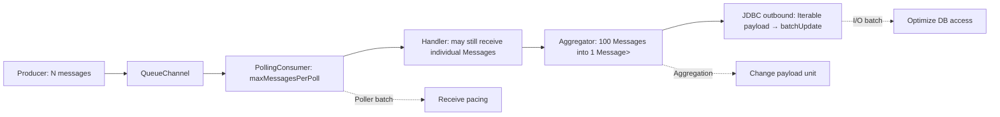
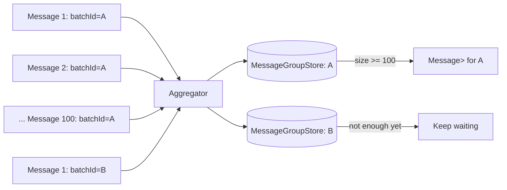
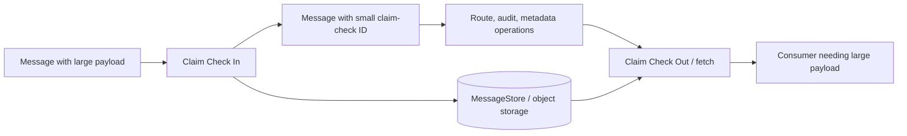
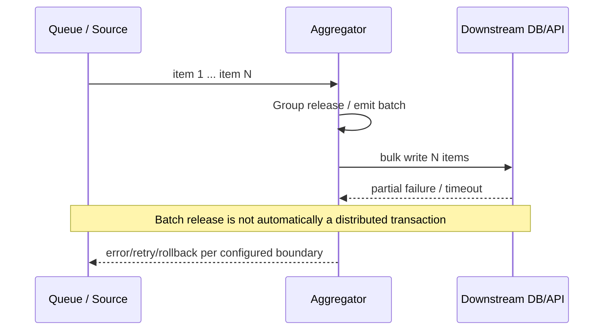

# Batching and payload size in Spring Integration

## 1. Why can batching make a system faster — or slower?

In the **SPRING_INTEGRATION_RUNTIME** module, messages travel through channels, consumers, pollers, executors, and endpoints to get work done. As messages/second climb, a common optimization suggestion is to **group multiple messages into a batch**. That advice only works when you understand the bottleneck and the cost of **payload size**.

For example, an endpoint writing 5,000 order lines to a database:

- Sending 5,000 individual INSERT statements incurs repeated round-trips, statement preparation, commits, or call overhead.
- Grouping 100 lines per batch can cut JDBC round-trips significantly.
- Yet grouping into one 5,000-line batch can create a huge payload, long transaction hold times, steep heap growth, and make a single bad row hard to handle.
- If the source only emits 2 orders per second, waiting for 100 items can force the first message to wait nearly a minute, even while average throughput improves.

Therefore you must optimize **three things together**:

1. **Throughput:** business items/messages completed per second.
2. **Latency:** time from message arrival to result/commit, especially p95/p99.
3. **Resource footprint:** heap, GC, serialization CPU, threads, connections, network, broker/store, and lock hold times.

> **Principle:** A batch is an application-defined *processing unit*; message size is a *transport and storage cost*. A large batch does not automatically become an atomic transaction, a durable message, or a deduplication mechanism.

## 2. Three different meanings of “batch”

In Spring Integration, the word “batch” can refer to very different mechanisms:

| Layer | Mechanism | What it actually does | What NOT to infer |
| --- | --- | --- | --- |
| **Poller batch** | `maxMessagesPerPoll=50` | One poll cycle can retrieve up to 50 messages sequentially, per configuration | Does not combine 50 messages into a single `List<?>` payload |
| **Message aggregation** | `Aggregator` / `MessageGroupStore` | Groups correlated messages, then emits one output message | Does not automatically ensure the output triggers a JDBC batch/HTTP bulk request |
| **I/O batch** | JDBC `batchUpdate`, broker producer batching, bulk HTTP API | Sends multiple records in one communication round-trip or adapter optimization unit | Does not automatically solve per-item idempotency or target-system atomicity |



These steps can be used together or independently. Merely changing a poller's `maxMessagesPerPoll` from 1 to 50 while the handler still runs one JDBC INSERT per message may fetch more messages per poll cycle, but **does not turn 50 JDBC calls into one**.

### An example of a common misconception

```xml
<int:service-activator id="writeOneOrder"
                       input-channel="ordersQueue"
                       ref="orderWriter"
                       method="writeOne">
    <int:poller fixed-delay="1000"
                max-messages-per-poll="100"/>
</int:service-activator>
```

`orderWriter.writeOne(...)` is still invoked **once per polled message**, unless the message's own payload is a collection and the handler implements bulk logic. The value 100 is **a polling loop limit**, not the size of a `Message<List<Order>>`.

## 3. Cost model: cutting overhead while increasing wait time

A useful approximation when downstream supports batching:

```text
Time to process 1 batch (N items)
  ≈ fixed_overhead_per_batch
    + N × item_processing_cost
    + serialization_and_network_cost(N)
    + transaction/commit overhead
```

Approximate single-batch-stream throughput:

```text
throughput_items_per_second
  ≈ N / batch_processing_time_seconds
```

However, **end-to-end latency** of the first item in the batch also includes **wait time to collect enough items**. With a steady source of 20 items/s, waiting for 100 items can keep the first item waiting around 5 seconds before batch processing even starts. If the p99 SLA is 500 ms, that policy fails even if server CPU drops.

Illustrative table with hypothetical numbers, not a default Spring Integration benchmark:

| N (items/batch) | Fixed overhead | Cost/item | Ideal batch duration | Max collection wait at 20 items/s |
| ---: | ---: | ---: | ---: | ---: |
| 1 | 5 ms | 0.2 ms | 5.2 ms | ~0 ms |
| 10 | 5 ms | 0.2 ms | 7 ms | ~0.5 s |
| 100 | 5 ms | 0.2 ms | 25 ms | ~5 s |
| 1,000 | 5 ms | 0.2 ms | 205 ms | ~50 s |

In practice overhead also includes network MTU, broker limits, serialization, GC, lock contention, and transaction duration; throughput does not scale linearly forever.

**The goal is not picking the largest N.** The goal is picking *a configuration region* that keeps p95/p99 latency, heap, retries, and DB load within SLO while meeting target throughput.

## 4. Four practical batch-bounding mechanisms

A safe batching strategy typically combines multiple flush conditions:

| Condition | Example | Purpose |
| --- | --- | --- |
| **Count** | At most 100 items | Caps item count and per-batch overhead |
| **Bytes** | At most 1 MiB encoded data | Prevents payloads from exceeding network/broker/heap limits |
| **Time** | Emit batch no later than 500 ms after first item | Cuts wait time under low traffic |
| **Business boundary** | Group only same tenant, transaction key, or routing destination | Preserves semantics and isolation |

A common triad is **100 items or 1 MiB or 500 ms, whichever comes first**; where business constraints apply, batches must also terminate at partition/tenant/transaction boundaries.

No single DSL method handles all conditions out of the box for every source. Depending on the model, use:

- **Aggregator** with `CorrelationStrategy` and `ReleaseStrategy` for count/business logic; add timeout/expiry policies and metadata if needed.
- **Reactor `bufferTimeout`** when source and consumer are truly reactive; add custom logic if a separate byte cap is required.
- **Batch adapters** when downstream already accepts an `Iterable` or collection, such as the JDBC outbound adapter.
- **Custom batchers** with byte budgets, deadlines, flushing, and durable state for specialized business rules.

Never use an unsynchronized global mutable `List` as a batch builder when messages can arrive from multiple worker threads.

## 5. Pollers: maxMessagesPerPoll does not equal payload batch size

According to the Spring Integration Reference:

- `PollingConsumer` reading a `PollableChannel` defaults to `maxMessagesPerPoll=-1`: in one cycle, it can keep calling `receive()` until `null` is returned.
- `SourcePollingChannelAdapter` reading a `MessageSource` defaults to `maxMessagesPerPoll=1`; it can pull more if configured.
- `receiveTimeout` is how long `receive()` waits when no message is available, not how long to wait to accumulate N items for a batch.
- `fixedDelay`/`fixedRate` control trigger timing. If a handler takes a long time, the poller can fall behind schedule.
- For source adapters, `maxMessagesPerPoll=0` has special semantics since Spring Integration 5.5: skip calling `MessageSource.receive()`. Do not extrapolate that behavior to every `PollingConsumer`.

### Example of polling throughput impact

```xml
<int:channel id="ordersQueue">
    <int:queue capacity="1000"/>
</int:channel>

<int:service-activator id="orderWriterEndpoint"
                       input-channel="ordersQueue"
                       ref="orderWriter"
                       method="writeOne">
    <int:poller fixed-delay="1000"
                max-messages-per-poll="20"
                receive-timeout="100"/>
</int:service-activator>
```

One cycle can read up to 20 messages and invoke `orderWriter.writeOne` for each message. If each call takes 50 ms, processing 20 messages takes about 1 second, and then `fixedDelay=1000` waits another ~1 second; throughput is only around 10 items/s (ignoring overhead). With 50 items/s ingress, backlog still grows even though the poller is “running”.

### Fairness across multiple pollers

A `PollingConsumer` with `maxMessagesPerPoll=-1` on a continuously populated queue can hold a single poll cycle for a very long time, especially when downstream is slow. This starves scheduler threads and delays polling of other endpoints. Choose a deliberate positive bound for fair scheduling, or configure dedicated executors when needed.

**Do not tune the poller before measuring**: the handler may be slow due to DB, retries, or locks; raising `maxMessagesPerPoll` might just lengthen a single transaction and worsen the incident.

## 6. Grouping messages with an Aggregator

Spring Integration provides `Aggregator` to collect messages by **correlation key** in a `MessageGroupStore`. `ReleaseStrategy` decides when a group is ready to emit output, and `MessageGroupProcessor` builds the output payload.

Example: each data-warehouse load batch consists of exactly 100 fragments sharing a `batchId`.



### Java DSL: grouping 100 items

```java
import java.util.List;
import org.springframework.context.annotation.Bean;
import org.springframework.context.annotation.Configuration;
import org.springframework.integration.config.EnableIntegration;
import org.springframework.integration.dsl.IntegrationFlow;
import org.springframework.integration.store.MessageGroupStore;
import org.springframework.integration.store.SimpleMessageStore;

@Configuration
@EnableIntegration
public class OrderBatchFlowConfiguration {

    @Bean
    public MessageGroupStore orderBatchStore() {
        return new SimpleMessageStore(); // In-memory only, for lab use.
    }

    @Bean
    public IntegrationFlow collectOrderBatch(
            MessageGroupStore orderBatchStore) {

        return IntegrationFlow.from("orderPartsIn")
                .aggregate(a -> a
                        .messageStore(orderBatchStore)
                        .correlationStrategy(message ->
                                message.getHeaders().get("batchId"))
                        .releaseStrategy(group ->
                                group.size() >= 100)
                        .outputProcessor(group ->
                                group.getMessages().stream()
                                        .map(m -> (OrderItem) m.getPayload())
                                        .toList())
                        .expireGroupsUponCompletion(false))
                .channel("orderBatchesOut")
                .get();
    }
}
```

`OrderItem` is an application payload, e.g., `record OrderItem(String orderId, String sku, int quantity) {}`. Producers must set a **non-null** `batchId` header on every message; `orderPartsIn` and `orderBatchesOut` must be wired as channels and the output needs an appropriate consumer. With `SimpleMessageStore`, groups that have not reached 100 will be **lost on JVM restart**.

**Limitations of this example:**

1. It assumes each batch already carries a distinct `batchId` with exactly 100 valid items. This is **not** a sliding/tumbling window splitting a continuous stream into groups of 100.
2. `group.size() >= 100` only counts messages in the group; it **does not prove 100 distinct business fragments** arrived if duplicates or missing items occur.
3. `expireGroupsUponCompletion(false)` keeps completion metadata to handle late arrivals, which can grow retained groups if no proper cleanup/reaper exists.
4. No timeout → an incomplete batch waits forever without additional expiry/recovery logic.
5. Output is still **one message with a `List<OrderItem>` payload**; downstream must support bulk operations to realize I/O gains.
6. The list built from `group.getMessages()` **does not automatically preserve arrival order or `sequenceNumber`**; if downstream requires order, sort explicitly by a stable key or use an appropriate resequencer.

### Correlation key and group lifecycle

If you only use `tenantId` as the key, messages for tenant A can pile into a single group for too long and create a **hot group**. When processing discrete batches, use a lifecycle-scoped key such as `tenantId + batchRunId`, or window via another batching mechanism. Mixing multiple tenants into one batch can break transaction boundaries, routing, quotas, and access isolation.

Spring Integration documentation confirms that updates to a group are guarded by a `LockRegistry` per correlation ID: concurrent messages with the same key are serialized. Locking protects consistency, **but cannot parallelize a hot group across multiple threads**.

## 7. Count + timeout: preventing incomplete batches from stalling

If the source is not guaranteed to send all 100 items, you need a timeout policy. Spring Integration offers `groupTimeout`/`groupTimeoutExpression` and `MessageGroupStoreReaper`.

A configuration variant (depending on version) of the aggregator:

```java
return IntegrationFlow.from("orderPartsIn")
        .aggregate(a -> a
                .messageStore(orderBatchStore)
                .correlationStrategy(m -> m.getHeaders().get("batchId"))
                .releaseStrategy(g -> g.size() >= 100)
                .groupTimeout(2000)
                .sendPartialResultOnExpiry(true)
                .expireGroupsUponCompletion(false))
        .channel("orderBatchesOut")
        .get();
```

**Critically important:** `groupTimeout(2000)` is usually a timeout from **the last message updating the group**, not a guarantee that “every item is emitted no later than 2 seconds after the first item”. If messages keep trickling in without reaching the count, the timeout can keep resetting. If the business SLO requires a deadline measured from **the first message**, design a deadline/`groupTimeoutExpression` based on the group creation timestamp or use a batcher with an explicit timer.

When a timeout fires, the aggregator re-evaluates the release strategy and then applies the partial/discard policy. `sendPartialResultOnExpiry(true)` emits a partial result on expiry, **which does not mean partial results are valid for every business workflow**.

### What should you do with a partial batch?

- Attach business markers/headers, such as `batchPartial=true`, `expectedCount=100`, `actualCount=17` (created and propagated by the application).
- For bulk operations that accept fewer items, process the partial batch normally while logging an audit record.
- If the business contract requires a complete 100-line file, **do not** automatically commit a partial batch. Route to recovery/retry and raise an alert.
- When late messages arrive after release, distinguish completed groups, expired groups, and the possibility of creating a new group if metadata was removed.
- Choose a retention/reaper policy; never retain every completed group indefinitely in RAM.

Reapers run on a schedule, so timeouts are **approximate to the polling interval**, not millisecond-exact timers. When using a persistent `MessageGroupStore`, configure callbacks/cleanup on the right store and correlating handler; do not arbitrarily share one store instance among aggregators with different expiry rules.

## 8. Batching by byte budget instead of count alone

Two batches of the same 100 messages can differ by orders of magnitude in payload size:

```text
Batch A: 100 × 1 KiB   ≈ 100 KiB payload bytes
Batch B: 100 × 150 KiB ≈ 14.6 MiB payload bytes
```

If an external API caps request bodies at 2 MiB or a broker enforces a max frame/message size, **a count threshold is not enough**.

A sensible policy:

```text
flush if:
   itemCount >= 100
   OR encodedBytes + nextEncodedBytes > 1 MiB
   OR elapsedSinceFirstItem >= 500 ms
   OR business partition changes
```

**Measure encoded bytes**, not `String.length()`. UTF-8 has multi-byte characters; JSON field names, quotes, escape sequences, headers, multipart framing, compression, and metadata all make wire size differ from heap object size.

### Example: measuring JSON size before sending

```java
import com.fasterxml.jackson.databind.ObjectMapper;
import java.util.List;

public final class JsonBatchSizer {

    private final ObjectMapper mapper;

    public JsonBatchSizer(ObjectMapper mapper) {
        this.mapper = mapper;
    }

    public int encodedBytes(List<OrderItem> batch) throws Exception {
        // Use the exact codec/configuration that transport actually uses.
        return mapper.writeValueAsBytes(batch).length;
    }
}
```

This measurement is **exact for this JSON codec**, but it can cost CPU/heap by allocating a full byte array on every check. **Do not re-serialize the entire batch every time an item is added**, or total cost becomes O(N²). Better approaches:

1. Serialize each item **once** and cache its bytes until flush, or compute incremental sizes for a known format.
2. Account for comma, bracket, envelope/header, and framing overhead.
3. Enforce a **hard cap** checking actual size before sending, in case estimates undercount.
4. Reject or split a single item that already exceeds the cap: lowering batch count cannot save an oversized item.
5. Do not log the entire serialized payload just to inspect its size.

With compressed payloads, base batch budgets on **wire size** matching transport limits, while also tracking **uncompressed size** to prevent OOM during decompression. Compression cuts network traffic at the expense of CPU and resource-amplification risk.

## 9. Payload size: what is the “true” size?

A `Message<?>` has representations at multiple layers:

| Layer | What to measure | Risk of measuring only one layer |
| --- | --- | --- |
| Payload object on the heap | Retained size, referenced objects, temporary copies | Java `String` or collections have much higher overhead than serialized bytes |
| Encoded payload | JSON/Avro/Protobuf byte length | Ignores envelope, headers, framing, compression |
| Transport frame/message | Headers, body, broker properties, protocol overhead | Exceeds broker max message/frame size |
| Persistent store | Serialized payload, DB rows/indexes, retention | Increases I/O, DB disk, and GC on deserialization |
| Response/ack | Returned body, timeouts, and batch result metadata | Client cannot tell which items succeeded |

For example, a message whose payload is `List<Map<String,Object>>`: Java collections contain many object references and entries; JSON may be compact on disk, yet deserializing spawns many heap objects. If an aggregator holds 1,000 `Message<?>` instances, beyond payloads there are **1,000 header maps**, group metadata, and supporting objects.

Therefore measure **bytes on the wire**, **heap/live set**, **GC pauses**, **serialization CPU**, and **in-flight batches** together rather than relying on a single `payloadBytes` metric.

### Formula for estimating in-memory cost

```text
rough_inflight_payload_bytes
  ≈ batch_items
     × avg_encoded_item_bytes
     × concurrent_batches
     × effective_in_memory_copy_factor
```

For example, **200 items × 80 KiB/item × 8 concurrent batches × 2 copies ≈ 250 MiB** for payload bytes alone. Adding headers, collections, DB driver buffers, direct byte buffers, and response payloads makes actual usage significantly larger. This is a **capacity estimate**, not an exact heap-sizing formula.

In particular, multiply by the number of **queues/boundaries** retaining copies or references to the payload. A `QueueChannel` holding messages and an executor task queue holding requests do not necessarily copy bytes every time, but serializers, compression, aggregation, and logging can allocate new buffers.

## 10. Streaming instead of carrying huge payloads in RAM

For very large files, instead of reading the entire file into a `byte[]` and passing it across multiple channels, you can use:

- `File` or a file path/`Resource` as the payload when the consumer can open and read it at the right moment.
- `InputStream`/`Reader` when stream lifecycle is tightly controlled.
- Spring Integration **`FileSplitter`**, which reads line-by-line via an iterator by default for suitable text sources.
- External object storage and **Claim Check**: store payloads in a separate store, pass a reference/ID in the message, and retrieve when needed.

### FileSplitter and sequence size

According to the Spring Integration Reference, `FileSplitter` uses an `Iterator` by default so all lines do not have to be loaded into memory. However, because an iterator does not know the item count ahead of time, the splitter may set `SEQUENCE_SIZE=0`. If downstream uses the **default aggregator release strategy based on sequenceSize**, the group may **never release** because the total fragment count is unknown.

Thus, for large files:

1. Propagate a stable `fileId`/`correlationId`.
2. Choose a suitable release strategy: end-of-file marker, record count from metadata, timeout/discard policy, or a streaming sink step that needs no aggregator.
3. Cap how many lines accumulate in a group; avoid collecting an entire file into one giant List.
4. Ensure the file path remains accessible during processing; with distributed workers, a local path on node A may not be readable on node B.

### Claim Check: keeping large data off multi-hop messages



Spring Integration offers `claim-check-in` and `claim-check-out` transformers. The incoming transformer writes the message to a `MessageStore` and returns an ID as the new payload; the outgoing transformer retrieves the original message. To survive restarts, choose an appropriate persistent store rather than the default in-memory store.

```xml
<int:claim-check-in id="storeLargePayload"
                    input-channel="largePayloadIn"
                    message-store="payloadMessageStore"
                    output-channel="withClaimId"/>

<int:claim-check-out id="restoreLargePayload"
                     input-channel="needPayload"
                     message-store="payloadMessageStore"
                     output-channel="processLargePayload"
                     remove-message="true"/>
```

`remove-message="true"` chooses **fetch-once and delete**, which requires verifying idempotency/retries: if downstream fails after the message is deleted, the payload may no longer exist for replay. If multiple consumers must fetch it or replay is needed, manage retention/reference counts explicitly.

Claim Check adds **write/read I/O**; use it only when avoiding carrying large payloads across many hops or separating storage is an architectural requirement, not as a free optimization.

## 11. JDBC batching: when an Iterable message truly triggers batchUpdate

For `JdbcMessageHandler`/JDBC outbound channel adapter, Spring Integration has supported batch updates since **version 5.1**: when **the request message payload is an `Iterable`**, the handler uses the JDBC `batchUpdate` API, building parameter sources for each element. This is **real I/O batching**, distinct from `maxMessagesPerPoll`.

XML example (context excerpt with the `int-jdbc` namespace):

```xml
<int-jdbc:outbound-channel-adapter
    id="ordersJdbcBatchWriter"
    channel="ordersJdbcBatches"
    data-source="dataSource"
    query="INSERT INTO order_lines (order_id, amount)
           VALUES (:payload[orderId], :payload[amount])"/>
```

A request message on `ordersJdbcBatches` with payload type `List<Map<String,Object>>`:

```java
import java.math.BigDecimal;
import java.util.List;
import java.util.Map;

import org.springframework.messaging.support.MessageBuilder;

List<Map<String, Object>> rows = List.of(
        Map.of("orderId", "O-1", "amount", new BigDecimal("12.50")),
        Map.of("orderId", "O-2", "amount", new BigDecimal("15.00")));

ordersJdbcBatches.send(
        MessageBuilder.withPayload(rows).build());
```

Here `ordersJdbcBatches` is an injected `MessageChannel` bean, `dataSource` contains the `order_lines` table, and JDBC dependencies/schema are configured. Each `Map` item is wrapped appropriately by the handler for SQL parameter expression access. Queries and parameter syntax must be tested against your exact version and SQL dialect.

**Important limitations:**

- `JdbcMessageHandler` does not support batch mode when `keysGenerated` is enabled.
- The JDBC driver/backend may split one batch into multiple internal requests; check driver metrics and database execution plans.
- Batch updates do not guarantee all rows succeed on error; **partial counts, `BatchUpdateException`, and transaction rollbacks** depend on the JDBC driver, transaction, and DB.
- If all-or-nothing atomicity is required for the whole batch, use an appropriate DB transaction boundary; external APIs/brokers sit outside the local DB transaction.
- Do not pass millions of rows as an unbounded `Iterable` if the implementation must materialize parameter arrays or iterate multiple times.
- Never assume output ordering and generated keys across all drivers for multi-row batches.

**Verify via benchmarks:** compare 1 item/message calling JDBC individually against one message payload carrying 10/50/100 items. Record DB round-trips, commit durations, lock waits, serialization CPU, failure recovery, and p99 latency.

## 12. Transactions: larger batches make rollbacks more expensive

A 200-item batch typically involves at least three levels of atomicity:

1. **Batch-formation atomicity:** multiple messages received by the aggregator and persisted to group state.
2. **Downstream storage atomicity:** e.g., an SQL transaction containing 200 INSERTs that commits or rolls back.
3. **External side-effect atomicity:** e.g., a bulk HTTP endpoint processing items individually, sending emails, or charging payments; partial success may not roll back.



### Three crash windows to test

| When does the crash happen? | Risk | Protection mechanism |
| --- | --- | --- |
| Fragments received, group still in RAM | Partial batch lost when JVM dies | Persistent `MessageGroupStore` or durable broker with replay |
| Batch released, downstream not committed yet | Batch re-sent or pending tracking lost | Durable handoff/outbox, transactions, and idempotency |
| Downstream wrote successfully, source not yet acked | Redelivery/retry re-sends entire batch | Unique business key, per-item upsert/idempotency |

**Do not raise batch size to cut transaction count while ignoring DB lock duration.** A large transaction can hold row/table locks longer, raising deadlock probability, WAL/redo log volume, replication lag, and rollback cost.

When a batch contains independent items, a single **poison item** can cause the entire batch to loop endlessly. Define an explicit policy: retry whole batch, retry subset, binary split to isolate the bad item, record per-item failures, or dead-letter. Never drop successful/failed items just to shrink queue depth.

## 13. Retries with batches: one batch failure is not N identical failures

Suppose a batch contains `A,B,C,D`, and the remote bulk API returns:

```json
{
  "batchId": "B-42",
  "results": [
    {"itemId": "A", "status": "OK"},
    {"itemId": "B", "status": "OK"},
    {"itemId": "C", "status": "RETRYABLE"},
    {"itemId": "D", "status": "REJECTED"}
  ]
}
```

**Wrong:** throwing an exception and unconditionally retrying the whole batch; A and B may execute again, and D will fail permanently. **Better:**

- Track per-item results by `itemId`/business key, not just `batchId`.
- Retry `C` with backoff; route `D` to validation/failure handling; keep audit records for A/B.
- When an API returns no per-item results and a timeout leaves status ambiguous, query reconciliation endpoints or rely on idempotency keys on the target system.
- Only send a large batch in one call/transaction if all items strictly require an atomic outcome.
- Set max attempts and deadlines; never retry a large payload endlessly.
- Retain the original batch manifest/record IDs so replay after restart is accurate.

### Splitting a batch when an unknown item causes failure

A technique for deterministic errors when downstream supports idempotent reprocessing is **binary isolation**: retrying half-batches to pinpoint the failing item instead of endlessly retrying all N items. However, this is safe only when **atomicity/partial commit** behavior is known and idempotency holds; never split a batch that already partially succeeded and double-write at the destination.

### Correlation and business identity

- `batchId`: identifies one accumulation/flush instance.
- `itemId`: identifies an individual record/command, stable across retries and re-batching.
- `correlationId`: key used by the aggregator to locate a group; may match batchId but needs lifecycle rules.
- `messageId`: Spring Message ID, which may change on rebuild.
- `attempt`: retry attempt at a boundary; not a business identity.

When re-batching a failed item from B-42 into B-43, `itemId` **must stay the same** if it represents the same business operation; keying idempotency on the new batch ID can cause duplicate side effects.

## 14. Payload compression, chunking, and transport limits

As payloads grow, inspect the limits of every layer:

| Layer | Issues | What to do |
| --- | --- | --- |
| HTTP gateway/outbound | Max body size, request timeout, reverse proxy limits | Chunk, use streaming APIs if available, handle 413/timeouts |
| JMS/AMQP/Kafka adapter | Message/frame/broker limits, producer buffering | Check broker/producer configuration and real codec output |
| JDBC channel/message store | DB row LOBs, serializer, query latency, logs/replication | Choose schema/payload format, benchmark DB I/O |
| JSON/Avro/Protobuf | Encoded size, schema evolution | Measure wire bytes, version codecs, bound depth |
| Claim Check/object storage | I/O and retention, reference expiry | Durable blobs + manifest, idempotent cleanup |
| Gzip/zstd | Compress/decompress CPU, memory expansion | Measure ratios, cap decompressed size |

**A large payload is not “free” even if it is only one message.** A single 10 MiB message can tie up heap/CPU longer than 1,000 messages of 10 KiB if multiple copies and transforms happen along the path.

### Chunking is not batching

- **Batching** combines multiple independent items into one message/request.
- **Chunking** splits one oversized payload/file into smaller pieces for transfer and reassembly.
- **Streaming** processes data incrementally without loading everything at once.

For example, a 500 MiB file: **chunk** into 1 MiB pieces, each carrying `fileId`, `offset`, checksum, and sequence number. Do not use an **in-memory aggregator** to reassemble all 500 MiB into one byte array if downstream can stream directly to object storage.

When reassembly is required, manage ordering, duplicate/missing chunks, timeouts, integrity, and persistent state. If total chunk count is unknown, the default sequence-based release strategy lacks enough information to release.

## 15. Backpressure and concurrency: batching can shift congestion elsewhere

An aggregator emitting a 100-item batch can suddenly hit downstream `ExecutorChannel`, HTTP clients, or JDBC pools with a burst of work. Batching cuts request count while raising **size and resource-hold duration per request**.

Scenarios to check:

- `DirectChannel`: the aggregator sends output synchronously, extending call-stack/lock and transaction hold times.
- `ExecutorChannel`: dispatches fast, but the task queue can hold many large batches, causing heap pressure; the producer does not receive Reactive Streams demand automatically.
- `QueueChannel`: bounded capacity counts **message count**, not bytes; a queue of 1,000 2 MiB batches may be far too large.
- `FluxMessageChannel`: downstream can request via Reactive Streams demand when upstream is a demand-aware Publisher; imperative `send()` can still outpace processing.
- Broker/adapter: producer batching/caching can keep the app queue small while broker backlog grows, or vice versa.

### Byte-based capacity model

```text
inflight_bytes ≈
    pending_batches × avg_batch_bytes
    + active_batches × working_copy_factor × avg_batch_bytes
```

If a queue is bounded to 100 messages but each message is a 5 MiB batch, pending payloads already total ~500 MiB encoded, before copies and overhead. **Count-bounded queues** are insufficient when payload sizes are heavily skewed.

The usual fix is **dual limits**: max in-flight batches and max in-flight bytes, paired with explicit client timeouts/backpressure/rejection. When limits are exceeded, enforce clear rejection, deferral, retry, or durable handoff policies; never use an infinite buffer.

### Ordering and fairness

Overly large batches can let one tenant monopolize DB connections, starving smaller tenants. You can separate queues/partitions, enforce per-tenant quotas, max byte budgets, per-tenant in-flight batch caps, and weighted scheduling, while preserving order if business rules require it.

If consumers require processing order, reactive `flatMap` concurrency or multiple pollers can complete batches out of input order. Use `concatMap`, resequencers, or sequence-aware processing when semantics demand it, trading off throughput.

## 16. CPU/GC: hidden costs of large payloads

A pipeline may be bottlenecked not by the network, but by **allocation rate**:

```text
Message<JSON String>
    ↓ deserialize
Map/String/List object graph
    ↓ transform/enrich
new Message + headers + copied fields
    ↓ serialize
byte[] + compression buffer
    ↓ JDBC/broker client
driver/network buffers
```

Sources of allocations/copies:

- `ObjectMapper.writeValueAsBytes`, `readValue`, `String.getBytes`.
- `new ArrayList<>(...)`, `stream().toList()`, or collection conversions in release strategies.
- Header enrichment/claim check/serialization across multiple hops.
- Logging `message.toString()` or JSON-logging entire payloads.
- Retries retaining the same payload/copies inside error records or scheduler tasks.
- Reactive operator prefetch/buffering and executor task queues.

### ReleaseStrategy impact on large-group performance

Spring Integration documentation notes that `ReleaseStrategy` may be consulted **on every incoming message**. For very large groups, a POJO-based strategy accepting `List<Payload>` can cause the framework to copy/convert the collection repeatedly. Implement the interface directly:

```java
import org.springframework.integration.aggregator.ReleaseStrategy;
import org.springframework.integration.store.MessageGroup;

public final class MaxCountReleaseStrategy implements ReleaseStrategy {

    private final int maxCount;

    public MaxCountReleaseStrategy(int maxCount) {
        this.maxCount = maxCount;
    }

    @Override
    public boolean canRelease(MessageGroup group) {
        return group.size() >= maxCount;
    }
}
```

Here `group.size()` is **O(1) or near-O(1)** depending on the implementation, much lighter than copying/deserializing every payload just to count. However, if you need to verify sequence uniqueness, use an appropriate strategy/identity policy; counting 100 messages does not prove 100 distinct items.

For split sequences with proper `sequenceSize` headers, `SimpleSequenceSizeReleaseStrategy` is the optimized default in modern releases; do not replace it with a strategy that scans every message for extra “safety” without measuring the overhead.

## 17. Persistent message stores change the performance math

If batches/groups must survive restarts, you can use `JdbcMessageStore` or another persistent `MessageGroupStore` implementation. This increases I/O and transactional work:

- Each fragment may need to be serialized and written to the store.
- On release, the framework loads the group, builds output, and updates/removes group messages per policy.
- Group metadata may remain to detect late arrivals.
- Indexes, table growth, cleanup, DB locks, and connection pools become bottlenecks.
- When multiple instances share a group store, a compatible distributed `LockRegistry` is needed to guard group updates.

A fast lab flow with `SimpleMessageStore` does not represent production running on JDBC. Benchmarks must run on **the same store type, payload codec, and DB conditions**.

### Do not confuse durability with correctness

A persistent store recovers pending groups, but does not solve:

- Output release succeeding while committing the group completion marker fails.
- External API succeeding followed by source dequeue rollback.
- Late messages creating a new group because completion metadata was deleted.
- Two nodes using local locks over a shared DB store.
- A new serializer failing to read old stored payloads during a rolling deploy.

You need per-item idempotency, transaction/outbox patterns, or appropriate recovery. With large transactional batches, a replay bug can produce hundreds of duplicates at once rather than a single record.

## 18. Metrics: measuring size and latency in the right units

A successful batch may hold 200 items while producing only **one** `Message<?>` sent from the aggregator. Looking solely at channel send counts might make dashboards suggest throughput dropped after enabling batching, even as items/second climbed.

Separate the units:

| Suggested metric (application-defined) | Unit | Meaning |
| --- | --- | --- |
| `app.batch.input.items` | items | Total items received for batching |
| `app.batch.output.batches` | batches | Number of emitted batches |
| `app.batch.output.items` | items | Total items in emitted batches |
| `app.batch.size.items` | distribution | Actual batch size (count) |
| `app.batch.size.bytes` | bytes | Actual encoded/wire size |
| `app.batch.wait.duration` | time | Time from first item to flush |
| `app.batch.process.duration` | time | Downstream batch processing/commit time |
| `app.batch.partial.count` | batches | Batches flushed due to timeout/partial |
| `app.batch.item.retry` | attempts/items | Retried items |
| `app.batch.item.terminal_failure` | items | Items with terminal failure |
| `app.queue.oldest.age` | time | Age of oldest pending message |
| `app.executor.rejected` | tasks | Tasks rejected due to saturation |
| `app.batch.inflight.bytes` | bytes | Bytes currently held in active/pending batches |

These names are **instrumentation suggestions**, not built-in metrics in every Spring Integration version.

A useful set of SLIs:

- **Item throughput = committed items / second**, not batches/second.
- **Average actual batch size = emitted items / emitted batches**; also track p50/p95/p99 because the mean can hide many tiny batches alongside a few huge ones.
- **End-to-end latency** from item ingress to commit, including queue/batch waiting.
- **Batch processing duration** measured solely from sending the batch downstream to response/commit; separated from wait time.
- **Failure rate** per item and per batch; a partial batch may have 1 failed item out of 100 rather than 100 failures.

Never use `batchId`, `orderId`, or `correlationId` as high-cardinality Micrometer tags. Put them in structured logs/traces or an audit store, and use bounded tags like `flow`, `batchPolicy`, `result`, and `storeType`.

## 19. Example: measuring batch size and processing with Micrometer

Suppose a consumer receives a `Message<List<OrderItem>>` from an aggregator. Below is an application endpoint method measuring item count and processing duration per invocation:

```java
import io.micrometer.core.instrument.DistributionSummary;
import io.micrometer.core.instrument.MeterRegistry;
import io.micrometer.core.instrument.Timer;
import java.util.List;
import org.springframework.integration.annotation.MessageEndpoint;
import org.springframework.integration.annotation.ServiceActivator;

@MessageEndpoint
public final class MeasuredBatchConsumer {

    private final MeterRegistry registry;
    private final BulkWriter writer;

    public MeasuredBatchConsumer(
            MeterRegistry registry,
            BulkWriter writer) {
        this.registry = registry;
        this.writer = writer;
    }

    @ServiceActivator(inputChannel = "orderBatchesOut")
    public void handle(List<OrderItem> batch) {
        DistributionSummary.builder("app.batch.size.items")
                .tag("flow", "orders")
                .register(registry)
                .record(batch.size());

        Timer.Sample timer = Timer.start(registry);
        String outcome = "success";

        try {
            writer.writeBatch(batch); // Implemented by app, transactional.
        } catch (RuntimeException | Error error) {
            outcome = "failure";
            throw error;
        } finally {
            timer.stop(Timer.builder("app.batch.process.duration")
                    .tag("flow", "orders")
                    .tag("outcome", outcome)
                    .register(registry));
        }
    }

    public interface BulkWriter {
        void writeBatch(List<OrderItem> batch);
    }
}
```

`OrderItem`/`BulkWriter` are application components. This code **measures per handler invocation**; it does not capture the DB transaction commit moment if an outer advice commits after the method returns.

If you want an `items_committed` metric, measure at a boundary known to occur after transaction commit (e.g., an after-commit callback/audit event or confirmed outbox record), rather than simply when `writer.writeBatch` returns. When a 100-item batch has 2 partial item failures, emit per-item outcome metrics instead of unconditionally tagging the whole batch `success`.

## 20. How to benchmark without optimizing the wrong thing

A proper benchmark compares **policies** under identical workload and correctness rules, not merely request counts.

### Workload design

- **Input rate:** 100, 1,000, 5,000, and bursts of 10,000 items/s where applicable.
- **Payload size:** 1 KiB, 10 KiB, 100 KiB, 1 MiB; include skewed distributions (1% very large).
- **Batch count cap:** 1, 10, 50, 100, 500.
- **Batch byte cap:** 256 KiB, 1 MiB, 4 MiB.
- **Flush time:** 50 ms, 250 ms, 1 s; under identical input conditions.
- **Concurrency:** 1, 4, 16 in-flight workers/batches.
- **Store:** in-memory vs. persistent JDBC if production uses JDBC.
- **Failures:** 0%, 1% transient, 0.1% poison/permanent, remote timeouts.
- **Restarts:** restart workers mid-batch-accumulation and mid-downstream-commit.

You do not need every combination in one lab; choose a small matrix representative of your workload. However, enforce **identical business correctness**: every item must commit per policy or have a clear terminal failure/recovery record.

### Experiment results table

| Policy | Committed items/s | p95 end-to-end | p99 end-to-end | Peak heap | GC pause | Retry/DLQ |
| --- | ---: | ---: | ---: | ---: | ---: | --- |
| 1 item/request | measure | measure | measure | measure | measure | measure |
| 50 items/≤1 MiB/250 ms | measure | measure | measure | measure | measure | measure |
| 100 items/≤1 MiB/500 ms | measure | measure | measure | measure | measure | measure |
| 500 items/≤4 MiB/1 s | measure | measure | measure | measure | measure | measure |

As batch count rises, **requests/second usually fall**, but p99 latency can climb, especially during sparse traffic or when large items appear. If CPU drops while GC rises, inspect peak in-flight bytes and copy factors.

### Measurement methodology

1. Warm up JVM/connection pools/caches and run multiple trials.
2. Pin Spring Integration version, drivers, DB schema, network, JVM heap, and logging level.
3. Capture client ingress timestamp, enqueue time, flush time, handler start, and commit time.
4. Collect CPU, allocation rate, heap, GC pauses, DB connection/lock waits, and broker lag.
5. Keep sampling/tracing controlled; logging full payloads skews benchmarks.
6. Keep input datasets and failure rates identical across policies.
7. Compare **variance/spread**, never deciding from a single run.
8. Document payload limits of broker/HTTP/DB to identify where failures from size caps could occur.

Never benchmark a tight loop calling `DirectChannel.send()` and conclude a system using Kafka/JDBC persistent stores has the same throughput: durability, remote round-trips, and ack costs change everything.

## 21. Hands-on labs by runtime layer

### Lab A — Distinguishing poller count from JDBC batching

1. Create an in-memory `QueueChannel` and a `PollingConsumer` with `maxMessagesPerPoll=20`.
2. Have the handler count `writeOne(...)` calls and log DB statement counts.
3. Send 100 messages; verify 100 handler invocations when each message is processed individually.
4. Switch to one message with a `List<Map<String,Object>>` payload of 20 items routed to a JDBC outbound adapter.
5. Observe SQL batch updates alongside transaction/driver behavior.
6. Prove increasing `maxMessagesPerPoll` does not automatically produce a JDBC batch.

**PASS:** Clearly distinguish `poll receive cycles`, `handler invocations`, and `database batchUpdate`.

### Lab B — Count-based Aggregator

1. Build the Java DSL flow from section 6, each batch carrying a stable `batchId` header.
2. Send exactly 100 items for batch A; verify one output with 100 payloads.
3. Send 20 items for batch B; verify B does not release without a timeout.
4. Send a duplicate `itemId` and omit another item; verify a count-only `releaseStrategy` can be semantically wrong.
5. Design deduplication or unique fragment keys before aggregation.
6. Compare group size, release latency, and memory as batch cap increases.

**PASS:** No mixing of batch IDs, clear understanding of count-only strategy limits.

### Lab C — Timeout flushing and partial batches

1. Add a 2-second group timeout and `sendPartialResultOnExpiry(true)` in the lab.
2. Send 7 messages then stop; verify partial output per policy.
3. Send one message every second before reaching 100; observe how group timeout resets as new messages arrive.
4. Design a deadline from the first item if the SLA is “wait no more than 2 seconds”.
5. Test late arrivals, discard channel, and completed metadata cleanup.
6. Explicitly specify whether a partial batch may commit or must go to recovery.

**PASS:** Distinguish **idle timeout** from **max wait from first item**.

### Lab D — Byte budgets and large payloads

1. Generate payloads of 1 KiB, 10 KiB, 100 KiB, and 2 MiB using the real codec.
2. Measure `ObjectMapper.writeValueAsBytes(...).length` and compare with `String.length()`.
3. Apply count=100 and byte cap=1 MiB; observe flushing on bytes before count.
4. Test a single item already larger than 1 MiB: reject/chunk/claim-check instead of sending an oversized request.
5. Measure peak heap, allocations, GC, serialization CPU, and wire bytes.
6. Enable gzip, compare compressed size against decompressed heap; verify decompression limits.

**PASS:** No payload exceeds the hard cap and no OOM occurs as concurrency increases.

### Lab E — FileSplitter streaming and groups with unknown sequenceSize

1. Create a large text file and configure `FileSplitter` with its default iterator.
2. Measure heap during incremental reading vs. loading the whole file into a List.
3. Inspect splitter sequence headers when the iterator does not know item count upfront.
4. Try the default `sequenceSize`-based aggregator; explain why the group may never release.
5. Replace with an end marker, explicit business count, or a streaming sink without aggregation.
6. Restart mid-file; verify checkpointing/file identity/idempotency per requirements.

**PASS:** Lower memory usage without losing file-processing completeness.

### Lab F — Retries and partial bulk failures

1. Send a 50-item batch to a mock bulk API returning per-item results.
2. Return 48 OK, 1 RETRYABLE, 1 REJECTED.
3. Verify only the retryable item retries; the rejected item gets a failure record.
4. Inject a timeout after partial API processing; verify per-item idempotency.
5. Repeat with a rolling-back JDBC transaction and contrast DB atomicity with API partial success.
6. Enable retry advice; measure handler attempts vs. item commits vs. batch failures.

**PASS:** Do not mark all 50 items failed when only two failed; never double-write the 48 OK items.

### Lab G — Hot groups, lock contention, and clustering

1. Send 10,000 items sharing one correlation key across multiple executor threads.
2. Measure lock wait and group update throughput.
3. Split across multiple independent batch IDs while preserving correctness and re-measure.
4. Use `JdbcMessageStore` and a distributed `LockRegistry` in a two-JVM test if production is multi-instance.
5. Inspect completed-group retention, expiry/reapers, and DB indexes/locks.
6. Restart one node mid-update; verify groups/outputs are neither lost nor double-committed.

**PASS:** Understand that a single group is serialized and does not scale throughput linearly with worker count.

### Lab H — Benchmarking and policy selection

1. Build the matrix from section 20 for three batch policies.
2. Run low load, medium load, burst, and failure injection.
3. Collect item throughput, p95/p99 E2E, peak heap/GC, and DB lock duration.
4. Pick the policy meeting the SLO with safety margin on large payloads, not simply max throughput.
5. Test shutdown/restart in both crash windows: while holding groups and after bulk success before ack.
6. Document decisions, assumptions, and a rollback plan if production workloads shift.

**PASS:** Backed by measurements and correctness scenarios, not merely “bigger batches are faster”.

## 22. Runbook: when enabling batching worsens performance

| Symptom | Hypothesis | Investigation and action |
| --- | --- | --- |
| Request rate drops, item throughput flat | Batching is not actually using a bulk API | Check downstream handler, JDBC `batchUpdate` |
| p99 rises even though CPU drops | Waiting too long to fill a batch | Add time cap / reduce count under low traffic |
| Heap/GC spikes sharply | Large batch bytes and copies | Byte cap, reduce concurrency, claim check/streaming |
| Queue backlog grows | Producer outpaces commits, low poller limits | Separate queue wait/handler duration, tune poller properly |
| One tenant blocks the whole flow | Hot group, oversized batch, long lock holds | Partition by tenant/run, quotas, shrink critical sections |
| JDBC deadlocks/rollbacks rise | Oversized transactions or too many concurrent batches | Lower N/concurrency, tune indexes and isolation |
| Retries trigger mass duplicates | Whole batch replayed after partial success | Per-item keys, per-item results, reconciliation |
| Partial batches get dropped | Misconfigured timeout/discard policy | Separate terminal outcomes, DLQ/audit, and group expiry |
| Restart loses incomplete batches | In-memory `SimpleMessageStore` | Persistent group store + compatible codec |
| Broker reports message too large | Count cap does not bound bytes | Hard cap on encoded size, split/chunk/claim check |
| Slow logging cuts throughput | Logging full payloads on every message/batch | Structured metadata, sampling, never log full bytes |
| One batch mixes multiple tenants | Correlation key/partition too broad | Business keys and tenant isolation |

### Practical investigation workflow

1. Pick **the unit of measurement**: item, batch, handler attempt, send, DB commit.
2. Confirm the effective flush policy: count, bytes, timeout, or boundary—which trigger is firing?
3. Measure total latency from item ingress to commit, separating batch wait, queue wait, and downstream.
4. Observe backlog bytes, active batches, heap/GC, executor saturation, and DB lock waits.
5. Take a specific `batchId` and use logs/traces to inspect size/attempts/outcomes; do not log sensitive payloads.
6. Check transactions, partial failures, retries, and per-item idempotency.
7. Change **one variable** per test run, re-measuring p95/p99 and correctness.
8. If SLOs or heap caps are breached, roll back the batch policy to a safe setting; do not wait for OOM to act.

## 23. Checklist before going to production

- **Know the batch type:** poller loop, aggregator, reactive buffer, JDBC/HTTP/broker bulk, or chunking.
- **Have max count and byte caps:** compute real encoded/wire bytes; enforce a hard cap for oversized items.
- **Have wait time bounds:** clearly distinguish idle timeout vs. deadline from the first item.
- **Have business semantics:** batch key, tenant isolation, ordering, deduplication, release/partial rules, and late arrivals.
- **Have bounded resources:** in-flight bytes, active batches, executor queues, DB pools, scheduler threads, max group size.
- **Have proper transactions:** understand rollback/ack/dequeue boundaries and downstream partial success.
- **Have idempotency:** stable item IDs across re-batch/retry/restart; batch ID never replaces per-item identity.
- **Have persistence where needed:** groups/pending work/DLQ/retry state survive restarts; codecs/regions remain compatible.
- **Have error flows:** exhausted retries, per-item failure records, dead-lettering, and auditing.
- **Have monitoring:** items/s, batches/s, actual batch size, encoded bytes, wait/process/E2E p95/p99, heap/GC, lock waits.
- **Have benchmarks:** low load, bursts, large payloads, failure injection, restarts, and multi-instance runs.
- **Have a rollback plan:** changing policies does not lose or double-process in-flight messages.

## 24. Conclusion

**Batching is a decision about the unit of processing; payload size is a decision about memory, serialization, and transport.** Raising `maxMessagesPerPoll` only lets a polling consumer fetch more messages per poll cycle; to get a `List<?>` payload, you need explicit aggregation/batching; to get JDBC bulk updates, downstream must receive an `Iterable` and use the handler/adapter's batch capability.

Proper optimization balances **throughput, p95/p99 latency, encoded size, in-flight batch count, transaction duration, retries, and business correctness**. Very large batches can lower per-request overhead while inflating heap, GC, lock contention, head-of-line blocking, and rollback cost. In the Spring Integration runtime, set batch caps **by count + bytes + time + business boundary**, benchmark against the real message store/adapter, and guard restarts/replays with persistent state and per-item idempotency.

## References

- [Spring Integration Reference — Message Endpoints and Poller Configuration](https://docs.spring.io/spring-integration/reference/endpoint.html)
- [Spring Integration Reference — Channel Adapter / maxMessagesPerPoll](https://docs.spring.io/spring-integration/reference/channel-adapter.html)
- [Spring Integration Reference — Aggregator and Aggregating Large Groups](https://docs.spring.io/spring-integration/reference/aggregator.html)
- [Spring Integration API — AggregatorSpec](https://docs.spring.io/spring-integration/api/org/springframework/integration/dsl/AggregatorSpec.html)
- [Spring Integration Reference — JDBC Outbound Adapter Batch Update](https://docs.spring.io/spring-integration/reference/jdbc/outbound-channel-adapter.html)
- [Spring Integration Reference — File Splitter](https://docs.spring.io/spring-integration/reference/file/splitter.html)
- [Spring Integration Reference — Claim Check](https://docs.spring.io/spring-integration/reference/claim-check.html)
- [Spring Integration Reference — Message Store](https://docs.spring.io/spring-integration/reference/message-store.html)
- [Spring Integration Reference — Transactions](https://docs.spring.io/spring-integration/reference/transactions.html)
- [Spring Integration Reference — Metrics and Management](https://docs.spring.io/spring-integration/reference/metrics.html)
- [Project Reactor Reference — Buffering / Backpressure](https://projectreactor.io/docs/core/release/reference/)
