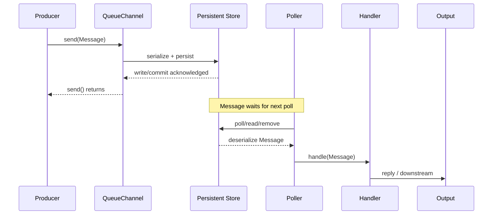
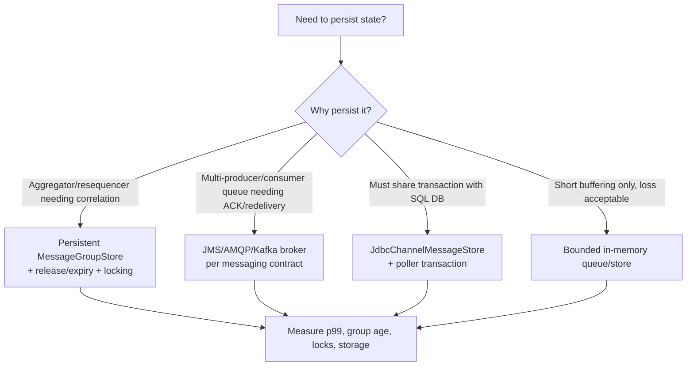
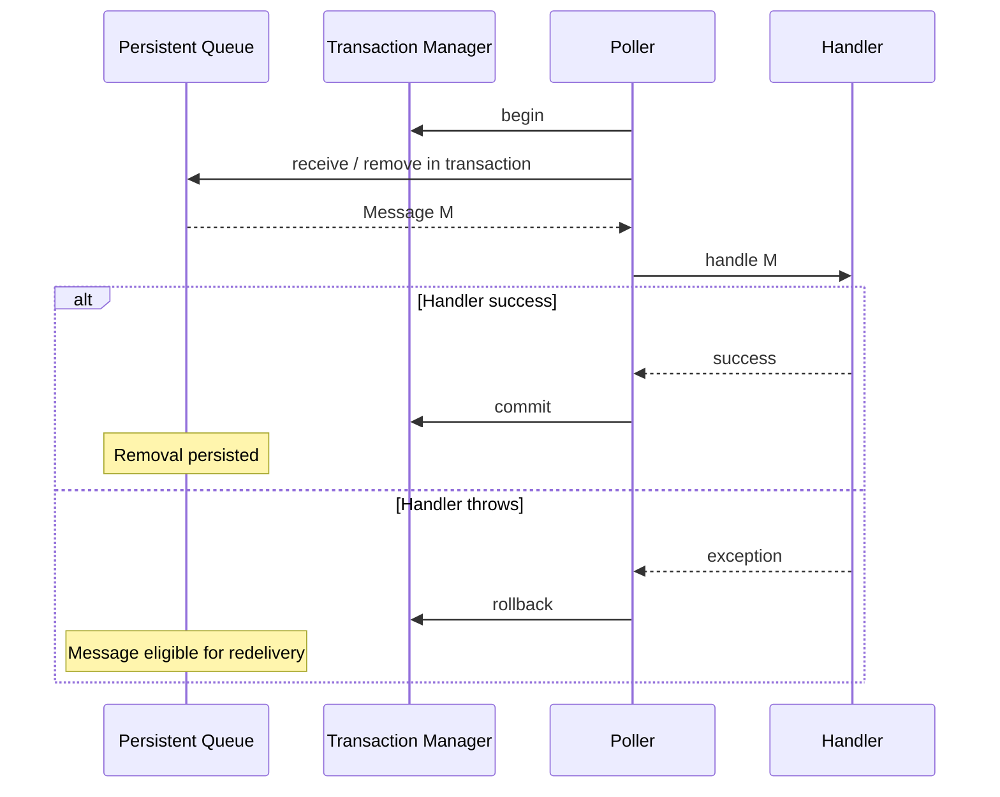
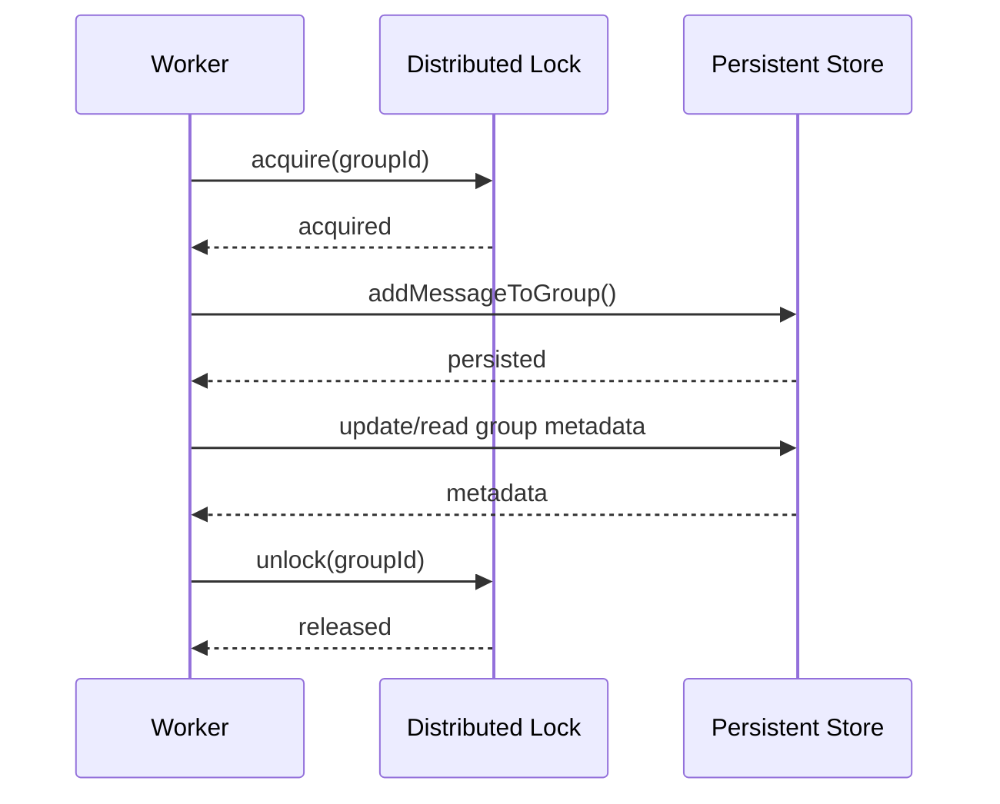
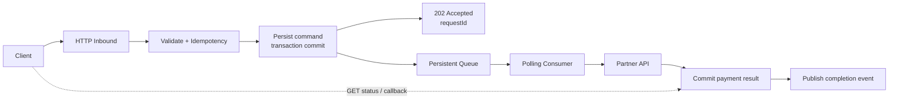

# Message store persistence and latency in Spring Integration Runtime

## 1. The problem: stronger data durability, higher latency?

In Spring Integration, `QueueChannel`, aggregators, resequencers, and delayers are components that can **hold messages for later processing**. When data resides solely in RAM, operations usually involve less I/O, yet unprocessed messages can vanish if the JVM stops unexpectedly. Switching to a **persistent `MessageStore`** (JDBC, Redis, MongoDB, or another backend) gives the system state recovery across restarts, at the cost of serialization, network, database, locking, and transaction overhead.

For example, a user submits an invoice-processing request:

```text
API -> QueueChannel (RAM) -> Poller -> Handler -> Database -> Reply
```

After moving the queue to JDBC:

```text
API -> QueueChannel (JDBC) -> Poller -> Handler -> Database -> Reply
             |                  |
        serialize + INSERT     SELECT/DELETE + deserialize
           + commit             + transaction/locks
```

You may observe:

- `send()` becomes slower because data must be written and committed.
- The poller spends extra time querying the queue; when no messages exist, the database may still be polled repeatedly.
- Workers contend for DB connections or row locks.
- Messages enter the store quickly, yet wait a long time for the next poller turn.
- When an aggregator holds large groups, checking release conditions and loading metadata becomes a bottleneck.
- After a restart, the system must read and rebuild pending groups/messages, slowing startup.
- A misconfigured transaction reduces throughput or causes duplicates/redeliveries.

**Message store persistence and latency** belongs to the **Performance** chapter of the **`SPRING_INTEGRATION_RUNTIME`** module. This lesson connects directly to how Spring Integration runs and coordinates message flows across channels, endpoints, consumers, pollers, and executors; `IntegrationFlow` lifecycle, transactions, retries, message stores, error handling, and correlation; while analyzing threading, performance, and runtime state.

### 1.1. Learning objectives

After studying this lesson, you will be able to:

1. Distinguish **durability, delivery guarantees, throughput, latency, and backlog**.
2. Understand when to use `SimpleMessageStore`, `JdbcChannelMessageStore`, `JdbcMessageStore`, Redis/MongoDB stores, or a broker.
3. Decompose latency across **write, commit, queue wait, poll, deserialize, lock, handler, retry, and reply**.
4. Configure a JDBC-backed `QueueChannel` and an aggregator using a message group store.
5. Measure p50/p95/p99 and throughput reproducibly without mistaking an in-RAM benchmark for a production workload.
6. Diagnose SQL/indexes, connection pools, transaction boundaries, polling intervals, and message group growth.
7. Design backpressure, scaling, recovery, observability, and restart/rollback tests.

**References:** Spring Integration **6.x** (primarily 6.5), Java 17+, Spring JDBC; examples use PostgreSQL when illustrating query providers. Benchmark numbers in this article are explicitly noted as **hypothetical**, not measurements from your environment.

## 2. Concepts to keep separate

### 2.1. Persistence does not automatically mean exactly-once

| Property | Question | Meaning |
|---|---|---|
| **Persistence** | Has the message been written outside the JVM? | Can survive process restart depending on backend/commit |
| **Durability** | Does a committed message survive a specific failure? | Depends on WAL/AOF, replication, storage policy, failover |
| **Acknowledgment** | What did producer/consumer confirm? | Send ACK, store ACK, processing, and business commit are distinct milestones |
| **At-least-once** | Can a message be redelivered? | Requires duplicate handling/idempotency |
| **At-most-once** | Can a message be lost without retry? | Depends on adapter and ACK policy |
| **Exactly-once business effect** | Does one business operation produce exactly one side effect? | Requires transactions/idempotency/unique constraints/outbox depending on the case |
| **Latency** | How long does one message take through the flow? | Requires defining clear start and end points |
| **Throughput** | How many messages are processed per unit of time? | Usually measured as sustainable messages/s |
| **Backlog** | How many messages are still waiting? | Grows when arrival rate exceeds service rate |

A JDBC-backed `QueueChannel` can recover committed messages after a restart; that does **not** mean an external HTTP call outside the transaction is rolled back if a downstream handler fails.

### 2.2. MessageStore, MessageGroupStore, and ChannelMessageStore

Spring Integration separates several abstractions:

| Interface/type | Typical purpose | Examples |
|---|---|---|
| `MessageStore` | Store/retrieve messages by ID (claim check) | `JdbcMessageStore` |
| `MessageGroupStore` | Store state by group ID, correlation/release/expiry | `JdbcMessageStore`, `RedisMessageStore` |
| `BasicMessageGroupStore` | Minimal group operations, capable of backing queues | `JdbcChannelMessageStore` |
| `ChannelMessageStore` | Optimized for `QueueChannel` | `JdbcChannelMessageStore`, `RedisChannelMessageStore` |
| `MessageGroupQueue` | `BlockingQueue<Message<?>>` adapter over a group store | `new MessageGroupQueue(store, "queue-id")` |
| `SimpleMessageStore` | In-memory store | Tests/dev or non-durable use cases |

**Pick implementations per use case.** Spring Integration recommends `JdbcChannelMessageStore` for backing message channels, while `JdbcMessageStore` suits aggregators/claim checks. Do not assume both stores have identical query costs and data layouts.

### 2.3. Persistence does not always cost the same

A backend may return an ACK after:

- A RAM/local cache operation.
- A network round-trip to Redis.
- A database write committed to the WAL.
- A write with synchronous replication.
- A batch flushed after a delay.
- A transaction spanning message receive, business processing, and message removal.

Safety guarantees and latency depend on the specific contract. For example, **a Redis-backed store does not inherently provide the same durability as a JDBC transaction**; you must account for Redis persistence (RDB/AOF), replication, eviction, failover, and serialization. Never rank a backend “always faster” based solely on product name.

## 3. Decomposing end-to-end latency

### 3.1. Timeline of a message



A reasonable latency model:

```text
L_end_to_end
  = L_send_to_store
  + L_store_commit
  + L_queue_wait
  + L_poll_read_remove
  + L_deserialization
  + L_handler
  + L_retry_backoff
  + L_reply_dispatch

In real deployments, some components overlap:
- serialization may happen inside send/store write;
- poller commit may happen AFTER the handler;
- broker or gateway acks have separate boundaries.
```

Do not double-count `commit` with `send()` if your `send()` timer already covers commit time. Always document **timer scope** clearly.

### 3.2. Queue waiting is often overlooked

Suppose a publisher sends 50 messages/s while the consumer processes only 35 messages/s. In one second, backlog grows by roughly 15 messages if rates hold steady; after one minute, it grows by roughly 900 messages.

```text
Arrival rate λ = 50 msg/s
Service rate μ = 35 msg/s
Backlog growth ≈ λ - μ = 15 msg/s (when λ > μ persists)
```

Backing the queue with a persistent store **does not eliminate** the rate mismatch. It shifts backlog accumulation from heap to storage; disk usage, transaction logs, and indexes keep growing unless the producer is throttled.

For a stable system, Little's Law states:

\[L = \lambda W\]

- `L`: average number of messages in the system.
- `λ`: average completion throughput (messages/s) in steady state.
- `W`: time a message spends in the system (s).

If on average 1,000 messages are queued/in-flight and steady throughput is 200 msg/s, then `W ≈ 5 s`. This is an **average relationship**, not a basis to claim p99 is only 5 seconds or to apply when backlog grows without bound.

### 3.3. Polling intervals add latency even when handlers are fast

For a polling consumer running on a fixed delay/fixed rate with randomly arriving messages, if the poller is **idle, regular, and uncontended**, expected wait until the next poll is roughly **T/2** for poll period `T`.

For example, with `T=1 s`, average waiting from the poll schedule alone can be near 500 ms. **This is an intuitive approximation**, not an SLA or guarantee; backlogs, batch sizes, transactions, scheduling jitter, and poller concurrency can lengthen waits substantially.

`maxMessagesPerPoll` controls messages per cycle; raising it can drain backlogs faster, yet also makes a single transaction or polling task hold a worker longer. Tune using empirical measurements.

### 3.4. p99 latency does not equal average

Two systems can share nearly identical mean latency while having vastly different tails:

| Metric | Hypothetical A | Hypothetical B |
|---|---:|---:|
| Mean end-to-end | 90 ms | 92 ms |
| p50 | 65 ms | 55 ms |
| p95 | 160 ms | 180 ms |
| p99 | 250 ms | 1,200 ms |
| Timeout rate | 0.1% | 2% |

**Numbers in the table are illustrative examples.** With persistent stores, tail spikes can come from DB checkpoints, GC, lock contention, connection acquisition, replica failovers, or very large groups.

Measure **p50/p95/p99, timeouts/retries, throughput, and backlog** together instead of optimizing a single average.

## 4. Choosing a store for latency and reliability

### 4.1. Qualitative comparison table

| Option | Where data lives | Strengths | Risks/costs to test |
|---|---|---|---|
| `SimpleMessageStore` | JVM heap | No network/database I/O for the store | State lost on crash; heap pressure, GC, capacity limits |
| `JdbcMessageStore` | Relational database | Group persistence, SQL transactions, easy audit/query | Serialization, SQL/indexes, row locks, DB pool, group size |
| `JdbcChannelMessageStore` | JDBC queue table | Optimized put/take message operations for channels | Polling SQL, WAL/IOPS, transaction conflicts, queue growth |
| `RedisMessageStore` | Redis | Shared key-value/group state, usually low network I/O | Durability/eviction config, serialization, TTL, failover |
| `RedisChannelMessageStore` | Redis LIST per channel | Specialized queue operations | Redis availability, persistence, memory, network, hot keys |
| MongoDB stores | Mongo collections/documents | Flexible document backing, stores metadata | Indexes/write concern, BSON, queries/transactions, document/group sizing |
| JMS/AMQP broker | Message broker | Queuing/delivery/ACK designed specifically for messaging | Broker setup, ACK/redelivery, partitions, ordering, network |
| Kafka transport | Append-only log/broker | Durable event streaming/replay and consumer groups | Consumer lag, offset semantics, per-partition ordering; not a drop-in MessageGroupStore |

**There is no universally best choice.** If you need an aggregator holding state by group ID, pick a suitable `MessageGroupStore`; if you need a durable high-volume queue, a dedicated broker is usually more appropriate than turning a relational DB into a hot queue.

Spring Integration 6.5 documentation **discourages using a relational database as a queue** without strong justification, suggesting JMS/AMQP-backed channels instead.

### 4.2. Decision framework



If an application already uses PostgreSQL with moderate traffic, `JdbcChannelMessageStore` can be a pragmatic option to share a single transaction manager. Still, verify **database throughput headroom and concurrency**, never assuming fewer infrastructure pieces automatically yield lower latency.

### 4.3. Guarantees by failure mode

Every store selection must be backed by tests for:

- Restarting the application immediately after `send()` is confirmed.
- Killing the process while messages sit in the store.
- Handler failure before vs. after DB commit.
- Database failover while the poller holds a transaction.
- Retries/redeliveries after a caller timeout.
- Store full, disk full, or database connection pool blocked.
- Message serializer version changes.
- Multiple JVMs sharing one backend.

Never write “durable = true” in an architecture doc without stating **which failures are tolerated, which ACK milestone applies, and what data is committed**.

## 5. Configuring a persistent QueueChannel with JDBC

### 5.1. Why use JdbcChannelMessageStore?

`JdbcChannelMessageStore` is a channel-specific implementation optimized for FIFO/priority queues in its own dedicated table. Avoid using the general-purpose `JdbcMessageStore` for high-throughput queues without good reason. Spring Integration provides DB-specific `ChannelMessageStoreQueryProvider` implementations because poll queries must match SQL dialects.

For PostgreSQL on Spring Integration 6.2+, the query provider uses a single-statement `DELETE ... RETURNING` poll path—an important optimization to account for in benchmarks. Use the matching PostgreSQL query provider version rather than assuming all DBs execute identical SQL.

### 5.2. Java configuration example

Requires `spring-integration-jdbc`, PostgreSQL driver, and Spring JDBC/transaction dependencies. Tables must already be created from Spring Integration's schema scripts before startup.

```java
import javax.sql.DataSource;

import org.springframework.context.annotation.Bean;
import org.springframework.context.annotation.Configuration;
import org.springframework.integration.channel.QueueChannel;
import org.springframework.integration.jdbc.store.JdbcChannelMessageStore;
import org.springframework.integration.jdbc.store.channel.PostgresChannelMessageStoreQueryProvider;
import org.springframework.integration.store.MessageGroupQueue;
import org.springframework.messaging.PollableChannel;

@Configuration
class JdbcQueueConfig {

    @Bean("orders.channelStore")
    JdbcChannelMessageStore channelStore(DataSource dataSource) {
        JdbcChannelMessageStore store =
                new JdbcChannelMessageStore(dataSource);

        store.setChannelMessageStoreQueryProvider(
                new PostgresChannelMessageStoreQueryProvider());
        store.setRegion("payments-prod");

        return store;
    }

    @Bean("orders.persisted")
    PollableChannel durableQueue(
            JdbcChannelMessageStore channelStore) {

        return new QueueChannel(new MessageGroupQueue(
                channelStore,
                "orders.persisted")); // stable groupId across restarts
    }
}
```

In this example:

- `setRegion("payments-prod")` namespaces rows in the table to prevent key collisions across applications/instances sharing a database.
- `"orders.persisted"` is the queue's group ID and **must remain stable across restarts** to read older messages.
- `MessageGroupQueue` implements `BlockingQueue<Message<?>>` backed by `BasicMessageGroupStore`.
- The `QueueChannel` bean is still a `PollableChannel`; it **does not create a poller automatically**. A polling consumer must consume from the channel.
- `JdbcChannelMessageStore` validates required tables at startup (6.2+); if the schema has not been provisioned, `ApplicationContext` startup can fail.

**Note on injection names:** in applications with multiple `JdbcChannelMessageStore` beans, use `@Qualifier("orders.channelStore")` instead of relying on incidental bean names. Here only one store exists, so autowiring by type suffices.

### 5.3. Polling consumer: work after retrieving a message

```java
import org.springframework.context.annotation.Bean;
import org.springframework.integration.annotation.Poller;
import org.springframework.integration.annotation.ServiceActivator;
import org.springframework.messaging.Message;

@Bean
OrderConsumer orderConsumer() {
    return new OrderConsumer();
}

class OrderConsumer {

    @ServiceActivator(
            inputChannel = "orders.persisted",
            poller = @Poller(
                    fixedDelay = "100",
                    maxMessagesPerPoll = "10"))
    public void consume(Message<String> message) {
        // Example: handler is invoked by the poller, not the producer thread.
        System.out.println("processing " + message.getPayload());
    }
}
```

Place `@Bean` inside an application `@Configuration`; `@ServiceActivator` sits on a Spring-managed bean. This pattern has **no transaction advice**: it illustrates scheduling, and does not guarantee `receive()+handler` roll back as one unit.

Never set `maxMessagesPerPoll=10` expecting an automatic SQL/transaction batch wrapping all 10 messages: receive counts, transaction boundaries, and batching depend on explicit poller configuration.

### 5.4. XML for a transactional poller

Example following Spring Integration JDBC configuration; Spring transaction manager and DataSource must be properly configured:

```xml
<int:channel id="ordersPersisted">
    <int:queue message-store="jdbcChannelStore"/>
</int:channel>

<bean id="jdbcChannelStore"
      class="org.springframework.integration.jdbc.store.JdbcChannelMessageStore">
    <property name="dataSource" ref="dataSource"/>
    <property name="channelMessageStoreQueryProvider" ref="postgresProvider"/>
    <property name="region" value="payments-prod"/>
</bean>

<bean id="postgresProvider"
      class="org.springframework.integration.jdbc.store.channel.PostgresChannelMessageStoreQueryProvider"/>

<int:service-activator
        input-channel="ordersPersisted"
        ref="orderHandler"
        method="handle">
    <int:poller fixed-delay="100" max-messages-per-poll="1">
        <int:transactional transaction-manager="transactionManager"/>
    </int:poller>
</int:service-activator>
```

This is a **configuration snippet** to place inside an XML file with proper `int` and `beans` namespaces; `dataSource`, `transactionManager`, and `orderHandler` beans are omitted here. If receive, business DB work, and remove must share one transaction, verify they share the same transaction manager with no async boundary breaking the thread-bound context.

**Why set `max-messages-per-poll=1` in the transaction example?** To make individual messages and transactions easy to observe in a first example. Increasing messages/poll does not automatically wrap the whole batch in one transaction, and can alter contention/latency.

### 5.5. When is capacity used?

With an in-RAM `QueueChannel`, `new QueueChannel(100)` creates a bounded queue. With a persistent queue, XML `<int:queue message-store="..."/>` **does not allow setting `capacity` at the same time** according to the reference docs.

To bound total durable backlog, enforce quotas at the upstream/producer or design a bounded `MessageGroupQueue` per contract; such limits do not replace disk-usage/backpressure policies. When a queue is shared across multiple nodes, capacity bounds must be enforced cluster-wide, not merely in one node's memory.

## 6. Transactions: latency and correctness are always linked

### 6.1. Why do transactions increase processing time?

A JDBC-backed message queue typically performs multiple steps:

```text
Producer:
    serialize -> INSERT -> COMMIT

Poller (without valid transaction):
    SELECT/DELETE -> deserialize -> handler
    handler fails -> uncertain whether message remains in store

Poller (transactional with compatible store):
    BEGIN
    SELECT/DELETE -> deserialize
    handler + DB operations
    COMMIT     (or ROLLBACK on failure)
```

Different milestones carry different costs:

- Acquiring a connection from the pool.
- Waiting on locks/row visibility and reading indexes.
- Running SQL read/delete statements.
- Deserializing payload and headers.
- Executing the handler.
- Flushing the transaction log, committing or rolling back.
- Releasing the connection/locks.
- Waiting for the next redelivery/retry.

**Commit latency** cannot be eliminated simply by adding threads. If the DB is already saturated on IOPS or connection pool slots, adding consumers can worsen contention and p99.

### 6.2. Transaction rollback can retain the message

Spring Integration documentation states that for a `QueueChannel` with a **transactional persistent store** and a **transactional poller**, the message is permanently removed when the transaction commits successfully; rolling back leaves the message eligible to be received again.



Do not assume that an exception sent to `errorChannel` means the message was requeued. **Error reporting** and **transaction outcome** are separate things. With an in-memory `SimpleMessageStore`, adding `@Transactional` to business code does not give the in-memory queue rollback durability.

### 6.3. Note on async boundaries

Suppose:

```text
Poller -> QueueChannel(JDBC).receive()
       -> ExecutorChannel
       -> handler(@Transactional)
```

`ExecutorChannel` switches threads. The poller thread's transaction can complete **before the handler runs**, because async dispatch returned immediately. When the handler fails, the message may already be removed/committed in the store and cannot be rolled back.

If `receive()+process()+ack/remove` must share one transaction, design the flow synchronously within the transaction scope, or use an explicit ACK mechanism/durable broker per contract. **Never treat `@Transactional` on an async handler as protecting the `receive` operation on the prior thread.**

### 6.4. Trade-off table

| Implementation style | Latency | Reliability to verify |
|---|---|---|
| Write message and commit independently | Adds commit before producer `send()` finishes | Message survives restart if commit actually succeeded |
| Poller receives/processes inside transaction | Can lengthen lock hold and connection occupancy | Rollback can restore message depending on store |
| Async handler after receive | Can boost producer throughput | Receive transaction does not follow onto worker thread |
| Single transaction covering message + DB write | Can grow long due to business logic | Suitable only when sharing resource/transaction boundary |
| Retries inside a long transaction | Backoff holds resources for a long time | Timeout/lock contention, rollback-only issues |
| Each retry attempt in its own transaction | More begin/commit calls, shorter lock holds | Requires idempotency and explicit policy |

Avoid placing slow HTTP calls or `Thread.sleep` backoffs inside a database transaction unless strictly necessary.

## 7. SQL, indexes, concurrency, and connection pools

### 7.1. A JDBC queue is not just a simple INSERT/SELECT

`JdbcChannelMessageStore` issues queries tailored to the database dialect. For PostgreSQL, Spring Integration 6.2+ includes a query provider optimizing polls with a single `DELETE ... RETURNING` statement (when `isSingleStatementForPoll=true`), eliminating a separate delete query on the poll path.

Do not write custom manual queries or blame the framework for slowness before checking whether:

- The query provider matches the wrong DB dialect.
- Schema/indexes match the packaged scripts.
- Priority queues require specialized indexes.
- Combining region and group ID creates a hotspot.
- Queue tables grew large and vacuum/bloat causes abnormal I/O.
- The database connection pool is smaller than required concurrency.
- Isolation/lock policies cause contention.

### 7.2. SQL metrics to collect from the database

| Metric source | What to inspect |
|---|---|
| SQL execution stats / `EXPLAIN (ANALYZE, BUFFERS)` | Execution time, scan type, buffer reads |
| Index usage | Are queries actually using indexes on `REGION`/`GROUP_KEY`/`CREATED_DATE`/`MESSAGE_SEQUENCE`? |
| DB connection pool | Active, idle, pending, acquisition timeouts |
| Transaction metrics | Begin/commit/rollback rates, long transaction count |
| Lock wait / deadlocks | Row/table lock contention, blocked sessions |
| WAL/redo log | Write rate, fsync/checkpoint pressure |
| Disk IOPS/latency | Read/write latency, saturation, throughput |
| Database table size | Backlog bytes, index growth, fragmentation |
| Application CPU/GC | Serialization/row-mapping pressure |
| Cross-AZ network | Round-trip latency and jitter |

**Never copy a specific `CREATE INDEX` directly into production from a tutorial example:** PostgreSQL, MySQL, Oracle, and SQL Server differ in indexes, isolation, optimizers, and SQL. Start from your running version's Spring Integration schema/dialect, inspect execution plans on production-like data, and measure each index's benefit.

### 7.3. Concurrent polling can slow things down instead of speeding up

With a JDBC-backed `QueueChannel` and multiple workers:

- Pollers contend on the same group/channel rows.
- Multiple transactions hold locks longer.
- Some databases lack suitable MVCC behavior.
- Connection pools run out of slots due to idle/blocked workers.
- Transaction retries/deadlocks climb.
- DB read/write IOPS hit hardware limits.

Spring Integration Reference highlights checking MVCC behavior during concurrent polling. For databases without suitable MVCC support, `JdbcChannelMessageStore.setUsingIdCache(true)` may be an optimization per the docs, coordinated with `removeFromIdCache` after commit/rollback if configured accordingly. **Never turn on `usingIdCache` as a blanket “make it faster” setting on every database.**

### 7.4. Pool size and executor size do not have a fixed 1:1 ratio

Example:

```text
Executor workers:                 32
JDBC connection pool max:         10
Long handler transaction:         2 s
Connection acquisition p99:       3 s
```

These are **hypothetical numbers**. Even with 32 executor threads, only a limited number of tasks can use the DB concurrently; 22 workers may sit waiting for connections. Raising the pool to 32 might cut wait time yet overload the DB. Measure **pool wait**, DB CPU/locks, handler concurrency, and latency before deciding.

A tuning workflow:

1. Measure query count and connection hold time per message.
2. Capture baseline throughput/latency with a modestly sized pool.
3. Step concurrency up gradually while watching p99 and rollbacks/deadlocks.
4. Stop scaling when throughput stops rising or tail latency/DB utilization degrades.
5. Reserve connections for health checks, management, and other flows.

### 7.5. Regions, queue IDs, and partitioning

Stores shared across multiple JVMs must avoid group-name collisions. `JdbcChannelMessageStore.setRegion(...)` namespaces rows in the same table. If two flows share the same channel group ID and region, they may unintentionally consume each other's messages.

Conversely, changing region or group ID between deployments leaves older messages in the previous namespace where the new flow **cannot see them**. This is frequently misdiagnosed as “persistence lost messages” or “infinite poller latency”.

Across multi-version deploys or tenant migrations, maintain clear migration/quarantine rules for `region`, `groupId`, and queue ownership.

## 8. Serialization: a source of latency and silent bugs

### 8.1. Headers and payloads are not free

A `Message<?>` consists of a payload and headers. With a persistent store:

```text
Java Message
  ├── payload object graph
  └── header map
          ↓ serialization
      bytes / JSON / BSON
          ↓ backend storage
      persisted record
          ↓ read + deserialization
      Java Message (new object)
```

Cost grows with:

- Payload size and object graph depth.
- Header count, especially headers holding large metadata.
- Serializer/deserializer implementation.
- Compression (fewer bytes, higher CPU).
- Network bandwidth and round-trip count.
- DB BLOB/BYTEA handling, object allocations, and GC.

**Accurate measures:** serialized bytes/msg, encode/decode time, allocations/GC, and backend network/DB latency—not just `payload.toString().length()`.

### 8.2. Default JdbcMessageStore and non-serializable headers

Per Spring Integration 6.5 Reference, `JdbcMessageStore` by default requires serializable data; non-`Serializable` headers may be dropped prior to persistence. Certain headers from HTTP/FTP/JMS adapters contain complex objects that may not serialize under default settings.

The problem is not just latency: **losing a header can break functionality**.

- `correlationId`/sequence headers change format.
- Object-valued `replyChannel`/`errorChannel` become invalid after deserialization/restart.
- Custom DTOs become incompatible between two deployment versions.
- Transport metadata triggers classloader/serializer rejections.
- Message history/tracing metadata fails to propagate or bloats record sizes unnecessarily.

**Solution:** design an explicit payload/header persistence contract, choose stable versioned serialization, and when preserving return addresses across a store, use `HeaderChannelRegistry`/header enrichers or named channels per documentation rather than arbitrarily serializing temporary channel objects.

### 8.3. Should you use JSON instead of Java serialization?

There is no universal answer. Comparison:

| Criterion | Java serialization (if supported) | JSON/BSON/Protobuf per backend |
|---|---|---|
| Speed | Depends on object graph/class metadata | Depends on mapper/schema/data types |
| Size | Can be large due to class metadata overhead | Can be smaller or larger depending on format |
| Deploy compatibility | Sensitive to `serialVersionUID`/class changes | Requires schema/versioning and migration |
| Deserialization security | Risks with untrusted payloads/classes | Requires validating types, sizes, polymorphism |
| Header fidelity | Objects preserve types if serializable | May alter numeric/UUID/Date types |
| Debugging | Raw bytes hard to inspect | JSON easy to inspect when non-sensitive |

Never enable unrestricted default typing/polymorphic deserialization on untrusted data. In benchmarks, use identical payloads, identical header counts, and the actual production serializer.

### 8.4. Pattern for measuring encode/decode latency (backend-independent)

If your application serializer exposes serialize/deserialize, you can instrument it:

```java
long start = System.nanoTime();
byte[] encoded = serializer.serialize(message);
long encodeNanos = System.nanoTime() - start;

long decodeStart = System.nanoTime();
Object restored = serializer.deserialize(encoded);
long decodeNanos = System.nanoTime() - decodeStart;

// Record separate timers for encode/decode; never log raw message bytes.
```

`serializer` above is an **application serializer adapter** with `serialize/deserialize` methods. Do not mistake this for automatic `JdbcChannelMessageStore` instrumentation. With a real store, JDBC methods may encompass encode/decode, so instrumenting the serializer layer isolates this cost.

## 9. Aggregators, resequencers, and MessageGroupStore latency

### 9.1. Group state performs more operations than a queue

An aggregator may execute:

```text
Part 1 arrives
  -> resolve correlation key
  -> acquire group lock
  -> persist message into group
  -> update metadata
  -> evaluate release
  -> unlock

Part 2 arrives
  -> same operations

Group ready
  -> load/stream messages
  -> aggregate payloads
  -> mark complete / remove group
  -> send result
```

Total duration of a logical group is not just single-message latency; it also depends on **when the last part arrives** and release/cleanup costs.

If a group has 1,000 parts, loading all 1,000 messages on every incoming part would be prohibitively expensive. Spring Integration optimizes this via lazy loading and metadata/group conditions.

### 9.2. Lazy-loading MessageGroup is a key optimization

Spring Integration 6.5 describes persistent `MessageGroupStore` using lazy loading to avoid loading the entire message collection on every correlation/release check. `AbstractMessageGroupStore.setLazyLoadMessageGroups(false)` disables this behavior, but usually requires clear measurement justification first.

Size-based release example:

```java
import org.springframework.integration.aggregator.ReleaseStrategy;
import org.springframework.integration.store.MessageGroup;

ReleaseStrategy releaseWhenComplete = (MessageGroup group) ->
        group.size() >= 1000;
```

Benefit: on supporting backends, `group.size()` and metadata can be evaluated without deserializing all message parts. However, when actually aggregating, processing still reads payloads; lazy loading **does not eliminate required I/O**, it eliminates redundant loads before release.

Spring Integration documentation cites a historical lazy vs. eager benchmark on MongoDB with 1,000-message groups. That is an **illustration in the docs**, not a throughput/speedup prediction for your DB and data.

### 9.3. streamMessagesForGroup for large groups

Since Spring Integration 5.5, persistent `MessageGroupStore` implementations support `streamMessagesForGroup(groupId)` backed by the store's streaming API, avoiding materializing huge groups in RAM. The stream must be **closed**:

```java
import java.util.stream.Stream;
import org.springframework.integration.store.MessageGroupStore;
import org.springframework.messaging.Message;

MessageGroupStore store = ...;
Object groupId = "tenant-A:run-42";

long count = 0;
try (Stream<Message<?>> messages =
        store.streamMessagesForGroup(groupId)) {

    count = messages
            .filter(m -> m.getPayload() != null)
            .count();
}
System.out.println("read " + count);
```

This counting example illustrates resource cleanup; in real apps, `MessageGroupStore` can supply metadata counts more efficiently rather than streaming every part just to count. With JDBC streaming, closing the stream is crucial because cursors/connections may remain held while iterating.

**Avoid slow external HTTP calls inside a stream loop holding a DB cursor** whenever possible; balance memory savings against connection hold time.

### 9.4. Group conditions and ReleaseStrategy

`MessageGroup` has a `condition` (String) and `MessageGroupStore.setGroupCondition(...)`; since 5.5, `AbstractCorrelatingMessageHandler.setGroupConditionSupplier(...)` lets metadata conditions update as messages are added.

A `ReleaseStrategy` can rely on the condition (expected part count/marker) instead of scanning the entire group every time. This can cut queries and deserializations for large groups.

However, the condition must be computed **correctly under concurrency and out-of-order arrivals**. If metadata drifts, release may fire early or never fire, creating far more backlog and latency than the optimization saved.

### 9.5. Correlation key collisions can create hot groups

An overly coarse key like `tenantId` instead of `tenantId+orderId+runId` funnels many logical requests into one group. Consequences:

- Groups bloat.
- Multiple threads contend on the same group lock.
- The release strategy receives fragments from unrelated requests.
- Store reads/writes form a hotspot.
- Heap and DB load climb.
- Business results may become incorrect.

**Locks do not fix business key collisions**; they only serialize access to the wrong group. Use stable composite/opaque keys and test same-tenant/same-order across separate runs.

### 9.6. Group lifecycle and cleanup

A group that is never released or expired can linger indefinitely in a persistent store. `SimpleMessageStore`'s `groupCapacity` is not a TTL; persistent groups also require timeouts/expiry/reapers depending on the endpoint.

When designing:

- The release strategy must match sequence/business rules.
- Group timeouts must align with part SLAs.
- Late arrivals and completed tombstones need explicit policies.
- Discard/recovery channels must have consumers.
- Group metadata and messages are cleaned up according to a verified policy.
- Never delete production groups ad hoc while transactions/workers hold locks.

## 10. Locking, clustering, and synchronization cost

### 10.1. One key updated by multiple threads

In Spring Integration 6.5, `AbstractMessageGroupStore` uses a `LockRegistry` to guard message group metadata operations by group ID, defaulting to `DefaultLockRegistry`. Across multiple replicas sharing a persistent store, the local default registry **does not synchronize locks across JVMs**.

Therefore check:

- Are aggregators/resequencers using the right lock registry?
- Is the store configured with a registry matching the backend?
- Do all instances share the same lock namespace?
- Is there group ownership/partitioning, or do multiple nodes update the same group?
- What are lock wait p99, hold time, and ownership-loss/lease-expiry counts?

### 10.2. Distributed locks are not free

A `JdbcLockRegistry`/`RedisLockRegistry` can require network round-trips to acquire/renew/unlock. If each message requires a group lock and DB writes, latency can include several network calls.



Never remove distributed locks for higher throughput if multiple JVMs could corrupt group state. Valid optimizations usually involve **shortening critical sections**, reducing metadata reads, partitioning group IDs properly, co-locating backends/locks, and bounding per-group concurrency.

### 10.3. TTL expiration while holding a lock

If a distributed lock lease expires while a worker is still processing, another worker may acquire the lock and touch the same group. The first worker's `unlock()` can fail with an ownership error (in Spring Integration 6.4+ some registries may throw `ConcurrentModificationException`). This is a correctness bug, not merely p99 latency.

Mitigations per requirements:

- Choose TTL and renewal intervals aligned with maximum lock hold time.
- Avoid HTTP calls or backoff sleeps inside critical sections.
- Alert when renew/unlock fails.
- Use optimistic versioning/fencing/idempotency when target systems need strong guarantees.
- Test network partitions/GC pauses in staging.

Never manually delete Redis/JDBC lock rows to “unblock” traffic without verifying whether a new owner already holds the lock.

## 11. Backpressure and capacity: keeping latency sustainable

### 11.1. A larger store does not make downstream faster

A persistent queue can hold far more messages than the heap, yet if handlers consume only 30 msg/s while producers send 100 msg/s, backlog still grows by ~70 msg/s.

```text
t=0:     backlog 0
t=60s:   backlog ≈ 4,200 messages
t=600s:  backlog ≈ 42,000 messages
(assuming steady rates, no throttling)
```

Compounding effects:

- `Queue waiting` stretches from minutes to hours.
- Retention/storage footprint grows; index and vacuum pressure climb.
- Gateway `replyTimeout` errors start rising.
- After restarts, the queue survives, yet draining the backlog takes a very long time.
- Storage space or quotas may fill up, triggering error storms.

### 11.2. Combining bounded admission with durable buffering

Available tools:

1. **Rate limiting** at ingress or producers.
2. **Concurrency limits** for handlers/remote clients.
3. **Backpressure** from publishers to subscribers when the topology is truly reactive.
4. **Bounded in-memory prebuffers** with explicit send timeouts.
5. **Durable brokers/queues** with quotas, retention, DLQs, and lag alerts.
6. **Load shedding / rejection** with explicit responses rather than silent drops.
7. **Circuit breakers / retry budgets** to avoid retry storms when the DB/store slows down.

Adding poller threads helps only when **handler concurrency is the bottleneck** and the store/DB has headroom; if DB locks/IOPS are the bottleneck, scaling threads can worsen latency.

### 11.3. Do not put retry backoffs inside long polling transactions

If retries run within the same transaction or while holding a group lock, multi-second backoffs hold connections/locks open. Design retries with separate attempts, delayed queues, or broker redelivery paired with idempotency.

A message retried multiple times must be measured by **end-to-end time from first receipt to final state**, not just per attempt. If a retry succeeds on the third attempt after the caller already timed out, business outcomes must be reconciled.

## 12. Benchmark design: what to measure before blaming persistence

### 12.1. Separate microbenchmarks from end-to-end benchmarks

A measurement plan should cover **at least three layers**:

| Layer | Measurement scope | What it cannot tell you |
|---|---|---|
| **Store operation** | `addMessageToGroup`, `poll`, serialize/deserialize, commit | Does not show gateway latency, retries, queue wait |
| **Channel round trip** | `QueueChannel.send()` + `receive()` | Does not reflect poller scheduling, handlers/external APIs |
| **End-to-end flow** | Ingress → persist → poll → handler → reply/outcome | Without separate spans, hard to tell store vs. handler cause |

Add **reliability tests** (restart, rollback, redelivery), which throughput benchmarks cannot replace.

### 12.2. Variables to control

In every benchmark run, record:

- **Backend:** PostgreSQL/MySQL/Redis/MongoDB version, disk, instance type, WAL/fsync/write concern, network AZ.
- **Spring Integration:** version, `JdbcChannelMessageStore`/`JdbcMessageStore`/`RedisChannelMessageStore`, query provider, and serializer.
- **Schema:** table prefix, region, indexes, row counts, table bloat, and retention.
- **Concurrency:** producer threads, poller threads, DB connection pool, executor size, ACK/transaction settings.
- **Payload:** byte size, type (String/DTO/byte[]), header count, unique group IDs, compression.
- **Load:** arrival process, batch/burst size, sustained throughput, warm-up, experiment duration.
- **Environment:** JVM heap, GC, CPU/memory limits, data volume, network RTT, scheduler tick.
- **Correctness:** accepted/completed/pending/duplicate/rejected counts, transaction outcomes.

Do not change store backend, serializer, and thread pool in the same run and guess which variable caused the difference. Vary **one parameter group per run**.

### 12.3. Java example for measuring store round-trip

The snippet below assumes a `QueueChannel` backed by a `MessageGroupQueue` of the store under test; it does not replace JMH and does not represent an asynchronous flow.

```java
import java.util.Arrays;
import java.util.concurrent.TimeUnit;

import org.springframework.integration.channel.QueueChannel;
import org.springframework.messaging.Message;
import org.springframework.messaging.support.MessageBuilder;

public final class QueueStoreLatencyProbe {

    private QueueStoreLatencyProbe() {}

    public static long[] run(QueueChannel queue, int count) {
        if (count <= 0) {
            throw new IllegalArgumentException("count must be > 0");
        }

        long[] samplesNanos = new long[count];

        for (int i = 0; i < count; i++) {
            Message<String> message =
                    MessageBuilder.withPayload("order-" + i)
                            .setHeader("testRun", "latency-probe-1")
                            .build();

            long started = System.nanoTime();

            if (!queue.send(message, 5_000)) {
                throw new IllegalStateException("send rejected at " + i);
            }

            Message<?> received = queue.receive(5_000);
            if (received == null) {
                throw new IllegalStateException("no reply at " + i);
            }

            samplesNanos[i] = System.nanoTime() - started;
        }

        return samplesNanos;
    }

    public static void printPercentiles(long[] samplesNanos) {
        long[] sorted = samplesNanos.clone();
        Arrays.sort(sorted);

        int n = sorted.length;
        System.out.printf(
                "n=%d p50=%.3fms p95=%.3fms p99=%.3fms%n",
                n,
                toMillis(sorted[(int) Math.ceil(0.50 * n) - 1]),
                toMillis(sorted[(int) Math.ceil(0.95 * n) - 1]),
                toMillis(sorted[(int) Math.ceil(0.99 * n) - 1]));
    }

    private static double toMillis(long nanos) {
        return nanos / (double) TimeUnit.MILLISECONDS.toNanos(1);
    }
}
```

**How to interpret results:**

- `run()` intentionally measures **back-to-back send + receive of one message**, covering construction/retrieval, store, and deserialization depending on the implementation. It **excludes** poller scheduling, multi-consumer contention, handlers, and external networks.
- Each message is built **before starting the clock**, keeping `MessageBuilder` allocation outside the timer.
- p50/p95/p99 use nearest-rank; for small `n`, p99 is unreliable.
- `send(message, 5_000)`/`receive(5_000)` have timeouts, though those timeouts do not necessarily bound **the latency of every blocking JDBC call** underneath.
- If another producer/consumer shares the queue during the test, results no longer match 1:1. Use a dedicated test queue and dedicated group ID.
- Never run against real production data. With a persistent backend, the test writes database rows/transactions and generates I/O.

### 12.4. RAM and JDBC baselines in the same harness

Example at the test/benchmark layer:

```java
import org.springframework.integration.channel.QueueChannel;
import org.springframework.integration.store.MessageGroupQueue;
import org.springframework.integration.store.SimpleMessageStore;

// RAM config:
QueueChannel memoryQueue = new QueueChannel(10_000);

// Persistent config with schema/transactions already initialized:
QueueChannel jdbcQueue = new QueueChannel(
        new MessageGroupQueue(jdbcChannelStore, "benchmark-run-001"));

// Warm up both with independent datasets before recording.
// Do not let application pollers consume the benchmark queue concurrently.
long[] memorySamples = QueueStoreLatencyProbe.run(memoryQueue, 5_000);
long[] jdbcSamples = QueueStoreLatencyProbe.run(jdbcQueue, 5_000);

QueueStoreLatencyProbe.printPercentiles(memorySamples);
QueueStoreLatencyProbe.printPercentiles(jdbcSamples);
```

`jdbcChannelStore` must be a configured `JdbcChannelMessageStore` bean; neither queue may have other consumers. In a real harness, **discard warm-up samples**, use fresh group IDs or clean up test rows via transactions/cleanup, repeat across multiple runs, and **alternate order** between the two configurations to reduce cache/GC bias.

**Never report a ratio like “JDBC is N times slower than RAM” without measuring on your exact workload.** Costs depend on payloads, indexes, DB load, network, durability policies, commits, and concurrency.

### 12.5. End-to-end tests with steady and burst traffic

A useful test matrix:

| Workload | Arrival | Payload | Consumers | Goal |
|---|---|---|---|---|
| Baseline | 20 msg/s | 1 KB | 1 | Measure low-load overhead |
| Sustained | 100 msg/s | 4 KB | 4 | Measure steady-state p95/p99 |
| Bursty | 300 msg/s for 30 s | 4 KB | 4 | Measure backlog and drain time |
| Large payload | 50 msg/s | 256 KB | 4 | Measure encoding/network/GC |
| Hot group | 100 parts/s same group | 1 KB | 8 | Measure locks, metadata latency |
| Many groups | 100 parts/s distinct group IDs | 1 KB | 8 | Measure cardinality/cleanup |
| Failure | 100 msg/s, DB delay spikes | 4 KB | 4 | Measure timeouts, retry storms |
| Restart | 10,000 msg backlog | 4 KB | 4 | Measure recovery and startup delay |

**All rates, payloads, and durations in the table are suggested test parameters**, not benchmark results.

Measure at least:

- Ingress accepted, rejected, completed, timed out.
- End-to-end latency histograms.
- Enqueue/store write and commit.
- Queue wait + dequeue/store read.
- Handler processing, retries/backoff.
- Oldest message age, queue/group counts.
- JVM CPU/heap/GC and DB locks/IOPS.
- Side-effect duplicates and transaction rollbacks.
- Drain time after bursts, restarts, and failovers.

## 13. Instrumentation with Micrometer and tracing

### 13.1. Timers for send and receive

Use Micrometer `Timer` to measure **code segment durations** without putting correlation IDs into tags:

```java
import java.util.concurrent.TimeUnit;

import io.micrometer.core.instrument.MeterRegistry;
import io.micrometer.core.instrument.Timer;
import org.springframework.messaging.Message;
import org.springframework.messaging.MessageChannel;

public class TimedSender {

    private final MessageChannel channel;
    private final Timer sendTimer;

    public TimedSender(MessageChannel channel, MeterRegistry registry) {
        this.channel = channel;

        this.sendTimer = Timer.builder("orders.channel.send")
                .description("Time to attempt send to orders channel")
                .tag("channel", "orders.persisted")
                .publishPercentileHistogram()
                .register(registry);
    }

    public boolean send(Message<?> message) {
        long started = System.nanoTime();
        try {
            return channel.send(message);
        }
        finally {
            sendTimer.record(
                    System.nanoTime() - started, TimeUnit.NANOSECONDS);
        }
    }
}
```

This snippet does not separate **send accepted**, **send rejected**, and **exceptions**; add outcome-tagged counters separately. Also, `send()` on a persistent `QueueChannel` may include the store write, so do not double-add a store-write timer to total latency over the same scope.

### 13.2. Measuring queue wait in a controlled way

Attach a timestamp at ingress and extract it when the poller retrieves the message:

```java
import org.springframework.messaging.Message;
import org.springframework.messaging.support.MessageBuilder;

Message<String> message = MessageBuilder.withPayload("ORD-42")
        .setHeader("queuedAtEpochMillis", System.currentTimeMillis())
        .build();

// In consumer after receive():
Object timestamp = message.getHeaders().get("queuedAtEpochMillis");
if (timestamp instanceof Number number) {
    long queuedMillis = number.longValue();
    long wait = System.currentTimeMillis() - queuedMillis;

    // Record metric after validating clock skew.
    queueWaitTimer.record(
            Math.max(0, wait), TimeUnit.MILLISECONDS);
}
```

From constructing the `Message` to being polled can include **send/store-write time**; to measure pure queue wait, stamp **after send commit** or add a second instrumentation timestamp. Across multiple JVMs, wall clocks can drift: evaluate p99 alongside NTP and account for clock skew; never subtract `nanoTime()` timestamps across processes.

### 13.3. Spring Integration management/Observation

Spring Integration 6.x supports Micrometer metrics/Observation for channels, handlers, gateways, and polling components as configured. Example:

```java
import org.springframework.context.annotation.Configuration;
import org.springframework.integration.config.EnableIntegration;
import org.springframework.integration.config.EnableIntegrationManagement;

@Configuration
@EnableIntegration
@EnableIntegrationManagement(observationPatterns = "*")
class IntegrationObservabilityConfig {}
```

An appropriate `ObservationRegistry`/handlers must exist in the ApplicationContext. In Spring Boot, rely on Actuator/Micrometer autoconfiguration where appropriate and avoid registering duplicate registries that drop exporters.

**Avoid double-counting:** the `spring.integration.send` timer or `spring.integration.producer` observation measures component scopes and **does not automatically measure total queue wait** or end-to-end business latency. Add an ingress→terminal-outcome histogram when tracking business SLAs.

### 13.4. Never use message IDs as time-series tags

Usable tags:

```text
component=orders.persisted
storeType=jdbc
region=payments-prod
operation=send
outcome=success|error|timeout
```

Never put `messageId`, `correlationId`, or `orderId` into per-message Prometheus/Micrometer labels because cardinality scales with traffic. To investigate an individual message, record IDs in structured logs or sampled span attributes under security policies.

### 13.5. Correlating traces with the database

When persistence latency rises, inspect a unified timeline:

```text
traceId=TRACE-1, businessRequestId=REQ-42
   span ingress:               3 ms
   span QueueChannel.send:    90 ms
   span DB connection wait:   45 ms
   span JDBC INSERT:          25 ms
   span DB COMMIT:            20 ms
   queue wait:               400 ms
   span handler:              30 ms
   reply dispatch:             5 ms
```

This is **hypothetical**, and the spans here illustrate nested/parent-child relationships rather than numbers to add into a single sum. Because `QueueChannel.send` already encompasses connection wait/insert/commit, do not add them again.

## 14. Testing durability and latency together

### 14.1. Fast runs do not replace rollback tests

A JDBC benchmark passing 10,000 requests only proves throughput/timing under **error-free conditions**. To test properly:

1. Send a message to the persistent queue.
2. Wait for `send()` to return success and the write transaction to commit.
3. Stop/restart the app instance.
4. Open the queue with **the same group ID and region**.
5. Verify the message is still available to consume.
6. If the poller is transactional, trigger an exception and roll back.
7. Verify the message is eligible for redelivery.
8. Verify business side effects are not duplicated.

### 14.2. Transaction rollback test pattern

With a `QueueChannel` on `JdbcChannelMessageStore` and a valid `PlatformTransactionManager`:

```java
import org.springframework.transaction.support.TransactionTemplate;
import org.springframework.messaging.Message;
import org.springframework.messaging.support.MessageBuilder;
import org.springframework.integration.channel.QueueChannel;

QueueChannel persistentQueue = ...;
TransactionTemplate tx = ...;

// Message has already been persisted and committed before this test step.
Message<?> initial = MessageBuilder
        .withPayload("ORDER-42")
        .setHeader("businessEventId", "event-42")
        .build();

persistentQueue.send(initial);

tx.executeWithoutResult(status -> {
    Message<?> received = persistentQueue.receive(1_000);
    if (received == null) {
        throw new IllegalStateException("No message in persistent queue");
    }

    // Simulate handler failure before commit:
    status.setRollbackOnly();
});

// After rollback, the same message can be received again.
Message<?> redelivered = persistentQueue.receive(1_000);
if (redelivered == null) {
    throw new AssertionError("Message missing after rollback");
}
```

This is a **conceptual test**: to be valid, `persistentQueue` must actually be backed by a transactional `JdbcChannelMessageStore` and `tx` must use **the same DataSource/transaction manager**. If send and receive run in separate transactions incorrectly or another worker steals the message before the check, assertions can fail for reasons unrelated to rollback. Use an isolated test DB fixture and control consumer ownership.

### 14.3. Fault tests at awkward moments

| Injected fault | What to verify |
|---|---|
| Kill JVM right after store commit | Message survives restart |
| Kill JVM mid-business-handler | Retry/redelivery policy exists, no lost business state |
| Database unavailable for 2 s | Send/poll time out cleanly, workers do not hang forever |
| DB connection pool exhausted | Acquisition wait/rejections have metrics |
| Network latency spike | Do p99/queue age rise and recover once fault clears? |
| Duplicate delivery | Idempotency key/unique constraint guards side effects |
| Deserialize payload after rolling deploy | Schema/class version compatibility |
| Change `region`/`groupId` | Older backlog is not accidentally hidden |
| Poller transaction rollback | Message eligible for retry, no silent loss |
| Group expiry/reaper runs during failover | No incorrect partial result release |
| Redis eviction/failover | Durability matches explicit configuration |
| Shutdown during retry backoff | Locks/connections are not held indefinitely |

**Never run `SIGKILL`, disk-full injection, or network chaos in production** without a staging environment and recovery plan.

## 15. Grounded JDBC queue optimization techniques

### 15.1. Get query provider and schema right first

Checklist:

- Choose `PostgresChannelMessageStoreQueryProvider`/the provider matching your database.
- Use Spring Integration's packaged schema scripts; verify indexes and constraints.
- On PostgreSQL, confirm single-statement poll (`DELETE ... RETURNING`) per version/query provider.
- Inspect real DB execution plans, table sizes, and index bloat.
- Use stable `region` and queue IDs, avoiding name collisions.
- Avoid priority-enabled stores unless genuinely needed; priority queues have different indexes and ordering semantics.
- Account for check-on-start (6.2+) slowing or failing ApplicationContext startup when the DB is unavailable.

### 15.2. PostgreSQL LISTEN/NOTIFY instead of hot polling

Since Spring Integration 6.0, PostgreSQL supports notifications to alert subscribers when new messages are inserted into `JdbcChannelMessageStore`:

- `PostgresChannelMessageTableSubscriber` receives notifications about arriving messages.
- `PostgresSubscribableChannel` can use notifications to trigger reading messages from the store.
- Requires the appropriate database trigger/schema and PostgreSQL JDBC driver.
- Notifications **do not replace durable data in the store**; the store/transaction still governs message retrieval.
- Recovery is required for missed/delayed notifications or dropped connections.

For sparse-traffic queues, LISTEN/NOTIFY can reduce empty polling and cut poll-schedule wait latency. However, benchmark your actual workload: notifications introduce a dedicated connection and lifecycle/failover complexity.

**Special note:** `PostgresChannelMessageTableSubscriber` holds **one dedicated JDBC connection** throughout its active lifecycle; documentation recommends **not taking this connection from the regular pool** and typically using **one subscriber per JVM** to register multiple subscriptions. Taking it from the general pool risks pool timeouts/leak-detection warnings and connection exhaustion.

### 15.3. Tuning polling and batching

| Parameter | Raising it may help | Risk |
|---|---|---|
| Poll frequency | Cuts wait under low backlog | Increases empty queries/DB load |
| `maxMessagesPerPoll` | Drains backlog faster per cycle | Lengthens poll task; verify transaction scope |
| Poller concurrency | Increases parallel processing | DB lock/connection contention, altered ordering |
| JDBC pool max | Cuts connection wait | DB saturation and higher p99 |
| Retry backoff | Eases load on failing dependencies | Increases latency for retrying messages |
| Serializer compression | Reduces network/storage bytes | Increases CPU/GC |
| Message/group batch size | Reduces round-trips if backend supports it | Increases memory/transaction duration |
| Transaction isolation | Can reduce lock conflicts in specific workloads | Correctness/phantom/lost-update risks if changed untested |

Use **A/B or staged experiments** with business correctness checks. Never lower isolation levels solely to trim p99 without verifying message-ownership invariants.

### 15.4. Keep payloads lean and offload large data

A 10 MB binary image message passing through `MessageStore` can cost:

- 10 MB serialization + network + database LOB write.
- 10 MB deserialization and object allocation.
- Index/row metadata, DB WAL/redo, and replication traffic.
- Heap memory when multiple messages are polled concurrently.

When business rules allow, consider **claim check**:

```text
Object storage / DB: store large payload by ID
Message Store: store small payload containing objectRef + metadata
Handler: fetch object by reference and process
```

However, claim check adds **an extra data lookup and a new failure mode**. Define object lifetimes, permissions, garbage collection/retention, and rollback semantics. Do not turn every payload into a reference if downstream needs low-latency access and object storage is slow.

### 15.5. Do not abuse database metrics queries

Calling `getMessageGroupCount()`, `getMessageCountForAllMessageGroups()`, or scanning all message groups every second can itself generate expensive queries. Some store interface metrics are optional and may throw `UnsupportedOperationException`.

Prefer:

- Built-in store/DB metrics and instrumentation.
- Sampling or sufficiently long intervals for expensive cardinality counts.
- Queue age/lag measured from bounded samples.
- Snapshotting a few large groups during incidents rather than continuously loading all group payloads.

## 16. Runbook: persistence raises p99 latency after deploy

### 16.1. Symptoms and narrowing down causes

| Symptom | Top hypothesis | How to verify |
|---|---|---|
| `send()` slows down after switching RAM → JDBC | Serialization, DB write/commit, pool wait | Send timer, SQL stats, WAL/fsync |
| Poller idle while queue has messages | Trigger, lifecycle, region/group mismatch | `isRunning`, queue ID, DB rows |
| p99 climbs while p50 is flat | Locks, DB checkpoints, GC, pool spikes | Histograms, DB wait events, JFR |
| Queue depth grows continuously | Consumer throughput below arrival rate | λ/μ, active workers, oldest age |
| Low DB CPU yet slow poller | Connection waits, lock waits, network RTT | Pool metrics, blocked sessions |
| High DB CPU when queue is empty | Polling too frequently | Query rate / empty polls |
| Group release is very slow | Eager group load, serializer, hot key | Group size, lazy loading, lock waits |
| Heap grows with persistent groups | Loading large groups, retaining payload refs | Heap dump, stream/lazy config |
| Messages survive restart yet aren't consumed | Namespace changed, poller stopped, deserialization error | Region/group IDs, logs, decoder |
| Message “lost” after handler throws | Receive committed before handler, async boundary | Transaction spans, error path, ACK |
| Message processed twice | Rollback/redelivery without idempotency | Business event ID, DB uniqueness |
| Redis fast yet loses messages on failover | Persistence/replication/eviction policy | Redis config, failover tests |
| JDBC priority queue delivers out of order | PriorityEnabled/index/ordering config | SQL ORDER BY, `MESSAGE_PRIORITY` |
| Adding consumers lowers throughput | DB locks/pool contention | Lock waits, rollbacks, CPU, IOPS |
| Retry storm after database slowdown | Retries lacking budgets/jitter | Retry counts, backlog growth, DB saturation |
| Monitoring queries slow the database | Full scans for group counts/sizes | SQL stats, scrape interval |

### 16.2. 10-step investigation procedure

1. **Pinpoint the regression window:** before/after deploy, Spring Integration version, store backend, schema/indexes, and serializer.
2. **Break down latency:** ingress, send/store commit, queue wait, receive/deserialization, handler, retry, reply.
3. **Measure throughput and backlog:** producer rate, consumer rate, pending/group counts, oldest message age.
4. **Inspect the DB:** connection pool waits, SQL plans, locks, WAL/fdatasync, disk IOPS, table size.
5. **Inspect polling:** active endpoints, fixedDelay, maxMessagesPerPoll, concurrency, and timeouts.
6. **Inspect transactions:** are receive and handler inside the same transaction/worker? Are rollbacks/redeliveries occurring?
7. **Inspect payload/schema:** serialized byte sizes, changed DTOs/headers, serializer exceptions.
8. **Inspect aggregators:** group IDs/correlation, lazy loading, release strategies, group ages, lock contention.
9. **Run a controlled experiment:** fixed workload, change one variable at a time (pool size or poll interval).
10. **Verify correctness:** improved throughput and p99 must not introduce message loss, duplicate side effects, or broken recovery.

### 16.3. Realistic scenario: slow queue even with a 20 ms handler

Hypothetical example:

```text
Ingress:                    100 msg/s
Store write + commit p95:    25 ms
Poller interval:            500 ms
Poller effective capacity:   40 msg/s
Handler duration p95:        20 ms
Queue pending after 5 min: ~18,000 msgs (at steady rates)
Gateway replyTimeout:         5 s
```

Here **the handler is fast, yet effective polling capacity is only 40 msg/s**, growing the backlog by 60 msg/s. Optimizing store writes from 25 ms to 10 ms will not fix the 40 msg/s service rate. Find why the poller only drains 40 msg/s: `maxMessagesPerPoll`, transaction duration, concurrency, connection pool, or DB locks.

An action plan:

1. Measure per-poller throughput and oldest queue age.
2. Tune polling cadence/concurrency if the DB still has headroom.
3. If producers must wait synchronously for results, revisit the gateway + durable queue architecture: a deep backlog is incompatible with a 5 s reply SLA.
4. Add admission control and an async-status pattern when business rules permit background processing.
5. Verify redelivery/idempotency when increasing concurrency.
6. Re-measure end-to-end p99, not just `send()` or handler p95.

## 17. Case study: keeping latency low while persisting messages durably

### 17.1. Business context

A payment system has:

- 3 application pods, Spring Integration Java DSL.
- Inbound HTTP gateway receiving payment requests.
- `QueueChannel` persisted in PostgreSQL.
- Polling consumer calling a partner over HTTP and updating payment status.
- Retries on 503 errors and socket timeouts.
- Synchronous API SLO of p99 under 2 seconds.
- During dependency incidents, backlogs can persist for 30 minutes.

Requiring “durable persistence plus synchronous reply p99 under 2 seconds **even during a 30-minute backlog**” is **architecturally contradictory** if one FIFO queue serves all requests sequentially with insufficient capacity. Redefine the API response model: return `202 Accepted` with a `paymentRequestId` and process asynchronously, or reserve a fast path with proper deadlines/admission control.

### 17.2. Redesigning with two ACK milestones



In this model:

1. **Request acceptance ACK** occurs once the command is persisted (and the caller receives the request ID).
2. **Business completion ACK** occurs only when the workflow reaches a verified terminal outcome.
3. Retries/redeliveries use a stable business idempotency key.
4. `202` API latency stays short even if background processing takes longer, while **business completion SLOs are still measured separately**.
5. When the DB/store is unavailable, the API must return an error/`503`/retry-after or apply another admission mechanism; never return Accepted before durable persistence succeeds if the contract promises durability.

This is **one architectural option** suited to workflows permitting asynchronous completion, not blanket advice to replace every request-reply gateway.

### 17.3. A testable SLO policy

Example:

| Indicator | Hypothetical SLO | Meaning |
|---|---|---|
| API acceptance p99 | 300 ms | Time to validate/persist/return request ID |
| End-to-end success p99 | 10 s under standard load | From accepted to terminal business outcome |
| Oldest backlog age | Under 5 minutes in steady state | Bounds queue waiting |
| Storage availability | Matches database SLA | Never issue fake ACKs while store is down |
| Recovery time | Under 10 minutes after process restart | Measures reconnect/drain |
| Duplicate business side effects | 0 per idempotency contract | Does not mean exactly-once delivery |
| Data-loss test | Zero lost committed commands in fault model | Explicitly lists tested crash/failover modes |

All numbers are **example targets** that must be agreed upon with stakeholders and verified via benchmarks/fault injection.

### 17.4. Rollout plan

1. Measure an in-RAM queue baseline (purely for performance comparison, not equivalent durability).
2. Enable the JDBC queue in staging; verify schema, serialization, and transactions.
3. Test 1 producer/1 consumer to establish the latency floor.
4. Increase concurrency; test concurrent polling and rollbacks.
5. Test large backlogs, crashes/restarts, rolling deploys, and group ID/region stability.
6. Enable canary on an observable slice of traffic (deterministic routing).
7. Compare p99, errors, pending ACKs, and duplicate business effects.
8. If it fails, roll back **traffic routing** without deleting or stranding committed queue rows.
9. Cut over completely only when both reliability and performance gates pass.

## 18. Practice exercises

### Exercise 1 — Separating store latency from poller latency

Create two flows:

```text
Flow A: DirectChannel -> ServiceActivator
Flow B: QueueChannel(JDBC) -> Poller -> ServiceActivator
```

Measure p50/p95/p99 from ingress to handler on identical input profiles. Adjust `fixedDelay` from 1,000 ms down to 100 ms; observe DB query rate and queue wait times. Explain why raising polling frequency can cut latency when the queue is mostly empty while costing extra DB queries.

### Exercise 2 — RAM vs. JDBC in the same harness

Use `QueueStoreLatencyProbe` from section 12. Run warm-up, then 5 trials of 5,000 messages with 1 KB and 64 KB payloads. Record p50/p95/p99, serialized bytes, CPU, GC, and DB I/O. Never compare the two setups when one has an extra polling consumer running and the other does not.

### Exercise 3 — Transaction rollback

Use `JdbcChannelMessageStore` with `TransactionTemplate`/a transactional poller. Receive one message and roll back; verify the message is read again. Repeat with an in-memory `QueueChannel` and explain why identical semantics cannot be assumed.

### Exercise 4 — Connection pool saturation

Configure 16 poller workers while the JDBC pool has only 4 connections. Build a transactional handler with a controlled delay. Measure connection acquisition p99, throughput, DB locks, and queue waits. Then raise the pool size in steps, keeping only increases that genuinely help.

### Exercise 5 — Large serialization

Create DTOs with 1 KB, 100 KB, and 1 MB payloads plus 20 headers. Measure serialized size and encode/decode allocations. Compare a variant with a large `byte[]` field against a variant storing only an object reference. Compare latency and data-loss risk if external objects are not yet committed.

### Exercise 6 — Aggregator lazy loading

Build a persistent aggregator group of 1,000 messages. Use a release strategy checking only `group.size()`. Compare default lazy loading against `setLazyLoadMessageGroups(false)` in staging, recording SQL counts, deserialization calls, p99, and heap.

### Exercise 7 — Group key collisions and locks

Have two tenants use the same `orderId` with a custom correlation strategy keying only on order ID. Observe the hot group and incorrect results. Fix the key to `tenantId+orderId+runId`, then measure lock waits and group sizes. Explain why reducing contention **is not the only goal**; correctness comes first.

### Exercise 8 — Restarts and regions

Write messages to a queue with `region=payments-v1`, `groupId=orders.persisted`. Restart with the same namespace and verify messages remain. Change the region on a test instance and see old messages vanish from view; restore the namespace and prove data was not lost, merely **hidden from the active queue ID**.

### Exercise 9 — PostgreSQL notifications

Configure `PostgresChannelMessageTableSubscriber` and `PostgresSubscribableChannel` in staging. Compare idle DB query count and first-message latency against periodic polling. Measure dedicated connection count and restart/failover behavior.

### Exercise 10 — Fault injection and idempotency

In a test environment, kill the handler process after an external API succeeds but before DB commit. Observe redelivery, message state, and business side effects. Use a stable business idempotency key to prevent duplicates and log reconciliation outcomes.

### Exercise 11 — Burst load and drain time

Inject 10,000 messages in a defined burst, stop the producer, and measure time until backlog returns to 0. Record at least: accepted count, peak backlog, oldest age, effective throughput, p99, DB IOPS, and error rate. Test three consumer concurrency levels and pick the best across both performance and correctness.

### Exercise 12 — Incident analysis

Using the symptom table in section 16, pick “p99 climbs after deploy, p50 unchanged” and design an investigation timeline. Identify evidence to distinguish DB checkpoints, lock waits, serializer allocations, connection pool waits, and a few oversized groups.

## 19. Production checklist and references

### 19.1. Checklist before putting a persistent store into a flow

- **Know why persistence is needed:** buffering, aggregator state, claim check, or durable channel.
- **Choose the right abstraction:** `JdbcChannelMessageStore` for JDBC queues; `JdbcMessageStore` for groups/claim checks.
- **Define the fault model:** which restarts/crashes/failovers are tolerated; what a successful ACK guarantees.
- **Configure transactions explicitly:** do receive/remove and handler commits share a transaction when rollback is required?
- **Verify serialization:** payloads/headers, compatibility, allowed types, and reply/error channel mapping.
- **Keep namespaces stable:** never change region/group IDs arbitrarily while backlogs exist.
- **Verify SQL/indexes/dialect:** Postgres `DELETE ... RETURNING` if supported, priority indexes, and SQL plans.
- **Measure connection pools and locks:** do not scale threads when the DB is already saturated.
- **Optimize aggregators properly:** lazy-load/`streamMessagesForGroup()` and sensible release strategies.
- **Clean up group state:** expiry/reapers, completion metadata, and late arrivals.
- **Backpressure/admission control:** durable queues do not fix arrival rate > service rate on their own.
- **Measure end-to-end p99:** queue wait and retries can exceed handler time.
- **Separate performance tests from reliability tests:** high throughput does not guarantee safe recovery.
- **Have observability:** send, commit, poll, deserialize, handler, retry, backlog, group age, DB wait events.
- **Have idempotency:** never assume a persistent queue guarantees an exactly-once business side effect.
- **Have runbooks:** store down, queue not draining, commit failures, restarts, schema migrations, rollbacks.
- **Protect sensitive data:** never log payloads/credentials, never tag metrics with raw business keys.

**In summary:** a persistent `MessageStore` moves state off the heap to improve recoverability, yet **runtime latency is the sum of business-meaningful durations**: storage, transactions, poller waits, handling, retries, and replies. Proper optimization is not dropping durable writes at all costs; it is **picking the right store, cutting unnecessary I/O, measuring tail latency, and honoring delivery/recovery contracts**.

### 19.2. Official references

1. [Spring Integration 6.5 — Message Store](https://docs.spring.io/spring-integration/reference/6.5/message-store.html): `MessageStore`, `MessageGroupStore`, lazy loading, streaming, `SimpleMessageStore`, and `LockRegistry`.
2. [Spring Integration 6.5 — JDBC Message Store](https://docs.spring.io/spring-integration/reference/6.5/jdbc/message-store.html): `JdbcMessageStore` vs. `JdbcChannelMessageStore`, query providers, indexes, MVCC, PostgreSQL notifications.
3. [Spring Integration — Configuring Message Channels](https://docs.spring.io/spring-integration/reference/6.5/channel/configuration.html): `QueueChannel`, bounded queues, persistent queues, and transactions.
4. [Spring Integration 6.5 — Redis Support](https://docs.spring.io/spring-integration/reference/6.5/redis.html): `RedisMessageStore`, `RedisChannelMessageStore`, Redis serialization/persistence.
5. [Spring Integration 6.5 — MongoDB Support](https://docs.spring.io/spring-integration/reference/6.5/mongodb.html): MongoDB message store, channel store, and queries/indexes.
6. [Spring Integration 6.5 — MessageGroupQueue Javadoc](https://docs.spring.io/spring-integration/docs/6.5.0/api/org/springframework/integration/store/MessageGroupQueue.html): `BlockingQueue` backed by group store, group ID/capacity.
7. [Spring Integration 6.5 — JdbcChannelMessageStore Javadoc](https://docs.spring.io/spring-integration/docs/6.5.0/api/org/springframework/integration/jdbc/store/JdbcChannelMessageStore.html): SQL-backed channel queue, `region`, priority, `usingIdCache`.
8. [Spring Integration 6.5 — JdbcMessageStore Javadoc](https://docs.spring.io/spring-integration/docs/6.5.0/api/org/springframework/integration/jdbc/store/JdbcMessageStore.html): persistent message/group operations and lifecycle.
9. [Spring Integration 6.5 — Aggregator](https://docs.spring.io/spring-integration/reference/6.5/aggregator.html): correlation/release, message group metadata, expiry/late arrivals.
10. [Spring Integration 6.5 — Polling Consumer](https://docs.spring.io/spring-integration/reference/6.5/endpoint.html): poller scheduling, `maxMessagesPerPoll`, transaction advice, and timeouts.
11. [Spring Integration 6.5 — Metrics and Management](https://docs.spring.io/spring-integration/reference/6.5/metrics.html): Micrometer Observation, channel/handler metrics, and management.
12. [Spring Integration 6.5 — Error Handling](https://docs.spring.io/spring-integration/reference/6.5/error-handling.html): error channel, failure/retry semantics.
13. [Spring Framework — Transaction Management](https://docs.spring.io/spring-framework/reference/data-access/transaction.html): `PlatformTransactionManager`, rollbacks, and thread-bound transaction contexts.
14. [Micrometer Documentation](https://docs.micrometer.io/micrometer/reference/): `Timer`, histograms, meter cardinality, and monitoring.

When completing the exercises, keep two kinds of artifacts: **latency/throughput charts** and **recovery proof showing zero lost committed messages or duplicate side effects**. Without both, a message store configuration cannot be deemed production-ready.
