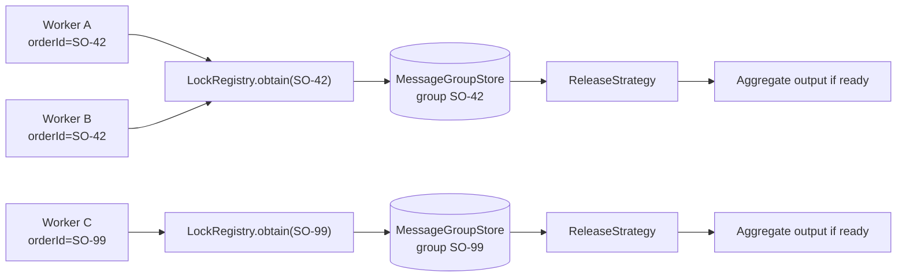
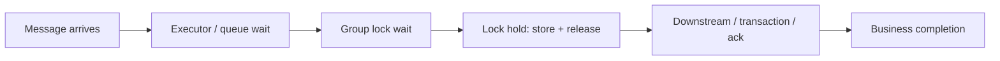
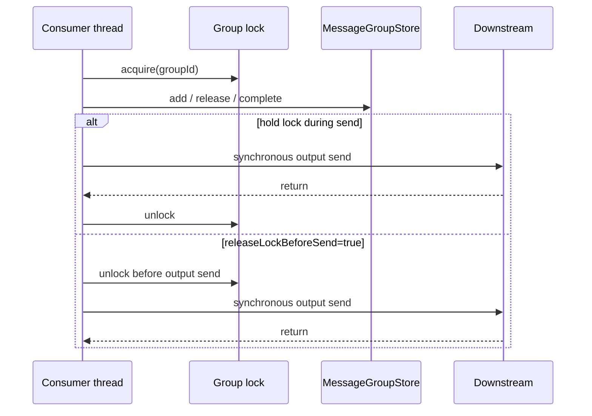
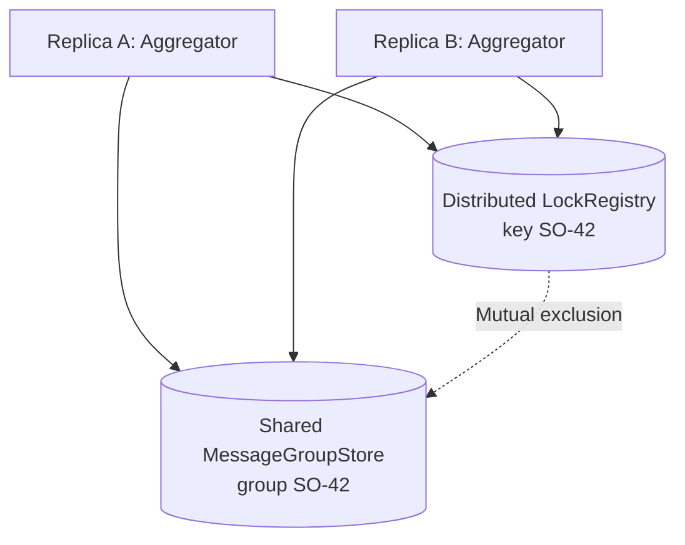
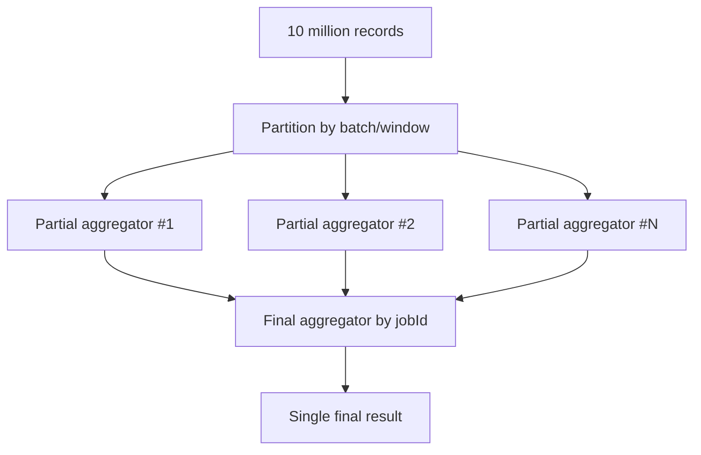
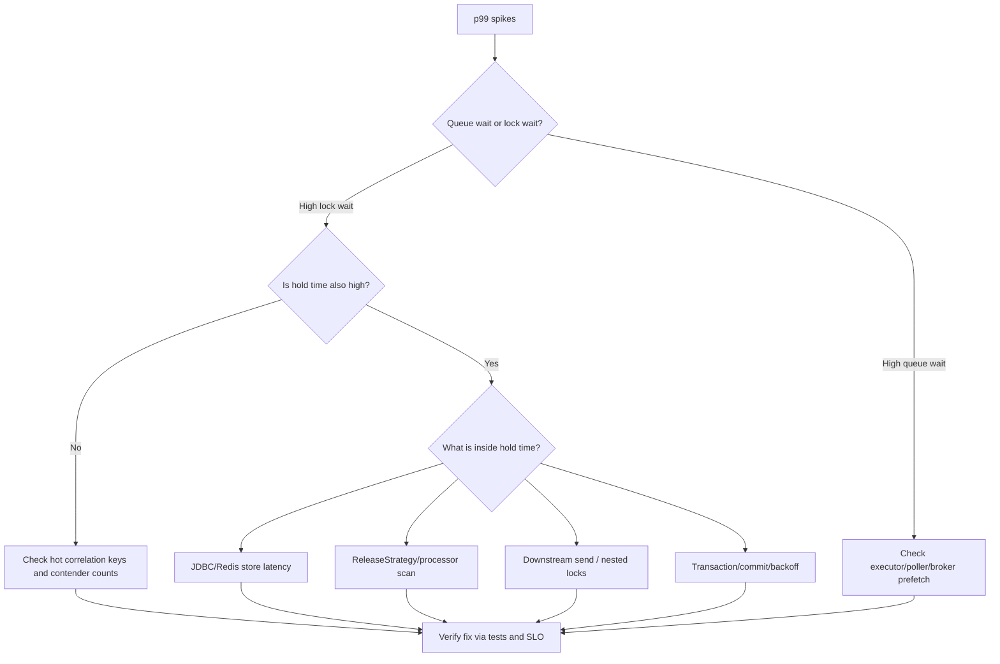

# Aggregator locks and group contention in Spring Integration Runtime

## 1. The performance problem: adding workers without increasing throughput

A system receives price, inventory, and shipping check results and uses an **aggregator** to combine them by `orderId`. As traffic grows, operations scales the `ExecutorChannel` from 4 to 32 workers. CPU stays below 100%, yet throughput barely moves, p99 latency spikes sharply, and threads spend most of their time waiting. A few orders have thousands of parts while most orders have only three.

This is a classic symptom of **group contention**: multiple consumers are competing to update **the same `MessageGroup`**. Spring Integration uses a `LockRegistry` keyed by correlation key to prevent concurrent threads from corrupting group state. Locking protects correctness, yet also limits how many *critical section* operations can execute in parallel for **a single group**.

The lesson **“Aggregator locks and group contention”** belongs to the **Performance** chapter of the **SPRING_INTEGRATION_RUNTIME** module. Its content ties directly to how the runtime coordinates channels, endpoints, consumers, pollers, and executors, while examining `IntegrationFlow` lifecycle, transactions, retries, message stores, errors, correlation, threading, and observability.

After this lesson, you will be able to:

1. Distinguish **lock wait time**, **lock hold time**, **downstream processing time**, and **queue wait time**.
2. Explain why each correlation group is usually updated sequentially while multiple distinct groups can run in parallel.
3. Spot **hot correlation keys**, oversized groups, slow release strategies, and slow backing stores.
4. Configure an appropriate `LockRegistry` for single-JVM/multi-JVM deployments, evaluate `releaseLockBeforeSend`, and prevent deadlocks.
5. Optimize stores, release conditions, processors, and transactions without breaking semantics.
6. Design reproducible benchmarks and concurrency tests measuring both SLOs and data correctness.
7. Investigate p95/p99 spikes, thread dumps, DB lock waits, lease expiry, retry storms, and orphaned groups.

Examples use Java 17+, Spring Integration 6.x, and Micrometer as shown. Certain 6.5+ APIs are noted explicitly; verify your actual dependency versions before applying.

## 2. Per-group locking: correctness and natural limits

Each message is assigned a **correlation key**; messages sharing that key belong to the same `MessageGroup`, stored via `MessageGroupStore`. The aggregator checks a `ReleaseStrategy` to decide when the group is ready to aggregate. With concurrent senders, the read–modify–evaluate–release cycle must be coordinated.



**Crucial detail:** `DefaultLockRegistry` protects lock keys within **a single JVM**. When two applications share access to a persistent group store, they need a shared distributed registry if they touch overlapping group IDs. Sharing a database **does not automatically** make two local registries lock against each other.

### 2.1. The aggregator critical section

Conceptually:

```text
correlationId = correlationStrategy(message)

acquire lock(correlationId)
try:
    read group state / check complete
    add message to group store
    update condition / group metadata
    evaluate ReleaseStrategy
    if releasable:
        invoke group processor
        update complete/remove/release state
        send output (depending on releaseLockBeforeSend)
finally:
    unlock(correlationId)
```

This is a **logical flow**, not line-by-line internal source code. Exact ordering depends on implementation, advice, and version, especially when configuring `releaseLockBeforeSend`. Key point: while code holds the lock during JDBC queries, group scans, or synchronous output sends, **other messages for the same group must wait**.

| Operation | Can fall inside the aggregator's processing path | Potential cost |
| --- | --- | --- |
| Computing correlation key | Before acquiring group lock | Expensive header conversion, expression, or lookup. |
| Acquiring `Lock` | Entry to critical section | Lock wait, DB/Redis round-trips, fairness/lease overhead. |
| `MessageGroupStore.addMessageToGroup` | When updating the group | Serialization, DB write, row/index contention. |
| `ReleaseStrategy.canRelease` | On each message arrival and some forceComplete calls | Full scan/collection conversion vs. O(1) metadata check. |
| `MessageGroupProcessor` | When the group releases | Heavy computation, payload copying, header merging. |
| Completing/removing group | When closing out the group | DB deletes/updates and transaction commit. |
| Output channel send | May happen while lock is still held | Synchronous downstream I/O, nested aggregators, exceptions. |

Any optimization evaluated here must **preserve safety**: no double releases, no lost parts, and no late messages improperly reactivating a completed group.

### 2.2. Per-group serialization does not mean a single global mutex

```text
SO-42: A is processing → B with SO-42 waits
SO-99: C can proceed
SO-77: D can proceed
```

If 1,000 messages belong to 1,000 distinct groups, a worker pool exploits concurrency well. However, if 800 out of 1,000 messages share `orderId=SO-42`, most traffic contends on a single lock key; adding threads only increases **contenders** on that hot group.

For a single-JVM aggregator, Spring Integration defaults to `DefaultLockRegistry`; different endpoints may have separate registries. A distributed lock does not make a hot group safer to update concurrently — it merely extends mutual exclusion across process boundaries, usually adding network overhead.

## 3. Four timing components to measure separately



Notation:

- `T_queue`: from channel acceptance until consumer starts.
- `T_lock_wait`: from requesting the lock until acquiring it.
- `T_lock_hold`: duration the lock is held for a group.
- `T_downstream`: processing outside the critical section, possibly async.
- `T_commit_ack`: source/DB commit latency and transport acknowledgement.

End-to-end time can be **approximately** decomposed as:

\[
T_{\text{e2e}} \approx T_{\text{queue}} + T_{\text{lock-wait}} +
T_{\text{lock-hold}} + T_{\text{downstream}} + T_{\text{commit/ack}}
\]

Do not double-count segments already inside `T_lock_hold`: if output send or DB commit still runs under the lock, do not add it a second time. This is a bottleneck-analysis breakdown, not a rigid equation for every topology.

### 3.1. Throughput ceiling of a hot group

If each message in the same group holds the lock for an average of \(h\) seconds, the **ideal** throughput ceiling of that critical section alone is roughly bounded by:

\[
\lambda_{\text{hot-key}} \lesssim \frac{1}{h}
\]

For example, if `T_lock_hold` averages 20 ms, a single group cannot continuously process faster than roughly **50 lock entries/second** when each message requires a non-overlapping lock acquisition. This excludes lock wait, arrival bursts, store variance, and release/timeout events.

Cutting hold time from 20 ms to 5 ms raises that group's ideal ceiling from ~50 to ~200 entries/second. However, **business output** throughput can differ significantly: an aggregator merging 100 parts into **one** reply means 200 lock entries/second does not equal 200 completed orders per second.

### 3.2. Little's Law for spotting backlog

In a steady-state system, on average:

\[
L = \lambda W
\]

Where \(L\) is the average work items in the system, \(\lambda\) is completion throughput, and \(W\) is average time in the system. If throughput stays constant while latency climbs, in-flight work tends to grow. When incoming rate **exceeds** long-term service capacity, the system leaves steady state: backlog grows until bounded, rejected, throttled, or destabilized.

**Caution:** the formula uses **averages within a steady-state window**. Never plug `p99` in for `W` and conclude `L=λ×p99`; nor use channel send metrics as business completion throughput when flows have retries or aggregation.

## 4. Causes of group contention

| Cause | Symptom | Why it creates contention |
| --- | --- | --- |
| **Hot correlation key** | Few `groupId`s, each receiving very many parts | Many consumers queue on the same lock. |
| Overly broad correlation | Using `tenantId` instead of `orderId` | Independent orders are forced into one giant group. |
| `ReleaseStrategy` scans whole group per arrival | `T_lock_hold` grows with `group.size()` | O(n) scans or repeated collection conversions. |
| Large payload/headers in store | Long serialization/DB I/O | Lock stays held during group add/fetch. |
| Group processor calls remote API | Hold p99 tracks HTTP latency | Other messages in the group block on external I/O. |
| Slow downstream on output `DirectChannel` | Hold time spikes at release time | Synchronous sends can prolong the critical section. |
| JDBC lock + JDBC store | DB round-trips, lock table, row contention | High coordination overhead per part. |
| Retries/backoff placed inside lock | Lock held during sleep/retries | Multiple consumers on the group starve. |
| Multiple JVMs hitting the same hot key | Network latency/leases/DB contention | Distributed locks do not relax serialization requirements. |
| Expiry/reaper running concurrently | Periodic latency spikes | Force completion/cleanup competes for group state. |
| Completing while keeping tombstones forever | Group count grows over time | Store bloats, metadata scans/queries slow down. |

### 4.1. Keying at the wrong granularity

Suppose the system has 20,000 active orders. If the correlation strategy returns `"all-orders"` or just `tenantId`, all orders for that tenant contend on one group. Yet **changing the correlation key solely for throughput** breaks business requirements if those messages truly must aggregate together.

A valid correction:

```text
Wrong if the business unit is an order:
  correlationKey = tenantId

Better if each order is independent:
  correlationKey = (tenantId, orderId, workflowVersion)
```

Keys must be **stable, immutable, and consistently typed** across all producers/nodes. If one adapter emits a UUID and another emits its String representation, groups and locks will mismatch. Untrusted source correlation keys must be validated before accessing state.

### 4.2. Parts per group is a design metric

A flow receiving 1 million parts/day with 3 parts per group behaves very differently from a flow receiving 1 million parts for **a single group**. Measure:

- Active group count.
- Mean and p95/p99 **parts/group**.
- Active groups sharing a logical tenant/source.
- Top-N hot group IDs or key shapes (only in access-controlled logs/traces).
- Age of incomplete groups, last-modified times, and completed-but-retained marker counts.

Never attach every `groupId` as a Prometheus label. For high-cardinality groups, use **low-cardinality metric tags** such as `flowType`/`endpoint`; hot key IDs belong in sampled logs/traces or guarded top-K diagnostics.

## 5. How to confirm the bottleneck is really the lock?

**Insufficient:** seeing high handler p99 and concluding the lock is slow. The handler could instead be waiting on connection pools, DB queries, executor queues, or downstream HTTP.

A minimal measurement set:

| Metric | Unit | Meaning |
| --- | --- | --- |
| Lock acquisition wait p50/p95/p99 | ms | Contention directly experienced by consumers. |
| Lock hold p50/p95/p99 | ms | How long each critical section lasts. |
| Lock acquire timeouts/failures | count/rate | Whether locks are acquired in time; ownership errors. |
| `MessageGroupStore` add/read/update/delete duration | ms | How much the backing store contributes to hold time. |
| Release strategy invocation count/duration | count, ms | Whether the group is scanned repeatedly per part. |
| Group processor duration | ms | Latency at release time. |
| Output send duration | ms | Whether synchronous sends extend hold time. |
| Executor active/queued/rejected | gauge/rate | Whether workers saturate before reaching locks. |
| DB connection pool wait / query p99 | ms | True lock wait vs. connection wait. |
| Business completion latency | ms | Final KPI, measured outside lock components. |

`MetricsCaptor`'s `spring.integration.send` is usually a **timer at channel/handler boundaries** and does not separate lock acquisition/hold details. Micrometer Observation also has its own scopes. To pinpoint lock bottlenecks, use targeted instrumentation or Java Flight Recorder, thread dumps, and backend lock diagnostics.

### 5.1. Breakdown of a slow case

```text
end-to-end:             920 ms
  executor wait:        150 ms
  group lock wait:      600 ms
  group lock hold:      110 ms
     JDBC add/read:      70 ms
     release strategy:   30 ms
     processor:          10 ms
  other post-unlock:     60 ms
```

These numbers are illustrative only and not framework benchmarks. They show that scaling the executor from 8 to 32 can **cut queue wait** while **increasing lock wait**, leaving end-to-end latency unimproved.

### 5.2. Measuring at the right boundary

Instrumentation in a service acquiring its own lock can measure:

```text
t0 = nanoTime() before lock.lock()
t1 = nanoTime() after acquiring lock
work under lock
t2 = nanoTime() right before unlock()

lockWait = t1 - t0
lockHold = t2 - t1
```

Measure elapsed duration within a JVM with `System.nanoTime()`, never `System.currentTimeMillis()` as a monotonic clock. Across multiple nodes, never subtract two timestamps from **different machines** to infer exact lock wait.

For the framework aggregator, **do not wrap another lock around `handleMessage` just to “measure”** if it creates nested critical sections different from real runtime behavior. You can measure via a tested `LockRegistry` decorator, controlled `ReleaseStrategy`/store proxies, or JFR/backend analysis. Instrumentation also adds overhead; compare benchmarks with and without it.

## 6. Simple baseline aggregator configuration for performance testing

Performance measurement should begin from a **minimal, semantically correct configuration** before swapping stores, worker counts, or lock registries. The example below uses a `DirectChannel` for parts, `SimpleMessageStore` for groups, and `DefaultLockRegistry` for in-JVM synchronization; output goes to a `QueueChannel` so tests can pull results deterministically.

```java
package demo.performance;

import org.springframework.beans.factory.annotation.Qualifier;
import org.springframework.context.annotation.Bean;
import org.springframework.context.annotation.Configuration;
import org.springframework.integration.aggregator.AggregatingMessageHandler;
import org.springframework.integration.aggregator.DefaultAggregatingMessageGroupProcessor;
import org.springframework.integration.annotation.ServiceActivator;
import org.springframework.integration.channel.DirectChannel;
import org.springframework.integration.channel.QueueChannel;
import org.springframework.integration.config.EnableIntegration;
import org.springframework.integration.store.MessageGroupStore;
import org.springframework.integration.store.SimpleMessageStore;
import org.springframework.integration.support.locks.DefaultLockRegistry;
import org.springframework.integration.support.locks.LockRegistry;
import org.springframework.messaging.MessageChannel;
import org.springframework.messaging.MessageHandler;
import org.springframework.messaging.PollableChannel;

@Configuration
@EnableIntegration
public class AggregatorPerformanceConfiguration {

    @Bean
    public MessageGroupStore performanceGroupStore() {
        return new SimpleMessageStore();
    }

    @Bean
    public LockRegistry performanceGroupLocks() {
        return new DefaultLockRegistry();
    }

    @Bean("partsIn")
    public MessageChannel partsIn() {
        return new DirectChannel();
    }

    @Bean("resultsOut")
    public PollableChannel resultsOut() {
        return new QueueChannel();
    }

    @Bean
    @ServiceActivator(inputChannel = "partsIn")
    public MessageHandler orderAggregator(
            MessageGroupStore performanceGroupStore,
            LockRegistry performanceGroupLocks,
            @Qualifier("resultsOut") PollableChannel resultsOut) {

        AggregatingMessageHandler handler = new AggregatingMessageHandler(
                new DefaultAggregatingMessageGroupProcessor(),
                performanceGroupStore);

        handler.setCorrelationStrategy(message ->
                message.getHeaders().get("orderId"));
        handler.setReleaseStrategy(group -> group.size() >= 3);
        handler.setLockRegistry(performanceGroupLocks);
        handler.setReleaseLockBeforeSend(true);
        handler.setExpireGroupsUponCompletion(false);
        handler.setOutputChannel(resultsOut);
        return handler;
    }
}
```

**How to read this configuration:**

- `orderId` is the correlation key. Every message must carry this header with the expected type and business contract.
- Releasing on `size() >= 3` illustrates count checking, **not deduplication**: three copies of `pricing` still satisfy the size check.
- `DefaultLockRegistry` protects threads within **a single JVM** only.
- `SimpleMessageStore` is fast and convenient for baselines, but loses groups on restart.
- `releaseLockBeforeSend=true` releases the group lock before sending output, reducing lock hold time when downstream executes synchronously. This option must be tested with downstream errors.
- `expireGroupsUponCompletion=false` retains completion metadata to reject late arrivals; cleanup is needed once the replay window closes.

Do not promote this baseline to production without selecting a persistent store, duplicate policy, transaction/error channels, group timeouts, retention, and failure tests.

### 6.1. Start with the right flow before optimizing

```text
Split → ExecutorChannel → Aggregator → QueueChannel
                                   |
                                   +-- MessageGroupStore
                                   +-- LockRegistry keyed by orderId
```

In this flow, `ExecutorChannel` lets parts arrive concurrently at the aggregator. The aggregator guards state per `orderId`, which does not mean part **arrival** order always matches sequence order. If downstream needs exact order, add a sequence/correlation contract or a resequencer per requirements.

**Avoid benchmarking solely via `send()` calls:** with an async executor, `send()` can return before the aggregator completes. Count released outputs and business completions at the actual downstream sink.

## 7. Concurrency testing and timing under `DefaultLockRegistry`

Before measuring throughput, prove the invariant **“same key never has two simultaneous owners; different keys can proceed”**. Use latches instead of `Thread.sleep()` to control interleaving.

```java
import static org.junit.jupiter.api.Assertions.*;

import java.util.concurrent.CountDownLatch;
import java.util.concurrent.ExecutorService;
import java.util.concurrent.Executors;
import java.util.concurrent.Future;
import java.util.concurrent.TimeUnit;
import java.util.concurrent.locks.Lock;
import org.junit.jupiter.api.Test;
import org.springframework.integration.support.locks.DefaultLockRegistry;
import org.springframework.integration.support.locks.LockRegistry;

class PerGroupLockTest {

    @Test
    void blocksSameGroupButNotAnotherGroup() throws Exception {
        LockRegistry registry = new DefaultLockRegistry();
        ExecutorService executor = Executors.newFixedThreadPool(3);
        CountDownLatch ownerHasLock = new CountDownLatch(1);
        CountDownLatch releaseOwner = new CountDownLatch(1);

        Future<Boolean> owner = executor.submit(() -> {
            Lock lock = registry.obtain("SO-42");
            lock.lock();
            try {
                ownerHasLock.countDown();
                return releaseOwner.await(5, TimeUnit.SECONDS);
            } finally {
                lock.unlock();
            }
        });

        try {
            assertTrue(ownerHasLock.await(2, TimeUnit.SECONDS));

            Future<Boolean> sameKey = executor.submit(() -> {
                Lock lock = registry.obtain("SO-42");
                boolean acquired = lock.tryLock(100, TimeUnit.MILLISECONDS);
                if (acquired) {
                    lock.unlock();
                }
                return acquired;
            });
            Future<Boolean> otherKey = executor.submit(() -> {
                Lock lock = registry.obtain("SO-99");
                boolean acquired = lock.tryLock(500, TimeUnit.MILLISECONDS);
                if (acquired) {
                    lock.unlock();
                }
                return acquired;
            });

            assertFalse(sameKey.get(2, TimeUnit.SECONDS));
            assertTrue(otherKey.get(2, TimeUnit.SECONDS));
        } finally {
            releaseOwner.countDown();
            assertTrue(owner.get(3, TimeUnit.SECONDS));
            executor.shutdownNow();
            assertTrue(executor.awaitTermination(3, TimeUnit.SECONDS));
        }
    }
}
```

This test uses timeouts **to avoid hanging CI**, never sleeps hoping two threads overlap. It does not measure production throughput, prove Redis/JDBC lock behavior, or verify group release logic.

### 7.1. Measuring lock wait/hold when custom code acquires locks directly

When application code uses `LockRegistry` directly, you can instrument it with `Timer`:

```java
import java.util.concurrent.locks.Lock;
import io.micrometer.core.instrument.MeterRegistry;
import io.micrometer.core.instrument.Timer;
import org.springframework.integration.support.locks.LockRegistry;

public final class TimedCriticalSection {
    private final LockRegistry registry;
    private final Timer waitTimer;
    private final Timer holdTimer;

    public TimedCriticalSection(
            LockRegistry registry, MeterRegistry meterRegistry) {
        this.registry = registry;
        this.waitTimer = Timer.builder("app.group.lock.wait")
                .tag("endpoint", "ordersAggregator")
                .register(meterRegistry);
        this.holdTimer = Timer.builder("app.group.lock.hold")
                .tag("endpoint", "ordersAggregator")
                .register(meterRegistry);
    }

    public void runForGroup(Object groupId, Runnable action) {
        Lock lock = registry.obtain(groupId);
        long waitingSince = System.nanoTime();
        lock.lock();
        long acquiredAt = System.nanoTime();
        waitTimer.record(acquiredAt - waitingSince,
                java.util.concurrent.TimeUnit.NANOSECONDS);

        try {
            action.run();
        } finally {
            long finishingAt = System.nanoTime();
            holdTimer.record(finishingAt - acquiredAt,
                    java.util.concurrent.TimeUnit.NANOSECONDS);
            lock.unlock();
        }
    }
}
```

**Very important limitation:** this class measures **the critical section wrapped by the application**, **not the lock internal to `AggregatingMessageHandler`**. Do not wrap `TimedCriticalSection` around the handler and treat it as internal metrics — double acquisitions/nested locks alter contention and deadlock risk. To measure inside the framework, build a full `Lock`-compliant `LockRegistry` decorator and inject it into the handler, testing reentrancy, `tryLock`, `lockInterruptibly`, `newCondition`, timeouts, and unlock ownership before deploying.

**Do not attach `groupId` as a tag** on this timer since every order creates a new time series; use fixed endpoint/flowType tags and log/trace hot groups separately. During failures, `lock.lock()` might not acquire before shutdown; if a deadline is required, use `tryLock(timeout)` and count timeouts separately.

## 8. Optimizing `ReleaseStrategy`: avoid scanning the whole group per arrival

An aggregator can invoke the release strategy **after every incoming message**. If each invocation scans a group of size \(n\), total work from part 1 to part \(n\) approaches:

\[
\sum_{k=1}^{n} O(k) = O(n^2)
\]

This is the **complexity of a naive strategy implementation**, not a claim that Spring Integration itself is always O(n²).

### 8.1. Anti-pattern example

```java
import org.springframework.integration.aggregator.ReleaseStrategy;

ReleaseStrategy slowStrategy = group ->
        group.getMessages().stream()
                .filter(message ->
                        "OK".equals(message.getHeaders().get("state")))
                .count() == 5;
```

If a group holds tens of thousands of messages backed by `JdbcMessageStore`, `getMessages()` can trigger lazy loading of tons of rows, payload deserialization, and full collection traversal on every update. Adding workers cannot eliminate that cost for the same correlation key.

### 8.2. Use `size()` only when count alone is valid

```java
ReleaseStrategy countOnly = group -> group.size() >= 5;
```

This is cheaper because it avoids iterating all payloads, **but it is valid only when** the contract guarantees all five parts are valid and duplicate-free. If `pricing` is delivered five times, `size()==5` does not mean five distinct part types arrived.

### 8.3. `group.condition` for metadata-based release

Since Spring Integration 5.5, `MessageGroup` carries a String `condition`. `AbstractCorrelatingMessageHandler` supports `setGroupConditionSupplier(...)`, letting developers update compact metadata on each message addition so `ReleaseStrategy` reads the condition instead of always scanning payloads.

Concept:

```text
groupId = batch-42
condition = "expected=100;received=90;valid=true"

arrival of one part:
  calculate updated condition
  persist condition in store
  release strategy parses small condition
```

This is an **application-defined protocol**; the framework **does not interpret** `expected=100`. Metadata updates must remain consistent under concurrency and handle duplicates properly; do not increment `received` on duplicate event IDs. If conditions grow overly complex, a domain row with unique constraints/versioning may be cleaner.

### 8.4. Prefer direct APIs over unnecessary POJO conversion

Spring Integration distinguishes:

- `ReleaseStrategy.canRelease(MessageGroup)`: receives the group directly and can inspect metadata alone.
- POJO method accepting `Collection<Message<?>>`: typically requires building an appropriate collection view/copy.
- POJO method accepting `Collection<SomePayload>`: the framework may extract payloads and convert the whole collection every time.

For large groups, implement `ReleaseStrategy` directly if it genuinely avoids copies/conversions. Exact savings depend on the group/store and code; **measure before and after**. Never sacrifice duplicate detection or business correctness for a fake O(1).

### 8.5. Default sequence strategy and duplicate semantics

Since Spring Integration 5.0, `SimpleSequenceSizeReleaseStrategy` is the default when partial group releases are not needed; it is more efficient than full sequence validation in applicable cases. When duplicate sequence IDs or partial releases must be checked, another strategy may be more accurate despite extra overhead. Never switch strategies solely because a microbenchmark runs faster if it breaks the “count each part once” invariant.

## 9. `MessageGroupStore`: optimize the right layer without changing semantics

The aggregator uses `MessageGroupStore` to persist state across arrivals. Although contention surfaces at `LockRegistry`, **lock hold time** is often dominated by store operations: adding messages, reading metadata, releasing the group, marking complete, and deleting messages.

### 9.1. Comparing in-memory and persistent stores

| Store | Performance profile | Limits to keep in mind |
| --- | --- | --- |
| `SimpleMessageStore` | Local operations, low latency; good baseline | JVM memory, state lost on restart; huge groups pressure GC. |
| `JdbcMessageStore` | Durable data, transactions, and DB indexing | Round-trips, connection pools, serialization, index/row locks, and query plans. |
| Redis-based MessageStore | Low-latency remote access on suitable infrastructure | Network, persistence/eviction, load, and complex group operations. |
| MongoDB MessageStore | Persistent document database with lazy loading | Queries/serialization/indexing; contention depends on workload. |

**Never assume a persistent store is faster or slower by a fixed threshold.** With large payloads, distant networks, tiny connection pools, or missing indexes, backend I/O can dominate `T_lock_hold`. Conversely, if the bottleneck is a hot group or slow processor, swapping JDBC for Redis will not fix it.

### 9.2. Lazy loading and avoiding full group materialization

Since Spring Integration 4.3, persistent `MessageGroupStore` implementations support **lazy loading** of messages in a group. When a strategy only inspects `size()` or metadata, the framework can avoid loading/deserializing every payload on each arrival.

For supporting implementations:

```java
import org.springframework.integration.jdbc.store.JdbcMessageStore;

JdbcMessageStore store = new JdbcMessageStore(dataSource);
store.setRegion("orders-aggregate");
store.setLazyLoadMessageGroups(true);
```

Here `dataSource` is an existing `javax.sql.DataSource`, and the database requires the matching JDBC message store tables/schema. This snippet shows **lazy group loading** setup; the aggregator must actually use this store for it to take effect.

Conversely, calling `group.getMessages()` inside a `ReleaseStrategy` on every arrival can force loading the full message collection. With a persistent store, a “slow release strategy” measurement may actually be **DB reads + deserialization**.

Since 5.5, `streamMessagesForGroup(groupId)` handles large groups via streaming on supporting backends. When calling APIs returning `Stream<Message<?>>`, **close the stream with try-with-resources** to release cursors/resources. Streaming does not remove the need for locking during concurrent updates.

### 9.3. `getGroupMetadata(...)` when only status is needed

If a dashboard only needs `groupId`, size, timestamps, completion state, and metadata, consider `MessageGroupStore.getGroupMetadata(groupId)` instead of `getMessageGroup().getMessages()` and iterating payloads.

Never poll `getGroupMetadata` in a tight millisecond loop for every group: metadata reads against a persistent store still run DB queries and compete with the aggregator. For monitoring, prefer sampling, batch queries, or store-level metrics.

### 9.4. `SimpleMessageStore.copyOnGet` and safe mutation

`SimpleMessageStore` defaults to **`copyOnGet=false`** in modern versions because copying large groups on every get can be very expensive. Changing it to `true` or mutating group objects outside the store impacts performance and correctness.

**Never mutate the collection returned by `getMessageGroup(...)` directly in dashboards or custom code** while the aggregator is running. Holding a live reference lets add/remove calls bypass store locks/metadata updates, breaking invariants the aggregator relies on.

### 9.5. Choosing collection structures for large groups

`SimpleMessageGroupFactory` offers different `GroupType`s. `LinkedHashSet`/hash-based structures support convenient add/remove operations, though hashing `Message<?>` with large payloads still carries cost. Queue/list alternatives trade off duplicate checks, ordering, and removal time.

Do not swap group factories solely because an insert microbenchmark looks faster; check:

1. Are duplicates still detected per contract?
2. Must order reflect insertion order or sequence number?
3. Are partial reads/removals frequent?
4. Is the group held on the heap or in a persistent backend?
5. What are p99 latency and memory footprint at realistic group sizes?

## 10. `releaseLockBeforeSend`: cutting hold time and avoiding nested locks

In an aggregator, sending output can occur during group release. If output goes to a `DirectChannel` wired to a slow synchronous handler, sending output can prolong group lock hold times.

The `releaseLockBeforeSend` option (available since Spring Integration 5.1.1) lets you **release the group lock before sending output**:

```java
handler.setReleaseLockBeforeSend(true);
```

In Java DSL 6.x, `CorrelationHandlerSpec.releaseLockBeforeSend(true)` provides the equivalent setting; XML uses the corresponding schema attribute.

### 10.1. Before and after model



If downstream takes 300 ms, this change keeps another part of the same group from **waiting the full 300 ms during output send**. However, it **does not** move group processor or persistence work outside the lock; measure where code actually executes.

### 10.2. Trade-offs of releasing the lock early

When output send runs **after** unlock:

- A new message for the same group can be processed while downstream is still handling the prior output.
- Output send exceptions no longer occur while the consumer holds the group lock; inspect transaction/error propagation.
- If downstream routes back into the same aggregator or chains aggregators, reducing nested locking can prevent deadlocks.
- Never assume group state and broker output committed atomically together.

**Tests required:** send the final part for a correlation key concurrently with a duplicate/late part while making the output channel slow or throw; assert output count, complete/tombstone state, retries, and idempotency.

### 10.3. Deadlock when two aggregators share a registry

```text
Thread T1:
  holds lock aggregator A / key X
  → synchronous send to aggregator B / key Y
  → waits on B / key Y

Thread T2:
  holds lock aggregator B / key Y
  → calls path requiring aggregator A / key X
  → waits on A / key X

T1 waits on T2, T2 waits on T1 → deadlock
```

Spring Integration Reference suggests three mitigations:

1. **Give each logical aggregator its own registry/namespace**; replicas of **the same aggregator** can still share one registry.
2. Put an `ExecutorChannel` or `QueueChannel` between aggregators to break the synchronous call stack.
3. Use `releaseLockBeforeSend=true` to send downstream after unlocking.

Do not pick `ExecutorChannel` without considering side effects: thread-bound transactions do not follow onto workers automatically, errors become async, and completion order can change. **Never sacrifice data correctness just to trim lock hold time.**

## 11. Distributed locking: performance and correctness are two separate axes

For **a single JVM**, `DefaultLockRegistry` is a sound baseline. With multiple replicas updating a shared persistent `MessageGroupStore`, evaluate distributed locking backends:

| Implementation | Pros | Costs / risks |
| --- | --- | --- |
| `DefaultLockRegistry` | Very low overhead, no network I/O | Does not coordinate across JVMs. |
| `JdbcLockRegistry` | Reuses existing RDBMS, DB-managed locks | Lock table, transactions/connections, retry contention, TTL. |
| `RedisLockRegistry` | Shared registry, low latency in suitable environments | Network, lease expiry/renewal, failover, Redis health. |
| ZooKeeper-based LockRegistry (where supported) | Session/coordination-service backed | Infrastructure cost, session expiry, network-partition behavior. |

### 11.1. With the same `groupId`, registry and store must align



Merely sharing **the same bean name** across two Spring contexts means nothing for distributed locking. Replicas must share **the same physical lock backend/region/key contract**, group store region, and correlation ID type.

### 11.2. Version 6.5: store-level locking added

Since Spring Integration **6.5**, `AbstractMessageGroupStore.setLockRegistry(...)` guards store/group metadata operations at the store layer, defaulting to `DefaultLockRegistry`. Distinguish:

- **Aggregator handler lock:** protects correlation handling, release decisions, and per-group mutually exclusive steps.
- **Store-level lock:** protects internal message-group/metadata update sequences inside the store implementation.

Do not assume configuring only one layer synchronizes the other. When store and handler use different registries across multiple JVMs, verify ownership and lock ordering. When sharing the same registry and key, confirm whether the implementation supports **reentrant locking** to avoid self-deadlock.

On versions **prior to 6.5**, do not call `AbstractMessageGroupStore.setLockRegistry(...)` if the API does not exist. Newer 7.x custom lock TTL APIs should also not be copied verbatim into 6.4 code.

### 11.3. Lock TTL/lease vs. lock hold duration

With distributed locks, at least **two different timers** apply:

- **Acquire wait timeout:** how long a caller waits to acquire a lock, e.g., `tryLock(2, SECONDS)`.
- **Lease/TTL:** how long the backend treats lock ownership as valid, allowing failover if an owner dies.

If `T_lock_hold` p99 approaches the TTL, the owner risks losing its lease before finishing. Another replica can acquire the lock while the old owner resumes after a GC pause/network blip. That creates a **stale owner**; locks do not automatically provide fencing tokens across all backends.

Mitigations:

1. Keep critical sections short; avoid HTTP calls inside.
2. Size TTL for worst-case latency/GC pauses and real failover requirements.
3. Use renewal/auto-renewal APIs where supported by the registry version and needed by the workload.
4. Monitor renewal failures, unlock exceptions, stale writes, and reconciliation.
5. For critical business data, enforce optimistic versioning/fencing/idempotency **at the target resource**.

Never set an ultra-short TTL just to benchmark “fast” failover while ignoring dual-writer risks during a long pause.

## 12. Transactions, retries, and where locks are released

### 12.1. Transaction lifecycle and lock lifecycle need not align

```text
Case A:
  acquire group lock
    BEGIN TX
      add message / complete group
    COMMIT TX
  unlock

Case B:
  BEGIN TX
    acquire group lock
      add message / complete group
    unlock
  COMMIT TX
```

In **Case B**, another consumer can acquire the lock **before DB changes are committed**. Reads depend on isolation levels and store semantics; this affects correctness, not just performance.

Actual ordering depends on poller transaction advice, `@Transactional` proxies, service activators, handler retry advice, lock registries, and output sends. Never claim “having `@Transactional` plus LockRegistry is enough” without testing commit order.

### 12.2. Retries/backoff under a lock worsen contention

```text
Bad if business logic does this under the group lock:
  remote call timeout
  backoff 200ms
  remote retry
  backoff 500ms
  remote retry
```

Other workers for the same group wait through the entire backoff even while no shared state is being updated. Whenever possible, separate:

1. Update group state/mark release under the lock briefly.
2. Persist delivery state and commit appropriately.
3. Execute remote calls with timeouts/retries **outside the critical section** using a stable idempotency key.
4. Have recovery if output happens while the group was not yet recorded complete.

**Never arbitrarily move remote calls outside the lock** if business logic requires atomic check-then-act on that resource. In that case consider transaction/outbox patterns, versioned updates, or another coordinator. Redesign around invariants first, then optimize.

### 12.3. Multi-layer retries multiply lock contention

```text
Broker redelivery
  └── Handler retry advice
        └── Downstream HTTP retry
              └── Possible aggregator re-entry
```

A message can reach the aggregator multiple times due to broker redelivery or flow retries. That adds contenders for the same key; the group may already be complete, expired, or still waiting. Tests must assert **unique business outputs**, not just handler invocations.

Adding a retry loop does not raise throughput; when transient errors stem from DB lock contention, simultaneous retries without backoff/jitter can trigger a **thundering herd**, overloading the DB and lock registry further.

### 12.4. Thread boundaries do not propagate transactions automatically

`DirectChannel` usually keeps the sender's call stack, while `ExecutorChannel`/`QueueChannel` + poller run consumers on another thread. Upstream transactions **do not automatically follow** onto the worker. Thus moving an aggregator onto an executor can improve producer latency while breaking rollback/ack assumptions unless transactions and error paths are redesigned.

With `FluxMessageChannel`/reactive handlers, do not measure returning a `Mono` as completion; also keep Reactor Context/reactive transactions separate from imperative JDBC `ThreadLocal`s.

## 13. Timeouts, expiry, and tombstones also consume resources

An incomplete group can stay in the store for a long time. `groupTimeout`/`MessageGroupStoreReaper` support forced completion/expiry per policy; they can run on a separate scheduler and contend for updates with arriving messages.

### 13.1. Two kinds of pressure

**Incomplete groups:** hold messages, consuming heap/DB space and raising scan/deserialization latency. One missing part can keep a huge group alive forever without a timeout.

**Completed groups retaining metadata:** may hold 0 messages while keeping markers to block late-arriving duplicates. Growing tombstone counts still impact memory, DB indexes, or cleanup operations even when “total pending messages” looks low.

```text
10:00:00 batch-42 receives 999/1000 parts
10:05:00 last part missing → group still waiting
10:10:00 reaper/timeout evaluates partial release / discard / expire

10:10:01 batch-99 completes, keeps empty complete group
11:00:00 millions of empty groups remain in store without cleanup
```

### 13.2. Tuning retention must not break idempotency

- `expireGroupsUponCompletion=false`: normally retains complete-group markers to block late arrivals, requiring metadata cleanup once the replay window ends.
- `expireGroupsUponCompletion=true`: removes groups on completion, cutting metadata size, though late duplicates with the same key **can start a new group**.
- `expireGroupsUponTimeout` and `sendPartialResultOnExpiry` govern how incomplete groups are handled on timeout.
- `MessageGroupStoreReaper` scans on a schedule; actual expiry can lag behind the configured value depending on cadence and callbacks.
- On persistent stores, a reaper scanning many groups can cause load spikes and contend for connection pool slots with normal ingestion.

Pick cleanup policies from **maximum redelivery/late-arrival windows**, business versioning, and group volume. Never delete markers simply because a dashboard reports high metadata counts if doing so causes duplicate outputs.

### 13.3. Expiry callbacks across aggregators

Do not casually share **the same `MessageGroupStore` instance** across multiple correlation handlers with expiry: each aggregator attaches expiry callbacks that can affect another endpoint's groups. The framework includes `UniqueExpiryCallback` checks/warnings, but clean designs separate stores/regions or manage group IDs and callback ownership explicitly.

In multi-node runtimes, reapers/schedulers also need proper ownership/coordination so multiple instances do not force-complete the same group inconsistently.

## 14. Designing benchmarks to separate contention from throughput

Benchmarks are useful when changing **one variable at a time** and measuring both performance and correctness. For example, to separate group lock bottlenecks from JDBC store bottlenecks:

| Scenario | Correlation distribution | Store | Lock registry | Goal |
| --- | --- | --- | --- | --- |
| A — baseline | 1,000 groups, uniform | Memory | Local | Processing capacity with minimal contention. |
| B — hot key | 90% of parts hit one incomplete group | Memory | Local | Measure lock wait on a hot group. |
| C — persistent | Same as A | JDBC | Local, single JVM | Measure store I/O, serialization/DB cost. |
| D — distributed | Same as A | Shared JDBC | Shared JDBC registry, two JVMs | Measure distributed lock + DB cost and correctness. |
| E — heavy strategy | Same as B | JDBC | Appropriate shared | Measure impact of full group scans. |
| F — slow send | Same as A | Memory | Local | Compare holding lock during send vs. `releaseLockBeforeSend=true`. |
| G — expiry spike | Many expired groups | Persistent | Appropriate shared | Measure reaper impact on p99 and connection pool. |

**Important:** when generating a “hot key”, ensure the group **does not release after 3 parts** like the baseline in section 6; otherwise after three parts the group completes and remaining parts get discarded, creating a bogus benchmark. Use a large expected sequence size, a release strategy waiting for N parts, or rotate group keys across **epochs** with clear lifecycles.

### 14.1. Variables to hold constant

- JDK, Spring Integration, Reactor/Micrometer, and driver versions.
- Heap settings, GC, CPU allocation, container replica counts.
- Payload sizes, header sizes, expected parts/group, duplicate rates.
- Producer rates, burst shapes, worker counts, queue capacities.
- DB schema/indexes, connection pools, network latency, and server load.
- Incomplete/complete group ratios and cleanup cadence.
- Identical definition of end-to-end completion/ack.

If you change executor threads, lock registry, DB pool, and release strategy **all at once**, you cannot tell which change caused the difference. On long runs, separate warm-up from measurement and eliminate cold-cache effects.

### 14.2. Measure the full latency distribution

```text
Run A: uniform keys
  throughput:       12,000 part arrivals/s
  lock wait p95:        0.4 ms
  lock hold p95:        1.0 ms
  end-to-end p99:      45.0 ms

Run B: one hot key
  throughput:        3,000 part arrivals/s
  lock wait p95:       80.0 ms
  lock hold p95:        1.2 ms
  end-to-end p99:     450.0 ms
```

**These are hypothetical numbers illustrating interpretation, not framework benchmark results.** In this example, `lock hold` barely changed while `lock wait` surged under skewed keys; adding CPU/executor threads will not fix it. Optimization must address correlation design, per-key arrival rates, and parts/group.

Conversely, if `lock hold p95` jumps from 1 to 50 ms after switching to JDBC, inspect DB queries/serialization, release strategies, and transactions. If `T_queue` rises while `lock wait` stays low, the bottleneck may be in the executor/poller or an external pool.

### 14.3. Benchmark reliability, not just speed

All variants A–G must assert:

1. Each logical group releases **the exact expected number of times** per policy.
2. No lost parts or mismatched correlation keys.
3. Duplicate/late messages follow contract rules.
4. Commits/acks and output side effects do not duplicate across retries/redeliveries.
5. Group store metadata remains valid across stop/start/crash.
6. Zero stale locks, leaked DB connections, unbounded queues, or runaway retries.

A tuning change that doubles throughput while producing duplicate payments is not a valid performance improvement.

## 15. Controlled test: two threads contending on one correlation group

This is an **illustrative integration test** for the configuration in section 6: sends three parts for multiple orders on an executor, waits for all input sends, and verifies one output per order. It does not measure precise lock hold times; its purpose is preserving invariants as workers/stores/registries change.

```java
package demo.performance;

import static org.junit.jupiter.api.Assertions.*;

import java.util.ArrayList;
import java.util.List;
import java.util.concurrent.Callable;
import java.util.concurrent.CountDownLatch;
import java.util.concurrent.ExecutorService;
import java.util.concurrent.Executors;
import java.util.concurrent.Future;
import java.util.concurrent.TimeUnit;

import org.junit.jupiter.api.Test;
import org.springframework.context.annotation.AnnotationConfigApplicationContext;
import org.springframework.messaging.MessageChannel;
import org.springframework.messaging.PollableChannel;
import org.springframework.messaging.support.MessageBuilder;

class AggregatorConcurrencyTest {

    @Test
    void releasesOneResultPerGroupUnderConcurrentSends() throws Exception {
        int groupCount = 30;
        int partsPerGroup = 3;
        ExecutorService executor = Executors.newFixedThreadPool(12);
        CountDownLatch startGate = new CountDownLatch(1);
        List<Future<Boolean>> sends = new ArrayList<>();

        try (var context = new AnnotationConfigApplicationContext(
                AggregatorPerformanceConfiguration.class)) {
            MessageChannel input =
                    context.getBean("partsIn", MessageChannel.class);
            PollableChannel results =
                    context.getBean("resultsOut", PollableChannel.class);

            try {
                for (int group = 0; group < groupCount; group++) {
                    String key = "SO-" + group;
                    for (int part = 1; part <= partsPerGroup; part++) {
                        int partNumber = part;
                        sends.add(executor.submit((Callable<Boolean>) () -> {
                            startGate.await();
                            return input.send(MessageBuilder
                                    .withPayload(key + ":part-" + partNumber)
                                    .setHeader("orderId", key)
                                    .setHeader("partId", partNumber)
                                    .build());
                        }));
                    }
                }

                startGate.countDown();
                for (Future<Boolean> result : sends) {
                    assertTrue(result.get(10, TimeUnit.SECONDS));
                }

                // One reply released for each group containing 3 parts.
                for (int i = 0; i < groupCount; i++) {
                    assertNotNull(results.receive(3_000));
                }
                assertNull(results.receive(0),
                        "No duplicate group output expected");
            } finally {
                startGate.countDown();
                executor.shutdownNow();
                assertTrue(executor.awaitTermination(3, TimeUnit.SECONDS));
            }
        }
    }
}
```

**Limitations of this test:**

- Uses 30 small groups; it is **not** a hot-key scenario. It is a concurrency correctness baseline.
- `DefaultAggregatingMessageGroupProcessor` emits aggregated payloads per framework contract; the test checks only output count, not every part ID. Production tests should assert the full set of part IDs and correlation IDs.
- No crashes, redeliveries, or DB rollbacks. Two JVMs require a persistent store and shared distributed locks.
- When changing stores or release strategies, maintain identical data correctness and measure **business output completion** rather than `input.send()` timing alone.
- One passing test run does not prove every interleaving is safe; add deterministic gates in store/strategy layers, stress tests, and failure injection.

## 16. Tuning workflow: change one factor, re-measure

### Step 1 — Confirm which group behavior is the bottleneck

Collect `lock wait/hold p95/p99` and `group size` distributions. If hot keys are 2% of groups yet cause 80% of wait time, analyze the business semantics of those keys instead of enlarging the worker pool.

### Step 2 — Check whether the correlation key is too broad

For example, each invoice has an `invoiceId`, yet the flow correlates by `tenantId`. If business rules allow processing each invoice independently, keying by `(tenantId, invoiceId)` splits locks and shrinks group sizes. If business rules truly require aggregating all invoices per tenant per period, keep the logical group and optimize via micro-batching or a properly designed intermediate aggregation stage.

### Step 3 — Reduce cost while holding the lock

Prioritize by evidence:

1. Replace payload-scanning `ReleaseStrategy` implementations with direct metadata/`size()` checks where contract-safe.
2. Avoid loading all messages when only group metadata is needed; leverage lazy loading.
3. Optimize DB indexes/connection pools and serialization overhead.
4. Avoid blocking downstream sends while locked; evaluate `releaseLockBeforeSend`.
5. Shorten transactions/critical sections; move external side effects outside locks with outbox/idempotency where appropriate.
6. Cut full-group copies, GC pressure, and header/payload conversion overhead.

**Never choose an approach based on p50 alone.** An occasional 5-second remote call can blow up p99 lock wait on a hot group even while p50 stays low.

### Step 4 — Bound upstream pressure

Instead of giving 128 workers to fight over 1 lock:

- Use bounded executors and queues with explicit reject/throttle policies.
- Lower `maxMessagesPerPoll` or polling concurrency when downstream saturates.
- For Kafka/JMS, tune prefetch/container concurrency and acks on the adapter.
- Shard/partition by key so independent groups run in parallel while parts of the same group are paced per contract.
- With Reactive Streams, enforce *actual* demand/concurrency limits; never assume a `Mono` automatically creates end-to-end backpressure across every adapter.

Measure producer rejections/queue waits too, because cutting lock wait simply by **pushing backlog upstream** may not improve end-to-end SLOs.

### Step 5 — Match store and lock registry to deployment scale

Single JVM + memory store: low local overhead, no durability across restarts.

Single JVM + JDBC store: measure JDBC reads/writes, schema, serialization, transactions, and connection waits.

Multiple JVMs + JDBC store: requires a shared distributed lock registry; measure network/DB lock contention, lease expiry, and output idempotency.

Never scale a single JVM to active-active simply by raising replica counts while the aggregator stores state in `SimpleMessageStore`; each replica sees only a subset of parts, causing incomplete groups or bad releases.

### Step 6 — Test failures and observe post-tuning

Once you have a candidate configuration:

- Measure throughput, lock wait/hold, end-to-end latency, and pending group counts.
- Inject duplicate/late parts, restarts, retries, timeouts, and DB failovers.
- Verify group markers, source acks, business commits, and output uniqueness.
- Run long soak tests to catch tombstone/heap/connection leaks.
- Prepare a config rollback plan if p99 or duplicate rates degrade.

## 17. Micro-batching, partitioning, and business-valid trade-offs

Some workloads genuinely have massive single groups (e.g., aggregating 10 million records from one file). You cannot arbitrarily “change the correlation ID” because **one final result** must be emitted.

### 17.1. Multi-level aggregation when the operation permits

If the aggregation is **associative**, you can split it:



For example, sums and counts can merge from partial sums/counts. However, **order-dependent** operations, side-effecting steps, or non-associative/non-commutative aggregations cannot be arbitrarily split and still yield identical results.

A two-tier design needs explicit contracts for:

- `jobId`, `partitionId`, and expected partition count.
- Idempotency unit for each partial result.
- Ordering if the final result depends on sequence.
- Cleanup, timeouts, retries, and group completion at **both tiers**.
- Ensuring that if one partition fails, the final aggregator does not emit an invalid result.

### 17.2. Never invent a new business group per worker

```text
Wrong:
  correlationKey = orderId + randomWorkerId

Consequence:
  Parts of the same order split across multiple groups.
  Each group may never reach its release condition.
  Or multiple business-invalid partial outputs may emit.
```

Valid sharding turns **partial aggregation** into an explicit, documented pattern rather than silently mutating correlation keys.

## 18. Tracing a p99 spike incident

Suppose the dashboard reports:

```text
Flow: ordersAggregator
Incoming parts:       8,000 / s
Aggregate outputs:      300 / s
Executor active:         32 / 32
Group lock wait p99:    950 ms
Group lock hold p99:     40 ms
JDBC store add p99:      25 ms
Group size p99:       5,000 parts
Expired groups:       rising fast
```

**These numbers are illustrative only**, yet the reasoning matters:

1. `Executor active=32` alone does not prove CPU-bound load; most threads may be waiting on locks/network.
2. `T_lock_wait≫T_lock_hold` points to contention/queuing; inspect hot-key distribution.
3. `T_lock_hold=40 ms` with 25 ms JDBC add points to I/O holding the lock; strategy/processor likely accounts for the rest.
4. `group size p99=5,000` points to huge groups; check whether the release strategy scans fully or filters out parts.
5. Rising expired groups can be both a **symptom** (parts delayed by backlog) and a **cause** (reaper contending on the store).

### 18.1. Investigation flowchart



### 18.2. Thread dumps and JFR

When a JVM stalls:

- Run `jcmd <pid> Thread.print` or `jstack <pid>` per operational runbook to inspect stacks.
- Look for threads blocked in `ReentrantLock`, `LockSupport.park`, JDBC drivers, connection pools, or Redis clients.
- Distinguish **many threads waiting on one group lock** from a **circular deadlock**: heavy contention can still make slow progress.
- Use Java Flight Recorder to examine thread parks/blocking/GC/network; locks via `java.util.concurrent` do not always show up like Java monitor contention.
- For JDBC locks, inspect DB session/lock waits and query plans; a single JVM's thread dump cannot show contenders in another JVM.

Do not hammer an overloaded host with rapid `jcmd` runs. Keep timestamped snapshots correlated with metric windows and access-controlled endpoint/correlation ID logs.

### 18.3. Why `spring.integration.send` is not enough

`MicrometerMetricsCaptor` can emit `spring.integration.send` timers for channels and handlers, yet “send success” can mean only **handoff succeeded** when crossing an executor. Downstream completion later on another thread does not retroactively update the channel's send timer.

To tell whether business p99 latency stems from group contention, correlate traces from ingress to completion alongside timers measuring lock wait/hold at the exact boundaries and store health metrics. With Spring Integration 6.x Observation, meter names differ (`spring.integration.handler`/`spring.integration.producer`); never mix series from two instrumentation schemes.

## 19. Aggregator performance troubleshooting table

| Symptom | Likely cause | How to inspect and resolve |
| --- | --- | --- |
| Adding executor threads leaves throughput flat | Hot group, lock contention | Measure `lock wait`, distinct group keys, key distribution. |
| High `T_lock_wait`, low `T_lock_hold` | Many senders contending on one key | Check correlation granularity, upstream throttling/partitioning. |
| High `T_lock_hold` with JDBC | Store I/O, connection pool, serialization | Profile DB add/read/delete and transactions; check lazy loading, indexes. |
| Hold time grows with group size | Release strategy scans group on every arrival | Measure invocation counts and cost; use metadata/direct `ReleaseStrategy` if valid. |
| p99 spikes when groups release | Slow processor or output channel | Profile processor and downstream; evaluate `releaseLockBeforeSend`. |
| Deadlock chaining two aggregators | Nested locks and synchronous sends | Separate registries per endpoint, add async boundary, release lock before send. |
| Locks clear yet DB commits still contend | Row/index locks, transaction wrapping lock | Check commit order, isolation levels, and lock scope. |
| Unlocked yet another node reads stale state | Unlocked before transaction commit | Check advice order, DB isolation, versioning. |
| Redis/JDBC lock unlock throws error | TTL expired, backend failover, lost lease | Cross-check GC/network, renewal, stale-write reconciliation. |
| Two replicas release the same group twice | Local lock registry or mismatched correlation keys | Shared registry+store, normalize keys, idempotent outputs. |
| Group never releases despite expected part count | Wrong sequence-size header, filter dropped parts, unmet strategy | Inspect part IDs, group metadata, timeouts/discards. |
| Releases too early when duplicates arrive | Strategy checks only `group.size` | Deduplicate by business part ID, unique constraints if needed. |
| In-memory heap grows over time | Incomplete groups or tombstones retained forever | Monitor active/complete groups, configure timeout/reaper retention. |
| DB slows down on reaper schedule | Expiry scan/cleanup hitting too many groups | Tune timeout/reaper schedule, batch/throttle cleanup. |
| Kafka lag grows despite fast group store | Consumer concurrency/acks/partitioning | Measure broker lag and per-partition processing, not just group locks. |
| High `DirectChannel` timer yet low handler CPU | Handler waiting on locks/I/O | Inspect thread stacks, lock waits, DB waits. |
| Low queue size yet high latency | Tasks waiting on locks after dequeue, or backlog elsewhere | Measure in-flight counts and lock waits, not just queue gauges. |
| Retry storm after DB timeout | Simultaneous attempts, backoff lacking jitter | Audit retry layers, cap attempts/in-flight, enforce idempotency. |
| Specific groups always slow | Hot keys with huge payloads or skewed group sizes | Sampled hot-key logs/traces, part-count and payload-byte distributions. |
| Lost or duplicate messages after tuning | Altered lock/timeout/correlation semantics | Revert, audit group metadata, event IDs, commits/acks, outputs. |

### 19.1. Production investigation checklist

1. **Define the SLO:** what is throughput measuring (part receives, group releases, or business commits)? Where are p95/p99 measured?
2. **Map the topology:** `DirectChannel`, `ExecutorChannel`, pollers, aggregators, stores, outputs, retry advice, and source acks.
3. **Verify correlation:** key types, logical groups, expected parts, hot-key cardinality.
4. **Decompose latency:** queue, acquire wait, hold, store queries, processor, output, commit/ack.
5. **Inspect the backend:** local/distributed registry, store region, DB pool/locks, and network/leases.
6. **Inspect lifecycle:** incomplete groups, tombstones, timeouts/reapers, late arrivals.
7. **Inspect correctness:** duplicate parts, unique outputs, transaction rollbacks, and idempotency.
8. **Change one thing:** optimize strategy, cut I/O under locks, or throttle upstream.
9. **Compare before/after:** identical workload, warm-up, p99, backlog, errors, throughput, and data safety.

## 20. Practice exercises

### Exercise A — Measuring the hot-group effect

1. Run the baseline from section 6 with 100 independent groups of 3 parts each.
2. Create a separate flow releasing after 1,000 parts for **one single group ID**.
3. Send parts from 1, 4, 8, 16, and 32 threads; measure lock wait/hold, throughput, and completion p99.
4. Verify **zero double releases** and exact part counts per group.
5. Analyze when adding threads stops helping and why.

### Exercise B — Comparing two release strategies

1. For group sizes 100, 1,000, and 10,000, build a strategy using `group.getMessages().stream()` to inspect a header.
2. Build another strategy reading `group.getCondition()`/metadata with equivalent semantics.
3. Measure execution time **per arrival**, total CPU, and `T_lock_hold`.
4. Test duplicates/late parts to prove the new strategy never releases prematurely.
5. On a JDBC store, count queries and bytes read before and after lazy loading.

### Exercise C — `releaseLockBeforeSend` and slow downstream

1. Connect the aggregator output via `DirectChannel` to a handler with a **controllable latch**.
2. When the final part triggers group release, hold the downstream handler at the gate to simulate slowness.
3. Send another message for the same group; measure lock wait with the option false vs. true.
4. Verify late-arrival policies, duplicate outputs, and complete/tombstone state.
5. Make the output handler throw an exception and inspect transaction/error/retry outcomes.

### Exercise D — Two JVMs and a shared store

1. Configure two application instances sharing a `JdbcMessageStore`.
2. First run with two local `DefaultLockRegistry` instances, create a controlled race window, and observe the risk.
3. Switch to a shared `JdbcLockRegistry` in the same region; verify mutual exclusion and cross-group parallelism.
4. Kill one JVM while holding a lock; test TTL/renewal and recovery on the surviving node.
5. Deliberately induce a stale owner via pause/failover; design output version checks/idempotency.

### Exercise E — Optimizing a system with reapers and retries

1. Create 10,000 groups, some missing parts and some completed with tombstones.
2. Enable group timeout/reaper with a measurable cadence.
3. Monitor DB load, lock waits, expiry callbacks, output/discard counts, and processing p99.
4. Add a retry policy when the store throws transient exceptions; check for retry storms.
5. Choose retention matching the max expected late-arrival window; confirm cleanup causes zero duplicate outputs.

### Self-assessment questions

1. Why does the aggregator serialize operations per correlation key while allowing multiple groups to run concurrently?
2. What is the difference between `T_lock_wait` and `T_lock_hold`, and which reveals a hot key more clearly?
3. Why can adding threads worsen p99 even when CPU has spare headroom?
4. If one group accumulates 10,000 parts, roughly what is the total cost of an O(n) release strategy running on every arrival?
5. Why can `group.size() >= N` be wrong when sources redeliver duplicates?
6. When can `group.condition` eliminate full group scans?
7. How does `SimpleMessageStore.copyOnGet=false` help performance, and what risks does it introduce?
8. What does `releaseLockBeforeSend=true` reduce, and why must errors and late arrivals be tested?
9. Does a `JdbcMessageStore` shared between two replicas automatically provide distributed locking?
10. Why does `AbstractMessageGroupStore.setLockRegistry(...)` apply only from Spring Integration 6.5 onward?
11. How does `tryLock` wait timeout differ from a distributed lock TTL?
12. Is an expired lock lease enough to stop a stale worker from updating a remote service?
13. If a group lock is released before DB commit, what consistency issue can arise?
14. Why can keeping empty complete groups forever hurt performance?
15. How do you construct a valid hot-key benchmark when the release strategy waits for 3 parts?
16. Why can't `spring.integration.send` alone reveal total group lock wait time?
17. When can two-tier aggregation expand parallelism safely?
18. Is a tuning change that raises throughput while breaking correlation/duplicate policies acceptable?

## 21. Checklist before shipping performance changes to production

- [ ] Have a baseline of correct business outcomes: unique outputs/events, group correlation, expected parts.
- [ ] Measured `lock wait`, `lock hold`, group sizes, queue delays, and business completion p99.
- [ ] Mapped hot-key distributions; avoided using `groupId` as a high-cardinality metric label.
- [ ] Distinguished local vs. distributed lock registries based on how many JVMs share state.
- [ ] Kept correlation key types, regions, and namespaces consistent across replicas.
- [ ] Ensured `ReleaseStrategy` does not copy/scan entire groups per arrival unnecessarily.
- [ ] For persistent stores, measured JDBC/Redis network I/O, lazy loading, serialization, and indexes.
- [ ] If using `releaseLockBeforeSend`, tested downstream failures, nested aggregators, and late arrivals.
- [ ] Verified transaction commits/acks were not unintentionally altered when introducing `ExecutorChannel`.
- [ ] Kept retries/backoff from holding group locks unnecessarily; enforced retry budgets/jitter.
- [ ] Tested distributed leases/TTLs/renewals against GC pauses and failovers.
- [ ] Aligned incomplete-group and tombstone cleanup with the business late-arrival window.
- [ ] Benchmarked under identical workloads, with warm-ups, enough samples for p95/p99, and matching environments.
- [ ] Added correctness/failure-injection tests for duplicates, restarts, timeouts, and redeliveries.
- [ ] Prepared a rollback plan if p99, queue backlogs, or data correctness degrade.

## 22. References

- [Spring Integration Reference — Aggregator, Lock Registry, and Deadlock Avoidance](https://docs.spring.io/spring-integration/reference/aggregator.html)
- [Spring Integration Reference — Distributed Locks](https://docs.spring.io/spring-integration/reference/distributed-locks.html)
- [Spring Integration Reference — Message Store, Lazy-Load, and Group Conditions](https://docs.spring.io/spring-integration/reference/message-store.html)
- [Spring Integration Reference — Aggregators and Resequencers in Java DSL](https://docs.spring.io/spring-integration/reference/dsl/java-aggregators.html)
- [Spring Integration Reference — JDBC Message Store](https://docs.spring.io/spring-integration/reference/jdbc/message-store.html)
- [Spring Integration Reference — JDBC Lock Registry](https://docs.spring.io/spring-integration/reference/jdbc/lock-registry.html)
- [Spring Integration Reference — Redis](https://docs.spring.io/spring-integration/reference/redis.html)
- [Spring Integration Reference — Metrics and Management](https://docs.spring.io/spring-integration/reference/metrics.html)
- [Spring Integration Reference — Transactions](https://docs.spring.io/spring-integration/reference/transactions.html)
- [Spring Integration Reference — Testing Support](https://docs.spring.io/spring-integration/reference/testing.html)
- [Spring Integration 6.4 API — AbstractCorrelatingMessageHandler](https://docs.spring.io/spring-integration/docs/6.4.x/api/org/springframework/integration/aggregator/AbstractCorrelatingMessageHandler.html)
- [Spring Integration 6.5 API — AbstractMessageGroupStore.setLockRegistry](https://docs.spring.io/spring-integration/docs/6.5.0/api/org/springframework/integration/store/AbstractMessageGroupStore.html)
