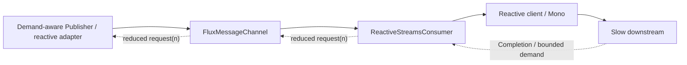
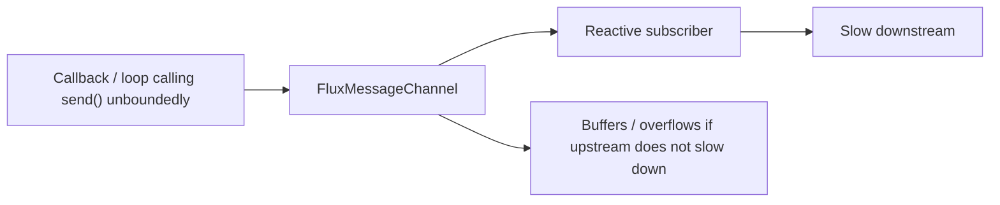

# Reactive backpressure with slow downstream in Spring Integration

## 1. The scenario: fast producer, slow downstream

Suppose a Spring Integration application receives thousands of events from upstream, routes them across `MessageChannel`s, and calls a storage service or partner API. When downstream can handle only 100 events/second while upstream keeps pushing 400 events/second, unprocessed work **accumulates** somewhere: in memory buffers, queues, brokers, connection pools, pending requests, or at the source itself.

Without a control policy, the system can suffer:

- Rapid heap growth from unbounded buffers and eventually `OutOfMemoryError`.
- Rising p95/p99 latency and gateway timeouts even when handler CPU is low.
- Ballooning executor queues; threads tied up on I/O or retries.
- Pollers continuing to pull messages from JDBC/brokers faster than processing speed.
- Retries after timeouts adding more load to an already congested downstream.
- Dropped messages, overflow errors, redeliveries, or broken ordering when the wrong mechanism is chosen.

**Reactive backpressure** is the mechanism by which a subscriber signals how much data it is **ready to accept** via demand signals. When upstream components support Reactive Streams, downstream can slow emission right at the source instead of pushing all pressure into in-JVM queues.

The lesson **Reactive backpressure with slow downstream** sits in the **Performance** chapter of the `SPRING_INTEGRATION_RUNTIME` module. We use Spring Integration 6.5 and Project Reactor to connect backpressure with channels, endpoints, consumers, pollers, executors, `IntegrationFlow` lifecycle, transactions, retries, message stores, errors, and correlation — the factors that actually determine runtime performance.

### Learning outcomes

After this lesson you will be able to:

1. Explain `Publisher → Subscriber → Subscription.request(n)` and distinguish demand from actual throughput.
2. Identify where backpressure **propagates through** and where it **breaks** in Spring Integration.
3. Use `FluxMessageChannel`, `ReactiveStreamsConsumer`, `handleReactive()`, and `fluxTransform()` in their proper roles.
4. Bound in-flight downstream requests with `flatMap(maxConcurrency, prefetch)`, and use `concatMap()` when ordering is required.
5. Design bounded buffers, overflow policies, retries, timeouts, and dead-lettering without masking message-loss risks.
6. Test demand with `StepVerifier`, measure in-flight concurrency, and diagnose runtime queues/waits.

> **Illustrative versions:** Spring Integration 6.5, Spring Framework 6.x, Project Reactor, and Java 17 (with matching Spring Boot 3.x dependency versions). Reactive does not magically make JDBC or blocking HTTP non-blocking; every guarantee depends on both the actual source and destination.

## 2. The Reactive Streams model: producers emit only what subscribers request

Reactive Streams has four core concepts:

| Component | Responsibility |
|---|---|
| `Publisher<T>` | Supplies a stream of items as requested by a subscriber. |
| `Subscriber<T>` | Receives `onSubscribe`, `onNext`, `onError`, `onComplete`. |
| `Subscription` | Connects a subscriber to a publisher, providing `request(n)` and `cancel()`. |
| **Demand** | Number of items the subscriber still permits upstream to emit; must exceed 0 to receive items per contract. |

```mermaid
sequenceDiagram
    participant S as Subscriber (downstream)
    participant P as Publisher (upstream)
    S->>P: subscribe()
    P-->>S: onSubscribe(subscription)
    S->>P: request(2)
    P-->>S: onNext(M1)
    P-->>S: onNext(M2)
    Note over P,S: No new demand: upstream pauses emission
    S->>P: request(1)
    P-->>S: onNext(M3)
    S->>P: cancel()
    Note over P,S: Stops subscription; handle ack/durable source separately
```

A data stream is typically wired during **assembly** and executes upon **subscription**. With a compliant publisher, downstream `request(n)` propagates upstream through operators. This is **item-count flow control**, not a per-second rate limiter.

### 2.1. Demand is not “100 requests per second”

- `request(10)` means the subscriber permits up to **the next 10 items**, not 10 items/second.
- `request(Long.MAX_VALUE)` represents unbounded demand; many convenience `subscribe()` overloads in Reactor request effectively unbounded demand.
- `limitRate(10)` splits large requests into smaller batches; it does **not** enforce an exact rate of 10 messages/second.
- `flatMap(..., 8)` caps concurrently subscribed inner publishers; it does **not** directly cap an HTTP API's RPM.
- `cancel()` tears down the subscription, which does **not** mean a broker record was acked, a transaction rolled back, or an external side effect was undone.

### 2.2. Rate-balance problem

Notation:

- `λ`: arrival rate from source (messages/second).
- `μ`: rate at which downstream succeeds (messages/second).
- `B`: unprocessed backlog.

If `λ > μ` persists long enough, backlog grows by roughly `(λ - μ) × time` unless bounded, dropped, rejected, or throttled. In the 400/s in vs. 100/s processed example, the system accumulates roughly 300 extra messages/second—around 18,000 unprocessed messages in one minute, **excluding** in-flight messages.

The primary mechanisms offer three options: **slow upstream down**, **hold a bounded/durable backlog**, or **intentionally reject/mark lost**. No operator makes a fixed downstream process beyond its real capacity.

## 3. Spring Integration: the channel determines the flow-control model

Spring Integration can place the same business handler behind different channel types. Channel choice dictates threading, buffering, and how the flow reacts to a slow downstream.

| Channel/boundary | How it works | What happens when downstream is slow |
|---|---|---|
| `DirectChannel` | Invokes handler synchronously on the sender thread | Sender may **block** until the handler finishes; this is blocking push, not Reactive Streams demand. |
| `ExecutorChannel` | Dispatches handler via a `TaskExecutor` | Executor queue can grow; when full, rejects or applies rejection policy. Caller transactions/MDC do not propagate automatically. |
| `QueueChannel` | Holds messages for a poller or `receive()` | Backlog grows up to capacity or store limits; sender may block/time out/reject depending on config. |
| `FluxMessageChannel` | A `MessageChannel` that is also a `Publisher<Message<?>>`/`ReactiveStreamsSubscribableChannel` | Connects reactive publishers and subscribers; **does not guarantee** an imperative source hammering `send()` will automatically slow down. |
| `PublishSubscribeChannel` | Fans out to multiple subscribers, optionally async | One slow branch affects behavior depending on executor, error handling, and buffers; not a single backpressure queue. |
| Broker/JDBC source adapter | Controls polling, prefetch, acks, commits | Flow control/acks must be configured at **the source**; downstream Reactor demand does not automatically control every driver. |

**Common mistake:** swapping `DirectChannel` for `FluxMessageChannel` and assuming you now have end-to-end backpressure, while upstream remains a callback or tight loop calling `channel.send(message)`. When the source does not speak `Publisher`/demand, the channel may have to buffer or signal overflow; it cannot force an external imperative producer to pause.

### 3.1. A flow that genuinely has backpressure



Source, channel, consumer, and downstream must all honor demand, including intermediate operators. If any segment switches to blocking or uncontrolled push, backpressure propagation can **stop at that segment**.

### 3.2. A flow that only looks reactive



A publisher from `Flux.range()` honors `request(n)` faithfully, whereas a UDP callback, file watcher, or push listener firing millions of events **may have no pause API**. At that boundary you need bounded capacity, explicit rejection/durable queues, or protocol-level flow control.

## 4. The core API pair: FluxMessageChannel and ReactiveStreamsConsumer

### 4.1. What does FluxMessageChannel do?

Per the Spring Integration 6.5 API, `org.springframework.integration.channel.FluxMessageChannel`:

- Extends `AbstractMessageChannel` and implements `MessageChannel`.
- Is also an `org.reactivestreams.Publisher<Message<?>>`.
- Implements `ReactiveStreamsSubscribableChannel`: provides `subscribeTo(Publisher<? extends Message<?>>)` to accept an **upstream publisher**.
- Has `start()`, `stop()`, `isRunning()`, and subscription lifecycle management.
- Is **not** a traditional `SubscribableChannel` or `PollableChannel`.

Channel definition example:

```java
import org.springframework.context.annotation.Bean;
import org.springframework.integration.channel.FluxMessageChannel;

@Bean("jobs.reactive")
FluxMessageChannel reactiveJobsChannel() {
    return new FluxMessageChannel();
}
```

If the source provides a genuine `Publisher<Message<Job>>`, the channel propagates downstream demand to the publisher via `subscribeTo(...)`. On the `send()` path receiving messages from imperative producers, Spring Integration uses an internal hot Flux/sink; check limits and overflow behavior for your version/backend rather than assuming zero buffering or `request(n)`-driven blocking.

### 4.2. ReactiveStreamsConsumer

When input is a `FluxMessageChannel` or compatible publisher, Spring Integration can use `ReactiveStreamsConsumer` instead of a conventional `EventDrivenConsumer` to coordinate the handler via Reactive Streams. Here message processing shifts from imperative push to reactive pull where supported.

Since 5.5, `ConsumerEndpointSpec.reactive()` lets you request a reactive endpoint even when the input channel is not directly a `FluxMessageChannel`. An optional function can transform the source `Flux<Message<?>>` with operators such as `publishOn()`, `doOnNext()`, and `retry()`. With annotations, `@Reactive` expresses the same idea.

However, **making an endpoint reactive does not make a non-demand-aware external source demand-aware**. Analyze end-to-end from source to sink rather than looking at a single `reactive()` flag.

### 4.3. ReactiveMessageHandler and handleReactive()

Spring Integration supports `ReactiveMessageHandler` returning a `Publisher<Void>`/`Mono<Void>` representing **processing completion**. With a reactive consumer, the framework composes the handler into the reactive stream; in an imperative flow, the handler may be wrapped and **subscribed immediately**, losing end-to-end demand coordination.

Since 6.1, Java DSL includes the terminal operator `handleReactive(ReactiveMessageHandler)`. Example:

```java
@Bean
IntegrationFlow auditFlow() {
    return IntegrationFlow.from("audit.in")
            .handleReactive(message ->
                    Mono.fromRunnable(() ->
                            System.out.println(message.getPayload()))
                        .then());
}
```

This is a terminal handler **that emits no reply message**. It does not imply `.handleReactive()` sets `maxConcurrency=1` or creates a durable queue. If the code inside `fromRunnable()` performs blocking I/O, blocking still occurs on the subscribing thread unless an appropriate scheduler is chosen.

### 4.4. Reactive reply payloads

A service activator or gateway can return `Mono<T>` or `Flux<T>`. When the output channel is a `ReactiveStreamsSubscribableChannel` such as `FluxMessageChannel`, the framework can flatten the publisher on demand. On an imperative channel, the publisher may simply become a **payload containing a publisher** or be subscribed asynchronously; never assume a `Mono<T>` will finish before the method call returns.

When designing request–reply, verify three things: (1) who subscribes to the result, (2) which channel holds `replyChannel`, and (3) how timeouts/cancellations map to business state.

## 5. Runnable example: reactive source and simulated slow downstream

This hands-on example uses Java 17, Spring Boot 3.x with matching Spring Integration 6.5, Reactor, and `spring-boot-starter-integration`.

### 5.1. Dependencies

```groovy
dependencies {
    implementation 'org.springframework.boot:spring-boot-starter-integration'
    implementation 'org.springframework.boot:spring-boot-starter-webflux'

    testImplementation 'org.springframework.boot:spring-boot-starter-test'
    testImplementation 'io.projectreactor:reactor-test'
}
```

Spring Boot dependency management selects compatible Reactor/Spring Integration versions; avoid manually pinning `reactor-core` to a different major or incompatible API.

### 5.2. Model and downstream contract

```java
public record WorkItem(String id, int priority) {
}
```

```java
import reactor.core.publisher.Mono;

@FunctionalInterface
public interface ReactiveDownstreamClient {
    Mono<Void> submit(WorkItem item);
}
```

A mock client simulating non-blocking I/O:

```java
import java.time.Duration;
import org.springframework.context.annotation.Bean;
import org.springframework.context.annotation.Configuration;
import reactor.core.publisher.Mono;

@Configuration
class DemoDownstreamConfig {
    @Bean
    ReactiveDownstreamClient downstreamClient() {
        return item -> Mono.delay(Duration.ofMillis(100)).then();
    }
}
```

`Mono.delay()` simulates latency using a Reactor scheduler and makes **no** real HTTP or DB calls. In production, replace it with WebClient, R2DBC, or another reactive driver.

### 5.3. Source publisher → IntegrationFlow → reactive handler

```java
import org.springframework.context.annotation.Bean;
import org.springframework.context.annotation.Configuration;
import org.springframework.integration.dsl.IntegrationFlow;
import org.springframework.messaging.Message;
import org.springframework.messaging.support.MessageBuilder;
import reactor.core.publisher.Flux;

@Configuration
class ReactiveJobFlowConfig {

    @Bean
    IntegrationFlow reactiveJobFlow(ReactiveDownstreamClient client) {
        Flux<Message<WorkItem>> source = Flux.range(1, 1_000)
                .map(n -> MessageBuilder
                        .withPayload(new WorkItem("job-" + n, 1))
                        .setHeader("businessId", "job-" + n)
                        .build());

        return IntegrationFlow.from(source)
                .handleReactive(message -> {
                    WorkItem item = (WorkItem) message.getPayload();
                    return client.submit(item);
                });
    }
}
```

**Explanation:**

1. `Flux.range()` is a demand-aware publisher and does not materialize a list of 1,000 messages in RAM.
2. `IntegrationFlow.from(Publisher<Message<T>>)` is the reactive entry point; Spring Integration wires a `FluxMessageChannel`-based mechanism.
3. `handleReactive()` terminates the flow with a handler returning `Mono<Void>`; subscription completion or error represents processing outcome.
4. If the client is slow, backpressure can propagate to the source across demand-aware portions of the pipeline.
5. Do not infer specific internal `flatMap` concurrency, throughput, or buffer depths from this example. To cap active I/O operations, **configure explicit concurrency** as in the next example.

**Lifecycle warning:** the publisher is subscribed when the flow/consumer is ready; a finite `Flux` completing, or stopping/starting/resubscribing a flow, can replay data depending on the source definition. Because `Flux.range()` is a cold publisher, each new subscription can replay all 1,000 items; downstream needs business idempotency. Never treat this demo source as a persistent event queue.

## 6. Bounding concurrent in-flight downstream tasks

Reactive Streams throttles item requests, yet each item can trigger long-lived I/O. If a downstream service tolerates at most 8 concurrent requests, place the bound **right on the operator issuing that request**.

### 6.1. flatMap with maxConcurrency and prefetch

```java
import reactor.core.publisher.Flux;
import reactor.core.publisher.Mono;

Flux<WorkItem> jobs = Flux.range(1, 1_000)
        .map(n -> new WorkItem("job-" + n, 1));

Flux<WorkItem> completed = jobs.flatMap(
        job -> client.submit(job)
                .timeout(java.time.Duration.ofSeconds(3))
                .thenReturn(job),
        8,  // at most 8 inner Publishers subscribed concurrently
        1   // prefetch per inner Publisher
);
```

Here each `client.submit(job)` is a `Mono<Void>`. `flatMap(..., 8, 1)` bounds concurrent **inner subscriptions** to 8; it does not guarantee a 3-second downstream SLA, nor does it cap absolute QPS.

**Condition:** each `Mono` must genuinely represent one request/I/O whose lifecycle tracks the subscription. If `client.submit()` kicks off an external fire-and-forget call and immediately returns `Mono.empty()`, the limit of 8 no longer equals 8 real requests.

### 6.2. Placing the bound into Spring Integration via fluxTransform()

Spring Integration Java DSL offers `fluxTransform()` to insert a Reactor pipeline segment between message flow steps:

```java
@Bean("jobs.flux.in")
FluxMessageChannel jobsFluxIn() {
    return new FluxMessageChannel();
}

@Bean
IntegrationFlow boundedJobFlow(ReactiveDownstreamClient client) {
    return IntegrationFlow.from("jobs.flux.in")
            .<WorkItem, Message<WorkItem>>fluxTransform(source ->
                    source.flatMap(message ->
                            client.submit(message.getPayload())
                                    .timeout(Duration.ofSeconds(3))
                                    .thenReturn(message),
                            8, 1))
            .handleReactive(message ->
                    Mono.fromRunnable(() ->
                            System.out.println("done="
                                    + message.getPayload()))
                        .then());
}
```

Required imports: `java.time.Duration`, `org.springframework.integration.channel.FluxMessageChannel`, `org.springframework.integration.dsl.IntegrationFlow`, `org.springframework.messaging.Message`, `reactor.core.publisher.Mono`, and Spring configuration annotations.

**Meaning:** `fluxTransform()` consumes `Flux<Message<WorkItem>>`, invokes the reactive client capped at 8, and passes completed `Message<WorkItem>` instances downstream. Using `FluxMessageChannel` on input keeps reception reactive; an external producer calling `send()` continuously **still must** respect capacity or admission control.

In production, replace `System.out.println` with an observable downstream/success sink with clear contracts, and verify business idempotency on cancellation/retry. Never treat terminal logging as a broker acknowledgement.

### 6.3. flatMap, concatMap, and flatMapSequential

| Operator | Behavior | When to use |
|---|---|---|
| `flatMap(mapper, concurrency, prefetch)` | Processes concurrently; outputs arrive in completion order | Many independent requests prioritizing throughput |
| `concatMap(mapper)` | Waits for previous inner publisher to finish before starting next | Strict ordering required with one in-flight task |
| `flatMapSequential(mapper, concurrency, prefetch)` | Runs inner publishers concurrently while emitting outputs in source order | Ordered output required; buffering slow items is acceptable |
| `limitRate(highTide, lowTide)` | Adjusts demand batching toward upstream | Tuning **request** batching, not a time-based rate limiter |

**Trade-offs:** `concatMap` preserves order, yet one slow request stalls every subsequent one; `flatMapSequential` can **buffer completed results** while waiting on an earlier slow item. Measure memory when latency variance is high.

### 6.4. Concurrency vs. parallel threads

`flatMap(8)` does not require 8 Java threads. With non-blocking reactive HTTP, many in-flight requests can multiplex on a small set of event-loop threads. Conversely, wrapping blocking JDBC calls in `subscribeOn(Schedulers.boundedElastic())` still occupies dedicated threads/queues and does not turn I/O non-blocking.

## 7. Buffers and overflow: never disguise message loss

When upstream cannot stop emitting, the problem becomes choosing buffers and overflow policies. **No backpressure operator creates infinite RAM safely.**

| Policy | When buffer fills | Suitable for |
|---|---|---|
| **Block producer with timeout** | Sender waits or gets an error | Imperative sources that tolerate delays and have timeouts |
| **Reject/admission control** | Rejects request with error code/retry-after | HTTP/gateways where callers handle retries |
| **Bounded in-memory buffer** | Signals overflow, drops, or fails per policy | Regenerable or non-durable data |
| **Durable broker/JDBC queue** | Broker/store holds backlog up to capacity/retention | Zero message loss required, with ack/redelivery/idempotency |
| **Coalesce/latest** | Merges or keeps only latest state | Telemetry/state snapshots, never exact transactions |
| **Drop** | Intentionally discards items and counts drops | Only when business rules **permit losing** individual samples |

### 7.1. onBackpressureBuffer is not automatically safe

```java
Flux<WorkItem> protectedStream = source
        .onBackpressureBuffer(
                256,
                item -> metrics.incrementOverflow(item.id()),
                reactor.core.publisher.BufferOverflowStrategy.ERROR);
```

This is an **illustrative snippet** (assuming `source` is `Flux<WorkItem>` and `metrics` exposes the method). Reactor offers several bounded buffer and overflow-strategy overloads. Always verify the exact API version, since parameters and overflow propagation depend on the overload.

If the source is a hot producer ignoring demand, the buffer can fill and fail the stream. You must know who catches the error, whether the source can replay, and whether messages are lost. Never configure `onBackpressureDrop()` for orders/payments thinking it is a safe optimization.

### 7.2. Sinks with bounded queues

Reactor allows creating `Sinks.many().unicast().onBackpressureBuffer(queue)` with a bounded queue. When full, `tryEmitNext()` returns failure codes such as `FAIL_OVERFLOW`. This **differs** from Spring Integration `FluxMessageChannel` guarantees; do not project custom sink behavior onto the framework's internal implementation.

```java
import java.util.concurrent.ArrayBlockingQueue;
import reactor.core.publisher.Sinks;

Sinks.Many<Integer> sink =
        Sinks.many().unicast()
                .onBackpressureBuffer(new ArrayBlockingQueue<>(2));

Sinks.EmitResult first = sink.tryEmitNext(1);
Sinks.EmitResult second = sink.tryEmitNext(2);
Sinks.EmitResult third = sink.tryEmitNext(3);

if (third.isFailure()) {
    // Reject / report error / persist for retry;
    // DO NOT assume the item was safely accepted.
}
```

This buffer holds only 2 items and still lives **in RAM**. A JVM restart loses unconsumed items. For critical business data, use a broker or persistent store with proper retry/ack mechanics.

## 8. When is FluxMessageChannel not enough?

Two boundaries require checking.

### 8.1. Imperative producer calling send() in a loop

```java
for (int i = 0; i < 1_000_000; i++) {
    boolean accepted = channel.send(
            MessageBuilder.withPayload("event-" + i).build());
    if (!accepted) {
        // Handle rejection per business policy.
    }
}
```

This code has no upstream `request(n)`; the producer pushes actively. Never claim a reactive consumer will automatically slow down the `for` loop. Actual behavior depends on internal sink limits, subscriber state, and overflow handling. With imperative APIs, use admission control, a bounded queue, or a demand-aware `Publisher` instead.

### 8.2. Blocking handlers inside a reactive flow

```java
// DO NOT put blocking JDBC directly on the Reactor event loop:
Mono.fromCallable(() -> jdbcTemplate.queryForObject(...))
    .subscribe(); // Fire-and-forget also loses completion control!
```

Calling `block()` or blocking JDBC inside a reactive handler can monopolize event-loop threads, spiking latency for **many unrelated requests**. If a reactive driver is not yet available, isolate blocking work with `Schedulers.boundedElastic()`:

```java
Mono<Result> databaseCall = Mono.fromCallable(
                () -> blockingRepository.loadById(id))
        .subscribeOn(Schedulers.boundedElastic());
```

This only offloads blocking work to a bounded scheduler; it **does not guarantee** the DB connection pool is big enough or that `boundedElastic`'s queue won't grow. Set timeouts, concurrency/admission limits, pool sizing, and measure queue waits. For critical data, preserve transaction boundaries; thread-bound Spring JDBC transactions do not cross schedulers automatically.

## 9. Backpressure vs. timeouts, retries, circuit breakers, and rate limits

These mechanisms often work together, yet solve distinct problems:

| Mechanism | What does it control? | Common mistake |
|---|---|---|
| **Backpressure** | Item count emitted by a demand-aware upstream | Mistaking it for a requests/second cap |
| **Timeout** | How long an operation is allowed to run | Assuming timeout rolls back external side effects |
| **Retry** | Retry attempts for transient errors | Retry storms worsening downstream congestion |
| **Circuit breaker** | Allows/blocks calls to downstream when error rates spike | Thinking it replaces buffers or durable replay |
| **Rate limiter** | Operations per unit time (RPS/tokens) | Using `limitRate(n)` and calling it an RPS limit |
| **Bulkhead** | Concurrent tasks/connections permitted | Raising thread counts without capping outstanding work |
| **Queue/broker** | Holds unprocessed work | Treating unbounded queues as free |

### 9.1. Retrying against a slow downstream

If downstream takes 5 seconds to respond while the timeout is 1 second, every event may retry 3 times while earlier requests are still executing. The system amplifies its own load and deepens congestion.

A practical policy:

1. Size timeouts from latency budgets and downstream characteristics.
2. Retry only **transient errors**, with capped attempts and exponential backoff + jitter.
3. Never retry validation or schema errors endlessly.
4. Use business idempotency keys downstream when prior call outcomes are ambiguous.
5. Track total attempts, pending retries, and DLQ rates, not only successful throughput.

### 9.2. Reactor retry is a resubscribe

```java
Mono<Void> call = client.submit(item)
        .timeout(Duration.ofSeconds(3))
        .retryWhen(
                reactor.util.retry.Retry.backoff(
                        2, Duration.ofMillis(200))
                .filter(this::isTransient));
```

This snippet assumes a service with an `isTransient(Throwable)` method. Reactor's `retryWhen` typically **resubscribes** to the source publisher on error; if `client.submit` triggers side effects eagerly at call time instead of subscription time, semantics differ. For external side effects like payments, always verify idempotency and prior attempt state.

## 10. Pollers, brokers, acks, and transactions with slow downstream

### 10.1. Reactive source polling

Per Spring Integration docs, when a `SourcePollingChannelAdapter` sends to a `ReactiveStreamsSubscribableChannel`, the runtime can create a trigger-driven `Flux` and poll on demand rather than purely imperative scheduled pulls. `ReactiveMessageSourceProducer` can also wrap `MessageSource.receive()` into a publisher with an appropriate scheduler when the source blocks.

This helps, yet **each adapter has its own contract**. A source lacking proper pause/seek/ack support cannot gain end-to-end guarantees merely because its output channel is `FluxMessageChannel`.

### 10.2. Standard pollers: maxMessagesPerPoll and queue depth

```text
Pollable source -> SourcePollingChannelAdapter
     -> QueueChannel / ExecutorChannel / Reactive boundary
     -> Slow downstream
```

If a poller uses a large `maxMessagesPerPoll`, short `fixedDelay`, and wide executor queue, it can pull messages into the JVM faster than downstream can process them. Measure messages received per cycle, queue depth, poller lag, worker saturation, and source rollback behavior. Tuning poll frequency does not replace a demand-aware source, yet can act as a practical admission throttle on legacy adapters.

### 10.3. Broker prefetch and acknowledgements

With JMS, AMQP, or Kafka, Reactor backpressure **does not automatically** synchronize with broker prefetch, partitions, offset commits, or ack modes. Check driver/adapter behavior:

- How many messages can the broker push before the consumer acks?
- When the reactive handler has not finished yet, has the source already acked/committed?
- If the subscription cancels, do unprocessed records return to the source or get lost?
- Are in-flight counts bounded per partition/consumer, with DLQs for deterministic errors?
- Across restarts, are messages committed before or after business side effects?

**At-least-once** remains the common reality when pairing brokers with external business databases. Backpressure reduces load; it does not create exactly-once transactions.

### 10.4. Transactions do not automatically cross async boundaries

```text
Poller thread:
  begin TX -> receive broker/JDBC -> enqueue async work -> commit TX

Reactive worker thread:
  perform business operation later -> error / success
```

If the poller commits before the asynchronous `Mono` finishes, downstream failure **will not roll back** the committed transaction. Ack only after verified completion, use a business inbox/outbox, or keep a synchronous boundary when one local transaction must span receive and handle. With R2DBC reactive transactions, use the proper reactive transaction context rather than `DataSourceTransactionManager` thread-locals.

## 11. Diagnosing bottlenecks before tuning operators

When p99 latency spikes, do not immediately raise `flatMap` concurrency or thread counts. Locate the real bottleneck first.

| Symptom | Likely cause | What to check |
|---|---|---|
| Low CPU, many pending HTTP calls | Slow downstream network/I/O | Partner latency, active connections, timeouts |
| Heap/GC climbing | Large buffers, queues, or batches | Buffer occupancy, `publishOn` prefetch, executor backlog |
| High CPU | CPU-bound serialization/transforms | CPU profiler, queue wait, event-loop utilization |
| HTTP 429/503 rising as concurrency rises | Exceeding downstream quota | RPS vs. max in-flight, retry amplification |
| `FluxMessageChannel` overflow | Fast push producer, insufficient downstream demand | Is the source truly a Publisher? Buffer size? |
| Kafka partition lag growing | Slow consumers/acks or retries | Prefetch, offsets, request completion |
| Deep `QueueChannel` backlog | Slow poller or handler | Poller started, maxMessagesPerPoll, JDBC locks |
| One slow item stalls everything | `concatMap` or ordered output | Ordering contract and completion timestamps |
| Retry attempts surging | Retry storm | Timeout budget, backoff, circuit breaker |

Time from ingress to completion splits into source wait, executor/buffer wait, processing, downstream I/O wait, backoff, and reply/ack. When successful throughput stops climbing, raising concurrent requests often just makes every request wait longer.

### 11.1. Little's Law for estimating in-flight concurrency

For a system in steady state:

\[
L \approx \lambda W
\]

`L` is average work items in the system, `λ` is average throughput (items/second), and `W` is average time each item spends in the system. For example, 20 requests/second at 0.5 seconds/request requires around 10 in-flight items on average.

This formula estimates steady-state **capacity**, not optimal concurrency when backlogs grow unboundedly, timeouts/drops occur, or traffic is bursty. Always measure p95/p99, not just averages.

## 12. Tuning maxConcurrency, prefetch, and queues

A baseline:

```java
static final int MAX_IN_FLIGHT = 8;
static final int PREFETCH = 1;

Flux<WorkItem> completed = source.flatMap(
        job -> client.submit(job)
                .timeout(Duration.ofSeconds(3))
                .thenReturn(job),
        MAX_IN_FLIGHT,
        PREFETCH);
```

Run a controlled workload with `MAX_IN_FLIGHT=1,4,8,16` while holding downstream conditions fixed and measure:

- **Successful** throughput, not just initiated requests.
- p50/p95/p99 latency; timeouts and HTTP 429/503s.
- Active connections, in-flight requests, executor/scheduler queues.
- Heap, GC, buffered item counts, overflow/rejection counts.
- Broker lag, source acknowledgements, retry/DLQ rates.
- Latency from source receipt to business commit.

**Raising concurrency** can hide I/O waits yet easily overwhelm downstream. **Raising prefetch** cuts request-batch overhead yet increases pending items. **Raising queue capacity** absorbs bursts yet increases queue wait and memory usage.

### 12.1. Hidden queues in Reactor

Even without a `QueueChannel`, items can accumulate in:

- `publishOn()` prefetch queues when switching schedulers.
- `flatMap` inner subscriptions/prefetch queues.
- `flatMapSequential` reordering buffers awaiting slow items.
- `groupBy()` open groups retaining per-group state.
- `buffer(n)`, `window(n)` while downstream waits for batches.
- Hot source sinks, callback bridges, or pending retry/backoff timers.

A “100% reactive” pipeline still needs an explicit memory budget. Never assume an operator without “queue” in its name does no buffering.

### 12.2. Concurrency is not a time-based rate limit

If a partner API caps at 50 requests/second and each request finishes in 10 ms, 8 in-flight tasks can send **hundreds of requests/second**. Pair bounded concurrency with a time-based rate limiter. `limitRate(8)` does not enforce 8 requests/second.

## 13. Observing demand, cancellation, and bottlenecks

Attach hooks at suspected operators:

```java
Flux<WorkItem> observed = source
        .doOnSubscribe(s -> log.debug("reactive-subscribed"))
        .doOnRequest(n -> log.debug("requested={}", n))
        .doOnNext(job -> metrics.accepted(job.id()))
        .doOnError(ex -> metrics.failed(ex.getClass().getSimpleName()))
        .doOnCancel(() -> metrics.cancelled())
        .doFinally(signal -> metrics.terminated(signal.name()));
```

This is illustrative code using application `log` and `metrics`. Never log every message at INFO under high volume. Logs should include stable `businessId`/`correlationId`, flow/component ID, instance, and source partition where applicable; never log raw secrets/PII.

| Layer | Valuable metrics |
|---|---|
| Source | Arrival rate, `requested(n)`, broker lag, poll counts, acks/commits |
| Reactive operator | Active inners, pending demand, overflow/drops, cancellations, buffer sizes |
| Downstream | RPS, active requests, connection saturation, 2xx/429/5xx statuses, latency |
| Business | DB commits/rollbacks, idempotency conflicts, retry and DLQ counts |

Specific metric names are instrumentation suggestions, not all built into Spring Integration/Micrometer out of the box. Spring Integration management measures channels/handlers per configuration, while custom publisher demand usually requires dedicated instrumentation.

### 13.1. Distinguishing blocking from non-blocking I/O

- `reactor-http-nio-*` threads blocking on `Thread.sleep()` or JDBC: event-loop starvation.
- Few event-loop threads yet many pending requests: likely proper non-blocking I/O with a genuinely slow downstream.
- Many `boundedElastic-*` threads waiting on DB: blocking was moved off the event loop, yet the connection pool remains the bottleneck.
- `taskScheduler-*` held by blocking handlers: inspect poller execution/threads.
- `DirectChannel` sender waiting on handler: producer stalled by synchronous call, not Reactive Streams `request(n)`.

MDC is thread-local and can disappear when Reactor switches schedulers; a message's `requestId` header can still survive. Distinguish **lost MDC** from **lost messages**.

## 14. Using StepVerifier to test backpressure

### 14.1. Verifying exact request(n) on a Reactor source

```java
import static org.junit.jupiter.api.Assertions.assertEquals;
import java.util.concurrent.atomic.AtomicLong;
import org.junit.jupiter.api.Test;
import reactor.core.publisher.Flux;
import reactor.test.StepVerifier;

class DemandTest {

    @Test
    void sourceEmitsOnlyWhenRequested() {
        AtomicLong requested = new AtomicLong();

        Flux<Integer> source = Flux.range(1, 5)
                .doOnRequest(requested::addAndGet);

        StepVerifier.create(source, 0)
                .expectSubscription()
                .thenRequest(2)
                .expectNext(1, 2)
                .thenRequest(3)
                .expectNext(3, 4, 5)
                .verifyComplete();

        assertEquals(5, requested.get());
    }
}
```

`initialRequest=0` means the subscriber has granted zero demand initially. Only after `thenRequest(2)` are 1 and 2 emitted, and after `thenRequest(3)` come the rest. This proves `Flux.range()` respects demand, **not** that every Spring Integration inbound adapter/broker maps demand properly.

### 14.2. Verifying concurrent Monos never exceed maxConcurrency

```java
import static org.junit.jupiter.api.Assertions.*;
import java.time.Duration;
import java.util.concurrent.atomic.AtomicInteger;
import org.junit.jupiter.api.Test;
import reactor.core.publisher.Flux;
import reactor.core.publisher.Mono;
import reactor.test.StepVerifier;

class MaxConcurrencyTest {

    @Test
    void atMostFourInnerPublishersRunTogether() {
        AtomicInteger active = new AtomicInteger();
        AtomicInteger peak = new AtomicInteger();

        Flux<Integer> completed = Flux.range(1, 20)
                .flatMap(id ->
                        Mono.defer(() -> {
                            int now = active.incrementAndGet();
                            peak.accumulateAndGet(now, Math::max);
                            return Mono.delay(Duration.ofMillis(20))
                                    .thenReturn(id)
                                    .doFinally(sig ->
                                            active.decrementAndGet());
                        }),
                        4, 1);

        StepVerifier.create(completed)
                .expectNextCount(20)
                .expectComplete()
                .verify(Duration.ofSeconds(5));

        assertTrue(peak.get() <= 4);
        assertTrue(peak.get() > 0);
    }
}
```

`active` is incremented when the inner `Mono.defer()` is **subscribed**, not when constructing the publisher. The test verifies the inner-subscription limit, not that thread count equals 4. Use short deadlines and a reproducible mock downstream; real load tests should add latency distributions and fault injection.

### 14.3. Virtual time for delays/retries

```java
import java.time.Duration;
import reactor.core.publisher.Flux;
import reactor.core.publisher.Mono;
import reactor.test.StepVerifier;

StepVerifier.withVirtualTime(() ->
        Flux.range(1, 3)
                .concatMap(i ->
                        Mono.delay(Duration.ofSeconds(1))
                                .thenReturn(i)))
        .expectSubscription()
        .thenAwait(Duration.ofSeconds(3))
        .expectNext(1, 2, 3)
        .verifyComplete();
```

Virtual time simulates Reactor timers; it does not speed up real HTTP/JDBC calls. If a pipeline uses custom schedulers outside virtual-time scope, reconfigure them or run a real-time integration test.

## 15. Integration testing Spring Integration with a slow downstream

Use a Spring context with `ReactiveJobFlowConfig` from section 5 and a controllable mock `ReactiveDownstreamClient`. Assert both **source→sink semantics** and **business effects**.

| Scenario | Control | Expectation |
|---|---|---|
| 100 valid messages, demand-aware source | Finite publisher, client returns completing Mono | 100 completions, no duplicate businessIds |
| Downstream 10x slower | Fixed/variable delay | In-flight stays within bound; backlog/latency follow policy |
| Callback source calling `send()` fast | Producer lacks demand | Bounded overflow/rejection/buffer, no OOM |
| Permanent error | Client throws validation exception | Quarantine/DLQ or clean stream stop, no endless retries |
| Transient retry | Client fails 503 then succeeds | Bounded retries, backoff, and idempotency |
| Cancel with work in-flight | Dispose subscription | In-flight cleanup per client; source ack/replay per contract |
| Restart before downstream completes | Persistent source and real process | Safe redelivery, zero lost/duplicated side effects |
| Gateway timeout after business commit | Late reply | Caller retry handled idempotently |
| Multi-tenant, one slow tenant | Quotas/bulkheads | Fast tenants are not starved of resources |

**Never use an in-memory `QueueChannel` to prove data survives restarts.** For broker/JDBC sources, use Testcontainers/real sources and verify acks, transactions, and redeliveries.

### 15.1. Caution with tests using handleReactive() alone

A terminal `handleReactive(message -> client.submit(...))` composes/subscribes the handler per API, yet does not enforce a specific concurrency cap. For a trustworthy “max 8 in-flight” assertion, place the bound at `flatMap(...,8,1)` **directly wrapping `client.submit()`** and test that operator segment.

### 15.2. Never treat successful send() as committed business state

`MessageChannel.send()` returning `true` means the channel accepted/dispatched per its contract—**not** that the downstream reactive `Mono` finished or the broker acknowledged. Reconcile completions, errors/acks, and business state.

## 16. Fairness and bulkheads across multiple tenants

One slow tenant can occupy every slot in a shared `flatMap(maxConcurrency=8)`, delaying all other tenants. Mitigations:

- **Per-tenant bulkheads:** cap concurrent calls, buffers, and connections per tenant.
- **Bounded pending queues** per tenant instead of one cluster-wide unbounded queue.
- **Rate limits** per tenant and per downstream endpoint.
- **Partitioning** by tenant/key if isolated ordering is needed.
- **Shared flows** for tenants with matching pipelines, or dedicated flows/worker pools for heavy tenants.
- **Admission control** with explicit rejections, never silently swallowing messages.

`Flux.groupBy(tenantId)` creates reactive sub-streams, yet can cause memory/backpressure stalls if group cardinality grows too high or groups go unconsumed. Never treat `groupBy` as a free fair scheduler for hundreds of thousands of tenants; manage cardinality, cleanup, and concurrency explicitly.

## 17. When to use reactive vs. bounded blocking?

| Situation | Approach |
|---|---|
| Upstream/downstream have reactive drivers with heavy I/O waits | `FluxMessageChannel`, Publisher, and reactive consumers |
| Blocking JDBC, legacy SDKs | Bounded executor/`Schedulers.boundedElastic()`, clear transactions; consider R2DBC if appropriate |
| Unpausable callback source | Bounded buffer + reject/overflow or durable queue |
| Broker must retain all events | Let broker hold backlog; tune prefetch/ack/consumer concurrency |
| Strict per-partition ordering required | `concatMap` or per-key ordered processor |
| Partner API has an RPS quota | Time-based rate limiter + bounded in-flight |
| CPU-bound transformers | Cap parallelism to CPU cores; do not expect reactive I/O to help CPU |
| Ultra-fast handlers needing no async | Synchronous `DirectChannel` can be simpler with less overhead |

Switching every channel to `FluxMessageChannel` carries no automatic throughput guarantee. Benchmark your actual workload before choosing the architecture.

## 18. Runbook when a reactive flow slows down

1. Capture `businessId`, flow ID, tenant/instance, timestamp, and root-cause exceptions.
2. Measure arrival rate (`λ`) vs. successful completion (`μ`); is backlog growing?
3. Determine whether the producer is a demand-aware Publisher or an imperative callback/`send()` loop.
4. Trace the channel chain: `FluxMessageChannel`, `ExecutorChannel`, `DirectChannel`, `QueueChannel`, and broker boundaries.
5. Measure downstream latency, status codes, active connections, and 429/503 quotas.
6. Sample `doOnRequest` and active inner-subscription counts.
7. Inspect `flatMap`, `publishOn`, `buffer`, `groupBy`, `retryWhen`, and source prefetch.
8. Check thread dumps for blocking I/O on Reactor event-loop threads; isolate blocking work if present.
9. Audit transactions, acks, and error handling: is completion awaited before commit?
10. Enforce explicit maxConcurrency, bounded buffering, admission control, and retry policies.
11. Load test with bursts and downstream delay/failure injection.
12. Post-tuning, monitor p95/p99, DLQs, GC, queue age, and successful business throughput.

### Quick failure matrix

| Symptom | Likely cause | Fix |
|---|---|---|
| Producer keeps calling `send()`, heap climbs | Hot source ignoring demand | Admission control/bounded queue/overflow |
| `limitRate(10)` yet >10 requests/s | Not a time-based limiter | Use a per-second rate limiter |
| `flatMap(8)` still gets 429s | Concurrency of 8 still exceeds RPS quota | Rate limit + concurrency |
| One slow item stalls the whole stream | `concatMap` / ordered output | Review ordering contract and partitioning |
| High memory in `flatMapSequential` | Output buffer waiting on older slow items | Lower concurrency or relax ordering policy |
| `publishOn` adds latency | Queue/scheduler handoff | Measure prefetch and queue wait |
| Broker lag climbs | Slow polling/acking | Tune consumers, downstream capacity, commits |
| Messages lost on cancel | Early ack / RAM-only buffer | Durable replay, idempotent processing |
| Retries worsen downstream failures | Retry storm | Backoff, circuit breaker, quota, DLQ |
| Gateway times out though DB committed | Late reply after tx commit | Business idempotency + status query |

## 19. Self-check questions

**1.** Does `request(10)` mean 10 messages/second?  
**Answer:** No. It is item-count demand, not a time-based rate.

**2.** Does replacing `DirectChannel` with `FluxMessageChannel` automatically throttle a `send()` loop?  
**Answer:** No guarantee. Upstream needs a demand-aware contract or admission/overflow policies.

**3.** What does `flatMap(mapper,8,1)` control?  
**Answer:** At most 8 concurrent inner subscriptions with prefetch 1 per inner; not 8 Java threads or 8 RPS.

**4.** Does `limitRate(10)` replace a rate limiter?  
**Answer:** No. It splits demand into batches without enforcing wall-clock speed limits.

**5.** Why can `concatMap()` cause head-of-line blocking?  
**Answer:** It waits for the current inner publisher to finish before starting the next, preserving order while limiting parallelism.

**6.** Is `onBackpressureDrop()` suitable for payment messages?  
**Answer:** No, unless business rules allow losing events; durable retries/acks/idempotency are required.

**7.** Does running JDBC on `boundedElastic` make JDBC non-blocking?  
**Answer:** No. JDBC still blocks threads; the scheduler merely isolates blocking from the event loop.

**8.** If `Mono<Void>` errors after the poller already committed, does Reactor cancel roll back the DB transaction?  
**Answer:** No. Design ack/transaction boundaries and recovery properly.

**9.** Does `StepVerifier` proving `Flux.range()` honors demand prove JMS/Kafka adapters do too?  
**Answer:** No. Test actual adapters, broker prefetch, acks, and cancellation behavior.

**10.** Why can a slow tenant degrade a fast tenant inside a shared `flatMap(8)`?  
**Answer:** The slow tenant occupies slots; per-tenant bulkheads/quotas or partitioning are needed.

**11.** Does `FluxMessageChannel.send() == true` mean downstream committed?  
**Answer:** No. Channel acceptance/dispatch differs from business completion and acknowledgement.

**12.** Downstream allows 50 RPS and requests finish fast; is `maxConcurrency=8` enough?  
**Answer:** Not necessarily. A time-based rate limiter matching the actual quota is needed.

## 20. Official references

1. [Spring Integration 6.5 — Reactive Streams Support](https://docs.spring.io/spring-integration/reference/6.5/reactive-streams.html): `FluxMessageChannel`, `ReactiveStreamsConsumer`, reactive polling, and `handleReactive()`.
2. [Spring Integration 6.5 API — FluxMessageChannel](https://docs.spring.io/spring-integration/docs/6.5.0/api/org/springframework/integration/channel/FluxMessageChannel.html): `Publisher<Message<?>>`, `subscribeTo()`, and lifecycle.
3. [Spring Integration 6.5 API — BaseIntegrationFlowDefinition](https://docs.spring.io/spring-integration/docs/6.5.0/api/org/springframework/integration/dsl/BaseIntegrationFlowDefinition.html): `fluxTransform()` and `handleReactive()`.
4. [Spring Integration 6.5 — Reactive annotations](https://docs.spring.io/spring-integration/reference/6.5/configuration/annotations.html): `@Reactive` and reactive endpoint configuration.
5. [Spring Integration 6.5 — Messaging Channels](https://docs.spring.io/spring-integration/reference/6.5/channel.html): synchronous, executor, queue, and flux channels.
6. [Spring Integration 6.5 — Transactions](https://docs.spring.io/spring-integration/reference/6.5/transactions.html): poller/transaction/thread boundaries.
7. [Spring Integration 6.5 — Error Handling](https://docs.spring.io/spring-integration/reference/6.5/error-handling.html): error flows, async handling.
8. [Project Reactor — Backpressure and Requests](https://projectreactor.io/docs/core/release/reference/subscribe-backpressure.html): `request(n)`, `limitRate`, demand/prefetch.
9. [Project Reactor — Sinks](https://projectreactor.io/docs/core/release/reference/coreFeatures/sinks.html): bounded sinks, overflow, and `tryEmitNext()`.
10. [Project Reactor — Testing with StepVerifier](https://projectreactor.io/docs/test/release/reference/): controlling demand and virtual time.
11. [Project Reactor — Flux API](https://projectreactor.io/docs/core/release/api/reactor/core/publisher/Flux.html): `flatMap`, `concatMap`, `flatMapSequential`, and buffer operators.
