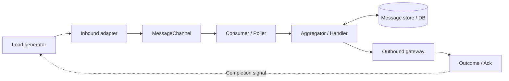
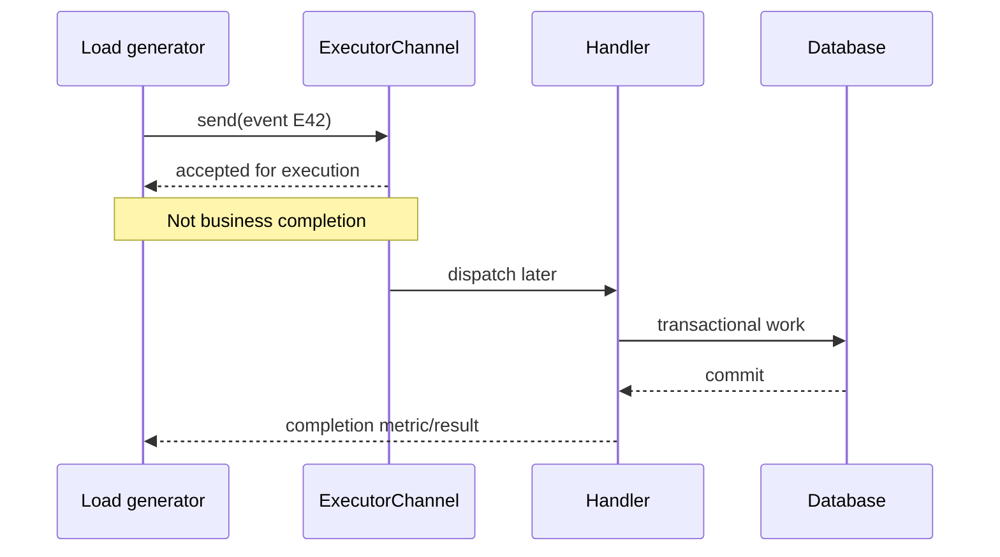
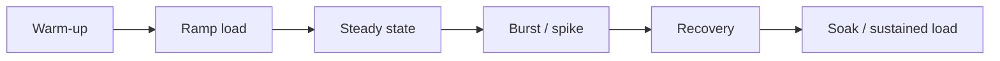
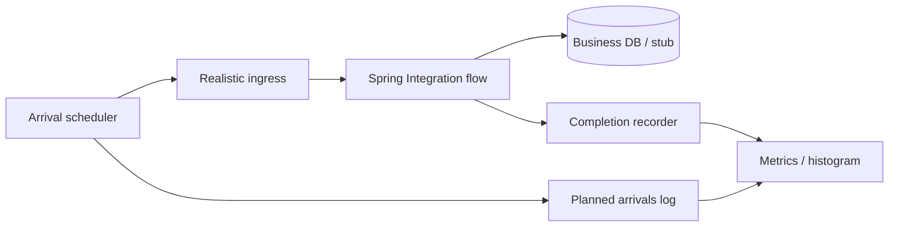
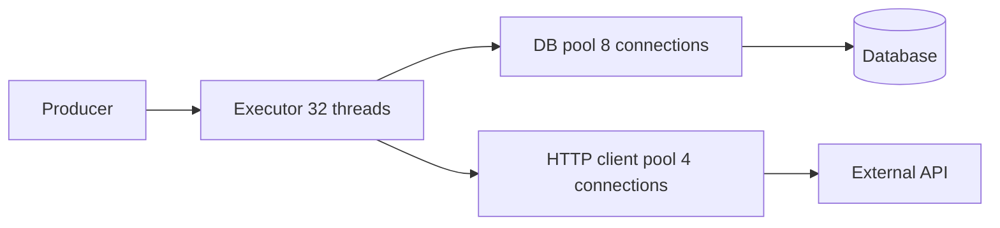
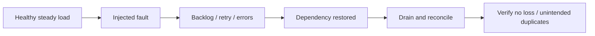
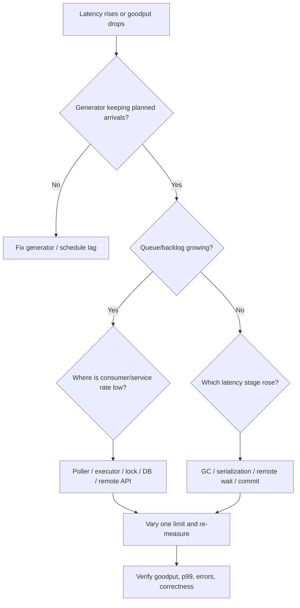

# Benchmarking on representative workloads and topologies

In the **Spring Integration runtime**, a message may travel through an inbound adapter, `MessageChannel`, poller, executor, filter, transformer, aggregator, transaction, message store, and outbound gateway. Each component affects **throughput, latency, load tolerance, memory, and overload behavior**. A benchmark that merely invokes a single handler directly with a tiny payload often yields flattering numbers, yet fails to reflect performance when waiting on pollers, contending for JDBC connections, synchronizing groups, or retrying an external API.

This lesson belongs to the **Performance** chapter of the `SPRING_INTEGRATION_RUNTIME` module. The focus is on how to **design, execute, and interpret benchmarks on representative workloads and topologies**, rather than optimizing against artificial measurements. Examples progress from load specification, topology selection, measurement boundaries, and experiment setup to bottleneck analysis and performance regression testing.

> **Core message:** benchmark results are meaningful only alongside a clearly documented **workload, environment, topology, resource limits, and definition of “done”**. Never derive production SLAs from the messages/second of a benchmark that ignores queues, retries, transactions, and error recovery.

## 1. What does “representative” mean?

A representative workload reasonably approximates the **message size distribution, arrival rates, business types, correlation keys, error rates, dependency latencies, and burst patterns** that the real system faces.

A representative topology retains the components that introduce significant cost or concurrency boundaries: **channel types, consumer concurrency, pollers, executors, serialization, transaction managers, JDBC/broker/message stores, routers, retries, and outbound I/O**.



In the topology above, measuring only `AGG` while omitting `SRC`, `CH`, and `ACK` misses a substantial share of total flow latency and failure modes.

### 1.1. Three distinct benchmark tiers

| Tier | Measurement scope | Useful for | What NOT to infer |
| --- | --- | --- | --- |
| **Microbenchmark** | A single transform, serializer, or pure function | Comparing implementations, memory allocations | End-to-end throughput of a message flow |
| **Component benchmark** | E.g., `DirectChannel`, a handler, or `JdbcMessageStore` in isolation | Understanding one specific bottleneck | Whole-system SLA across multiple sources |
| **End-to-end benchmark** | Source to business commit/ack/reply with matching dependencies | Capacity, latency, stability of the topology | Correctness under untested load shapes |

A solid benchmark suite often includes **all three tiers**, but reports must state explicitly which tier produced each result. Never publish microbenchmark numbers as production processing capacity.

## 2. Start from a performance question, not from a number

Before tweaking `maxMessagesPerPoll` or thread counts, formulate a measurable hypothesis.

Examples:
- “With 1–16 KiB JSON payloads, version B cuts p95 latency while holding throughput and error rate steady.”
- “When 20% of messages share a correlation key, aggregator lock contention drives p99 up.”
- “JDBC `QueueChannel` makes restarts safe, yet how much goodput does it trade off compared to an in-RAM queue?”
- “Does retrying 3 times while the downstream API slows down grow the queue beyond acceptable limits?”

### 2.1. Definitions to lock down

| Concept | Recommended definition | Common confusion |
| --- | --- | --- |
| **Offered load** | Messages/second the generator intends to send | Mistaking it for successful processing throughput |
| **Accepted rate** | Messages/second accepted by the source/channel | Ignoring messages still sitting in queues |
| **Completed rate** | Work items reaching the defined completion milestone | Counting `send()==true` as business success |
| **Goodput** | **Unique, valid, completed** business events per unit time | Counting retries, duplicates, and failed outputs |
| **End-to-end latency** | From defined arrival milestone to defined business completion/reply/ack | Measuring only handler execution time |
| **Queue wait** | From enqueue until consumer actually begins | Mixing with business processing |
| **Service time** | Processing time inside one defined stage | Using it as whole-flow latency |
| **Error/drop rate** | Errors, rejections, overflows, timeouts, rollbacks over a clear denominator | Counting only logged exceptions |

**Goodput** is especially vital when retries or redeliveries occur: three handler invocations for one event are not three completed orders.

## 3. Defining the “done” boundary

A synchronous `DirectChannel.send()` may return only after the handler runs. By contrast, `ExecutorChannel.send()` can return once the executor accepts the task; `QueueChannel.send()` may only enqueue.

```text
Event E42:
  t0 = load generator planned emission
  t1 = inbound adapter receives
  t2 = message enters queue
  t3 = handler starts
  t4 = business DB commit
  t5 = outbound reply/ack completes
```

From these:

```text
Queue wait         = t3 - t2
Business duration  = t4 - t3
E2E commit latency = t4 - t0
E2E ack latency    = t5 - t0
```

Picking `t4` or `t5` as the completion milestone depends on the SLA. If the system is fire-and-forget, use a **trustworthy completion signal** such as a business DB outcome or audit record; never substitute `send()` by default.

### 3.1. Milestones that get conflated in async flows



In an async flow, completion metrics must be recorded **after the right milestone**. When transaction commit happens outside the method body via a proxy, a log at the end of a `@Transactional` body can still fire **before commit actually finishes**.

## 4. Specifying the workload as a reproducible contract

Never write vague descriptions like “send lots of messages.” A benchmark needs an explicit specification:

| Workload dimension | Hypothetical example | Why it matters |
| --- | --- | --- |
| Message types | 70% create, 20% update, 10% cancel | Each type hits different routers/handlers |
| Payload sizes | 50% 1 KiB, 40% 8 KiB, 10% 64 KiB | Serialization, allocations, network |
| Correlation cardinality | 10,000 concurrent groups | Memory/group store footprint |
| Hot-key skew | 15% of messages fall on 1% of keys | Lock contention, partition imbalance |
| Arrival distribution | Steady + short bursts | Capacity, queues, and p99 |
| Dependency latency | Median 15 ms, p99 250 ms | Thread saturation and long tails |
| Error mix | 1% timeouts, 0.3% retryable DB errors | Retry amplification |
| Duplicates | 0.5% duplicate business IDs | Idempotency and business goodput |
| Group completion | 95% complete, 5% incomplete/late | Expiry/reapers, pending state |
| Consumer count | 1, 4, 8 threads or multiple replicas | Scaling, locking, and DB pools |
| Runtime duration | Warm-up, steady, burst, soak | JIT/GC, leaks, queue growth |

**All numbers in this table are illustrative examples**, not real benchmarks or measurements of this module. Replace them with distributions from production telemetry or credible business forecasts.

### 4.1. Do not use only 1-byte payloads

A message with a large DTO, many headers, or file references behaves very differently from `"hello"`. Consider:

- JSON/Java serialization per adapter.
- Actual header counts and header sizes.
- Compression/encryption if production uses them.
- Object allocations, GC, and payload copies across channels/adapters.
- Mutable/binary/streaming payloads if processed by the system.
- Chunking, batch sizes, and aggregator group sizes.
- Different validation rules driving varying CPU and DB queries.

**Benchmark data must be synthetic or properly anonymized.** Never place raw credentials, PII, or customer data into test logs or repositories.

## 5. Deriving workloads from telemetry without copying sensitive data

Distributions can be extracted from aggregated telemetry:

1. Measure `message_size_bucket` at inbound boundaries.
2. Measure event-type and router-branch ratios.
3. Collect p50/p95/p99 of dependency latencies.
4. Count active groups and members/group at aggregators.
5. Collect retry/redelivery, timeout, and business-duplicate percentages.
6. Observe bursts by minute/second and per tenant/partition.
7. Store **distribution parameters** and random seeds, not raw payloads.

A synthetic model should preserve **cost-driving characteristics**, not actual content. For example, synthetic JSON with matching field count, nesting depth, and byte length; synthetic identifiers following the real hot-key skew.

### 5.1. Avoid happy-path-only benchmarks

If production has retries or expired groups while the benchmark only sends valid messages to a fast handler, results will underestimate:

- Downstream call volume.
- `MessageGroupStore` read/write load.
- Transaction rollback counts.
- Queue backlogs when consumers slow down.
- Objects retained in RAM by retries/pending groups.
- Recovery duration and tail latency.

Measure **normal load** and **fault-mixed load** separately; avoid blending every cause into one hard-to-interpret score.

## 6. Benchmark topology must match the critical path

A topology inventory should document:

```text
Source: HTTP/JMS/Kafka/file/JDBC poller
  -> filters / routers
  -> DirectChannel / ExecutorChannel / QueueChannel
  -> transformer / validator
  -> aggregator / resequencer (if present)
  -> JDBC/Redis/message group store
  -> service activator / outbound gateway
  -> business DB commit
  -> error/recovery/ack/reply
```

For each hop, specify:

| Attribute | Example to document |
| --- | --- |
| Dispatch | Synchronous caller thread, task executor, or poller |
| Buffering | Queue capacity, full/reject policy, durability |
| Concurrency | Poller threads, executor threads, listener/container concurrency |
| Transaction | Where it begins and ends, which resources enlist |
| Retry | Attempts, backoff, recovery, and DLQ |
| Message store | RAM/JDBC/remote, schema, region, locking |
| Correlation | Key distribution, release/expiry policy |
| External dependency | DB pool, API connection pool, timeouts |
| Ack | After receive, enqueue, handler, or commit depending on source |
| Error path | Exception returns to caller or routes to `errorChannel` |

This serves as a **resource map** showing which components the benchmark must keep. If production uses a JDBC-backed queue, substituting an in-RAM `QueueChannel` in benchmarks yields throughput numbers unsuitable for capacity planning.

## 7. Topology matrix to compare

You do not need to benchmark every parameter combination upfront. Pick a few variants with clear hypotheses:

| Scenario | Topology | Question |
| --- | --- | --- |
| T0 — Sync baseline | `DirectChannel → handler` | What is the baseline cost of handler and dispatch? |
| T1 — Executor | `ExecutorChannel → handler` | Does throughput improve when the handler is I/O-bound? |
| T2 — Bounded queue + poller | `QueueChannel(capacity) → poller → handler` | What are queue latency and drain rate? |
| T3 — JDBC channel store | JDBC-backed queue + transactional poller | What latency/I/O does durability cost? |
| T4 — Aggregator | Correlating endpoint + `MessageGroupStore` | How do hot groups and group size affect locks/store? |
| T5 — Retry | T4 + retry/backoff + failure mix | How do attempt amplification and p99 grow? |
| T6 — Multi-instance | N replicas + shared broker/store | Does scaling stay linear or hit shared bottlenecks? |

Reports must separate **topology changes** from **workload changes**. Changing from RAM to JDBC while simultaneously enlarging pool size and payload size leaves the cause of any difference unknown.

## 8. Open-loop vs. closed-loop: two different ways to generate load

### 8.1. Closed-loop

The client sends a new request **only after the previous request finishes**. When the server slows down, the send rate drops automatically. This fits some interactive workflows, yet can **hide overload**.

```text
send -> wait response -> send next -> wait -> ...
```

If a synchronous client waits 500 ms per response, it cannot sustain 100 requests/second on that same thread. Measured p99 can look fine simply because the load generator eased off while the system slowed down.

### 8.2. Open-loop

The generator follows **an arrival schedule independent of completion time**: e.g., aiming to emit 500 events every second even when downstream slows down. This is essential for testing capacity, queue buildup, and overload behavior.

```text
scheduled arrivals: t0, t0+2ms, t0+4ms, ...
actual completion:  t0+X, t0+Y, ...
```

| Characteristic | Open-loop | Closed-loop |
| --- | --- | --- |
| Arrival rate | Independent of response latency | Tied to completion |
| Exposing overload | Better when the generator keeps schedule | Throttles down as soon as the server slows |
| Best suited for | Event streams, broker ingress, fixed rates | User journeys with think time and client caps |
| Pitfall | Underpowered generators miss schedules | Coordinated omission, falsely low latency |
| What to record | Scheduled arrival, actual send, completion, dropped schedules | Concurrency, think time, response time |

**Benchmarks of message-driven runtimes usually need at least one open-loop test**, because external sources can keep producing events even when consumers slow down.

## 9. Coordinated omission and avoiding artificially pretty p99s

**Coordinated omission** occurs when measurement fails to record intervals during which requests should have arrived but were paused because the harness waited on completion or the generator stalled.

For example, a producer only sends after each response:
- The server stalls for 5 seconds.
- The producer stalls with it.
- Measurements show one 5-second sample while missing all the arrivals that **went unsent**.
- Overall percentiles then underestimate the latency users or an event stream would suffer under a fixed arrival rate.

To reduce bias:

1. Define a **planned arrival timestamp** on the generator's clock.
2. Separate planned send, actual send, and completion.
3. Track scheduled arrivals delayed/dropped when the generator saturates.
4. When reading latency against an SLA, measure from **when the event should have arrived** if that matches the test contract.
5. Use load generators/histograms supporting corrected latency or independent arrival tracking.
6. Never patch numbers with an unverified formula; explicitly report tools and calculation methods.

Do not confuse this issue with **clock skew** across machines: both distort results, yet require different fixes.

## 10. Throughput, goodput, and backlog must be measured together

Suppose a producer feeds an average of 600 events/second while the flow completes 500 **distinct business events** per second over the same window. Without rejections or throttling, if everything is retained, backlog tends to grow by roughly **100 events/second**.

```text
arrival_rate       = 600 events/s
unique_goodput     = 500 events/s
backlog_growth     ≈ 100 events/s
available_capacity = 2,000 events
approx_fill_time   ≈ 20 s  (assuming steady rates)
```

This is an illustrative calculation, **excluding bursts, retries, payload distributions, blocked producers, or other buffers**.

### 10.1. Little's Law as a sanity check

In steady state under appropriate assumptions:

```text
L ≈ λ × W
```

Where:
- `L` is average work items in the system.
- `λ` is steady-state completion/effective arrival throughput.
- `W` is average time work spends in the system.

If a system sustains 400 completions/second and a message stays in the flow an average of 0.2 seconds, roughly 80 messages are in-flight/in the system at steady state.

**Do not use Little's Law to draw exact conclusions while backlog is growing unstably.** Nor does it guarantee tail latency p99; measure the actual distribution.

## 11. Latency: never report only a single average

To evaluate message-flow performance, report at minimum:
- p50: typical experience.
- p95: notable slow tail.
- p99 or p99.9 when the business cares about tail behavior.
- Max and timeout counts.
- Queue wait vs. service duration vs. end-to-end duration.
- Error/retry latency separated from first-attempt successes.

```text
End-to-end latency =
    ingress wait
  + channel/queue wait
  + poller wait
  + handler work
  + dependency wait
  + transaction/commit wait
  + reply/ack delay
```

Never add stage percentiles together as “whole-flow p99.” For instance, `p99(A)+p99(B)` does **not equal** `p99(A+B)` in general. To obtain E2E p99, measure E2E durations directly for the same event set; stage durations explain why.

### 11.1. Watch histograms and units

When using `Micrometer Timer` or similar histograms:
- State display units and conversions explicitly.
- Keep histogram bounds aligned with SLAs.
- Clarify whether p99 is estimated from histogram buckets or computed from raw samples.
- Never lump different tenants, flow types, or success/error paths into one percentile if their distributions differ.
- Keep observation windows long enough for meaningful sample counts; percentiles over a handful of messages have low confidence.

## 12. Workload profiles: ramp, steady, burst, soak, and failure



| Phase | Purpose | What to record |
| --- | --- | --- |
| Warm-up | Stabilize JIT, pools, caches, JVM | Exclude from main results unless testing cold start |
| Ramp | Locate latency/throughput inflection points | Arrivals, goodput, queue depth, and errors |
| Steady | Compare two topologies at identical load | p50/p95/p99, CPU, GC, resource waits |
| Burst | Test spike absorption | Peak queue, overflows, recovery duration |
| Recovery | Measure post-burst backlog draining | Drain rate, time-to-recover |
| Soak | Catch leaks, fragmentation, group buildup | Heap, old-gen, pending groups, pool stability |
| Fault injection | Simulate slow DB/API, retry storms, node restarts | Losses, duplicates, recovery, SLO under failure |

A benchmark lasting only a few seconds may measure mostly warm-up; a soak test with steady traffic alone can miss burst-induced failures.

## 13. Selecting a test environment capable of explaining results

Minimum environment details to record:

| Layer | Parameters to fix |
| --- | --- |
| Java | JDK version, VM flags, GC, min/max heap |
| Spring | Spring Boot/Integration version, profiles, relevant auto-config |
| Hardware | CPU model/cores, RAM, disk type, network, virtualization |
| Container | CPU quota, memory limit, replica count, throttling |
| Broker | Partition count, prefetch, retention, ack mode |
| Database | Version, schema/indexes, isolation, pool, storage, connection limits |
| Load generator | Host count, CPU/headroom, tool/version, arrival schedule |
| Dependency | Local stub vs. remote service, latency/error distributions |
| Data | Dataset size, cache state, hot keys, and payload distributions |
| Observability | Instrumentation on/off, log volume, sampling |
| Clock | Clock synchronization when measuring across hosts |

**Reproducibility matters more than chasing the highest throughput number.** If a test setup uses a local in-RAM DB while production relies on network + disk latency, explicitly document the gap and never present results as guaranteed production capacity.

### 13.1. The generator itself can become the bottleneck

An overloaded load generator can:
- Fail to emit planned arrivals on schedule.
- Stall on its own connection pools/threads.
- Build up local queues.
- Report falsely low latency by failing to record unemitted events.
- Steal CPU when co-located on the same host as the application.

Measure **generator CPU, schedule lag, actual offered rate, and rejection rate**. If the generator cannot sustain the target arrival rate, that run is invalid for capacity claims at that load level.

## 14. Warm-up, JIT, caches, and GC

The JVM needs time to compile hot paths; pools and caches also need initialization. Repeated runs can diverge due to:
- Cold DB buffer caches.
- Connection pools not yet fully opened.
- Class loading and JIT compilation.
- Long/slow GC cycles.
- OS page caches and storage writebacks.
- Broker partition assignments or consumer rebalances.
- Garbage from pending messages/group stores.

A sound procedure:
1. Run a warm-up workload resembling the main workload.
2. Monitor throughput/latency/GC until sufficiently stable.
3. Mark a clear measurement start boundary.
4. Run multiple independent trials, alternating A/B execution order.
5. Keep cold-start measurements separately if **cold start itself has an SLA**.

Never silently delete ugly GC samples from reports. If that is how the JVM behaves under load, it is part of the performance being evaluated.

## 15. Measuring a minimal DirectChannel flow in Java

First, a small harness can measure **synchronous send cost**; the goal is building a baseline, **not a complete production benchmark**.

```java
import java.util.Arrays;
import java.util.concurrent.TimeUnit;
import java.util.concurrent.atomic.LongAdder;

import org.springframework.integration.channel.DirectChannel;
import org.springframework.messaging.support.MessageBuilder;

public class DirectChannelBaseline {
    public static void main(String[] args) {
        DirectChannel input = new DirectChannel();
        LongAdder completed = new LongAdder();

        input.subscribe(message -> {
            // Tiny CPU workload: simply access the payload.
            String payload = (String) message.getPayload();
            if (payload.isEmpty()) {
                throw new IllegalArgumentException("empty");
            }
            completed.increment();
        });

        final int warmup = 10_000;
        final int measured = 20_000;
        for (int i = 0; i < warmup; i++) {
            input.send(MessageBuilder.withPayload("event-" + i).build());
        }

        long[] elapsedNanos = new long[measured];
        long started = System.nanoTime();

        for (int i = 0; i < measured; i++) {
            var message = MessageBuilder
                    .withPayload("event-" + i).build();
            long start = System.nanoTime();
            if (!input.send(message)) {
                throw new IllegalStateException("send rejected");
            }
            elapsedNanos[i] = System.nanoTime() - start;
        }

        long totalNanos = System.nanoTime() - started;
        Arrays.sort(elapsedNanos);

        double seconds = totalNanos / 1_000_000_000.0;
        System.out.printf("send_rate=%.1f per second%n", measured / seconds);
        System.out.printf("p95_send_microseconds=%.3f%n",
                elapsedNanos[(int) Math.ceil(measured * 0.95) - 1] / 1_000.0);
        System.out.println("total_completed_including_warmup=" + completed.sum());
    }
}
```

**Limitations of this example:**
- No broker, DB, JDBC store, network, retries, or executor.
- Small, uniform payloads; JIT/GC can cause run-to-run variance.
- Synchronous `DirectChannel.send()` timing covers handler work on the caller thread, yet **misses** async tasks launched inside the handler.
- A single-thread loop is **closed-loop** and does not test a fixed offered load.
- `long[]` suits only small sample counts; large benchmarks should use streaming histograms/timers.
- Never use these numbers to claim “Spring Integration processes X messages/s in production.”

For microbenchmarking a small function, use **JMH** with proper warm-up, forks, and blackholes. For end-to-end capacity, use a dedicated generator and end-to-end completion measurement.

## 16. End-to-end benchmarks: recommended test harness model



A realistic harness needs:

1. **Workload generator** emitting events with `eventId` and planned arrival schedules.
2. **Ingress** matching production as closely as possible (broker/HTTP/file/JDBC polling).
3. **Completion recorder** logging one **unique outcome per business event ID**.
4. **Metrics collector** tracking accept, start, commit, ack, retry, reject, timeout, and queue depth.
5. **Run controller** orchestrating warm-up, ramp, steady, burst, stop, and drain phases.
6. **Validator** verifying output cardinality, idempotency, and zero unintended message loss.
7. **Report** capturing versions, workload seed, topology configuration, and resource metrics.

### 16.1. Do not let logging become the bottleneck

Never emit an `INFO` log line with the full payload for every message during a high-throughput benchmark. Logging can burn CPU/network/disk, altering the very system under test. Use structured metrics, controlled sampling, and safe logging at essential errors/boundaries.

If production logs per-message at certain points, run **two separate runs**: a production-parity instrumentation baseline, and a diagnostic run with extra traces for bottleneck hunting; never mix them when comparing capacity.

## 17. Measuring end-to-end accurately across processes

`System.nanoTime()` works for elapsed durations **within one process/JVM**; never subtract nanoTime from machine A and machine B. To measure E2E across processes:

- Have the generator record planned arrival and completion timestamps on **its own clock** when it receives replies/completions.
- Or use synchronized wall-clock timestamps while measuring and reporting clock skew/uncertainty.
- Carry `eventId` in messages to join ingress and outcomes accurately.
- If completion lives only in a DB or audit store, use a recorder with explicit timestamps rather than inferring from report-polling times.
- Tracing helps break down per-stage spans, keeping sampling, propagation, and clock alignment in mind.

### 17.1. Proving zero message loss

After stopping the generator, wait for **drain with a deadline**. End the run when:
- No planned events remain unsent except recorded rejections.
- No in-flight/backlog items remain beyond explicitly reported pending/recovery counts.
- Outcome totals per unique event ID reconcile with accepted/rejected/DLQ policies.
- No retries remain executing with unrecorded outcomes.

A benchmark claiming high throughput while leaving 2% of messages unaccounted for **fails** if the SLO requires zero data loss.

## 18. Micrometer and structured instrumentation

Micrometer provides `Timer`, `Counter`, `Gauge`, and `DistributionSummary` for runtime observability. An example measuring **only synchronous handler invocations**, suitable as a stage metric:

```java
import io.micrometer.core.instrument.MeterRegistry;
import io.micrometer.core.instrument.Timer;
import org.springframework.messaging.Message;

final class ObservedHandler {
    private final MeterRegistry registry;
    private final Timer processingTimer;

    ObservedHandler(MeterRegistry registry) {
        this.registry = registry;
        this.processingTimer = Timer.builder("integration.handler.duration")
                .description("Synchronous handler invocation duration")
                .tag("flow", "orders")
                .tag("endpoint", "validate")
                .register(registry);
    }

    void handle(Message<?> message) {
        Timer.Sample sample = Timer.start(registry);
        try {
            validate(message);
        }
        finally {
            sample.stop(processingTimer);
        }
    }

    private void validate(Message<?> message) {
        // Real application workload; never log raw payloads.
    }
}
```

This illustrates stage measurement and does not automatically measure queue wait, external transaction commits, or async completion. If a handler returns a `Mono` or `CompletableFuture`, record at **terminal completion**, not upon creating the Publisher/Future.

### 18.1. Avoid excessive metric cardinality

Use bounded tags such as:
- `flow`, `endpoint`, `channel_type`;
- `outcome` (success, timeout, rejected, retried);
- `message_type` (allowlisted enum);
- `dependency` (logical name, never raw URLs/tenant IDs).

Never use per-message `messageId`, `orderId`, or `correlationId` as metric tags. They explode time-series counts and can leak data. When linking individual events, use pseudonymized logs/traces with retention policies.

## 19. Benchmarking DirectChannel, ExecutorChannel, and QueueChannel

Different channels have different semantics; thus “channel A is faster than channel B” is meaningful only for **the same objective**.

| Channel | Characteristics | What the benchmark must measure |
| --- | --- | --- |
| `DirectChannel` | Synchronous dispatch on caller thread | Send latency includes synchronous handler; caller thread count |
| `ExecutorChannel` | Dispatches into `TaskExecutor` | Queue wait, rejections, worker saturation, async completion |
| `QueueChannel` | Pollable channel | Capacity, poller frequency/concurrency, receive latency |
| Queue with `JdbcChannelMessageStore` | Durable backlog, typically DB I/O | Schema/indexes, locks, transactions, disk/network |
| `FluxMessageChannel` | Bridge to Reactive Streams | Demand, buffering, overflow, ingress push behavior |

### 19.1. Measure all three metrics for ExecutorChannel

Do not measure `send_rate` alone. Collect:

1. **Accepted send rate** into the executor.
2. **Completed goodput** at the handler/DB.
3. **Executor queue depth and wait latency**.

If accepted rate = 2,000/s while completed = 700/s, a dashboard watching only `send_rate` might report a “3x speedup” while the backlog grows toward eventual failure.

### 19.2. Bounded queues and rejections

When capacity fills, the executor/channel may reject, block, or error depending on implementation. Measure:
- Rejection/timeout/overflow counts.
- Time senders spend blocked.
- p95/p99 queue wait latency.
- Whether the generator maintains arrival rate.
- Post-burst recovery rate.

Never use an unbounded queue to dodge capacity sizing. It silently inflates latency and memory until OOM.

## 20. Pollers: do not equate maxMessagesPerPoll with fixed throughput

`maxMessagesPerPoll` bounds receives per poll cycle according to endpoint semantics; `fixedDelay`, `fixedRate`, thread counts, handler duration, and transactions also matter.

```text
Poller A:
  maxMessagesPerPoll=10
  fixedDelay=100ms

You cannot assume a guaranteed 100 msg/s,
because each poll cycle takes time and the source may be empty.
```

Parameters to vary systematically:
- `maxMessagesPerPoll`;
- poll interval and jitter;
- poller/scheduler thread count;
- `receiveTimeout`;
- `PollableChannel` vs. I/O-backed adapter source;
- transaction/ack scope;
- downstream blocking duration.

### 20.1. Poller vs. handler bottleneck

| Signal | Likely cause |
| --- | --- |
| Queue backlog grows, poller thread idle | Schedule/trigger, endpoint stopped, receive config |
| Poller thread busy, long handler latency | Handler/downstream bottleneck |
| Poller runs often, receives 0 | Source has no data or misconfigured input |
| Receives succeed yet DB rolls back repeatedly | Poison message/retries/recovery |
| Poller lag grows with payload size | Serialization/storage/network |

Measure **poll attempts, receives, empty polls, handler completions, and transaction rollbacks** separately rather than counting scheduler ticks alone.

## 21. Executors, thread pools, and connection pools

Some benchmarks raise `maxPoolSize` and see zero speedup. The cause can be a shared resource underneath:



Scaling threads from 16 to 64 creates zero extra database connections or API capacity. It can cause:
- Higher context switching and memory usage.
- Longer DB connection waits.
- Higher lock contention.
- Worse p99 latency with flat throughput.

A suggested tuning matrix:

| Variable | Change one variable per experiment | Verification |
| --- | --- | --- |
| Executor concurrency | 4 → 8 → 16 | Completed goodput, queue wait, CPU |
| DB pool max size | 8 → 16 | Connection wait, DB CPU/locks |
| HTTP max connections | 8 → 16 | Timeouts, request latency, remote saturation |
| Message group lock | Appropriate Default/JDBC/Redis | Lock wait, double releases, hot-key throughput |
| Poller concurrency | 1 → 2 → 4 | Dequeue rate, transaction conflicts |

Never assume “more threads is faster.” Operate in the region where **latency and errors still meet SLOs**, not simply peak throughput.

## 22. Transactions, JDBC stores, and durability have real costs

Flows using `JdbcMessageStore` or `JdbcChannelMessageStore` read/write state via the DB. Latency is affected by:
- Round-trips and SQL batching.
- Commit fsync/log flushes and network.
- Indexes, row locks, and transaction isolation.
- Store regions/schemas and serialization.
- Connection pool waits.
- Cleanup/expiry of completed groups.
- Retries on deadlocks or transient DB exceptions.

### 22.1. Benchmark the true transaction boundary

A benchmark pushing to an in-RAM `QueueChannel` and reading back cannot represent a transactional JDBC-backed queue. Measure:
- Enqueue commit.
- Dequeue inside the poller transaction.
- Business DB commit.
- Source/broker ack.
- Rollback and redelivery on handler failure.

**Never disable transactions just to achieve high messages/second and compare against a production setup needing durability.** If you test an unsafe configuration, label it strictly an *upper-bound experiment*, never production capacity.

### 22.2. Benchmarking message group stores

For aggregators:
- Measure group add/update latency.
- Group size distribution and active group count.
- Per-group lock wait.
- Release/expiry completion duration.
- Ratio of completed vs. expired groups.
- DB row/byte growth during soak tests.
- Time to recover group state after restart.

A benchmark using a unique correlation key per message misses contention; conversely, a benchmark putting **every message on one key** can be harsher than production. Run both **representative key distributions** and a dedicated hot-key stress test.

## 23. Correlation and skew: global throughput can mislead

Suppose 80% of messages spread evenly across keys while 20% pile onto one hot group or tenant. Even with spare global CPU, a `LockRegistry` serializes messages for that hot key.

```text
Cold keys:  K1 K2 K3 ... K999    -> processed in parallel
Hot key:    H H H H H H H ...    -> contends on group lock H
```

Measure:
- p99 latency **by workload cohort** (hot vs. regular).
- Lock wait at the correlating endpoint.
- Active groups and pending members.
- Group time-to-release.
- Expired/late-arrival/resequencer backlogs.
- Fairness: are cold keys degraded by the hot key?

**Never optimize an aggregator by message/s ingest rate while ignoring output/group completion rate.** A group ingesting rapidly without ever releasing makes ingest metrics look great while business goodput is zero.

## 24. Retries, redeliveries, and failure amplification

If a handler calls an API with up to four attempts (1 initial + 3 retries), outbound calls can surge dramatically when the API starts failing. With retries inside the message flow plus broker redeliveries outside, **multiple retry layers** can compound:

```text
Delivery #1:
  handler attempts 1,2,3,4 -> fail
  broker nack/rollback
Delivery #2:
  handler attempts 1,2,3,4 -> success
```

One business event in this example can trigger up to eight outbound attempts. Benchmarks must therefore report simultaneously:
- Unique events submitted/committed.
- Handler invocation counts.
- Outbound call attempts.
- Retry backoff durations.
- Broker redelivery counts.
- Error/DLQ/recovery outcomes.

### 24.1. Never benchmark retries by “success latency” alone

Counting only eventually-succeeded messages while omitting terminal timeouts yields falsely low p99s. Report **success/error/timeout distributions**, failure ratios, and denominators. Benchmarks with unbounded retries can keep backlogs alive indefinitely and mask insufficient capacity.

## 25. Backpressure and overload policies

When downstream is slower than the source, define **what the system does with excess load**.

| Policy | Outcome on overload | Metrics |
| --- | --- | --- |
| Block producer | Producer waits | Producer wait latency, timeouts |
| Reject/429/503 | Explicit rejection response | Rejection rate, client retries |
| Bounded queue | Accepts within capacity | Queue depth, overflows |
| Broker durable backlog | Stored at broker | Lag, retention, storage, and drain time |
| Drop telemetry | Drops per policy | Drop counts, impact on measurement |
| Reactive demand | Downstream pulls via `request(n)` | Demand, buffers, and push/reactive boundaries |

**Backpressure is not just adding `onBackpressureBuffer`.** If an upstream bridge is a push adapter, lowering demand on a downstream publisher does not automatically slow the broker/file adapter. Benchmarks must measure **where backlog accumulates** and real overload behavior.

## 26. Testing horizontal scaling across multiple instances

A typical scale test runs 1, 2, and 4 replicas against the same database/broker, then compares:

| Metric | What to observe |
| --- | --- |
| Goodput scaling | Does it scale near replica count, or hit a shared bottleneck? |
| p95/p99 | Does tail latency worsen as workers are added? |
| Per-node CPU/GC | Is load balanced evenly? |
| DB pool/locks | Do total connections and contention cross thresholds? |
| Broker partitions/consumers | Are there enough partitions/delivery concurrency for all replicas? |
| Group state | Which node owns correlation keys; how do shared stores/locks behave? |
| Duplicates/ordering | Does adding nodes break idempotency or per-key ordering? |

Do not expect strictly linear scaling: coordination, shared DBs, and networks all add overhead. Still, if going from one to four replicas leaves goodput flat, find **where** the bottleneck lies before scaling further.

### 26.1. Never change two things at once

If adding replicas automatically multiplies total DB connections, broker partitions, and CPU quotas, you have **a new system with multiple variables changed**, not just scale-out. Run targeted follow-up experiments to isolate each resource limit.

## 27. Failure benchmarks: measuring recovery, not just throughput

Test in an isolated, authorized environment:

1. Downstream API p99 spikes or times out.
2. DB pool shrinks / connection delays occur.
3. A consumer/poller stops.
4. Broker disconnects temporarily then recovers.
5. One replica restarts while work is in-flight.
6. Message store lock contention / long transactions.
7. A group misses its final part and expires.
8. Retry storm from a transient error.
9. Dynamic `IntegrationFlow` cutover with active backlog.



The goal is not merely `time_to_recover`; verify **business outcome accuracy**: which events committed, which await recovery, and which were rejected per policy. Never force-kill processes or purge queues in production for a “quick test.”

## 28. Statistics and comparing two implementations

If benchmark A and B show a small difference, a single run is not enough:

- Run multiple independent trials with identical workload seeds and environments.
- Randomize or alternate A/B run order to cancel cache/thermal/resource drift.
- Keep dependency versions/configs/datasets equivalent.
- Report sample counts, medians across runs, spread/variance, or confidence intervals where appropriate.
- Evaluate latency percentiles, goodput, error rates, and resource usage together.
- Never discard a “bad” run simply because it looks unflattering; document noise causes and exclusion rules upfront.
- Retain versioned raw metrics/reports for re-verification.

### 28.1. Example of reading a results table

**The table below is completely hypothetical to illustrate interpretation, not actual measurements.**

| Scenario | Offered load | Goodput | E2E p95 | E2E p99 | Errors | End-of-run queue |
| --- | ---: | ---: | ---: | ---: | ---: | ---: |
| A — Sync | 400/s | 398/s | 85 ms | 140 ms | 0.1% | 0 |
| B — Async bounded | 400/s | 399/s | 66 ms | 115 ms | 0.1% | 0 |
| B — Async overloaded | 700/s | 505/s | 1,800 ms | 3,100 ms | 1.4% | 8,500 |
| C — JDBC durable | 400/s | 385/s | 125 ms | 220 ms | 0.1% | 170 |

You cannot conclude “B handles 700/s” from the overloaded row, because goodput fails to keep up with offered load and backlog grows rapidly. Judge by **steady capacity meeting the SLO**, not the highest accept rate.

Likewise, C may be slower yet satisfy durability requirements. **Performance must be evaluated alongside correctness and operational goals**, not merely ranked by messages/s.

## 29. Defining acceptance criteria before running

A worthwhile benchmark defines pass/fail criteria before inspecting numbers. **Illustrative example proposal:**

```yaml
benchmark:
  scenario: order-ingress-steady-v1
  duration:
    warmup_seconds: 180
    measure_seconds: 600
    drain_timeout_seconds: 120
  workload:
    planned_arrival_per_second: 450
    payload_sizes_kib:
      small: 1
      medium: 8
      large: 64
    hot_key_fraction: 0.15
    transient_error_fraction: 0.01
  acceptance:
    minimum_unique_goodput_per_second: 440
    max_end_to_end_p95_ms: 250
    max_end_to_end_p99_ms: 650
    max_unintended_loss: 0
    max_unintended_duplicate_effect: 0
    backlog_must_drain: true
```

This is a **sample configuration for a custom test harness**, not a Spring Integration config file loaded directly. Thresholds are purely hypothetical; in real projects they must come from SLAs and available resources.

### 29.1. Watch the denominator when claiming “zero loss”

If 100,000 events were planned yet the generator emitted only 98,000, you cannot report “zero loss” simply because the app processed 98,000. Reconcile:

```text
planned_events
= successfully_sent
+ explicit_generator_failures
+ not_scheduled_due_to_generator_overload

accepted_events
= committed_unique_outcomes
+ known_rejects
+ pending_recovery
+ unresolved (must investigate)
```

This is an **event-accounting model**; when sources have redeliveries and duplicates, group by unique business event ID to avoid double-counting.

## 30. Repeatable benchmark workflow

### Before the experiment

1. Define **business SLOs** and completion milestones.
2. Map the real topology, highlighting async boundaries and transaction boundaries.
3. Pick a workload matching real source distributions using synthetic data.
4. Prepare the environment, CPU/RAM/network limits, and equivalent dependencies.
5. Instrument ingress, channels, queues, handlers, commits, and retries/errors.
6. Verify the generator has headroom to sustain planned load.
7. Define acceptance criteria and report templates.

### During the experiment

8. Run bounded warm-up; record versions/configs and seeds.
9. Ramp to locate the capacity knee while watching errors/queues.
10. Run steady-state trials at target load points.
11. Run burst and recovery trials; never stop before draining/reconciling.
12. Run fault-mixed and soak tests if within SLA scope.
13. Never change config mid-run; if a change is needed, treat it as a new scenario.

### After the experiment

14. Reconcile planned/accepted/committed/failed/pending counts.
15. Compute E2E latency from contract boundaries; report p50/p95/p99.
16. Cross-reference queue depth, resource saturation, and stage latencies.
17. Compare multiple runs and report variance without cherry-picking.
18. Document evidence-backed bottlenecks; change only **one major variable** for the next run.
19. Archive reports, configs, dashboard snapshots, and commits/versions for regression tracking.
20. Select the configuration meeting **SLO + correctness + recoverability**, not merely the highest TPS figure.

## 31. Runbook: identifying bottlenecks from symptoms



| Symptom | Do not jump to conclusions | What to inspect |
| --- | --- | --- |
| Low CPU, low throughput | “Spring Integration is slow” | DB/network waits, locks, idle pollers, producer throttling |
| High CPU, frequent GC pauses | “Just add threads” | Allocations, payload copies, message group retention |
| Continuously growing queue | “Just raise queue capacity” | Arrival > service rate, downstream bottleneck |
| High p99, normal p50 | “Median is good enough” | Contention, GC, bursts, retry tails |
| High send rate, low completion | “Capacity improved” | Executor enqueues vs. actual commits |
| Slow JDBC store | “JDBC doesn't work here” | Indexes, locks, serialization, fsync, pool, retention |
| Aggregator slow on specific keys | “Total CPU is low so it's fine” | Hot-key lock contention, group skew |
| Timeouts rise during retries | “Network is flaky” | Retry amplification, pool saturation, circuits/admission |
| Adding replicas doesn't raise goodput | “Need even more replicas” | Broker partitions, DB locks/pools, shared bottlenecks |
| No visible app backlog | “No overload exists” | Broker lag, generator schedule lag, remote queues |

## 32. Optimize only after gathering evidence

A sound optimization workflow:
1. **Detect:** p99 climbs once offered load crosses a threshold.
2. **Isolate:** queue wait dominates while handler service duration stays flat.
3. **Hypothesize:** poller frequency/concurrency limits dequeue rate.
4. **Change:** adjust only poller configuration.
5. **Re-measure:** compare p99, goodput, empty polls, DB locks, and CPU.
6. **Verify:** zero duplicates, lost messages, or transaction mismatches.
7. **Decide:** keep, roll back, or move to the next bottleneck.

Never ship multiple simultaneous changes to production just because one benchmark run looked “faster.” If an optimization breaks ordering, durability, or retry safety, it is not a valid improvement.

## 33. Practice exercises

### Exercise 1 — DirectChannel baseline and limits of inference

Use the `DirectChannelBaseline` harness. Replace the `String` payload with a multi-field DTO; measure p95 send and throughput. Explain why these results cannot predict p99 once JDBC, brokers, and executors are added.

### Exercise 2 — Open-loop vs. closed-loop

Simulate a handler sleeping with a heavy-tailed latency distribution. Compare a `send → wait → send` client against an independent-schedule generator. Record planned/actual arrivals, latencies, and schedule lag; analyze coordinated omission.

### Exercise 3 — ExecutorChannel overload

Put a blocking handler behind `ExecutorChannel` with a bounded executor queue. Push offered rate past capacity. Measure accepted sends, completed goodput, in-flight counts, queue depth, and rejections. Explain why rising `send_rate` does not mean rising capacity.

### Exercise 4 — Poller tuning

Use `QueueChannel` and a polling consumer. Vary `maxMessagesPerPoll`/trigger interval one variable at a time. Measure queue wait, receive rate, empty polls, CPU, errors, and E2E p99; locate the optimal operating region.

### Exercise 5 — JDBC durability cost

Compare an in-RAM `QueueChannel` against a JDBC-backed channel polled transactionally. Use identical payloads and arrival distributions; also test restarts/redeliveries. Report latency/capacity trade-offs alongside state durability, not throughput alone.

### Exercise 6 — Correlation hot keys

Build an aggregator with many group keys, then route 20% of messages to one hot key. Measure lock waits, pending groups, release success, and group completion latency; compare uniform keys against skewed keys.

### Exercise 7 — Retry amplification

Create an HTTP stub with 1% timeouts and high p99 latency. Enable bounded retries with backoff. Count outbound attempts, unique completed events, DLQ/recovery items, and queue backlog. Identify when retries worsen dependency overload.

### Exercise 8 — Bursts and recovery

Run steady load below capacity, inject a higher burst, then return to steady load. Measure peak backlog, overflows, recovery time, and event loss. Never stop reporting as soon as the burst ends.

### Exercise 9 — Group retention soak test

Create many completed and expired message groups in a long run with `JdbcMessageStore`. Watch DB table growth, cleanup, heap, GC, and p99. Verify completed-marker retention and late-arrival correctness.

### Exercise 10 — Scaling from 1 to 4 replicas

Using a shared broker/database, keep total offered load constant and then ramp up. Measure scaling efficiency, partition balance, DB connection waits, and duplicate business effects. Document the environment to explain shared bottlenecks.

### Exercise 11 — Failure injection

During steady benchmarking, stop a consumer or simulate a DB slowdown then recover. Prove which events committed, await retry, or were rejected, plus drain time. Never treat auto-retry as proof of exactly-once.

### Exercise 12 — Regression report

Run three trials each for baseline and candidate with the same workload seed. Produce a report with cross-run medians, p95/p99, goodput, errors, GC/CPU, peak queue, and resource configs. Choose the version satisfying **all acceptance criteria**, rather than the one with the highest single throughput score.

## 34. Checklist before publishing results

- [ ] Included topology diagram and config for every channel, poller, executor, store, and transaction.
- [ ] Included workload profile covering sizes, event mix, key skew, arrivals, and errors.
- [ ] Distinguished offered, accepted, completed, and unique business goodput.
- [ ] Defined E2E start/end matching the SLA without mistaking enqueue for commit.
- [ ] Measured queue wait, retries/redeliveries, failures, timeouts, and backlogs.
- [ ] Verified generator kept planned arrivals with spare headroom.
- [ ] Documented warm-up, duration, seed, JDK/GC/hardware, and dependencies.
- [ ] Reported p50/p95/p99 and sample counts; never average alone.
- [ ] Tested steady/burst/recovery and soak where relevant.
- [ ] Ran multiple trials and reported result variance transparently.
- [ ] Left zero unaccounted messages; reconciled all event IDs.
- [ ] Verified correctness, ordering, idempotency, and durability.
- [ ] Enforced payload/log/metric security policies.
- [ ] Noted all limitations and differences from production in comparisons.
- [ ] Archived results alongside commits/configs so runs are reproducible.

## 35. Common mistakes

| Mistake | Consequence | How to fix |
| --- | --- | --- |
| Using `"hello"` on DirectChannel to represent the whole system | Misses serialization/DB/queues | Build representative workloads and topologies |
| Measuring only successful `send()` | Enqueue mistaken for commit | Instrument completion/ack boundaries |
| Reporting only requests/second | Hides retries, duplicates, errors | Report unique goodput and reconcile |
| Measuring latency of successful requests only | Hides tail timeouts/losses | Include error/timeout distributions and accounting |
| Using a closed-loop generator for event streams | Masks overload/coordinated omission | Include at least one open-loop scenario |
| Omitting scheduled arrival timestamps | Misses generator lag | Track planned vs. actual arrival metrics |
| Using unbounded queues to boost accepted TPS | OOM and growing tail latency | Bounded queues + overload policies |
| Adding threads indefinitely | DB/API pools stay congested | Measure shared-resource waits |
| Changing multiple parameters between runs | Root cause remains unknown | One-factor experiments |
| Running once and claiming a 5% gain | Noise/JIT/GC can exceed the delta | Multiple runs with variance reporting |
| Summing stage p99s as E2E p99 | Statistically invalid | Measure E2E directly |
| Ignoring hot-key lock contention | High aggregate throughput yet one tenant stalls | Skew scenarios and per-cohort latency |
| Skipping failure/retry benchmarks | Overstates real capacity | Fault-mixed + recovery runs |
| Testing in-memory stores for JDBC topologies | Misses disk/commit/locks | Real backends, real transactions |
| Ignoring correctness while optimizing | Lost/duplicated messages despite high speed | Business outcome/idempotency assertions |
| Ignoring telemetry overhead | Benchmark diverges from production | Production-equivalent instrumentation baseline |
| Ending runs when generator stops | Leaves backlog unaccounted for | Drain + event reconciliation |
| Logging raw payloads during benchmarks | Data leaks, I/O bottlenecks | Synthetic payloads + safe structured metrics |

## 36. Self-check questions

1. **Which dimensions must a representative workload describe?** At minimum types, sizes, arrivals, key skew, bursts, errors/duplicates, and dependency latency.
2. **Why doesn't benchmarking one handler represent a full flow?** It omits channel, poller, transaction, store, I/O, and ack costs.
3. **Does `send()==true` on `ExecutorChannel` prove business commit?** No; the task may only be enqueued.
4. **How does goodput differ from raw throughput?** Goodput counts unique valid completed business events, excluding retries/duplicates that create no new business work.
5. **How does open-loop differ from closed-loop?** Open-loop keeps an arrival schedule independent of completion; closed-loop typically emits after receiving prior results.
6. **In what direction does coordinated omission skew results?** It skips arrivals that should have occurred during server stalls and underestimates tail latency.
7. **Is summing stage p99s valid as end-to-end p99?** No; measure E2E durations directly.
8. **If offered=600/s and steady goodput=500/s with no rejections, what happens?** Backlog tends to grow by roughly 100/s.
9. **Should Little's Law be applied casually while backlog grows continuously?** No; it assumes steady state and consistent throughput definitions.
10. **Why might increasing executor threads fail to raise goodput?** DB/API pools, locks, CPU, or network may be the real bottleneck.
11. **Do `maxMessagesPerPoll=10` and `fixedDelay` 100 ms guarantee 100 msg/s?** No; processing time, source availability, and scheduler timing still apply.
12. **Why benchmark hot correlation keys?** They create localized contention and tail latency even when overall CPU is low.
13. **Why measure attempts alongside unique outcomes when retries are enabled?** Retries increase load without creating new unique business completions.
14. **How can a completed-group store affect a soak test?** Long-retained completion markers or pending state inflate DB/memory and gradually slow operations.
15. **Can a benchmark ending with a huge backlog be called stable capacity?** No, unless bounded/recovered within SLO.
16. **When must you benchmark the JDBC backend directly?** Whenever production relies on JDBC persistence/transactions/locking.
17. **Why don't multi-replica benchmarks necessarily scale linearly?** Shared DBs, broker partitions, lock contention, and coordination overhead.
18. **Is a high throughput result with lost messages acceptable?** No, if data loss violates the business contract.
19. **Why record JDK/GC/CPU quotas and seeds?** To explain differences and reproduce experiments.
20. **What should the final configuration optimize?** Latency SLOs, unique goodput, correctness, recoverability, and resource cost **together**.

## 37. References and scope limits

- [Spring Integration Reference Documentation](https://docs.spring.io/spring-integration/reference/): channels, endpoints/pollers, executors, message stores, transactions, metrics, and error flows.
- [Micrometer Documentation](https://docs.micrometer.io/): timers, histograms, distribution statistics, and tag cardinality.
- [OpenTelemetry Documentation](https://opentelemetry.io/docs/): distributed traces, context propagation, and semantic instrumentation.
- [Java Microbenchmark Harness (JMH)](https://github.com/openjdk/jmh): more accurate JVM microbenchmarking than ad-hoc loops.
- [Reactive Streams Specification](https://www.reactive-streams.org/): backpressure and demand for reactive topologies.

API names, actuator/observation settings, and queue/scheduler/transaction semantics vary across Spring Integration, Spring Boot, Reactor, and adapter versions. Verify against your **deployed versions**; numbers in examples serve only to explain methodology, **never as executed benchmark results**.

## 38. Summary

**Benchmarking on representative workloads and topologies tests whole-system behavior under controlled load, not a single-number TPS contest.** Specify workload mix and key skew, preserve real source/channel/poller/executor/store types, measure from arrival to business completion, separate accepted rate from **unique goodput**, and monitor queue wait, transactions, retries, errors, GC, lock contention, and drain behavior.

A trustworthy experiment needs an unthrottled generator, warm-up and clear arrival schedules, multiple trials, safe synthetic data, upfront pass/fail criteria, and zero-unaccounted-event reconciliation. Once a bottleneck is found, vary one major factor, re-measure on the same workload, and verify durability, ordering, and idempotency remain intact. **The best configuration is the one meeting SLAs while preserving business state under representative load — not necessarily the one posting the highest messages/second in a microbenchmark.**
