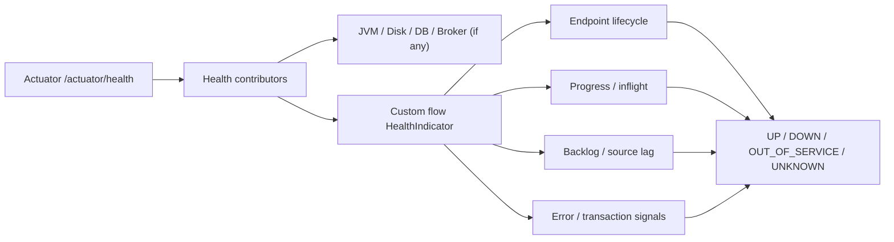
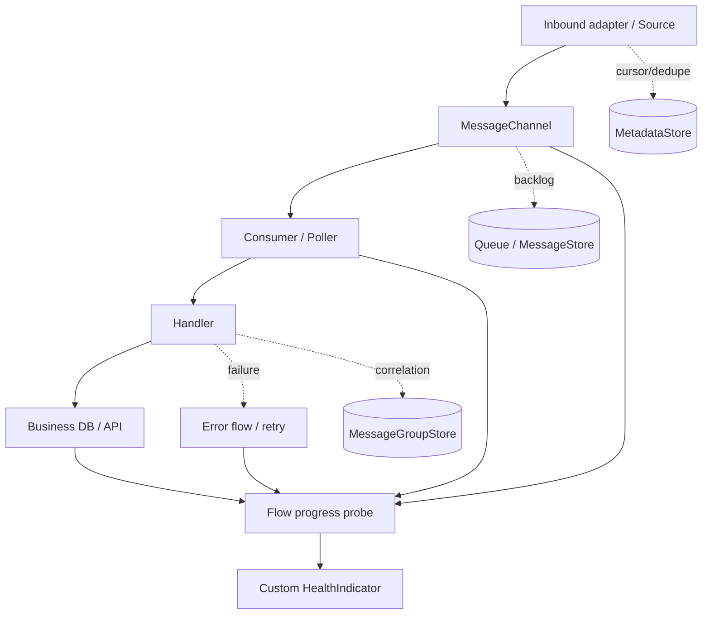
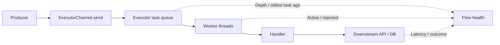

# Health indicator for integration flows in Spring Integration

## Learning objectives

An application might return HTTP 200 from `/actuator/health`, with the JVM still running and the Spring context initialized, yet no orders pass through any integration flow for 20 minutes. Conversely, a flow that only processes at the end of the day may produce no output all morning and still be completely healthy. This raises an operational question: **What does "healthy IntegrationFlow" actually mean, which signals measure it, and should those signals control application readiness/liveness?**

The **Health indicator for integration flows** lesson belongs to the **Operations** chapter of the **SPRING_INTEGRATION_RUNTIME** module. The context is how Spring Integration runs and orchestrates messages across channels, endpoints, consumers, pollers, and executors; the lesson connects `IntegrationFlow` lifecycle management with transactions, retries, message stores, error channels, correlation, performance, runtime state, and Spring Boot Actuator.

After this lesson, you can:

- Distinguish between **liveness**, **readiness**, **startup**, **per-flow health**, **metrics**, and **business outcome**.
- Explain why `SmartLifecycle.isRunning()` is a necessary signal in some flows but insufficient to prove that processing is making progress.
- Build a custom `HealthIndicator` for a critical endpoint, combining lifecycle state and bounded in-flight signals.
- Place a health component into an appropriate Spring Boot Actuator **health group** without accidentally causing a restart loop.
- Design additional signals for `DirectChannel`, `ExecutorChannel`, `QueueChannel`, pollers, gateways, aggregators, and reactive flows.
- Classify **valid IDLE** versus **STALLED**, **BACKPRESSURED**, **intentional STOPPED**, **FAILED**, and **DEGRADED**.
- Test the indicator using simulated time, missing bean scenarios, stopped endpoints, and incomplete handlers; avoid tests relying on `Thread.sleep()`.
- Define alerts, runbooks, recovery conditions, and error analysis by `businessKey`/`correlationId` without affecting data.

> **Rule:** A health indicator must answer a **specific operational contract**. An `UP` flag does not prove every business message has committed, and a period of silence does not automatically prove an endpoint is hung.

## 1. Application health and integration flow health are different

Spring Boot Actuator provides the **`HealthIndicator`** mechanism to expose health status and details through the health endpoint. Spring Integration has its own endpoints, channels, dispatchers, pollers, and handlers; there is no reason to assume any arbitrary business endpoint will be thoroughly checked just because Actuator is enabled.



There are **three layers of questions** that should not be mixed:

1. **Is the process alive?** Are the JVM, event loop/scheduler, and application capable of basic operation? This is close to *liveness*.
2. **Can the instance accept traffic within its responsibility?** Have critical flows started, do subscribers exist, and are essential downstreams ready at an acceptable level? This is close to *readiness*.
3. **Are messages actually progressing to business outcomes?** Are there source backlogs, queue age, latency, error rates, business commits, and correlation? This is *flow health/SLO/observability*; not every signal should be mapped directly to readiness.

An API server still serving requests healthily can simultaneously have a broken Kafka consumer. A batch-only worker can still be healthy with no input. The health contract must reflect the role of the **instance and flow**, not merely "how many handlers were invoked in 5 minutes".

### 1.1. Common Actuator statuses

| Status | Suggested operational meaning | When appropriate |
| --- | --- | --- |
| `UP` | The contributor's health conditions are satisfied | Required endpoints are running and there are no verified stall signs |
| `DOWN` | Critical check failed | Required endpoint bean is missing, mandatory resource cannot be used |
| `OUT_OF_SERVICE` | The instance should not receive traffic under the checked responsibility | Critical endpoint is stopped, quiesced, or violates a health policy affecting intake |
| `UNKNOWN` | Insufficient signals/results to decide | Initialization phase, metrics data not ready, or state cannot yet be interpreted |

Spring Boot has status ordering/aggregation and HTTP mapping according to configuration. Typically `DOWN` and `OUT_OF_SERVICE` can return HTTP 503 from the health endpoint, while `UP` returns 200; **do not guess the HTTP status of a custom status** if `status.http-mapping` is not configured. A custom `DEGRADED` status needs ordering and HTTP mapping defined if used for readiness.

You should not set `DOWN` just because a business event returned a validation error; that is a **data processing outcome**, not necessarily a condition where the instance cannot serve valid messages.

## 2. Liveness, readiness, and startup: assigning the right responsibility

In container environments like Kubernetes, probe signals can decide whether to **restart a process** or **remove an instance from traffic routing**. Choosing the wrong probe can turn a minor downstream incident into a prolonged restart loop.

| Probe/perspective | Question it should answer | If failed, it may lead to | Should not directly depend on |
| --- | --- | --- | --- |
| **Liveness** | Is the process still capable of continuing to operate? | Kubelet restarts the container | Temporary DB loss, partner HTTP 503, a single failed order |
| **Readiness** | Should the instance receive **new traffic** governed by this probe? | Pod is removed from service endpoints | Isolated business error or normal queue age during a burst |
| **Startup** | Has the application finished its initialization phase? | Protects slow startup time per policy | Per-message processing SLA after start |
| **Flow operational health** | Is a specific flow receiving/processing/committing as expected? | Alert, dashboard, runbook, or readiness if truly needed | Only a single `isRunning()` flag |

### 2.1. Why avoid putting external dependencies into liveness?

Suppose a shipping API temporarily returns 503. If liveness depends directly on this API, the entire pod can be restarted even though the JVM and integration consumers are operating properly, leading to reconnects/rebalances/redelivery, loss of in-memory buffers, and increased load on the failing API. Worse, every replica might restart simultaneously.

Usually you should keep **liveness minimally dependent on process aliveness**, while monitoring downstream failures via separate readiness or SLO/alerts depending on whether removing the pod from service actually helps. If every pod shares the same failing API, removing all pods from service can make availability worse.

### 2.2. Readiness of a multi-flow application

An application has two flows:

```text
ordersFlow:    receives online orders, required to operate
reportsFlow:   end-of-day aggregation, can be paused on schedule

ordersFlow STOPPED            => may affect readiness of the instance serving orders
reportsFlow IDLE              => should not affect readiness
reportsFlow STOPPED on schedule => not a process-wide readiness error
```

You can use **separate health groups** to observe each group of flows; only include the health of flows **essential for traffic on the instance** in readiness when the infrastructure actually uses that signal to route properly. For flows that primarily pull data from a broker, Pod readiness does not necessarily control broker message delivery like an HTTP service; you may need to pause the listener/container/consumer instead of only setting readiness to false.

## 3. Defining the "healthy" contract for each flow type

Before writing Java, determine whether the flow is **continuous message-driven**, **polling**, **scheduled batch**, **request/reply**, or **aggregator**. One common rule set for every flow will produce false positives.

| Flow type | Lifecycle signal | Progress signal | Valuable alert | Easy false positive |
| --- | --- | --- | --- | --- |
| `DirectChannel` + handler | Consumer `isRunning`, subscriber | Started/completed/failure, latency | Invocation stuck longer than SLA | No messages during off-peak hours |
| `ExecutorChannel` | Consumer/worker active | Queue depth, oldest age, active workers | Queue grows and completion stalls | `send() == true` treated as business success |
| `QueueChannel` + poller | Polling consumer + scheduler | Last poll, backlog, oldest age | Backlog exists but no poll progress | Queue empty and last completed is old |
| Broker inbound adapter | Container running/partition assigned | Delivery/ack lag, redelivery, commits | Consumer lag rising, continuous errors | Topic has no new messages |
| Request/reply gateway | Endpoint/gateway serving | Pending requests, timeout, reply latency | Prolonged request timeouts | No incoming requests |
| Splitter/aggregator | Endpoints and group store reachable | Pending group age, release count | Group waits past business deadline | Valid group waiting for remaining parts |
| Reactive bridge | Subscription active | Demand, in-flight Mono, buffer, terminal errors | Subscriber dead while upstream emits | Not yet subscribed during startup phase |
| Dynamic flow | `IntegrationFlowContext` registration/observed state | Active alias, in-flight and backlog per version | Alias points to an ID not yet READY | Old version intentionally draining |

### 3.1. Health predicates must consider context

A suggested condition:

```text
If critical endpoint is not expected to run:
    PAUSED/MAINTENANCE state, do not automatically treat as an incident

If critical endpoint must run but is not running:
    readiness = OUT_OF_SERVICE

If running, with no expected work:
    UP / IDLE is normal

If work is waiting or in-flight:
    check oldestAge, completion, retries, error rate,
    source ack, and business deadline

If queue grows and progress stalls beyond threshold:
    STALLED or DEGRADED; decide readiness impact
    based on traffic routing and recovery capability
```

This condition is **application-designed business logic**, not a built-in Spring Integration enum or default algorithm.

### 3.2. "No progress" must be interpreted accurately

A metric of `completedPerMinute == 0` can be valid if `inputPerMinute == 0`. Conversely, with 10,000 messages in the queue and no handler completion for a long time, that is a strong sign of a stall.

```text
expectedWork = sourceHasAvailableInput
            OR queueDepth > 0
            OR inFlight > 0
            OR pendingGroupPastDeadline

possibleStall = expectedWork
            AND noBusinessProgressBeyondSLO
```

If a flow has a valid processing time of 30 minutes, a 10-second threshold will trigger false positives. Health thresholds must come from **real SLOs and workloads**, not just Actuator defaults.

## 4. Core signals: from channel to business commit



### 4.1. Distinguishing five moments

1. **Received:** adapter receives the source message.
2. **Accepted:** channel accepts the `send()` call according to its contract.
3. **Started:** handler begins processing.
4. **Completed:** handler finishes, successfully or with failure.
5. **Business committed / acknowledged:** real side effect has been recorded and source ack/offset is applied appropriately.

A health indicator that only counts `send()` can report UP when every handler worker is stuck. A health indicator counting `handler.completed` can report healthy even while the source backlog grows too fast. For critical business logic, correlate **input, backlog, progress, and final outcome**.

### 4.2. Errors and retries are health signals, not just business errors

- `RetryAdvice` can hold a handler invocation longer due to backoff.
- `RequestHandlerCircuitBreakerAdvice` in OPEN state can fail fast without calling the external API.
- An error consumer may receive `ErrorMessage`, but the archive has not committed yet; health should not consider recovery complete.
- A gateway timeout can happen after the downstream side effect has already succeeded.
- Redelivery/replay can increase received message throughput without increasing unique completed business events.

Therefore, metrics should separate `retryAttempt`, `deliveryCount`, `error.archive.committed`, and `business.commit`. If you only count exceptions, it will be hard to distinguish **recoverable transient errors**, **poison messages**, **a breaker protecting a dependency**, and **resource contention**.

## 5. Implementation example: progress probe for a synchronous handler

Let's build a small, easy-to-test example: `DirectChannel` delivers messages to an event-driven endpoint; a probe records active work, the elapsed time of the longest invocation, and success/failure counts.

**Explicit limitation:** this probe measures **work inside the handler**, does not know about messages still waiting upstream/in the broker, does not measure a transaction commit occurring asynchronously after the method returns, and does not replace an end-to-end business SLO metric.

### 5.1. Self-contained FlowProgressProbe

```java
import java.time.Clock;
import java.util.concurrent.ConcurrentHashMap;
import java.util.concurrent.ConcurrentMap;
import java.util.concurrent.atomic.AtomicLong;
import java.util.concurrent.atomic.LongAdder;

final class FlowProgressProbe {
    private final Clock clock;
    private final AtomicLong sequence = new AtomicLong();
    private final ConcurrentMap<Long, Long> startedAt =
            new ConcurrentHashMap<>();

    private final LongAdder succeeded = new LongAdder();
    private final LongAdder failed = new LongAdder();

    FlowProgressProbe(Clock clock) {
        this.clock = clock;
    }

    // Each invocation has an independent token; do not use message ID
    // to avoid collisions if the same message is processed concurrently.
    long begin() {
        long token = sequence.incrementAndGet();
        startedAt.put(token, clock.millis());
        return token;
    }

    void success() {
        succeeded.increment();
    }

    void failure() {
        failed.increment();
    }

    void end(long token) {
        startedAt.remove(token);
    }

    Progress snapshot() {
        long now = clock.millis();

        long oldestAge = startedAt.values().stream()
                .mapToLong(start -> Math.max(0L, now - start))
                .max()
                .orElse(0L);

        return new Progress(
                startedAt.size(),
                oldestAge,
                succeeded.sum(),
                failed.sum());
    }

    record Progress(
            int inFlight,
            long oldestInFlightAgeMillis,
            long successCount,
            long failureCount) {
    }
}
```

**Design rationale:**

- `begin()` creates a separate token for **each invocation**, independent of `MessageHeaders.ID`.
- `end()` must run in `finally` even if the handler throws so it does not create "ghost in-flight" entries.
- `snapshot()` only reads state; it does not make HTTP/DB calls or mutate messages.
- `LongAdder` is suitable for counting under concurrency, though snapshot counters are not an atomic transaction across multiple variables.
- `Clock` enables deterministic tests using a simulated clock. In production, measuring **elapsed time** via a monotonic time source or Micrometer `Timer` can be better than wall-clock time when NTP adjusts the clock.
- The example scans the map to find the longest invocation, suitable for demos/low load. In production with thousands of invocations, the health check should read bounded-cost aggregated snapshots/metrics, avoiding expensive scans on every HTTP health endpoint call.

### 5.2. IntegrationFlow bean and handler

```java
import java.time.Clock;

import org.springframework.context.annotation.Bean;
import org.springframework.context.annotation.Configuration;
import org.springframework.integration.channel.DirectChannel;
import org.springframework.integration.config.EnableIntegration;
import org.springframework.integration.dsl.IntegrationFlow;
import org.springframework.messaging.Message;
import org.springframework.messaging.MessageChannel;
import org.springframework.messaging.MessageHandler;

@Configuration
@EnableIntegration
class OrdersFlowConfiguration {

    @Bean
    Clock flowClock() {
        return Clock.systemUTC();
    }

    @Bean
    FlowProgressProbe ordersProbe(Clock flowClock) {
        return new FlowProgressProbe(flowClock);
    }

    @Bean("ordersInput")
    MessageChannel ordersInput() {
        return new DirectChannel();
    }

    @Bean
    IntegrationFlow ordersFlow(
            FlowProgressProbe ordersProbe,
            OrderProcessor processor) {

        MessageHandler tracedHandler = message -> {
            long token = ordersProbe.begin();
            try {
                processor.process(message);
                ordersProbe.success();
            }
            catch (RuntimeException failure) {
                ordersProbe.failure();
                throw failure;
            }
            finally {
                ordersProbe.end(token);
            }
        };

        return IntegrationFlow.from("ordersInput")
                .handle(tracedHandler, endpoint ->
                        endpoint.id("ordersHandlerEndpoint"))
                .get();
    }

    interface OrderProcessor {
        void process(Message<?> message);
    }
}
```

`OrderProcessor` is an application dependency that must be implemented or mocked in the Spring Test context; it is not a built-in Spring Integration interface. `ordersHandlerEndpoint` is the ID of the endpoint to control/observe; using a fixed name reduces the risk of measuring the wrong handler bean. Because the flow in this example runs synchronously, `ordersProbe.success()` indicates that **the `process()` method returned normally**; if the method only enqueues other work and returns, the counter does **not** prove a business commit.

### 5.3. What the probe does not measure yet

```text
ordersInput (DirectChannel)
   |
   |  Message delivered directly
   v
ordersHandlerEndpoint
   |
   +-- begin() ---------------------+
   |                                |
   +-- processor.process(message)   | Probe measures this interval
   |                                |
   +-- success/failure + end() -----+
   |
   v
Business completion (only if process() actually completed it)
```

If you replace `DirectChannel` with `ExecutorChannel`, messages can sit in the executor queue **before `begin()` runs**. In that case, the health indicator may report UP while the queue backlog grows. To measure accurately, add executor meters (active, queued, rejected, oldest age) and ingress/source lag at the appropriate points.

## 6. Creating a custom HealthIndicator based on endpoint and progress

Spring Boot Actuator provides `HealthIndicator`, `Health`, and `Status`. Below is a contributor named `ordersFlow` in the health tree that detects missing/stopped endpoints and invocations exceeding a time threshold.

### 6.1. Java code

```java
import org.springframework.beans.factory.NoSuchBeanDefinitionException;
import org.springframework.boot.actuate.health.Health;
import org.springframework.boot.actuate.health.HealthIndicator;
import org.springframework.context.ApplicationContext;
import org.springframework.context.Lifecycle;
import org.springframework.stereotype.Component;

@Component("ordersFlowHealthIndicator")
final class OrdersFlowHealthIndicator implements HealthIndicator {

    private static final long MAX_INFLIGHT_AGE_MS = 30_000L;

    private final ApplicationContext applicationContext;
    private final FlowProgressProbe probe;

    OrdersFlowHealthIndicator(
            ApplicationContext applicationContext,
            FlowProgressProbe ordersProbe) {
        this.applicationContext = applicationContext;
        this.probe = ordersProbe;
    }

    @Override
    public Health health() {
        final Lifecycle endpoint;

        try {
            endpoint = applicationContext.getBean(
                    "ordersHandlerEndpoint", Lifecycle.class);
        }
        catch (NoSuchBeanDefinitionException missing) {
            return Health.down()
                    .withDetail("reason", "endpointBeanMissing")
                    .build();
        }

        if (!endpoint.isRunning()) {
            return Health.outOfService()
                    .withDetail("reason", "endpointStopped")
                    .build();
        }

        FlowProgressProbe.Progress progress = probe.snapshot();

        if (progress.inFlight() > 0
                && progress.oldestInFlightAgeMillis()
                        > MAX_INFLIGHT_AGE_MS) {

            return Health.outOfService()
                    .withDetail("reason", "inFlightOverThreshold")
                    .withDetail("inFlight", progress.inFlight())
                    .withDetail("oldestAgeMs",
                            progress.oldestInFlightAgeMillis())
                    .build();
        }

        return Health.up()
                .withDetail("inFlight", progress.inFlight())
                .withDetail("successCount", progress.successCount())
                .withDetail("failureCount", progress.failureCount())
                .build();
    }
}
```

If Spring Boot Actuator is configured following the `...HealthIndicator` naming convention, the component is typically exposed under the key `ordersFlow`. To verify the actual name, inspect the health output/beans of **the exact Boot version in use**; do not infer from the class name when using custom bean names, a custom contributor registry, or custom grouping configuration.

**Strengths:** missing/stopped endpoints are detected; long-running invocations can signal anomalies. **Important limitations:**

1. This is a pattern for a **critical flow requiring the endpoint to always be running**. If the endpoint is intentionally stopped during maintenance, the application needs a maintenance/desired-state policy to avoid misinterpretation.
2. The 30-second threshold is **just an example**. A handler normally processing a 2-minute batch will trigger a false positive.
3. An invocation running over 30 seconds may be valid business work or backoff; only transition to `OUT_OF_SERVICE` if the SLO and traffic architecture indicate the instance should not accept more messages.
4. Having no in-flight work does not mean downstream is healthy: the flow could be cut off upstream, the executor may not be dispatching, or the broker consumer might not have partition assignments.
5. The `successCount` counter only records normal method return. If the transaction commits afterward or the handler only dispatches async work, this is **not** a business commit.
6. The health response contains operational details; do not put payloads, business keys, customer IDs, tokens, or sensitive stack traces into `withDetail`.
7. A health indicator should be **fast, side-effect-free, and bounded in cost**. Do not call `endpoint.start()` or try sending real business messages from `health()`.

### 6.2. Why use ApplicationContext to look up the endpoint?

The DSL generates an endpoint bean using the configured ID. Fetching the `Lifecycle` bean via `ApplicationContext.getBean(id, Lifecycle.class)` lets the health check detect a missing bean; in tests, the context can be mocked easily. However, because the health method runs frequently, in production you can cache the verified bean or inject an `EndpointStateProvider` abstraction. If the endpoint type does not implement `Lifecycle` as assumed, choose an appropriate management/metric API rather than forcing a cast.

### 6.3. Separating business state and readiness state

Another option is to report `UP` for runtime readiness while recording `statusDetail="DEGRADED"`/metrics and firing separate alerts when a business task is delayed. When to turn delay into `OUT_OF_SERVICE` depends on:

- Does the instance receive **new traffic** belonging to that flow?
- Are there other healthy pods to take over?
- Does setting readiness to false actually stop the broker consumer from receiving, or only remove the HTTP route?
- Is the downstream a system-wide dependency that would cause all pods to lose readiness together?
- Will a short-term overload recover on its own without restarting or rerouting?

Health and traffic policy must be designed together.

## 7. Configuring Spring Boot Actuator health groups

When using Spring Boot 3.x and compatible Actuator, you can enable probes and create a dedicated health group for integration flows. Example `application.yml` configuration:

```yaml
management:
  endpoint:
    health:
      probes:
        enabled: true
      show-details: when_authorized
      group:
        liveness:
          include: livenessState
        readiness:
          include: readinessState,ordersFlow
        integration:
          include: ordersFlow
  endpoints:
    web:
      exposure:
        include: health,info
```

With appropriate configuration, endpoints can include:

```text
GET /actuator/health
GET /actuator/health/liveness
GET /actuator/health/readiness
GET /actuator/health/integration
```

**Must verify in the actual application:** the component name `ordersFlow` must exist; a health group referencing a nonexistent contributor may cause configuration rejection depending on the Boot version. The `livenessState` and `readinessState` probes rely on Spring Boot's availability/probes mechanism. If using a separate management port, Kubernetes network/proxy and probe paths must point to the right port and endpoint.

### 7.1. Should ordersFlow be included in readiness?

In the example, `ordersFlow` is included in `readiness` **to illustrate** how it affects Pod readiness. Keep this configuration only when:

- The instance is actually responsible for receiving the kind of requests `ordersFlow` serves.
- Another instance can serve the traffic instead, or stopping new intake is the right action.
- A stall condition will not trigger an UP/DOWN oscillation loop every few seconds.
- Monitoring/alerts still remain active even when the pod is removed from service.

If the flow is a standalone broker listener, consider **including the indicator only in the `integration` health group**, while managing main Pod readiness separately. Removing a Pod from an HTTP load balancer does not automatically pause a Kafka/RabbitMQ listener; the consumer container must be controlled per the adapter's own contract.

### 7.2. Do not let health depend on heavy load or side effects

A common mistake is letting `HealthIndicator.health()` run on every invocation:

```java
// Anti-pattern: do not run these operations inside health():
// endpoint.start();
// broker.receiveAndAck();
// jdbcRepository.deleteExpiredRecords();
// remoteOrderApi.createOrder("health-check");
```

These actions give the health probe side effects, potentially creating real messages, deleting data, or contending for resources just when the system is degraded. If a synthetic business transaction is needed, use a **dedicated canary** with a distinct business key, sandbox, or contractual compensation mechanism; do not place order-creation calls inside a readiness request polled continuously by Kubelet.

### 7.3. Securing health details

`management.endpoint.health.show-details=when_authorized` requires the corresponding authorization mechanism to be properly configured. Do not expose exception messages, internal addresses, tenants, error payloads, or credentials via a public management endpoint. Protect the management listener with network policies and authentication/authorization if externally reachable; liveness/readiness probes use safe paths readable by Kubelet per infrastructure design.

## 8. The hardest part: pollers and trafficless sources

A `SourcePollingChannelAdapter` can have `isRunning() == true` yet fail to poll because the scheduler is starved, the trigger is misconfigured, a leader election lock is held, or a metadata filter rejects every file. Conversely, the poller may work properly while the source is empty.

### 8.1. Measure four timestamps

```text
lastPollScheduledAt
lastPollStartedAt
lastPollFinishedAt
lastMessageAcceptedAt
```

Add `lastBusinessCommittedAt` if a true commit signal exists. With a 1-minute poll interval, a 2-minute gap without a completed poll may warrant investigation; with a daily midnight cron, "no polls during the morning" may be normal. Do not hard-code a "no processing in 5 minutes = DOWN" threshold for every poller type.

### 8.2. Poller health can use time and input expectation

| Condition | Interpretation | Suggested health/alert |
| --- | --- | --- |
| Poller running, recent last poll, source empty | Valid idle | UP, do not alert on throughput |
| Poller running, last poll stalled across multiple expected cycles | Scheduler/poller stall | DEGRADED/alert, consider readiness if critical |
| Poller stopped on schedule | Maintenance | Status based on desired state, not automatically DOWN |
| Poller running, reads data, handler fails repeatedly | Processing failure | Alert retry/error, inspect source ack |
| Poller running but persistent filter blocks all files | May be valid or stale metadata | Inspect `MetadataStore`, do not auto-delete checkpoint |
| Poller lost leader lock | One node does not poll while another node polls | Evaluate by cluster ownership, do not mark all pods DOWN |

### 8.3. Metadata checkpoint is not a progress counter

`MetadataStore` holds checkpoints, accept-once markers, or dedupe keys. Reading an unchanged checkpoint is valid when the source has no new data. If it advances **before business commit**, the source might skip messages after a restart. Health reading only `lastCursor` and seeing it advance does not prove business completion.

To evaluate the flow, link checkpoint/source delivery with **business commit** and error/recovery state. Do not let the indicator automatically reset the cursor or delete metadata keys when seeing it "stall".

## 9. Executors, queues, and backpressure: isRunning can still be UP when a flow is stuck



`ExecutorChannel` can accept tasks faster than workers process them. `send(true)` reflects the dispatch/enqueue outcome per contract, **not** handler completion.

### 9.1. An example of quantifying backlog

If a producer generates 2,000 messages/second and consumers complete 1,200 messages/second:

```text
Backlog growth = 2,000 - 1,200 = 800 messages/second

After 3 minutes:
800 x 180 = 144,000 waiting messages (estimate)

If each task/message averages 3 KB:
144,000 x 3 KB = 432 MB before JVM/queue overhead
```

This is an illustrative model, not a framework measurement. The `HealthIndicator` in section 6 that only checks in-flight handlers **does not yet detect backlog ahead of the handler**. In production, add queue depth, oldest waiting age, executor active/rejected counts, and source lag. With an unbounded in-RAM queue, OOM risk can appear before an operator sees a business exception.

### 9.2. Backpressure does not mean unhealthy

A properly configured system may actively slow down producers, return rejections, or pause consumers when a downstream degrades. Then raw throughput drops, yet protection **is working properly**. Evaluate:

- What capacity, overflow policy, and durability does the queue have?
- Are retries/backoff pausing processing as planned?
- Is the circuit breaker OPEN because downstream returns 503, or due to misconfiguration?
- Can the source redeliver without losing messages?
- Is there a committed fallback/recovery?

Do not use a health indicator to auto-increase executor pool sizes or retry counts; remediation requires a runbook and separate control permissions.

## 10. Correlation, aggregators, and waiting groups

An aggregator can have `isRunning() == true` while input continues arriving, yet produce no output because the final part is missing or the correlation expression changed.

```text
workflow: tenant-a:ORD-42

PaymentConfirmed  -> group ORD-42
InventoryReserved -> group ORD-42
ShippingQuoted    -> error flow / DLQ (not yet in group)

Aggregator:
  group size = 2
  required = 3 distinct parts
  no aggregate output
```

Aggregator health should track **pending group count**, **oldest group age**, **release count**, **group timeout**, and failed/quarantined groups. However, a group missing a part for 30 seconds can be completely valid if the wait SLA is 10 minutes; do not automatically report DOWN simply when pending > 0.

### 10.1. MessageGroupStore and correlation ID

`MessageGroupStore` holds group state by group ID; `CorrelationStrategy` determines the key, which can come from `headers['correlationId']` or an expression. A message instance's `MessageHeaders.ID` is not the default group key. An overdue pending group can be caused by a message failing on another branch; inspect `ErrorMessage`/DLQ by `businessKey` and `correlationId` before restarting the aggregator.

If flows v1 and v2 share a store while changing the correlation key, messages can be split across two groups. The health indicator should tag **flow version**/group policy into observed data, not attempt to "fix" it by deleting old groups.

### 10.2. Persistent stores do not automatically prove a flow is healthy

| State | Store | Health role | Pitfall |
| --- | --- | --- | --- |
| Message archive | `MessageStore` | Check backlog/recovery by UUID when a worker reads | Having records does not mean the worker is running |
| Pending group | `MessageGroupStore` | Detect overdue groups | Deleting groups can lose message parts |
| Checkpoint/dedupe | `MetadataStore` | Know what offset/file state the adapter recorded | A stalled cursor may mean an empty source |
| Error archive/DLQ | Error store/broker | Retry volume, oldest recovery age | Receiving ErrorMessage does not guarantee record commit |
| Business ledger | Business DB | Where recorded side effects are confirmed | Not automatically linked to broker ack |

## 11. Transactions, acks, and health: look at the final outcome

A flow can report UP because the handler returned normally, yet an outer JDBC transaction rolls back or the source acks improperly. Therefore, progress health should measure the right **completion milestone**.

### 11.1. Critical milestones

```text
T0: source delivers message
T1: channel accepts message
T2: handler starts
T3: handler calls external API
T4: API returns success (may already be committed)
T5: write DONE to business DB
T6: commit transaction
T7: ack broker/advance checkpoint
```

`handler.completed` may be recorded before T6/T7. If a crash happens between T4 and T5, source redelivery can create duplicate side effects. If ack happens at T2 while the handler runs asynchronously, a crash can lose unfinished work. A health indicator **does not replace** proper transaction boundaries, durable handoff, and idempotency.

### 11.2. "Business progress" is a contractual measurement

In an order flow, you can measure `orders.committed.count` from the repository/outbox after commit, rather than only counting handler returns. If commits occur asynchronously, the meter must be updated after the actual completion signal. For flows that only forward messages to a durable broker, "success" can be defined as **confirmed persisted by the broker**, not final order completion; the scope must be documented explicitly.

### 11.3. Health of the recovery flow

A system where the handler fails but **the error archive is working and messages can be replayed** may be considered DEGRADED rather than completely DOWN depending on the SLO. Conversely, if the error archive also fails while the source still acks, message loss risk is very high.

Health should track:

- `error.publish.failed` and the count of `ErrorMessage` instances reaching the error consumer.
- `error.archive.committed`, pending record count, and oldest record age.
- `retry.exhausted` and poison message rate.
- `source.ack/nack` or redelivery per adapter contract.
- Business idempotency/duplicate guards at the target resource.

Merely seeing traffic on `errorChannel` is not enough to declare recovery healthy; the archive might not be committing.

## 12. Dynamic IntegrationFlow and per-version health

Dynamic flows can be registered/removed with `IntegrationFlowContext`. Within one JVM, `getRegistrationById(registrationId)` can return an existing registration or `null` if unregistered/removed. This does not automatically synchronize across other pods.

### 12.1. Desired state and observed state

```text
Desired state (application-managed registry):
  tenant-a.orders.active = orders-v2-r7
  orders-v1-r3 = DRAINING

Observed state (pod-a):
  orders-v2-r7 = registered, running, READY
  orders-v1-r3 = running, 2 in-flight

Observed state (pod-b):
  orders-v2-r7 = not registered
  orders-v1-r3 = running
```

If health only checks "is there a running flow", pod-b can still report UP even though **the active route pointing to v2 does not exist**. You must verify the selected version, input channel/subscriber, active route/generation, and per-version backlog.

### 12.2. Planned stop and draining

A v1 flow in DRAINING state should not accept new messages, yet still needs to run for messages already pinned to v1. Seeing v1 `isRunning=true` and treating v1 as active is wrong. Removing v1 while work is still in-flight can lose work or replay into an incompatible v2.

A sound health model:

- **Active version:** must be READY and processing new messages.
- **Draining version:** can be running but does not accept unpinned messages; track in-flight, queue, and pending groups.
- **Retired/removed version:** does not need HEALTH UP, though error archive/replay may still depend on v1.
- **Unknown version on a node:** intentional readiness or routing rejection, avoiding dispatching to a nonexistent registration.

### 12.3. Per-pod health does not automatically create cluster-wide health

`HealthIndicator` runs inside a specific node's process. Pod A reporting UP does not mean Pod B has been updated; when using a shared broker/metadata store, you also need to monitor consumer group lag, leader election, and node ownership. An aggregated dashboard should clearly show **logical flow, version, instance, and desired generation**, avoiding a single "healthy flows = N" number without knowing which pods N are on.

## 13. Testing HealthIndicator without sleeping for real time

A health indicator is state-reading logic; most scenarios can be tested with JUnit/Mockito and a simulated clock, without starting a broker.

### 13.1. Testing STOPPED and UP/IDLE

Example testing the object in section 6 via a mocked `ApplicationContext`:

```java
import java.time.Clock;
import java.time.Instant;
import java.time.ZoneOffset;

import org.junit.jupiter.api.Test;
import org.springframework.boot.actuate.health.Status;
import org.springframework.context.ApplicationContext;
import org.springframework.context.Lifecycle;

import static org.junit.jupiter.api.Assertions.*;
import static org.mockito.Mockito.*;

class OrdersFlowHealthIndicatorTest {

    @Test
    void stoppedIsOutOfServiceAndRunningIdleIsUp() {
        ApplicationContext context = mock(ApplicationContext.class);
        Lifecycle endpoint = mock(Lifecycle.class);

        when(context.getBean("ordersHandlerEndpoint", Lifecycle.class))
                .thenReturn(endpoint);
        when(endpoint.isRunning()).thenReturn(false, true);

        FlowProgressProbe probe = new FlowProgressProbe(
                Clock.fixed(
                        Instant.parse("2026-11-22T00:00:00Z"),
                        ZoneOffset.UTC));

        OrdersFlowHealthIndicator health =
                new OrdersFlowHealthIndicator(context, probe);

        assertEquals(Status.OUT_OF_SERVICE,
                health.health().getStatus());

        // No input/in-flight; running + idle is still healthy
        // per the example's contract.
        assertEquals(Status.UP,
                health.health().getStatus());
    }
}
```

JUnit Jupiter and Mockito dependencies are required in test scope. This is a **unit test** of the indicator; to verify that the `ordersHandlerEndpoint` bean actually exists, add a Spring integration test using the flow fixture from section 5. Do not treat a mocked `Lifecycle` as proof that the real-world endpoint is wired correctly.

### 13.2. Testing threshold exceedance with a controllable clock

For `FlowProgressProbe` in section 5, to test a 31-second in-flight invocation without `Thread.sleep()`, create a `Clock` with adjustable time:

```java
import java.time.Clock;
import java.time.Duration;
import java.time.Instant;
import java.time.ZoneId;
import java.time.ZoneOffset;
import java.util.concurrent.atomic.AtomicLong;

final class MutableClock extends Clock {
    private final AtomicLong epochMillis;

    MutableClock(Instant initial) {
        epochMillis = new AtomicLong(initial.toEpochMilli());
    }

    void advance(Duration duration) {
        epochMillis.addAndGet(duration.toMillis());
    }

    @Override
    public ZoneId getZone() {
        return ZoneOffset.UTC;
    }

    @Override
    public Clock withZone(ZoneId zone) {
        if (!ZoneOffset.UTC.equals(zone)) {
            throw new IllegalArgumentException("Test clock is UTC only");
        }
        return this;
    }

    @Override
    public Instant instant() {
        return Instant.ofEpochMilli(epochMillis.get());
    }
}
```

Pass this clock as a dependency to `FlowProgressProbe`, call `begin()`, then `advance(Duration.ofSeconds(31))` without calling `end()`. With a fake endpoint where `isRunning()=true`, the indicator must return `OUT_OF_SERVICE`. Call `end(token)` and verify it returns to `UP`. For real timestamps and production capacity, consider a monotonic timer as noted in section 5.

### 13.3. Integration testing with a real Spring context

Unit tests will not catch a wrong endpoint bean name. An integration test should:

1. Stand up `OrdersFlowConfiguration` with a fake `OrderProcessor` in a Spring Test context.
2. Initialize the appropriate Spring Boot Actuator `HealthEndpoint`/`HealthContributorRegistry`.
3. Retrieve `ordersHandlerEndpoint` and verify `Lifecycle`.
4. Send a test message through `ordersInput`, checking probe success/failure.
5. Stop the exact endpoint and query the health group, confirming the status changes.
6. Restore the endpoint in `finally` or via context isolation.
7. Never run this stop/start test in production, and do not cause side effects on real systems.

### 13.4. Testing queues/executors requires a separate probe

If the flow uses an `ExecutorChannel`, a fake handler can block on a latch; meanwhile send multiple messages to create a backlog. Health needs to detect **queue age/capacity**, not only handler in-flight. Set a finite timeout for the test and release the latch in `finally`. Use `CountDownLatch`/`Awaitility` or an event probe; do not write `Thread.sleep(1000)` and infer whether a worker picked up the task.

## 14. Avoiding false positives, flapping, and self-inflicted health check overload

### 14.1. Hysteresis and stability thresholds

One poll slower than 30 seconds is not enough to remove a pod from readiness if the SLA allows 2 minutes. A policy can require **N consecutive checks** violating the threshold or **a rolling window** before reporting unhealthy, then require M good checks to return to UP. That is hysteresis.

```text
Healthy -> Suspected (single threshold violation)
Suspected -> Unhealthy (sustained violation across window)
Unhealthy -> Recovering (progress observed)
Recovering -> Healthy (stable progress across window)
```

This state machine belongs to the application/monitoring controller, **not default states of `HealthIndicator`**. Consider state storage, reset after restart, and ownership across multiple pods.

### 14.2. Setting timeouts and load limits

Health probes are called continuously by Kubelet, load balancers, monitoring, and operators. Therefore:

- Do not scan the entire `MessageStore`/`MessageGroupStore` on every request.
- Do not take thread dumps, make slow remote HTTP calls, or start an integration message inside the health method.
- Do not hold locks synchronously with the handler path for long periods.
- If broker queue depth/lag is needed, measure via metrics/background collector with a timeout, then have health read a **cached snapshot**.
- When metrics are stale or unavailable, report `UNKNOWN`/alert per policy instead of treating old data as current.
- Avoid health details that leak internal information to unauthorized callers.

### 14.3. Metric staleness must also be checked

A probe might read `lastPollAt` from an object that is no longer updated because the collector died. Then an UP status is wrong. Alongside the value, include a `lastMeasuredAt` timestamp and sample freshness.

```text
queueDepth = 0
sampledAt = 3 hours ago

=> Insufficient basis to conclude the queue is currently empty.
```

However, if there is no scheduled input, the lack of new measurements itself may be normal; separate **collector** liveness from **source** throughput.

## 15. Dashboards, metrics, and per-flow alerting

The metric names below are **instrumentation suggestions**, not a list guaranteed to be provided out of the box by Spring Integration/Actuator.

| Suggested metric | Meaning | Usage |
| --- | --- | --- |
| `integration.flow.running` | Whether endpoint/registration is running | Lifecycle/desired-state drift |
| `integration.flow.inflight` | Number of unfinished invocations | Hung handlers and drain capability |
| `integration.flow.oldest_inflight_age` | Longest-running invocation | Timeout/SLO violation |
| `integration.flow.input_rate` | Inbound message rate | Distinguish idle vs source problem |
| `integration.flow.success_rate` | Successful handler outcome rate | Processing progress |
| `integration.flow.business_commit_rate` | Committed business outcome rate | True SLO |
| `integration.flow.error_rate` | Errors by type/cause | Retry storm, poison data |
| `integration.flow.retry_attempts` | Internal retries | Distinguish from redelivery |
| `integration.flow.backlog_depth` | Queue/broker backlog | Backpressure |
| `integration.flow.oldest_wait_age` | Oldest waiting message | Processing SLA, risk of stale work |
| `integration.flow.poll.last_success_age` | Age of most recent successful poll | Scheduler/poller stall |
| `integration.flow.group_pending` | Pending aggregator groups | Correlation/release issues |
| `integration.flow.error_archive_pending` | Unresolved errors | Recovery health |
| `integration.flow.active_version` | Flow version receiving new traffic | Rollout/multi-pod drift |
| `integration.flow.metric_sample_age` | Freshness of monitoring data | Avoid evaluating stale snapshots |

### 15.1. Alerts should correlate multiple conditions

Alerting solely because `successRate == 0` for 1 minute will be noisy for flows that rarely receive data. A better rule:

```text
IF expectedInput > 0 OR backlogDepth > 0 OR inflight > 0
AND noBusinessProgressBeyondSLO
AND not plannedMaintenance
THEN investigate stalled flow
```

Another rule is for `errorArchivePendingAge` exceeding a threshold, or `queueDepth` rising rapidly even while throughput remains >0. Alerts and health can serve **different purposes**: a DEGRADED condition should page on-call, yet may not require pulling the Pod out of routing.

### 15.2. Cardinality and sensitive data

Tagging metrics by `flowType`, `version`, `instance`, `environment` can be useful, but the number of versions/tenants must be bounded. **Do not** use `messageId`, `orderId`, `correlationId`, or raw error strings as Prometheus/Micrometer tags per message: cardinality becomes very high, easily exhausting memory/backend storage.

To trace a specific message, use structured logs/tracing with `businessKey`/`correlationId` under access control, retention, and masking. Health output should only expose safe aggregate numbers.

## 16. Runbook when flow health drops to OUT_OF_SERVICE

A health signal is an **investigation lead**, not a final diagnosis.

### Step 1 — Verify which contributor reported unhealthy

Check `/actuator/health/integration` or the readiness group under authorized access, noting the component name/status/reason, instance, and timestamp. Distinguish flow status from DB/broker/disk status.

### Step 2 — Check expected/desired state

Is the endpoint required to run, or is it in maintenance? Is flow v1 DRAINING while v2 is ACTIVE? If intentionally stopped, do not auto-start just because the indicator reports OUT_OF_SERVICE.

### Step 3 — Distinguish IDLE from STALLED

Inspect input, backlog, in-flight, last poll, and last business commit within the same time window. If no work is expected, evaluate false-positive thresholds.

### Step 4 — Identify the bottleneck by topology

- `DirectChannel`: sender/handler thread blocking and exception propagation.
- `ExecutorChannel`: active workers, rejected tasks, queue age, and downstream latency.
- `QueueChannel`/poller: scheduler, trigger, receive timeout, transaction, and metadata filter.
- Aggregator: pending groups, correlation ID, release strategy, missing branch.
- Reactive bridge: subscription, terminal error, buffer/demand.
- Broker adapter: consumer assignment/ack/redelivery/lag.

### Step 5 — Inspect errors and recovery capability

Check `errorChannel`, `ErrorMessage`, retry advice, breaker status, DLQ/error archive, and transaction outcome. A logged error does not mean it was persisted durably.

### Step 6 — Protect messages before taking action

Verify in-flight work, queue/broker durability, checkpoints, and the business ledger. If an external side effect committed without an ack, ensure idempotency before replaying. Do not delete stores to fix health.

### Step 7 — Minimal permitted remediation

Depending on root cause: fix the dependency, throttle input/prefetch, raise timeouts appropriately, restart **the exact endpoint** per approval, or roll back the flow version. The health indicator **must not invoke `stop()/start()` itself** to avoid restart loops.

### Step 8 — Verify the outcome

Monitor input-to-business-commit, backlog/age, error rate, retries, source ack, and duplicate business keys. Close the incident only when operational state is stable; `isRunning=true` or `HTTP 200` is necessary but insufficient evidence.

## 17. Quick diagnostic table

| Symptom | Possible cause | What to check |
| --- | --- | --- |
| Health UP but no output | Idle source, probe only checks lifecycle, backlog ahead of handler | Input expectation, oldest queue age, progress metrics |
| Health DOWN right after deploy | Wrong/missing endpoint bean ID | Endpoint ID, bean type, application context |
| Health OUT_OF_SERVICE during maintenance | Flow stopped intentionally, policy ignores maintenance | Desired state, maintenance window |
| Health flapping every 30 seconds | Low threshold, fluctuating backlog, missing hysteresis | SLO, rolling windows, active tasks |
| Health OUT_OF_SERVICE while consumer runs | One invocation exceeded threshold | Invocation trace, retry/backoff, legitimate duration |
| Readiness 503 on all pods | Shared downstream failure or overly sensitive predicate | Probe grouping, dependency, traffic policy |
| Kubelet restart loop | External dependency errors placed in liveness | Liveness group and restart reasons |
| Executor queue growing but health UP | Probe only measures handler in-flight | Executor pending/rejected, queue age |
| Poller running but not polling | Starved scheduler, lock, wrong trigger | Last poll start/end, thread dump, leader |
| Poller output=0 yet healthy | Empty source, valid file filter | Source backlog, metadata, poll count |
| Aggregator produces no output | Wrong correlation key, missing branch, pending group | Group ID, error flow, pending age |
| Health UP while error DLQ grows | Health ignores recovery SLO | Error archive pending, oldest error age |
| Slow health call | Indicator calls DB/API or scans large store | Health latency, profiler, cached metrics |
| Status stuck at UNKNOWN | Probe uninitialized, dead metrics collector | Sample age, initialization errors |
| Pod A UP, Pod B DOWN | Flow version/registration drift or different local resource | Desired generation, per-pod observed state |
| Health UP after restart but duplicates appear | Broken ack/transaction/idempotency | Business key ledger, source redelivery |

## 18. Testing and drill matrix

| Scenario | Condition | Expected indicator result | Additional check |
| --- | --- | --- | --- |
| Endpoint does not exist | Wrong bean ID | DOWN | No stack/secret leak |
| Endpoint stopped | `Lifecycle.isRunning=false` | OUT_OF_SERVICE | Is planned maintenance considered? |
| Endpoint running, no work | Inflight=0, queue/source empty | UP/IDLE | Do not alert throughput=0 |
| Handler running 5 seconds | Threshold 30 seconds | UP in demo | Do not infer business commit |
| Handler running > 30 seconds | Still in-flight, fake clock advances | OUT_OF_SERVICE | Must return to UP when finished |
| Handler throws | Probe `failure()` and `end()` | No in-flight leak | Check error flow/ack |
| Large executor backlog | Slow workers, queue grows | Need to extend predicate | Health does not false UP if policy requires |
| Poller not running | Scheduler makes no progress | DEGRADED/alert per SLO | Do not confuse with source idle |
| Scheduled empty poller | No input, poll still executes | UP | Last poll continues advancing |
| Circuit breaker OPEN | Downstream is protected | DEGRADED per policy | Do not reset blindly |
| Broken error archive | Recovery fails to commit | Alert/unhealthy if critical | Source ack/redelivery policy |
| Group waiting too long | Missing part | DEGRADED/alert | Correlation and release strategy |
| Flow v1 draining | v2 active READY | Health per desired state | V1 backlog tracked separately |
| Multi-pod mismatch | Pod B has not registered v2 | Pod B not READY if serving v2 | Routing/grace period |
| Stale metrics collector | Last sample too old | UNKNOWN or alert | Do not trust stale snapshots |
| Health called 100 times/s | Probe load test | No DB/CPU spike | No side effects |
| App restart mid-processing | In-memory state lost | Health recovers only after bootstrap | Broker/store/idempotency test |

### 18.1. Exercise A — Lifecycle-only indicator

Build a simple `HealthIndicator` reading `ordersHandlerEndpoint.isRunning()`. Send a message via `DirectChannel`, stop the endpoint in a Spring test context, and verify `UP → OUT_OF_SERVICE → UP` after start. Explicitly note that this test **only verifies lifecycle**, not queue or downstream state.

### 18.2. Exercise B — Progress and controllable clock

Use `FlowProgressProbe` and `MutableClock`. Start an invocation, advance 31 seconds, verify health is `OUT_OF_SERVICE`; call `end(token)` and verify `UP`. Add another active invocation to observe verifying the oldest in-flight item.

### 18.3. Exercise C — ExecutorChannel and backlog

Replace `DirectChannel` with an `ExecutorChannel` having one worker. Block the handler with a latch, send 100 more messages, and measure pending tasks, active workers, and handler in-flight count. Upgrade the indicator to consider queue age, without letting `health()` perform any enqueue/dequeue operations.

### 18.4. Exercise D — Empty poller and stalled poller

Create a fake message source with no data that polls successfully, and a source with messages where the scheduler does not run. Record `lastPollFinishedAt` and `sourceHasInput`; design health so the idle case is not marked DOWN.

### 18.5. Exercise E — Retry and error flow

Have the handler throw a transient exception twice, then succeed. Observe `retry.attempts` and handler success. Next, make the handler always fail while the error archive commits a record. Distinguish a published `ErrorMessage` from a durably persisted error; do not ack the source without durable recovery per policy.

### 18.6. Exercise F — Aggregator and correlation

Send two parts to a group requiring three parts, holding the third part in a DLQ. Observe group age and the error archive; choose alert thresholds based on the business deadline. Replay the third part with the matching `correlationId` and verify group release. Do not delete the group just to make the indicator return to UP.

### 18.7. Exercise G — Readiness, liveness, and downstream failure

In a test Kubernetes environment, configure `liveness` to use only `livenessState`, and `readiness` to include only essential flows. Have the external API return 503; observe whether the Pod is pulled from traffic or restarted. Try removing `ordersFlow` from readiness if that flow is purely a background broker worker; document the reasoning based on actual routing behavior.

### 18.8. Exercise H — Restart, ack, and business idempotency

Use a durable broker/queue and create a message with a stable `businessKey`. Have the handler write to the DB successfully then kill before ack; restart and verify redelivery and a unique business effect. The indicator may return to UP, but the test must prove no duplicate data was created.

## 19. Self-check questions

1. What question does `HealthIndicator` in Spring Boot Actuator answer, and how does it differ from metrics/SLOs?
2. Why does `isRunning() == true` not prove that an integration flow is still making progress?
3. How do liveness and readiness differ in consequences when Kubernetes receives a failing status?
4. Why should HTTP 503 errors from a downstream generally not directly fail liveness?
5. When can a STOPPED flow be valid behavior during maintenance?
6. How do you distinguish a valid IDLE poller from a poller whose schedule has stopped running?
7. Does `DirectChannel.send(true)` mean the business commit has succeeded?
8. What additional time boundary does `ExecutorChannel` introduce that a handler-only probe cannot see?
9. Why can rising queue depth alongside rising handler starts indicate overload?
10. How do `oldestInFlightAgeMillis` and `oldestQueueWaitAge` differ?
11. Why does the sample code use a separate token per invocation instead of just the message UUID?
12. If a producer sends no messages for 24 hours, should it report DOWN because the success count did not increase?
13. How does the `integration` Spring Boot health group differ in purpose from the `readiness` health group?
14. Does a custom `DEGRADED` status automatically produce HTTP 503 if no mapping is configured?
15. Should a health indicator call `endpoint.start()` or create a real business order?
16. When should metrics snapshots be cached instead of querying the broker/DB directly inside `health()`?
17. Does a received `ErrorMessage` prove that the recovery archive committed?
18. If retry advice makes a handler wait in backoff longer than the SLO, how do you avoid false positives?
19. `MessageStore` and `MessageGroupStore` help assess backlog/recovery, but what do they not do on their own?
20. When can an unchanged `MetadataStore` checkpoint be valid?
21. When an aggregator does not release output, what signals help locate the failing branch?
22. How should a DRAINING v1 flow be evaluated compared to an ACTIVE v2 flow?
23. Why does Pod A's health indicator not guarantee Pod B has received the same flow registration?
24. When is an indicator unit test insufficient and an integration test with real channels required?
25. Why does a caller's `@Transactional` not automatically cover a handler handed off to an executor?
26. When a process restart brings an indicator back to UP, what additional evidence is needed to conclude the incident is resolved?
27. How does hysteresis help reduce flapping?
28. Why should message IDs/correlation IDs not be per-event metric labels?
29. Can a `business.commit.count` of 0 ever be completely healthy?
30. What should a runbook check before restarting or replaying messages after a health alert?

**Remember:** **Health indicator for integration flows** is a contract between **runtime state**, **message progress**, and **operational decisions**. Use `HealthIndicator`/Actuator to publish verified status, and also measure backlog, pollers, executors, retries/errors, transactions, and correlation per flow. Separate **liveness** from **readiness**, prevent health probes from causing side effects or restart loops, and conclude recovery only when **messages along with their business outcomes** actually progress safely.
