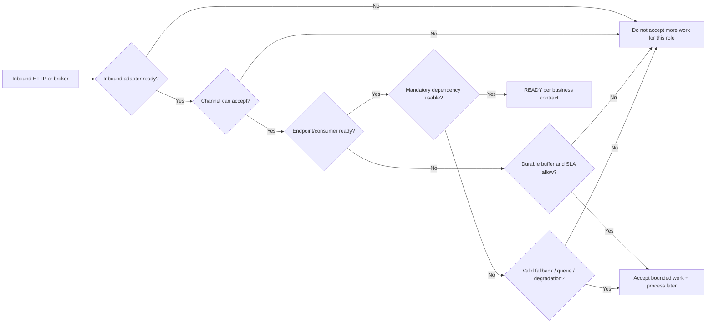
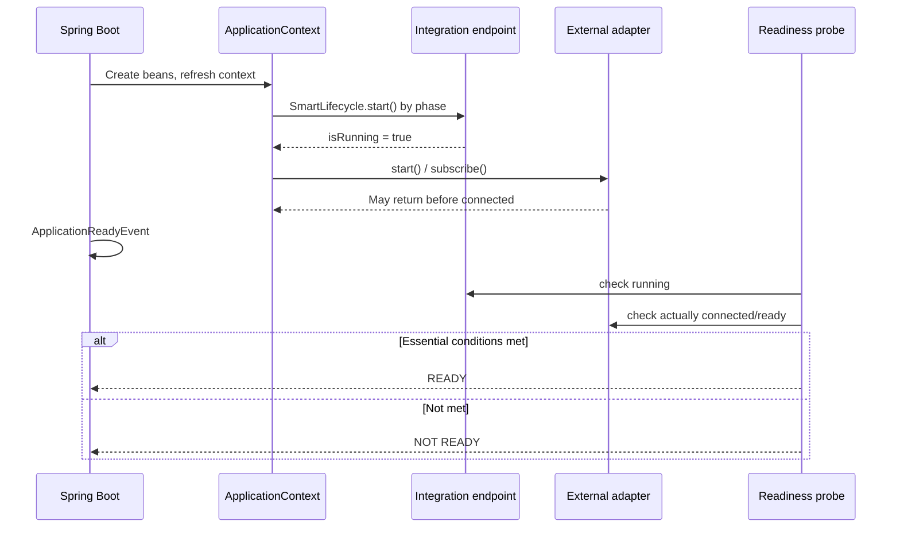
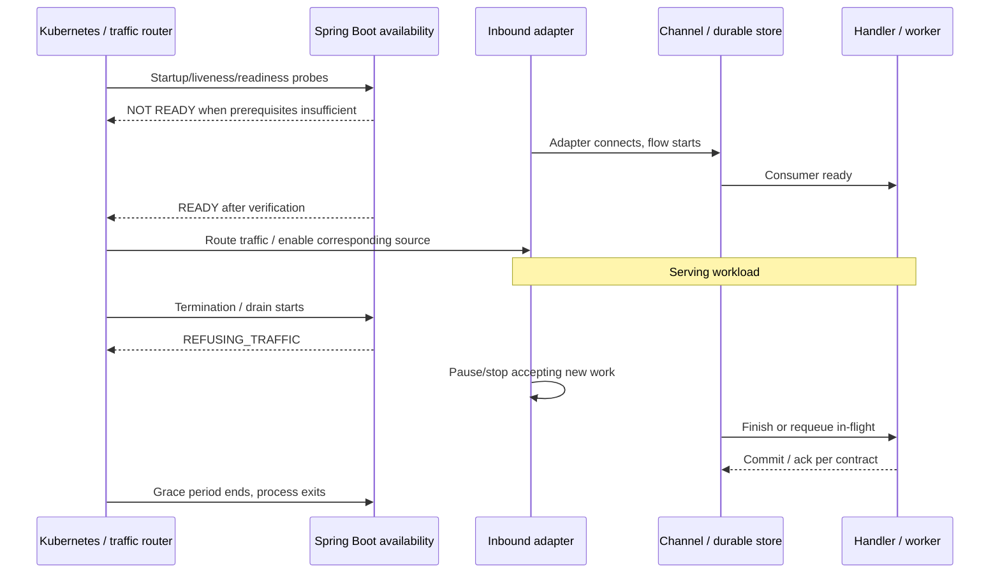

# Readiness when channels, adapters, and endpoints become ready in Spring Integration

## 1. Readiness is an operational promise, not "the application has started"

In the **Operations** chapter of the `SPRING_INTEGRATION_RUNTIME` module, Spring Integration orchestrates messages across **channels, endpoints, consumers, pollers, and executors**, while managing `IntegrationFlow` lifecycle, transactions, retries, message stores, errors, correlation, and performance. A service can return HTTP 200 from a controller while a source adapter has not connected to the broker, a `DirectChannel` has no subscriber yet, or a polling endpoint has stopped. If the orchestrator immediately routes traffic to that pod, messages can fail or get stuck during startup.

**Readiness** answers a business-scoped question:

> Is this instance **currently ready to accept additional work for its assigned role** and does it have an eligible processing path to advance that work, rather than merely existing as a Java process?

This question differs from "Is the JVM alive?" and "Has the Spring ApplicationContext finished creating beans?". It also differs from "Have all messages in the backlog finished processing?": a consumer can still be ready while holding a valid backlog.

For example, an order processing service has:

```text
HTTP gateway -> ordersIn (DirectChannel) -> validateEndpoint
             -> ordersQueue (persistent) -> poller -> reserveStock
             -> outbound HTTP adapter -> payment service
```

If `validateEndpoint` is running while the `reserveStock` poller has not started yet, accepting messages into the durable queue may be fine **if** capacity/backpressure and the SLA allow it. If `ordersQueue` is an in-RAM queue that is full, the instance may no longer accept new work safely. If the payment service is temporarily down while business logic allows queuing, the readiness decision may differ from a synchronous payment API required to return an immediate result.

### After this lesson, you can

1. Distinguish **startup**, **liveness**, **readiness**, **dependency health**, and **drain** capability.
2. Evaluate readiness separately for `DirectChannel`, `QueueChannel`, `ExecutorChannel`, `FluxMessageChannel`, and adapter/endpoint types.
3. Understand `SmartLifecycle`, `autoStartup`, phase, `IntegrationFlow` lifecycle, and the limits of `isRunning()`.
4. Configure a Spring Boot Actuator readiness probe alongside a `HealthIndicator` that inspects real endpoints.
5. Build mechanisms to signal `REFUSING_TRAFFIC`/`ACCEPTING_TRAFFIC` during incidents or shutdown without breaking adapter message-intake contracts.
6. Design tests for startup, unready dependencies, restarts, executor overload, retries, and rolling deployments.
7. Build dashboards/runbooks so startup success is not confused with business processing capability.

## 2. Distinguishing startup, liveness, and readiness

| Signal | Question | Example success condition | Should not be used to conclude |
|---|---|---|---|
| **Startup** | Has the application finished its required initialization phase? | Context created, valid configuration, essential beans/dependencies initialized | Broker has assigned partitions or adapter can always receive messages |
| **Liveness** | Should the process keep running or be restarted? | JVM and management threads still progress, no fatal deadlock | Database/Kafka temporarily unreachable |
| **Readiness** | Should the instance accept more work *right now*? | Essential intake/routing/consumer paths ready per contract | Pending messages are all processed or zero retries remain |
| **Dependency health** | Is a dependent system operating and usable? | DB pool has available connections, broker client is authorized | Every dependency, even optional ones, must force readiness DOWN |
| **Drain/shutdown** | Can new intake stop and in-flight work finish or be handed off safely? | No new traffic accepted, in-flight drains to threshold or timeout, clear ack/replay | Setting readiness DOWN is enough to stop Kafka listeners/pollers automatically |

A failing **liveness probe** can cause Kubernetes to restart the pod. Therefore **do not put a temporarily failing dependency** such as a database outage into liveness arbitrarily: multiple pods could restart together when the database goes down, worsening the incident.

A failing **readiness probe** typically removes the pod from Kubernetes Service ready endpoints, but **does not restart the pod** solely because readiness is DOWN. Readiness is a **routing/control-plane** mechanism; it does not automatically pause a Kafka consumer, JMS listener, file poller, or an integration flow pulling messages directly from a broker.

### Set goals by role

Two instances of the same application can play different roles:

- **HTTP request–reply gateway:** must have a working reply path; a missing `DirectChannel` subscriber or mandatory target service may drive readiness DOWN.
- **Background processor consuming from Kafka:** processing capability depends on the listener/container, assignment if required by business logic, connection/auth, and work capacity. HTTP readiness does not replace broker consumer control.
- **Durable queue ingester:** may remain ready to accept work while downstream workers are slow, **if** the durable store has space and allows backlog within the SLA.
- **Leader-only scheduler:** a standby pod without the lock/leadership can remain **healthy and ready for its standby role**; it should not be marked DOWN just because it is not running leader tasks.

**Readiness must have a written contract**, rather than assuming "every endpoint must run and every downstream must be UP".

## 3. Inventorying essential processing paths

Before adding a `HealthIndicator`, identify what must exist to accept a given type of work.



Distinguish **ready to accept** from **ready to complete**:

- A synchronous command system with a 2-second deadline usually should not accept work if it knows its mandatory downstream has been disconnected for a long time.
- A store-and-forward system with a durable queue and a multi-hour deadline can continue accepting messages even while the consumer is temporarily paused.
- If the queue fills up or durable writes fail, store-and-forward can no longer guarantee safe acceptance; readiness must be re-evaluated.

### Inventory checklist

| Point in flow | Resource / signal | Practical oracle |
|---|---|---|
| Inbound adapter | HTTP listener, Kafka listener, JMS, TCP, file source... | Adapter/container operates per contract and is ready to receive or poll |
| Input channel | `DirectChannel`, `QueueChannel`, `ExecutorChannel`, `FluxMessageChannel` | Safe way to accept messages exists for the channel type |
| Consumer endpoint | `EventDrivenConsumer`, `PollingConsumer`, `SourcePollingChannelAdapter` | Appropriate lifecycle and subscription/poller |
| Scheduler/executor | `TaskScheduler`, `TaskExecutor` | Pool not exhausted; queue/rejection policy monitored |
| Message store | JDBC/broker/metadata store | Can read/write required state, valid schema/credentials |
| Mandatory downstream | Business DB, required API | Reachable within SLA without the health probe causing side effects |
| Dynamic integration flow | `IntegrationFlowContext` registration | Required flows registered and started properly |
| Recovery/error path | Retry advice, `errorChannel`, DLQ | Failure fallback path still operates per durability requirements |

There is no need to turn **every metric** into a `DOWN` condition. Queue age, retry rate, and error rate are usually **diagnostic metrics**, becoming readiness gates only when safe thresholds and stability policies are defined.

## 4. Readiness of channel types

A channel is a path for sending messages and does not always expose `isRunning()`. Check the **exact contract** of each type:

| Channel type | What readiness can rely on | Risk if overlooked |
|---|---|---|
| `DirectChannel` | Registered consumer/dispatcher and essential handler running | Channel bean exists with **no subscriber**, `send` can fail |
| `PublishSubscribeChannel` | Required subscribers present, clear error handling | One slow/failing subscriber; not every subscriber is mandatory |
| `QueueChannel` in RAM | Queue has capacity, required poller/consumer has a processing path | `send` accepts into queue even with no poller; restart loses pending work |
| `QueueChannel` backed by persistent store | Store persists durably, pending backlog/retention within limits | Store ready but consumer not running; drain throughput falls short |
| `ExecutorChannel` | Executor accepts tasks, no saturation/rejection, consumer has handler | In-RAM executor queue is not automatically durable and transactions do not cross threads |
| `FluxMessageChannel` | Active subscription/real demand, source/consumer support backpressure | Imperative `send()` does not naturally honor `request(n)`, buffers can accumulate |
| `PriorityChannel` / `RendezvousChannel` | Capacity and channel send/receive contract | A blocking receive or priority logic can delay messages |

### 4.1. DirectChannel without a subscriber

A `DirectChannel` bean may already be initialized while the endpoint has not subscribed due to `autoStartup=false`, a bean lifecycle failure, or the consumer having been stopped.

```text
ApplicationContext refreshed
  ordersIn bean exists
  ordersConsumer not started or stopped
  producer.send(message)
    -> no matching subscriber
    -> dispatch can fail
```

Therefore, **bean existence != subscriber readiness**. For event-driven consumers, `EventDrivenConsumer.isRunning()` is a practical signal because the endpoint subscribes/unsubscribes on the input channel according to its lifecycle. However, it still does not prove the handler will not throw exceptions when processing.

### 4.2. QueueChannel accepting does not mean processing works

A queue accepting messages while its polling endpoint is stopped may be intentional **by design** if business rules allow backlog. However:

- An in-RAM queue can fill up/OOM and lose data on JVM restart.
- A JDBC message store can fail schema/connection writes.
- A poller may run without fetching messages because the scheduler is blocked or transactions fail.
- Backlog grows indefinitely even with `isRunning()==true` if downstream is slower than the incoming rate.

Readiness should choose an **acceptable workload threshold**, not merely check `queue size == 0`. A queue with 10,000 messages can still be ready if processing capacity and SLA allow it; a queue with 10 free slots whose adapter fails writes is not ready.

### 4.3. ExecutorChannel needs load limits

An executor with a low `activeCount` does not prove there is no overload if the task queue is long, workers are blocked, or a rejection policy is triggering. Use bounded pools/queues and monitor pending tasks, rejected tasks, task age, and latency. If the executor saturates, producers can receive `TaskRejectedException`/`RejectedExecutionException` at dispatch time; readiness can refuse **new work** once a safe threshold is exceeded.

### 4.4. Reactive does not mean always ready

A `FluxMessageChannel` can exist without an upstream Publisher subscribed or downstream requesting demand; or a reactive adapter may be subscribed while a required resource lacks connectivity. Do not use `bean != null` as readiness. Use subscription lifecycle, demand/in-flight state, and appropriate source/downstream status; a terminal `onError` can terminate the processing pipeline even though the channel bean still exists.

## 5. Adapter readiness differs from endpoint running

Spring Integration includes many inbound/outbound adapters. Actual connectivity often lives **outside** `SmartLifecycle.isRunning()`.

| Component | What does `isRunning()` say? | What else must be verified |
|---|---|---|
| `SourcePollingChannelAdapter` | Endpoint/scheduler lifecycle is running | Source has readability, valid credentials, poller thread makes progress |
| Kafka inbound adapter/container | Container lifecycle is running | Cluster connectivity, authorization, subscription/partition assignment per contract |
| JMS/AMQP inbound listener | Listener container lifecycle is running | Broker connection, consumer registration, queue/exchange availability |
| TCP/HTTP inbound adapter | Server/listener has started | Port accepts traffic, routes/auth/config valid, downstream path usable |
| File inbound adapter | Poller and filter are active | Mounted directory, read permissions, marker/metadata store, accessible source |
| Outbound HTTP/gateway | Endpoint is ready to invoke | DNS/TLS/mandatory target/request deadlines and fallback |
| JDBC adapter | Bean/poller may be running | Pool, query, schema, transaction manager, and DB permissions |

For example, a Kafka listener can have `isRunning()==true` while **not yet assigned partitions** during parts of startup/rebalance. If a pod only processes when assigned, readiness should also incorporate listener/container signals. Yet **0 partitions** can also be valid for an extra standby replica in a consumer group; do not automatically mark DOWN when the role definition does not require every pod to own partitions.

Similarly, a file poller finding zero files is **not a readiness error**. "No work" differs from "unable to process work".

### Avoid destructive health checks

Do not call `source.receive()` inside a readiness probe just to verify "the source is readable": receiving may **pull a message off the queue**, record a file filter metadata entry, or open a transaction. A continuously running health probe could mutate business state.

Instead, prefer:

1. Adapter callbacks/lifecycle events for connection, assignment, or listener readiness.
2. Dependent resource health indicators when the adapter and business logic share the same live client.
3. Instrumented progress signals (most recent poll time, consecutive errors, queue lag) with reasonable thresholds.
4. Read-only, bounded, side-effect-free health checks.
5. Purpose-built probes tested during startup, reconnect, rebalance, and graceful shutdown.

## 6. SmartLifecycle, autoStartup, and start/stop ordering

In Spring, many Spring Integration endpoints/adapters implement `SmartLifecycle`. The framework lifecycle processor invokes `start()`/`stop()` based on `autoStartup` and `phase`.

- `autoStartup=true` lets the component start automatically on context refresh per default lifecycle; `false` means an orchestrator must start it once prerequisites are met.
- During **startup**, components with a lower `phase` typically start first.
- During **shutdown**, components with a higher `phase` typically stop first.
- If a component starts asynchronously or an adapter waits on a broker after `start()` returns, `isRunning` may not yet reflect **external resource readiness**.
- Spring Boot's `ApplicationReadyEvent` indicates the application finished Boot lifecycle initialization; it **does not automatically prove every source adapter is subscribed/assigned/connected**.



### 6.1. Dynamic IntegrationFlow initialization

A dynamic `IntegrationFlow` registered via `IntegrationFlowContext` may be created after Boot emits `ApplicationReadyEvent`. If that flow is mandatory to accept work, readiness must remain **REFUSING_TRAFFIC** or DOWN until:

- Registration is complete with the expected ID.
- The flow's channels/endpoints/adapters are started per contract.
- Required subscriptions/connections/sources are ready.
- No startup errors were hidden in callbacks/logs.

When deregistering a flow for maintenance, readiness for the **relevant role** must be updated; the pod can still stay ready for other endpoints.

### 6.2. Do not create circular dependencies

If an adapter only starts after readiness turns UP, while readiness requires the adapter to be started, the system deadlocks. Use an **initialization/orchestration** phase that actively starts components, waits for readiness signals, and then publishes readiness. The readiness probe should only **read state**, not start/stop endpoints every time it is called.

## 7. Spring Boot Actuator: readinessState and health groups

In Spring Boot with Actuator, `ApplicationAvailability` provides `ReadinessState` and `LivenessState`; Boot can expose both health groups via:

```text
GET /actuator/health/liveness
GET /actuator/health/readiness
```

Under standard Boot behavior, `ReadinessState.ACCEPTING_TRAFFIC` indicates the app is ready to accept traffic, whereas `ReadinessState.REFUSING_TRAFFIC` indicates it is not yet/no longer accepting traffic. When the readiness group is enabled, the refusing state can map to HTTP 503.

**Warning:** by default the readiness group may **only check `readinessState`**. It does not automatically include every health indicator such as datasource, Redis, Kafka, or custom flow indicators. For readiness to represent a Spring Integration flow, you must **explicitly add essential health contributors** to the group.

### 7.1. Dependencies and application.yml

Boot example using Actuator:

```groovy
dependencies {
    implementation "org.springframework.boot:spring-boot-starter-integration"
    implementation "org.springframework.boot:spring-boot-starter-actuator"
}
```

Example `application.yml`:

```yaml
management:
  endpoint:
    health:
      probes:
        enabled: true
        add-additional-paths: true
      group:
        readiness:
          include: readinessState,ordersEndpoint
  endpoints:
    web:
      exposure:
        include: health,info
```

Meaning:

- `management.endpoint.health.probes.enabled=true` enables liveness/readiness probes even when not running inside Kubernetes.
- `group.readiness.include` adds the custom health contributor `ordersEndpoint` alongside `readinessState`.
- `add-additional-paths=true` on supported Spring Boot versions adds probe endpoints such as `/readyz` and `/livez` **on the main server port**, useful when Actuator uses a separate management port.
- Do not expose all Actuator endpoints to public networks; open only required probe/management paths and configure security/network policies.

**Note on health ID spelling:** a bean named `ordersEndpointHealthIndicator` exposes the health contributor under ID `ordersEndpoint` per Spring Boot's rule of stripping the `HealthIndicator` suffix. If the bean name differs, the group configuration must match. Verify against actual Actuator responses or health endpoint configuration.

### 7.2. Do not let liveness depend on the database

For example, do not put `db` and `kafka` into the liveness group just to "make sure everything is okay". During a widespread DB/Kafka outage, Kubernetes could restart pods en masse without fixing the root cause. Usually keep only `livenessState` and fatal process conditions; check mandatory dependencies in readiness or separate metrics/alerts.

## 8. Complete Java example: real endpoint and HealthIndicator

The following example uses Java 17+, Spring Boot with `spring-boot-starter-integration` and `spring-boot-starter-actuator`. We explicitly create an `EventDrivenConsumer` bean with a stable name to inspect lifecycle. This is **a minimal readiness layer for an internal endpoint**, without broker/DB checks; to conclude the whole flow can accept work, add the adapter/dependency checks from section 9.

### 8.1. Payload and Integration endpoint configuration

File `OrderCommand.java`:

```java
package example.integration;

public record OrderCommand(String eventId) {}
```

File `OrdersFlowConfig.java`:

```java
package example.integration;

import org.springframework.beans.factory.annotation.Qualifier;
import org.springframework.boot.actuate.health.Health;
import org.springframework.boot.actuate.health.HealthIndicator;
import org.springframework.context.annotation.Bean;
import org.springframework.context.annotation.Configuration;
import org.springframework.integration.channel.DirectChannel;
import org.springframework.integration.config.EnableIntegration;
import org.springframework.integration.endpoint.EventDrivenConsumer;
import org.springframework.messaging.MessageHandler;

@Configuration
@EnableIntegration
public class OrdersFlowConfig {

    @Bean("ordersIn")
    public DirectChannel ordersIn() {
        return new DirectChannel();
    }

    @Bean("ordersHandler")
    public MessageHandler ordersHandler() {
        return message -> {
            if (!(message.getPayload() instanceof OrderCommand command)
                    || command.eventId() == null
                    || command.eventId().isBlank()) {
                throw new IllegalArgumentException("Invalid OrderCommand");
            }

            // Demo: synchronous handler. Do not log payload or PII.
            System.out.println("Accepted " + command.eventId());
        };
    }

    @Bean("ordersEndpoint")
    public EventDrivenConsumer ordersEndpoint(
            @Qualifier("ordersIn") DirectChannel input,
            @Qualifier("ordersHandler") MessageHandler handler) {
        return new EventDrivenConsumer(input, handler);
    }

    @Bean("ordersEndpointHealthIndicator")
    public HealthIndicator ordersEndpointHealthIndicator(
            @Qualifier("ordersEndpoint") EventDrivenConsumer endpoint) {

        return () -> endpoint.isRunning()
                ? Health.up().withDetail("endpoint", "ordersEndpoint").build()
                : Health.down().withDetail("endpoint", "ordersEndpoint").build();
    }
}
```

Example `OrdersApplication.java`:

```java
package example.integration;

import org.springframework.boot.SpringApplication;
import org.springframework.boot.autoconfigure.SpringBootApplication;

@SpringBootApplication
public class OrdersApplication {

    public static void main(String[] args) {
        SpringApplication.run(OrdersApplication.class, args);
    }
}
```

Ensure `OrdersFlowConfig` is in the same package or a component-scanned subpackage. After startup, `EventDrivenConsumer` is started by the lifecycle processor and subscribes to `ordersIn` per contract. If the endpoint is stopped, the `ordersIn` bean still exists, but this endpoint's consumer is gone, and the health indicator reflects `DOWN`.

### 8.2. What does this HealthIndicator prove?

**Proves:** the `ordersEndpoint` in the current JVM is in the `isRunning()` state.

**Does not yet prove:** the source is connected to the broker, messages can arrive from outside, the DB will commit, retry/ack is right, downstream HTTP is working, or the queue has capacity. If you use only this sample and document "full flow ready", that is an **overstatement**.

The way to upgrade it is to combine conditions:

```text
Readiness for OrderWorker role =
    readinessState ACCEPTING_TRAFFIC
    AND ordersEndpoint.isRunning()
    AND requiredInboundAdapterIsReady
    AND requiredStoreCanAcceptWork
    AND requiredDownstreamCanProgress
    AND NOT operationallyDraining
```

Not every condition needs a **network ping on every probe**; prefer reading read-only signals updated by callbacks/monitors with a **staleness** policy.

### 8.3. A JUnit test verifying start/stop

The test uses `AnnotationConfigApplicationContext` and Spring Boot Actuator classes present in the test classpath:

```java
package example.integration;

import org.junit.jupiter.api.Test;
import org.springframework.boot.actuate.health.HealthIndicator;
import org.springframework.boot.actuate.health.Status;
import org.springframework.context.annotation.AnnotationConfigApplicationContext;
import org.springframework.integration.endpoint.EventDrivenConsumer;

import static org.junit.jupiter.api.Assertions.*;

class OrdersEndpointReadinessTest {

    @Test
    void healthReflectsEndpointLifecycle() {
        try (var context = new AnnotationConfigApplicationContext(
                OrdersFlowConfig.class)) {

            var endpoint = context.getBean(
                    "ordersEndpoint", EventDrivenConsumer.class);
            var indicator = context.getBean(
                    "ordersEndpointHealthIndicator", HealthIndicator.class);

            assertTrue(endpoint.isRunning());
            assertEquals(Status.UP, indicator.health().getStatus());

            endpoint.stop();
            assertFalse(endpoint.isRunning());
            assertEquals(Status.DOWN, indicator.health().getStatus());

            endpoint.start();
            assertTrue(endpoint.isRunning());
            assertEquals(Status.UP, indicator.health().getStatus());
        }
    }
}
```

This test exercises the **lifecycle layer** without needing a broker or network. To verify the real HTTP readiness group, add a test with a Spring Boot application context + Actuator (see section 12); a `HealthIndicator` unit test is not enough to confirm `/actuator/health/readiness` includes the right contributor.

## 9. Adapter/source readiness must follow real signals

A source adapter sometimes needs several seconds or tens of seconds to connect, register a consumer, or receive partitions after the endpoint has started. Do not use `isRunning` as the sole criterion.

### 9.1. Using state updated by owned callbacks

A practical design typically includes a **tracker**:

```java
import java.time.Instant;
import java.util.concurrent.atomic.AtomicReference;

public final class AdapterReadinessSnapshot {

    public record State(
            boolean connected,
            boolean subscribed,
            Instant observedAt
    ) {}

    private final AtomicReference<State> current =
            new AtomicReference<>(
                    new State(false, false, Instant.EPOCH));

    public void update(boolean connected, boolean subscribed) {
        current.set(new State(
                connected, subscribed, Instant.now()));
    }

    public State snapshot() {
        return current.get();
    }
}
```

**This is an illustrative tracker**, not a universal callback API across all Spring Integration adapters. The application must call `update(...)` from **real events** of the Kafka listener, JMS client, HTTP listener, or corresponding adapter. Do not set `connected=true` merely because the bean was created.

A `HealthIndicator` can read the snapshot and require the state not to be too stale per policy:

```java
import java.time.Duration;
import java.time.Instant;
import org.springframework.boot.actuate.health.Health;
import org.springframework.boot.actuate.health.HealthIndicator;

HealthIndicator inboundHealth(AdapterReadinessSnapshot tracker) {
    return () -> {
        var state = tracker.snapshot();
        boolean fresh = Duration.between(
                state.observedAt(), Instant.now()).abs()
                .compareTo(Duration.ofSeconds(30)) <= 0;

        boolean ready =
                state.connected() && state.subscribed() && fresh;

        return ready
                ? Health.up().withDetail("source", "connected").build()
                : Health.down().withDetail("source", "unavailable").build();
    };
}
```

The method above is a **fragment**: define a `@Bean("inboundHealthIndicator")` in configuration and add `inbound` to the readiness group when needed. Do not log full source exceptions/credentials in health response details. The `30 seconds` limit is just an example; adjust to the real signal frequency. An adapter that emits `connected` **once** and sends no heartbeats should not be marked DOWN after 30 seconds just for lacking new events; distinguish **event-driven** connection state from heartbeat/refresh signals.

### 9.2. Adapter-specific signals needed

| Adapter | Which events can be observed? | When is it not enough? |
|---|---|---|
| Kafka | Container start/stop, assignment/revocation, authentication/connection errors | "Assignment is 0" can be rebalancing or a standby pod |
| JMS/AMQP | Consumer/listener lifecycle, connection/reconnect, recovery callbacks | Lifecycle running does not say the broker accepted registration |
| HTTP/TCP | Listener port bound, route registered, TLS/certificate availability | Endpoint ready while downstream business DB is unusable |
| JDBC/File poller | Latest poll result, read errors, permissions/path/schema | Zero records/files is a valid idle state |
| Gateway/outbound | Read-only verified downstream request health, circuit breaker state | Do not use a side-effecting HTTP call as a probe |

If a dependency is **optional** (for instance, an analytics dispatch system), do not let it pull down overall readiness while the primary processing path remains valid. If it is **mandatory to avoid message loss**, report NOT READY and/or stop the source appropriately.

## 10. ApplicationAvailability: signaling refusing traffic at the right time

Spring Boot provides `ApplicationAvailability` to read the current state and `AvailabilityChangeEvent` for components to publish changes.

Example of a validated management component:

```java
package example.integration;

import org.springframework.boot.availability.AvailabilityChangeEvent;
import org.springframework.boot.availability.ReadinessState;
import org.springframework.context.ApplicationEventPublisher;
import org.springframework.stereotype.Component;

@Component
public class ReadinessGate {

    private final ApplicationEventPublisher publisher;

    public ReadinessGate(ApplicationEventPublisher publisher) {
        this.publisher = publisher;
    }

    public void refuseNewTraffic() {
        AvailabilityChangeEvent.publish(
                publisher, ReadinessState.REFUSING_TRAFFIC);
    }

    public void acceptTrafficAfterValidation() {
        AvailabilityChangeEvent.publish(
                publisher, ReadinessState.ACCEPTING_TRAFFIC);
    }
}
```

**Do not call `acceptTrafficAfterValidation()` immediately upon bean creation.** Boot manages readiness during startup lifecycle; transition to `ACCEPTING_TRAFFIC` only once the role's conditions are verified. If an adapter disconnects, event handling logic can switch back to refusing; on recovery, re-verify **all prerequisites** before accepting traffic again.

### An important warning for message-driven consumers

Publishing `ReadinessState.REFUSING_TRAFFIC` can remove a pod from Kubernetes Service endpoints, but **Kafka/JMS/file pollers do not stop automatically**. To stop pulling from a broker, call the adapter/container's pause/stop mechanism or control the endpoint per its own contract.

For example:

```text
Readiness DOWN
    != Kafka container.stop()
    != SourcePollingChannelAdapter.stop()
    != ExecutorChannel queue drained
    != Broker ack complete
```

Therefore, drain decisions need a **dedicated coordinator controller** across readiness, adapter lifecycle, in-flight work, transaction/ack, and backpressure.

## 11. Startup probes, readiness probes, and graceful shutdown

In Kubernetes, three distinct probes are commonly used:

```yaml
startupProbe:
  httpGet:
    path: /actuator/health/liveness
    port: 8080
  periodSeconds: 5
  failureThreshold: 24

livenessProbe:
  httpGet:
    path: /actuator/health/liveness
    port: 8080
  periodSeconds: 10
  failureThreshold: 3

readinessProbe:
  httpGet:
    path: /actuator/health/readiness
    port: 8080
  periodSeconds: 5
  failureThreshold: 2
```

This is only a **fragment** of a container in a Pod spec, not a complete Deployment manifest. Thresholds are examples and should be chosen based on maximum startup time, SLO, probe latency, reconnect cycles, and processing capacity. If using a separate management port, update path/port accordingly; `/livez` and `/readyz` can be used on the main port when compatible `add-additional-paths` configuration is enabled.

### 11.1. Startup probe protects slow initialization

An application running migrations, warming caches, or initializing source adapters may not be ready for multiple probe cycles. `startupProbe` defers liveness/readiness evaluation **until the startup probe succeeds**, avoiding pod restarts caused by normal initialization. Do not abuse `startupProbe` as an unlimited mask for failures: if misconfigured or a mandatory dependency never recovers, set a deadline and alert.

### 11.2. Readiness during a rolling deployment

A desired sequence:



Readiness DOWN **does not necessarily stop traffic instantaneously**: routing updates, kube-proxy/load balancers, connection keep-alive, and in-flight requests all have propagation delay. Do not rely solely on probes to prevent new work; when required, adapters/gateways must execute controlled stop/pause themselves.

### 11.3. Stop intake then drain: distinguish by source type

| Source | When refusing traffic | When waiting to drain |
|---|---|---|
| HTTP | Remove from Service + app rejects new requests per policy | Wait for accepted requests, grace period, and reply/DB commit |
| Kafka/JMS/AMQP | Pause/stop listener via its API, not readiness alone | Finish/requeue/unack work per source contract |
| JDBC/file poller | Stop `SourcePollingChannelAdapter` or controller owning poller | Ensure already-received messages get proper rollback/ack |
| Durable QueueChannel | Stop new producers or cap enqueues | Consumers can drain backlog to reduce downtime |
| In-memory ExecutorChannel | Stop submitting new tasks | Wait for active workers or apply separate loss/replay policy |

**Do not promise "graceful shutdown = exactly-once".** A crash can still happen after business commit and before source ack. Idempotency ledgers and durable/replayable sources exist to handle that uncertainty.

## 12. Testing readiness on stopped endpoints, disconnected adapters, and slow startup

A solid readiness test suite must verify **lifecycle**, **HTTP health groups**, and **actual workload intake**.

### 12.1. Testing a stopped endpoint

Using `OrdersEndpointReadinessTest` from section 8:

- After context refresh, `ordersEndpoint.isRunning()` is true → contributor `UP`.
- Call `endpoint.stop()` → contributor `DOWN`.
- Call `endpoint.start()` → contributor `UP`.

When running on Boot with `application.yml` from section 7, also test over HTTP that `/actuator/health/readiness` returns non-2xx when `ordersEndpoint` is DOWN, and 2xx after restarting. This verifies **health group wiring**, not that business logic commits.

### 12.2. Testing missing subscriber

A test in a context intentionally sets `autoStartup=false` or stops `EventDrivenConsumer` before sending. Expected behavior:

- `DirectChannel` bean still exists.
- Sending may fail with no-subscriber/dispatch failure.
- Readiness indicator must not return `UP` solely because the channel bean exists.

Assertions on errors should match the channel/dispatcher type and version; avoid hardcoding full exception messages whose wording may change.

### 12.3. Testing delayed adapter readiness

Simulate a broker connection callback emitted **after** the endpoint `start()` call. Before the callback, source health must be DOWN even though the endpoint is running. After a valid callback, health becomes UP; when the connection drops, health must return to DOWN. For adapters requiring partitions, test rebalancing and valid standby pod states as well.

Do not use `Thread.sleep()` to guess whether a callback ran: use `CountDownLatch`, `QueueChannel.receive(timeout)`, or deadline-bounded polling assertions on the snapshot.

### 12.4. Testing queue saturation

Create a `QueueChannel` or bounded executor with small capacity in a test environment, make the consumer intentionally slow, and send a burst. Confirm:

1. Queue/pool reaches real capacity limits.
2. Additional messages block or are rejected per configured contract.
3. Health logic transitions to DOWN if the readiness policy includes that threshold.
4. Once backlog drops below the recovery threshold, readiness returns to UP.
5. No messages are lost or duplicated outside contract.

Use **hysteresis**: separate thresholds for transitioning DOWN and UP to avoid readiness flapping when queue depth hovers near one value.

### 12.5. Testing zero messages

Run the source/poller normally with **no files/broker records**. Readiness should generally stay UP if intake capability remains intact; do not mark DOWN just because `lastMessageAt` is old. Track "last successful poll" or "last healthy heartbeat" rather than "last non-null business message".

### 12.6. Testing restart and reprocessing

Simulate a crash after receiving a message but before ack, restart the app, and verify:

- Durable source or message store still provides a replay path.
- Beans/flows started and readiness was not enabled early before required sources/consumers were ready.
- Replayed messages are processed idempotently.
- Error channel/DLQ still functions if the handler keeps failing.
- When recovery stalls, backlog/oldest message age metrics are reported; readiness policy accurately reflects capacity to accept **new work**.

An in-RAM `QueueChannel` and an `UP` `HealthIndicator` are not enough to prove persistence across a crash.

## 13. Readiness when dependencies fail: fail-fast or degrade?

Decision rules must come from the **business contract**, not from the convenience of a health check.

| Incident | When it should be NOT READY | When it can stay READY |
|---|---|---|
| Business DB down | Synchronous API must commit DB before replying | Source has durable buffer, ingests now and processes later |
| Broker disconnected | Instance only consumes from broker and has no other work path | Instance still has an independent HTTP path not needing the broker |
| Redis lock registry down | Critical section requires distributed exclusivity for safety | Functionality not using this lock can continue |
| Downstream HTTP 503 | Request–reply with no valid fallback | Circuit breaker/outbox/retry exists within acceptable SLA |
| Logging/metrics backend down | Mandatory audit loses durable write capability | Best-effort diagnostic logging fails while business processing is safe |
| Local queue nearly full | Cannot accept more without data loss/latency violation | Source applies backpressure, durable overflow path has sufficient headroom |
| A standby replica | Required to receive traffic yet lacks handler | Its role is strictly standby, not taking partition/leader work |

### Do not use readiness as a circuit breaker for every error

If a single business request fails, immediately flipping readiness DOWN can trigger a **cascading outage** and constant pod endpoint churn. Prefer measuring **error rate**, **observation window**, **error persistence**, **saturation thresholds**, **timeouts, and recovery**. Transition to NOT READY only when proven thresholds indicate the instance cannot serve safely.

Readiness can work alongside a circuit breaker, but they play different roles: the breaker prevents further calls to a failing dependency; readiness signals whether the instance should accept **new work**. An OPEN breaker can still be compatible with READY if a valid fallback exists.

## 14. Observability: measuring readiness meaningfully

A single 0/1 gauge is not enough. When readiness is refused, operators need to know **why**, **since when**, and **the impact on message flows**.

| Suggested metric/log | Purpose |
|---|---|
| `readiness_state` (ready/refusing) | Current serving state per instance |
| `readiness_transition_total` by reason | Transition frequency, detecting flapping |
| `readiness_refusing_duration_seconds` | Duration spent refusing additional workload |
| `integration_endpoint_running` | Whether required endpoints are started |
| `adapter_connection_state` / `assignment_state` | Distinguish running from connected/assigned |
| `executor_active_threads` / `executor_rejected_total` | Identify saturation and handoff failures |
| `queue_depth` / `oldest_message_age` | Measure backlog rather than confusing it with readiness |
| `poller_last_successful_poll_timestamp` | Whether poller is progressing or stuck |
| `integration_message_send_failures_total` | No subscriber, timeout, store error |
| `business_commit_latency` / `error_channel_total` | Business processing capability and terminal errors |
| `shutdown_inflight_work` / `drain_duration` | Verify graceful shutdown |
| `readiness_probe_latency` | Whether the health check itself blocks threads/DB |

These are **suggested application metric names**, not all built-in Spring Integration/Micrometer meters. Cross-check version-specific metrics such as `spring.integration.send`, `spring.integration.receive`, handler timers, and Observation contexts.

### Health endpoints should be lightweight and leak-free

- Prefer reading `AtomicReference`/cached snapshots, bean lifecycle, and gauges; avoid heavy queries or side-effecting external API calls on each probe.
- Limit details returned publicly: avoid credentials, connection strings, sensitive internal hostnames, or payloads.
- Probes must have deadlines; an infinitely hanging health check can exhaust threads.
- On a cluster, state is **per instance**. Pod A being ready does not prove Pod B is ready or that overall broker backlog is being handled properly.
- Distinguish availability metrics from **business completion** metrics. A running endpoint can fail 100% of messages due to a schema change; dashboards must highlight that.

## 15. Runbook when readiness is wrong or flapping

| Symptom | Possible cause | Diagnostic action |
|---|---|---|
| Actuator readiness UP yet `DirectChannel` cannot send | Endpoint not subscribed/stopped; health group omits endpoint | Check `EventDrivenConsumer.isRunning`, channel subscribers, and `group.readiness.include` |
| Endpoint bean running yet broker still delivers no messages | Not connected/assigned or auth failure | Inspect adapter/container callbacks, broker connection, assignment, and logs |
| Boot emitted `ApplicationReadyEvent` yet dynamic flow unregistered | `IntegrationFlowContext` registration happens after Boot lifecycle | Add a gate waiting for actual flow registration/start |
| Readiness DOWN even with zero messages | Health relies on `lastMessageAt` instead of poll/connection capability | Distinguish normal idle from poller error |
| Readiness UP while executor keeps rejecting | Health only checks lifecycle without capacity | Measure queue, rejections, latency, and overload thresholds |
| Readiness continuously flips UP/DOWN | Tight thresholds, flaky dependency, stale callback state | Hysteresis, debounce, backoff, and essential/optional classification |
| Pods restart when broker is down | Liveness depends on broker/DB | Decouple liveness from external dependencies |
| Readiness DOWN yet Kafka keeps consuming | HTTP readiness does not control broker consumer | Pause/stop listener/adapter via lifecycle |
| Messages lost on stop | In-memory queue/executor or ack before business commit | Check source durability, transactions, shutdown drain, and idempotency |
| Readiness HTTP 404/group missing | Actuator/probes not enabled, wrong port/path/security | Check dependencies, `probes.enabled`, endpoint exposure, main/management port |
| Custom health indicator missing | Wrong bean name/suffix or wrong readiness group include | Inspect contributor IDs in Actuator |
| DB health DOWN makes every pod NOT READY despite fallback | Optional dependency mis-included | Adjust readiness group to match real role/fallback |

### Diagnostic sequence

1. Confirm **the exact pod, port, path, and timestamp** where readiness was read.
2. Read `ApplicationAvailability` state and health group contributors.
3. Check channel-consumer endpoint lifecycle, `autoStartup`, phase, and dynamic registrations.
4. Check real adapter readiness: connected/subscribed/assigned/poll progressing.
5. Inspect queues, executors, message stores, and mandatory dependencies.
6. Review event/error flows, exceptions, retries, and source ack/recovery on error.
7. Evaluate policy: should it be NOT READY or merely degraded with durable buffering?
8. Verify Kubernetes routing and flow state after recovery, not just HTTP status.
9. Record root cause, time-to-ready, affected message count, and business reconciliation.

## 16. Scenario-based lab exercises

Use the sample app from section 8 and `application.yml` from section 7 in a test environment:

1. **Baseline:** run the app; verify the `ordersEndpoint` bean is running and the `ordersEndpoint` contributor is UP. Call the readiness URL and confirm the contributor is included.
2. **Stop endpoint:** call `ordersEndpoint.stop()` in a test, verify health is DOWN and a message sent to `DirectChannel` cannot be dispatched as when a subscriber exists.
3. **Auto startup:** change the endpoint to `setAutoStartup(false)` in a test variant, observe the app starting while the endpoint is not running; readiness must be NOT READY if the endpoint is mandatory.
4. **Delayed adapter:** use the tracker from section 9, emit connected/subscribed callbacks after startup; verify readiness turns UP only after both signals arrive.
5. **Source idle:** have the poller return no messages for several cycles; verify it does not mark DOWN while the source and scheduler remain operational.
6. **Dependency outage:** make the test DB or broker unavailable; observe whether the health group and policy react according to role.
7. **Executor saturation:** create a small bounded executor; send a burst of messages, track rejections, and test DOWN/UP thresholds with hysteresis.
8. **Queue backlog:** temporarily stop the consumer while the durable queue still has space; determine whether the instance should stay READY or refuse per the store-and-forward contract.
9. **Rolling restart:** start drain, switch readiness to refusing, pause/stop the adapter, wait for in-flight/ack with a deadline; verify remaining messages can replay.
10. **Dynamic flow:** create a flow via `IntegrationFlowContext` after the context is running, verify the readiness gate updates on registration/start and when removing the flow.
11. **Multi-instance:** run two replicas, drop the connection on one; check per-pod readiness and confirm the router removes only the affected replica rather than treating cluster state as uniform.
12. **Security:** verify the health endpoint exposes no secrets, opens only necessary network paths, and causes no probe side effects.

Result recording table:

| Field | Observation |
|---|---|
| Instance, role, version | Which pod/JVM; what traffic type does it serve? |
| `ApplicationAvailability` | `ACCEPTING_TRAFFIC` or `REFUSING_TRAFFIC`? |
| Health contributor | Which component is UP/DOWN, brief reason |
| Endpoint lifecycle | `isRunning`, `autoStartup`, phase |
| Adapter | Connected, subscribed, assignment, or successful poll |
| Channel/store/executor | Subscribers, capacity, queue age, task rejection |
| Dependency | Essential/optional, timeout, fallback |
| Source ack/retry | Did the message commit/ack or is there a replay path? |
| Readiness HTTP | Status/latency and state transition time |
| Business result | Any message loss, duplicates, or SLO breach? |

## 17. Rules to remember

- **Readiness is not liveness:** temporary dependency failures should not restart every pod via liveness; readiness represents the workload intake capability of a **specific role**.
- `ApplicationReadyEvent`, bean existence, and `SmartLifecycle.isRunning()` are **necessary signals that may still be insufficient**: adapters must also connect/subscribe/be assigned, channels need consumers, and stores/executors need adequate capacity.
- `DirectChannel` can lack subscribers; `QueueChannel` can accept backlog without processing; `ExecutorChannel` can reject; `FluxMessageChannel` needs subscription/demand. Evaluate according to **each channel's contract**.
- `@EnableIntegration` and `autoStartup` control lifecycle, **not prove** broker connectivity or business processing capability.
- Actuator `readinessState` does not check all integration endpoints by default; intentionally add **HealthIndicators/health groups**, keeping probes lightweight and read-only.
- `REFUSING_TRAFFIC` **does not automatically pause Kafka/JMS/file pollers**; graceful shutdown must coordinate routing, adapter stop, in-flight drain, transaction/ack, and replay.
- Valid backlogs, idle sources, or standby pods can still be READY; readiness is not a check that "the queue must be empty".
- Verify with tests for start/stop, dependency loss, saturation, rolling restart, retry/idempotency, and real metrics, rather than relying on HTTP 200 alone.

### Official references

- [Spring Boot Reference — Kubernetes Probes](https://docs.spring.io/spring-boot/reference/actuator/endpoints.html#actuator.endpoints.kubernetes-probes): `ApplicationAvailability`, liveness/readiness groups, and `/livez`, `/readyz`.
- [Spring Boot Reference — Application Availability](https://docs.spring.io/spring-boot/reference/features/spring-application.html#features.spring-application.application-availability): `ReadinessState`, `LivenessState`, and `AvailabilityChangeEvent`.
- [Spring Boot Reference — Health Indicators](https://docs.spring.io/spring-boot/reference/actuator/endpoints.html#actuator.endpoints.health): `HealthIndicator`, health groups, and HTTP status.
- [Spring Framework Reference — Startup and Shutdown Callbacks](https://docs.spring.io/spring-framework/reference/core/beans/factory-nature.html#beans-factory-lifecycle-processor): `SmartLifecycle`, `phase`, `autoStartup`, and start/stop ordering.
- [Spring Integration Reference — Message Channels](https://docs.spring.io/spring-integration/reference/channel.html): `DirectChannel`, `QueueChannel`, `ExecutorChannel`, and `FluxMessageChannel`.
- [Spring Integration Reference — Polling Consumer](https://docs.spring.io/spring-integration/reference/endpoint.html): `SourcePollingChannelAdapter`, pollers, schedulers, and lifecycle.
- [Spring Integration Reference — Dynamic Integration Flows](https://docs.spring.io/spring-integration/reference/dsl/java-runtime-flows.html): `IntegrationFlowContext`, runtime registration/start/stop of flows.
- [Spring Integration Reference — Orderly Shutdown](https://docs.spring.io/spring-integration/reference/shutdown.html): coordinating inbound adapters, channels, and in-flight messages during shutdown.
- [Spring Integration Reference — Metrics and Management](https://docs.spring.io/spring-integration/reference/metrics.html): Micrometer/Observation and observability for channels, handlers, and sources.
