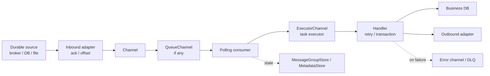
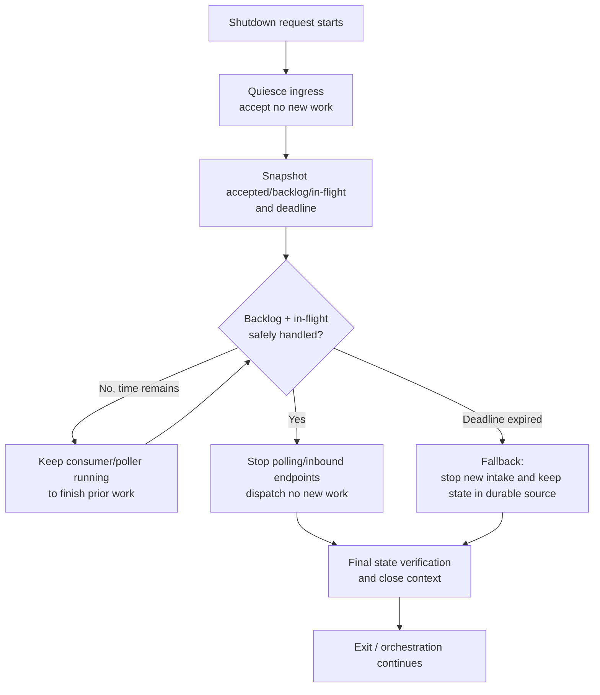
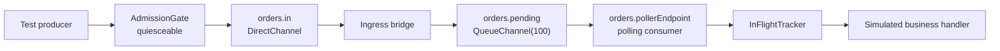
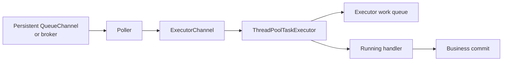
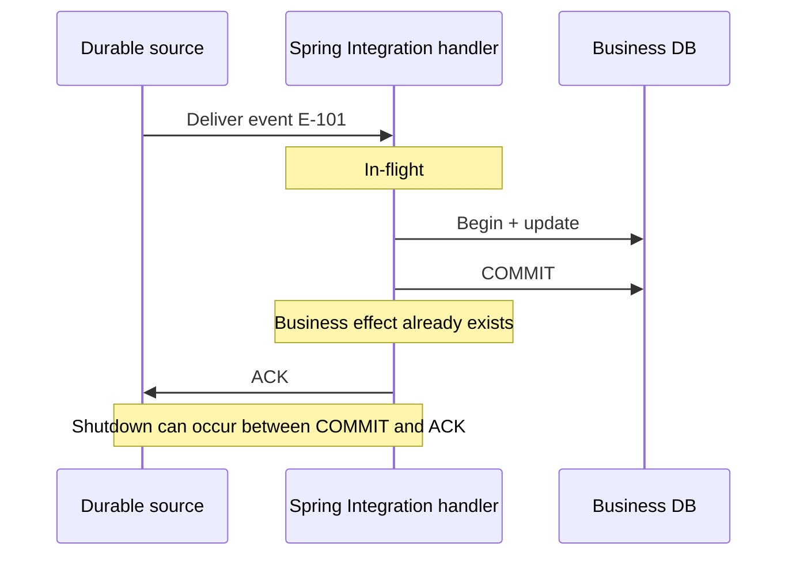
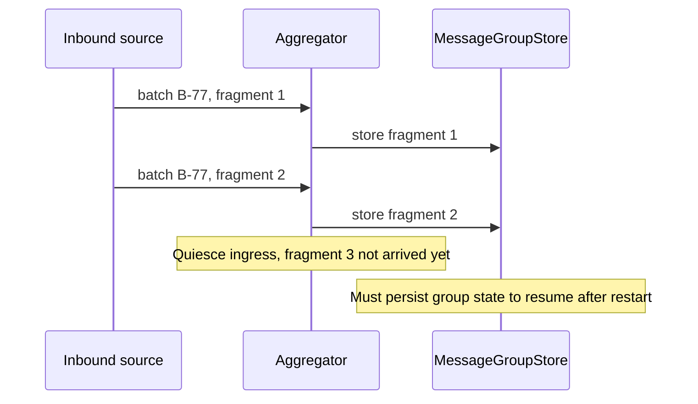
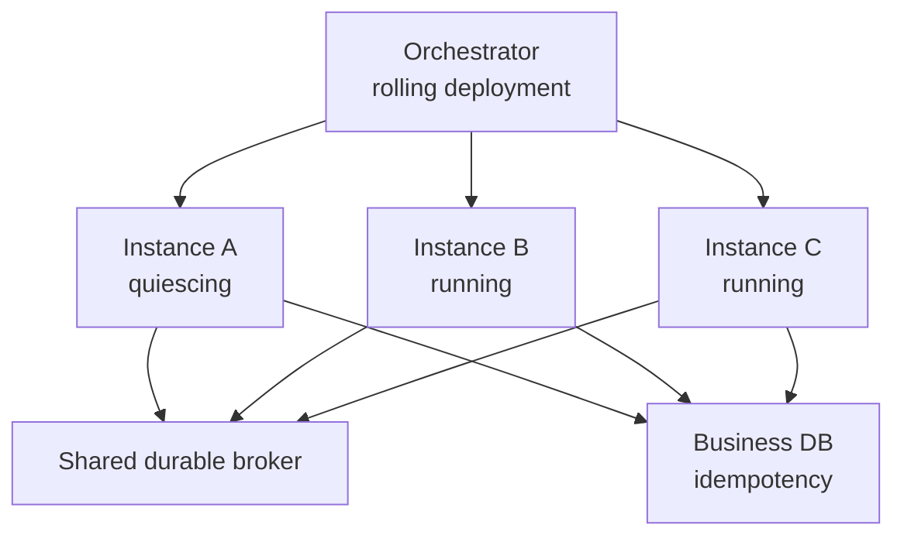

# Graceful shutdown and message draining

## 1. Why does graceful shutdown matter for message flows?

In Spring Integration, an application can continuously receive messages from an HTTP gateway, Kafka/RabbitMQ/JMS adapter, file poller, or internal `MessageChannel`. After being received, messages may be sitting in a `QueueChannel`, dispatched through an `ExecutorChannel`, waiting for a polling consumer, held by an aggregator in a `MessageGroupStore`, or have called a database/HTTP API without yet acknowledging the source.

When deploying a new version, scaling down pods, maintaining a database, or shutting down a dynamic `IntegrationFlow`, the process should not be terminated arbitrarily. An out-of-order shutdown can cause:

- Received but unfinished messages to be lost because queues/tasks only lived in RAM.
- Workers to be stopped mid-transaction or mid-HTTP side effect.
- Brokers to redeliver messages already committed to the DB because acknowledgement did not complete.
- Producers to keep sending to a `DirectChannel` after the last subscriber stopped, causing dispatch errors.
- Executors to stop accepting tasks, causing `TaskRejectedException` or losing tasks per the rejection policy.
- Aggregators to hold incomplete message groups while `MessageGroupStore` is non-persistent.
- The service to be marked "safely stopped" just because `isRunning() == false`, even when many tasks or messages have no outcome yet.

The **"Graceful shutdown and message draining"** lesson belongs to the **Operations** chapter of the **SPRING_INTEGRATION_RUNTIME** module. We will practice orchestrating `IntegrationFlow`, endpoint, poller, and executor lifecycles, controlling new intake and in-flight work, coordinating transactions, retries, message stores, error channels, correlation, and measuring shutdown effectiveness.

> **Distinction upfront:** graceful shutdown is a **time-bounded protocol with a policy for handling unfinished work**, not merely calling `ApplicationContext.close()` or `SmartLifecycle.stop()`.

## 2. Precise definitions: quiesce, drain, stop, and terminate

| Term | Interpretation | Must be verified |
| --- | --- | --- |
| **Quiesce ingress** | Stop accepting **new** work into the scope under maintenance | No source sends additional work into the branch being drained; already-accepted requests are recorded. |
| **Drain backlog** | Keep consumers running to process **queued** messages until the desired condition | Queue/broker backlog shrinks, work completes or moves to durable storage. |
| **Drain in-flight** | Wait for already received/dispatched messages to finish, commit, or roll back per contract | Active handlers and pending tasks are actually measured; not inferred from lifecycle state. |
| **Stop endpoint** | Instruct an inbound adapter, poller, or consumer to stop operating | Endpoint creates no new work per lifecycle; check impact on in-flight messages. |
| **Stop executor** | Stop accepting new tasks, process/cancel queued ones per shutdown policy | No critical tasks lost silently; shared resources are not shut down while other flows still use them. |
| **Close application context** | Run Spring bean stop/destroy sequence | Resources close and the sequence stays within the shutdown budget. |
| **Hard kill** | JVM terminated without letting cleanup finish | Only durably persisted state and redelivery/idempotency support recovery. |

**Draining does not necessarily mean backlog equals 0 in every architecture.** There are two valid policies with different goals:

1. **Drain-to-zero:** temporarily stop new work from entering, **keep consumers active** to process all accepted backlog, wait for every side effect to finish, and only then stop consumers.
2. **Preserve-and-resume:** stop new work intake and stop consumers orderly, **leaving remaining backlog in the broker/persistent message store** for another instance or the new version to process. The right criterion is "no lost messages and redelivery intact", not "empty queue".

Do not mix the two policies. For example, stopping the polling endpoint first and then waiting for `QueueChannel` to reach 0 may **never finish** because no consumer remains to read the queue.

## 3. Model of layers holding messages



Each layer has different **work ownership rules** and **stopping behavior**.

| Message location | On stop | Risk if unverified |
| --- | --- | --- |
| Not yet delivered by source | Usually remains in broker/source | May be lost if source is non-durable or offset committed wrongly. |
| Already entered `DirectChannel` | Synchronous handler may be running on producer thread | Stopping subscriber before blocking producer causes subsequent sends to fail. |
| Inside in-RAM `QueueChannel` | May remain if only poller stops and JVM stays alive | Lost on JVM crash; not replayed by default. |
| Inside persistent channel store | Can be picked up after restart if store write committed | Dequeue/ack outside transaction can lose messages despite durable storage. |
| Waiting in executor work queue | Handler has not started; `Runnable` in RAM | Shutdown policy or crash can cancel/lose tasks. |
| Handler executing | May hold DB connection, lock, transaction | `stop()` does not automatically cancel/roll back side effects; needs layered deadlines and timeouts. |
| Aggregator holding 2/3 fragments | `MessageGroupStore` holds fragments/correlation | Group can be lost across restart if store is in-memory. |
| DB committed but broker not acked | Source can redeliver | Lack of idempotency causes double business effects. |

**A message store differs from an executor queue.** Increasing `ThreadPoolTaskExecutor` `queueCapacity` does not create a durable queue; increasing an in-RAM `QueueChannel` capacity does not guarantee survival across `SIGKILL`.

## 4. General sequence: close intake, finish prior work, then stop

For the **drain-to-zero** policy, the typical flow is:



Key points:

- **Close ingress first:** you cannot drain to 0 if producers keep adding work.
- **Do not stop consumers too early** if the requirement is to finish backlog on the current instance.
- **Wait with a deadline**, never indefinitely; eventually the orchestrator may issue `SIGKILL`.
- **Track both backlog and in-flight**. An empty queue may just mean a worker dequeued the message, not that it finished processing.
- **Do not declare completion** merely because executor active = 0: tasks can still sit in the queue, retry callbacks may remain, or messages may be in another endpoint.
- **Fallbacks must make business sense:** with a durable broker and proper acks, redelivery is acceptable; with an in-RAM-only queue, timeout implies a work-loss risk that must be reported clearly.

### When to choose preserve-and-resume?

If the backlog has millions of messages, deployments only get 60 seconds to stop, and the source is durable, drain-to-zero may be infeasible. In that case:

1. Stop receiving or transition consumer state so no new receives occur.
2. Finish or terminate **currently processing messages** within the deadline.
3. Ensure unacked messages stay in the source or roll back for redelivery.
4. Stop endpoints and the process.
5. Start the new instance and verify consumers resume the backlog per policy.

**Do not call this drain-to-zero.** This is recoverable shutdown, with work continuing after restart.

## 5. Why `SmartLifecycle.stop()` is not enough

Many Spring Integration endpoints implement `SmartLifecycle`, supporting `start()`, `stop()`, and `isRunning()`. When the application stops, Spring's lifecycle processor also considers `phase` and the wait timeout per phase; exact timing and ordering depend on configuration and version.

Example fetching a polling endpoint by bean ID:

```java
import org.springframework.context.ApplicationContext;
import org.springframework.context.SmartLifecycle;

SmartLifecycle worker =
    context.getBean("orders.pollerEndpoint", SmartLifecycle.class);

worker.stop();
boolean stillRunning = worker.isRunning();
```

`stillRunning == false` only tells you the lifecycle state reported by the endpoint. There is **insufficient evidence** to conclude every task, transaction, or output has finished.

Moreover, not every bean in a flow implements lifecycle. A regular `MessageChannel` has no general `stop()` API; a plain Java transformer or handler does not start/stop on its own. You must identify the exact **endpoint/adapter/registration**, rather than calling lifecycle methods on a channel bean by mistake.

### `SmartLifecycle.stop(Runnable)` and phase

Spring provides an asynchronous callback-based stop API. Compliant components invoke the callback once stop completes; lifecycle processor configuration can bound the wait time. Do not rely on synchronous `stop()` alone to assume tasks running outside the endpoint have finished.

Regarding `phase`, the lifecycle processor typically starts lower-phase components first and stops higher-phase components first. However, **phase does not automatically resolve** an active producer sending requests, a queued backlog, or worker transactions. Explicit quiesce/drain planning is required.

## 6. Demo design: independent ingress + queue + worker poller

This lab uses a **single-JVM** application with no real broker/database so we can observe stop ordering precisely. Topology:



`AdmissionGate` blocks *submissions passing through this service* after quiesce. `QueueChannel` splits ingress and worker into two separate endpoints. `InFlightTracker` records running handlers and handler completions **within the demo**.

**Limitations:** an in-RAM queue has no durability; in-RAM stats do not mean "DB committed" or "broker acked"; if another inbound adapter bypasses the gate and sends directly to `orders.pending`, there is no safe quiesce boundary. The code illustrates a testable **local** procedure, not automatically a production or distributed shutdown protocol.

## 7. Java DSL: two static flows, one stoppable point

Create a minimal configuration with separate ingress and polling worker. The example uses Java 17+, Spring Integration, and `@EnableIntegration`.

```java
package example.runtime.operations;

import java.time.Duration;

import org.springframework.beans.factory.annotation.Qualifier;
import org.springframework.context.annotation.Bean;
import org.springframework.context.annotation.Configuration;
import org.springframework.integration.channel.DirectChannel;
import org.springframework.integration.channel.QueueChannel;
import org.springframework.integration.config.EnableIntegration;
import org.springframework.integration.dsl.IntegrationFlow;
import org.springframework.integration.dsl.Pollers;
import org.springframework.messaging.MessageChannel;

@Configuration
@EnableIntegration
public class OperationsFlowConfig {

    @Bean("orders.in")
    MessageChannel ordersIn() {
        return new DirectChannel();
    }

    @Bean("orders.pending")
    QueueChannel pendingOrders() {
        return new QueueChannel(100);
    }

    @Bean
    InFlightTracker inFlightTracker() {
        return new InFlightTracker();
    }

    @Bean
    AdmissionGate admissionGate(
            @Qualifier("orders.in") MessageChannel input) {
        return new AdmissionGate(input);
    }

    @Bean
    IntegrationFlow ordersIngress() {
        return IntegrationFlow.from("orders.in")
            .bridge()
            .channel("orders.pending")
            .get();
    }

    @Bean
    IntegrationFlow ordersWorker(InFlightTracker tracker) {
        return IntegrationFlow.from("orders.pending",
                endpoint -> endpoint
                    .id("orders.pollerEndpoint")
                    .poller(Pollers.fixedDelay(Duration.ofMillis(100))
                        .maxMessagesPerPoll(1)))
            .handle(String.class, (payload, headers) -> {
                tracker.track(() -> {
                    // Illustrative side effect only.
                    System.out.println("Processed " + payload);
                });
                return null; // One-way handler.
            })
            .get();
    }
}
```

In this topology, a single polling endpoint consumes the queue on a schedule. The ingress `DirectChannel` invokes the bridge synchronously, placing the message into `QueueChannel`. The poller is the **only consumer** of the queue in the demo. Setting `id("orders.pollerEndpoint")` lets the control plane retrieve the exact `SmartLifecycle` bean when stopping.

**Do not assume** `poller.stop()` waits for all post-receive tasks. If you add an executor, retry advice, or external transaction, you must extend instrumentation and deadlines.

## 8. `AdmissionGate`: blocking new submissions without check-then-send races

A common broken pattern is:

```java
// Race-prone: quiesce happens after if but before send.
if (accepting.get()) {
    input.send(message);
}
```

Here thread A reads `accepting=true` and gets preempted; thread B switches it to `false`; A still sends the message after draining begins. Depending on the SLA, that makes the accepted count unstable.

In the demo, use a `ReentrantReadWriteLock` to serialize quiesce with sends going through the gate.

```java
package example.runtime.operations;

import java.util.Objects;
import java.util.concurrent.atomic.AtomicLong;
import java.util.concurrent.locks.Lock;
import java.util.concurrent.locks.ReentrantReadWriteLock;

import org.springframework.messaging.MessageChannel;
import org.springframework.messaging.support.GenericMessage;

public final class AdmissionGate {

    private final MessageChannel input;
    private final ReentrantReadWriteLock rw = new ReentrantReadWriteLock(true);
    private final AtomicLong accepted = new AtomicLong();

    private boolean accepting = true;

    public AdmissionGate(MessageChannel input) {
        this.input = Objects.requireNonNull(input);
    }

    public boolean submit(String jobId, long timeoutMillis) {
        Lock read = rw.readLock();
        read.lock();
        try {
            if (!accepting) {
                return false;
            }

            boolean ok =
                input.send(new GenericMessage<>(jobId), timeoutMillis);

            if (ok) {
                accepted.incrementAndGet();
            }
            return ok;
        } finally {
            read.unlock();
        }
    }

    public void quiesce() {
        Lock write = rw.writeLock();
        write.lock();
        try {
            accepting = false;
        } finally {
            write.unlock();
        }
    }

    public void resume() {
        Lock write = rw.writeLock();
        write.lock();
        try {
            accepting = true;
        } finally {
            write.unlock();
        }
    }

    public long acceptedCount() {
        return accepted.get();
    }
}
```

Quiesce acquires the **write lock**, so it returns only after in-flight `submit` calls holding the **read lock** finish; from then on, `acceptedCount()` on this gate stops increasing (until resumed). This provides a clean boundary to verify draining.

However, there are limitations that must be stated:

- This mechanism only blocks **requests passing through `AdmissionGate`**. A Kafka adapter or another inbound flow sending straight to `orders.in`/`orders.pending` bypasses the gate.
- `input.send() == true` only confirms the channel/bridge accepted the message per contract, **not** that business side effects succeeded.
- Holding the read lock during `send` can stall quiesce if the queue is full or `send` blocks. Always set finite send timeouts and control capacity.
- With multiple replicas, each JVM has its own gate. Stopping the cluster requires coordinating every instance or controlling the shared source.

## 9. `InFlightTracker`: distinguishing dequeued from completed

An empty `QueueChannel` does not mean zero work remains: the poller may have just pulled a message while the handler is executing. We track counts at the **handler boundary** and completions.

```java
package example.runtime.operations;

import java.util.concurrent.atomic.AtomicInteger;
import java.util.concurrent.atomic.AtomicLong;

public final class InFlightTracker {

    private final AtomicInteger active = new AtomicInteger();
    private final AtomicLong completed = new AtomicLong();

    public void track(Runnable businessWork) {
        active.incrementAndGet();
        try {
            businessWork.run();
            completed.incrementAndGet(); // Success within demo scope.
        } finally {
            active.decrementAndGet();
        }
    }

    public int activeCount() {
        return active.get();
    }

    public long completedCount() {
        return completed.get();
    }
}
```

If `businessWork.run()` throws an exception, `completed` does not increment while `active` still decrements in `finally`. That prevents the drain coordinator from **reporting success** when an accepted message lacks a successful outcome.

Do not use this exact code as a "transaction committed" metric in production: if a transaction wraps the method via an advice **outside** the tracker, `completed.incrementAndGet()` runs **before the transaction commits**. To confirm business completion, measure at a verified commit/ack boundary, or reconcile against a durable database marker.

**Receive → handler gap:** between leaving the queue and the tracker incrementing `active`, there can be a tiny gap. Thus "queue empty and active=0" is **not enough**. In the demo, we also reconcile **accepted** against **completed** before declaring drain finished.

## 10. Coordinating drain with a deadline and verification criteria

A local coordinator can use the beans defined above. It assumes a **single** polling consumer, all queue entries pass through the gate, no retries/duplicates outside demo scope, and handlers succeed.

```java
package example.runtime.operations;

import java.time.Duration;
import java.util.Objects;

import org.springframework.context.SmartLifecycle;
import org.springframework.integration.channel.QueueChannel;

public final class DrainCoordinator {

    private final AdmissionGate admission;
    private final InFlightTracker tracker;
    private final QueueChannel queue;
    private final SmartLifecycle worker;

    public DrainCoordinator(
            AdmissionGate admission,
            InFlightTracker tracker,
            QueueChannel queue,
            SmartLifecycle worker) {
        this.admission = Objects.requireNonNull(admission);
        this.tracker = Objects.requireNonNull(tracker);
        this.queue = Objects.requireNonNull(queue);
        this.worker = Objects.requireNonNull(worker);
    }

    public boolean drainAndStop(Duration budget)
            throws InterruptedException {

        if (budget.isNegative() || budget.isZero()) {
            throw new IllegalArgumentException("Budget must be positive");
        }

        admission.quiesce();

        long deadline = System.nanoTime() + budget.toNanos();
        while (System.nanoTime() < deadline) {

            boolean allAccountedFor =
                tracker.completedCount() == admission.acceptedCount();
            boolean noHandlerRunning = tracker.activeCount() == 0;
            boolean queueEmpty = queue.getQueueSize() == 0;

            if (allAccountedFor && noHandlerRunning && queueEmpty) {
                worker.stop();

                // Final check after endpoint stop was requested.
                return tracker.activeCount() == 0
                    && queue.getQueueSize() == 0
                    && tracker.completedCount() == admission.acceptedCount();
            }

            // Bounded poll for demo; production needs better monitoring.
            Thread.sleep(25);
        }

        // Do not mark as success; worker may still be running.
        return false;
    }
}
```

Usage:

```java
import java.time.Duration;

import org.springframework.context.SmartLifecycle;
import org.springframework.integration.channel.QueueChannel;

AdmissionGate admission =
    context.getBean(AdmissionGate.class);
InFlightTracker tracker =
    context.getBean(InFlightTracker.class);
QueueChannel queue =
    context.getBean("orders.pending", QueueChannel.class);
SmartLifecycle endpoint =
    context.getBean("orders.pollerEndpoint", SmartLifecycle.class);

DrainCoordinator coordinator =
    new DrainCoordinator(admission, tracker, queue, endpoint);

boolean drained =
    coordinator.drainAndStop(Duration.ofSeconds(10));

if (!drained) {
    System.err.println(
        "Drain incomplete: fallback/recovery required, must not report PASS");
}
```

**Technical limitations of the demo:**

- The deadline only bounds the **wait loop**, not `worker.stop()` itself if the stop implementation blocks; orchestrators must manage that separately.
- If the worker was already stopped before the queue emptied, the wait loop will time out. You may have to restart the worker or choose preserve-and-resume.
- If a message is dequeued and fails processing, `completed < accepted`, so drain reports incomplete. It does not automatically put messages back onto `QueueChannel`; proper transactions/acks are required.
- Aggregate counters do not guarantee **exact per-eventId accounting** if duplicates, drops, or external messages exist. Production must reconcile IDs and durable state.
- If an `ExecutorChannel` sits after the poller, submitted tasks not yet started in the handler will not show up in `activeCount`; you must also measure **executor queue and submitted/completed counts**.
- Do not treat `Thread.sleep(25)` as an assumption that any poll cycle completes in 25 ms. It is merely bounded sampling; the decision rests on counters and queue state.

For production systems, use a stateful **drain protocol** (`QUIESCING → DRAINING → STOPPING → STOPPED`), a request ID, a time budget, accounting for all message sources, and an explicit fallback decision.

## 11. Illustrative testing with JUnit 5

We boot a minimal Spring context with `OperationsFlowConfig`, submit five jobs, and invoke drain. Without business exceptions or external ingress in the demo, accepted must equal completed when drain succeeds.

```java
package example.runtime.operations;

import java.time.Duration;

import org.junit.jupiter.api.Test;
import org.springframework.context.SmartLifecycle;
import org.springframework.context.annotation.AnnotationConfigApplicationContext;
import org.springframework.integration.channel.QueueChannel;

import static org.junit.jupiter.api.Assertions.*;

class GracefulDrainTest {

    @Test
    void drainsAcceptedJobsThenStopsPollingEndpoint()
            throws Exception {

        try (var context = new AnnotationConfigApplicationContext(
                OperationsFlowConfig.class)) {

            AdmissionGate gate =
                context.getBean(AdmissionGate.class);
            InFlightTracker tracker =
                context.getBean(InFlightTracker.class);
            QueueChannel pending =
                context.getBean("orders.pending", QueueChannel.class);
            SmartLifecycle poller =
                context.getBean(
                    "orders.pollerEndpoint", SmartLifecycle.class);

            for (int i = 0; i < 5; i++) {
                assertTrue(gate.submit("J-" + i, 500));
            }

            DrainCoordinator coordinator =
                new DrainCoordinator(gate, tracker, pending, poller);

            assertTrue(coordinator.drainAndStop(
                Duration.ofSeconds(5)));

            assertFalse(poller.isRunning());
            assertEquals(0, pending.getQueueSize());
            assertEquals(0, tracker.activeCount());
            assertEquals(5, tracker.completedCount());
            assertEquals(5, gate.acceptedCount());

            // Gate is quiesced, no new work allowed.
            assertFalse(gate.submit("J-late", 100));
        }
    }
}
```

This test verifies the **quiesce → drain → stop** order in **one JVM** with a synchronous handler and an in-RAM queue. It does not prove crash recovery, broker acknowledgement, DB transactions, or multi-threaded executor shutdown.

To test a message already inside the handler at shutdown, replace the simulated work with a `CountDownLatch` that blocks at the exact moment; from a management thread invoke quiesce/drain, assert it does not report PASS while the latch is closed, then release the latch and assert drain finishes. Do not synchronize tests with a fixed `Thread.sleep`.

## 12. With `ExecutorChannel`: task accepted does not mean completed

When adding an executor between poller and handler, the topology may look like:



A poller can dequeue messages and **submit tasks** very quickly. When the source/`QueueChannel` looks empty, the executor may still hold hundreds of tasks in RAM waiting for workers.

To determine drain completion, you need at least:

- **Accepted/submitted task count** at the dispatch boundary.
- **Executor queue size** and active task count.
- **Business completion count** or commit markers.
- **Failed/rejected task count** and retry/recovery paths.
- Whether the source has been acked; acking before worker completion risks message loss on crash.

Example inspecting `ThreadPoolTaskExecutor`:

```java
import org.springframework.scheduling.concurrent.ThreadPoolTaskExecutor;

ThreadPoolTaskExecutor executor =
    context.getBean("orders.executor", ThreadPoolTaskExecutor.class);

int active = executor.getActiveCount();
int queued = executor.getQueueSize();
int pool = executor.getPoolSize();

System.out.printf(
    "pool=%d active=%d queued=%d%n", pool, active, queued);
```

This is a **snapshot**, not proof that every task has committed. `active=0, queued=0` does not guarantee every HTTP request succeeded, replies were published, or business transactions committed. You need metrics and business outcomes.

### Executor shutdown does not mean broker drain

If a `ThreadPoolTaskExecutor` is configured to wait for tasks on shutdown, that only applies to tasks the executor already manages while wait time remains. It **does not coordinate** broker acks, retry advice, transactions, tasks from other sources, or dynamic flow registrations.

Conversely, if shutdown cancels unstarted tasks, **tasks in RAM can be lost**. Do not use thread pool shutdown policy as a delivery guarantee; keep durable backlogs in the proper source.

### Rejections during shutdown

A stopping executor can reject tasks even when not overloaded. If a poller or upstream endpoint keeps sending to `ExecutorChannel`, it may receive `RejectedExecutionException` or a Spring wrapper. That is a **shutdown ordering bug**:

1. Stop creating/submitting new tasks per policy.
2. Wait for accepted tasks to finish or ensure redelivery.
3. Only then shut down dedicated executors.
4. Do not shut down a shared executor while another flow still uses it.

## 13. Transactions and acknowledgements: the most dangerous window

Stopping threads "gently" alone does not prevent message loss or duplicate processing. You must distinguish **business commit** time from **source ack** time.



| Stop point | Possible consequence | Safe practice |
| --- | --- | --- |
| Before receive | Message usually remains in durable source | Stop inbound/poller per source policy and check backlog. |
| After receive, before DB commit | Message pulled; business work unfinished | With proper transaction/ack, roll back/nack/redeliver; otherwise risk of loss. |
| After DB commit, before ack | Business succeeded yet source can redeliver | Idempotency key/unique constraint in business DB or target API. |
| After ack, before worker/outbound completion | Source may not redeliver even though work is incomplete | Do not ack early unless handed off durably or policy accepts the risk. |
| After outbound API success, before recording marker | Replay can cause duplicate external side effects | API idempotency key, transactional outbox, reconciliation. |
| After stop while RAM queue still holds messages | Data exists only in current JVM | Drain to 0 or ensure move to durable source before terminating. |

**Local transactions** do not automatically span broker, database, and HTTP API simultaneously. If a poller receives a message and hands it to `ExecutorChannel`, the transaction context bound to the poller thread **does not transfer automatically** to the handler running on another thread.

Annotating a service with `@Transactional` does not guarantee broker acknowledgement coordinates with commit. Inspect each adapter's acknowledgement policy and the transaction semantics of your message store.

### Retries during shutdown

If a message is on its third attempt in retry advice:

- Stopping the poller does not necessarily cancel the active attempt.
- If the attempt commits to DB before ack, redelivery may repeat it.
- If retry context lives in RAM, a restart may reset the attempt count per policy.
- If retry backoff holds workers for a long time, the drain budget must include backoff or actively choose preserve-and-resume.

Do not let infinite retries block shutdown forever. Permanent failures need an error/DLQ path and data retention policy for safe replay.

## 14. Error channels, poison messages, and unresolved work

A message can leave a queue without being processed successfully. When a handler throws an exception, the question is **which safe destination handled the error?**

- With a synchronous `DirectChannel`, exceptions can propagate back to the producer; the caller knows whether the request was accepted.
- With a poller or executor, exceptions can be routed to `ErrorMessage`/error channel per configuration. If the error channel has no subscriber or the secondary error handler fails, the incident must be recorded.
- Exhausted retries may route to a DLQ/recovery flow; count a message as **safely resolved** only when a durable contract or clear business outcome exists.
- An in-memory `QueueChannel` that already dequeued a message may not automatically put it back on handler error; poller transactions/store rollback support or durable source redelivery are required.

For drain accounting, classify states:

| State | Counts as safely finished? |
| --- | --- |
| Business transaction **committed** | Yes, if downstream effects and ack/markers align. |
| Failed but **durably moved to DLQ** | Can count as resolved from main flow per error handling policy. |
| Currently retrying in RAM worker | No. |
| Accepted into in-RAM executor work queue | No. |
| Sent to error channel with no consumer | No. |
| Business committed, broker not acked | Needs idempotency/redelivery; not yet considered "duplicate-free". |
| Remains in persistent broker to be consumed after restart | Fits **preserve-and-resume**, not drain-to-zero. |

Do not count handler completions alone; distinguish **terminal success**, **terminal recoverable failure**, and **unresolved**. Reconcile these totals by event ID list, not just raw counts when duplicates or reprocessed messages occur.

## 15. Aggregators, correlation, and message groups on stop

For an aggregator receiving three fragments sharing a `correlationId`, shutdown may happen when a group only has 2/3 fragments. You cannot "drain groups" by waiting for all three parts if the third fragment will not arrive within the maintenance window.



Policy options:

1. **Preserve partial groups:** use a persistent `MessageGroupStore`, keep correlation/release configuration consistent, and wait for remaining fragments after restart.
2. **Controlled expiry of partial groups:** declare a timeout/expiry/reaper policy; emit partial results or discard per business contract.
3. **Batch-level quiesce:** stop accepting **new batches** while letting already-started batches receive remaining fragments if the source supports separation; define a policy if fragments miss the deadline.

Do not set `sequenceSize=3` and assume group state is durable. Test persisted fragments, completion markers, output adapters, and late-arrival scenarios separately.

With multiple instances, stores and lock registries must align so two workers do not release the same group together. **A persistent group store alone does not guarantee exactly-once output**.

## 16. Rolling deployments and multi-replica shutdown

In container orchestration, a service may have multiple replicas consuming the same broker. A quiesce/stop command on instance A **does not automatically stop B and C**.



In a rolling deployment, this can be **exactly the goal**: A stops accepting messages and finishes in-flight work; B/C continue serving. However, consider:

- Broker consumer groups, partition rebalances, and redeliveries can shift message ownership.
- A's transactions/acks must complete or roll back cleanly before A exits.
- B/C must tolerate redelivered events and idempotent side effects.
- If A holds dynamic `IntegrationFlow` registrations only in RAM, the new version must **recreate the topology** from durable configuration.
- Multi-instance consumers may share a `LockRegistry` or metadata store for shared resources, so distributed leases must handle stale owners/fencing.
- A readiness change does not mean every client stopped sending immediately; account for in-flight connections and propagation delay.

### Kubernetes and termination budgets

Typical operations involve a stop signal, application quiesce, waiting for in-flight work, and exiting before the orchestrator issues a hard kill. Configuration items to check in real deployments:

- Is `terminationGracePeriodSeconds` sufficient for the shutdown budget?
- Does readiness drop before termination, and does the load balancer have update latency?
- How does the app handle `SIGTERM` and shutdown hooks in your Spring Boot version?
- Is a `preStop` hook needed to reduce ingress races, and is that hook counted within the total budget?
- Should consumer concurrency be reduced or pollers stopped early instead of waiting to drain the entire backlog?
- Do logs and metrics flush before the deadline without blocking shutdown indefinitely?

Do not pick one fixed number for all systems. Total deadline must cover propagation of stopping new intake, arriving requests, worker drain, commit/ack, and cleanup. **Never promise SIGTERM always finishes**: the orchestrator can still hard-kill on timeout.

## 17. Observing drain state and defining SLOs

To legitimately claim "drained", every stage needs trustworthy signals:

| Signal | Meaning | Things to watch out for |
| --- | --- | --- |
| `ingress.accepting` | Whether the gate allows new work | Applies only to submission paths actually passing through the gate. |
| `accepted` | Messages accepted into the branch per contract | Does not imply business effects committed. |
| `queueDepth` | Messages waiting in queue/broker | An empty queue can still have many in-flight items. |
| `executor.queued` | Tasks waiting for workers in RAM | Do not confuse with messages remaining in the broker. |
| `handler.active` | Handlers currently executing | Can miss dequeued tasks before handler invocation starts. |
| `business.committed` | Business outcomes committed | Must be measured at the proper transaction boundary. |
| `retry.pending` / `failed.unresolved` | Work still requiring handling | Do not count as resolved if merely sent to an error channel with no consumer. |
| `dlq.persisted` | Failed messages durably stored in recovery path | Track replay, retention, and IDs. |
| `broker.unacked` | Delivered but unacknowledged messages | Semantics depend on transport and consumer mode. |
| `drain.duration` | Time from quiesce to conclusion | Report success only when invariants hold. |
| `shutdown.timeout` | Count of shutdown budget overruns | Distinguish recoverable timeouts from unrecovered work loss. |

### Simple counting invariant

In a test system with no duplicates and a single entry path, you can use:

```text
accepted
  = committed_success
  + durable_terminal_failure
  + unresolved

When drain-to-zero is reached:
  unresolved == 0
  AND no new accepted after quiesce
  AND no active/queued tasks
```

In real systems with retries, duplicates, fan-out, aggregators, or multiple outputs, **a simple equality may not apply directly**. Use event IDs and an explicit state machine such as `RECEIVED → PROCESSING → COMMITTED` or `RECOVERABLE_FAILED`, and define clearly which numbers represent the same business event.

Never use `isRunning()==false` or `executor.activeCount==0` alone as a PASS criterion.

## 18. Estimating required drain time beforehand

A rough estimate helps select a policy:

Suppose at quiesce time there are **4,800 unfinished messages**. The whole system steadily processes **80 messages/second** and accepts no new work:

```text
Ideal drain time ≈ backlog / throughput
                 = 4,800 / 80
                 = 60 seconds
```

This is an **ideal lower bound**, excluding p99 handler latency, transaction commits, retries, duplicate messages, batches awaiting fragments, database slowdowns, and stop/cleanup time. With only a **30-second** termination budget, you cannot assume drain-to-zero will succeed. Use preserve-and-resume or change your rollout strategy.

Another example: ingress receives **120 msg/second** while workers only process **100 msg/second**. Without quiescing ingress, the backlog **grows by about 20 msg/second**, making drain-to-zero impossible. Waiting another 30 seconds just adds roughly 600 messages to the backlog at constant rates.

These estimates catch infeasible plans before rollout, but final decisions must rely on **measured completion throughput**, not theoretical capacity from `maxPoolSize`.

## 19. Graceful shutdown test matrix

Good tests actively control shutdown timing and verify business outcomes. Key cases:

| ID | Scenario | Correct assertion |
| --- | --- | --- |
| G01 | Send 5 messages, quiesce then drain | No new messages accepted; all 5 complete; poller stops. |
| G02 | Quiesce while a `send` blocks on full queue | Quiesce waits for the send holding the gate or times out; accepted does not increase after quiesce returns. |
| G03 | Stop poller before queue drains | Drain-to-zero cannot finish; reports timeout, must not report PASS. |
| G04 | Handler holds transaction during quiesce | Finishes/rolls back per policy; not inferred from `isRunning`. |
| G05 | Handler fails before commit, message dequeued from RAM | Test detects unresolved; never treats empty queue as success. |
| G06 | Task accepted into `ExecutorChannel` but not yet run | Measures executor queue; never declares drained while tasks remain unfinished. |
| G07 | Executor shuts down before poller | Rejections occur; diagnose and fix stop order. |
| G08 | Broker redelivery after DB commit before ack | Idempotency prevents double business effect. |
| G09 | In-memory queue still has backlog on JVM SIGKILL | Exposes message loss risk; must not mark recovery passing. |
| G10 | Durable source retains unacked backlog | After restart/new replica, work processes per policy. |
| G11 | Aggregator holds 2/3 fragments | Persistent group state survives and resumes by correlation key. |
| G12 | Error handler not running | Failed messages are not treated as resolved; monitoring detects it. |
| G13 | Two replicas, quiesce one replica | Remaining replica continues consuming; command scope is clear. |
| G14 | Termination budget expires | Controlled fallback executes, logs unresolved IDs, does not claim success. |
| G15 | Dynamic flow destroyed before drain | Detects pending/in-flight work and requires recreating flow on restart. |
| G16 | Clients keep calling while readiness drops | Admission layer rejects/routes safely; accepted requests are not lost. |

In asynchronous tests, use `CountDownLatch`/barriers and finite timeouts for synchronization; never just `Thread.sleep(1000)` and assume messages finished. For hard crashes, you need **process-level tests** and durable storage; a single in-JVM exception cannot fully simulate it.

## 20. Step-by-step operations runbook

### Phase A — Before stopping

1. Identify the **goal**: drain-to-zero or preserve-and-resume.
2. Identify the **scope**: one polling endpoint, one dynamic flow, one JVM, or the whole cluster.
3. Inventory ingress sources, channels, `QueueChannel`s, executors, aggregators, error channels, and stores.
4. Measure backlog, active/queued tasks, retries, business completion rate, and shutdown time budget.
5. Verify the source has appropriate durability/ack policy if draining to 0 is impossible.
6. Prepare idempotency/replay and rollback in case the new version deployment fails.

### Phase B — Quiesce

1. Drop readiness and close admission at managed ingress, accounting for propagation delay.
2. Stop receiving new work from required inbound adapters per policy.
3. Verify no other source bypasses the gate.
4. Snapshot accepted IDs/backlog/in-flight along with `shutdownRequestId` and deadline.

### Phase C — Drain

1. **If drain-to-zero:** keep required workers/pollers running until prior events reach terminal outcomes.
2. **If preserve-and-resume:** stop polling new work while finishing/rolling back already-received messages; leave unreceived work in the durable source.
3. Reconcile transactions, acks, error/DLQ, retries, and incomplete message groups.
4. Watch `queueDepth`, executor queued/active, business committed, and unresolved IDs.
5. Do not extend waits indefinitely during prolonged downstream outages.

### Phase D — Stop/terminate

1. Stop consumer endpoints/flow registrations within the defined scope.
2. Shut down dedicated executors only when no component can still submit tasks to them; watch shared executors.
3. Flush logs/metrics/audits appropriately; close connection pools and resources per lifecycle.
4. If unresolved items remain at deadline, document the **fallback**, durable state location, and resume steps.
5. Let the application context close orderly; verify process exit and startup on the new version.

### Phase E — After restart

1. Confirm required inbound adapters, pollers, error consumers, and dynamic flows have started.
2. Verify persistent queues/groups/metadata remain readable; do not delete state as a "quick fix".
3. Observe backlog decreasing, redeliveries, and duplicates handled idempotently.
4. Reconcile committed business events and downstream outcomes.
5. Declare the deployment safe only when no unmanaged unresolved work remains.

## 21. Troubleshooting when shutdown does not complete

| Symptom | Possible cause | Evidence / remediation |
| --- | --- | --- |
| Drain never reaches 0 | Ingress still sending, poller stopped, handler blocked, or messages failing continuously | Measure accepted over time, endpoint running state, queue, and retry state. |
| Queue empty yet unfinished messages remain | Dequeued and in-flight, queued in executor, or lost due to wrong ack | Compare event IDs, active/queued tasks, business markers. |
| Stopping endpoint takes a long time | Handler waiting on DB/HTTP/lock or slow lifecycle callback | Thread dumps, connection pools, per-layer timeouts. |
| `RejectedExecutionException` during rollout | Executor shut down before producer/poller | Check lifecycle order and whether endpoints still submit tasks. |
| Messages lost after SIGKILL | RAM queue/tasks, early source ack, or uncommitted store | Message store/broker state, ack timeline, transactional receive. |
| Messages processed twice after deploy | DB commit before broker ack, redelivery on rebalance | Business idempotency key, unique constraint, event IDs. |
| Aggregator does not release after restart | In-memory group store, missing fragment, or changed correlation key | Group store snapshot, headers, release strategy, expiry. |
| Error channel has no subscriber | Error flow stopped too early | Error endpoint lifecycle, DLQ/recovery logs. |
| One replica still processes despite UI showing paused | Command executed on only one instance | Effective state per replica, consumer group membership. |
| Readiness false yet requests still arrive | Load balancer propagation lag, keep-alive, or bypassing adapter | Ingress traces and admission gate. |
| Drain reports success yet DB uncommitted | Counting handler return before transaction commit | Transaction synchronization, committed marker/ack. |
| Worker threads remain after context close | Unmanaged executor/resources or wrong shutdown wait | Thread dump, bean ownership, executor lifecycle. |

**Do not remediate by repeatedly killing processes** if the source is non-durable or side effects lack idempotency. First determine where messages live and where recovery can resume.

## 22. Exercises and self-check questions

**Exercise 1 — Drain-to-zero in a single JVM.** Use `OperationsFlowConfig`, `AdmissionGate`, `InFlightTracker`, and `DrainCoordinator`. Submit 20 jobs, quiesce, verify no new jobs are accepted, and verify all 20 complete before the poller stops.

**Exercise 2 — Wrong stop order.** Put the poller in stopped state while 10 messages remain in the queue, then invoke drain with a short deadline. Why can the condition never be met? Propose resuming the poller or switching to preserve-and-resume.

**Exercise 3 — Handler still in-flight.** Use a `CountDownLatch` to block the first handler; trigger drain from another management thread. Verify PASS is not reported while the latch is held; after releasing, inspect when the worker stops.

**Exercise 4 — Quiesce with concurrent producers.** Spawn 10 threads calling `AdmissionGate.submit`, while another thread calls `quiesce()`. Record `acceptedCount` when quiesce returns and verify it does not increase afterward.

**Exercise 5 — Executor work queue.** Add an `ExecutorChannel` and bounded-queue `ThreadPoolTaskExecutor`; accept multiple messages then quiesce. Measure `queueSize` and `activeCount`, explaining why observing `QueueChannel` alone is insufficient.

**Exercise 6 — Broker acknowledgement.** Using a durable test source, kill the process after DB commit but before ack, restart, and verify redelivery causes no duplicate business effect.

**Exercise 7 — Poison message.** Make the handler always fail for one job. Verify drain does not report success just because the queue emptied; route the job to a durable DLQ per policy and verify the resolved state is recorded.

**Exercise 8 — Aggregator 2/3 fragments.** Register a persistent `MessageGroupStore`, receive two fragments, then perform preserve-and-resume. After restart, send the third fragment; verify group release/correlation works and output is not duplicated.

**Exercise 9 — Rolling deployment with two instances.** Have A and B consume from a broker and quiesce A. Verify B keeps processing, A stops taking new work, and A's unacked messages are redelivered per contract.

**Exercise 10 — Realistic deadline.** With 6,000 queued messages and 75 msg/s completion throughput, estimate minimum drain time. If the orchestrator only grants 40 seconds, write a safe fallback plan.

**Exercise 11 — Dynamic flow.** Register a worker via `IntegrationFlowContext`, quiesce and drain, then stop/destroy the registration. Restart the JVM and demonstrate why registrations must be rebuilt from durable configuration.

**Exercise 12 — Shutdown audit.** Design a dashboard showing `shutdownRequestId`, current phase, accepted, committed, DLQ, unresolved, queueDepth, executor queued/active, and deadline. Build rules distinguishing `DRAINED`, `TIMED_OUT_RECOVERABLE`, and `FAILED_UNSAFE`.

### Self-check questions

1. How does graceful shutdown differ from hard kill and from merely calling `ApplicationContext.close()`?
2. Why must ingress quiesce happen before waiting for the backlog to reach 0?
3. How does drain-to-zero differ from preserve-and-resume?
4. Does `SmartLifecycle.isRunning()==false` prove messages have committed or acked?
5. Does an in-memory `QueueChannel` retain messages across a JVM restart?
6. Why does an empty queue not mean zero in-flight work?
7. With an `ExecutorChannel`, which tasks do not yet appear in the handler active counter?
8. Why should you not shut down an executor before stopping the poller from submitting tasks?
9. If the DB commits while the broker has not acked, what phenomenon can shutdown/restart cause?
10. Under what condition can a failed message be counted as safely resolved?
11. Why can an aggregator with 2/3 fragments not force drain-to-zero without a policy for missing fragments?
12. Does a quiesce command on replica A affect B/C?
13. Why does setting readiness to false not necessarily stop all new requests immediately?
14. When the termination deadline is shorter than estimated drain time, which policy should you choose?
15. What advantage does `CountDownLatch` have over `Thread.sleep` when testing shutdown?
16. Which metrics are required to prove no business events were lost or duplicated?

**Operational principle:** safe shutdown is an ordered protocol: **quiesce new intake → identify backlog/in-flight work → drain or preserve work in durable sources → stop consumers/executors respecting dependencies → reconcile transactions, acks, and side effects → terminate within deadline**. A "stopped" flow does not mean all messages finished; reliability must be proven by durable state, idempotency, error/recovery paths, and post-restart business outcomes.
