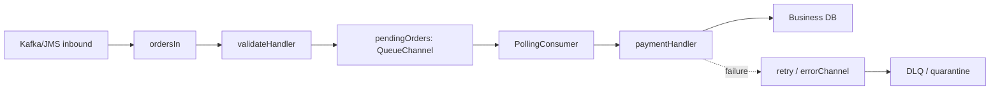
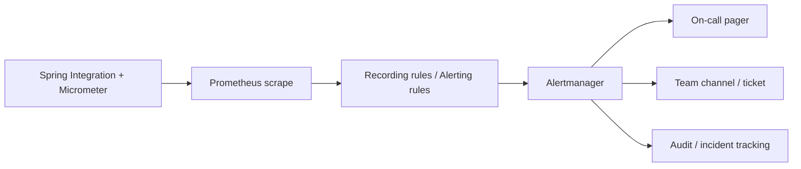

# Metrics, alerts, and error thresholds in Spring Integration operations

## 1. Objectives and context

In the **SPRING_INTEGRATION_RUNTIME** module, message flows run across channels, endpoints, consumers, pollers, and executors. They may use transactions, retries, message stores, correlation, and error flows. When traffic rises or downstream dependencies fail, the operational question is no longer just "does the code work?", but:

- **How many messages are accepted, processed, retried, moved to DLQ, or still waiting?**
- **Which flow is slow, and is the bottleneck at a channel, poller, executor, handler, or external resource?**
- **When does that condition merit an alert, and when should it page the on-call engineer?**
- **Are thresholds chosen from business/SLO needs or arbitrary numbers?**
- **If metrics do not appear, is the flow healthy, lacking traffic, or is monitoring broken?**

The **"Metrics, alerts, and error thresholds"** topic in the **Operations** chapter builds a workflow from measurement → setting thresholds → alerting → investigating → taking action → re-evaluating thresholds.

By the end of this lesson, you can:

1. Select the right **SLI/SLO** for a Spring Integration flow, distinguishing *technical outcomes* from *business outcomes*.
2. Read direct Micrometer meters and Observation meters in Spring Integration 6.x without mixing names/tags across the two modes.
3. Track throughput, failure ratios, handler latency, queue backlog, message age, retries, DLQs, poller progress, and resource saturation.
4. Write PromQL using `rate()`/`increase()`, build alert rules with `for`, sample-count gates, and detect zero traffic and missing series.
5. Design **multi-window multi-burn-rate alerts** aligned with SLO error budgets, with anti-fatigue safeguards.
6. Build runbooks tied to each alert and diagnose via `IntegrationGraphServer`, metrics, traces, logs, thread dumps, and stores/brokers.
7. Test alerts against synthetic data, rollbacks, retry storms, queue-full conditions, stopped endpoints, and restarts.
8. Avoid high-cardinality tags, leaking sensitive data, and automated remediation that loses messages.

Examples use Spring Integration **6.5.x**, Java 17+, Micrometer, Spring Boot Actuator 3.5.x, Prometheus, and Alertmanager. Exact metric/label strings emitted by your registry must be verified because they depend on the Micrometer exporter, naming conventions, integration management configuration, and version.

## 2. Start from business invariants, not dashboards

An illustrative order processing flow:



If an app only counts successful `ordersIn.send()` calls, dashboards can remain "green" even after the payment handler has stopped working. Measurement must anchor on the **desired outcome**:

> "99.9% of valid order events are applied to the business DB within 2 minutes of receipt, without creating duplicate side effects, measured over a 30-day window."

This is an **example SLO**, not a universal Spring Integration SLA. Operationalizing it requires defining:

- **Counting unit:** unique event ID or delivery/retry count?
- **Denominator:** valid events accepted from the source, not empty polls.
- **Success condition:** DB commit succeeds and mandatory downstream work finishes.
- **Deadline:** 2 minutes from a trustworthy timestamp; distinguish receive time from source event time.
- **Duplicates:** if re-received and treated as an idempotent no-op, does that count as success?
- **Valid business rejections:** for example, insufficient funds is a proper business rejection, not necessarily an availability error.
- **Maintenance windows and zero-traffic periods:** are they inside the SLO window?
- **Data source:** ephemeral metrics, durable inbox/outbox, audit DB, or broker telemetry?

Without these definitions, any "5% error rate" is only a technical ratio on one operation, not a **business SLI**.

### Measurement layers to keep separate

| Layer | Example | Can answer | Cannot answer on its own |
|---|---|---|---|
| Channel send | `DirectChannel.send()`, enqueue | Was send accepted or did it throw? | Did the order commit? |
| Pollable receive | `QueueChannel.receive()` | Was a message received? | Did the handler finish? |
| Handler | `ServiceActivator`, transformer | Invocation duration, exception | Did async tasks finish? |
| Poller/consumer | `PollingConsumer`, adapter | Source progress, scheduling, empty polls | Was the business event processed exactly once? |
| Message store | JDBC group/queue state | Backlog, oldest age, orphans | Were remote side effects committed? |
| Broker | Offset lag, redelivery, DLQ | Backlog and whether source delivers | Did the DB transaction commit? |
| Business | Order state, successful event IDs | Real outcome, timeliness | How did one tracing span end? |

The **data plane** processes messages; the **control plane** starts/stops flows, registers endpoints, and changes config. Measure both, without substituting one metric type for the other.

## 3. Minimal SLI set for message-driven services

For each critical flow, prefer a small, precisely defined set.

| SLI | Formula/source | Meaning | Misinterpretation trap |
|---|---|---|---|
| Business success ratio | Terminal successes / terminal eligible outcomes | Correct completion rate | Counting each attempt as a unique event |
| Timeliness ratio | Events completed before deadline / due events | On-time delivery | Measuring handler latency only, ignoring queue wait |
| Ingress rate | `rate(input events)` | Incoming load | Source stopping makes error rate look artificially low |
| Handler error rate | Failures / invocations | Technical error rate at handler | Recovery turning exceptions into success results |
| Queue depth | `queue.size`/store backlog | Queued volume | Depth=0 while workers are stuck processing long tasks |
| Oldest message age | Now − oldest uncompleted arrival | How long a message has been stuck | Average age hiding the tail |
| Retry/redelivery rate | Attempts/retries/redeliveries | Downstream instability | Treating retries as unique customer requests |
| DLQ arrival & oldest age | Broker/DB quarantine | Work needing intervention | Paging at night for every DLQ item regardless of severity |
| Poller no-progress | No completed work while input waits | Consumer stalled or blocked | Confusing zero-event periods with outages |
| Resource saturation | Active/queued executor tasks, DB pool, locks | Imminent bottleneck | Watching CPU only when blocked on I/O or locks |

### Choosing "good events" and "bad events"

In a payment flow, a payment **validly declined** by business rules can be a **good processing event**: the system returned the right result within the deadline. A payment exceeding the deadline or double-charging is a bad event.

Therefore maintain two distinct metric classes:

- **Technical:** handler attempt success/failure, network/DB exceptions, retries.
- **Business:** on-time event completions, failed-to-process, duplicate-effects, compensation-required.

Do not use HTTP 4xx codes, channel `failure` results, or `ErrorMessage` counts as a direct proxy for the entire business error budget.

## 4. Built-in Spring Integration metrics: know the instrumentation mode

Spring Integration provides both direct Micrometer meters and Micrometer Observation. The two mechanisms can produce **different metric names**.

### 4.1. Direct Micrometer meters

Spring Integration 6.5 documentation lists:

| Metric name | Type | Key tags | What it measures |
|---|---|---|---|
| `spring.integration.send` | `Timer` | `type=channel`, `name`, `result`, `exception` | `channel.send` duration |
| `spring.integration.send` | `Timer` | `type=handler`, `name`, `result`, `exception` | Handler invocation |
| `spring.integration.receive` | `Counter` | `type=channel`, `name`, `result`, `exception` | Receives at pollable channels |
| `spring.integration.receive` | `Counter` | `type=source`, `name`, `result`, `exception` | Message source receives |
| `spring.integration.channel.queue.size` | `Gauge` | `type=channel`, `name` | Supported `QueueChannel` depth |
| `spring.integration.channel.queue.remaining.capacity` | `Gauge` | `type=channel`, `name` | Remaining capacity |
| `spring.integration.channels` | `Gauge` | registry metadata | Channel count |
| `spring.integration.handlers` | `Gauge` | registry metadata | Handler count |
| `spring.integration.sources` | `Gauge` | registry metadata | Source count |

**Important warning:** In direct mode, **the handler Timer is still named `spring.integration.send`**, distinguished by tag `type=handler`. Do not assume `spring.integration.handler` is the direct Timer.

A channel `send` returning success may only mean the message **entered a queue** or **was handed to an executor**, not that the business handler committed a transaction.

`QueueChannel.receive()` is a channel receive operation; it is not an end-to-end latency Timer. A null/timed-out receive and a message-returning receive must also not be equated with business results.

### 4.2. Micrometer Observation (Spring Integration 6.x)

When an `ObservationRegistry` and `@EnableIntegrationManagement` with matching `observationPatterns` are present, the framework can instrument components via the Observation API:

| Convention | Primary meter | Active meter | Low-cardinality keys |
|---|---|---|---|
| Producer/channel | `spring.integration.producer` | `spring.integration.producer.active` | `spring.integration.name`, `spring.integration.type=producer` |
| Handler | `spring.integration.handler` | `spring.integration.handler.active` | `spring.integration.name`, `spring.integration.type=handler` |
| Gateway | `spring.integration.gateway` | `spring.integration.gateway.active` | `spring.integration.name`, `spring.integration.type=gateway`, `spring.integration.outcome` |

`*.active` is a long-task timer for operations still running; it is not the count of finished operations. Under the default handler convention, **do not assume a `result=failure` tag exists** as in direct mode.

When Observation is enabled, meters may be emitted by `ObservationHandler` instead of the standalone direct meters. If dashboards currently query direct metrics, **migrate queries** to match the configured mode; never blindly sum both series sets.

### 4.3. Verifying in a live environment

Common reasons panels look empty:

- Missing `MeterRegistry` or `ObservationRegistry`.
- `@EnableIntegrationManagement`/`observationPatterns` does not cover the target component.
- Component has not processed any messages yet: meters may register **lazily on first use**.
- A `MeterFilter` drops meters, or the exporter/Prometheus endpoint is disabled.
- Auto-generated component names differ from what the dashboard expects.
- Switched from direct metrics to Observation without updating queries.

Never create an alert on a metric **you have not actually observed from a live runtime**. Send test traffic, inspect `MeterRegistry.getMeters()`, `/actuator/metrics`, and raw `/actuator/prometheus` before authoring expressions.

## 5. Channels, handlers, pollers: which thresholds make sense?

### DirectChannel

`DirectChannel` normally dispatches to consumers on the caller thread. The send Timer can **include downstream handler duration**. If `ordersIn.send` p95 is 800 ms, the culprit may be a DB/HTTP call inside the consumer, not slow channel infrastructure.

**Sensible alerts:** rising send latency paired with handler latency, logs/tracing, and DB pool saturation. Never sum send latency and handler latency into one "request latency" because they may **overlap**.

### ExecutorChannel

`ExecutorChannel.send` may finish as soon as the task is handed to a worker. A 2 ms send Timer does not tell you a worker spent 8 seconds processing.

**Sensible alerts:** worker active count, executor queue saturation, completion rate, and oldest uncompleted age; never treat send latency as E2E latency.

### QueueChannel and polling consumers

`QueueChannel.send` measures enqueues; `receive` counts receive calls; backlog and waiting age must be measured separately. A poller may be stopped, out of threads, blocked on transactions, or in retry backoff.

**Sensible alerts:** backlog depth > threshold **alongside** high oldest age or low completion rate, avoiding alerts on brief bursts that drain on their own.

### Aggregator/Resequencer

Group processing time can depend on missing parts, `ReleaseStrategy`, `groupTimeout`, orphaned message groups, store transactions, and expiry/reapers.

**Sensible alerts:** oldest incomplete group, growing group count, timed-out/discarded groups, and release-to-business time. Counting inbound messages alone does not prove the aggregator is working properly.

### Error flows and retries

`RequestHandlerRetryAdvice` may invoke a handler multiple times; recovery may return normally after publishing an `ErrorMessage`. A retry storm raises `handler attempts/s` while **unique business events/s** does not increase.

**Sensible alerts:** retry/attempt rate, failed terminal operations, DLQ age, and business error SLI. Do not count the same error in the main handler, error channel, and DLQ consumer as three separate business failures.

## 6. From numbers to thresholds: three rule types

### 6.1. Absolute thresholds

Examples:

- `QueueChannel` size > 500 for 10 minutes.
- Oldest item > 120 seconds.
- JVM heap usage > 85% with rising GC pause latency.
- Zero business completions in 10 minutes **while the system has backlog**.

Pros: easy to understand, aligned with capacity and backlog. Cons: queue capacities vary, traffic varies by time of day, and short bursts cause false alarms.

### 6.2. Ratio thresholds

Examples:

- Channel send failures / all channel sends > 5% over 5 minutes.
- Retried events / attempted events > 20%.
- Business terminal failure ratio > 0.5%.

Pros: compares across varying load. Cons: at very low volume, 1/2 errors = 50% rarely warrants paging. Add a **minimum sample count** condition or design a low-traffic SLO.

### 6.3. Error-budget / SLO thresholds

With a 99.9% success SLO over 30 days, the error budget ratio is:

```text
B = 1 − 0.999 = 0.001 = 0.1%

Burn rate = actual bad-event ratio / B
```

For example, if the actual bad-event ratio is 1.44%:

```text
Burn rate = 0.0144 / 0.001 = 14.4x
```

A burn rate of 14.4 means **consuming error budget 14.4 times faster than an even pace across the SLO window**, not "14.4% error rate".

**Multi-window multi-burn-rate** alerts typically pair a long window and a short window to detect sustained impact while confirming the situation **is still bad right now**:

| Level | Long window | Short window | Burn rate | At 99.9% SLO: bad ratio | Example action |
|---|---|---|---:|---:|---|
| High | 1 hour | 5 minutes | 14.4× | 1.44% | Page |
| High | 6 hours | 30 minutes | 6× | 0.6% | Page |
| Lower | 3 days | 6 hours | 1× | 0.1% | Ticket/investigate |

These are **examples from the Google SRE Workbook for a 99.9%/30-day SLO**, not Spring Integration defaults. For 99.95% or low-traffic services, recalculate and tune ratios and thresholds.

### Business alerts differ from infrastructure alerts

- **Business SLO alert:** events fail to complete on time or terminal outcomes degrade.
- **Symptom alert:** oldest queue age is high and completion rate drops.
- **Cause alert:** DB pool saturated, executor threads blocked, broker unreachable.

Page on **user-facing symptoms**, and route root-cause alarms into tickets/deduplication. If a database outage causes 20 handlers to fail simultaneously, you do not need 20 separate paging calls.

## 7. Setting up Spring Boot Actuator and Prometheus

A Spring Boot project can use dependencies:

```text
spring-boot-starter-integration
spring-boot-starter-actuator
micrometer-registry-prometheus
```

Actual starter dependencies must match the adapters in use. The Spring Boot BOM manages compatible versions; avoid forcing incompatible major versions of Spring Integration/Micrometer/Reactor.

Illustrative configuration:

```yaml
spring:
  application:
    name: orders-runtime

management:
  endpoints:
    web:
      exposure:
        include: health,info,metrics,prometheus
  metrics:
    tags:
      application: orders-runtime
    distribution:
      percentiles-histogram:
        spring.integration.handler: true
```

`spring.integration.handler` is an **Observation** Timer name; in direct mode, consider filtering/configuring **`spring.integration.send`** instead. Histograms multiply series counts; enable them only for critical operations and measure overhead.

**Security:** Expose Actuator endpoints only on management networks/ports with proper authorization. Metric tags and channel/topic/handler names can reveal internal architecture. Avoid exposing every endpoint publicly via `include: "*"`.

### Verification commands

```bash
# Check which meter names actually exist:
curl -s http://localhost:8080/actuator/metrics

# Direct mode:
curl -s "http://localhost:8080/actuator/metrics/spring.integration.send?tag=type:handler"
curl -s "http://localhost:8080/actuator/metrics/spring.integration.receive?tag=type:channel"

# Observation mode:
curl -s http://localhost:8080/actuator/metrics/spring.integration.producer
curl -s http://localhost:8080/actuator/metrics/spring.integration.handler

# Inspect exact Prometheus series/labels:
curl -s http://localhost:8080/actuator/prometheus
```

These URLs are local demo defaults; in production management ports/base-paths, authentication, and TLS may differ. On 404, check dependencies/exposure/mode/traffic first rather than assuming a flow bug.

## 8. PromQL: converting Timers and Counters into operational signals

Typical Prometheus naming conventions produce:

```text
spring.integration.send (Micrometer Timer)
  → spring_integration_send_seconds_count
  → spring_integration_send_seconds_sum

spring.integration.receive (Counter)
  → spring_integration_receive_total

spring.integration.channel.queue.size (Gauge)
  → spring_integration_channel_queue_size

spring.integration.handler (Observation Timer)
  → spring_integration_handler_seconds_count
  → spring_integration_handler_seconds_sum
```

**These are example conventions**; `_total` suffixes and labels are determined by the Prometheus registry/Micrometer exporter. Always inspect raw exposition instead of guessing.

### 8.1. Throughput: operations per second

```promql
# Successful channel sends / second, split by channel:
sum by (job, name) (
  rate(
    spring_integration_send_seconds_count{
      type="channel",
      result="success"
    }[5m]
  )
)

# Pollable channel receive operations / second:
sum by (job, name, result) (
  rate(
    spring_integration_receive_total{
      type="channel"
    }[5m]
  )
)
```

`rate()` handles counter resets across restarts better than raw point differences, but needs enough samples in the window. Never plot raw `spring_integration_send_seconds_count` as "messages/s".

### 8.2. Channel error ratio (direct mode)

```promql
sum by (job, name) (
  rate(
    spring_integration_send_seconds_count{
      type="channel",
      result="failure"
    }[5m]
  )
)
/
clamp_min(
  sum by (job, name) (
    rate(
      spring_integration_send_seconds_count{
        type="channel"
      }[5m]
    )
  ),
  0.000001
)
```

Meaning: `failure send operations / all send operations` for the same channel name/job. A value of 0.05 means 5%. **Never** interpret this as 5% of business orders failing.

Note: if the failure series **has never been created**, this expression can yield no data even while successes climb. You can build a "zero-fill" recording rule over known channels, though vector matching must be designed carefully. Avoid alerts relying solely on this ratio when failure series are absent without zero-initialization; test with both **0 failures** and **with failures**.

### 8.3. Average handler latency

In Observation mode:

```promql
sum by (job, spring_integration_name) (
  rate(spring_integration_handler_seconds_sum[5m])
)
/
clamp_min(
  sum by (job, spring_integration_name) (
    rate(spring_integration_handler_seconds_count[5m])
  ),
  0.000001
)
```

Units are typically **seconds**. With zero traffic, the denominator guard avoids division errors mathematically without making the result meaningful; dashboards should distinguish `no samples` from low latency.

### 8.4. p95/p99 with histograms

Only when histograms are enabled and the exporter emits buckets:

```promql
histogram_quantile(
  0.95,
  sum by (le, job, spring_integration_name) (
    rate(spring_integration_handler_seconds_bucket[5m])
  )
)
```

Do not use `_max` as p95. If `_bucket` is missing, enable histogram/distribution statistics or choose a suitable metric. Histogram aggregation breaks if incompatible bucket boundaries or label sets are combined.

### 8.5. Queue capacity and backlog

```promql
# Queue depth of instrumented QueueChannels:
max by (job, name) (
  spring_integration_channel_queue_size{type="channel"}
)

# Remaining capacity:
max by (job, name) (
  spring_integration_channel_queue_remaining_capacity{type="channel"}
)
```

Queue gauges show **local channel queues**; for JDBC queues, Kafka lag, broker DLQs, or outboxes, add dedicated metrics. Even when the queue gauge is 0, if consumers already pulled messages and are blocked on the DB, end-to-end latency can still be very high.

**Capacity ratio** is only meaningful when the queue has a fixed positive capacity and stable total capacity:

```text
occupancy = queue_size / (queue_size + remaining_capacity)
```

Never apply this formula blindly to unbounded queues or gauges lacking finite capacity semantics.

## 9. Defining custom business metrics at the right boundaries

Spring Integration's Micrometer meters **do not prove DB commits, broker acks, or remote side effects completed**. For SLOs, emit custom business metrics with clear contracts.

Suggested set:

| Metric | Type | Low-cardinality tags | When to increment/update |
|---|---|---|---|
| `orders.processing.attempts` | Counter | `stage`, `result` | A technical attempt finishes |
| `orders.processing.terminal` | Counter | `outcome=success/failure`, `service` | An event ID reaches a true terminal policy state |
| `orders.processing.duration` | Timer | `operation`, `outcome` | Entire target processing duration |
| `orders.inbox.pending` | Gauge | `service` | Unique events without a terminal outcome |
| `orders.oldest.pending.age` | Gauge | `service` | Age in seconds of oldest pending event |
| `orders.dlq.items` | Gauge | `queue` | Events awaiting manual intervention |
| `orders.last.success.timestamp` | Gauge | `service` | Unix seconds of latest business completion |
| `orders.outbox.oldest.age` | Gauge | `topic` | Oldest undelivered business event |

With the Prometheus exporter, names transform to `orders_processing_terminal_total`, `orders_oldest_pending_age_seconds`, etc., though naming rules and `Gauge` base units must be verified.

### 9.1. Java example: technical attempts

```java
import io.micrometer.core.instrument.Counter;
import io.micrometer.core.instrument.MeterRegistry;
import io.micrometer.core.instrument.Timer;
import org.springframework.stereotype.Component;
import java.util.concurrent.TimeUnit;

@Component
public class PaymentAttemptMetrics {

    private final MeterRegistry registry;

    public PaymentAttemptMetrics(MeterRegistry registry) {
        this.registry = registry;
    }

    public <T> T recordAttempt(
            String operation,
            java.util.concurrent.Callable<T> action) throws Exception {

        long started = System.nanoTime();
        String result = "failure";

        try {
            T value = action.call();
            result = "success";
            return value;
        }
        finally {
            Counter.builder("orders.processing.attempts")
                    .tag("operation", operation)
                    .tag("result", result)
                    .register(registry)
                    .increment();

            Timer.builder("orders.processing.attempt.duration")
                    .tag("operation", operation)
                    .tag("result", result)
                    .register(registry)
                    .record(System.nanoTime() - started,
                            TimeUnit.NANOSECONDS);
        }
    }
}
```

This snippet **only measures attempts**. `recordAttempt` does not decide terminal business success and does not know whether an event will be retried afterward. `operation` must be an allowlisted bounded value such as `"charge"` or `"confirm"`, never an order ID or arbitrary URL.

Do not place metric updates inside a transaction expecting the counter to roll back. Micrometer Counters live outside DB transactions; if the DB rolls back, the incremented counter remains incremented. For **post-commit** outcomes, measure at the confirmation boundary or compute SLIs from durable records.

### 9.2. Business terminal outcomes need a durable source of truth

A more reliable way to count unique successful events:

- Inside the **same DB transaction**, update `orders` + `processed_event`/`inbox` + `outbox`.
- Post-commit, a worker/reconciler emits metrics from durable rows.
- Or treat application-level counters as **near-real-time signals**, reconciled against audit/outbox tables because crashes can occur between commit and counter increment.

`@TransactionalEventListener(phase=AFTER_COMMIT)` avoids recording "success before commit", yet callbacks **do not survive process crashes**. Never use an in-memory Counter as the sole ledger for strict SLO accounting.

### 9.3. Separating duplicates from failures

Suppose an idempotency inbox detects event `EV-12` already committed and returns a successful no-op. If the callback sees a duplicate, it may increment `orders.processing.attempts{result="duplicate"}`, yet **must not** increment another `orders.processing.terminal{outcome="success"}` if the terminal outcome was already recorded on the first pass.

Key rule: **one business event ID contributes at most one terminal outcome under the SLI definition**, even if network deliveries exceed one.

## 10. Prometheus recording rules: alert only on meaningful signals

For an orders system with a custom Counter `orders.processing.terminal` exported as `orders_processing_terminal_total`, assuming the `outcome` tag holds only `success` and `failure`, you can calculate the ratio from terminal events.

```promql
# 5-minute bad-event ratio; result ranges 0..1.
sum by (service) (
  rate(orders_processing_terminal_total{outcome="failure"}[5m])
)
/
clamp_min(
  sum by (service) (
    rate(orders_processing_terminal_total{
      outcome=~"success|failure"
    }[5m])
  ),
  0.000000001
)
```

**Fix needed for low-error systems:** the failure series may not exist before the first error. Therefore **pre-register success and failure series** with stable tag sets, or add tested zero-fill aggregation. A missing metric must never be silently assumed to mean a 0 error rate.

### Spring bean example to pre-register series

```java
@Bean
public ApplicationRunner registerBusinessOutcomeCounters(
        MeterRegistry registry) {

    return args -> {
        for (String outcome : java.util.List.of(
                "success", "failure")) {

            Counter.builder("orders.processing.terminal")
                    .tag("service", "orders")
                    .tag("outcome", outcome)
                    .register(registry);
        }
    };
}
```

This snippet needs `@Bean`, `ApplicationRunner`, `Counter`, and `MeterRegistry` imports. It creates fixed-cardinality series. It does **not** emit fake terminal events; initial counts are 0. If you have multiple services, pre-register for each bounded service label.

### Illustrative recording rules

```yaml
groups:
  - name: orders-sli-recording
    interval: 30s
    rules:
      - record: orders:terminal_bad_ratio:5m
        expr: |
          sum by (service) (
            rate(orders_processing_terminal_total{outcome="failure"}[5m])
          )
          /
          clamp_min(
            sum by (service) (
              rate(orders_processing_terminal_total{
                outcome=~"success|failure"
              }[5m])
            ),
            1e-9
          )

      - record: orders:terminal_bad_ratio:1h
        expr: |
          sum by (service) (
            rate(orders_processing_terminal_total{outcome="failure"}[1h])
          )
          /
          clamp_min(
            sum by (service) (
              rate(orders_processing_terminal_total{
                outcome=~"success|failure"
              }[1h])
            ),
            1e-9
          )

      - record: orders:terminal_bad_ratio:30m
        expr: |
          sum by (service) (
            rate(orders_processing_terminal_total{outcome="failure"}[30m])
          )
          /
          clamp_min(
            sum by (service) (
              rate(orders_processing_terminal_total{
                outcome=~"success|failure"
              }[30m])
            ),
            1e-9
          )

      - record: orders:terminal_bad_ratio:6h
        expr: |
          sum by (service) (
            rate(orders_processing_terminal_total{outcome="failure"}[6h])
          )
          /
          clamp_min(
            sum by (service) (
              rate(orders_processing_terminal_total{
                outcome=~"success|failure"
              }[6h])
            ),
            1e-9
          )
```

This rule set fits **business terminal failure ratio SLOs** for higher-traffic services. It does not measure **timeliness** or non-terminal pending events—an infinitely hung event never increments the terminal bad ratio! Therefore add alerts for queue age, missed deadlines, and no-progress.

**Operational note:** Missing recording rule series or gaps caused by Prometheus scrape outages must be tracked separately. Any long-window `rate` expression has inherent inertia and needs sufficient retention. Low-traffic SLOs need dedicated policies based on **event counts**, heartbeats, or synthetic probes rather than percentage ratios alone.

## 11. Multi-window multi-burn-rate alerts for a 99.9% SLO

With a 99.9% SLO, the error budget ratio is `0.001`. Reference options from Google SRE:

- Fast page if burn rate > `14.4` **in both** 1h and 5m.
- Page when burn rate > `6` **in both** 6h and 30m.
- Slower ticket if burn rate > `1` in both 3d and 6h.

### Alert rule using recorded series

```yaml
groups:
  - name: orders-error-budget
    interval: 30s
    rules:
      - alert: OrdersErrorBudgetFastBurn
        expr: |
          (
            orders:terminal_bad_ratio:1h{service="orders"} > 0.0144
            and on(service)
            orders:terminal_bad_ratio:5m{service="orders"} > 0.0144
          )
          or
          (
            orders:terminal_bad_ratio:6h{service="orders"} > 0.006
            and on(service)
            orders:terminal_bad_ratio:30m{service="orders"} > 0.006
          )
        for: 2m
        labels:
          severity: page
          team: integration-ops
          service: orders
        annotations:
          summary: "Business terminal failures are burning error budget rapidly"
          description: "Inspect business terminal errors, error sources, and DLQ."
          runbook_url: "https://runbooks.example.invalid/orders-error-budget"
```

The YAML above is an **illustrative rule**; it does not auto-wire Alertmanager or replace your organization's severity policy. `for: 2m` suppresses transient blips but adds detection latency; measure **MTTD** after rollout.

**Note on labels:** `and on(service)` is vector matching pairing samples with the same `service`; ensure recording rule output retains only the exact labels needed. If staging, environment, or clusters share a service name, separate SLIs by deployment/environment before alerting in production so staging traffic never pollutes production alerts.

### Common pitfalls in burn-rate alerts

- Confusing 14.4× with "14.4% error rate"; at a 99.9% SLO the threshold is **1.44%**.
- Watching only the 1h window: alerts linger after errors stop; the 5m window confirms current impact.
- Missing failure metric before any error occurs: empty vectors stop alerts from firing.
- Zero terminal events when consumers stop: failure ratio becomes 0/0 or series vanish while users are impacted.
- Adding retry attempts into the denominator instead of unique business terminal outcomes.
- Paging on a single failed event in a service handling 1 event/day; low-traffic services need different policies.
- Ignoring alert dependencies, causing 3 rules for the same outage to page repeatedly.

## 12. Alerting on backlog, message age, and no-progress

Error ratios only measure finished operations. A growing queue keeps **non-terminal events** out of the terminal-outcome SLI denominator.

### 12.1. Fixed queue-size threshold

Example for a pre-sized queue capacity:

```yaml
groups:
  - name: orders-backlog
    rules:
      - alert: OrdersQueueBacklogSustained
        expr: |
          max by (job, name) (
            spring_integration_channel_queue_size{
              type="channel",
              name="pendingOrders"
            }
          ) > 500
        for: 10m
        labels:
          severity: warning
          team: integration-ops
        annotations:
          summary: "Queue pendingOrders backlog exceeds 500 messages"
          description: "Inspect pollers, workers, retries, and queue retention."
```

The `500` threshold is only valid when derived from capacity, arrival rate, service rate, and deadlines; it is not a universal default for every `QueueChannel`. If `pendingOrders` is a JDBC channel that does not emit this gauge, read counts from the message store/DB or a dedicated gauge instead of treating absence as depth 0.

### 12.2. Oldest pending age matters more than depth under variable traffic

Suppose processing must finish under 2 minutes; a message waiting 3 minutes is a bad signal even if queue size is only 1.

```text
oldest_pending_age_seconds
    = now - min(accepted_at of non-terminal unique events)
```

Measure oldest age from a durable source (inbox, queue store, trustworthy broker timestamp) including in-flight work. Never compare `System.currentTimeMillis()` across two clock-skewed JVMs to draw absolute conclusions without clock synchronization.

Example custom Prometheus gauge:

```promql
orders_oldest_pending_age_seconds{service="orders"} > 120
```

Combine with `for: 2m` or an SLO-derived threshold. If delays happen in the broker before reaching the app, an app-local gauge starting at receive time undercounts E2E latency; use an acceptance timestamp with clear provenance.

### 12.3. No-progress when backlog exists

```text
Backlog > 0
AND
completed business events do not increase for 10 minutes
AND
service is currently expected to run
=> consumer/poller may be stalled
```

This is a **composite condition** requiring properly initialized gauges/series. `No traffic` is not `no progress` if nothing is waiting. PromQL patterns must handle missing series from cold starts and scrape outages separately.

For example, if the service updates `orders_last_success_timestamp_seconds` (Unix seconds), you can check:

```promql
(
  orders_oldest_pending_age_seconds{service="orders"} > 600
)
and on(service)
(
  time() - orders_last_success_timestamp_seconds{service="orders"} > 600
)
```

The last-success metric must be initialized intentionally; if the service has not processed any event since deploy, never initialize it to "now" and pretend a completion occurred. You can replace it with a success counter plus a controlled no-progress recording rule.

## 13. Setting technical ratio alerts with a sample-count gate

An alert like "channel failure ratio > 5%" on a channel with 2 operations in 5 minutes is noisy. Add a **sample count gate**.

Using `spring_integration_send_seconds_count`:

```promql
(
  sum by (job, name) (
    rate(
      spring_integration_send_seconds_count{
        type="channel",
        result="failure"
      }[5m]
    )
  )
  /
  clamp_min(
    sum by (job, name) (
      rate(
        spring_integration_send_seconds_count{
          type="channel"
        }[5m]
      )
    ),
    1e-9
  )
  > 0.05
)
and on(job, name)
(
  sum by (job, name) (
    increase(
      spring_integration_send_seconds_count{
        type="channel"
      }[5m]
    )
  ) >= 100
)
```

Additional condition: at least 100 send operations in 5 minutes. **100 is an illustrative parameter**; tune it to your traffic and customer impact. When the failure series is absent, the expression may return no output; verify behavior for "zero errors", "one error", "target down", and "missing series" before going on-call.

Do not assign the same severity to every channel. Failures on debug/optional channels may only need a ticket; failures on inbound payment intake may need a page if the SLO is impacted.

## 14. Missing data, low traffic, and silent failures

One of the worst monitoring failures is **missing series making a dashboard look empty and getting interpreted as zero errors**.

| State | Example | Appropriate response |
|---|---|---|
| Truly zero traffic | Batch service receiving events once/day | Do not alert on no-events outside expected schedules |
| Missing failure series | Never failed yet so meter not registered | Pre-register bounded outcome series or zero-fill |
| Scrape target down | `up==0` | Monitoring infra alert; do not infer business failures from empty metrics |
| Target vanished from service discovery | Pod deleted or registry error | Check expected replicas/availability in control plane |
| Producer stopped emitting | Zero input during expected traffic hours | Synthetic heartbeat/source freshness alert |
| Consumer stopped polling | Backlog climbs or oldest age rises | No-progress/queue-age alert |
| App restarted | Counter reset, short uptime | Use `rate()`/`increase()` and inspect restart indicators |
| Component renamed | Old series ends, new series not yet on dashboard | Maintain naming policies and metrics smoke tests |
| Alert not evaluating | Broken Prometheus rule or scrape timeout | Alerting pipeline health, `promtool`/rule tests |

### Monitor the monitoring system itself

Checking `up==0` alone is not enough: when a target disappears completely from service discovery, the `up` series may **vanish**. Monitor expected target/replica counts, Prometheus/Alertmanager health, `scrape_samples_scraped`, notification delivery, and a "dead man's switch"/watchdog alert if your infrastructure requires it.

### Low-traffic mode

A service receiving 5 messages/day has a 20% business failure ratio if 1 event fails, yet should not auto-page using thresholds built for 1 million events/day. Instead:

- Alert on **deadline missed** per critical event rather than a 5-minute ratio.
- Route to tickets and retry/reconciliation if impact can be handled during business hours.
- Page on "no completion within mandatory batch window" or direct customer impact.
- Attach minimum volume gates to ratio alerts, without letting a gate hide a single high-value event (such as a large payment).
- Use synthetic transactions or canary events if the source supports regular probing safely.

## 15. Alertmanager: grouping, deduplication, and routing

Prometheus **evaluates conditions**, while **Alertmanager** typically handles notification grouping, routing, inhibition, and silences.



### Purposeful severity levels

| Level | When | Example channel | Requirement |
|---|---|---|---|
| `critical/page` | SLO loss/outage needing immediate intervention | On-call pager | Actionable runbook and response |
| `warning` | Growing backlog, DLQ, or retries, not yet emergency | Team channel | Clear owner and remediation timeframe |
| `ticket` | Slow burn, cleanup/optimization | Ticket backlog | Does not wake on-call at night |
| `info` | Deploys, restarts, scale-ups | Dashboard/log | Never pages automatically |

Do not mark `critical` just because a single HTTP 500 occurred if retries succeeded with zero business impact.

### Example Alertmanager route

```yaml
route:
  receiver: integration-team
  group_by: ['alertname', 'service', 'environment']
  group_wait: 30s
  group_interval: 5m
  repeat_interval: 4h
  routes:
    - matchers:
        - severity="page"
      receiver: oncall

receivers:
  - name: integration-team
    webhook_configs:
      - url: https://alerts.example.invalid/team

  - name: oncall
    webhook_configs:
      - url: https://alerts.example.invalid/oncall
```

`example.invalid` URLs are placeholders, not live webhooks. Real integrations must use organization-provided endpoints with authentication/security, timeouts, and retries.

**Grouping and inhibition:** If a DB outage breaks dozens of handlers, group by `service`/`environment` and inhibit redundant root-cause alarms. However, never inhibit a **data loss / duplicate charge** alert just because an infrastructure alert is firing—it may require an independent response.

### Silences and maintenance

- Scope silences via explicit labels and time windows.
- Never silence all `severity=page` cluster-wide for a minor deploy.
- Audit who created a silence, why, and its expiry.
- Review silenced alerts during incident postmortems.
- Never use silences to mask a noisy rule forever; fix the signal or threshold.

## 16. From alerts to actionable runbooks

An alert with no concrete action belongs as a **dashboard indicator**, not a page.

### Sample runbook: OrdersQueueBacklogSustained

**Trigger:** `pendingOrders` queue depth > 500 for 10 minutes and/or oldest age exceeds the agreed deadline.

**Goal:** restore processing progress without losing messages or creating duplicate side effects.

1. **Verify the alert:** are metrics fresh? Is the scrape target up? Are component name/instance/environment right?
2. **Assess impact:** how many unique orders are delayed, oldest age, missed-deadline rate, queue capacity, and customer impact?
3. **Locate the bottleneck:** ingress rate vs completion/receive rate; poller `isRunning()`; worker executor active/queue size; DB pool/locks; network timeouts; retry backoff.
4. **Inspect topology:** use `IntegrationGraphServer.getGraph()` or `rebuild()` after dynamic registrations to inspect channels/endpoints/links. A link in the graph does not prove the handler is running.
5. **Inspect error paths:** `errorChannel`, recovery callbacks, DLQ, exception types, attempts; avoid counting one failed send as a unique order failure.
6. **Check transactions/acks:** was the message dequeued while the DB rolled back? Is the broker redelivering? Does the consumer have an idempotency key?
7. **Take safe remediation:** restore downstream, scale workers within DB limits, resolve hot keys, restart the poller per procedure, backpressure producers, or pause intake.
8. **Confirm progress:** oldest age and backlog shrink, business completions rise, DLQ/duplicates do not spike.
9. **Document:** timeline, dashboard snapshots, hypothesized/verified root cause, remediation, and prevention plan.

### Never auto-"fix" via destructive actions

Actions that risk losing or duplicating business events:

- Clearing the entire queue/JDBC message store to "drain backlog".
- Resetting Kafka offsets without a replay/idempotency plan.
- Calling `IntegrationFlowRegistration.destroy()` while messages are still processing.
- Cranking up polling concurrency uncontrollably, choking the DB and creating duplicate races.
- Arbitrarily changing `groupTimeout` or deleting incomplete message groups.
- Enabling unbounded retries when a remote service is already overloaded.
- Dropping unique constraints or locks to boost throughput.

Good automation enforces guardrails: root-cause verification, attempt caps, canaries, rollbacks, auditing, and owners. Without safety guarantees, prefer notifying and guiding operators over automated mutations.

## 17. Diagnosing slow systems without rising error rates

A flow can "succeed" technically on every call yet still violate deadlines:

```text
Input = 200 messages/s
Business completions = 130 messages/s
Delta = +70 messages/s backlog

After 60 seconds, backlog grows by roughly 4,200 messages
(assuming no drops/backpressure/in-flight changes)
```

This is not code throwing exceptions. Timeliness and backlog SLIs are what catch it early.

### Comparing throughput against capacity

Simplified:

```text
λ = average ingress rate (messages/s)
μ = average completed throughput (messages/s)

If λ > μ over a sustained period:
   backlog tends to grow.

If λ ≈ μ:
   bursts can still cause backlog spikes.
```

Long-term stability requires service throughput > arrival rate when buffered, yet adding threads alone will not fix it: remote DBs/HTTP APIs and locks may be the true bottleneck.

### Using Little's Law within scope

```text
L ≈ λ × W
```

In a relatively steady state, `L` is work items **in the system**, `λ` is throughput, and `W` is time **in the system**. Do not apply Little's Law rigidly to an unstably growing queue or heavily skewed service-time distributions. To measure queue wait time, record timestamps and measure at dequeue/terminal completion with proper instrumentation.

### Executor saturation indicators

For `ExecutorChannel`/pollers:

- Active threads / max pool.
- Queued tasks and queue capacity.
- Rejected task count.
- Blocked/waiting threads (DB locks, `ReentrantLock`, HTTP).
- Time spent in retry backoff.
- Pool thread leaks and shutdown state.

Low `spring.integration.send` latency does not rule out an overloaded executor if it only measures task submission. Conversely, high `DirectChannel.send` latency can include downstream blocking.

## 18. Tracking correlation, persistent state, and restarts

### Aggregators and orphaned groups

An aggregator with a 2/3-part group waiting forever may never emit a handler error. Alerts should measure:

- Incomplete group count in the store.
- Oldest group age; distinguish last-modified from group creation time.
- Groups timed out/force-completed/discarded.
- Group release rate versus inbound group rate.
- Message store database health, lock contention, and cleanup/reaper status.

With a persistent `MessageGroupStore` across multiple pods, use shared locks/ownership/DB consistency; local `DefaultLockRegistry` does not coordinate across JVMs. Never delete groups whose oldest age exceeds a threshold without business rules for partial-release/discard/retry.

### Restarts and data durability

In-process counters reset on restart, while persisted message store/inbox/outbox records survive. To evaluate recovery:

1. After restart, inspect pending messages in the store/broker and oldest age.
2. Check incomplete groups and reaper/timeout scheduling.
3. Check unsent outbound outbox rows and verify the dispatcher is running.
4. Reconcile business terminal event IDs against the durable audit log.
5. Verify no segments went missing from prematurely committed checkpoints/offsets.

**Never treat an aggregate counter reset** as proof messages were lost. Counters reset due to new pods, changed Prometheus target labels, or registry restarts.

## 19. Context propagation, tracing, and high-cardinality tags

Metrics should use **low-cardinality tags**, while tracing individual messages uses logs/traces and correlation IDs.

### Recommended

| Metric tag | Example | Bound to enforce |
|---|---|---|
| `application` | `orders-runtime` | Bounded set |
| `environment` | `prod`, `staging` | Bounded set |
| `service` | `orders`, `billing` | Bounded set |
| `name`/`spring.integration.name` | `paymentHandler` | Stable endpoint names |
| `result`/`outcome` | `success`, `failure` | Small set |
| `exception` | `TimeoutException` | Watch for proliferating custom types |
| `region` | `ap-southeast-1` | Bounded set |
| `topic` | `orders-events` | Bounded topic set |

### Avoid

- Per-event `messageId`, `orderId`, `correlationId`.
- Customer emails/phones, JWTs, PII, or raw payloads.
- Stack traces or verbatim exception messages.
- Dynamic route names generated per request.
- Unbounded user IDs/tenant IDs.

For example, 100 handlers × 3 outcomes × 10 exception types × 1,000 tenants = **3,000,000 tag combinations** before adding instances, regions, or histogram buckets. Even if only a few percent materialize, that is still major memory and ingestion overhead.

### Tracing does not replace SLOs, and SLOs do not replace tracing

A trace shows which endpoints a message traversed and where time went. SLOs need aggregate statistics with well-defined denominators and retention policies. Log/trace sampling can drop events; never treat sampled traces as the complete business denominator without calibration.

With reactive execution, ThreadLocal/MDC does not automatically follow new subscribers/threads. Use Reactor Context/`REACTOR_CONTEXT` headers/Micrometer Context Propagation when trace continuity is needed, and inspect header propagation across brokers/adapters. Do not serialize an entire `ContextView` into a persistent message store solely for trace IDs.

## 20. Testing metrics and alerts before handing to on-call

### 20.1. Smoke test Spring Integration meter registration

```java
import static org.assertj.core.api.Assertions.assertThat;

import io.micrometer.core.instrument.MeterRegistry;
import org.junit.jupiter.api.Test;
import org.springframework.beans.factory.annotation.Autowired;
import org.springframework.beans.factory.annotation.Qualifier;
import org.springframework.integration.channel.QueueChannel;
import org.springframework.messaging.MessageChannel;
import org.springframework.messaging.support.GenericMessage;
import org.springframework.test.context.junit.jupiter.SpringJUnitConfig;

@SpringJUnitConfig(OrdersMetricsFixture.class)
class OrdersRuntimeMetricsTest {

    @Autowired
    @Qualifier("ordersIn")
    MessageChannel input;

    @Autowired
    @Qualifier("ordersOut")
    QueueChannel output;

    @Autowired
    MeterRegistry registry;

    @Test
    void directMetersAppearAfterTraffic() {
        assertThat(input.send(new GenericMessage<>("ORD-1")))
                .isTrue();

        assertThat(output.receive(1_000)).isNotNull();

        var sendTimers = registry.find("spring.integration.send")
                .tags("type", "channel", "name", "ordersIn")
                .timers();

        assertThat(sendTimers)
                .anyMatch(timer -> timer.count() >= 1);
    }
}
```

`OrdersMetricsFixture` is a Spring test fixture you must create with `@EnableIntegration`, `@EnableIntegrationManagement`, `SimpleMeterRegistry`, channel `ordersIn`, `QueueChannel ordersOut`, and a connecting handler; the snippet above is an **illustrative test class**, not a standalone compiling project.

This tests **direct metrics mode**. If your project uses Observation mode, assert `spring.integration.producer`/`spring.integration.handler` and the `spring.integration.name` key instead of direct meters.

### 20.2. Testing Prometheus rules

Before shipping rules to production:

1. Run `promtool check rules <file>` to validate syntax.
2. Run `promtool test rules <testfile>` with sample time series for each scenario.
3. Verify alert transitions **inactive → pending → firing** per `for`.
4. Verify **resolution** once errors stop, especially for multi-window burn alerts.
5. Test missing metrics, target down, zero traffic, low traffic, counter resets, and high traffic.
6. Test `service`/`environment`/`instance` labels so deployments never merge accidentally.
7. Verify Alertmanager grouping, inhibition, silences, routing, live receivers, and notification delivery.
8. Use a canary/non-paging receiver before enabling paging.

**Example test matrix:**

| Case | Signal | Expected |
|---|---|---|
| Healthy | 0 bad events, sufficient traffic | No page |
| Brief burst | 10% errors for 1 minute then recovers | No page if policy requires sustained impact |
| Sustained high errors | 2% errors for 20 minutes, sufficient traffic | Pages per matching burn-rate rule |
| Slow burn | 0.2% over multiple days | Ticket/investigation per SLO |
| Queue backlog spike | >500 for 1 minute then drops | No page due to `for:10m` |
| Long backlog | >500 for 15 minutes | Backlog alert |
| No traffic expected | Zero messages during off-hours | No unfounded consumer-outage alert |
| Traffic expected but no progress | Pending age climbs, completions stop | No-progress alert |
| Missing failure meter | Success series exists, failure not yet created | Rule still evaluates healthy accurately |
| Monitoring down | Scrape targets/Prometheus failing | Separate monitoring-health alert |
| Restart | Counters reset, persisted state intact | No "negative traffic"/false data-loss alerts |
| Duplicate redelivery | Multiple attempts, one unique business outcome | Attempt metric increases, unique terminal remains one |

### 20.3. Testing runbooks and alert hygiene

A mathematically sound rule is a bad alert if on-call engineers do not know what to do. Every alert needs:

- Owner/primary on-call, backup, and escalation path.
- Clear severity.
- One sentence describing symptom + impact scope.
- Dashboard link, query, and runbook URL.
- Expected first response: what to check within 5 minutes?
- Safe recovery actions and actions **forbidden to perform**.
- Post-incident review metrics: false positives, false negatives, MTTD, MTTA, MTTR, pages per week.

Periodically revisit thresholds as traffic and capacity change; a queue-size threshold right for 10 messages/s makes no sense once traffic grows to 2,000 messages/s.

## 21. Investigation example: handler timeouts, growing queue, yet sends still succeed

**Context:** `ordersIn → QueueChannel → poller → paymentHandler → HTTP API`.

```text
09:00 Ingress 120 msg/s; business completions 115 msg/s
09:05 Remote payment API p95 latency spikes: 200 ms → 4 s
09:06 Handler threads nearly exhausted
09:07 Queue backlog begins climbing
09:09 Channel sends still report success for many messages
09:10 Oldest pending age exceeds 120 s deadline
09:12 Some requests land in DLQ after retry exhaustion
```

### Which signals detect it early?

| Signal | State | Interpretation |
|---|---|---|
| Channel `send{result=success}` | Still high | Reflects enqueue/accept only |
| Handler latency p95 | Spikes sharply | Slow remote API or lock/DB |
| Executor active/queued | Near saturation | Worker pool congested |
| Queue oldest age | >120 s | Timeliness SLO impacted |
| Retry attempts | Rising | Remote timeouts/retries |
| DLQ items | Starting to rise | Terminal failures occurring |
| Business completions | Dropping | Users waiting longer |

An alert relying solely on channel send failures will **miss** the incident until the queue fills up. **Oldest pending age** or **multi-window business SLO burn** alerts align much more closely with user impact.

### Safe runbook

1. Confirm downstream API slowdown via tracing/HTTP client timings.
2. Check retry backoff; if excessive retries amplify load, enforce configured retry budgets/circuit breakers.
3. If ingress must be throttled temporarily, apply backpressure or protocol-safe source pauses without losing acks.
4. Do not scale consumers beyond downstream connection pools or true downstream capacity.
5. After recovery, monitor backlog-drain rate and orders that breached deadlines.
6. Audit outbox/inbox/idempotency to verify retries caused no double charges.
7. Tune alerts if detection was late and add capacity tests.

## 22. Investigation example: zero failure ratio yet customers complain

**Symptom:** `spring.integration.send` and handler Timers look mostly successful, yet customers report "order received but never updated".

Possibilities:

- Poller stopped; zero new receives/handler invocations, **failure rate never rises**.
- `QueueChannel` accepted messages, yet no consumer exists.
- Recovery callback routed errors to the error channel and returned normally.
- DB transaction commit failed **after** the instrumented handler operation.
- Broker acked before DB commit, losing events.
- Aggregator group lacks parts and never releases.
- Producer stopped emitting messages or source checkpoint broke.
- Event committed yet downstream outbox has not dispatched.

### Step-by-step investigation

1. Compare durable ingress counts with terminal business records.
2. Inspect non-terminal event IDs and oldest pending age.
3. Check poller/endpoint `isRunning()` lifecycle and `IntegrationGraphServer`.
4. Check message group store, transactions, retries, and DLQ/outbox state.
5. Use correlation/traces to separate unreceived, waiting, and failed messages.
6. Build a minimal reproducible flow/test case preserving exact thread/poller/transaction boundaries.

**Conclusion:** Error rate is an important SLI, but **cannot replace timeliness, liveness, and durability indicators**.

## 23. Production rollout checklist

- [ ] Clear business SLI/SLO: which events are valid, what counts as success, what the deadline is, and the observation window.
- [ ] Separate attempts, deliveries, retries, terminal outcomes, and unique events.
- [ ] Choose direct Micrometer meters or Observation and use the exact names/tags of that mode.
- [ ] Verify raw `/actuator/prometheus` before building dashboards/alerts.
- [ ] Interpret channel send and handler duration according to Direct/Executor/QueueChannel boundaries.
- [ ] Measure backlog size and **oldest pending age**, not just send success rate.
- [ ] Monitor poller/consumer liveness when the source has expected traffic/backlog.
- [ ] Emit metrics for DLQ, outbox, retries, redeliveries, and orphan groups if the flow uses them.
- [ ] Ensure alerts have clear purpose, severity, owner, runbook, and safe actions.
- [ ] Compute SLO burn rates accurately from error budgets (never confuse burn rate with % errors).
- [ ] High-traffic alerts consider multi-window rules and minimum sample counts.
- [ ] Low-traffic services use deadline/heartbeat alerts or dedicated policies.
- [ ] Tested healthy, failure, recovery, low/no traffic, missing series, counter resets, and target down.
- [ ] Metrics contain no messageId/orderId/correlationId/PII as tags.
- [ ] Histogram, sampling, and export overhead measured/tuned for critical components.
- [ ] Alertmanager grouping/inhibition/silences configured with clear scope and auditing.
- [ ] Never automatically clear queues, shift offsets, or destroy flows solely due to a backlog alert.
- [ ] During incidents, you can trace graph → handler → executor/poller → broker/DB.
- [ ] Regular reviews of MTTD/MTTR, false positives, and alert value for on-call engineers.
- [ ] Business/restart/transaction tests guard against message loss and duplicate effects even though metrics are best-effort.

## References

- [Spring Integration Reference — Metrics and Management](https://docs.spring.io/spring-integration/reference/metrics.html): Micrometer direct metrics, channel send/receive, queue gauges, Observation conventions, and `@EnableIntegrationManagement`.
- [Spring Integration Reference — Message Channels](https://docs.spring.io/spring-integration/reference/channel.html): `DirectChannel`, `QueueChannel`, `ExecutorChannel`, and threading.
- [Spring Integration Reference — Endpoint and Poller](https://docs.spring.io/spring-integration/reference/endpoint.html): endpoint lifecycle, `PollingConsumer`, and schedulers.
- [Spring Integration Reference — Error Handling](https://docs.spring.io/spring-integration/reference/error-handling.html): error flows, recovery, and synchronous/async semantics.
- [Spring Integration Reference — Message Store](https://docs.spring.io/spring-integration/reference/message-store.html): durable queues/groups and restarts.
- [Spring Integration Reference — Integration Graph](https://docs.spring.io/spring-integration/reference/graph.html): mapping runtime topology with metrics/traces.
- [Micrometer — Timers](https://docs.micrometer.io/micrometer/reference/concepts/timers.html): count, total time, distribution histograms, and max.
- [Micrometer — Counters](https://docs.micrometer.io/micrometer/reference/concepts/counters.html): rate/increase rather than cumulative counts.
- [Micrometer — Meter Filters](https://docs.micrometer.io/micrometer/reference/concepts/meter-filters.html): filtering and cardinality management.
- [Spring Boot 3.5 — Actuator Metrics](https://docs.spring.io/spring-boot/3.5/reference/actuator/metrics.html): `MeterRegistry`, metrics endpoints, and exporters.
- [Prometheus — Alerting Rules](https://prometheus.io/docs/prometheus/latest/configuration/alerting_rules/): `for`, `keep_firing_for`, alert labels/annotations, and alert states.
- [Prometheus — Recording Rules](https://prometheus.io/docs/prometheus/latest/configuration/recording_rules/): building reusable SLI series.
- [Prometheus — Query Functions](https://prometheus.io/docs/prometheus/latest/querying/functions/): `rate`, `increase`, `histogram_quantile`, `absent`.
- [Prometheus — Unit Testing for Rules](https://prometheus.io/docs/prometheus/latest/configuration/unit_testing_rules/): `promtool test rules`.
- [Prometheus Alertmanager](https://prometheus.io/docs/alerting/latest/alertmanager/): grouping, inhibition, silences, notification routing.
- [Google SRE Workbook — Alerting on SLOs](https://sre.google/workbook/alerting-on-slos/): error budgets, burn rates, multi-window/multi-burn-rate alerts, and low-traffic considerations.

**Remember:** In Spring Integration operations, **"channel.send succeeded" does not mean "the business event finished on time"**. Measure from ingress to terminal outcome, add queue age, poller progress, retry/DLQ, and transaction/resource signals. Use the right Micrometer/Observation metric names, check for missing series, base thresholds on SLOs and capacity, and pair alerts with runbooks containing safe actions. A good alert catches real impact, minimizes noise, and helps on-call engineers make the right call—not just a red line on a dashboard.
