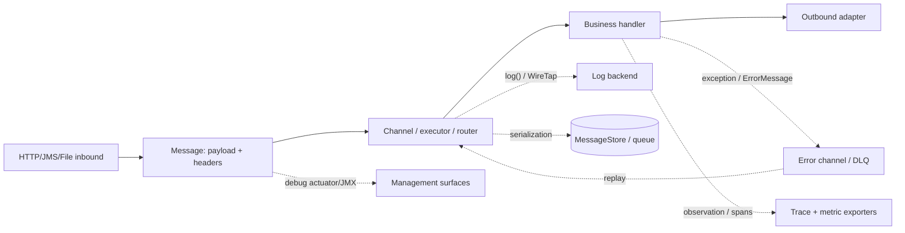
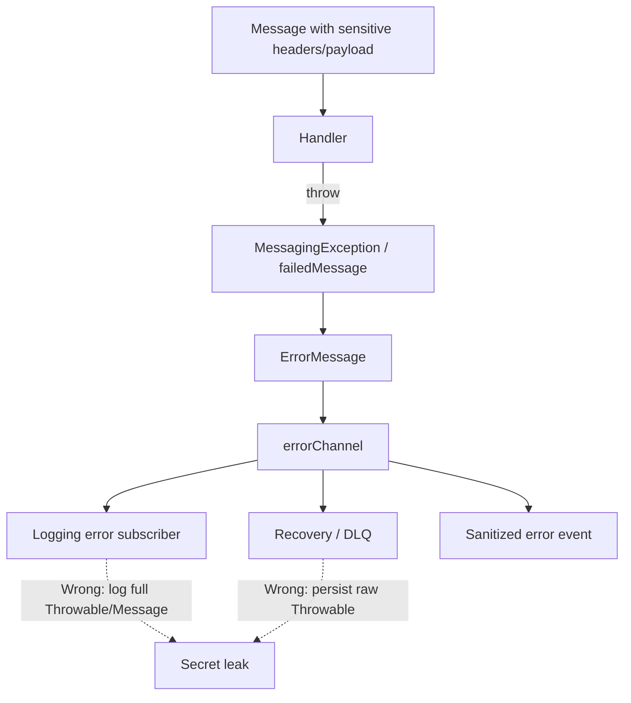
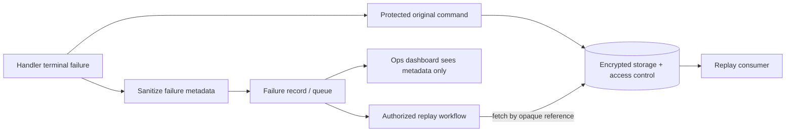

# Redacting credentials, payloads, and headers in Spring Integration operations

## 1. When DEBUG becomes a security risk

A Spring Integration application receives requests via an HTTP inbound gateway and routes `Message<?>` through `DirectChannel`, `ExecutorChannel`, routers, `ServiceActivator`, and outbound adapters. When timeouts occur, engineers turn on DEBUG and add a `WireTap` to trace the message path.

Suppose an inbound request contains:

```text
Authorization: Bearer <ACCESS_TOKEN>
Cookie: session=<SESSION_VALUE>
X-API-Key: <API_KEY>
X-Correlation-Id: checkout-42

{
  "customerEmail": "customer@example.invalid",
  "cardToken": "<PAYMENT_TOKEN>",
  "orderId": "ORDER-42",
  "amount": 125000
}
```

If you log `Message.toString()` verbatim, a single log line can contain **both the payload and the headers mapped onto the message**. If a handler throws an exception, `ErrorMessage` or a dead-letter record may continue carrying the original message. Another copy may already sit inside a persistent `MessageStore`. Deleting the exposed log line after an incident **does not remove the data from copies, queues, and storage systems that already received it**.

In the **Operations** chapter of the **SPRING_INTEGRATION_RUNTIME** module, **"Redacting credentials, payloads, and headers"** explains how to protect sensitive data while orchestrating messages across channels, endpoints, consumers, pollers, executors, retries, transactions, message stores, error flows, correlation, and runtime observability interfaces.

The **goal** is to retain diagnostic capability without turning logs, metrics, tracing, error channels, DLQs, or management APIs into leaks for credentials and personal data.

> **Core principle:** Emit to telemetry only fields that are explicitly allowlisted. Do not rely on low log levels, a token-masking regex at the end of a pipeline, or dashboard access permissions to replace data minimization at the source.

## 2. How do redaction, masking, tokenization, and encryption differ?

| Technique | How it works | Best fit | Limitation |
| --- | --- | --- | --- |
| **Omit / allowlist** | Exclude sensitive fields from logs, traces, outbound headers | Safest default for credentials | Loses some context if allowlist is too narrow |
| **Redaction** | Replace the entire value with `[REDACTED]` | Tokens, passwords, cookies, Authorization | Cannot correlate equality across records |
| **Masking** | Show only part of a value, e.g., `****1234` | Data business rules allow showing partially | Still sensitive; may be guessable |
| **Pseudonymization / HMAC** | Generate a stable identifier using a secret key | Correlating across logs without exposing email/user ID | Not absolute anonymity; HMAC key must be protected |
| **Tokenization** | Use a mapped reference in a vault/token service | Replacing secrets/PII with an authorized lookup ID | Token/reference and mapping vault still require protection |
| **Encryption at rest/in transit** | Protect data while stored/transmitted | Persistent stores, DLQs, brokers, backups, object storage | Authorized decryptors see original data; does not replace log redaction |

For **passwords, bearer tokens, refresh tokens, session cookies, private keys, and API keys**, the best approach is **never logging any part of them**. Never log "the first 6 characters" of an access token to distinguish requests.

For business payloads, log only **classified and approved** fields such as `flowName`, `schemaVersion`, `payloadType`, `byteLength`, `resultCategory`, and a pseudonymized identifier when needed.

### Where does redaction sit in the architecture?

There are three distinct points:

1. **Minimize data in the message:** do not put unnecessary secrets into `MessageHeaders` or payloads.
2. **Sanitize before emitting telemetry:** loggers, wire taps, exception events, metric labels, trace attributes, audit events, and management responses.
3. **Protect data that must be retained:** encryption, access control, retention, and replay/cleanup policies for brokers/DBs/DLQs.

A message sometimes must carry a payment token to an authorized handler. Keep the token on the **secure business path**, while ensuring **every observability path** sees only a summary stripped of the token. Never strip a required field before the business adapter can use it.

## 3. Mapping where credentials and payloads can leak



Each dotted arrow is a path that can copy or expose data **separately from the primary business path**. A `.headerFilter(...)` placed late in the flow does not sanitize copies created earlier.

### Common sensitive data checklist

| Category | Examples | Telemetry policy |
| --- | --- | --- |
| Credentials | `Authorization`, `Proxy-Authorization`, `X-API-Key`, `password`, `access_token` | **Never log values** |
| Session/CSRF | `Cookie`, `Set-Cookie`, JWT, CSRF tokens | Omit/redact completely |
| Keys/certificates | Private keys, client secrets, signing material, keystore passwords | Omit, do not store in Message |
| URL/connection | DSNs with username/password, `?token=...` queries, Basic auth URLs | Log allowlisted scheme/host, strip userinfo/query |
| Personal data | Emails, phone numbers, addresses, personal IDs | Omit/mask/HMAC per policy |
| Payment data | PAN, CVV, payment tokens, account data | Do not log; follow domain regulations |
| Business content | Invoice content, records, attachments, file bodies | Approved technical metadata only |
| Framework headers | `replyChannel`, `errorChannel`, routing, correlation, message history | Selective; do not dump entire objects blindly |
| Operation IDs | `traceId`, `messageId`, `correlationId`, `businessId` | Loggable if policy permits; never put personal IDs in metric tags |

**Header keys are not always consistent in casing.** `Authorization`, `authorization`, and an `HttpHeaders` holding header lists can be represented differently. Inspect actual data shapes, nested maps/headers, and adapter header mappers rather than relying on a single case-sensitive check.

## 4. Minimal threat model for a message flow

Before configuring logging, determine:

1. **Who sends the data?** HTTP clients, brokers, file partners, internal trusted producers.
2. **Who can read telemetry?** Developers, SREs, APM vendors, SaaS log tools, users with JMX/Actuator access.
3. **Where does the data live?** JVM heap, executor queues, JDBC stores, brokers, DLQs, log collectors, trace backends, backups.
4. **Who actually needs the secret?** For example, the outbound client needs the API key, while routers and logging endpoints do not.
5. **What is the retention?** Pending messages and replays may live for hours; logs/backups may persist for weeks.
6. **What happens on exceptions?** `Throwable.getMessage()` or `getFailedMessage()` may contain payloads/headers.
7. **What happens after restart?** Did MessageStore/metadata/outbox persist a copy containing sensitive data?

These answers define **per-boundary data policies**. Do not run a regex that "masks every header containing the word key" and consider the job done: secrets can live inside JSON payloads, URL queries, exception messages, or custom objects.

## 5. Minimizing data right at ingress

**The strongest defense is never putting secrets into messages if downstream does not need them.**

For HTTP inbound gateways:

- Authenticate bearer tokens/sessions **at the HTTP security layer** before passing data into the integration flow.
- Map only needed HTTP headers into Spring Messages; control `HeaderMapper` instead of forwarding all request headers.
- When calling downstream under an identity, prefer service identities/credentials from a secret manager rather than forwarding raw inbound tokens.
- Convert request bodies into validated DTOs with explicit schemas; do not pass raw `HttpServletRequest` or unbounded maps.
- Never attach raw request/response objects to `MessageHeaders` for "easier debugging".

One way to structure this:

```text
Client HTTP request
   |
   v
Authentication / validation
   |-- credentials verified at security boundary
   |-- do not copy Authorization into MessageHeaders
   v
OrderCommand(orderId, itemsRef, schemaVersion)
   |
   v
Spring Integration flow
   |
   +-- safe diagnostic summary
   +-- business handler obtains outbound credentials from Secret Provider
```

### Header mappers are control points, not automatic promises

Different adapters have distinct header mapping mechanisms (HTTP, JMS, AMQP, Kafka, TCP...). Property names and defaults **differ**. Check your exact adapter version and mapped headers list, especially across upgrades. Do not assume a universal `redactAllCredentials=true` setting exists across protocols.

When payloads carry large files or PII, pass a **durable reference** to protected object storage instead of copying full contents across channels. Ensure references enforce proper access control and TTLs, without embedding token-bearing signed URLs that easily end up in logs.

## 6. HeaderFilter: stripping headers before a trust boundary

Spring Integration provides `HeaderFilter`/DSL `headerFilter(...)` to remove message headers that should not cross a boundary.

Java DSL example:

```java
import org.springframework.context.annotation.Bean;
import org.springframework.integration.dsl.IntegrationFlow;

@Bean
IntegrationFlow outboundOrderFlow() {
    return IntegrationFlow.from("validatedOrders")
            .headerFilter(
                    "Authorization",
                    "authorization",
                    "Cookie",
                    "cookie",
                    "X-API-Key",
                    "x-api-key",
                    "accessToken")
            .handle(orderOutboundHandler);
}
```

`orderOutboundHandler` is an application-provided `MessageHandler` requiring a bean and its own outbound credential lookup. The example only shows **specific headers removed from the new message** passing through the filter. It does not strip credentials from:

- Original messages sitting in an upstream channel or DLQ.
- Debug/wire tap records already emitted before the filter.
- JSON payloads containing `accessToken` under another field.
- Headers nested inside a `Map`/`HttpHeaders` stored as a value.
- Memory inside another copy/object currently being processed.

**Better than a fixed denylist** is an **allowlist of fields permitted across the boundary**. A HeaderFilter targeting known names is only an extra defense layer; uncontrolled external header names can bypass a denylist.

### Designing an allowlist

A message crossing from **untrusted input → integration core** only needs:

```text
messageId / correlationKey (classified)
eventType
schemaVersion
tenantInternalRef (if permitted)
retryContext per contract
validated business payload
```

Do not copy extra `Authorization`, `Cookie`, raw response headers, connection passwords, or secret manager results merely because the framework supports arbitrary message headers.

## 7. Never log entire Messages or MessageHeaders

Very high-risk calls:

```java
// DO NOT USE in production with unclassified messages.
log.debug("message={}", message);
log.debug("headers={}", message.getHeaders());
log.error("Processing failed: " + exception); // May contain message/URL/token.
```

Some exceptions, including `MessagingException`, can hold `failedMessage`. HTTP/JDBC drivers can also embed URLs or SQL/parameters in exception messages. A `Throwable` passed directly to a logging framework to print stack traces can carry sensitive details anywhere along its cause chain.

**Do not print full exception stack traces to an untrusted sink.** When stack traces are needed for deep debugging, route them to a tightly controlled sink, review exception contents, and enforce retention/incident controls. Log-appender redaction is only a last line of defense, never a substitute for source hygiene.

### A safer diagnostic record

```json
{
  "event": "integration.handler.failed",
  "flow": "orders",
  "endpoint": "paymentOutbound",
  "messageId": "a150d2f4-...",
  "payloadType": "OrderCommand",
  "payloadSizeBucket": "1k-10k",
  "errorType": "DownstreamTimeout",
  "attempt": 2,
  "outcome": "retryable"
}
```

Never call `payload.toString()` to compute `payloadType` or `size`. For sizes, use serializer-produced byte counts, verified content lengths, or bounded size buckets; do not re-serialize entire sensitive payloads just to log byte counts.

## 8. LoggingHandler and Java DSL log(): specify a safe expression

Spring Integration supports `LoggingHandler` and DSL `.log(...)`. Default payload/header logging settings can expose contents. Supply an **allowlisted summary expression/function**.

```java
import org.springframework.context.annotation.Bean;
import org.springframework.integration.dsl.IntegrationFlow;
import org.springframework.integration.handler.LoggingHandler;

@Bean
IntegrationFlow observedOrdersFlow() {
    return IntegrationFlow.from("ordersIn")
            .log(
                    LoggingHandler.Level.DEBUG,
                    "app.integration.orders",
                    message -> "event=order.received"
                            + " messageId=" + message.getHeaders().getId()
                            + " payloadType="
                            + message.getPayload().getClass().getSimpleName())
            .handle(orderService, "process");
}
```

`orderService` is an application bean; `ordersIn` is a configured channel. The logging function does not call `toString()` on the payload, does not print the headers map, and does not assume business IDs are always safe to log.

**Warning regarding WireTap:** DSL `log()` can act like a logging wire tap. Messages continue through the flow; the log function is an observation branch, **not an interceptor scrubbing downstream branches**. Separate `WireTap`s or other handlers can still log the raw message if misconfigured.

### XML logging adapter

```xml
<int:logging-channel-adapter
    id="safeOrderLog"
    channel="orderLogChannel"
    level="DEBUG"
    logger-name="app.integration.orders"
    expression="'event=integration.message.observed'"/>
```

The example emits only a fixed string without reading payloads/headers; in practice you can compose controlled allowlisted fields. Never enable `log-full-message="true"` on channels carrying secrets/PII. If custom expressions extract data from messages, test that values are sanitized before logging.

### Why not use post-processing regex as the primary control?

A regex matching `Authorization: Bearer ...` can miss:

- Tokens inside escaped JSON or Base64.
- URL queries `?access_token=...`.
- Newly added `X-Partner-Credential` headers.
- Exception messages holding bare token strings without field names.
- Payloads split across multiple log lines.
- Personal data lacking fixed patterns.

**Allowlists come first**; denylists/regexes are only secondary defense for legacy sources.

## 9. Java: building a reusable SafeMessageSummary

A utility class separates observability data from business data. The example uses **only approved metadata fields**, without copying headers.

```java
import java.util.LinkedHashMap;
import java.util.Map;

import org.springframework.messaging.Message;

public final class SafeMessageSummary {

    private SafeMessageSummary() {}

    public static Map<String, Object> from(
            String flowName,
            String endpointName,
            Message<?> message) {

        Object payload = message.getPayload();
        Map<String, Object> out = new LinkedHashMap<>();

        // Flow/endpoint names must come from the application's trusted registry.
        out.put("flow", flowName);
        out.put("endpoint", endpointName);
        out.put("event", "message.observed");
        out.put("messageId",
                message.getHeaders().getId() == null
                        ? "unknown"
                        : message.getHeaders().getId().toString());
        out.put("payloadType", payload.getClass().getSimpleName());

        if (payload instanceof byte[] bytes) {
            // Approved bucket or byte count, never print byte[] content.
            out.put("payloadBytes", bytes.length);
        }

        // Do not iterate message.getHeaders().entrySet().
        // Do not call payload.toString().
        return Map.copyOf(out);
    }
}
```

For systems with dynamic class loading or payload type names leaking internal details, replace `getSimpleName()` with a **standardized event schema name**, such as `"order-command.v2"`. Even type names can sometimes be sensitive metadata.

### Usage inside a handler

```java
import org.slf4j.Logger;
import org.slf4j.LoggerFactory;
import org.springframework.messaging.Message;

public final class SafeOrderConsumer {

    private static final Logger log =
            LoggerFactory.getLogger(SafeOrderConsumer.class);

    public void handle(Message<?> message) {
        log.debug("integration_event={}",
                SafeMessageSummary.from(
                        "orders", "orderConsumer", message));

        // Business handler uses original message when needed.
        businessProcessor.process(message);
    }
}
```

`businessProcessor` is an application dependency. The utility builds a new summary for logging; it **does not mutate the original message**, interfere with processing, or guarantee other loggers automatically use this utility. Full protection requires auditing every telemetry emission point.

## 10. Redaction in exceptions, ErrorMessage, and failedMessage

When a handler throws, Spring Integration can create an `ErrorMessage`. Its payload is a `Throwable`; if it is a `MessagingException`, it may reference `failedMessage` with the **original payload and headers**.



A safe error handler extracts **minimal fields**, such as exception class, message ID, and known flow ID:

```java
import org.slf4j.Logger;
import org.slf4j.LoggerFactory;
import org.springframework.integration.annotation.MessageEndpoint;
import org.springframework.integration.annotation.ServiceActivator;
import org.springframework.messaging.Message;
import org.springframework.messaging.MessagingException;
import org.springframework.messaging.support.ErrorMessage;

@MessageEndpoint
public class SafeErrorEndpoint {

    private static final Logger log =
            LoggerFactory.getLogger(SafeErrorEndpoint.class);

    @ServiceActivator(inputChannel = "orderErrors")
    public void handle(ErrorMessage errorMessage) {

        Throwable failure = errorMessage.getPayload();

        Message<?> failed = failure instanceof MessagingException ex
                ? ex.getFailedMessage()
                : null;

        String messageId = failed != null
                && failed.getHeaders().getId() != null
                    ? failed.getHeaders().getId().toString()
                    : "unknown";

        log.error(
                "event=order.failed flow=orders messageId={} errorType={}",
                messageId,
                failure.getClass().getSimpleName());

        // Do not log failure.getMessage(), Throwable, or failedMessage.
        // A separate durable failure record should store approved fields.
    }
}
```

**Limitation:** the code above does not guarantee every failure has a `failedMessage`; poller/adapter exceptions can occur **before a message exists**, or wrapper exceptions may bury deeper causes. Never walk the entire cause chain logging attached messages indiscriminately.

If stack traces are needed for internal debugging, use a **restricted diagnostic sink** with security/retention controls and dedicated redaction tooling; do not publish raw exceptions to a broadly accessible shared log channel.

## 11. Retry advice and RecoveryCallback: avoid multiplying sensitive data

`RequestHandlerRetryAdvice` can invoke a handler multiple times. A message carrying a token in headers could be logged **on every attempt**, duplicating a secret dozens of times in log storage.

Distinguish:

- **Attempt log:** `flow`, `endpoint`, `attempt`, `errorCategory`; no request bodies/tokens.
- **Terminal failure event:** a summary record when retries exhaust; never dump raw `Throwable`.
- **Durable retry item:** needs enough data to reprocess, yet must be **encrypted/protected**, not confused with debug logs.
- **Business result:** recorded after clear commit/outcome so a recovery handler that "swallows errors" is not mistaken for business success.

Example log in a recoverer:

```text
INFO event=retry.exhausted flow=orders
     endpoint=paymentAdapter errorCategory=timeout attempts=4
     recoveryTarget=orderDeadLetters
```

Do not log `recoveryContext.getLastThrowable()` raw to the console if payloads/URLs/secrets can appear in the exception chain. If the recovery callback returns normally, outer poller transactions/acks may commit; persist durable failure records **before treating the error as recovered** when business rules require it.

## 12. Dead-letter queues: do not turn DLQs into uncontrolled secret vaults

A DLQ needs enough information to replay, yet **replayability** and **telemetry safety** are separate requirements.

A DLQ structure should separate:

```text
Failure envelope (for monitoring):
  failureId
  eventType
  flowId / endpointId
  errorCategory
  firstSeenAt / lastAttemptAt
  attempts
  payloadRef (opaque, access-controlled)
  replayPolicy

Protected original (for replay):
  encrypted command payload, only required fields
  minimal headers, schemaVersion, business idempotency key
  stored in DB/object storage/secured broker topic
```



**Do not send raw `ErrorMessage` or `Throwable` objects to a DLQ without reviewing serializers, access controls, and retention.** `ErrorMessage` can carry failed messages with sensitive data; Java serialization of `Throwable` can fail or capture stack/context unsuitable for replay.

### Replaying without stale inbound credentials

If the original message held an expired bearer token, persisting it in the DLQ is both risky and useless for replay. Persist the **business command** needed for re-execution and let the outbound adapter fetch current credentials from the secret manager. For data that cannot be reconstructed, protect durable contents in storage designed for that sensitivity level.

## 13. Persistent MessageStore, QueueChannel, and MessageGroupStore

Log redaction **does not protect persisted data**. When using `JdbcChannelMessageStore` for `QueueChannel`, `JdbcMessageStore` for aggregators/resequencers, or another message store, serialized payloads and headers sit inside the database.

Risks:

- Backups or replicas contain committed records.
- DB admins, ad-hoc troubleshooting queries, and exports can inspect blobs/rows.
- Messages with unexpired tokens can be extracted outside the flow.
- Serializers can preserve custom header objects, exceptions, or embedded secrets.
- Version upgrades can break deserialization, tempting operators to print raw blobs while debugging.

Design requirements:

1. **Never place unnecessary credentials into stored messages at ingress.**
2. Check **which headers the serializer/message store actually retains**; strip non-contract headers before the **durable boundary**.
3. Enforce encryption at rest, key management, least privilege, access auditing, and export/backup restrictions.
4. Define retention for pending queues, completed groups, failed messages, and checkpoints.
5. Use versioned command schemas and idempotency keys; avoid storing raw HTTP requests/security contexts.
6. For very large or sensitive payloads, consider claim check/object storage with proper ACLs and TTLs.

### A notable trap: headerFilter placed too late

```text
Inbound message (Authorization header)
      |
      v
Persistent QueueChannel [Authorization already serialized]
      |
      v
PollingConsumer
      |
      v
.headerFilter("Authorization") [TOO LATE to protect persisted copy]
      |
      v
Business handler
```

Only placing the filter **before enqueue**—or never mapping the token onto the message—prevents durable records from storing that token. If handlers need outbound credentials, supply them at the outbound adapter instead of passing long-lived tokens down the entire pipeline.

### MessageGroupStore can retain data longer than expected

Aggregators hold fragments in `MessageGroupStore` until release/expiry and may retain completed-group metadata to detect late arrivals. If payloads contain PII, **group** retention, reapers/cleanup, and backups fall under data policy as well. Incomplete sequence batches can linger in the DB for a long time if release/timeout settings are misconfigured.

## 14. MetadataStore and idempotency keys can also be sensitive data

`MetadataStore` holds small key/value strings like file checkpoints, accept-once markers, and idempotency state. Never use emails, phone numbers, access tokens, or PII-bearing filenames as **raw metadata keys** if operators can query the entire table.

Bad example:

```text
metadata_key = "processed:alice@example.invalid"
metadata_value = "true"
```

A better choice is an opaque/pseudonymous key based on an internal identifier or namespaced HMAC:

```text
metadata_key = "processed:v1:9af3... (HMAC, illustrative)"
metadata_value = "COMPLETED"
```

**Never treat plain SHA-256** of low-entropy data like emails or phone numbers as anonymization: attackers can dictionary-attack and match hashes. HMAC with a well-managed secret key mitigates guessing attacks, though the output remains a pseudonymous identifier that must be protected.

Additionally:

- `ConcurrentMetadataStore.putIfAbsent` gives atomic claiming, not automatic retention or confidentiality.
- `JdbcMetadataStore`/Redis backends keep keys/values until cleaned up; review ACLs, replication, and backups.
- When rotating HMAC keys, design versioning/migration for idempotency markers; never assume all old messages are new and create duplicate side effects.
- Never embed secrets inside message IDs or correlation IDs just for "quick tracing".

## 15. HMAC pseudonyms to correlate logs by business flow

When correlating the same business command across systems without exposing emails/user IDs, use **HMAC-SHA256** with a secret key provided by the security system. Standalone Java example:

```java
import java.nio.charset.StandardCharsets;
import java.security.GeneralSecurityException;
import java.util.Arrays;
import java.util.HexFormat;
import javax.crypto.Mac;
import javax.crypto.SecretKey;

public final class LogPseudonymizer {

    private final SecretKey hmacKey;

    public LogPseudonymizer(SecretKey hmacKey) {
        this.hmacKey = hmacKey;
    }

    public String fingerprint(String domain, String businessId)
            throws GeneralSecurityException {

        Mac mac = Mac.getInstance("HmacSHA256");
        mac.init(hmacKey);

        byte[] digest = mac.doFinal(
                (domain + ":" + businessId)
                        .getBytes(StandardCharsets.UTF_8));

        // Truncate only to create a compact troubleshooting label;
        // collision risk must be evaluated at system scale.
        return "v1:" + HexFormat.of()
                .formatHex(Arrays.copyOf(digest, 16));
    }
}
```

Keys must come from KMS/secret managers; never hard-code keys or write them to logs, public property files, or message headers. Keep a **domain prefix** so identical strings do not produce matching pseudonyms across unrelated ID namespaces.

**An HMAC pseudonym is not a business primary key.** For uniqueness/idempotency constraints, use proper business/internal IDs. Rotating HMAC keys changes outputs; plan versioning/migration/dual-read per policy. Never strip the `v1` prefix and assume values stay comparable forever.

## 16. Tracing and baggage: never put tokens in span attributes

Micrometer Observation/OpenTelemetry can record trace/span names, low/high-cardinality attributes, and context propagation. Some developers put `userEmail`, `Authorization`, or raw payloads into span attributes for easy APM lookup. That **exports sensitive data to another system** with separate access and retention controls.

Policy should enforce:

- Span name: stable operation name, e.g., `integration.orders.process`.
- Low-cardinality attributes: `flow=orders`, `endpoint=paymentAdapter`, `outcome=timeout`.
- High-cardinality attributes: only approved/pseudonymized identifiers when genuinely needed.
- Baggage: no credentials/PII; baggage can propagate into outbound HTTP headers and external services.
- Exception events: restrict exception messages/stacks when they may include URLs, HTTP headers, or payloads.
- Trace sampling: reducing volume via sampling **is not** a redaction mechanism; sampled messages can still contain secrets.

### Correlation across ExecutorChannel/pollers

`ExecutorChannel` switches threads, so the producer's SLF4J `MDC` does not transfer automatically to workers. Carry a **classified correlation ID** via message headers/tracing context, populate local MDC in the worker, and clear it in `finally`:

```java
import org.slf4j.MDC;
import org.springframework.messaging.Message;

public void processSafely(Message<?> message) {
    Object id = message.getHeaders().get("safeCorrelationRef");

    try {
        if (id != null) {
            MDC.put("correlationRef", id.toString());
        }
        handleBusiness(message);
    } finally {
        MDC.remove("correlationRef");
    }
}
```

`safeCorrelationRef` must be generated by the application from an approved ID; never reuse raw inbound bearer tokens as correlation keys. For distributed tracing, use framework-supported instrumentation/context propagation; copying MDC ad hoc does not replace standard trace context propagation.

## 17. Metrics: never create high-cardinality labels from payloads or headers

Micrometer meter tags are easy to misuse:

```java
// WRONG: Each email creates a time series; also leaks PII via metrics.
registry.counter(
        "integration.orders.received",
        "email", customerEmail).increment();

// BETTER: Low-cardinality, controlled labels.
registry.counter(
        "integration.orders.received",
        "flow", "orders",
        "source", "http",
        "result", "accepted").increment();
```

Beyond emails, never put `accessToken`, `apiKey`, `businessId`, `correlationId`, or raw URL queries into tags. Even non-sensitive UUIDs with millions of values cause **cardinality explosion** in metrics backends.

Spring Integration provides meters like `spring.integration.send`/`receive` and Micrometer Observation depending on version/configuration. `spring.integration.name` tags or component names in dynamic `IntegrationFlow`s could contain tenant IDs or user-supplied data; **never build bean/component IDs from secrets/PII**. Standardize flow/endpoint names, use internal mappings, and bound cardinality.

### Payload size metrics

Measure `payloadBytes` with a **distribution summary/histogram** or buckets rather than a `size=123456` label for every distinct size. Record only meaningful codec byte counts; never log raw bytes or payload content inside tags/logs.

## 18. Message History, WireTap, and logging channels

Spring Integration supports `@EnableMessageHistory`, adding component path info to headers. The `history` header helps debugging, yet it is not a redaction mechanism, not a business audit log, and may be serialized if messages are persisted/forwarded.

`WireTap` sends a copy/reference of a message to an observation channel. If a logging subscriber executes `log.debug("{}", message)`, **all data can leak**, even if the main flow applies a `HeaderFilter` later.

Defensive rules:

1. **Wire tap only onto a safe summary channel** or use a LoggingHandler allowlist expression.
2. Never place a logging subscriber with `payloadExpression = payload` on channels carrying credentials.
3. Do not automatically forward raw message history/error headers across external adapters.
4. Control dynamic flow registration: an admin could add a wire tap/log handler at runtime.
5. With `MessageHistory`, use component IDs free of user PII; enable only where needed.

**Observability must not alter business semantics:** a logging tap is a side effect; it must never become proof that a message committed. If an asynchronous log sink fails, business handlers still need clear semantics; if logs serve legally/business-mandated audits, build a dedicated durable audit instead of relying on DEBUG logging.

## 19. Management interfaces, Actuator, and JMX can expose metadata

A dashboard calling `GET /actuator/integrationgraph`, JMX MBeans, or Control Bus exposes endpoint, channel, and adapter names and states. Although these interfaces **do not dump every payload by default**, bean names, extra properties, or custom methods can reveal sensitive information.

Avoid:

- Putting `password`, tokens, or private URLs into bean names, component IDs, or error descriptions.
- Returning raw credentials via JMX/graph additional-properties callbacks.
- Letting Control Bus invoke methods that log/return full secret configs.
- Exposing `/actuator/env`, `/actuator/configprops`, `/actuator/loggers`, `/control-bus`, or remote JMX broadly without protection.
- Logging URL queries containing signed tokens in management gateway/proxy logs.

Spring Boot provides **sanitization** mechanisms for certain management endpoint values depending on version and configuration, yet do not treat them as a guarantee that arbitrary secrets inside messages, bean names, or error texts are masked.

**Distinguish interfaces:** `POST /actuator/integrationgraph` refreshes the graph, not start/stop endpoints. Control Bus/JMX can mutate runtime state depending on exposed operations; enforce RBAC, network isolation, and auditing.

## 20. Protecting outbound HTTP, broker, and file adapters

Adapters use different header/protocol formats; inspect each separately.

| Boundary | Risk | Safeguard |
| --- | --- | --- |
| HTTP outbound gateway | Logging raw request/response headers, URL queries, bodies; forwarding tokens from message headers | Header allowlist; outbound credentials from secret provider; log request ID/status/latency |
| JMS/AMQP/Kafka | Framework headers/PII leaking into broker properties, DLQs, or multi-consumer topics | Map only needed headers; enforce broker ACLs/retention/encryption |
| SFTP/FTP | Passwords/private keys in adapter configs or URIs/stack traces | Secret provider; never log session configs/URIs with credentials |
| JDBC | SQL bind values or exceptions containing PII; message blobs in DB | Parameterized SQL, restrict SQL logging, DB encryption and permissions |
| TCP/HTTP inbound | Raw frame/binary payload dumps at TRACE | Never enable unconditional payload dumps; cap captures |
| File/claim check | File paths/names holding personal data; contents in storage | Opaque references, path sanitization, ACLs, and cleanup |
| Mail | Email addresses and bodies are PII | Log event category and internal ref; omit recipients/bodies unless required |

**Never assume filtering a header out of a Spring Message guarantees the adapter will not regenerate/attach another header.** For example, an outbound HTTP adapter can inject `Authorization` from its client config; while intended for connectivity, proxy/client logs still need controls.

## 21. Error flows and replay: separate investigation data from recovery data

A failure record sufficient for investigation may be **insufficient** to replay; a replayable command may be **unsafe to display** in a dashboard.

Example policy:

```text
Business source
   → validated command (minimal)
   → persistent inbox / queue (protected)
   → handler
      ├── success → business commit + outbox
      └── terminal failure
            ├── failure summary (safe for ops search)
            └── replay reference → protected original command
```

Sound requirements:

- **Replay source of truth:** protected command + schemaVersion + idempotency key.
- **Ops telemetry:** failure ID, category, flow/endpoint, attempt count, timestamps, status.
- **Recovery authorization:** only authorized roles can open/replay originals; audit every operator action.
- **Retention:** originals can be purged per SLA/legal rules; summaries may live longer or shorter per policy.
- **Idempotency:** replaying a message causes no duplicate side effects even with a new message ID or expired token.

Never let a "Replay" button in a dashboard accidentally print raw payloads to the console or download full original JSON into the browser of anyone permitted to view metrics.

## 22. Protecting persistence and backups differs from protecting telemetry

Redaction must fit the storage layer:

| Storage location | Goal | Solution |
| --- | --- | --- |
| Application logs | Expose no sensitive data | Allowlisted summaries, no raw Message/Throwable logs |
| Trace exporter | Propagate no secrets/PII | Attribute/baggage allowlists, exception scrubbing |
| Metrics registry | No data leaks and avoid cardinality | Stable flow/outcome tags |
| In-memory queues | Minimize sensitive data lifetime | TTL/timeouts, bounded backlogs, no gratuitous copies |
| JDBC MessageStore | Protect payloads/headers that must persist | Minimal commands, DB ACLs, encryption, retention |
| DLQ/retry stores | Replayable yet restricted readership | Envelope + protected original, idempotency, auditing |
| MetadataStore | Leak no business identity via keys | Opaque/HMAC keys, ACLs, and TTLs |
| Object storage/backups | Prevent extraction via snapshots | KMS, encryption, IAM/ACLs, retention, key lifecycle |

**Once data leaks into logs**, patching code only stops new writes. Old data still lives in log backends, backups, and caches. Follow an incident response process rather than treating adding a regex as complete remediation.

## 23. Testing redaction with "sentinel string searches"

A practical test technique is creating **fake test-only secrets**, routing messages through success, retry, exception, and DLQ branches, and verifying **readable sinks** contain none of the sentinels.

```text
TEST_AUTH_TOKEN_ABC_123
TEST_PASSWORD_DEF_456
TEST_EMAIL_XYZ@example.invalid
```

These are **fake values**—never use production credentials. Place sentinels in multiple locations:

- Top-level `Authorization` header.
- Lowercase headers and a custom `X-Partner-Credential` header.
- Nested JSON fields and payload `toString()`.
- Query string inside a fake exception message.
- `ErrorMessage.failedMessage` after handler failure.
- DLQ/failure envelopes.
- Tracing attributes or MDC if a test exporter is enabled.

### Required assertions

| Check | PASS condition |
| --- | --- |
| Safe LoggingHandler | Contains messageId/type/outcome; zero sentinels |
| Exception handling | Error logs do not print Throwable messages containing sentinels |
| WireTap | If enabled, logs safe summaries only |
| DLQ visible record | Zero raw tokens/passwords/sensitive payloads |
| Protected original | If persisted, readable only by authorized accounts with encryption |
| Trace exporter | Zero Authorization/Cookie/sentinels in span attributes/baggage |
| Metrics | Zero message-specific IDs/secrets in tags |
| Restart/replay | Replay uses current credentials; does not emit stale tokens |

**Never test with real credentials.** Even if e2e tests use test tokens, keep tokens out of documentation, screenshots, and issue trackers.

## 24. A Java unit test for safe summaries

JUnit 5 example verifying the section 9 utility omits sensitive headers/payloads from summaries:

```java
import static org.junit.jupiter.api.Assertions.*;

import java.util.Map;
import org.junit.jupiter.api.Test;
import org.springframework.messaging.Message;
import org.springframework.messaging.support.MessageBuilder;

class SafeMessageSummaryTest {

    @Test
    void doesNotExposePayloadOrCredentialHeaders() {
        String secret = "TEST_AUTH_TOKEN_ABC_123";
        String pii = "TEST_EMAIL_XYZ@example.invalid";

        Message<?> message = MessageBuilder
                .withPayload(
                        Map.of("email", pii, "accessToken", secret))
                .setHeader("Authorization", "Bearer " + secret)
                .setHeader("X-Partner-Credential", secret)
                .build();

        String summary = SafeMessageSummary
                .from("orders", "ordersConsumer", message)
                .toString();

        assertFalse(summary.contains(secret));
        assertFalse(summary.contains(pii));
        assertFalse(summary.contains("Authorization"));
        assertFalse(summary.contains("accessToken"));
        assertTrue(summary.contains("ordersConsumer"));
    }
}
```

This is a **unit test of the utility**, not proof that the whole logging pipeline is safe. Add integration tests with an **in-memory test appender/exporter** observing all enabled sinks, including retries/`ErrorMessage`/WireTap/management paths.

If logger/trace exporters are configured differently in production, run equivalent config tests in staging and monitor for drift.

## 25. Redaction mistakes that are easy to miss

| Mistake | Why it is dangerous | Fix |
| --- | --- | --- |
| `log.debug("{}", message)` | Message.toString may include payload/headers | Allowlisted safe summary |
| `log.error("failed", exception)` unchecked | Throwable/causes may hold tokens, SQL params, raw URLs | Sanitized error categories; secure diagnostic sink if stacks needed |
| HeaderFilter after persistent QueueChannel | Credentials already serialized before filter | Filter before enqueue or avoid mapping at ingress |
| Redacting `Authorization` yet missing `authorization`/custom headers | Differing casing/nested structures | Header mapper allowlist and variant tests |
| Masking all but last 4 chars of access token | Still leaks token fragment, aiding attacks | Omit entire token |
| SHA-256(email) in logs | Vulnerable to dictionary attacks | HMAC + key management or internal opaque ref |
| Putting `businessId` in Micrometer tags | High cardinality, can leak PII | Stable tags; put approved IDs in logs/tracing |
| Serializing raw `ErrorMessage` into DLQ | FailedMessage/exceptions can carry secrets | Envelope + encrypted original reference |
| Using token-bearing query strings as endpoint IDs | Leaks via graph, logs, and metrics | Stable, opaque IDs |
| Redacting only in the log collector | Raw secrets already crossed networks and buffers | Sanitize in-app before exporting |
| Enabling DEBUG during an incident and forgetting to turn off | Expands cost and exposure surface | Time-box, audit, auto-revert per procedure |
| Keeping MessageHistory headers too long | Headers persist when messages are stored | Limit scope/history and retention |
| Stopping/starting flow to "clear" secrets from RAM | Copies remain in queues, retry tasks, DBs, logs | Inventory all copies, rotate credentials, clean up safely |
| Replaying from DLQ with stale bearer token | Token expired or revoked | Rebuild outbound credentials at adapter |

## 26. Operations runbook when secrets are suspected in logs

If tokens, passwords, cookies, or sensitive data appear in logs/traces:

1. **Determine scope:** data type, endpoint, start time, all loggers/collectors receiving records, and viewer permissions.
2. **Stop ongoing exposure:** turn off scoped DEBUG/`log-full-message`/unsafe wire taps or swap in safe summaries while preserving minimal error monitoring.
3. **Handle credentials:** rotate/revoke exposed tokens or passwords per policy; never assume log deletion alone suffices.
4. **Protect evidence:** store diagnostic details without secrets or in access-restricted storage; avoid pasting raw logs into chats/tickets.
5. **Scan all related sinks:** central logs, traces, DLQs, persistent stores, metadata, dashboards, exported files, and backup policies.
6. **Identify root cause:** ingress header mapper, Message.toString, exception chain, `ErrorMessage`, wire tap, metric label, or management response?
7. **Fix at the source:** drop unnecessary data, enforce allowlists, and add tests across success/failure/retry/restart branches.
8. **Handle stored data:** follow deletion/quarantine/retention procedures and legal requirements, including log replicas/backups.
9. **Verify:** push fake sentinels through the exact flow; confirm current sinks emit none of them.
10. **Postmortem:** strengthen code review policies, automated tests, logging/config drift alerts, and management change audits.

**Never purge queues/DLQs arbitrarily just to delete secrets.** Those records may hold unfinished business work; plan safe data migration preserving replayability/idempotency and confirm business state before deleting.

## 27. Hands-on labs

### Lab A — Raw Message logging vs safe summary

1. Create a `Message<Map<String,Object>>` holding fake tokens in `Authorization` and a nested payload field.
2. In a test environment, run an unsafe logger to observe secrets **actually appearing**; never send these logs to production collectors.
3. Replace with `SafeMessageSummary` and DSL `.log(...)` per sections 8–9.
4. Use a test appender to assert zero sentinels in output.
5. Add an unknown custom header to demonstrate denylists are insufficient.
6. Summarize why allowlists are more resilient than regexes.

**PASS:** Telemetry output contains only approved fields, exposing no raw payloads/headers.

### Lab B — HeaderFilter before/after a persistent queue

1. Build a flow with a `QueueChannel` backed by `JdbcChannelMessageStore` on a test DB.
2. Send a message with fake credentials and inspect stored bytes only inside a protected test environment.
3. Place `headerFilter("Authorization")` after the queue: prove persisted messages still retain the header if the serializer saves it.
4. Move the header filter **before** the queue and repeat the test.
5. Keep downstream functional by moving required credentials to an outbound secret provider.
6. Restart the app and verify committed data does not leak old credentials into logs.

**PASS:** Secrets never cross into the new durable boundary without breaking replay semantics.

### Lab C — Exceptions, retries, and ErrorMessage

1. Have a handler throw a fake exception containing a URL with `?token=TEST_AUTH_TOKEN_ABC_123`.
2. Produce an `ErrorMessage`; verify `MessagingException.getFailedMessage()` can carry the original payload/headers.
3. Route through `SafeErrorEndpoint` without logging raw `Throwable`/`failedMessage`.
4. Configure multiple retry attempts and measure total log volume.
5. Recover into a durable failure sink holding only a safe envelope.
6. Verify zero sentinels appear in error logs, metrics, traces, and visible DLQ metadata.

**PASS:** Multiple attempts do not multiply secrets across telemetry.

### Lab D — HMAC pseudonyms and cardinality

1. Generate several fake emails and a **test-only** HMAC key.
2. Call `fingerprint("orders", email)` repeatedly; identical inputs/keys must yield identical outputs.
3. Change domain/key and observe output changing; design a version marker.
4. Compare unkeyed SHA-256 vs HMAC under dictionary-attack risk.
5. Test putting 10,000 business IDs into metric tags on staging, observe cardinality, then remove high-cardinality tags.
6. Verify HMAC output is used only for logs/correlation, never as a business uniqueness key.

**PASS:** Correlation works without turning raw emails into log/metric labels.

### Lab E — Tracing, MDC, and ExecutorChannel

1. Send messages across `DirectChannel` then `ExecutorChannel`, logging thread names.
2. Attach `safeCorrelationRef` to messages and populate local MDC in worker handlers.
3. Never use inbound Authorization as correlation or baggage.
4. Inspect a test trace exporter to confirm span attributes/exception events hold no raw secrets.
5. Trigger a retry error and verify MDC is cleared in `finally` between tasks.
6. Verify sampling is not used as a redaction control.

**PASS:** Traces/logs link the flow without propagating credentials.

### Lab F — Management and DEBUG during incidents

1. Enable `integrationgraph`/loggers in an admin-authenticated test environment.
2. Confirm component IDs contain no secrets or token-bearing raw URLs.
3. Enable DEBUG only for one flow's narrow logger during an investigation window.
4. Use a safe summary logging handler; never enable `log-full-message`.
5. Verify graph/JMX/Control Bus expose only approved operations/metadata.
6. Revert logging levels and record an audit entry.

**PASS:** Runtime observability works without exposing payloads or secret configs.

### Lab G — DLQ and controlled replay

1. Send a business command containing a payment reference (no bearer token) into a durable queue.
2. Make the handler fail terminally, recording a safe failure envelope and protected original.
3. Verify the dashboard shows only the envelope and unauthorized roles cannot download originals.
4. Replay by command ID using fresh outbound credentials from the secret provider.
5. Verify business idempotency if the command partially executed before failing.
6. Purge originals per policy while retaining audits/tombstones where required.

**PASS:** Work replays cleanly without turning the DLQ into an uncontrolled token store.

### Lab H — Verifying redaction across restarts

1. Persist messages and group state in a test DB without unnecessary secrets.
2. Restart the application and let pollers/recovery/reapers run.
3. Confirm DEBUG/error logs during replay print no sensitive fields.
4. Intentionally change serializer/schema versions and observe safe deserialization error handling.
5. Check DB backups/retention/cleanup in the runbook without deleting live rows while consumers run.
6. Verify safety holds across a two-version rolling deployment.

**PASS:** Redaction and replay policies hold across restarts, not only inside one JVM.

## 28. Production checklist

- **Data classification:** know which credentials, PII, confidential payloads, business IDs, and metadata may enter telemetry.
- **Ingress:** HTTP/broker header mappers use allowlists; security contexts/tokens are not copied carelessly into Messages.
- **Outbound:** credentials load at adapters from secret providers; URL/header/query logging is controlled.
- **Logging:** never log full `Message`, `MessageHeaders`, `Throwable`, `ErrorMessage`, or payload `toString()`.
- **WireTap/MessageHistory:** enable narrowly; never add raw-message logging taps.
- **Error handling:** exception metadata sanitized; recovery/DLQ visible envelopes safe.
- **Persistence:** MessageStore, MetadataStore, message groups, DLQs, and backups have ACLs, encryption, and retention.
- **Redaction:** prefer omission/allowlists; HMAC includes key/rotation policies when pseudonyms are needed.
- **Observability:** low-cardinality metric tags, secret-free trace attributes/baggage, MDC cleared across thread hops.
- **Management:** Actuator/JMX/Control Bus/Integration Graph enforce authentication, RBAC, and hide secret configs.
- **Runtime:** retries/backoff, pollers, executors, and reactive publishers do not leak sensitive data in logs.
- **Testing:** fake sentinels across nested payloads/headers/exceptions, e2e error flows, DLQs, tracing, restarts, and version migrations.
- **Incident response:** runbooks cover rotate/revoke, containment, auditing, and inventorying replicas/backups.

## 29. Conclusion

Redaction in Spring Integration is not a `replaceAll(...)` tacked onto the end of a logging pipeline. It is **data-flow design**: minimizing sensitive data at ingress, passing credentials across proper security boundaries, emitting allowlisted summaries to logs/metrics/traces, and protecting original commands persisted for processing/replay.

In a runtime spanning channels, endpoints, pollers, executors, retries, transactions, message stores, correlation, and error flows, the same data can be copied along many paths. Therefore, **never log raw Messages/Throwables**, keep credentials out of headers, metric tags, and span baggage, never treat DLQs as unsecured raw exception dumps, and never place filters after a copy has already persisted. When investigating issues, combine **safe metadata + trace/correlation + protected business audits** to preserve diagnostic power while honoring data minimization.

## References

- [Spring Integration Reference — Logging Channel Adapter](https://docs.spring.io/spring-integration/reference/logging-adapter.html)
- [Spring Integration Reference — Java DSL log()](https://docs.spring.io/spring-integration/reference/dsl/java-log.html)
- [Spring Integration Reference — Header Enricher and Header Filter](https://docs.spring.io/spring-integration/reference/content-enrichment.html)
- [Spring Integration Reference — Message Channels and Wire Tap](https://docs.spring.io/spring-integration/reference/channel/configuration.html)
- [Spring Integration Reference — Error Handling](https://docs.spring.io/spring-integration/reference/error-handling.html)
- [Spring Integration Reference — Message Store](https://docs.spring.io/spring-integration/reference/message-store.html)
- [Spring Integration Reference — Claim Check](https://docs.spring.io/spring-integration/reference/claim-check.html)
- [Spring Integration Reference — Message History](https://docs.spring.io/spring-integration/reference/message-history.html)
- [Spring Integration Reference — Metrics / Micrometer Observation](https://docs.spring.io/spring-integration/reference/metrics.html)
- [Spring Integration Reference — HTTP Header Mapping](https://docs.spring.io/spring-integration/reference/http/header-mapping.html)
- [Spring Boot Reference — Actuator Endpoints and Security](https://docs.spring.io/spring-boot/reference/actuator/endpoints.html)
- [OWASP Logging Cheat Sheet](https://cheatsheetseries.owasp.org/cheatsheets/Logging_Cheat_Sheet.html)
