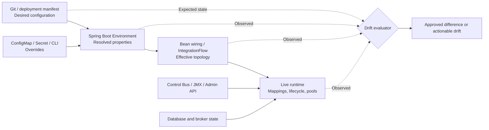
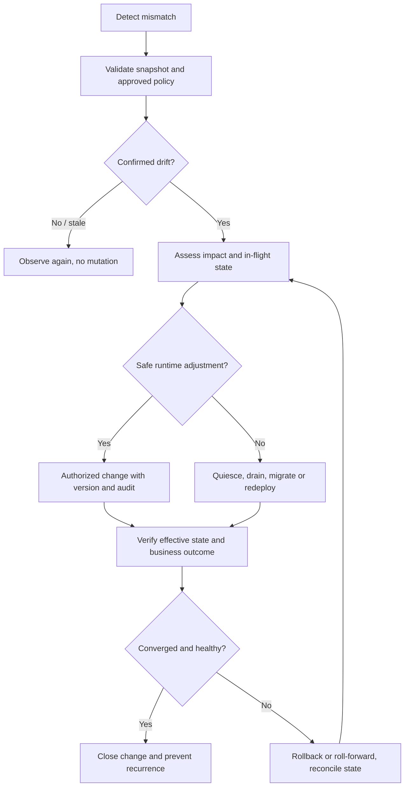

# Configuration drift across environments in Spring Integration runtime

## 1. The problem: same application version, yet flows behave differently

A Spring Integration application runs well in staging yet continuously builds backlog in production, or one pod in production processes messages differently from the rest. Every pod reports the same Git commit and Docker image name. So why do outcomes differ?

Most likely **configuration drift**: the configuration *actually in effect* no longer matches the desired state, or differs beyond permitted tolerances across environments and instances. For example: staging has `maxMessagesPerPoll=20` while production only has `1`; one production pod enables `channelKeyFallback=true`; a dynamic flow was stopped via Control Bus yet still appears in static config lists; or a worker points to a different `region` and stops reading the old backlog.

This is the **"Configuration drift across environments"** lesson in the **Operations** chapter of the **SPRING_INTEGRATION_RUNTIME** module. The module covers message flows through channels, endpoints, consumers, pollers, and executors; `IntegrationFlow` lifecycle management; transactions, retries, message stores, errors, correlation, and runtime state. Therefore, drift here is not merely a differing environment variable: it can alter **message routing, throughput, durability, and correctness**.

After this lesson, you will know how to:

1. Distinguish **intentional differences** across environments from **out-of-policy drift**.
2. Analyze four layers of state: **desired configuration → resolved properties → wired components → live runtime state**.
3. Inspect Spring Boot configuration precedence, profiles, environment variables, and unexpected overrides.
4. Design **secret-free configuration manifests**, fingerprints, policy-based comparisons, and multi-pod drift detection.
5. Use Actuator, Spring Integration graph, metrics, and authorized inspection to verify topology, lifecycle, thread pools, polling, routing, and persistent state.
6. Build a drift remediation runbook with **preflight, canary, drain/reconcile, rollback**, and regression tests.

> **Version scope:** Examples reference Spring Integration **6.5.x**, Spring Boot **3.5.x**, Spring Framework 6.x, and Java 17+. Configuration keys starting with `app.integration.*` in this lesson are **application-defined conventions**, not properties automatically recognized by Spring Integration.

## 2. Defining drift via desired state and actual state

A system may intentionally use different polling intervals in dev and production, or write to separate databases/schemas. Differing values are **not automatically a bug**: only when configuration falls outside allowed rules, diverges across nodes required to be uniform, or violates an approved manifest does it become actionable drift.



### 2.1. Four configuration layers to separate

| Layer | Source and scope | Example drift | Why comparing YAML files alone is insufficient |
| --- | --- | --- | --- |
| **Desired** | Git, GitOps/Helm, approved deployment spec, per-env policy. | Production is approved for 8 workers, yet an old Helm release still specifies 4. | Git represents intent; the cluster may not have deployed the new revision. |
| **Resolved** | Spring `Environment` after applying `PropertySource` precedence, profiles, env vars, system properties, CLI args. | `APP_INTEGRATION_ORDERS_POLL_MAX_MESSAGES=1` overrides the YAML file. | The file holds the right value while runtime loads a different one. |
| **Wired** | Spring beans/`IntegrationFlow`, channel types, endpoint IDs, advice chains, transaction managers. | Same property value, yet a `@Profile` branch in Java config wires an `ExecutorChannel` on one pod. | Values in Environment do not prove beans were wired properly. |
| **Live** | Router mappings, `SmartLifecycle.isRunning()`, `IntegrationFlowContext` registrations, pool sizes, subscribed consumers. | An operator changed a route via Control Bus and forgot to revert it. | Runtime can mutate after context startup without touching Environment. |

There is also **data-coupled state**: JDBC store region/table prefixes, group IDs, metadata markers, schema versions, broker subscriptions/partitions, and retry caches. Drift in these identifiers can strand existing data in the backend where the new flow **cannot find it**, or cause multiple flows to process the same events under mismatched namespaces.

### 2.2. Variance matrix: valid or dangerous?

| Difference | Intentional? | Required check |
| --- | --- | --- |
| Dev uses in-RAM queue, production uses JDBC queue | Potentially valid. | Test durability and transactions separately in a production-like environment; never use dev runs to prove restart survival. |
| Dev polls every 1 second, prod polls every 5 seconds | Potentially valid. | Validate against each environment's SLO, throughput, and expected policy. |
| Production pod A `ordersPoller.isRunning=true`, pod B `false` | Either an incident or approved maintenance. | Check desired replica/role, change window, and pod B ownership. |
| Pod A `routeKey=VIP → channelBlue`, pod B `→ channelGreen` | Could be an intentional canary rollout. | Check rollout generation, traffic split, and convergence deadline. |
| Same JDBC queue yet node A uses region V1, node B uses V2 | Dangerous if both are expected to drain one backlog. | Audit table prefixes, group IDs, migrations, and drain/replay plans. |
| One environment lacks `errorChannel` / recovery policy | Usually dangerous. | Verify error paths, source ack/rollback, DLQs, and alerts. |
| Production worker pool has 16 threads instead of 8 | Do not assume more is better. | Measure CPU, downstream limits, DB pools, and p99 latency. |
| One environment enables debug logs with sensitive payloads | Data and performance risk. | Enforce logging policy, PII scrubbing, and debug TTLs. |

**Principle:** a drift detector evaluates against an **approved baseline with declared exceptions**, rather than comparing every dev value against prod and firing thousands of false positives.

## 3. How does Spring Boot load configuration by precedence?

Spring Boot externalizes configuration via `application.yml`/`application.properties`, profile-specific files, external files outside the JAR, environment variables, JVM system properties, `SPRING_APPLICATION_JSON`, and command-line arguments. Per Spring Boot 3.5 documentation, **configuration sources earlier in the documented precedence list override later ones (i.e., higher-priority sources override lower-priority defaults)**.

Commonly critical operational sources:

| Source | Example | Drift trap |
| --- | --- | --- |
| Config data inside JAR | `application.yml`, `application-prod.yml` | Same image version running with different active profiles. |
| Config data outside JAR | `/config/application.yml`, mounted ConfigMap | ConfigMap/mount updated out-of-band without matching Git commit. |
| OS environment variables | `APP_INTEGRATION_ORDERS_WORKER_POOL_SIZE=8` | One pod retains an old override in Deployment/Secret. |
| JVM system properties | `-Dapp.integration.orders.worker-pool-size=4` | Launch script/Java tool options override config data. |
| `SPRING_APPLICATION_JSON` | JSON passed via env/system/CLI | Easy to miss when scanning only "normal" variable names. |
| Command-line arguments | `--app.integration.orders.poll-max-messages=1` | Higher precedence than regular config data. |
| Spring test overrides | `@DynamicPropertySource`, `@TestPropertySource` | Test behavior diverges from production if override sources are overlooked. |

**Do not oversimplify precedence to "env vars always win".** JVM system properties, command-line arguments, and test property sources can take higher priority depending on context. Check the complete precedence order in the Spring Boot documentation for your exact version.

### 3.1. Example: same YAML, different outcomes

Application-owned configuration file:

```yaml
# application.yml
app:
  integration:
    orders:
      poll-max-messages: 20
      poll-delay: 250ms
      receive-timeout: 0ms
      worker-pool-size: 8
      store-region: ORDERS_PROD_V1
```

On pod A, with no overrides, Spring Boot binds `poll-max-messages=20`. On pod B, the Deployment still carries:

```text
APP_INTEGRATION_ORDERS_POLL_MAX_MESSAGES=1
```

and the effective value on B becomes 1 even though both pods share the exact same `application.yml`. This is an example of **property drift**, which can make the two pollers' throughput diverge sharply.

### 3.2. Profiles and Config Data can also introduce skew

Check:

- `spring.profiles.active`: actual active profile list, order, and profile groups.
- `spring.config.location`: whether it replaced default locations instead of extending via `spring.config.additional-location`.
- `spring.config.import`: imported files/config servers/secret mounts, `optional:` policies, and behavior when a source is absent.
- Multiple YAML/properties files with colliding names/paths, or external files outside the JAR taking precedence over bundled ones.
- Whether properties bound to beans at startup **auto-refresh** when a config source changes. In standard Spring Boot, editing a file/ConfigMap does not automatically rebind running beans; intentional refresh/restart mechanisms are required.

Instead of trusting profile names from a pipeline log, inspect **actual active profiles and property sources** on the running process while avoiding printing secrets.

## 4. Configuration points with major runtime impact

### 4.1. Message channels, dispatchers, and subscriber topology

| Change point | Direct impact | Symptom |
| --- | --- | --- |
| `DirectChannel` ↔ `ExecutorChannel` | Switches from synchronous to async processing, changing transaction/thread boundaries. | Producer send latency drops while handler completion does not necessarily improve. |
| `DirectChannel` ↔ `PublishSubscribeChannel` | Point-to-point becomes fan-out; one event can hit multiple handlers. | Business side effects or outbound calls spike unexpectedly. |
| RAM `QueueChannel` ↔ persistent queue | Changes durability/rollback/serialization and I/O latency. | Post-restart behavior, backlogs, and DB metrics diverge. |
| Executor core/max/queue capacity | Changes concurrency, task queuing, and rejections. | p99 latency, active threads, rejected tasks, and throughput shift. |
| Router mapping/fallback | Changes message destination; can self-loop if unknown keys match channel names. | Traffic hits wrong flow; `getChannelMappings()` diverges from baseline. |
| Channel subscription count | An endpoint may lose its subscriber or alter distribution. | `MessageDispatchingException`, halted flows, or unexpected delivery. |

### 4.2. Pollers, consumers, and lifecycle

A poller with differing `fixedDelay`, `maxMessagesPerPoll`, `receiveTimeout`, or `TaskScheduler` yields completely different throughput and backlogs. Specifically:

- A `PollingConsumer` can pull multiple messages in **one poll cycle**, so `maxMessagesPerPoll=20` does not mean 20 messages/second.
- Raising concurrent consumers does not automatically boost throughput if the DB/API/partition is already saturated; it can worsen lock contention and redeliveries.
- An endpoint bean with `isRunning() == false` **accepts no new work** under normal lifecycle.
- `IntegrationFlowContext` allows registering/stopping/destroying flows after startup; drift in registration IDs cannot be caught from a property list alone.
- `DirectChannel` keeps the current thread while `ExecutorChannel` switches threads: channel-type drift significantly changes transactions and exception handling.

### 4.3. Transactions, retries, and error paths

| Skewed configuration | Possible consequence |
| --- | --- |
| Poller lacks `PlatformTransactionManager` or uses wrong DataSource | `receive()` from JDBC queue commits independently; handler failures fail to restore messages as expected. |
| `RequestHandlerRetryAdvice.maxAttempts` differs across pods | Handler invocation counts, latency, and error amplification diverge. |
| Recovery callback omitted or target changed | Errors propagate/roll back differently or get swallowed causing bad commits/acks. |
| `errorChannel` lacks a consumer, or DLQ binding differs | Failed messages have no reliable recovery path. |
| Idempotency key strategy / metadata region differs | Duplicate events get reprocessed, or new events get misclassified as duplicates. |
| Aggregator correlation/release strategy differs | Groups stall or release twice after cutover. |

**Never measure drift solely by strings like `transactional=true`.** Verify which manager is bound at the **exact layer** (poller vs handler) and whether resources participate in the same transaction; `ExecutorChannel` introduces a thread boundary no single flag captures.

### 4.4. Persistent stores, schemas, and logical identity

With Spring Integration JDBC:

- `JdbcChannelMessageStore` fits channels, whereas `JdbcMessageStore` fits aggregators/claim-checks.
- `tablePrefix` (default `INT_`), `region`, and logical group/channel IDs determine **which records are read**.
- Query providers depend on the RDBMS (PostgreSQL, Oracle, etc.); the wrong provider breaks polls or alters locking behavior.
- DDL/schema versions and serializers must stay compatible with messages written by older releases.
- Some stores since Spring Integration 6.2 validate table existence on startup; **existing tables do not guarantee formats/codecs, indexes, and group states are valid**.

If two production nodes use different regions while operators think they share one queue, old backlog remains stranded in the other region. **Never change `region`/`groupId` arbitrarily to "fix drift"** without inventorying existing records and planning migration/replay.

## 5. Designing per-environment configuration baselines

A good baseline specifies **desired values**, **exception rules**, and **deployment provenance**. Version it alongside source code or infrastructure repositories so every change shows who approved it, when, and in which rollout.

### 5.1. Illustrative manifest example

The YAML below is an **application-team-defined operational manifest**. It is **not** a format automatically read by Spring Boot or Spring Integration to enforce policies. To automate it, build your own parser/validator/control plane.

```yaml
# expected-runtime.yml -- illustrative application-owned policy
service: SPRING_INTEGRATION_RUNTIME
release: 2026.11.1
schemaVersion: 1
environments:
  staging:
    expected:
      orders.pollMaxMessages: 5
      orders.workerPoolSize: 2
      orders.storeRegion: ORDERS_STAGING_V1
      orders.routerFallback: false
  production:
    expected:
      orders.pollMaxMessages: 20
      orders.workerPoolSize: 8
      orders.storeRegion: ORDERS_PROD_V1
      orders.routerFallback: false
    invariantAcrossPods:
      - orders.storeRegion
      - orders.routerFallback
      - orders.errorChannelName
    rolloutExceptions:
      - key: orders.routerMappingVersion
        allowedVersions: [17, 18]
        reason: approved-blue-green-cutover
        expiresAt: "2026-11-23T00:00:00Z"
```

In this example, staging/prod may differ on `pollMaxMessages` and `workerPoolSize`. Yet two production pods must never differ on store region or fallback policy unless covered by an explicit deployment exception. Exceptions **must carry an expiration**, owner/change ID, and closure state; otherwise drift becomes permanently legitimized.

### 5.2. Fields recommended in every snapshot

| Group | Recommended fields | Rationale |
| --- | --- | --- |
| Provenance | `service`, image digest, Git SHA, build version, Spring Integration/Boot versions | Compare against the exact release; image tags can be mutated. |
| Scope | Environment, region/zone, namespace, deployment, pod/node ID | Separate intentional differences from pod drift. |
| Desired version | Config Git commit, Helm release, config generation, change ID | Trace source of truth and rollouts. |
| Resolved config | Allowlisted bound properties and property origin when safe | Compare effective values, not just files. |
| Wired topology | Channel types, endpoint IDs, poller/advice/transaction manager identities | Know what flows were actually constructed. |
| Live mutable state | Running flags, router mappings/generation, dynamic flow IDs, executor pool core/max | Catch post-startup mutations. |
| Persistence identity | Store type, logical region/table prefix/group ID, schema version | Keep alignment with persisted backlog and metadata. |
| Observation | UTC timestamp, observation TTL, config fingerprint, health/backlog | Avoid comparing stale snapshots against live state. |

**Never include secrets directly in comparisons.** Never put JDBC passwords, OAuth tokens, private keys, credential-bearing URLs, or raw payloads into snapshots. For secret rotation, record the **version/revision ID** provided by the secret manager alongside applied status; never log plaintext or arbitrary hashes of secret tokens. Even hashes leak information when input entropy is low.

### 5.3. Impact-based severity classification

Not all drift requires an emergency restart:

- **Critical:** store region/table prefix mismatch when nodes are supposed to share a queue, missing transaction around `receive()`, routing to an unauthorized handler, endpoint failing while still ACKing.
- **High:** error/recovery path differs from baseline, unbounded retries, drastically shrunk pool exploding backlog, missing security policy on control endpoints.
- **Medium:** poll interval/worker count diverges from plan while business invariants still hold; investigate SLOs and change history.
- **Low/info:** intentional approved differences within rollout windows, or temporary metric/log level adjustments.

Severity is an **organizational and workload rule**, not a built-in Spring Integration classification. A `poolSize` change may be Critical for a real-time reconciliation flow yet Medium for an offline batch job.

## 6. Preventing drift at config binding time: typed properties and validation

Use `@ConfigurationProperties` for strongly typed configuration instead of scattering `@Value` defaults across beans. With Spring Boot 3.5 and Java 17, records are a clean fit for **startup-fixed configuration**.

### 6.1. Strongly typed configuration

```java
import java.time.Duration;

import jakarta.validation.constraints.Max;
import jakarta.validation.constraints.Min;
import jakarta.validation.constraints.NotBlank;
import jakarta.validation.constraints.NotNull;
import org.springframework.boot.context.properties.ConfigurationProperties;
import org.springframework.validation.annotation.Validated;

@Validated
@ConfigurationProperties(prefix = "app.integration.orders")
public record OrdersRuntimeProperties(
        @Min(1) @Max(1000) int pollMaxMessages,
        @NotNull Duration pollDelay,
        @NotNull Duration receiveTimeout,
        @Min(1) @Max(128) int workerPoolSize,
        @NotBlank String storeRegion) {
}
```

Register the properties bean and wire it into endpoint configuration:

```java
import org.springframework.boot.context.properties.EnableConfigurationProperties;
import org.springframework.context.annotation.Bean;
import org.springframework.context.annotation.Configuration;
import org.springframework.integration.annotation.EnableIntegration;
import org.springframework.integration.channel.QueueChannel;
import org.springframework.integration.dsl.IntegrationFlow;
import org.springframework.integration.dsl.Pollers;
import org.springframework.messaging.PollableChannel;

@Configuration
@EnableIntegration
@EnableConfigurationProperties(OrdersRuntimeProperties.class)
class OrdersFlowConfiguration {
    @Bean
    PollableChannel ordersInputQueue() {
        return new QueueChannel(500);
    }

    @Bean
    IntegrationFlow ordersWorkerFlow(
            OrdersRuntimeProperties settings,
            OrderProcessor processor) {

        return IntegrationFlow.from("ordersInputQueue")
                .handle(processor, "process",
                        e -> e.id("ordersPollingEndpoint")
                                .poller(Pollers.fixedDelay(settings.pollDelay())
                                        .maxMessagesPerPoll(
                                                settings.pollMaxMessages())
                                        .receiveTimeout(
                                                settings.receiveTimeout()
                                                        .toMillis())))
                .get();
    }
}
```

Assume `OrderProcessor` is an application bean with `public void process(String payload)`. The example uses an **in-RAM** `QueueChannel`, so `storeRegion` is not yet wired to a backing JDBC store; in production, configure the store explicitly and inspect actual identities. Likewise, `workerPoolSize` is not yet applied to a scheduler/executor. **A bound property that is never used has zero effect on runtime.**

To enforce `pollDelay > 0` or bound timeouts, add custom validators/validation rules; `@NotNull Duration` only forbids `null`, not `Duration.ZERO` or negative durations. For constraints to execute, a Bean Validation provider (such as `spring-boot-starter-validation`) must be on the classpath.

**Why does this prevent drift?** Wrong types or out-of-range values fail startup early instead of running with pool size 0 or absurd retry counts. Still, validation **does not prove** every pod shares the same value or that an operator has not altered runtime state post-startup.

### 6.2. Configuration constraints that belong to the same transaction/flow

A flow often couples multiple related properties:

```text
orders.pollMaxMessages       = 20
orders.pollDelay             = 250ms
orders.receiveTimeout        = 0ms
orders.workerPoolSize        = 8
orders.dbPoolSize            = 12
orders.maxHandlerAttempts    = 3
orders.storeRegion           = ORDERS_PROD_V1
orders.errorChannelName      = ordersErrorChannel
```

Here `dbPoolSize` should not be so low that workers starve waiting for connections; `maxHandlerAttempts` and retry backoff must fit the message deadline; `errorChannelName` must resolve to a channel with a consumer. **Cross-field** rules should be checked via custom validators or startup integration tests. Spring Boot property binding alone has no awareness of these business invariants.

### 6.3. Frozen configuration differs from mutable runtime state

In standard Spring Boot, the `OrdersRuntimeProperties` record is created at bind time and **does not automatically update** if someone edits a ConfigMap or YAML file. Conversely, `ThreadPoolTaskExecutor.setCorePoolSize(...)`, `HeaderValueRouter.setChannelMappings(...)`, and `IntegrationFlowRegistration.stop()` mutate **runtime state** without the initial record reflecting it.

Therefore, observe two sources:

1. **Resolved startup config:** effective values when the context initialized.
2. **Observed live state:** values read directly from live beans, not just re-printing the properties record.

Never assume an endpoint automatically refreshes when a property source changes; if your application uses Spring Cloud Config refresh or custom watchers, test exactly **which beans** recreate and **which components** actually transition state.

## 7. Capturing runtime state without leaking sensitive data

A custom health or diagnostic endpoint can expose a **minimal snapshot** of critical fields. Read values directly from live beans—never expose the entire `Environment` or all bean definitions to the Internet.

### 7.1. Java example: comparing resolved properties against live router/pool state

Assume the application defines an `ordersRouter` bean of type `HeaderValueRouter` and `ordersWorkerExecutor` of type `ThreadPoolTaskExecutor`. This is an **application-owned diagnostic service**, not an auto-generated actuator endpoint:

```java
import java.time.Instant;
import java.util.Map;

import org.springframework.beans.factory.annotation.Qualifier;
import org.springframework.integration.router.HeaderValueRouter;
import org.springframework.scheduling.concurrent.ThreadPoolTaskExecutor;
import org.springframework.stereotype.Component;

record OrdersRuntimeSnapshot(
        Instant observedAt,
        int configuredWorkerPoolSize,
        int actualCorePoolSize,
        int actualMaxPoolSize,
        int activeWorkers,
        String configuredStoreRegion,
        Map<String, String> actualRouterMappings) {
}

@Component
final class OrdersRuntimeSnapshotService {
    private final OrdersRuntimeProperties settings;
    private final HeaderValueRouter router;
    private final ThreadPoolTaskExecutor executor;

    OrdersRuntimeSnapshotService(
            OrdersRuntimeProperties settings,
            @Qualifier("ordersRouter") HeaderValueRouter router,
            @Qualifier("ordersWorkerExecutor") ThreadPoolTaskExecutor executor) {
        this.settings = settings;
        this.router = router;
        this.executor = executor;
    }

    OrdersRuntimeSnapshot collect() {
        return new OrdersRuntimeSnapshot(
                Instant.now(),
                settings.workerPoolSize(),
                executor.getCorePoolSize(),
                executor.getMaxPoolSize(),
                executor.getActiveCount(),
                settings.storeRegion(),
                Map.copyOf(router.getChannelMappings()));
    }
}
```

**Limitations of this snapshot:**

- `actualCorePoolSize` and `actualMaxPoolSize` are live executor configuration, whereas `activeWorkers` is a **point-in-time load value**; never compare `activeWorkers` for equality across two pods to flag drift.
- `configuredStoreRegion` only reflects the **bound value**, **not proof** that the actual `JdbcChannelMessageStore` uses that region. To verify, inject the real store and read `getRegion()`, adding appropriate backing resource identity checks.
- Route names can be sensitive because they reveal topology; return snapshots only on authenticated, authorized management endpoints.
- Never compare snapshots taken **far apart in time** and blame every difference on drift.
- These examples are standalone illustrative classes; declare the router/executor beans and `OrderProcessor` in your real application to compile a full configuration.

### 7.2. Values that should not be fingerprinted as configuration

| Value | Why not compare equality across pods |
| --- | --- |
| `activeCount` / thread ID | Varies with traffic and scheduling. |
| Queue depth, in-flight tasks | Pods carry differing loads; not config drift. |
| Estimated age of oldest message | Operational/backlog characteristic; use alert thresholds rather than equality. |
| HTTP/database latency | Needs SLO/benchmarks, not a static expected value. |
| Dynamic correlation ID, message ID | Unique per event; not component config. |
| Passwords/tokens/secrets | Sensitive; never output raw into snapshots or fingerprint logs. |

Conversely, `channel type`, `route policy`, `store region`, `poll max`, `pool core/max`, and `registered flow IDs` usually belong in baseline comparisons, bearing in mind that **registered flow IDs** may legitimately differ during tenant scaling or blue–green rollouts.

## 8. Inspection tools: Environment, Actuator, Integration Graph, and JMX

A strong dashboard combines **loaded configuration** with **runtime topology** and **behavioral metrics**. No single endpoint proves everything matches desired state.

### 8.1. Spring Boot Actuator inspection points

Depending on dependencies, exposure, and security settings, Actuator can provide:

| Common endpoint | Useful for seeing | Limitation |
| --- | --- | --- |
| `/actuator/env` | Property values from Spring `Environment` and their property sources/origins when metadata exists. | Does not guarantee beans applied the properties; sensitive data must be sanitized. |
| `/actuator/configprops` | Bound `@ConfigurationProperties` values. | Shows config beans/records only; live executors/routers may still have mutated since startup. |
| `/actuator/beans` | Initialized beans, types, and dependencies. | Does not show all attributes or live flow state. |
| `/actuator/conditions` | Why auto-configuration/conditional beans matched or did not. | Does not replace business flow testing. |
| `/actuator/integrationgraph` | Graph of Spring Integration components and links described by the framework. | May omit semantic config, transactions, or store data state. |
| `/actuator/health` | Aggregate/component health per declared indicators. | `UP` does not guarantee zero drift or uncongested queues. |
| `/actuator/metrics` | Per-channel, handler, queue, and resource metrics when instrumented. | Metrics describe behavior/load; not a manifest checksum. |
| `/actuator/flyway` / `liquibase` | Applied database migrations if corresponding modules are present. | DB version does not prove serializer/semantic state compatibility. |

**Security:** `env`, `configprops`, `beans`, and `integrationgraph` expose internal structure; Actuator does not expose all of them over HTTP by default. Spring Boot 3.5 **sanitizes/masks** many values in `env` and `configprops`; never enable `show-values=always` just to debug production. Keep endpoints inside management networks, enforce authentication/authorization, TLS, auditing, and expose only what is truly needed. Sanitized values like `******` **cannot be used to conclude two secrets are identical**.

Spring Integration can also expose a separate `IntegrationGraphController` with URLs like `/integration`; it is **not the same** as Boot Actuator's `/actuator/integrationgraph`. Security and enablement for each controller must be inventoried separately.

### 8.2. Observing Spring Integration state

Read from live component/management APIs:

- **Router:** `AbstractMappingMessageRouter.getChannelMappings()`; distinguish static intended mappings from mappings mutated via Control Bus/JMX.
- **Lifecycle:** `SmartLifecycle.isRunning()` on endpoints/channel adapters/pollers; a component present in the graph is not necessarily running.
- **Dynamic flows:** `IntegrationFlowContext.getRegistry()` and `getRegistrationById(id)` within **the current JVM**; registrations on other pods do not appear automatically.
- **Executor:** core/max pool, active count, executor task queue, rejections; note `maxPoolSize` is not the active thread count.
- **Poller:** trigger type, interval, `maxMessagesPerPoll`, receive timeout, advice chain; fields lack uniform public getters, so expose an application diagnostics adapter from config.
- **Persistent stores:** `JdbcChannelMessageStore.getRegion()` and configured prefix/schema; cross-check actual database/table/group keys instead of trusting bound-but-unused config.
- **Errors/retries:** error channel name, recovery handler, retry/backoff policy, source ack/transaction; inspect topology and test rather than checking a single Boolean.

**Operational tip:** maintain an application **component inventory** with stable endpoint IDs. Avoid randomly generated IDs on endpoints tracked for drift, because two semantically identical flows would produce different names and trigger false positives.

### 8.3. Comparing configuration and behavior side by side

Suppose a pod reports `pollMaxMessages=20` matching baseline yet processes only 1 message every several seconds. Do not declare "no drift" and stop investigating. Possibilities include:

1. The poller is not running or uses another congested `TaskScheduler`.
2. The source/queue is empty or messages sit under a different region/group ID.
3. Handlers fail repeatedly, rolling back transactions and redelivering the same message.
4. DB connection pools/locks throttle handler throughput.
5. `maxMessagesPerPoll` is an **upper bound per poll**, not a guarantee of at least 20 messages.

In such cases, config may match desired state while **runtime health/SLO** still fails. Drift detection does not replace functional monitoring.

## 9. Automated drift detection: normalized, versioned comparison

A drift evaluator takes two inputs:

1. **Expected snapshot:** approved baseline for the exact service, environment, release, and config generation.
2. **Observed snapshot:** timestamped data from the **exact instance**, containing only comparable allowlisted fields and provenance.

### 9.1. Normalize before comparing

Two values can be semantically identical while formatted differently:

| Value A | Value B | Can normalize to |
| --- | --- | --- |
| `PT0.25S` | `250ms` | `250 ms` in canonical units. |
| `false` | `FALSE` | Boolean `false`. |
| `4` | `04` | Integer 4 if key is numeric; **never** do this for string IDs. |
| Route map with different key order | Route map with same key/value pairs | Sort keys deterministically. |
| `ordersErrorChannel` | `ordersErrorChannel` | Exact string match; bean IDs. |
| `ORDERS_PROD_V1` | `orders_prod_v1` | **Never** auto-lowercase; regions/keys are often case-sensitive. |

Prefer **typed bound config** when comparing `Duration`, `int`, and `boolean` values rather than fragile guessing regexes. Identifiers such as tenants, group IDs, regions, channels, and schema versions must compare strictly per contract, never arbitrarily normalized.

### 9.2. Java example: exact diff on allowlisted keys

The code below **reads no secrets** and has no Spring dependency; it illustrates the core of a drift evaluator. Keys are predefined by the application:

```java
import java.util.ArrayList;
import java.util.List;
import java.util.Map;
import java.util.Objects;
import java.util.Set;
import java.util.TreeSet;

record Drift(String key, String desired, String observed) {}

final class ConfigDriftDetector {
    static List<Drift> compare(
            Map<String, String> desired,
            Map<String, String> observed,
            Set<String> allowedToDiffer) {

        TreeSet<String> allKeys = new TreeSet<>(desired.keySet());
        allKeys.addAll(observed.keySet());

        List<Drift> differences = new ArrayList<>();
        for (String key : allKeys) {
            if (allowedToDiffer.contains(key)) {
                continue;
            }

            String expectedValue = desired.get(key);
            String actualValue = observed.get(key);
            if (!Objects.equals(expectedValue, actualValue)) {
                differences.add(
                        new Drift(key, expectedValue, actualValue));
            }
        }
        return List.copyOf(differences);
    }
}
```

Usage:

```java
import java.util.Map;
import java.util.Set;

Map<String, String> desired = Map.of(
        "orders.pollMaxMessages", "20",
        "orders.storeRegion", "ORDERS_PROD_V1",
        "orders.routerFallback", "false");

Map<String, String> podB = Map.of(
        "orders.pollMaxMessages", "1",
        "orders.storeRegion", "ORDERS_PROD_V1",
        "orders.routerFallback", "false");

var drift = ConfigDriftDetector.compare(desired, podB, Set.of());
// One difference: orders.pollMaxMessages (desired=20, observed=1).
```

**A missing key differs from a null value:** the example uses `Map.get`, so null blurs both cases. In production, retain explicit **MISSING/UNAVAILABLE/REDACTED** states so an absent property is never confused with a valid null or a collection error. If a snapshot expires or an API returns 403, report **unobservable**, never conclude the pod has zero drift.

### 9.3. Fingerprints for fast comparison, diffs for explanation

You can compute a fingerprint from **allowlisted, normalized** key/value pairs sorted deterministically and hashed with SHA-256. However, a fingerprint alone only says **same or different** for the selected fields—it does not explain why.

```text
orders.pollMaxMessages=20
orders.routerFallback=false
orders.storeRegion=ORDERS_PROD_V1
```

In the control plane, store:

```text
service=SPRING_INTEGRATION_RUNTIME
environment=production
deploymentId=orders-worker
configGeneration=18
snapshotAt=2026-11-22T02:00:00Z
fingerprintSha256=<hex digest of canonical non-secret fields>
```

In a distributed system, never compare two fingerprints belonging to **two different approved generations during a rollout window** and immediately treat it as an incident. First check each node's desired config generation, then wait for convergence within the rollout SLA.

### 9.4. Multi-node drift and measurement consistency

Suppose three pods A/B/C:

| Pod | Image digest | Desired config gen | Applied gen | VIP route | Status |
| --- | --- | ---: | ---: | --- | --- |
| A | sha256:abc… | 18 | 18 | Green | Compliant. |
| B | sha256:abc… | 18 | 17 | Blue | Awaiting rollout or drifted. |
| C | sha256:abc… | 18 | 18 | Green | Compliant. |

If the change window is still open and B is actively draining, its state may be `ROLLING_OUT`. Once past the deadline or if B never received the new generation, raise `CONFIG_DRIFT`. **Mutating mappings on pod A does not update B/C**: Java objects and Spring ApplicationContexts are process-local.

With a custom control plane, persist desired generation in durable storage, let each pod apply and ACK, and compare observed generation. Accept **eventual consistency** when design permits; if strict simultaneous cutover is required, **quiesce ingress/apply a barrier** before switching.

### 9.5. When to fail fast

When missing/invalid config breaks correctness (missing transaction manager, violated immutable store region, negative timeout, route to a forbidden internal channel), you can:

- Fail component/application startup via Bean Validation or an explicit `SmartLifecycle` startup check.
- Set readiness to `DOWN/OUT_OF_SERVICE` so load balancers/brokers withhold new traffic.
- Keep the instance alive in diagnostic mode **only if** its state will not misprocess data and reads remain safely secured.

Never fail the whole application because `activeWorkers` differs from another pod: that is **load**, not config. Likewise, a stale `ConfigMap` should not blindly force-restart every pod if doing so drops in-flight jobs; follow a drain-aware rollout policy.

## 10. Diagnosing drift from runtime symptoms

Do not start with "change YAML to match staging". First identify **which layer drifted** and **the consequences of changing it**.

### 10.1. Investigation order

1. **Identify the incident:** service, environment, namespace, pod, image digest, Git commit, start time, and affected business flows.
2. **Compare desired generation:** which config/Helm chart is approved; is a rollout or exception currently active?
3. **Read resolved values:** active profiles, property sources, and allowlisted keys from `env`/`configprops` or internal diagnostics; never expose secrets.
4. **Inspect wired topology:** channel types, subscribed endpoints, pollers/source adapters, advice chains, error channels, transaction managers, and graph.
5. **Inspect live mutable state:** `isRunning()`, dynamic flow registry, router mappings, executor core/max, and changes applied via Control Bus.
6. **Check persistence:** logical queue IDs, store region/table prefixes, metadata keys, JDBC schema, serializers, and broker consumer groups.
7. **Correlate behavioral signals:** backlog, oldest message age, committed throughput, retries/rollbacks, p95/p99, and active threads; distinguish drift from infra faults.
8. **Determine blast radius:** single pod, single tenant, single route, or whole fleet? Are there in-flight messages/transactions to protect?
9. **Choose layer-appropriate remediation:** config redeploy, audited runtime operation, or data migration.

### 10.2. Symptom-and-check reference table

| Symptom | Likely drift | Decisive check |
| --- | --- | --- |
| Pod A processes slower than B despite idle CPU | `maxMessagesPerPoll`, poll delay, stopped endpoint, scheduler pool. | Resolved config + live poller state + polls/sec. |
| One pod sends VIP to Blue, another to Green | Out-of-sync router mapping update. | `getChannelMappings()`, applied generation, audit change ID. |
| Queue looks "empty" after restart while DB still holds rows | Region/group ID/table prefix/channel name changed. | Compare logical identity; read-only query by region. |
| Partial aggregator groups never finish | Differing correlation/release strategy or serializer. | Group state, message IDs, completion markers, shared locks. |
| Duplicate business effects after rollout | Dedupe key/metadata region changed or differing retry policy. | Business IDs, metadata state, transaction/rollback audit. |
| Handler fails only in production | Differing error/recovery/advice, classpath, or downstream endpoint. | Bean graph/advice, root cause, resolved downstream config. |
| Fast `send()`, low business completions | Channel switched to async, or deep executor queue. | Channel type, task queue, commits/s, handler latency. |
| Pod has no subscribers | Conditional bean/profile/feature flag differs or flow destroyed. | `conditions`, `beans`, flow registry, and `isRunning()`. |
| Adding workers lowers throughput | DB pool/lock contention, retries, or heavier contention. | Active workers, DB waits, connection wait time, rollback counts. |
| Startup fails after deploy | Wrong DDL/table prefix, validation failure, profile wires different bean. | Startup exception, migration history, config source origin. |
| Identical `/actuator/env`, different routing | Runtime mapping mutated post-startup. | Direct router mapping check per process. |

### 10.3. Using metrics to separate drift from load

Spring Integration/Micrometer can emit send/receive counters, handler timers, queue-size gauges, and observations/tracing when instrumented. These describe **behavior**, not root cause directly:

| Same config? | Same load? | Behavior differs? | Initial interpretation |
| --- | --- | --- | --- |
| Yes | No | Yes | Likely load skew/hot partition key. |
| No | Yes | Yes | Strong drift suspect; still verify causality. |
| No | No | Yes | Could be both drift and load; compare equivalent workloads. |
| Yes | Yes | Yes | Inspect dependencies, network, DB locks, JVM/GC, and input data. |
| No | Yes | No | Drift may be "hidden"; still fix if it violates invariants/security. |

For instance, two pods both having `maxMessagesPerPoll=20` while pod A handles 80% of a hot tenant's traffic and pod B handles 20%: pod A's growing backlog is not proof of drift. Conversely, identical image digests do not prove identical OS environments, startup arguments, or queue regions.

### 10.4. Options when running on Kubernetes

Use read-only commands to compare Deployment templates, ConfigMap revisions, image digests, and pod status against GitOps state, then verify **effective Spring Boot properties** inside the process:

```bash
# Illustrative; run only on namespaces you are authorized to access.
kubectl -n orders-prod get deployment orders-worker -o yaml
kubectl -n orders-prod get pods -l app=orders-worker
kubectl -n orders-prod describe deployment orders-worker
```

**Security note:** manifests may hold sensitive env variables or secret references; never paste raw outputs into public tickets/logs. These commands do not prove JVM router mappings were not altered post-startup. Any command querying containers directly must likewise avoid bare credentials and follow organizational policy.

## 11. Safe drift remediation runbook

A sound drift detector never blindly mutates every mismatch without knowing in-flight message state. Changing a poller, router, or store mid-flight can **lose or duplicate messages** when transactions/backlogs exist.



### 11.1. Phase 1 — Confirm and lock the source of truth

Verify the snapshot is fresh, the manifest matches the target environment, and any rollout window has ended or allows intervention. Record the incident/change ID, owner, desired/observed versions, drifted layer, affected pods/tenants, backlog, in-flight work, retries, unreleased groups, and rollback plan.

Never record plaintext secrets. If a pod differs due to an approved canary, classify it as `ROLLING_OUT` rather than forcing it back to the old version.

### 11.2. Phase 2 — Remediate at the right layer

| Drift type | Preferred fix | What to avoid |
| --- | --- | --- |
| Resolved property wrong due to env/CLI/profile | Fix **declarative deployment source**, controlled rollout. | Editing YAML inside a container expecting it to survive redeploy. |
| Bean wiring wrong due to conditional/profile | Fix config/flag and run tested restart/rollout. | Changing a property without rebuilding the affected bean. |
| Router mappings drifted | Reapply approved mappings via authorized service with change ID and expectedVersion. | Issuing multiple per-key updates that leave intermediate states. |
| Endpoint stopped unexpectedly | Inspect root cause and queue/transactions; start per runbook. | Restarting infinitely while DB/downstream remains down. |
| Dynamic flow missing | Register exact flow ID/version and verify input route. | Registering duplicate IDs or destroying V1 while still in-flight. |
| Executor pool altered | Check current core/max and downstream quotas; reapply within safe range. | Raising threads indefinitely and worsening contention. |
| Store region/group/table prefix drifted | **Quiesce + inventory data**, review migration and config. | Changing region "to match" and abandoning backlog in the old region. |
| Metadata key strategy drift | Dual-read/migrate markers, verify dedup/inbox and idempotency. | Wiping all metadata and replaying blindly. |
| Retry/recovery/transaction policy wrong | Update flow/bean with failure/rollback tests. | Testing happy paths only or enabling unbounded retries. |

In 6.5, `AbstractMappingMessageRouter.setChannelMappings(Map)` replaces the whole mapping table atomically on **one router instance**; it is not atomic across multiple JVMs. Every runtime control path (JMX, Control Bus, Admin API) requires authentication, authorization, and auditing.

### 11.3. Phase 3 — Quiesce/drain when state exists

1. Pause **new ingress** at a controlled point, or divert into another durable buffer.
2. Let consumers advance to a verifiable checkpoint; inspect queues, delayed messages, aggregator partial groups, and executor tasks.
3. Confirm `receive + handler` transactions committed/rolled back, not just `isRunning() == false`.
4. Record baseline row counts, business IDs, schema/region/group, and recovery/DLQ counts; back up when needed.
5. Apply the tested rollout/migration; resume with a canary and watch for duplicate effects and stale backlog.
6. Reopen full traffic only after observed state, business outcomes, and SLOs pass.

**An empty `QueueChannel` does not prove draining finished.** Aggregators may hold partial groups, delayers hold messages, brokers have redeliveries, gateways await replies, and external APIs may have executed side effects whose responses the caller has not received.

### 11.4. Phase 4 — Verify and close the incident

After the change, verify **both configuration and outcomes**:

- Desired generation == applied generation across all pods required to converge.
- Resolved properties match baseline; wired bean types, endpoint IDs, and channel graph are correct.
- Router mappings, flow registry, `isRunning()`, executor core/max, and live pollers match policy.
- Persistent store region/group and serializers are right; old backlog has active consumers.
- Business events commit/ack cleanly, and retries/rollbacks and duplicate effects return to acceptable levels.
- Queue depth/oldest age, p95/p99, throughput, and post-cutover audit trails are healthy.

If checks fail, perform a **conditional rollback or roll-forward**. Reverting routes to V1 does not undo V2 side effects already committed. Rolling back code when the store already holds new-schema payloads can fail deserialization. Whenever config drift caused data inconsistency, reconcile state from evidence instead of forcing old configuration onto incompatible data.

## 12. Preventing drift recurrence with tests and deployment gates

Drift is not just an incident to patch post-deploy. Much of it can be prevented via **CI, staging, canaries, and startup validation**, followed by checks **after runtime mutations**.

### 12.1. Testing binding and validation before creating IntegrationFlow

Use Spring Boot Test's `ApplicationContextRunner` to validate types, bounds, and profiles without starting full inbound adapters. This tests the `OrdersRuntimeProperties` record from section 6:

```java
import org.junit.jupiter.api.Test;
import org.springframework.boot.context.properties.EnableConfigurationProperties;
import org.springframework.boot.test.context.runner.ApplicationContextRunner;
import org.springframework.context.annotation.Configuration;

import static org.junit.jupiter.api.Assertions.*;

class OrdersRuntimePropertiesTest {

    @Configuration(proxyBeanMethods = false)
    @EnableConfigurationProperties(OrdersRuntimeProperties.class)
    static class PropertiesOnlyConfiguration {
    }

    private final ApplicationContextRunner runner =
            new ApplicationContextRunner()
                    .withUserConfiguration(PropertiesOnlyConfiguration.class);

    @Test
    void bindsApprovedValues() {
        runner.withPropertyValues(
                "app.integration.orders.poll-max-messages=20",
                "app.integration.orders.poll-delay=250ms",
                "app.integration.orders.receive-timeout=0ms",
                "app.integration.orders.worker-pool-size=8",
                "app.integration.orders.store-region=ORDERS_PROD_V1"
        ).run(context -> {
            assertNull(context.getStartupFailure());
            var props = context.getBean(OrdersRuntimeProperties.class);
            assertEquals(20, props.pollMaxMessages());
            assertEquals(8, props.workerPoolSize());
            assertEquals("ORDERS_PROD_V1", props.storeRegion());
        });
    }

    @Test
    void rejectsInvalidConsumerLimit() {
        runner.withPropertyValues(
                "app.integration.orders.poll-max-messages=0",
                "app.integration.orders.poll-delay=250ms",
                "app.integration.orders.receive-timeout=0ms",
                "app.integration.orders.worker-pool-size=8",
                "app.integration.orders.store-region=ORDERS_PROD_V1"
        ).run(context ->
                assertNotNull(context.getStartupFailure()));
    }
}
```

The second test requires a Bean Validation provider on the test classpath for `@Min(1)` to enforce. If absent, assert startup failure (or test results) explicitly rather than assuming constraints were applied. Also test **cross-field constraints** like `pollDelay > 0` and coherent pool sizes and timeouts, not just single-field validity.

### 12.2. Testing the drift evaluator against a concrete baseline

```java
import java.util.Map;
import java.util.Set;
import org.junit.jupiter.api.Test;

import static org.junit.jupiter.api.Assertions.*;

class ConfigDriftDetectorTest {
    @Test
    void detectsUnexpectedPollLimitButAllowsIntentionalDifference() {
        Map<String, String> expected = Map.of(
                "orders.pollMaxMessages", "20",
                "orders.storeRegion", "ORDERS_PROD_V1",
                "orders.workerPoolSize", "8");

        Map<String, String> observed = Map.of(
                "orders.pollMaxMessages", "1",
                "orders.storeRegion", "ORDERS_PROD_V1",
                "orders.workerPoolSize", "4");

        var diffs = ConfigDriftDetector.compare(
                expected, observed, Set.of("orders.workerPoolSize"));
        assertEquals(1, diffs.size());
        assertEquals("orders.pollMaxMessages", diffs.get(0).key());
    }
}
```

In production, the `workerPoolSize` exception in the example must not be a permanent whitelist: it needs scope, an owner, an expiration time, and a reason. This comparator only demonstrates the **diff calculation**, not policy authorization or expiration checks.

### 12.3. Integration tests must verify beans are wired correctly

Testing property binding does not prove flows actually use those values. A startup test suite should:

1. Load configuration under production-like profiles, relevant `@ConditionalOnProperty`/`@Profile` conditions, and fake external resources.
2. Verify channel types, stable endpoint IDs, and expected subscribers/consumers.
3. For pollers, use `@SpringIntegrationTest(noAutoStartup=...)` with `MockIntegrationContext` to substitute triggers/sources, proving messages are pulled within configured bounds.
4. For routers, send messages through real channels; verify expected routing and disabled fallback for untrusted inputs.
5. For retries/transactions, inject exceptions and assert business commits/rollbacks, not just handler invocation counts.
6. For JDBC stores, run restart tests against a production-like schema/region database, verifying no pending messages or metadata are lost.

If multiple deployment profiles exist, run tests **for every supported profile**. A green dev context does not prove the production profile wires the right flow.

### 12.4. Post-deployment canary verification

After deploy, evaluate a snapshot from each pod:

| Gate | Pass criterion |
| --- | --- |
| Provenance | Image digest/release and approved config generation match the plan. |
| Resolved config | No unexpected property overrides; values pass validation. |
| Wired runtime | Channel/endpoint types, advice chains, transaction managers, and error channels match. |
| Live state | Desired router mappings, flow registrations, `isRunning()`, and executor bounds match. |
| Persistence | Region/table prefix/group ID, serializers, and schema match the backlog. |
| Business outcome | Canary events succeed; idempotency/rollbacks and error recovery behave properly. |
| Performance | Throughput, backlog growth, p95/p99, and retries/rollbacks stay within limits. |
| Fleet convergence | All nodes required to sync ACKed the target generation before deadline. |

**The final gate cannot be reduced to "Deployment available".** Having enough healthy pods while one pod holds an old mutable router mapping is still drift impacting business flows.

### 12.5. When to auto-remediate vs when to alert only

Auto-remediation can apply to properties that are **safe, idempotent, reversible**, and pre-approved—such as resetting a temporary log level or stateless flow mapping inside a managed window. Guardrails required:

- Control actions enforce authentication/authorization, allowlists, expected generation, and change IDs.
- Auditing and postcondition verification exist, beyond merely checking HTTP 2xx.
- Retries are idempotent; timeouts can happen **after a command already executed**.
- Operations affecting persistent state/transactions/replay (store regions, schema migrations, destroying dynamic flows) require runbooks and usually human oversight.
- Never let an auto-reconciler "fight" a canary rollout by toggling mappings back and forth continuously.

## 13. Typical scenario: one pod silently processes fewer messages

### 13.1. Context

An order processing service runs three pods in one production deployment. Approved manifest:

```text
image digest             = sha256:abc...
config generation        = 18
poll max messages        = 20
poll delay               = 250ms
store region             = ORDERS_PROD_V1
worker pool              = 8
route VIP                = ordersGreen
```

Pods A and C resolve `poll-max-messages=20`. Pod B still has an environment variable left over from an earlier hotfix:

```text
APP_INTEGRATION_ORDERS_POLL_MAX_MESSAGES=1
```

All three pods share the exact same image digest and Git SHA. Over the same window, backlog in the slice handled by pod B rises with no obvious exceptions. This is a classic **property drift** from an override source, though load and topology must still be checked before concluding it is the sole cause.

### 13.2. Evidence-based investigation

1. Compare desired generation 18 against resolved properties and property origins on each pod (without exposing sensitive keys).
2. On B, confirm Environment/property binding yielded `pollMaxMessages=1`, versus baseline 20.
3. Verify `ordersPollingEndpoint` on B actually uses the bound value and is running; if the endpoint was stopped via a control operation, that is **a separate drift**.
4. Compare poll cycles/s, message receives/s, handler completions/s, and oldest backlog age; normalize by traffic and partitions/queues owned per pod.
5. Verify `storeRegion` and transaction managers match across pods so fixing it does not point consumers at different data.
6. Trace the hotfix audit/incident that introduced the env var; find the authoritative deployment source carrying the override.

### 13.3. Fix and verification

Update the deployment manifest/GitOps config to remove the unapproved override instead of hot-patching inside the container. Roll out via rolling/canary deployment with readiness and in-flight handling. For polling endpoints backed by durable stores, ensure open transactions commit/roll back before pod stop; for in-RAM queues, drain/hand off to avoid losing backlog.

Post-rollout:

- Resolved `pollMaxMessages=20` across A/B/C; applied generation 18 with no out-of-policy overrides.
- Each polling endpoint started on the right backing queue/region, with older messages still drainable.
- Business commits/s and backlog age improve as expected, not merely `receive()` counts rising.
- Retries, DB lock waits, or downstream rate limits do not spike past thresholds once the poller pulls more messages per cycle.
- Incident audit records root cause, fix, and checks. CI adds a gate rejecting stray env-var overrides absent from the manifest.

**Lesson:** identical images do not guarantee identical configs; identical resolved properties do not guarantee identical live runtime state; fixing a property does not automatically mean backlog and business outcomes have recovered.

## 14. Hands-on exercises and self-check questions

**Exercise 1 — Classifying differences:** create dev/staging/prod baselines with intentionally different poll intervals, worker counts, and store regions. Write a rule detecting when a production pod has `routerFallback=true` or a region differing from sibling pods.

**Exercise 2 — Property precedence:** set `poll-max-messages=20` in `application.yml`, then override it via an OS env var or command line in a test. Read the bound value and identify the winning property source.

**Exercise 3 — Bean validation:** run `OrdersRuntimePropertiesTest`; add constraints for `pollDelay > 0`, `receiveTimeout >= 0`, and worker pool limits. Verify startup fails on invalid values.

**Exercise 4 — Snapshots:** add `OrdersRuntimeSnapshotService` to an app with a real `HeaderValueRouter` and executor; capture resolved properties, mappings, and pool core/max. Mutate the mapping at runtime and verify the live snapshot diverges from baseline even while bound config stays unchanged.

**Exercise 5 — Dynamic flows:** register two per-tenant IntegrationFlows, then stop one via an authorized management API. Prove the property list stays unchanged while `IntegrationFlowContext.getRegistry()` and `isRunning()` reflect the change.

**Exercise 6 — Drift on a JDBC store:** configure a durable queue with region `ORDERS_PROD_V1`, send messages, then restart the app with region V2. Observe backlog stranded in V1; design a safe recovery procedure instead of dropping tables.

**Exercise 7 — Retries/transactions:** use two test contexts, one wrapping `receive()` in a transaction and one without. Inject a failure after a DB write and compare rollback/redelivery. Explain why two contexts with similar YAML wire different advice.

**Exercise 8 — Multi-pod rollout:** simulate A/B/C with desired generation 18 and applied generations 18/17/18. Design timeouts and `ROLLING_OUT → DRIFT_CONFIRMED` transitions, ensuring no reconciler tries to roll back a valid canary.

**Exercise 9 — Security:** grant runtime snapshot and Control Bus access only to admin/automation roles. Verify viewers cannot mutate mappings and responses never expose secrets or full environment variables.

**Exercise 10 — Incident drill:** reproduce pod B's scenario from section 13, completing the timeline of investigation → evidence → deployment fix → post-verification. Build a checklist covering message loss/duplication, retries, backlog, and auditing.

### Self-check questions

1. Why are differing staging and production configs not necessarily drift?
2. How do the four layers—desired, resolved, wired, and live—differ?
3. Why can an OS environment variable make behavior diverge from `application.yml` even with the exact same image?
4. What do `/actuator/env` and `/actuator/configprops` prove and fail to prove?
5. Why must you read `getChannelMappings()` to know whether a router was modified at runtime?
6. What happens if a store region changes across restarts while unprocessed messages remain?
7. Why should `activeWorkers` or queue depth not be compared across pods as a static fingerprint?
8. When are two pods allowed to hold different config generations during a rolling deployment?
9. Why does calling `stop()` or `destroy()` not prove in-flight messages finished?
10. Why does fixing a transaction manager mismatch require testing rollbacks, not only happy paths?
11. When can drift be reconciled automatically, and when must you use a quiesce/migration runbook?
12. How do you prove an incident is resolved without relying solely on a config checksum?

## 15. Official references

- Spring Boot **3.5** — [Externalized Configuration](https://docs.spring.io/spring-boot/3.5/reference/features/external-config.html): property sources, precedence, profiles, config data, environment variables, command-line overrides.
- Spring Boot **3.5** — [Actuator Endpoints](https://docs.spring.io/spring-boot/3.5/reference/actuator/endpoints.html): `env`, `configprops`, `beans`, `conditions`, `integrationgraph`, endpoint exposure, and sanitization.
- Spring Boot **3.5** — [Configuration Properties](https://docs.spring.io/spring-boot/3.5/reference/features/external-config.html#features.external-config.typesafe-configuration-properties): `@ConfigurationProperties`, relaxed binding, and validation.
- Spring Integration **6.5** — [Message Channel Implementations](https://docs.spring.io/spring-integration/reference/6.5/channel/implementations.html): channel dispatch, threading, and queue semantics.
- Spring Integration **6.5** — [Message Endpoints](https://docs.spring.io/spring-integration/reference/6.5/endpoint.html): polling consumers, maxMessagesPerPoll, and transaction boundaries.
- Spring Integration **6.5** — [Dynamic Routers](https://docs.spring.io/spring-integration/reference/6.5/router/dynamic-routers.html): runtime router mappings and `setChannelMappings(Map)`.
- Spring Integration **6.5** — [Dynamic and Runtime Integration Flows](https://docs.spring.io/spring-integration/reference/6.5/dsl/java-runtime-flows.html): `IntegrationFlowContext`, registration, and lifecycle.
- Spring Integration **6.5** — [JDBC Message Store](https://docs.spring.io/spring-integration/reference/6.5/jdbc/message-store.html), [JDBC Metadata Store](https://docs.spring.io/spring-integration/reference/6.5/jdbc/metadata-store.html): region, table prefix, schema, and transactional persistence.
- Spring Integration **6.5** — [Metrics and Management](https://docs.spring.io/spring-integration/reference/6.5/metrics.html), [Transaction Support](https://docs.spring.io/spring-integration/reference/6.5/transactions.html): observability and transaction semantics.
- Spring Integration **6.5** — [Control Bus](https://docs.spring.io/spring-integration/reference/6.5/control-bus.html): controlling managed components at runtime.

**Conclusion:** Configuration drift in Spring Integration must be evaluated from the **approved manifest all the way to actual message processing outcomes**, never stopping at YAML files or image tags. A resilient design requires validated typed config, secret-free runtime snapshots, versioned rollouts, policy-based comparisons, security/auditing for mutable operations, and runbooks that preserve persistent state, transactions, retries, and idempotency during recovery.
