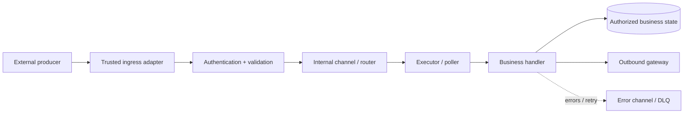
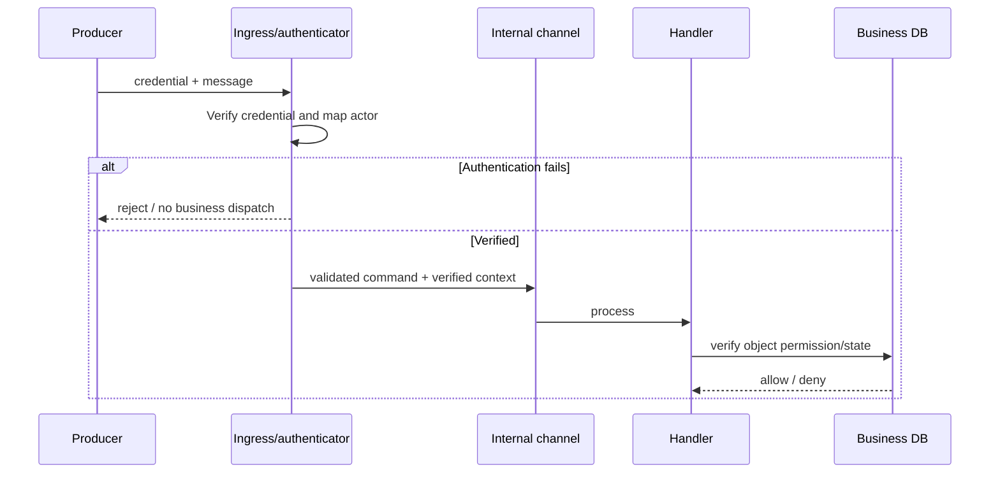
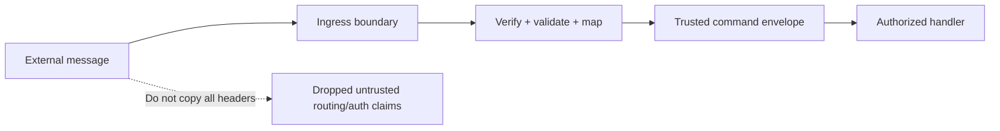
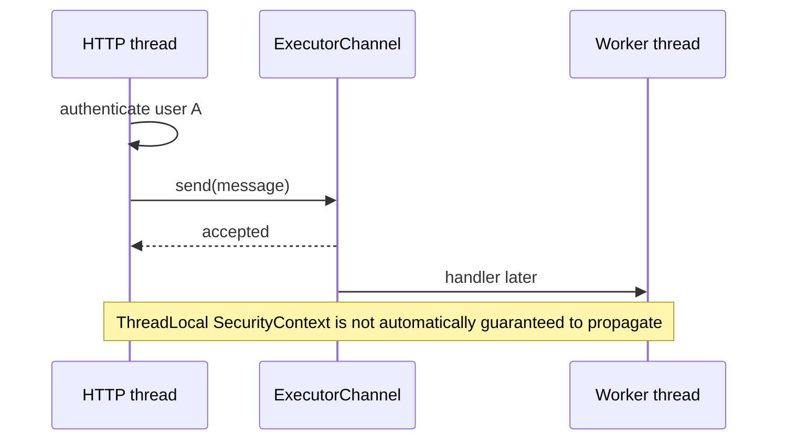
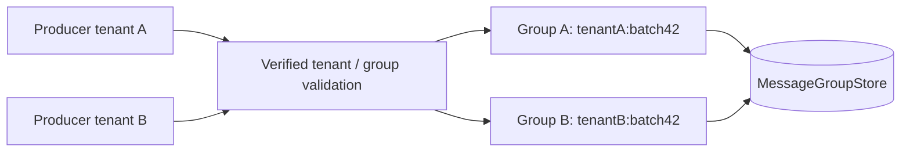
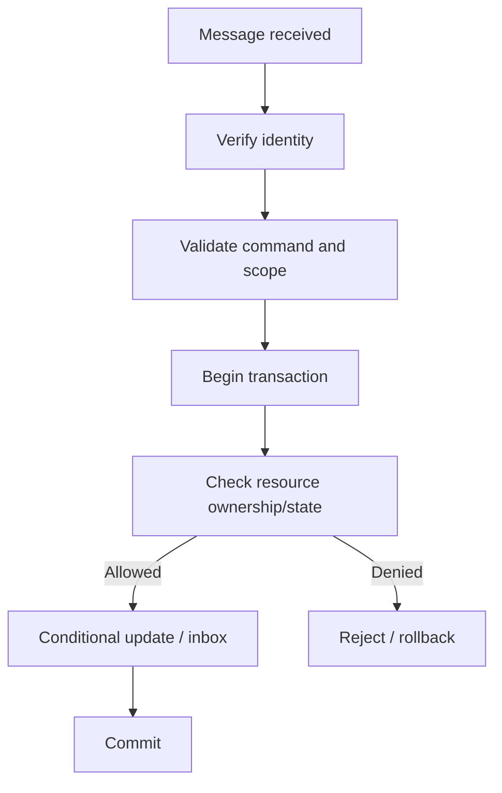
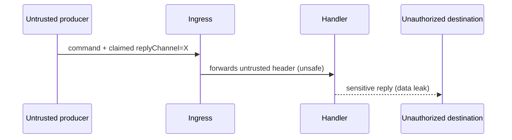
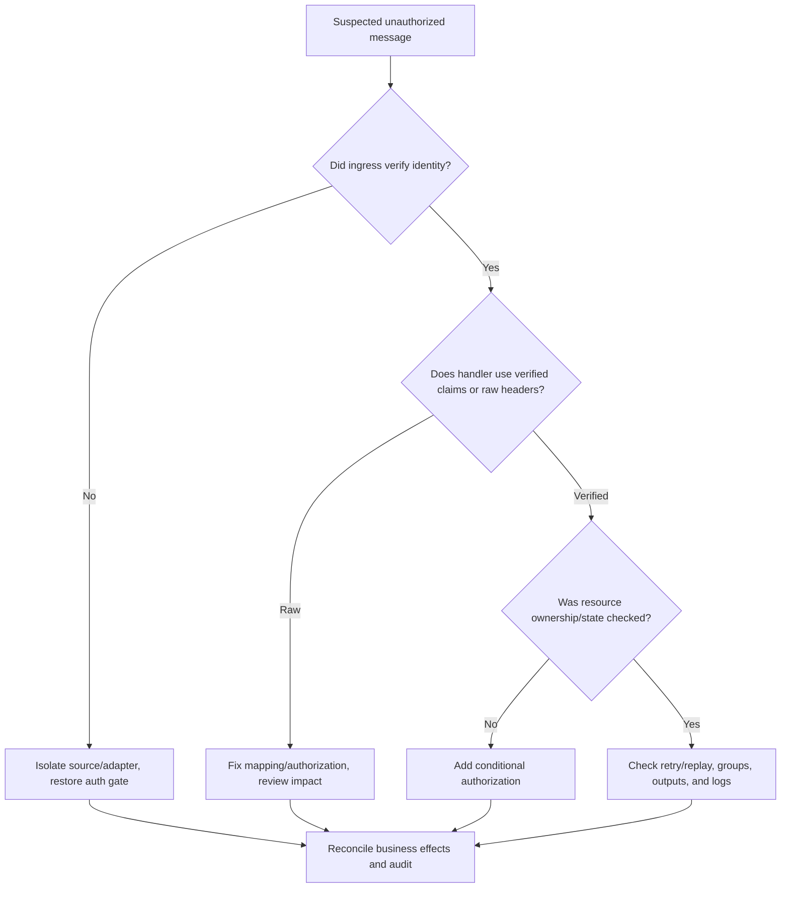

# Trust Boundary Between Message Producer and Handler

In the **Spring Integration runtime**, a producer can be an HTTP client, a service sending via JMS/Kafka/AMQP, a file inbound adapter, a batch poller, or another Java component. The message then travels through channels, routers, transformers, executors, aggregators, retry advice, message stores, and handlers. If a handler treats **payloads or headers sent by the producer** as authentication proof, the system is vulnerable to **identity spoofing, tenant privilege escalation, unauthorized routing, reading/writing the wrong resource, or data leakage via reply and error flows**.

This lesson belongs to the **Runtime Security** chapter of the `SPRING_INTEGRATION_RUNTIME` module. The goal is to clearly define the **trust boundary** from producer to handler, place controls in the right locations, understand the impact of threads/transactions/retries, and test both normal and abnormal paths. The content focuses on runtime message flow security; specific rules for JWT, broker ACLs, encryption, or storage must be verified against the version, infrastructure, and threat model of the real system.

> **Guiding principle:** receiving a message **over a channel** does not mean the sender has been authenticated or authorized to perform the business operation. **Payload, headers, and correlation keys are untrusted input** until verified according to a trust contract.

## 1. Where Does the Trust Boundary Lie?

A message flow has multiple boundaries, not just an HTTP gateway:



| Boundary | Security question | Must not assume |
| --- | --- | --- |
| Producer → adapter | Who is allowed to connect/send? Does the data authenticate its source? | A successful connection means permission to operate on every tenant |
| Adapter → channel | Which headers are trusted, and which must be stripped? | Every header set by the producer is safe |
| Channel → handler | Which actor is actually authenticated, and with what permissions? | An internal channel protects itself from all callers |
| Thread/queue → consumer | Does the verified identity survive across threads, restarts, and redelivery? | `ThreadLocal` automatically crosses `ExecutorChannel`/poller boundaries |
| Handler → database | Does the actor have permission on the **specific record**? | `tenantId` in the payload is proof of ownership |
| Handler → outbound | Which destinations are allowed? Which credentials are used? | A URL/destination suggested by the payload can be used directly |
| Error/DLQ/logging | Where is sensitive data copied when an error occurs? | Errors stay solely within the main message flow |

**Limit trust at every boundary:** the adapter may authenticate the connection, but the handler must still check permissions for the action and business object. Even a legitimate sender can send malformed data, replay old events, or attempt to escalate privileges beyond its scope.

## 2. Building a Threat Model for a Payment Capture Flow

Suppose a service receives `CapturePayment`:

```json
{
  "eventId": "E-42",
  "orderId": "ORDER-42",
  "tenantId": "tenant-A",
  "amountMinor": 149900
}
```

At the same time, the producer may attach:

```text
headers:
  userId: "admin"
  role: "SUPER_ADMIN"
  tenantId: "tenant-B"
  correlationId: "ORDER-42"
  replyChannel: "someExternalDestination"
  retryCount: 0
```

Questions that must be answered:

1. Which application or user is the producer? **Where** is the authentication proof obtained from?
2. Is `tenant-A` proven by a verified identity or does it merely appear in the JSON?
3. Does the actor have `payments:capture` permission for `ORDER-42`?
4. Has `eventId=E-42` already been processed?
5. Does `amountMinor` match the authoritative order state?
6. Is the producer allowed to choose the `replyChannel`/target HTTP URL?
7. If the handler fails, is the original message exposed in `ErrorMessage` or the DLQ?
8. If retried after a restart, are the permissions still valid and is the business state still consistent?

A control at the gateway may answer question 1, but it **does not automatically solve questions 3–8**.

## 3. Separating Identity, Claims, and Business Data

Four types of information should be distinguished:

| Type | Source | Can be used as security proof? |
| --- | --- | --- |
| **Verified identity** | A trusted authenticator that verified signatures/tokens/sessions/mTLS or infrastructure-level principal identity | Yes, within the scope of audience, expiration, verification method, and policy |
| **Verified authorization claims** | Verified claims mapped from a trusted issuer; may need reconciliation against current data | With limits; does not replace resource-level authorization |
| **Untrusted message attributes** | JSON payload, producer headers, routing hints, trace baggage | No; this is input that requires validation |
| **Authoritative business state** | DB/service managing object ownership and state | Basis for checking permissions on a specific order, invoice, or account |

### 3.1. Invalid Inferences

```text
header["authenticated"] == true          != authenticated
header["role"] == "ADMIN"                 != authorized admin
payload.tenantId == "tenant-A"           != caller owns tenant-A
message arrived on "adminChannel"        != caller may invoke admin action
broker delivered message successfully   != producer authorized for business object
```

A broker can guarantee that a **consumer is allowed to read a topic**, but if multiple services are permitted to produce to that topic, a broker ACL does not necessarily prove the **actual user** or permission on each order. An appropriate identity model is needed for each message type.

## 4. Classifying Trust Levels for Message Sources

| Source | Where is authentication typically placed? | Additional steps needed in the flow |
| --- | --- | --- |
| HTTP inbound gateway | TLS, Spring Security filter chain, JWT/OAuth2/mTLS depending on the application | Validate payload, actor, tenant, and object permission |
| JMS/AMQP/Kafka consumer | Broker TLS/SASL/ACL, infrastructure-level producer identity | Identify which sources may produce; verify business claims or signed envelopes if needed |
| SFTP/file polling | Endpoint/host identity, filesystem permissions, and adapter configuration | Validate file format, path, size, provenance, replay, and content |
| JDBC poller | DB account/service identity and SELECT/UPDATE privileges | Read only in-scope data; check state/ownership during processing |
| Internal Java publisher | In-process code, bean/channel references | Enforce internal service permissions; do not treat all plugins/modules as trusted by default |
| Scheduler | Job service identity | Authorization for the job target and lease/replay controls |
| Reactive Publisher | Identity verified at the source before emission | Context propagation; demand/cancel does not alter security semantics |

**Not every producer has an end-user principal.** A batch run may execute using a service identity with least privilege. Never fabricate a "userId" from headers or assign a default admin identity just so a handler passes authorization.

## 5. Authentication Principles at Ingress

A trusted ingress must:
1. Be protected by an appropriate transport channel (TLS/mTLS or broker security).
2. Verify credentials/tokens at an **accountable boundary** and check issuer, audience, expiration, and required conditions.
3. Map the identity to a **verified principal or security context**.
4. Place only permitted information into the internal message.
5. Reject inputs with missing/invalid credentials using an appropriate error mechanism.
6. Never write credentials/tokens to logs, traces, or DLQs.



**Critical boundary:** if an adapter merely receives the string `"authenticated": true` added by the client itself, that is **not** authentication. Conversely, a header or context **attached by a gateway that already verified the credential** can be trusted data **within the protected lifecycle and provenance scope**, provided spoofing/overwriting from external sources is prevented.

## 6. Headers Are a Common Attack Surface

Spring messages include runtime headers such as `id`, `timestamp`, `correlationId`, `sequenceNumber`, `sequenceSize`, `replyChannel`, and `errorChannel`. Adapters may also map HTTP/JMS/Kafka headers or custom properties.

| Header group | Risk if trusted directly | Recommended policy |
| --- | --- | --- |
| `role`, `userId`, `authenticated` | Identity/privilege spoofing | Do not use for decisions if self-asserted by the producer |
| `tenantId`, `accountId` | Cross-tenant access | Derive from verified actor; verify against resource ownership |
| `replyChannel`, `errorChannel` | Redirecting results/errors to unauthorized destinations | Retain only internal channels created by a trusted gateway/framework |
| `correlationId` | Group mixing, ID guessing, group poisoning | Validate scope, format, namespace, and version |
| `sequenceNumber` / `sequenceSize` | Premature/delayed release, memory exhaustion | Validate consistency and maximum size |
| `routingKey`, `destination`, `httpUrl` | Unauthorized routing or SSRF | Map through allowlist logic → trusted endpoint |
| `retryCount`, `priority` | Retry bypass, starvation, priority abuse | Managed, bounded, and validated by runtime |
| `traceparent` / baggage | Log injection, metadata leak, untrusted span context | Parse/validate, bound size, never treat as authentication |
| `contentType`, `typeId` | Unsafe converter/class selection | Fixed allowed media/type mapping |
| Raw file path / URL | Path traversal, internal network access | Never pass directly to filesystem/HTTP clients |

**A header denylist is insufficient:** if you only block `Authorization` and `Cookie`, an attacker can place secrets or forged privileges in `X-Role`, `X-User`, or another custom header. Explicitly select which headers are allowed across the boundary and strip unneeded fields.

## 7. Creating a Trusted Internal Envelope Instead of Copying All Headers

A flow can be separated into two data models:

```text
Untrusted envelope:
  raw payload + external headers + transport metadata

Trusted internal command:
  parsed DTO + verified actor + validated business key
  + allowlisted technical metadata
```



An essential condition is that the **trusted envelope must be created by accountable code**, not deserialized directly from untrusted JSON where the client can set `verified=true`.

### 7.1. Example of Building a New Message with a Header Allowlist

```java
import org.springframework.messaging.Message;
import org.springframework.messaging.support.MessageBuilder;

record VerifiedActor(String subject, String tenantId) {}
record CreateOrder(String orderId, long amountMinor) {}

Message<CreateOrder> buildInternalCommand(
        CreateOrder command,
        VerifiedActor actor,
        String verifiedEventType) {

    // Actor has already been verified by a trusted authenticator.
    // Attach only minimal technical metadata.
    return MessageBuilder.withPayload(command)
            .setHeader("verifiedActor", actor)
            .setHeader("eventType", verifiedEventType)
            .build();
}
```

**Mandatory condition:** this code must execute on the **trusted ingress path** and `actor` must be constructed from verified proof. Never accept a `VerifiedActor` or `verifiedEventType` sent by the producer and assume it is safe. A message object containing a principal must be protected when passing through a store or broker because it may not serialize safely and represents sensitive internal data.

Do not use `MessageBuilder.fromMessage(untrusted)` and simply add `verifiedActor` without rules to strip dangerous headers; that call can retain many unauthorized fields.

### 7.2. Exception: Request–Reply Gateways with Valid Internal Channels

A Spring Integration gateway may internally generate `replyChannel` or `errorChannel` to correlate a request with its response. **Do not blindly strip** these headers when they are a trusted part of the gateway protocol.

The right approach is to **distinguish provenance**:
- Reply headers **generated by a trusted framework/gateway**: may need to be preserved per contract.
- Reply headers **supplied by an external producer**: must not be used to point to an arbitrary Java channel.
- When rebuilding a message at ingress: forward only the trusted reply context provided by the gateway through a controlled mechanism.

## 8. Validating Payloads: Format, Size, and Semantics

Authentication answers **"who sent it?"**, validation answers **"is the data valid?"**, and authorization answers **"what is this actor allowed to do with this resource?"**. These three questions cannot substitute for one another.

| Validation layer | Example | Harm if missing |
| --- | --- | --- |
| Byte/content size | Max 1 MiB payload or per contract | OOM, heavy CPU/GC, broker/backlog saturation |
| Structural schema | Required fields, types, nesting depth | Parse exceptions, incorrect deserialization |
| Domain ranges | `amountMinor > 0`, bounded item count | Business corruption |
| Identifier constraints | Order key with valid format/length | Log injection, key explosion |
| Temporal constraints | Event time/expiry/nonce per policy | Replay and stale commands |
| Cross-field constraints | Consistent tenant, currency, amount, order state | Logic bypass |
| Duplicate semantics | Stable event ID, business member ID | Idempotency failure |
| Resource reference | URL, file path, table/queue alias allowlist | SSRF/path traversal/unauthorized routing |

Payload limits must be enforced **before or during parsing/buffering** whenever possible. If a parser reads an entire 1 GiB body onto the heap before checking a `payloadSize` field, the control comes too late.

## 9. Deserialization and Message Conversion Are Trust Boundaries

A vulnerability can occur **before the handler is ever invoked**, inside a JSON/XML/Java message converter.

Design principles:

1. Use **fixed DTO schemas** and permitted types; restrict polymorphic type resolution from untrusted input.
2. Never allow producers to choose Java class names for deserialization via unverified metadata.
3. Never deserialize Java objects from untrusted byte streams using native serialization without appropriate filters and risk evaluation.
4. For JSON/XML, configure limits on size, depth, field count, and disable unnecessary parser features.
5. Avoid converters that automatically turn input into objects capable of executing behavior or accessing resources.
6. Validate schema versions and support backward compatibility intentionally.
7. Log **safe error codes and message IDs**, without dumping raw bodies on parse failures.

```text
Safer:
  bytes → validated media type → fixed DTO → business validation

Risky:
  bytes → user-chosen Java class → arbitrary object graph → handler
```

Blocking inside the handler is necessary but **insufficient** if the payload can already be exploited by the deserializer before reaching the handler.

## 10. Authorization Must Check the Specific Action and Object

An authenticated actor may be authorized to **view orders in tenant A** while having no permission to modify orders in tenant B.

```text
Verified actor:
  subject = service-orders
  tenant = tenant-A
  permissions = [orders:create]

Incoming payload:
  tenantId = tenant-B
  orderId = ORDER-999
```

If the handler only checks `permissions.contains("orders:create")` and then trusts `payload.tenantId`, the actor can operate on the wrong tenant. Authorization must evaluate the **specific business object**:

- Does `subject` have permission for this action?
- Does the actor's `tenant` match the tenant that owns the resource?
- Is the order currently in a state that permits the update?
- Has the event already been processed? Is it a replay?
- Which DB/service holds the authoritative data, and has it been checked at the commit boundary?

### 10.1. Enforcing Scope Directly in the DB Write Query

```sql
-- Illustrative PostgreSQL/SQL; parameters are bound, never concatenated.
UPDATE orders
SET status = 'CAPTURE_REQUESTED'
WHERE order_id = :orderId
  AND tenant_id = :verifiedTenantId
  AND status = 'READY_FOR_CAPTURE';
```

If the number of affected rows is 0, the record may **not exist**, **not belong to the tenant**, or be in an **invalid state**. Do not prematurely reveal detailed causes to the producer if doing so creates an enumeration vulnerability; returned information must follow the API security contract.

Crucially, `:verifiedTenantId` must come from the **verified identity**, not directly from the payload or headers. This is a **conditional state transition**, rather than a standalone permission check that risks a time-of-check/time-of-use race.

## 11. Java Example: An Endpoint with Clear Trust Boundaries

The following Java 17+ example illustrates a **Spring Integration service activator** that receives a message, delegates identity verification, and checks scope before invoking the business service. `IngressAuthenticator` is an **application interface**; real verification of JWTs, mTLS identities, or signed events must be implemented in the adapter/verifier.

```java
import java.util.Set;

import org.springframework.integration.annotation.ServiceActivator;
import org.springframework.messaging.Message;
import org.springframework.security.access.AccessDeniedException;
import org.springframework.stereotype.Service;

record CreateOrderCommand(
        String orderId, String tenantId, long amountMinor, String eventId) {}

record VerifiedCaller(
        String subject, String tenantId, Set<String> permissions) {}

interface IngressAuthenticator {
    // Must verify authentication proof from a trusted source
    // and reject invalid, expired, or wrong-audience credentials.
    VerifiedCaller authenticateOrThrow(Message<?> inbound);
}

interface AuthorizedOrderService {
    // Business service must still enforce permissions/state in the DB.
    void createOrder(VerifiedCaller caller, CreateOrderCommand command);
}

@Service
public class SecureOrderEndpoint {
    private final IngressAuthenticator authenticator;
    private final AuthorizedOrderService orders;

    public SecureOrderEndpoint(
            IngressAuthenticator authenticator,
            AuthorizedOrderService orders) {
        this.authenticator = authenticator;
        this.orders = orders;
    }

    @ServiceActivator(inputChannel = "untrustedOrders")
    public void accept(Message<?> inbound) {
        VerifiedCaller caller =
                authenticator.authenticateOrThrow(inbound);

        if (!(inbound.getPayload() instanceof CreateOrderCommand command)) {
            throw new IllegalArgumentException("Unsupported command type");
        }
        if (command.orderId() == null || command.orderId().isBlank()
                || command.orderId().length() > 80
                || command.eventId() == null
                || command.eventId().isBlank()
                || command.amountMinor() <= 0) {
            throw new IllegalArgumentException("Invalid command");
        }

        if (!caller.permissions().contains("orders:create")
                || !caller.tenantId().equals(command.tenantId())) {
            throw new AccessDeniedException("Not allowed");
        }

        orders.createOrder(caller, command);
    }
}
```

**This example is not a complete authentication implementation.** `authenticateOrThrow` must never trust headers like `authenticated=true` or `role=ADMIN`. For HTTP inbound with Spring Security, verification typically resides in the filter chain; ingress can obtain the authenticated principal from a **trusted security context on the same thread**. For brokers, producer permissions on the broker and/or a cryptographically verified signed envelope per contract are required.

`AuthorizedOrderService` must still verify **record ownership and state at the authoritative store**. The `tenantId` check above is only an **additional safeguard**, not a replacement for binding the tenant in SQL/transactions or an authorization service.

### 11.1. Distinguishing "Rejected" from "Successfully Processed"

When permissions are lacking or the payload is invalid, the exception must route to the source's appropriate **error/reject policy**. Avoid:

```java
// NOT RECOMMENDED: may ack an unprocessed message.
if (!authorized) {
    log.warn("Denied");
    return;
}
```

A normal return may cause the broker/listener/gateway to assume the message completed successfully. That **may be intentional** if the contract specifies permanent rejection with proper auditing, but it must be explicitly designed. Otherwise, classify `PERMANENT_REJECTION`/`RETRYABLE_FAILURE`/`DLQ` instead of returning a false success.

## 12. Method Security and Internal Handlers

Spring Security method authorization, such as `@PreAuthorize`, can be useful on a service boundary:

```java
import org.springframework.security.access.prepost.PreAuthorize;
import org.springframework.stereotype.Service;

@Service
public class SecuredBusinessActions {

    @PreAuthorize("hasAuthority('orders:create')")
    public void createAuthorizedOrder(CreateOrderCommand command) {
        // Do not check only global authorities:
        // must also verify order ownership/state in the business store.
    }
}
```

For the annotation to take effect, **method security must be enabled**, the bean must be invoked through its proxy or matching AOP configuration, and `SecurityContext` must be properly set on the executing thread. **Self-invocation** such as `this.createAuthorizedOrder(...)` normally bypasses proxy-based interception, so annotations should not serve as the sole security boundary if code can call them via the wrong path.

A flow triggered by a poller lacks an HTTP thread's end-user context. `@PreAuthorize` there may see anonymous/no authentication; **do not fix this by assigning a default admin principal to every message**. Use an authenticated service identity with valid permissions for that workflow.

## 13. SecurityContext Does Not Automatically Cross ExecutorChannel and Pollers

By default, Spring Security usually stores authentication in a **thread-local context**. If an authenticated HTTP request hands work off across an `ExecutorChannel` or another executor, the worker thread may **not see** the original context:



Solutions by architecture:

| Flow type | Mechanism to consider |
| --- | --- |
| Synchronous HTTP request processing | Context is maintained by Spring Security on the request thread |
| Async task submission in the same lifecycle | Use Spring Security's `DelegatingSecurityContext*` mechanisms or an appropriate `TaskDecorator` |
| Poller or scheduled job | Establish a valid service identity per job source; do not borrow an HTTP thread's context |
| Broker redelivery/restart | Do not rely on a lost ThreadLocal; use a verified envelope/signed identity or service auth |
| Reactor pipeline | Use reactive security context propagation appropriate for Reactor; do not equate ThreadLocal with reactive Context |
| Long-running job | Define token expiration/revocation and re-verification policy at execution time |

**Do not store raw access tokens or `Authentication` objects in a persistent message store without careful evaluation.** Tokens can expire, contain secrets, fail to serialize safely, or leak through storage/logs. Instead, store a **subject reference, issuer, and policy version**, then re-verify identity/authorization at execution time.

### 13.1. Simulating a Context Loss Bug When Debugging

```text
[http-nio-1] authenticated actor=user-17
[executor-3] Authentication=null
[handler] authorization denied
```

This may be **context loss across a thread hop**, rather than the producer sending invalid credentials. However, **never solve it by trusting a producer-supplied `userId` header**: that turns a context propagation bug into a spoofing vulnerability.

## 14. Channels Are Not Access-Control Boundaries by Themselves

`DirectChannel`, `ExecutorChannel`, `QueueChannel`, and `FluxMessageChannel` primarily coordinate **dispatch, buffering, and threading**. They do not replace gateway authentication or business authorization.

A channel ID like `adminCommands` is merely a technical name; any code in the same application context with sufficient access to that bean can attempt to send messages to it. If multiple internal modules/plugins have different trust levels, **separate access privileges or process boundaries** appropriately instead of relying on naming a channel "private".

Some versions/modules of Spring Integration provide channel security/interceptor mechanisms integrated with Spring Security. When using them, verify:
- Which dependencies and APIs exist in your **specific version**.
- Whether rules apply at `send`, `receive`, or which handler invocation.
- How `SecurityContext` propagates across pollers and executors.
- Where authorization exceptions route and how the source acks/nacks.
- Whether alternate paths bypass the interceptor/secured channel.

**Defense in depth:** even when channel security is active, handlers/business services must still enforce invariants and resource permissions.

## 15. Never Use Client Routing Headers as Administrative Commands

A producer should not be allowed to choose arbitrary internal destinations:

```text
Unsafe:
  payload.targetChannel = "adminPayments"
  router routes directly to payload.targetChannel

Safer:
  payload.eventType = "ORDER_CREATED"
  trusted router maps approved event type → fixed processing channel
```

### 15.1. Destination Allowlist

```java
import java.util.Map;

final class SafeRouteCatalog {
    private static final Map<String, String> ROUTES = Map.of(
            "ORDER_CREATED", "orderCreateInput",
            "ORDER_CANCELLED", "orderCancelInput");

    static String target(String eventType) {
        String target = ROUTES.get(eventType);
        if (target == null) {
            throw new IllegalArgumentException("Unsupported event type");
        }
        return target;
    }
}
```

`ROUTES` is a catalog of **logical destinations** controlled by code/configuration. If a router selects channels via an expression, ensure the **expression comes from trusted configuration**, never compiling/evaluating SpEL supplied by a producer.

**Do not equate "using SpEL" with "vulnerable to injection":** expressions declared statically in code/configuration that only read validated properties can be legitimate. The danger arises when a producer can supply **source expressions**, bean names, method names, or arbitrary destinations for the system to execute.

## 16. SSRF, File Traversal, and Outbound Destinations

A handler making HTTP calls to a URL taken from a payload can be abused to reach internal services not intended for the producer. Similarly, an SFTP/file adapter writing to a client-controlled path can lead to writes outside the permitted directory.

| Producer-supplied input | Risk | Control |
| --- | --- | --- |
| `callbackUrl` | SSRF, metadata service access, exfiltration | Do not use directly; destination alias allowlist, egress policy |
| `filePath` | Traversal, path normalization, symlink issues | Enforce root directory and canonical path policy, filesystem restrictions |
| `topicName` / `queueName` | Sending data to out-of-scope topics/queues | Map through a broker destination catalog and ACLs |
| `sqlFragment` | SQL injection | Fixed queries, bound parameters |
| `className` / `expression` | Type/expression evaluation abuse | Never let producers pick runtime types/expressions |
| `tenantDbSchema` | Cross-tenant access | Select schema from verified tenant mapping, not raw input |

Outbound credential configurations must belong to **service accounts/secret management**. Do not let producers send destination credentials and ask the handler to "use them on their behalf" unless an explicit delegation workflow is securely designed.

## 17. Replay, Idempotency, and Spoofing "Already Processed" State

Even a validly authenticated message can still be **replayed**:

```text
T0: E42 is authenticated, business DB commits.
T1: Process crashes before broker acknowledgement.
T2: Broker redelivers E42.
T3: Handler receives E42 again.
```

Authentication does not prevent replay. A lock on `orderId` only serializes execution; it **does not remember** that E42 already committed.

### 17.1. Properly Scoped Inbox/Unique Constraints

For example, when business data carries an `eventId` issued by a legitimate issuer, use a unique constraint to prevent duplicates:

```sql
-- PostgreSQL, executed in the SAME transaction as the business update.
INSERT INTO processed_event(tenant_id, producer_id, event_id)
VALUES (:verifiedTenantId, :verifiedProducerId, :eventId)
ON CONFLICT (tenant_id, producer_id, event_id) DO NOTHING;
```

If the INSERT affects 0 rows, the event has already been recorded under that key. Only if it succeeds should the business update execute in the **same transaction**. The unique key must match the contract: `eventId` may only be unique **per producer/tenant**, not globally.

**Do not trust `retryCount` or `processed=true` sent by the producer.** The runtime/source must maintain its own trustworthy attempt/delivery state. An `ACCEPTED` marker in `MetadataStore` does not prove the business handler completed.

### 17.2. Signature/Time Window and Replay

For a signed event envelope, verify that the signature covers the **critical payload, issuer, audience, timestamp/nonce, and event ID** per the chosen protocol. A valid signature alone does not prevent an old message from being replayed; a replay window/nonce store or business idempotency is required depending on requirements.

## 18. Correlation Group Poisoning from External Data

Aggregators/resequencers use `correlationId`, `sequenceNumber`, and `sequenceSize` to group or release messages. If a producer is not fully trusted, an attacker can:

- Generate countless distinct correlation IDs → **group explosion** and memory/DB growth.
- Reuse another tenant's key → **cross-tenant message group mixing**.
- Set a huge `sequenceSize` → groups wait indefinitely.
- Send duplicate sequence numbers with new message IDs → **premature release** if only counting size.
- Send unauthorized triggers to a barrier → prematurely unblocking workflows.
- Send late arrivals after a completed group → recreating groups or causing duplicates.



A group key should reflect the **verified tenant and business batch/run/version** when required by business scope. Never let producers choose a namespace containing another tenant's data. If both tenants have batch ID `42`, they must reside in **two independent groups**.

### 18.1. Group Resource Limits

Design controls for:
- Maximum active groups per tenant/source.
- Maximum group size and `sequenceSize`.
- TTL/expiry/reaper policy for incomplete groups.
- Rate of group creation per producer.
- Duplicate/member validation.
- Message group store retention, cleanup, and database quotas.
- Error/recovery policy when rejecting overloaded groups.

A persistent `MessageGroupStore` survives restarts but **does not protect itself from resource exhaustion**. Both business correctness and capacity controls are needed.

## 19. Trust Boundaries in Split, Transform, and Header Enrichment

A `split → transform → enrichHeaders → route → aggregate` flow can alter payloads and headers. Distinguish between:

| Operation | Data that can change | Risk |
| --- | --- | --- |
| `Splitter` | Child messages, sequence/correlation headers | Batch mixing if headers are overwritten or copied from the wrong source |
| `Transformer` | Payload type/schema | Loss of validation, falsely elevated field trust |
| `HeaderEnricher` | Add/modify technical headers | Overwriting verified identity with untrusted values |
| `Router` | Destination selection | Bypassing handler security if routing is externally controlled |
| `Aggregator` | Group context/derived output | Merging multi-tenant data if keys are wrong |
| `ServiceActivator` | Business command execution | Missing resource-level authorization |
| `Gateway` | Request–reply channel mapping | Sending responses to forged destinations |

A `trustedTenant` header is only valid if **created at trusted ingress**, cannot be overwritten by the producer, and all subsequent transformers/enrichers preserve provenance. When changing topology dynamically, verify that every new branch still passes through the **same security boundary**.

## 20. Dynamic IntegrationFlow and Bypass Risks

With `IntegrationFlowContext`, an application can register new flows at runtime. If a new flow attaches directly to a source channel while bypassing the validation/authentication endpoint, it can receive unverified messages.

```text
Expected:
  external ingress → auth/validation → trustedCommands → handler

Dangerous dynamic route:
  external ingress ----------------------→ privilegedHandler
```

### 20.1. Policy for Dynamic Flow Registration

1. Only an authenticated/authorized control plane may register/start/stop/remove flows.
2. New flows must traverse recognized **security gates**.
3. Do not allow tenants to upload SpEL/scripts/class names to construct arbitrary handlers.
4. Ensure flow/endpoint IDs do not collide with or impersonate privileged channels.
5. Inspect input/output and reply/error routing before publishing.
6. Maintain revisions, operation audits, and controlled rollbacks.
7. When retiring a flow, protect in-flight work, credentials, and secrets of the old connector.
8. Re-test authorization across all routes after cutover.

A controlled, stable ingress prevents producers from altering the entry point, but **concurrency-safe route switching** does not guarantee that **each new handler enforces sufficient security checks**. Both properties must be tested separately.

## 21. Transactions Do Not Replace Authentication and Authorization

Transactions guarantee atomicity within a resource/transaction manager; they do not prove the actor is authorized.



Examine the ordering of auth/validation and transaction boundaries:
- Verify credentials before allocating expensive resources whenever possible.
- Check object authorization **atomically with the write operation** to prevent TOCTOU races.
- Idempotency markers and business state should commit in the same transaction when sharing the same DB.
- For external HTTP/payment effects, a DB transaction cannot roll back external side effects; use idempotency keys/outbox/reconciliation.
- Classify `AccessDeniedException` separately from transient DB errors to avoid futile retries.

## 22. Retry, Redelivery, and Poison Messages

An invalid message or one denied due to missing permissions should generally **not** be retried indefinitely. Conversely, a DB timeout or dependency 503 may be transient.

| Outcome | Meaning | Potentially appropriate policy |
| --- | --- | --- |
| `AUTHENTICATION_FAILED` | Invalid/expired credentials, untrusted source | Reject, audit safely; no tight retry loop |
| `AUTHORIZATION_DENIED` | Actor lacks permission on the resource | Permanent rejection, no false success ack |
| `VALIDATION_FAILED` | Invalid schema/size/type/range | Reject or quarantine, no infinite loop |
| `DUPLICATE_EVENT` | Event already committed for business key | Idempotent no-op with clear outcome |
| `TRANSIENT_DB_ERROR` | Temporary DB connection/deadlock error | Bounded retry/backoff per policy |
| `DEPENDENCY_TIMEOUT` | Unclear whether side effect occurred | Retry with idempotency and reconciliation |
| `STORE_CORRUPTION` | Payload cannot be deserialized | Quarantine/incident, no poison loop |

**Permanent rejection** does not necessarily mean throwing an exception back to the broker to redeliver forever. It can route to a DLQ or write a rejection record and acknowledge per contract. However, catching an exception and returning normally **without recording an outcome or audit** can cause messages to vanish silently.

### 22.1. Error Channels Also Contain Sensitive Data

`ErrorMessage` and exceptions wrapping `failedMessage` can retain original payloads and headers. On authentication or validation errors:
- Never log the entire `ErrorMessage`.
- Never send raw tokens to an unprotected DLQ.
- Include error code, source alias, trace ID, and pseudonymized business keys.
- DLQs require dedicated ACLs, retention, encryption, and replay authorization.
- Replay tools must **re-apply validation/authorization** rather than treating "already in DLQ" as trusted.

## 23. Header Spoofing Can Turn into Data Leakage via Replies

A dangerous scenario occurs when a producer sets `replyChannel` to an unintended destination and the handler returns sensitive data. In an internal system supporting channel name mapping, a misconfiguration could trust that header to pick the destination.



**Solution:** inbound adapters must control reply destinations via a **trusted gateway context**, never using arbitrary producer-supplied channel objects or channel names. Likewise, error channels should only be determined from trusted internal configuration.

If an API genuinely offers a customer-provided callback URL as a feature, it must be managed as an **authorized outbound destination** with ownership checks, allowlist/network policies, and response content limits—not simply mapped directly onto `replyChannel`.

## 24. Egress Security and Least Privilege

A handler often calls databases, brokers, HTTP APIs, or file storage. Even with secure ingress, side effects can exceed privileges if service credentials are overly broad.

Key principles:
- Credentials scoped **per connector/destination** with least privilege.
- DB users limited to required schemas/tables.
- Producers and consumers use separate broker ACLs rather than sharing a superuser.
- Secrets fetched from a protected secret manager/environment; never embedded in messages/headers/logs.
- Appropriate timeouts, retries, and egress network policies configured.
- Destination aliases validated; never pass raw user URLs to HTTP outbound clients.
- Tenant isolation enforced in DB queries/records, not merely in channel names.
- Output fields controlled so data outside the caller's scope is not emitted.

**Do not forward the full original identity/token downstream just because the handler has it.** If delegation is needed, use an explicitly designed token-exchange protocol or service-to-service authorization with the appropriate audience/scope.

## 25. Resource Exhaustion: Security Is Also a Performance Problem

A legitimate but buggy producer—or a malicious one—can cause denial of service (DoS) through:
- Oversized payloads or deeply nested JSON.
- Creating countless group keys in `MessageGroupStore`.
- Sending massive volumes of duplicates that bloat inbox/metadata stores.
- Flooding a `QueueChannel`/executor beyond capacity.
- Triggering retry storms via timeouts.
- Using high priority to starve other tenants.
- Sending messages with an enormous `sequenceSize` so groups never complete.

| Runtime area | Control |
| --- | --- |
| Adapter/parser | Max payload size, parse depth/timeouts |
| Producer authorization | Quota/rate limit per verified identity |
| Channel | Capacity, backpressure/reject policy |
| Poller/executor | Concurrency bound, queue limit, task timeout |
| Correlating endpoint | Max active groups, group size, expiry |
| Message store | Retention, storage quotas, cleanup |
| Retry | Bounded attempts/backoff, DLQ, circuit breaker where appropriate |
| Logging/tracing | Sampling after redaction, cardinality control |

**An unbounded queue is not overload protection.** It merely shifts the outcome from explicit rejection to uncontrolled memory and latency growth.

## 26. LockRegistry and Message Stores Are Not Authorization

`LockRegistry` coordinates critical sections by key. `MessageGroupStore` stores correlation members. `MetadataStore` may hold idempotency/checkpoint markers. **None of these components determines whether an actor has permission on a business resource.**

```text
lock("order:42") acquired          != actor can edit order 42
metadata["E42"] == "ACCEPTED"      != authorized business commit
group("tenantA:batch42").size=3   != every member is trusted
```

You must authenticate the source, validate members, and enforce tenant isolation and idempotent business effects. If a group store is shared across tenants, keys must be properly namespaced, yet **a namespace string is not a security boundary** if the producer chooses the key. The tenant must be verified before constructing the group ID.

For lease-based distributed locks, an old worker can resume after expiration; protect authoritative state with conditional updates/owner generation/fencing when needed, **not by lock ownership alone**.

## 27. Safe Tracing Across Threads, Retries, and Correlation

Observability needs to answer:
- Which source sent the message, and at which boundary was it authenticated?
- Which verified actor and tenant (logged via reference ID or pseudonym when sensitive)?
- Where did the handler make the allow/deny decision?
- Was the message retried/redelivered?
- Did the business state commit?
- Was it routed to an unexpected channel/group?

A safe log record:

```json
{
  "event": "command_rejected",
  "source": "orders-http",
  "flow": "orders-v42",
  "endpoint": "createOrder",
  "trace_id": "opaque-trace-123",
  "caller_ref": "hmac:example-actor-token",
  "tenant_ref": "hmac:example-tenant-token",
  "error_code": "TENANT_SCOPE_DENIED",
  "retryable": false
}
```

This is a **suggested format**, not an exporter built into Spring Integration. Never log full payloads, raw `Authorization` headers, cookies, `SecurityContext`, or an entire `Message<?>`. Producer-supplied `traceparent` can help correlate traces, but it is **not proof of identity**.

### 27.1. Preserving Context Across Threads

`ThreadLocal`/MDC/SecurityContext can be lost across an `ExecutorChannel` or poller. Verify both:
1. Is context properly propagated to the running task?
2. Is context **cleared after the task**, preventing identity bleed between two messages?
3. For durable redelivery, is identity **re-verified** per policy?
4. Do logs record the verified principal at the right boundary rather than self-asserted sender headers?

## 28. Action-Based Permission Matrix

A clear design practice is to build a permission matrix:

| Actor / service identity | Action | Resource scope | Outcome |
| --- | --- | --- | --- |
| `orders-reader` | `orders:read` | Tenant A | Allow for orders belonging to A |
| `orders-reader` | `orders:create` | Tenant A | Deny |
| `orders-writer` | `orders:create` | Tenant A | Allow if schema/state valid |
| `orders-writer` | `orders:update` | Tenant B | Deny |
| `billing-worker` | `payments:capture` | Authorized payment jobs | Allow with idempotency and state checks |
| Unknown producer | Any privileged action | Any | Reject before business handler |

This matrix is only a policy example. "Allowed" still depends on the **specific resource, business state, and current policy**. Test both positive and negative paths; running only happy paths for legitimate actors will miss privilege escalation bugs.

## 29. Security Testing at the Right Levels

| Test level | Examples | Evidence |
| --- | --- | --- |
| Unit | Header spoofing, DTO validation, permission matrix | Business logic does not trust raw claims |
| Integration flow | Messages traversing real adapters/channels/handlers | Route bypasses and exception semantics are controlled |
| Security integration | HTTP filter chain, JWT validator, broker identity/ACL | Real authentication at ingress |
| Async/restart | `ExecutorChannel`, poller, broker redelivery | Verified context is not lost/spoofed |
| Multi-tenant | Two tenants with identical order IDs or correlation IDs | Cannot read/write/mix each other's state |
| Failure/recovery | DLQ, error channel, retry, and replay | No credential leaks; no infinite retries |
| Dynamic topology | Registering a new flow version | New flow does not bypass boundaries |
| Performance/abuse | Large payloads, many groups, retry storms | Resource limits and overload policies hold |

Do not use a fake verifier `return VerifiedCaller("admin",...)` in tests and conclude that ingress is secure. A fake is only useful for testing **business authorization**; real verification must be tested separately with invalid inputs.

## 30. Unit Test: Producer Spoofing Role/Tenant Is Rejected

An invariant-focused test can have the producer set `role=ADMIN` in headers while the authenticator returns a verified caller for tenant A.

```java
import static org.junit.jupiter.api.Assertions.assertThrows;
import static org.mockito.Mockito.*;

import java.util.Set;

import org.junit.jupiter.api.Test;
import org.springframework.messaging.support.MessageBuilder;
import org.springframework.security.access.AccessDeniedException;

class SecureOrderEndpointTest {

    @Test
    void deniesUntrustedTenantEvenWhenHeaderClaimsAdmin() {
        IngressAuthenticator authenticator =
                mock(IngressAuthenticator.class);
        AuthorizedOrderService service =
                mock(AuthorizedOrderService.class);
        SecureOrderEndpoint endpoint =
                new SecureOrderEndpoint(authenticator, service);

        var command = new CreateOrderCommand(
                "ORDER-42", "tenant-B", 1000L, "E-42");
        var inbound = MessageBuilder.withPayload(command)
                .setHeader("role", "ADMIN")
                .setHeader("userId", "system")
                .setHeader("tenantId", "tenant-B")
                .build();

        when(authenticator.authenticateOrThrow(inbound))
                .thenReturn(new VerifiedCaller(
                        "user-17", "tenant-A",
                        Set.of("orders:create")));

        assertThrows(AccessDeniedException.class,
                () -> endpoint.accept(inbound));

        verifyNoInteractions(service);
    }
}
```

This test proves the **endpoint does not use forged role/tenant headers** to allow the operation. It **does not prove that `IngressAuthenticator` implements cryptography correctly**. Add integration tests for invalid signatures, expired tokens, wrong audience/issuer, missing credentials, and unauthorized sources.

### 30.1. Critical Negative Path Tests

- Client sends `role=ADMIN` in headers when the principal is a regular user.
- Client specifies another tenant's `tenantId`.
- Event contains a valid `eventId` but a tampered payload amount.
- Routing hint points to a privileged endpoint.
- `replyChannel` is spoofed to another destination.
- Replaying the same `eventId` after commit.
- Message arrives through an endpoint lacking a security gate.
- Headers are lost/overwritten after a transformer/enricher.
- Async worker lacks context or retains the previous request's context.
- Producer creates thousands of group IDs to exceed quotas.

## 31. Integration Test: Verifying Security Boundaries End-to-End

A valid end-to-end test should include:
1. A **real source or test adapter** with the configured authentication mode.
2. A valid command from actor A/tenant A.
3. A spoofed command from actor A whose payload/header specifies tenant B.
4. A command with missing or invalid credentials.
5. A duplicate/replayed message after a successful commit.
6. Verification of DB rows and tenant ownership after processing.
7. Assertion that `errorChannel`/DLQ logs do not contain raw credentials.
8. For async, assertion of the business outcome after the executor and no identity leak.
9. When changing flow versions, assertion that all routes enforce the policy.

In particular, **do not only assert exceptions on direct method calls**. When a handler is invoked via channels, adapters, and retry advice, exceptions may propagate or be wrapped into an `ErrorMessage` depending on topology. Tests must verify the corresponding **source acknowledgement, transaction rollback, and recovery outcome**.

### 31.1. Minimum Test Matrix

| Scenario | Expected outcome |
| --- | --- |
| Valid credentials, proper permissions, matching tenant record | Business command processed |
| Invalid signature credentials | Rejected at ingress, handler not invoked |
| Expired/wrong-audience credentials | Rejected, no silent downgrade |
| Self-asserted `role=ADMIN` claim in payload/header | No privilege escalation |
| Tenant A modifies tenant B's order | Denied, DB unchanged |
| Valid command but invalid state | Business validation/conditional update rejects |
| Message replayed with same event ID | Side effect not duplicated |
| Huge `sequenceSize`/group key explosion | Controlled rejection/quota/expiry |
| `ExecutorChannel` thread switch | Verified context remains valid, no actor mixing |
| DLQ containing failedMessage | Proper ACLs, redaction, and replay authorization |
| Dynamic flow bypassing gate | Test fails, not published |
| Unknown outbound URL | Non-allowlisted endpoint not called |

## 32. Incident Runbook: Suspected Producer Privilege Escalation



Operational steps:

1. Collect the `eventId`, trace ID, and suspected source; use **redacted logs**.
2. Identify which producers have publish permissions on the broker/adapter.
3. Inspect the authentication policy at ingress and the deployed version.
4. Determine what identity the handler actually used and where it came from.
5. Compare the tenant in the verified identity with the resource-owning tenant in the DB.
6. Check for route/transform/retry/DLQ paths bypassing validation.
7. Check for duplicates/replays and correlation group poisoning.
8. Contain already-committed side effects; do not assume rollback is sufficient.
9. Consider revoking credentials/disabling the producer per organizational incident procedures.
10. Fix the boundary, add negative tests, and monitor post-deploy.

**Do not delete the message store, force-release groups, or bulk-replay the DLQ** before verifying permissions and idempotency. Those actions can duplicate side effects or destroy forensic evidence.

## 33. Hands-On Exercises

### Exercise 1 — Header Spoofing

Create a message with `role=ADMIN`, `userId=system`, and `tenantId=tenant-B`. Configure the test authenticator to return a tenant A actor. Assert that the handler rejects it and the business service is not called. Then verify the permission matrix with a valid actor.

### Exercise 2 — Building a Trusted Envelope

Create a DTO from mock data and an authenticated actor, construct a message using `MessageBuilder.withPayload` and an allowlist of headers. Compare with `MessageBuilder.fromMessage` carrying all external headers; detect unwanted `replyChannel`, `errorChannel`, and routing hints.

### Exercise 3 — Resource-Level Authorization

Create orders with the same logical `orderId` across two tenants (using an appropriate composite key). Use an SQL conditional update scoped by `verifiedTenantId`. Prove that tenant A cannot modify tenant B's row even when the payload specifies tenant B.

### Exercise 4 — Async Security Context

Send a message from an HTTP thread through an `ExecutorChannel`. Observe the context inside the handler. Apply standard context propagation and assert that the context is cleared before the executor thread serves the next message.

### Exercise 5 — Broker Producer Identity

Configure two test producers with different broker ACLs. The unauthorized producer must be rejected from publishing. For the authorized producer, still verify signed envelopes/claims and object permissions when the business logic requires end-user identity.

### Exercise 6 — Replay and Inbox

Send the same event `E-42` twice, intentionally building a new message with a different `MessageHeaders.ID`. Use an inbox unique key scoped by verified producer/tenant and business transaction, and assert a single business effect.

### Exercise 7 — Correlation Group Poisoning

Send messages with an abnormal `sequenceSize`, invalid correlation key, and a group ID belonging to another tenant. Verify that validators/quotas reject them; ensure no cross-tenant group merging or unbounded pending groups occur.

### Exercise 8 — SSRF and Outbound Allowlist

Provide input suggesting a callback URL outside the allowed list. Verify that the router/gateway rejects it instead of issuing the request; ensure valid targets can only be selected from a trusted catalog.

### Exercise 9 — Error Flow and DLQ

Have a parser/handler throw an exception containing a fake credential marker. Inspect `ErrorMessage`, logs, and the DLQ. Verify no marker appears in logs/exports; only authorized operators can replay, and replay passes through validation.

### Exercise 10 — Dynamic Flow Cutover

Dynamically register flow B and have a producer attempt to send to handler B through a new route. Test that B still uses the same trusted ingress/authz logic and does not accept a raw `userId` header as a verified actor.

### Exercise 11 — Resource Exhaustion

Generate many fake business keys, large payloads, and bursts in a test environment. Measure queue depth, active groups, retries, and rejection rates; confirm capacity limits and recovery work without dropping messages contrary to policy.

### Exercise 12 — Threat Modeling Workshop

Diagram a real flow containing HTTP inbound, queue, executor, aggregator, JDBC store, and outbound HTTP. At each boundary, document **identity source, untrusted data, controls, exception/recovery, and test assertions**. Propose at least three testable abuse scenarios.

## 34. Common Anti-Patterns

| Mistake | Consequence | Fix |
| --- | --- | --- |
| Trusting `headers["role"]` from producer | Privilege escalation | Verified principal and permission checks |
| Trusting `payload.tenantId` for DB access | Cross-tenant access | Derive tenant from verified actor, SQL scoped update |
| Skipping authorization because TLS is enabled | Valid clients can still exceed scope | Action + resource-level authz |
| Assuming broker ACL means user is authorized for any order | Business authorization bypassed | Distinguish producer identity and end-user scope |
| Copying all headers into internal messages | Header spoofing and reply leaks | Allowlists, trusted provenance |
| Using client-sent raw `replyChannel` | Exfiltration of results/errors | Gateway-generated reply context |
| Using producer-supplied SpEL/class names | Runtime evaluation abuse | Expressions/classes from trusted code/config only |
| Using raw URL/path as outbound destination | SSRF/path traversal | Destination catalog, egress/file policies |
| Storing access tokens in persistent group stores | Token leak/expiry, deserialization issues | Verified identity reference and re-check at execution |
| `@PreAuthorize` with self-invocation | Proxy interception bypassed | Invoke through proper service boundary, integration test |
| Assuming `SecurityContext` crosses executors automatically | Handler lacks identity or uses wrong context | Context propagation and cleanup |
| Assigning admin identity to pollers to pass security | Overprivileged background work | Least-privilege service identity |
| Retrying forever on access denied | Poison loop, wasted resources | Permanent reject/quarantine with audit |
| Using only locks to prevent replay | Duplicate side effects after unlock | Inbox/idempotent transaction |
| Trusting producer-chosen correlation keys | Cross-tenant group poisoning | Verified namespace + validation/quota |
| Treating message enqueue as success | Async handler may not have committed | Completion/ack at the proper boundary |
| Logging raw `ErrorMessage`/failedMessage | Payload and credential leaks | Safe error codes and log projections |
| Dynamic flow skipping security gates | Bypass via new topology | Admission/policy validation before publish |
| Testing only happy paths with valid actors | Privilege escalation goes undetected | Negative tests, replay, and async tests |
| Treating internal channel names as security boundaries | Other trusted code/modules can still invoke | API boundaries and service authz |

## 35. Self-Check Knowledge Questions

1. **Does a producer sending a `role=ADMIN` header mean it is an admin?** No; verified identity/claims from a trusted source are required.
2. **Does TLS prove a user has permission to edit an order?** No; TLS protects the connection, while resource authorization is a separate layer.
3. **Does a broker ACL replace business authorization?** No; it does not automatically guarantee permissions per tenant/order.
4. **Can `tenantId` in the payload be used directly as the DB scope?** No; it must be verified against or derived from the verified caller.
5. **Why create a trusted envelope?** To separate verified identity from untrusted external headers.
6. **Should all headers be copied from inbound to the handler?** No; an allowlist and provenance tracking are needed.
7. **What is the risk of a producer-spoofed `replyChannel`?** Results may be routed to an unauthorized destination if misconfigured.
8. **Does authentication guarantee a valid payload?** No; schema, type, size, and business validation are separate layers.
9. **Can deserialization introduce vulnerabilities before the handler?** Yes; converters are trust boundaries.
10. **Does `@PreAuthorize` always apply on self-invocation?** Not with standard proxy-based interception.
11. **Does `SecurityContextHolder` automatically propagate across `ExecutorChannel`?** Not by default; explicit propagation is required.
12. **What should a poller without a user identity do?** Use a least-privilege service identity per contract.
13. **Can an authenticated message still be replayed?** Yes; idempotency or replay protection is needed.
14. **Does a lock on order ID prove an event already committed?** No.
15. **Why does a correlation key need a verified tenant scope?** To avoid cross-tenant group mixing and key collisions.
16. **What problem can an enormous `sequenceSize` cause?** Long-lived groups and resource exhaustion.
17. **Is SpEL always an injection vulnerability?** No; the danger is when producers can control arbitrary expressions/source execution.
18. **Does successful authentication remove the need to check record ownership in the DB?** No.
19. **Why does the error channel need security controls?** It can carry failed messages and sensitive data.
20. **Is a normal return from a handler on rejection safe?** Only when rejection/ack semantics are explicitly designed; messages must not be silently lost.
21. **Can dynamic `IntegrationFlow` create a security bypass?** Yes, if the new route bypasses trusted gates.
22. **What is the definition of least privilege for an outbound connector?** Granting only the required destination/operation permissions, never superuser access.
23. **Why are HMAC group/actor IDs useful in logs?** They enable correlation without exposing raw IDs, provided keys and retention are managed.
24. **What is the best test to detect cross-tenant bugs?** Send input as actor A targeting tenant B's resource, assert denial, and verify B's DB remains unchanged.

## 36. Version-Specific Reference Documentation

- [Spring Integration Reference Documentation](https://docs.spring.io/spring-integration/reference/): channels, endpoints, adapters, gateways, message stores, error handling, and dynamic flows.
- [Spring Security Reference Documentation](https://docs.spring.io/spring-security/reference/): authentication, authorization, method security, concurrency/context propagation, and reactive security.
- [Spring Integration Security](https://docs.spring.io/spring-integration/reference/security.html): channel/message flow protection features; verify URIs and APIs per version.
- [OWASP Cheat Sheet Series](https://cheatsheetseries.owasp.org/): input validation, authorization, SSRF prevention, deserialization, and logging guidance.
- [Apache Kafka Security](https://kafka.apache.org/documentation/#security): broker/producer/consumer security and ACLs when using Kafka.
- [Reactive Streams Specification](https://www.reactive-streams.org/): demand, cancellation, and boundaries when using reactive boundaries.

Classes, DSL overloads, channel security configurations, and `SecurityContext` propagation mechanisms may vary across **versions of Spring Integration, Spring Security, Spring Boot, adapter types, and transports**. Application interfaces like `IngressAuthenticator` and `AuthorizedOrderService` are **design patterns**, not built-in Spring APIs; real implementations and real authentication tests are required before deployment.

## 37. Summary

**The trust boundary between message producer and handler must be clearly defined at every runtime step.** A producer may be permitted to send a message, yet **never implicitly allowed to dictate identity, roles, tenant, routing, reply destination, or business outcome**. Authenticate at ingress, validate payloads and headers, build a trusted command context with provenance, enforce authorization by **action + resource ownership/state** in the handler and authoritative DB, and properly manage retries/replays, errors/DLQs, and side effects.

With Spring Integration, pay special attention to the boundaries **channel → executor/poller → handler**, where `SecurityContext` can be lost; **correlation → message group store**, where malformed data can stall or mix groups; and **transaction/retry → acknowledgement**, where messages can be redelivered or falsely marked as successful. A secure flow is one in which **no path—including errors, retries, restarts, and dynamic topology—can turn self-asserted producer data into verified privilege**.
