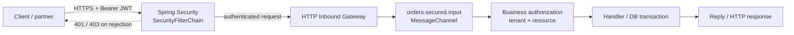
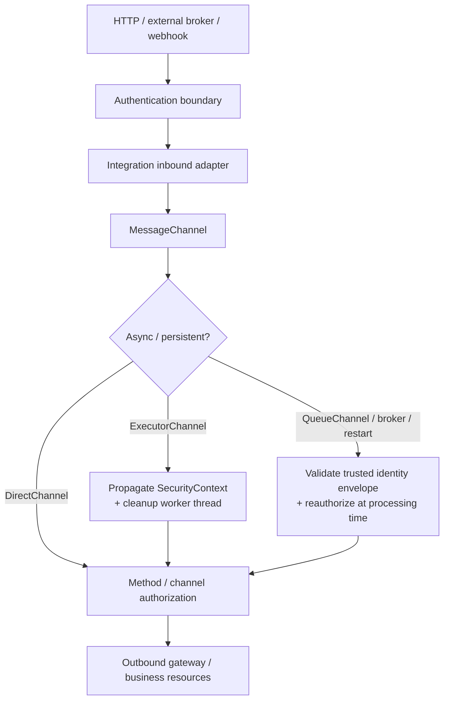
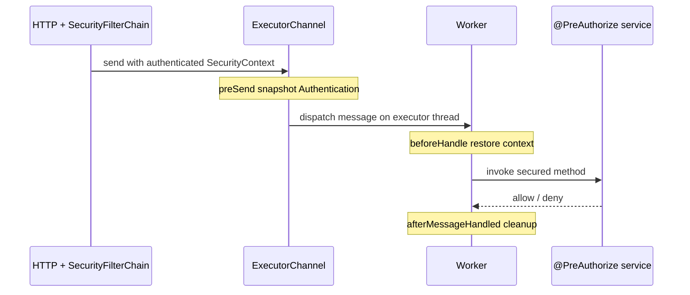
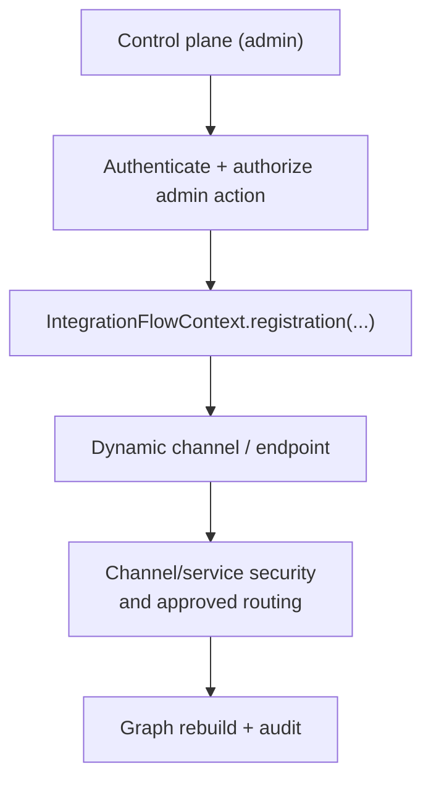

# Authentication and Authorization at the Gateway in Spring Integration Runtime

## 1. The Security Problem at the Message Flow Entry Point

An `IntegrationFlow` can start from an HTTP inbound gateway, WebSocket, JMS/AMQP/Kafka adapter, scheduler, file inbound adapter, or a `@MessagingGateway` interface invoked by Java code inside the application. After the entry point, messages can travel through `DirectChannel`, `ExecutorChannel`, `QueueChannel`, routers, transformers, splitters, aggregators, service activators, and outbound gateways. **Each of those boundaries has a different trust level and security context**.

For example, a payment command processing service receives an HTTP request, validates a Bearer JWT, authorizes `orders:write`, verifies the order's tenant, and dispatches a message into the flow:



Questions that must be answered:

1. **Who is calling?** Which token, client certificate, or ingress mechanism proves identity?
2. **Are they allowed to invoke the operation?** Does their role/scope/authority permit accessing the endpoint?
3. **Are they authorized on the specific resource?** Is this principal permitted to modify an order belonging to the stated tenant?
4. **Are permissions still intact after switching threads?** `SecurityContext` must be properly propagated/initialized in executors/pollers.
5. **Are permissions re-verified after sitting in a queue or surviving a restart?** Tokens and roles may expire or change.
6. **Where do security errors go?** HTTP 401/403, error channel, or retry/DLQ? Is sensitive information leaked?
7. **Who can produce messages from elsewhere?** An HTTP filter protecting the HTTP path does not automatically protect broker adapters, internal flows, or other gateways.

The lesson **Authentication and Authorization at the Gateway**, part of the **Runtime Security** chapter of `SPRING_INTEGRATION_RUNTIME`, is framed within the orchestration of channels, endpoints, consumers, pollers, executors, `IntegrationFlow` lifecycle, transactions, retries, message stores, errors, correlation, threading, performance, and operational observability.

**Learning objectives:** distinguish authentication from authorization; secure HTTP inbound gateways with Spring Security 6; enforce resource/tenant-level authorization; use `AuthorizationChannelInterceptor` on channels; propagate security context across thread switches; avoid trusting headers from messages/brokers; secure outbound gateways; test 401/403, async, and multi-tenant paths; and diagnose lost permissions across retries/restarts.

**Versions:** Examples target **Spring Integration 6.5.x**, **Spring Security 6.5.x**, Spring Framework 6.x, Java 17+. Security classes from Spring Integration 5.x/early 6.x must not be assumed to apply to 6.5 applications.

## 2. Distinguishing Authentication, Authorization, and Trust Boundaries

### 2.1. Authentication Is Not Authorization

| Term | Question | Example |
|---|---|---|
| **Authentication** | Who is the actual principal? | Verifying JWT signature, issuer, expiry |
| **Authorization** | What is the principal allowed to do? | Holds `SCOPE_orders.write` to submit commands? |
| **Resource authorization** | Which records may the principal act upon? | May only edit orders belonging to tenant A |
| **Service identity** | Which application/consumer is calling? | Service account of the adapter |
| **Message provenance** | Which trusted source did the message come from? | Broker/topic, authenticated ingress, envelope signature |
| **Delegation** | May a service act on behalf of a user? | On-behalf-of token or scoped delegation |
| **Audit** | Where did the allow/deny decision occur? | Event with principal ID, action, tenant, outcome |

`authenticated()` only guarantees that an `Authentication` recognized by the framework as authenticated is present; it does not ensure the user has permission to process **every** order. Likewise, an authority like `SCOPE_orders.write` generally expresses a coarse permission and does **not** replace resource/tenant ownership rules.

### 2.2. Tenant-Owned Resources Are Data That Must Be Verified

A request:

```json
{
  "tenantId": "tenant-B",
  "orderId": "ORD-101",
  "operation": "APPROVE"
}
```

A client can alter `tenantId` or `orderId`. Therefore, **never** allow an operation merely because the HTTP header/body claims `tenant-B` or because the request carries a valid JWT. The decision must verify **verified identity + permissions + resource ownership in a trusted source** (e.g., database, ACL, policy service, tenant membership).

Even when a token carries a `tenant_id` claim, you must verify the issuer/audience, confirm the claim was issued by a trusted authority, and verify that the order actually belongs to the authorized tenant. Prevent IDOR/BOLA (*broken object-level authorization*).

### 2.3. Runtime Trust Boundaries



**Critical rule:** trust established at an earlier hop **does not automatically stay with the message forever**. An `Authentication` in `SecurityContextHolder` is typically bound only to a thread. A persisted message is not an actively logged-in user, and a custom `roles=ADMIN` header sent by a producer is not proof of privilege.

## 3. "Gateway" Has Multiple Meanings: Securing the Right Entry Points

### 3.1. HTTP Inbound Gateway

`HttpRequestHandlingMessagingGateway` accepts an HTTP request, converts it into a message, and awaits a reply from the Spring Integration flow. In a Servlet application, Spring Security's `SecurityFilterChain` executes **before** the HTTP endpoint in the request pipeline when properly configured.

You can define policies such as:

- `POST /api/orders` requires a JWT with scope `orders.write`.
- `GET /api/orders/{id}` requires `orders.read`.
- Admin APIs require dedicated permissions and must never inherit "authenticated = admin".
- Unlisted URLs are denied by default.
- HTTPS is enforced across ingress/load balancer and internal hops per architecture.

### 3.2. `@MessagingGateway` Interfaces Are Not HTTP Endpoints

`@MessagingGateway` in Spring Integration is a **Java proxy** that turns a method invocation into a message, supporting request/reply. For example:

```java
import org.springframework.integration.annotation.Gateway;
import org.springframework.integration.annotation.MessagingGateway;

@MessagingGateway
interface OrderGateway {
    @Gateway(requestChannel = "orders.secured.input")
    String submitOrder(String command);
}
```

The `submitOrder()` method can be called from a controller, scheduled job, or internal bean. The annotation itself **adds neither authentication nor authorization**, and `SecurityFilterChain` only protects the corresponding web request—it does **not** automatically protect every Java call to the gateway.

Accordingly, security should be layered:

- Security filters for **HTTP transport**.
- Method security/service authorization for **business logic**.
- Channel authorization for **message ingress or where a cross-caller policy is needed**.
- Appropriate authentication/authorization for **non-HTTP ingress**.

### 3.3. Outbound Gateways Also Need Security

`Http.outboundGateway`, JMS/Kafka outbound gateways, or any adapter calling an external system are **egress points**. They require credential policies, TLS/mTLS, tenant routing, secret rotation, and endpoint invocation permissions; never blindly forward the end user's bearer token.

**There is no single "gateway filter" that protects every kind of gateway.** Identify which adapter receives external input, who the caller is, and where policy is enforced.

## 4. HTTP JWT Resource Server: Authenticating at the Perimeter

### 4.1. Dependencies and Issuer Configuration

For a Spring Boot Servlet resource server, you typically need:

- `spring-boot-starter-security`.
- `spring-boot-starter-oauth2-resource-server` (including the relevant `spring-security-oauth2-resource-server` and `spring-security-oauth2-jose` artifacts).
- `spring-integration-http` for HTTP inbound gateways, along with `spring-integration-core`.
- Spring Integration Java DSL/Boot configuration per project.

Example application configuration for a **mock token issuer environment**, not real secrets:

```yaml
spring:
  security:
    oauth2:
      resourceserver:
        jwt:
          issuer-uri: https://identity.example.com/issuer
```

The resource server verifies JWTs using the issuer's decoder/trust configuration: signature, `iss`, `exp`, `nbf`, and by default maps scopes to `SCOPE_*` authorities. **You should configure/validate audience (`aud`) matching your API**, allowed signing algorithms, key rotation, clock skew, and JWKS caching. Never accept `alg=none` or manually "decode" JWT JSON and trust its claims.

The `issuer-uri` in the example is a placeholder; replace it with your organization's approved token issuer. Never write client secrets into YAML committed to a repository.

### 4.2. `SecurityFilterChain` for Specific Endpoints

```java
import org.springframework.context.annotation.Bean;
import org.springframework.context.annotation.Configuration;
import org.springframework.http.HttpMethod;
import org.springframework.security.config.annotation.web.builders.HttpSecurity;
import org.springframework.security.config.annotation.web.configuration.EnableWebSecurity;
import org.springframework.security.config.http.SessionCreationPolicy;
import org.springframework.security.web.SecurityFilterChain;

@Configuration
@EnableWebSecurity
class GatewayHttpSecurityConfig {

    @Bean
    SecurityFilterChain apiFilterChain(HttpSecurity http) throws Exception {
        return http
                .csrf(csrf -> csrf
                        .ignoringRequestMatchers("/api/orders", "/api/orders/**"))
                .sessionManagement(session -> session
                        .sessionCreationPolicy(SessionCreationPolicy.STATELESS))
                .authorizeHttpRequests(auth -> auth
                        .requestMatchers(HttpMethod.POST, "/api/orders")
                            .hasAuthority("SCOPE_orders.write")
                        .requestMatchers(HttpMethod.GET, "/api/orders/**")
                            .hasAuthority("SCOPE_orders.read")
                        .anyRequest().denyAll())
                .oauth2ResourceServer(oauth2 -> oauth2.jwt(jwt -> {}))
                .build();
    }
}
```

**Explanation:**

- `SecurityFilterChain` rejects requests **before** the HTTP gateway emits a message if authentication/authorization fails.
- The `orders.write` scope in a JWT typically becomes `SCOPE_orders.write`, not `ROLE_orders.write`. `hasRole("ADMIN")` checks the `ROLE_ADMIN` convention, which is a different authority model.
- `anyRequest().denyAll()` is a strategy to block uninventoried URLs. If the application has health endpoints/public docs, declare **explicit** exceptions with appropriate restrictions rather than opening `permitAll()` across the entire application.
- `csrf.ignoringRequestMatchers` is only appropriate when **these endpoints strictly use Bearer tokens in the Authorization header and do not accept cookie/browser-session authentication**. If browser login/cookies are supported, retain CSRF protection and proper tokens; never disable CSRF globally just to make a POST test pass.
- `STATELESS` does not replace JWT validation or CSRF policy; it only governs how the server manages HTTP sessions.
- If deployed behind an API gateway/proxy, enforce strict forwarded-header handling, HTTPS redirects, and trusted-proxy policies to prevent scheme/host spoofing.

### 4.3. 401 and 403 Are Different

| Situation | Usually expected HTTP response | Cause |
|---|---|---|
| Missing Bearer token on a protected endpoint | **401 Unauthorized** | No valid authentication |
| Expired token or invalid signature | **401 Unauthorized** | Authentication failed |
| Valid JWT but missing `SCOPE_orders.write` | **403 Forbidden** | Authenticated but not permitted |
| Sufficient scope but order belongs to another tenant | **403 Forbidden** or **404 Not Found** per anti-enumeration policy | Resource authorization denied |
| Malformed payload/JSON schema | **400 Bad Request** | Input validation/conversion |
| Rate limit/queue overload | **429**/**503** per contract | Not an authentication error |
| Handler/network/database error after acceptance | **5xx** or business response | Should not silently turn into 401/403 |

The actual status returned by a Spring Integration HTTP inbound gateway when a handler throws may depend on gateway error flows, reply mapping, and `ResponseStatusException`; do not assume every `AccessDeniedException` thrown on a **worker thread** will return to the HTTP request thread's `ExceptionTranslationFilter`. See the error handling and async sections below.

### 4.4. Placing the HTTP Gateway in an `IntegrationFlow`

Java DSL example for an HTTP inbound gateway dispatching to a handler method:

```java
import org.springframework.context.annotation.Bean;
import org.springframework.context.annotation.Configuration;
import org.springframework.http.HttpMethod;
import org.springframework.integration.dsl.IntegrationFlow;
import org.springframework.integration.http.dsl.Http;

@Configuration
class OrderHttpGatewayFlow {

    @Bean
    IntegrationFlow orderApiFlow(OrderGatewayHandler handler) {
        return IntegrationFlow
                .from(Http.inboundGateway("/api/orders")
                        .requestMapping(mapping ->
                                mapping.methods(HttpMethod.POST))
                        .requestPayloadType(String.class))
                .handle(handler, "handle")
                .get();
    }
}
```

Here `OrderGatewayHandler` is a Spring-managed bean and `handle` must have a signature invocable by a service activator adapter, such as `String handle(Message<String> message)`. `Http.inboundGateway` maps the HTTP request to a message and the handler's reply to the HTTP response. Using `String` here merely illustrates the path; real applications should use **DTOs + validation + JSON converters** rather than parsing raw strings or trusting self-asserted values.

**Note:** `SecurityFilterChain` belongs to the **Servlet HTTP pipeline**. If using the Spring WebFlux reactive stack, the corresponding configuration must use `SecurityWebFilterChain`/`ServerHttpSecurity`, not Servlet classes on a reactive server.

## 5. Deep Authorization at the Service Layer: Tenant, Object, and Action

### 5.1. Why URL Checks Are Insufficient

Protecting `POST /api/orders` with the `orders.write` scope only stops callers lacking that scope from submitting commands. It does not prevent a tenant A user from sending a payload claiming `tenantId=B` or an `orderId` owned by tenant B. If the flow also has an internal Kafka source, the HTTP filter does **not run at all** on Kafka messages.

You need a protected method at the **service layer** invoked by every business entry point. Spring Security 6 uses `@EnableMethodSecurity` and `@PreAuthorize` on **Spring-managed proxied beans**.

### 5.2. Example of `@PreAuthorize` Combined with a Policy Bean

```java
import org.springframework.context.annotation.Configuration;
import org.springframework.security.config.annotation.method.configuration.EnableMethodSecurity;

@Configuration
@EnableMethodSecurity
class OrderMethodSecurityConfig {}
```

Policy evaluation bean:

```java
import org.springframework.security.core.Authentication;
import org.springframework.security.oauth2.server.resource.authentication.JwtAuthenticationToken;
import org.springframework.stereotype.Component;

@Component("tenantPolicy")
public class TenantPolicy {

    public boolean canWrite(
            Authentication authentication, String tenantId) {

        if (!(authentication instanceof JwtAuthenticationToken jwtAuth)
                || !authentication.isAuthenticated()) {
            return false;
        }

        Object claimedTenant =
                jwtAuth.getToken().getClaims().get("tenant_id");

        return tenantId != null
                && tenantId.equals(claimedTenant);
    }
}
```

Business service:

```java
import org.springframework.security.access.prepost.PreAuthorize;
import org.springframework.stereotype.Service;

@Service
public class OrderCommandService {

    private final OrderRepository repository;

    public OrderCommandService(OrderRepository repository) {
        this.repository = repository;
    }

    @PreAuthorize("hasAuthority('SCOPE_orders.write') "
            + "and @tenantPolicy.canWrite(authentication, #p0)")
    public String approve(String tenantId, String orderId) {

        // Tenant authorization in the JWT is only one condition.
        // Must also verify the order actually belongs to tenantId in the DB.
        Order order = repository.findByTenantIdAndOrderId(
                tenantId, orderId)
                .orElseThrow(() -> new ResourceNotFoundException());

        order.approve();
        repository.save(order);

        return order.getId();
    }
}
```

`OrderRepository`, `Order`, and `ResourceNotFoundException` are **application types** left unimplemented in this learning snippet. `#p0` references the first parameter so it does not depend on parameter name metadata; if using `#tenantId`, ensure parameter name information is preserved. Always invoke `approve` through the **Spring proxy**, never via `this.approve(...)` from another method in the same bean (self-invocation bypasses AOP interception).

**Critical security point:** even when `tenantId` matches the claim, you must still query by **tenant ID + order ID** rather than querying by order ID alone and trusting the body. If tokens allow multiple tenants or complex roles, the policy must consult trusted membership/ACL records rather than comparing a single claim.

### 5.3. Spring Integration Handler Calling a Method-Secured Bean

```java
import org.springframework.messaging.Message;
import org.springframework.security.access.AccessDeniedException;
import org.springframework.security.core.Authentication;
import org.springframework.security.core.context.SecurityContextHolder;
import org.springframework.security.oauth2.server.resource.authentication.JwtAuthenticationToken;
import org.springframework.stereotype.Component;

@Component
class OrderGatewayHandler {

    private final OrderCommandService service;

    OrderGatewayHandler(OrderCommandService service) {
        this.service = service;
    }

    public String handle(Message<String> message) {

        // DirectChannel: SecurityContext remains on the authenticated HTTP thread.
        Authentication identity =
                SecurityContextHolder.getContext().getAuthentication();
        if (!(identity instanceof JwtAuthenticationToken jwtAuth)) {
            throw new AccessDeniedException("Trusted JWT principal required");
        }

        // Do not trust tenantId self-asserted in headers/body by the client.
        String tenantId = jwtAuth.getToken().getClaimAsString("tenant_id");
        if (tenantId == null || tenantId.isBlank()) {
            throw new AccessDeniedException("Missing tenant claim");
        }

        // Production: parse DTO + Bean Validation and verify resource.
        String orderId = message.getPayload();

        return service.approve(tenantId, orderId);
    }
}
```

**Warning:** this example extracts `tenantId` from a **JWT already verified by the resource server**, not from headers/body. It assumes the HTTP → `DirectChannel` call path preserves `SecurityContext` on the same thread. For `ExecutorChannel`/pollers, propagation or reauthorization is required per Sections 7–8. `@PreAuthorize` re-checks the claim, while the repository enforces querying the resource by tenant. In production with DTOs, payload validation and per-order permission checks remain mandatory.

### 5.4. Rules for Multi-Tenant Runtimes

- Do not trust `X-Tenant-Id`, `role`, or `permissions` in an inbound message merely because they exist.
- Do not use `tenantId` from a payload as a database schema name, file path, or URL without validation/allowlisting.
- Do not fetch `orders` by ID and check permissions only after modifying the record.
- Do not grant extra privileges based on a canary/version route.
- Do not treat a business correlation ID as an identity or authentication proof.
- For batch/splitter flows, verify permissions on **every individual resource** if parts can belong to different entities.
- During retries, never let roles/tenants shift accidentally due to thread reuse; authorization policies must be evaluated at a defined point and audited.

## 6. Authorization at `MessageChannel`: An Additional Defense Layer

### 6.1. Version 6.5: `spring-security-messaging`

**Especially important:** starting with **Spring Integration 6.3**, the legacy `spring-integration-security` module was **removed**. Classes/configurations such as `org.springframework.integration.security.channel.ChannelSecurityInterceptor`, `@SecuredChannel`, and XML `<secured-channels>` belong to older versions; **do not** use them for Spring Integration 6.5.

Use `org.springframework.security.messaging.access.intercept.AuthorizationChannelInterceptor` from `spring-security-messaging` together with `AuthorizationManager<Message<?>>`. The Spring Integration 6.5 reference provides this `@GlobalChannelInterceptor` example:

```java
import org.springframework.context.annotation.Bean;
import org.springframework.context.annotation.Configuration;
import org.springframework.integration.config.GlobalChannelInterceptor;
import org.springframework.security.authorization.AuthorityAuthorizationManager;
import org.springframework.security.messaging.access.intercept.AuthorizationChannelInterceptor;

@Configuration
class SecureChannelsConfig {

    @Bean
    @GlobalChannelInterceptor(patterns = "orders.secured*")
    AuthorizationChannelInterceptor authorizeOrdersChannels() {

        return new AuthorizationChannelInterceptor(
                AuthorityAuthorizationManager.hasAuthority(
                        "SCOPE_orders.write"));
    }
}
```

**Effect:** this interceptor makes its decision during the **`preSend`** operation of matching channels. It does not turn into a JWT validator by itself; a valid `SecurityContext` must already be populated at the call site. Nor does it replace tenant/resource policies in the service layer.

### 6.2. Be Careful with Patterns and Send/Receive Directions

`@GlobalChannelInterceptor(patterns="orders.secured*")` applies to channels **whose bean name matches the pattern**; it does not automatically protect arbitrary channels or outbound adapters. Verify the actual bean names generated by Spring Integration when using Java DSL and `IntegrationFlowContext`.

With `QueueChannel`, `AuthorizationChannelInterceptor` guards `preSend`, not "every receive and business operation". Once a producer is allowed to send, a poller may process the message later on another thread; method-level authorization and a valid identity source are still needed.

Distinguish policies across boundaries:

| Boundary | Recommended policy |
|---|---|
| HTTP inbound gateway | `SecurityFilterChain` authenticates and checks scopes |
| Public-facing input channel | `AuthorizationChannelInterceptor` for `preSend` |
| Business service | `@PreAuthorize` or policy service for tenant/resource |
| Queue/poller consumer | Verify valid context/delegation at processing time |
| Admin/control channel | Separate admin authorities, never merged with client business permissions |
| Error/DLQ channel | Do not let clients arbitrarily inject or read error payloads |
| Outbound gateway | Dedicated credentials and target system ACLs |

### 6.3. Channel Security Does Not Replace Web/Transport Security

If a malicious client calls an HTTP gateway, the HTTP filter must block it **before** the payload enters the flow. If an internal component sends directly to a channel, the channel interceptor checks the current `Authentication`. However, if a broker consumer reads a message carrying a forged `authentication=ADMIN` header, you must **never** treat that header as a verified principal.

Do not attach `Authentication` to a message and blindly trust it as truth across a new trust boundary. Authentication headers are merely untrusted data unless provenance is cryptographically or infrastructurally guaranteed.

### 6.4. Fail Closed and Performance

A denied channel throws `AccessDeniedException` synchronously on `send()`. If you catch the error and route the message to an **unprotected channel** or auto-retry infinitely, you can introduce a bypass or retry storm.

For policy services, **deny by default** when principal, tenant, valid token, or required permissions are missing. Evaluating `AuthorizationManager` on a channel has a cost, but it is far cheaper than unauthorized processing; never remove an interceptor to save a few microseconds without a proven alternative policy.

## 7. `SecurityContext` Across `ExecutorChannel`, Pollable Channels, and Async Gateways

### 7.1. On Thread Switches, `SecurityContextHolder` Can Be Empty

Spring Security stores `SecurityContext` per thread via `SecurityContextHolderStrategy` (typically `ThreadLocal`). On a `DirectChannel`, downstream components usually execute immediately on the request thread, so the current context remains available. However:

```text
HTTP request thread:
    Authentication = user A
    HTTP inbound gateway -> ExecutorChannel.send()

Worker thread:
    handler @PreAuthorize(...)
    SecurityContextHolder.getContext().getAuthentication() = ?
```

Without configured propagation, the worker thread may see no principal, causing `AccessDeniedException`/`AuthenticationCredentialsNotFoundException` or policy failures. The **wrong** fix is switching `SecurityContextHolder` to `MODE_INHERITABLETHREADLOCAL` to "auto-solve" thread pools: worker threads are pooled and reused, context may not copy correctly at submission time, and identities risk bleeding across tasks.

### 7.2. `SecurityContextPropagationChannelInterceptor`

In Spring Security 6.x, the right class is `org.springframework.security.messaging.context.SecurityContextPropagationChannelInterceptor` (in `spring-security-messaging`), not the removed `spring-integration-security` package.

Example of a thread-switching channel:

```java
import org.springframework.context.annotation.Bean;
import org.springframework.context.annotation.Configuration;
import org.springframework.integration.channel.ExecutorChannel;
import org.springframework.integration.config.GlobalChannelInterceptor;
import org.springframework.messaging.MessageChannel;
import org.springframework.scheduling.concurrent.ThreadPoolTaskExecutor;
import org.springframework.security.messaging.context.SecurityContextPropagationChannelInterceptor;

@Configuration
class AsyncSecurityContextConfig {

    @Bean("orders.workerExecutor")
    ThreadPoolTaskExecutor workerExecutor() {
        ThreadPoolTaskExecutor executor = new ThreadPoolTaskExecutor();
        executor.setCorePoolSize(4);
        executor.setMaxPoolSize(8);
        executor.setQueueCapacity(100);
        executor.setThreadNamePrefix("orders-secure-");
        return executor;
    }

    @Bean("orders.async.input")
    MessageChannel asyncOrdersInput(ThreadPoolTaskExecutor workerExecutor) {
        return new ExecutorChannel(workerExecutor);
    }

    @Bean
    @GlobalChannelInterceptor(patterns = "orders.async.input")
    SecurityContextPropagationChannelInterceptor propagateContext() {
        return new SecurityContextPropagationChannelInterceptor();
    }
}
```

The interceptor captures `Authentication` in `preSend()` while the caller still holds context; it then sets the context in `beforeHandle()` (`ExecutorChannel`) or `postReceive()` (pollable channel) and clears it when handling completes. It is this post-handling **cleanup** that prevents worker B from accidentally seeing request A's identity.

**Scope:** this is propagation **within the application runtime for trusted message sources**; the interceptor attaches an `Authentication` to a message header. Do not persist/header-map that object out to a broker or allow clients to send forged headers with the same name. Audit header mappers and channel interceptors before using them in flows with untrusted external producers.

### 7.3. Difference Before and After Attaching the Interceptor



Tests must verify both sides:

- The handler sees the correct `Authentication.getName()` and authorities when processing request A.
- If the handler throws an exception, context is still cleared.
- Request B with a different principal on the **same worker thread** never sees identity A.
- Messages without a valid context are denied.
- Channels without the interceptor must not silently default to allowing access.

### 7.4. Asynchronous `@MessagingGateway` and the Gateway's Own Executor

Aside from channel workers, a `@MessagingGateway` returning `Future<?>`/async results can use an executor for the **gateway invocation itself**. The Spring Integration reference recommends Spring Security Concurrency Support such as `DelegatingSecurityContextAsyncTaskExecutor` to propagate context across this boundary:

```java
import java.util.concurrent.Future;
import org.springframework.context.annotation.Bean;
import org.springframework.core.task.AsyncTaskExecutor;
import org.springframework.integration.annotation.Gateway;
import org.springframework.integration.annotation.MessagingGateway;
import org.springframework.scheduling.concurrent.ThreadPoolTaskExecutor;
import org.springframework.security.task.DelegatingSecurityContextAsyncTaskExecutor;

@Bean("gateway.secure.executor")
AsyncTaskExecutor gatewaySecureExecutor() {
    ThreadPoolTaskExecutor delegate = new ThreadPoolTaskExecutor();
    delegate.setCorePoolSize(2);
    delegate.setMaxPoolSize(4);
    delegate.setThreadNamePrefix("secure-gateway-");
    delegate.initialize();

    return new DelegatingSecurityContextAsyncTaskExecutor(delegate);
}

@MessagingGateway(asyncExecutor = "gateway.secure.executor")
interface AsyncOrderGateway {
    @Gateway(requestChannel = "orders.secured.input")
    Future<String> submit(String payload);
}
```

This snippet illustrates a Spring bean method and gateway interface within their respective configuration/classes; the application needs `@EnableIntegration` and gateway component scanning enabled. In real deployments, manage the delegate executor's lifecycle as a separate Spring bean for clean shutdown.

**Do not conflate the two mechanisms:**

- `DelegatingSecurityContextAsyncTaskExecutor` covers **tasks running on an executor**.
- `SecurityContextPropagationChannelInterceptor` covers **messages switching threads across a channel**.

Depending on topology, you may need both or just one. Do not layer multiple context propagation mechanisms without verifying ordering and cleanup; avoid combining `SecurityContextPropagationChannelInterceptor` and `SecurityContextChannelInterceptor` on the same channel as warned in the Javadoc.

## 8. Persistent `QueueChannel` and Brokers: Re-Authenticating at Boundaries

### 8.1. Do Not Arbitrarily Serialize `SecurityContext`

An HTTP request arrives with a valid JWT at `t0`. The message then enters a `QueueChannel` backed by `JdbcChannelMessageStore` or a broker and is processed 20 minutes later. In the meantime:

- The JWT may have expired or been revoked.
- The user may have been removed from the tenant.
- The resource may have changed ownership.
- A new application version with updated authorization policies may have deployed.
- The message may have been redelivered or deserialized by another process.

**No `Authentication` stored in a message header automatically represents a still-valid login session at processing time**. In practice, you also face issues serializing complex principals, storing credentials/tokens, or spoofing by senders.

### 8.2. Two Models to Consider

| Policy | Approach | Trade-offs |
|---|---|---|
| **Reauthorize at processing time** | Store stable subject/tenant/action/resource IDs from trusted ingress, verify authenticity/provenance, and query current policy | Revoked permissions take effect; jobs can be denied after acceptance |
| **Authorized command snapshot** | Ingress performs full authorization checks and records a trusted, approved command with TTL, scope, and audit | Supports long-running jobs; requires immutability, anti-tampering/replay protection, and cancellation policy |

**Do not choose between them implicitly.** An order already approved for background processing may need to finish even if the user logs out, whereas querying sensitive information 20 minutes later may require re-checking permissions.

### 8.3. Trusted Command Envelopes Instead of Raw Role Headers

```json
{
  "commandId": "CMD-19",
  "action": "order.approve",
  "subjectId": "user-7",
  "tenantId": "tenant-A",
  "resourceId": "ORD-101",
  "requestedAt": "2026-11-22T02:00:00Z",
  "authorizationVersion": "policy-v5",
  "idempotencyKey": "PAYMENT-19"
}
```

This is an **illustrative schema**: it is only trustworthy if produced by an authenticated ingress, protected by broker/topic/connection ACLs, and integrity-protected (e.g., envelope signature/HMAC or end-to-end binding via service identity + storage ACLs). An attacker must never be able to publish the JSON above directly onto the same queue.

Do not store raw Bearer tokens in payloads, logs, or message stores. If a consumer must call downstream services on a user's behalf, use OAuth 2.0 token exchange/on-behalf-of per system policy with short-lived, least-scoped tokens; never reuse old unbounded tokens.

### 8.4. Consumers Run Under a Service Identity Distinct from User Identity

A polling consumer has no HTTP request thread; it typically runs as a workload with a **service principal**. When processing a command:

1. Authenticate the **service/broker connection** and verify message provenance.
2. Verify command ID, provenance signature/claims, timestamp, audience, and replay protection.
3. Look up the resource by tenant and applicable policy.
4. Check delegated permissions or re-verify against the authoritative source.
5. Execute the operation with a valid idempotency key and transaction.
6. Emit an audit record: executing service principal, original subject, target resource, and authorizing policy.

**Do not bind an HTTP user's `SecurityContextHolder` to a poller that lives for hours.** If an acting principal is needed, create a trusted context scoped strictly to that processing invocation and restore/clear it at the end—never reuse it from a prior worker run.

### 8.5. Retries and Dead-Letter Queues Must Not Become Bypass Paths

`RequestHandlerRetryAdvice`, poller retries, or broker redeliveries can process the same command multiple times. When authorization has been denied:

- Do not retry an `AccessDeniedException` infinitely as if it were a transient network glitch.
- Do not send commands to a DLQ and have an "admin consumer" automatically process them with elevated privileges.
- Do not treat error recovery as permission to bypass authorization.
- During manual DLQ replay, revalidate provenance/tenant/policy and audit the operator.
- Do not treat `MessageHeaders.ID` as the sole idempotency key; redelivery can generate a new message ID, so use a stable `commandId`.

A retry after token expiration must follow the **long-running command policy**, never attempting to secretly extend an old principal to circumvent revocation.

### 8.6. `MessageGroupStore` and Correlation Must Also Isolate Tenants

An aggregator/resequencer can store messages from multiple sources in the same `MessageGroupStore`. If `CorrelationStrategy` uses only `orderId`, two tenants both having order `42` will share a group. An authenticated user in tenant A could then cause tenant B's data to be aggregated together, even though the HTTP gateway validated the initial JWT.

```text
tenant A, order 42, processingRunId=run-1
tenant B, order 42, processingRunId=run-2

DO NOT USE: correlationKey = orderId
CONSIDER:   correlationKey = tenantId + ":" + stage + ":" + processingRunId
```

All parts of the same logical group must share a stable key; independent groups must stay distinct. The `tenantId` in the group key must come from a **verified source**, not merely an untrusted header. When multiple JVMs share a persistent store, verify namespacing, distributed `LockRegistry`, release/expiry policies, late arrivals, and read access via admin endpoints. Locks and transactions preserve technical consistency; **they do not replace per-resource authorization checks**.

Tests should interleave parts from two tenants with identical business IDs and verify there is no data mixing in `MessageGroupStore`, no cross-tenant leakage to reply/error channels, and no unintended reads of old groups by newer flow versions.

## 9. Error Handling: 401/403 Must Not Become Success or a Retry Storm

### 9.1. Error Paths at the HTTP Boundary

When a token is missing/invalid, the resource server's `AuthenticationEntryPoint` returns HTTP **401**. When authenticated but lacking permissions under `authorizeHttpRequests`, `AccessDeniedHandler` returns **403**. Both typically occur **before** the Spring Integration inbound gateway receives a message.

If method security inside a **synchronous `DirectChannel`** flow throws `AccessDeniedException`, the exception can propagate up the request call stack; verify how it maps to an HTTP response across your filter/exception-translation/gateway configuration. Never assume a custom `errorChannel` automatically converts every method security error into HTTP 403.

### 9.2. Async Channels: The HTTP Request May Already Have Ended

```text
HTTP request -> Gateway -> QueueChannel -> accepted response
                                 |
                                 v
                        Poller -> @PreAuthorize throws
                                 |
                                 v
                            ErrorMessage
```

An error occurring **after** the HTTP request returned a response no longer has an active caller connection to immediately send a 403. The design usually requires:

- A business status such as `REJECTED_AUTHORIZATION`/`FAILED_POLICY` tied to a stable request ID.
- Audit events and caller notifications via a controlled channel.
- An error/recovery channel consumed with proper permissions.
- Stripping sensitive data from status responses.
- A policy against auto-retrying permanent permission failures.

Only when the gateway is still waiting for a reply with explicit error-to-reply mapping can it respond directly to the caller; still test timeouts and closed connections.

### 9.3. `ErrorMessage` Can Contain Sensitive Data

An `ErrorMessage` payload is usually an exception; `MessagingException.getFailedMessage()` or `ErrorMessage.getOriginalMessage()` can retain the entire payload and headers. Default `toString()` logging on an error channel can expose bearer tokens, internal endpoint URLs, or tenant data if upstream placed them on the message.

Countermeasures:

- Never put JWTs/raw credentials into message headers in the first place.
- Use an `ErrorMessage` handler that logs only permitted audit fields: event ID, pseudonymized principal ID, tenant, endpoint, decision code.
- Restrict read access to `errorChannel`/DLQ/monitoring.
- Never return stack traces, roles, internal group IDs, SQL details, or full payloads in client error responses.
- Separate `Unauthorized`/`Forbidden` (policy outcomes) from genuine `5xx` operational failures so alerting stays accurate.

### 9.4. Scenario Table

| Event | Expected handling | Strictly avoid |
|---|---|---|
| Missing/invalid-signature JWT | 401 at HTTP ingress | Passing the message down the flow and authenticating from payload |
| Valid JWT, missing scope | 403 | Retrying the handler under a privileged service principal |
| Valid user, wrong tenant | 403/404 per policy | Returning another tenant/order name in the error |
| `@PreAuthorize` denies on async worker | Business rejection, audit/error route | Trying to send 403 to a closed HTTP connection |
| Auth service/IdP temporarily unavailable | 503 or appropriate fail-closed policy | Allowing by default when verification fails |
| Broker command lacks provenance | Quarantine/reject, audit | Trusting `roles=ADMIN` from headers |
| Error handler itself fails | Operational alert, safe fallback | Swallowing the root error or creating an infinite loop |
| Gateway reply timeout | Mark outcome unknown, inspect side effects | Treating a timeout as proof the transaction rolled back |

## 10. Dynamic `IntegrationFlow` and Newly Exposed Access Paths

### 10.1. Creating Dynamic Flows Can Expand Attack Surface

`IntegrationFlowContext` can register a new flow while the runtime is live. A flow introducing a new inbound adapter, direct input channel, or outbound gateway creates **a new entry point** if not properly secured.



**Principles:**

- Only an authorized administrative service/controller may call `registration()`/`remove()`.
- Never accept raw SpEL expressions, class names, bean references, or arbitrary URLs from users to build flows without allowlisting.
- If a flow uses dynamic channel names, verify that `@GlobalChannelInterceptor(patterns=...)` still matches as intended.
- Configure HTTP filters for newly exposed endpoints; a filter rule for `/api/orders` does not automatically protect `/admin/flows` or a new adapter.
- Protect callers of `getRegistry()`/`IntegrationGraphServer`: the graph can reveal internal topology and remote service names.
- Audit who registered/removed flows, versions, reasons, effective policies, and rollbacks.
- Do not let a new flow produce side effects until policies/scopes, input/output destinations, and canary safety have been verified.

### 10.2. Global Interceptors Apply to Dynamic Flows, but Require Testing

Since Spring Integration 5.1, global channel interceptors can apply to channels dynamically created via `IntegrationFlowContext`; however, **patterns and lifecycle matter greatly**. A new flow named `admin.controlQueue` will not match `patterns="orders.secured*"`.

Regression tests should:

1. Register a new flow with a specific ID/version.
2. Inspect the generated channel/endpoint names.
3. Send a message from an under-privileged principal and verify denial.
4. Send with valid permissions and verify it follows only the authorized route.
5. Test thread switches, stop/start, retries, and errors.
6. Destroy the flow, inspect `rebuild()` of the graph, and confirm no policy-bypass path remains.

### 10.3. Separating Control Plane Permissions from Data Plane Permissions

| Permission class | Example | Separated to prevent |
|---|---|---|
| Data plane | `SCOPE_orders.write` | Users invoking business operations appropriately |
| Read-only observability | `ROLE_OBSERVER` | Cannot alter routing |
| Operations | `ROLE_OPERATOR` | Start/stop an approved group of endpoints |
| Security admin | `ROLE_SECURITY_ADMIN` | Manages policies, does not automatically invoke business ops |
| Break-glass | Temporary, separately approved/audited | Eliminates "permanent admin" across all flows |

Do not let permission to process an order imply permission to call `IntegrationFlowContext.remove("...")` or inspect another tenant's failed payloads.

## 11. Outbound Gateways: Who Is Calling Downstream?

### 11.1. Service Credentials or User Tokens?

An `Http.outboundGateway` may call another service's API. Three scenarios:

| Scenario | Appropriate identity |
|---|---|
| Backend batch calling an internal API | Narrowly scoped service account/client credentials |
| API requiring authorized user context | Token exchange/on-behalf-of from a trusted IdP |
| Internal messaging between pods | mTLS/workload identity + signed/verified messages |
| Calling a third-party partner | Dedicated per-partner/tenant credentials via secret manager |

Do not blindly copy every client `Authorization` bearer token into outbound headers. A token issued for audience A must not be presented to audience B; blind forwarding causes token leakage and confused-deputy vulnerabilities.

### 11.2. Credentials, URLs, and Header Mapping

- Resolve the outbound destination `base URL` from a **configured allowlist**, never from user-supplied `replyChannel`/payload/headers, to prevent SSRF.
- Inject tokens with the right audience/scope in client configuration.
- Use a secret manager, short-lived credentials, TLS verification, and rotation.
- Never allow payloads to override outbound client `Authorization`/`Host`/sensitive headers.
- Watch out for `MailHeaders.TO/CC/BCC`, `MqttHeaders.TOPIC`, `RedisHeaders.KEY`, `AvroHeaders.TYPE`, and reply destinations: headers from untrusted sources can redirect outbound data.
- In multi-tenant setups, base tenant routing and credential selection on verified tenant membership, never merely a custom `tenantId`.

### 11.3. Outbound Authorization Errors Are Not Always Inbound Client Errors

An HTTP 401 from a **downstream partner API** indicates that the **outbound service's credentials** are invalid—not that the user's ingress token was wrong. Do not mechanically translate a downstream 401 into a 401 for the caller if the gateway already authenticated the user; this is usually a dependency/credential failure requiring alerts and mapping to `502`/`503` or a business status per contract.

For a downstream 403, distinguish between missing service-principal scope, tenant mismatch, and resource policy. Do not retry infinitely when credentials are revoked or scopes are wrong; fix the secret/authorization first.

## 12. Input Validation and Header Spoofing: Stopping Dangerous Data Before the Gateway

### 12.1. Valid Authentication Can Still Submit Malicious Input

Even a validly authenticated user can submit input containing:

- Oversized payloads, deeply nested JSON, or structures exhausting CPU/heap.
- `tenantId`/`orderId` pointing to another customer's data.
- Spoofed `replyChannel` or `errorChannel` to redirect results elsewhere.
- `routingSlip`, `gatherResultChannel`, `originalErrorChannel` causing unexpected framework behavior.
- `mqtt_topic`, `kafka_topic`, `redis_key`, or `mail_to` directing data to an attacker-controlled topic/key/address.
- File paths, filenames, remote folders, or URIs causing path traversal/SSRF.
- Type headers triggering unsafe deserialization or unauthorized class instantiation.

Spring Integration 6.5 security guidance emphasizes **trusting data** and **sensitive metadata**: beyond authentication/authorization, you must filter and validate payloads and headers before downstream components consume them.

### 12.2. Header Mapper Allowlists and `HeaderFilter`

A recommended strategy:

```text
External HTTP/broker headers
    ↓ HeaderMapper accepts only allowlisted names
Message headers containing:
  businessRequestId (format validated)
  tenantClaimReference (reconciled)
  eventType (enum / allowlist)
    ↓ HeaderFilter strips untrusted routing metadata
    ↓ Validate domain DTO and policy
Secured MessageChannel / Handler
```

At adapters, **do not map all headers** just because header mapping is available. When building an allowlist, explicitly enumerate required protocol headers; keep `Authorization`, `Cookie`, `Proxy-Authorization`, raw credentials, and routing-control headers out of persistent stores.

When tenant/recipient routing is needed, derive a **validated internal header** from a trusted service/lookup instead of preserving an external header with the same name.

### 12.3. `AllowListMessageHeaderSelector` Since Spring Integration 6.5.9

Starting in **6.5.9**, Spring Integration provides `AllowListMessageHeaderSelector` to validate header values against patterns. Conceptual example for messages with `MqttHeaders.TOPIC`:

```java
import org.springframework.integration.channel.interceptor.MessageSelectingInterceptor;
import org.springframework.integration.mqtt.support.MqttHeaders;
import org.springframework.integration.selector.AllowListMessageHeaderSelector;

AllowListMessageHeaderSelector selector =
        new AllowListMessageHeaderSelector(
                MqttHeaders.TOPIC,
                "tenantA/*",
                "!tenantA/private/*");

selector.setAcceptNulls(false); // Nulls may be accepted by default.

MessageSelectingInterceptor topicGuard =
        new MessageSelectingInterceptor(selector);
```

Attach `topicGuard` to the channel immediately before `MqttPahoMessageHandler` or the relevant outbound endpoint. **This validates header value format only; it does not replace caller/tenant authorization**. If your application uses **6.5.0–6.5.8**, `AllowListMessageHeaderSelector` is not yet available; use a version-compatible custom `MessageSelector`/`MessageFilter`.

Note that a pattern like `tenantA/*` only checks syntax; a tenant B user must not be allowed to publish to tenant A simply because their topic matches a shared pattern. **Match against the verified tenant and policy**.

### 12.4. Preventing Reply Routing and Deserialization Attacks

A `@MessagingGateway` may use `replyChannel` to return responses. If a client controls this header, there is a risk of redirecting replies or routing errors to untrusted channels. Therefore:

- Do not accept arbitrary client-supplied `replyChannel` or `errorChannel` objects/channel names.
- Set internal return addresses at the gateway after authentication and topology validation.
- Do not allow custom message converters to instantiate arbitrary classes from `__TypeId__` or equivalent headers.
- Enforce size/depth, filename/path, and allowed content-type limits before deserializing.
- Validate destination topics/keys/recipients before an outbound adapter performs side effects.
- For headers persisted in a store, persist only necessary metadata—never serialize transient `MessageChannel` objects or `Authentication` instances containing secrets.

### 12.5. Rate Limiting and Runtime Resources Are Also Security Concerns

A user with a valid scope can flood requests, causing `QueueChannel` backlogs, full `MessageStore`s, CPU spikes from JWT validation/JSON parsing, or executor saturation. Protect the system with:

- Rate limits per principal/tenant/client, not solely by IP.
- Bounded request sizes, concurrency, and connection timeouts.
- Admission control when `QueueChannel`/executors/stores reach capacity.
- Retry budgets; never retry authorization failures.
- Caps on aggregator groups, group age, payload bytes, and header cardinality.
- Protection for health/management endpoints, actuator, integration graph, and error channels.

Never "fix" overload by disabling authentication or dumping all failed messages into an unbounded queue; that expands the attack surface.

## 13. TLS, CSRF, CORS, Secrets, and API Gateway Infrastructure

### 13.1. Transport Security Cannot Be Replaced by JWT

JWT proves identity/signature as configured, but does not encrypt payloads on the wire. Inbound and outbound HTTP require HTTPS/TLS, proper certificate validation, TLS version/cipher policies, and mTLS when workload identity requires it.

If traffic traverses a load balancer/API gateway:

- Define TLS termination points and require TLS on subsequent hops carrying sensitive data.
- Trust forwarded headers only from **trusted proxies**, preventing clients from spoofing Host/X-Forwarded-Proto.
- Verify URI/path normalization: protected URL patterns must match real endpoints including trailing slashes and path encoding.
- Enforce security policies at both the reverse proxy **and** the application when defense in depth is needed.
- Never trust client-supplied `X-User`/`X-Roles` headers unless ingress strips original headers, authenticates the proxy, and protects the integrity/identity of injected metadata.

### 13.2. CSRF and Stateless APIs

An API using solely Bearer tokens in the `Authorization` header—without auto-sent authentication cookies—can typically be configured to skip CSRF checks for **those specific endpoints**. However, `SessionCreationPolicy.STATELESS` **is not sufficient** to conclude CSRF is impossible: an application using a custom authentication cookie can still be vulnerable to CSRF even without server-side sessions.

If an API serves browsers with cookie/session-based auth, keep CSRF protection, `SameSite` cookies, and proper CORS policies. Never combine `Access-Control-Allow-Origin: *` with credentialed requests. Remember **CORS is not authorization**, and a browser preflight does not mean identity has been verified.

### 13.3. Secret Lifecycle

- Load OAuth client secrets, private keys, and partner credentials from a secret manager/keystore.
- Rotate keys, verify JWKS caching/refresh, and replace client credentials on suspected leaks.
- Issue short-lived access tokens with minimal audience/scope.
- Never write `Authorization` headers, JWTs, refresh tokens, or signing keys to logs/error channels/traces/message stores.
- Restrict access to heap dumps/thread dumps/config endpoints as they may contain tokens.
- Plan for IdP/JWKS endpoint unavailability: cache policies, bounded retries, fail closed, and monitoring.

### 13.4. "Internal Only" Is Not a Security Mechanism

An internally called `@MessagingGateway`, a queue in a private subnet, or an admin endpoint inside a Kubernetes cluster is not inherently secure. Require service identity verification, network policies, and authorization at **real trust boundaries**. If one service is compromised, a private network does not stop it from publishing forged messages to channels/brokers.

## 14. Observability and Auditing of Authorization Decisions

### 14.1. Log Enough to Investigate Without Leaking Secrets

A sound audit record:

```text
event=authorization_decision
requestId=REQ-42
traceId=4f6a...
principalIdHash=9c2d...
tenantId=tenant-A
action=order.approve
resourceType=Order
resourceIdHash=f3d0...
component=orders.secured.input
decision=DENY
reasonCode=TENANT_MISMATCH
policyVersion=policy-v5
flowVersion=v2
timestamp=2026-11-22T09:10:00+07:00
```

This is a **suggested audit schema**, not a default Spring Integration event format. Never log raw JWTs, passwords, `Authentication.toString()`, or full principal claims. Certain identifiers require hashing/pseudonymization along with proper retention and access controls.

### 14.2. Correlation IDs Are Not Proof of Authentication

`MessageHeaders.ID` identifies a message instance; `CORRELATION_ID` links splitter/aggregator parts; `businessRequestId` links business journeys; `traceId` links distributed spans. **None of these IDs independently proves authorization**.

For example, a request with `businessRequestId=REQ-42` authenticated at the gateway, yet two message groups sharing a correlation key could belong to different tenants if the correlation strategy is flawed. Thus, a **correlation key collision** causes both business corruption and isolation breaches.

Protect against this by:

- Scoping correlation keys by tenant, workflow/stage, and `processingRunId`.
- Verifying identity/provenance independently of correlation.
- Enforcing proper namespacing/ACLs on message stores/group stores.
- Testing two tenants with identical business IDs concurrently traversing splitters/aggregators.
- Auditing before and after the aggregator, never inferring the output group's tenant from the first message alone.

### 14.3. Metrics by Outcome, Not by Individual ID

| Suggested metric | Meaning |
|---|---|
| `security.authentication.failure.count` | Missing/expired/invalid-signature tokens |
| `security.authorization.denied.count` | Deny decisions by endpoint/reason |
| `gateway.request.duration` p95/p99 | Authentication + request/reply latency |
| `security.context.missing.count` | Workers missing Authentication where required |
| `security.context.leak.detected.count` | Tests/diagnostics detecting cross-request context |
| `security.policy.lookup.duration` | Is ACL/tenant checking slowing down handlers? |
| `security.retry.denied.count` | Auth denials unnecessarily retried |
| `broker.message.provenance.failure.count` | Messages missing or failing source signature |
| `errorChannel.security.failure.count` | Error flows not handled securely |
| `dynamicFlow.unauthorized.change.count` | Rejected control-plane operations |

These names are **proposed instrumentation**, not metrics automatically emitted under those exact names by Spring Security/Spring Integration. Never use raw `userId`, `orderId`, `correlationId`, or tokens as metric labels due to cardinality and security risks. Use low-cardinality labels like endpoint, decision, reason code, policy version, and flow version.

### 14.4. Separating Security Concerns from Performance

A slow policy check calling a DB/IdP can block HTTP request threads on `DirectChannel` or tie up `ExecutorChannel` workers, causing queue backlogs. Measure:

```text
HTTP request -> JWT authentication -> HTTP scope check
             -> channel authorization
             -> tenant/resource policy lookup
             -> DB transaction / business handler
             -> reply
```

If p99 rises, optimize policy caching/DB access/connection pools or bound concurrency with verification—**never remove permission checks**. Permission caches must have clear TTL, invalidation, and revocation semantics; avoid caching "allow" too long after permissions are revoked.

## 15. Testing Security of HTTP Gateways and Message Flows

### 15.1. MockMvc: 401 When Missing Token, 403 When Missing Scope

With Spring Boot Servlet, `spring-security-test`, and a test context containing `GatewayHttpSecurityConfig` + the HTTP inbound gateway, you can write:

```java
import static org.springframework.security.test.web.servlet.request
        .SecurityMockMvcRequestPostProcessors.jwt;
import static org.springframework.test.web.servlet.request.MockMvcRequestBuilders.post;
import static org.springframework.test.web.servlet.result.MockMvcResultMatchers.status;

import org.junit.jupiter.api.Test;
import org.springframework.beans.factory.annotation.Autowired;
import org.springframework.boot.test.autoconfigure.web.servlet.AutoConfigureMockMvc;
import org.springframework.boot.test.context.SpringBootTest;
import org.springframework.http.MediaType;
import org.springframework.security.core.authority.SimpleGrantedAuthority;
import org.springframework.test.web.servlet.MockMvc;

@SpringBootTest
@AutoConfigureMockMvc
class OrderHttpGatewaySecurityTest {

    @Autowired
    MockMvc mvc;

    @Test
    void noTokenIsUnauthorized() throws Exception {
        mvc.perform(post("/api/orders")
                        .contentType(MediaType.TEXT_PLAIN)
                        .content("ORD-42"))
                .andExpect(status().isUnauthorized());
    }

    @Test
    void validPrincipalWithoutWriteScopeIsForbidden()
            throws Exception {

        mvc.perform(post("/api/orders")
                        .with(jwt().authorities(
                                new SimpleGrantedAuthority(
                                        "SCOPE_orders.read")))
                        .contentType(MediaType.TEXT_PLAIN)
                        .content("ORD-42"))
                .andExpect(status().isForbidden());
    }
}
```

**Prerequisites:** `SecurityFilterChain` from Section 4 is registered, `POST /api/orders` is mapped, `spring-security-test` is included, and security filters are attached to `MockMvc` (Spring Boot `@AutoConfigureMockMvc` normally handles this). This test only verifies **HTTP authentication/URL authorization**.

**Important:** `spring-security-test`'s `jwt()` creates a **test `JwtAuthenticationToken` in the SecurityContext**; it **does not validate a real JWT signature**. Add separate integration tests with `JwtDecoder` and a signing/JWKS test fixture to test wrong issuer, audience, expiry, signature, and key rotation. Never treat the two tests above as proof that the resource server validates cryptography properly.

### 15.2. Channel Integration Test: Authorized Send and Denied Send

A non-HTTP Java test verifies `AuthorizationChannelInterceptor` on a message channel:

```java
import static org.junit.jupiter.api.Assertions.*;

import java.util.concurrent.atomic.AtomicInteger;
import org.junit.jupiter.api.BeforeEach;
import org.junit.jupiter.api.Test;
import org.springframework.beans.factory.annotation.Autowired;
import org.springframework.beans.factory.annotation.Qualifier;
import org.springframework.context.annotation.Bean;
import org.springframework.context.annotation.Configuration;
import org.springframework.integration.channel.DirectChannel;
import org.springframework.integration.config.EnableIntegration;
import org.springframework.integration.annotation.ServiceActivator;
import org.springframework.messaging.MessageChannel;
import org.springframework.messaging.MessageHandler;
import org.springframework.messaging.support.GenericMessage;
import org.springframework.security.access.AccessDeniedException;
import org.springframework.security.test.context.support.WithMockUser;
import org.springframework.test.context.junit.jupiter.SpringJUnitConfig;

@SpringJUnitConfig(classes = {
        SecureChannelsConfig.class,
        SecureChannelTest.TestConfig.class
})
class SecureChannelTest {

    @Configuration
    @EnableIntegration
    static class TestConfig {

        @Bean("orders.secured.input")
        DirectChannel secureChannel() {
            return new DirectChannel();
        }

        @Bean
        AtomicInteger handlerCalls() {
            return new AtomicInteger();
        }

        @Bean
        @ServiceActivator(inputChannel = "orders.secured.input")
        MessageHandler handler(AtomicInteger handlerCalls) {
            return message -> handlerCalls.incrementAndGet();
        }
    }

    @Autowired
    @Qualifier("orders.secured.input")
    MessageChannel input;

    @Autowired
    AtomicInteger handlerCalls;

    @BeforeEach
    void resetCalls() {
        handlerCalls.set(0);
    }

    @Test
    @WithMockUser(authorities = "SCOPE_orders.write")
    void authorizedUserCanSend() {
        assertTrue(input.send(new GenericMessage<>("ORD-42")));
        assertEquals(1, handlerCalls.get());
    }

    @Test
    @WithMockUser(authorities = "SCOPE_orders.read")
    void insufficientScopeCannotSend() {
        assertThrows(AccessDeniedException.class,
                () -> input.send(new GenericMessage<>("ORD-42")));
        assertEquals(0, handlerCalls.get());
    }
}
```

Here `@WithMockUser` provides a **test Authentication**, not a real JWT; it suffices to test the channel's `hasAuthority` policy. Channel tests also do not replace service tenant-policy tests, since `@PreAuthorize` on `OrderCommandService` requires a `JwtAuthenticationToken`/distinct claims.

When adding dynamic endpoints/flows, re-test the same policy on channels created after `ApplicationContext.refresh()`, not only channels in static fixtures.

### 15.3. Testing Method Security by Tenant and Object

Test cases:

| Authentication | Request | Expected |
|---|---|---|
| JWT with `SCOPE_orders.write`, tenant A | Order belonging to tenant A | Allow if business preconditions pass |
| JWT tenant A, write scope | Order belonging to tenant B | **Deny** |
| JWT tenant B, read scope | Order belonging to tenant B, approve action | **Deny** |
| JWT tenant A, write | Client changes `tenantId=B` | **Deny** |
| Service identity without delegation | Request on behalf of user | **Deny** or per separate workload policy |
| Missing principal, raw header `roles=ADMIN` | Approve order | **Deny** |
| Expired JWT yet custom converter builds principal without checking expiry | Approve | **Authentication design bug**, test decoder/validator |
| Order transferred tenant after enqueue | Worker processes old command | Clear reauthorization/snapshot policy |
| Multiple orders in one batch | One order belongs to tenant B | Must not process unauthorized order just because other parts are valid |

Method security tests must invoke the **Spring proxy bean**. Calling `new OrderCommandService(...)` directly bypasses AOP for `@PreAuthorize`. Use a test context with `@EnableMethodSecurity` and a repository fixture, or unit-test the policy bean directly **and** add proxy integration tests.

### 15.4. Testing `SecurityContext` Across Thread Switches

A test flow:

```text
request A (principal=alice, scope=write)
  -> orders.async.input (ExecutorChannel)
  -> worker thread #1
  -> handler verifies principal=alice
  -> finally interceptor cleanup

request B (principal=bob, scope=read)
  -> same worker thread #1
  -> handler verifies principal=bob OR is denied by policy

request C (no auth)
  -> same worker thread #1
  -> handler must NOT see alice/bob
```

Use `ThreadPoolTaskExecutor` with a single worker and `CountDownLatch`/`CompletableFuture` instead of `Thread.sleep` so tests do not depend on scheduling timing.

Mandatory to test both **success** and **exception-throwing** handler paths; cleanup must occur in both. If context is lost because the interceptor was not applied, fix the channel/async gateway executor properly—never remove `@PreAuthorize` to make tests pass.

### 15.5. Testing Persistent Queue and Broker Boundaries

Tests should run against real adapters/backends:

1. Submit a command from authenticated ingress and commit to a persistent queue.
2. Have a consumer read on a process/thread **with no HTTP SecurityContext**.
3. Verify command provenance using the chosen policy.
4. Inject a message with attacker-spoofed subject/roles/tenant; ensure it is not processed.
5. Revoke the user's permissions between enqueue and consume; verify behavior per the reauthorize/snapshot contract.
6. Replay a message with the same `commandId` and try tampering with the payload; verify integrity/idempotency.
7. Test broker consumer authn/ACL, topic isolation, and DLQ replay with a service principal.
8. Restart the consumer: do not restore user context from a stale `Authentication` object without verification.

### 15.6. Testing Errors, Headers, and HTTP Statuses

- Missing token, invalid signature, future `nbf`, past `exp`, wrong issuer/audience.
- Read scope calling a POST write endpoint.
- Tenant A user accessing tenant B resource; verify existence of order B is not leaked.
- Body with forged `tenantId` and `X-Tenant-Id` header differing from claims.
- Spoofed `replyChannel`, `errorChannel`, `routingSlip`, `mqtt_topic` in request.
- HTTP request exceeding size/depth limits.
- IdP/JWKS unreachable, expired cache.
- Authorization denied on worker after HTTP already returned accepted.
- `errorChannel`/DLQ not exposing tokens/headers.
- New dynamic `IntegrationFlow` missing pattern-matched interceptors.
- Client disconnect/`replyTimeout` not resulting in processing under an old principal.

## 16. Threat Model Matrix for Gateway Runtime

| Risk | Scenario | Primary defense layer |
|---|---|---|
| Missing authentication | Client calls API without token | Spring Security filter |
| Token forgery | Invalid JWT signature/issuer | JwtDecoder validation, issuer/JWKS |
| Wrong audience | Token for another API reused | Audience validator |
| Overprivileged endpoint | Only checking `authenticated()` for writes | Scope/authority rule |
| IDOR/BOLA | User A submits user B's `orderId` | Resource-level/tenant authorization |
| Tenant spoofing | Client sets `tenantId` in payload/header | Trusted claims + DB policy |
| Message header spoofing | Injecting `replyChannel`/`routingSlip`/topic | Header mapper, filter, allowlist |
| Context lost on executor | Worker lacks user principal | Security context propagation/reauthorization |
| Context leak on worker reuse | Worker B sees principal A | Interceptor cleanup, tests |
| Persisted stale auth | Token/revocation changed while queued | Reauthorization or trusted command contract |
| Broker impersonation | Consumer trusts `roles=ADMIN` in message | Service identity + integrity + ACLs |
| Internal gateway bypass | Bean calls `@MessagingGateway` directly | Service/channel authorization |
| Dynamic flow bypass | New flow lacks policy/interceptor | Control-plane auth + runtime tests |
| SSRF through outbound gateway | Client controls URL/destination header | Destination allowlist, no raw URL routing |
| Credential leakage | Forwarding bearer token to wrong audience | Outbound credential isolation |
| Excessive retries | Deny/401 retried repeatedly | Non-retriable classification + retry budget |
| Sensitive error disclosure | `ErrorMessage` dumps tokens/payloads | Redaction + DLQ access control |
| DoS via queues/groups | Authenticated producer floods traffic | Rate limits, capacity, expiry |
| Audit tampering/missing events | Error flow drops deny logs or overloads | Structured audit, protected storage |
| CSRF in browser clients | Cookie credentials auto-sent with POST | CSRF protection, SameSite, CORS policy |

## 17. Runbook for Diagnosing Authentication/Authorization Incidents

### 17.1. Symptom-Based Procedure

1. **Identify the boundary:** HTTP inbound gateway, Java `@MessagingGateway`, message channel, poller, or broker consumer?
2. **Classify the HTTP status:** 401, 403, 400, 429, 503, gateway timeout, or async `ErrorMessage`?
3. **Inspect `SecurityFilterChain` mapping:** path, method, servlet path, ordering across multiple filter chains, and CSRF config.
4. **Inspect issuer/JWT:** signature/JWKS, `iss`, `aud`, `exp`, `nbf`, scopes/roles mapping, clock skew.
5. **Identify the effective principal:** Is `Authentication` present on the checked thread, what are its authorities, did it fall back to anonymous?
6. **Check resource policy:** tenant in token vs order owner in DB, ACL/group membership, policy version.
7. **Locate async boundaries:** `ExecutorChannel`, `QueueChannel`, `PublishSubscribeChannel` with executor, `@MessagingGateway(asyncExecutor=...)`.
8. **Check propagation and cleanup:** Is the interceptor attached to the right channel, are old principals logged on reused workers?
9. **Verify message provenance:** Did headers arrive from untrusted broker/HTTP mappings, is `Authentication` serialized in a persistent store?
10. **Trace the error path:** 403 at filter vs `AccessDeniedException` from worker; is an error handler turning it into retry/false accept?
11. **Reconcile side effects and message state:** Did the handler commit, are ACK/store/retry/correlation states valid?
12. **Write a regression test at the right boundary**, fix the policy/propagation, canary rollout, and monitor audit/deny rates.

### 17.2. Diagnostic Table

| Symptom | Primary hypothesis | Action |
|---|---|---|
| HTTP POST always 403 despite JWT having scope | CSRF misconfigured; wrong scope mapping | Check CSRF, authorities, and filter order |
| HTTP 401 with fresh JWT | Issuer/JWKS/clock skew/audience | Check decoder and IdP metadata |
| Handler denied even though HTTP check passed | Resource policy/tenant mismatch or lost context | Audit principal, tenant, and thread boundary |
| `DirectChannel` passes, `ExecutorChannel` fails | SecurityContext not propagating | Attach interceptor/executor wrapper in right scope |
| Request B has A's permissions | ThreadLocal leak | Cleanup/restore after handling and test with 1 worker |
| Queued message after restart lacks user auth | Authentication not serializable/expired | Use trusted command + policy recheck |
| Message has `ROLE_ADMIN` header without token | Header spoofing | Do not trust unverified headers; strip/allowlist |
| `@PreAuthorize` method does not block | Self-invocation, unproxied bean, method security not enabled | Check AOP proxy and annotations |
| Downstream 403 returned as 401 to user | Outbound auth confused with inbound auth | Map per dependency error contract |
| Bearer token appears on error channel | Headers contain secret, overly broad logging | Redact, strip secrets from messages, restrict access |
| New dynamic flow bypasses permissions | Global interceptor pattern mismatch | Rebuild graph, inspect channel names/interceptors |
| Valid scope but writes to wrong tenant | Only checked URL authority, missing object auth | Query resources by tenant and policy |
| DLQ replay runs with admin privileges | Recovery path escalated privileges | Revalidate identity/provenance, non-escalating replay |
| Gateway timeout despite auth success | Poller/handler latency | Investigate queue wait/response timeout, do not weaken auth |
| High CPU from repeated permission checks | Repeated policy lookup/IdP calls | Measure p99, cache with TTL/revocation, admission |
| 403 appears after adding web path | Filter chain/requestMatcher order | Test each HTTP method/path and default deny |

### 17.3. Example Incident: Cross-Tenant Command

```text
09:00  Tenant A sends POST /api/orders with valid JWT
09:00  Payload contains tenantId=tenant-B, orderId=B-101
09:00  HTTP filter only checks SCOPE_orders.write => passes
09:00  IntegrationFlow sends message to handler
09:00  Handler fetches order by orderId (no tenant filter) => mistakenly updates B-101
09:01  Audit discovers tenant A principal modified tenant B's order
```

**Root cause:** authenticated + scope checks **do not replace** object/tenant authorization. To remediate: move tenant checks into a Spring-managed service proxy, query by tenant+order ID, add database row-level security where appropriate, audit outcomes, trace commands matching the pattern, and verify side effects. Do not only block clients sending `tenantId=B`, because attackers can alter `orderId`.

### 17.4. Example Incident: Async Missing Principal

```text
Gateway holds SecurityContext(user=alice)
     ↓
ExecutorChannel without propagation interceptor
     ↓
Worker thread SecurityContextHolder.authentication=null
     ↓
@PreAuthorize denies
     ↓
ErrorMessage on global errorChannel; caller already timed out
```

**Root cause:** `SecurityContext` is thread-bound. Add a propagation interceptor on the appropriate channel or an executor wrapper for the async gateway; test principal A/B/no-auth sequentially on a reused worker. **Never** fix by removing `@PreAuthorize` or setting a default admin principal in workers.

## 18. Hands-On Exercises

### Exercise 1 — Distinguishing Authentication and Authorization

Build an HTTP inbound gateway `POST /api/orders` and `SecurityFilterChain`. Test: no token, read-only JWT, write-scope JWT. Record 401/403 statuses and when the handler is actually invoked.

### Exercise 2 — Tenant Resource Authorization

Use a test repository containing order A-1 for tenant A and B-1 for tenant B. Call the `@PreAuthorize` service through a Spring proxy as a tenant A user. Verify approving A-1 succeeds while B-1 returns deny/404 per policy. Try a client spoofing the tenant header.

### Exercise 3 — `AuthorizationChannelInterceptor`

Attach `@GlobalChannelInterceptor(patterns="orders.secured*")` to a `DirectChannel`. Create principals with `SCOPE_orders.read` and `SCOPE_orders.write` and verify the handler runs only for the authorized principal.

### Exercise 4 — Context Loss Across `ExecutorChannel`

Configure an `ExecutorChannel` with a single worker thread, send a request with `Authentication`, and call downstream method security. Demonstrate the failure before configuring the interceptor; then add `SecurityContextPropagationChannelInterceptor` and test A/B/no-auth consecutively.

### Exercise 5 — Async `@MessagingGateway`

Create a `@MessagingGateway(asyncExecutor="gateway.secure.executor")`. Use `DelegatingSecurityContextAsyncTaskExecutor` and confirm context propagates properly. Remove the wrapper, observe the failure mode, and add a regression test.

### Exercise 6 — Persistent Queue and Revocation

Accept a command while a JWT is valid, persist it, then revoke permissions before the poller processes it. Implement an explicit **reauthorize at processing time** or **authorized command snapshot** policy, testing happy path, expired command, forged command, and replay.

### Exercise 7 — Header Spoofing

Send messages carrying `replyChannel`, `errorChannel`, `routingSlip`, or `mqtt_topic` from a spoofed source. Verify ingress HeaderMapper/HeaderFilter/selectors strip or deny per allowlist. Ensure tests never send outbound traffic to real addresses outside the sandbox.

### Exercise 8 — Outbound Gateway Credentials

Simulate service A calling service B. Use service credentials with `audience=B` instead of forwarding a token issued for A. Verify tokens do not appear in logs/error messages. Simulate a downstream 401 and confirm it is not misreported as an inbound 401.

### Exercise 9 — Dynamic `IntegrationFlow` and Interceptor Patterns

Use `IntegrationFlowContext` to register a v2 flow with dynamic channel names. Test that unauthorized sends are denied. Rename the channel so it no longer matches the pattern and use tests to catch the policy gap; fix the pattern/explicit interceptor.

### Exercise 10 — Error Mapping 401/403/500

Trigger missing auth, denied scope, denied tenant, and outbound service timeout in turn. Inspect the HTTP responses and corresponding `ErrorMessage`/audit records; prove unauthorized actions are neither retried infinitely nor converted to success.

### Exercise 11 — Fault Injection for JWKS and Brokers

In staging, simulate JWT signing key rotation, JWKS timeouts, clock skew, and broker reconnects. Verify fail-closed behavior, bounded retries, message provenance, and absence of admin fallbacks.

### Exercise 12 — Threat Modeling on a Real Diagram

Diagram a topology with HTTP ingress, `ExecutorChannel`, `QueueChannel(JDBC)`, aggregator, outbound gateway, and control plane. At each node, note who authenticates, who authorizes, what data is trusted, how context propagates, and which audit/events prove decisions.

## 19. Implementation Checklist and Official Documentation

### 19.1. Pre-Production Checklist

- **Distinguish gateways:** HTTP inbound gateways, `@MessagingGateway` Java proxies, and outbound gateways have distinct trust boundaries.
- **Authenticate at ingress:** JWT signature/issuer/audience/expiry, TLS, and IdP/JWKS policy.
- **Restrict URLs and methods:** `SecurityFilterChain` checks scopes and denies unlisted endpoints.
- **CSRF/CORS per reality:** do not disable globally merely because an API is "stateless".
- **Service authorization:** Spring-managed beans + `@EnableMethodSecurity`, tenant/resource checks, and DB filtering.
- **Channel defense in depth:** `AuthorizationChannelInterceptor` from `spring-security-messaging`, with verified pattern matching.
- **Avoid legacy modules:** `spring-integration-security` was removed in Spring Integration 6.3.
- **Propagate across threads properly:** `SecurityContextPropagationChannelInterceptor`/`DelegatingSecurityContextAsyncTaskExecutor` per topology.
- **Clean up workers properly:** never let principal A bleed into B's task; test both success and exceptions.
- **Never trust persisted `Authentication`:** use trusted commands/provenance and explicit reauthorization policies.
- **Broker ACLs and DLQ:** verify source/consumer identity; replay must never escalate privileges.
- **Input/header validation:** allowlist names/values, strip sensitive routing metadata, restrict deserialization.
- **Separate outbound credentials:** proper audience/scope, secret manager, mTLS/HTTPS; avoid blind token forwarding.
- **Error mapping:** distinguish 401, 403, business rejections, 5xx, and async errors after the caller disconnects.
- **No secret leaks:** payloads/headers/errors/logs/traces must not contain JWTs/credentials.
- **Protect the control plane:** dynamic flow registration, integration graph, actuator, and admin routes require separate roles.
- **Security monitoring:** deny counts, missing context, policy lookup latency, flow version, audit logs.
- **Negative testing:** missing token, wrong scope, cross-tenant, spoofed headers, lost context, retry/DLQ bypass, key rotation.
- **Idempotency:** business command IDs and transaction/retry state must not be mistaken for authorization.
- **Operational runbook:** trace boundaries, principals, claims, threads, policies, message provenance, and side-effect outcomes.

**Summary:** securing `SPRING_INTEGRATION_RUNTIME` goes far beyond an annotation on an HTTP gateway. You must **authenticate identity at trusted boundaries**, **authorize by function and individual resource**, **control message headers**, **preserve and clean up context across thread switches**, and **re-verify provenance/policy when messages are persisted or replayed**. Only when every layer has proper tests and auditing can you reduce the risk of bypasses, privilege escalation, and cross-tenant access.

### 19.2. Official Reference Documentation

1. [Spring Integration 6.5 — Security in Spring Integration](https://docs.spring.io/spring-integration/reference/6.5/security.html): `AuthorizationChannelInterceptor`, `SecurityContextPropagationChannelInterceptor`, removal of `spring-integration-security`, message header trust boundary.
2. [Spring Integration 6.5 — HTTP Support](https://docs.spring.io/spring-integration/reference/6.5/http.html): `HttpRequestHandlingMessagingGateway`, HTTP inbound/outbound adapters/gateways, and request/reply mapping.
3. [Spring Integration 6.5 — Java DSL](https://docs.spring.io/spring-integration/reference/6.5/dsl/java-dsl.html): `IntegrationFlow`, `Http.inboundGateway`, and wiring.
4. [Spring Integration 6.5 — Messaging Gateways](https://docs.spring.io/spring-integration/reference/6.5/gateway.html): `@MessagingGateway`, async gateway, `replyTimeout`, `errorChannel`.
5. [Spring Security 6.5 — Authorize HttpServletRequests](https://docs.spring.io/spring-security/reference/6.5/servlet/authorization/authorize-http-requests.html): `SecurityFilterChain`, `authorizeHttpRequests`, `AuthorizationFilter`, deny-by-default.
6. [Spring Security 6.5 — OAuth 2.0 Resource Server JWT](https://docs.spring.io/spring-security/reference/6.5/servlet/oauth2/resource-server/jwt.html): signature/issuer/expiry validation, JWT scopes to `SCOPE_*`.
7. [Spring Security 6.5 — Method Security](https://docs.spring.io/spring-security/reference/6.5/servlet/authorization/method-security.html): `@EnableMethodSecurity`, `@PreAuthorize`, AOP/proxy.
8. [Spring Security 6.5 — AuthorizationChannelInterceptor Javadoc](https://docs.spring.io/spring-security/reference/6.5/api/java/org/springframework/security/messaging/access/intercept/AuthorizationChannelInterceptor.html): `preSend` authorization using `AuthorizationManager<Message<?>>`.
9. [Spring Security 6.5 — SecurityContextPropagationChannelInterceptor Javadoc](https://docs.spring.io/spring-security/reference/6.5/api/java/org/springframework/security/messaging/context/SecurityContextPropagationChannelInterceptor.html): `preSend`, `beforeHandle`, `postReceive`, `afterMessageHandled`.
10. [Spring Security — Concurrency Support](https://docs.spring.io/spring-security/reference/6.5/servlet/integrations/concurrency.html): `DelegatingSecurityContextAsyncTaskExecutor` and context management.
11. [Spring Security 6.5 — Testing OAuth2](https://docs.spring.io/spring-security/reference/6.5/servlet/test/mockmvc/oauth2.html): `jwt()` MockMvc post-processor and limitations of mock JWTs.
12. [Spring Security 6.5 — Testing Method Security](https://docs.spring.io/spring-security/reference/6.5/servlet/test/method.html): `@WithMockUser` and testing AOP authorization.
13. [Spring Security — CSRF](https://docs.spring.io/spring-security/reference/6.5/servlet/exploits/csrf.html): CSRF with browser/session and caveats for stateless cookie authentication.
14. [Spring Integration 6.5 — Dynamic Integration Flows](https://docs.spring.io/spring-integration/reference/6.5/dsl/java-runtime-flows.html): `IntegrationFlowContext` and runtime lifecycle.
15. [Spring Integration 6.5 — Message Store](https://docs.spring.io/spring-integration/reference/6.5/message-store.html): persistent queues/groups and serialized message headers.
16. [Spring Integration 6.5 — Error Handling](https://docs.spring.io/spring-integration/reference/6.5/error-handling.html): `ErrorMessage`, failed/original message, error channel, and async behavior.
17. [OWASP API Security Top 10 (2023)](https://owasp.org/API-Security/editions/2023/en/0x11-t10/): BOLA, broken authentication, authorization, and resource consumption.
18. [W3C Trace Context](https://www.w3.org/TR/trace-context/): `traceparent`/`tracestate` for tracing, not authentication.

The lab passes when it demonstrates **proof of 401/403 and tenant isolation**, **tests of context propagation/cleanup on async threads**, and **provenance verification for persisted/replayed messages**. Merely observing an HTTP filter blocking a missing token without testing direct channels, brokers, or dynamic flows is not enough to conclude the gateway and entire runtime are protected.
