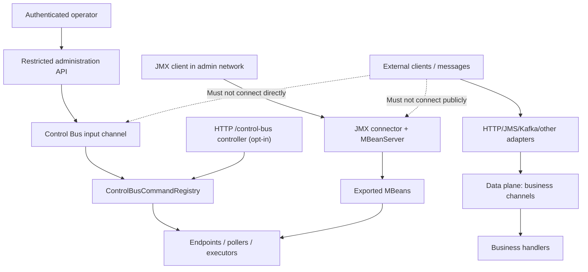
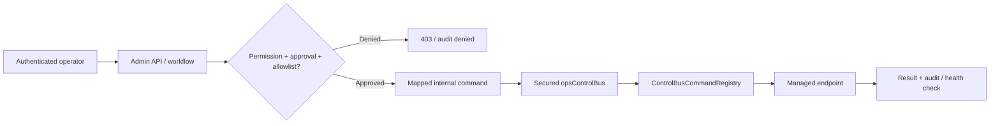
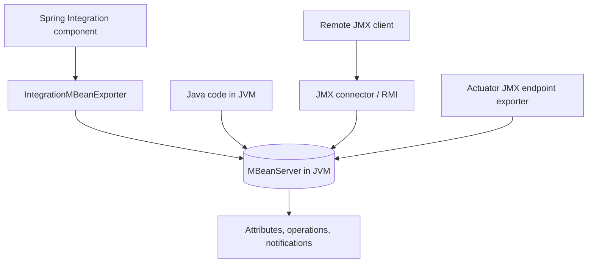

# Securing the Control Bus and JMX in Spring Integration Runtime

## 1. The Message Flow Control Plane Is Also a Security Surface

A Spring Integration application receives orders from JMS, uses a `SourcePollingChannelAdapter` to poll inventory data, and routes messages through `DirectChannel`, `ExecutorChannel`, or `QueueChannel` to handlers. During operations, administrators need to stop pollers, adjust routing, inspect queue status, and occasionally restart endpoints **without restarting the JVM**. Two common mechanisms are the **Control Bus** and **Java Management Extensions (JMX)**.

Management capabilities are useful yet dangerous: an administrative command can halt a consumer, resize an executor pool, enable/disable an endpoint, or inspect topology details. If message sources are unauthenticated or JMX/HTTP ports are exposed, unauthorized actors can disrupt processing flows or access sensitive information.

The lesson **"Securing the Control Bus and JMX"** belongs to the **Runtime Security** chapter in the **SPRING_INTEGRATION_RUNTIME** module. Its scope covers securing the **runtime control plane** in systems with channels, endpoints, consumers, pollers, executors, dynamic `IntegrationFlow` instances, transactions, retries, message stores, error channels, and correlation.

After this lesson, you will be able to:

1. Distinguish the business message path (*data plane*) from the runtime control path (*control plane*).
2. Understand Control Bus commands in **Spring Integration 6.4+**, without confusing them with expression execution in older versions.
3. Protect channels with `AuthorizationChannelInterceptor` and propagate `SecurityContext` properly across thread boundaries.
4. Design an **allowlist of administrative operations**, never accepting raw commands from untrusted sources.
5. Lock down the REST `/control-bus` endpoint, separating permission to read the command catalog from invoking operations.
6. Distinguish **JMX MBean export** from enabling a **remote JMX connector**, applying least privilege, authentication, TLS, and network isolation.
7. Identify risks when JMX adapters read objects/operations from headers or when management beans are exposed through multiple mechanisms.
8. Test unauthorized access, operational auditing, failure recovery, and prevention of unintended runtime changes.

**Versions and assumptions:** core examples target Spring Integration 6.4.x, Spring Security 6.x, Java 17+, and Spring Boot 3.x where Actuator is present. Behavior on Spring Integration 6.3 and earlier or 7.x should be verified separately. This lesson does not assume applications enable remote JMX or expose the Control Bus by default.

## 2. Threat Model: Who Can Issue Commands?



Separate three questions:

| Question | What must be protected | Example |
| --- | --- | --- |
| **Who is identified?** | Authentication at ingress or remote connector | Operator token, mTLS/JMX authenticated principal. |
| **What are they allowed to do?** | Authorization at HTTP, channel, service, or JMX role | Operator A may view health but cannot stop pollers. |
| **How are impacts recorded and recovered?** | Audit, change control, metrics, desired state | Record stop request, result, approver, timestamp, and flow ID. |

**Deny-by-default principle:** never wire an inbound adapter accepting arbitrary payloads to the Control Bus input, never allow arbitrary users to supply bean/method names, and never export every operation over JMX merely because a dashboard needs message counts.

### 2.1. Concrete Changes That Can Occur

| Administrative capability | Runtime impact | Risk if abused |
| --- | --- | --- |
| `Lifecycle.stop()/start()` | Stops/starts an endpoint/poller | Message intake disruption, backlogs, or SLA breaches. |
| `Pausable.pause()/resume()` | Pauses/resumes supporting components | Message source stalls or bursts upon resume. |
| `TaskExecutor`/`TaskScheduler` tuning | Adjusts pool/threads/rates | Saturation, thread exhaustion, or scheduling skew. |
| Router mappings or configuration operations | Changes message destinations | Misroutes messages or drops processing paths. |
| JMX attribute/operation | Reads state or mutates an MBean | Topology/metrics leaks, connection changes, or service stoppage. |
| Custom `IntegrationFlowContext` API | Registers, stops, destroys dynamic flows | Accidentally deletes another tenant's flow or drops in-flight messages. |

A protected channel does not mean every path to the corresponding operation is protected. **A JMX connector or REST Controller can invoke management operations without going through the application channel.** Controls must be applied on **every surface**.

## 3. Control Bus in Spring Integration 6.4+: Constrained Commands

Spring Integration allows sending a `Message<?>` to the Control Bus to invoke operations on manageable beans. For example:

```text
ordersInboundAdapter.stop
ordersInboundAdapter.start
orderTaskExecutor.setMaxPoolSize
```

Starting in **6.4**, the new Control Bus mechanism uses `ControlBusCommandRegistry` to map **bean names and management-eligible methods**. The command payload is a string formatted as:

```text
beanName.methodName
```

For methods taking parameters, pass the list via the `IntegrationMessageHeaderAccessor.CONTROL_BUS_ARGUMENTS` header. The registry uses parameter types/count to select the matching overload. For instance:

```java
import java.util.List;
import org.springframework.integration.IntegrationMessageHeaderAccessor;
import org.springframework.messaging.Message;
import org.springframework.messaging.support.MessageBuilder;

Message<?> changePool = MessageBuilder
        .withPayload("ordersTaskExecutor.setMaxPoolSize")
        .setHeader(IntegrationMessageHeaderAccessor.CONTROL_BUS_ARGUMENTS,
                List.of(12))
        .build();
```

This is an example of **command shape**, not an invitation to grant arbitrary permission to resize pools. The bean must exist, the operation must be permitted by `ControlBusCommandRegistry`, and the caller must be authorized. Never run example commands against real systems without operational approval.

### 3.1. Which Methods Are Eligible?

`ControlBusMethodFilter` in 6.4 filters methods such as:

- Methods annotated with `@ManagedOperation` or `@ManagedAttribute`.
- Operations from `Lifecycle` and `Pausable`.
- Certain setters/getters and management methods of `TaskExecutor`/`TaskScheduler` per framework rules.

**Being recognized by the framework** does not mean **a user is allowed to invoke it**. This is only a command-eligibility filter; authorization must still be enforced at ingress/channel/service and any other administrative paths.

### 3.2. Do Not Confuse Control Bus 6.4 with Legacy SpEL

Older Spring Integration documentation described a Control Bus accepting **Spring Expression Language (SpEL) expressions** and executing them in an evaluation context. Spring Integration 6.4 introduced `ControlBusCommandRegistry`/`ControlBusFactoryBean`, shifting the model to `beanName.methodName` command strings with header-bound arguments.

| Version/model | Threat modeling considerations |
| --- | --- |
| Classic Control Bus (older versions) | Exposes a **SpEL evaluation** surface; never accept expressions from untrusted clients. |
| Control Bus 6.4+ with `ControlBusCommandRegistry` | Registry only invokes eligible methods, **yet can still stop endpoints or resize pools** without authorization. |
| Applications explicitly using `ExpressionControlBusFactoryBean` or custom expression processors | Review the exact implementation; never assume all flows migrated to the new registry model. |

Do not bring `@bean.method(...)` payloads from old SpEL guides onto a 6.4 system assuming they are valid or properly filtered. Likewise, never treat "no arbitrary SpEL" as an excuse to skip authorization controls.

### 3.3. Declaring a Control Bus with Java DSL

```java
import org.springframework.context.annotation.Bean;
import org.springframework.context.annotation.Configuration;
import org.springframework.integration.channel.DirectChannel;
import org.springframework.integration.config.EnableIntegration;
import org.springframework.integration.dsl.IntegrationFlow;
import org.springframework.messaging.MessageChannel;

@Configuration
@EnableIntegration
public class InternalControlBusConfiguration {

    @Bean("opsControlBus")
    public MessageChannel opsControlBus() {
        return new DirectChannel();
    }

    @Bean
    public IntegrationFlow internalControlBusFlow() {
        return IntegrationFlow.from("opsControlBus")
                .controlBus()
                .get();
    }
}
```

This flow only **creates an internal control bus**; the snippet **does not yet protect the channel**. Section 5 adds authorization, and Section 6 separates a safe administrative API from the raw Control Bus. **Never** wire `HttpInboundGateway`, `JmsMessageDrivenChannelAdapter`, or a business channel directly into `opsControlBus` without permission checks.

### 3.4. Do Not Overlook Responses and Errors

The Control Bus is also a service-activating endpoint. If an operation returns a value, an output/reply channel can be configured in the flow; if an operation throws, the exception can unwind synchronously or go to `errorChannel` across an async boundary. Never return raw exception messages or bean topology to public APIs. Record the **final outcome** of the operation rather than marking success solely because `MessageChannel.send()` returned `true`.

## 4. Placing a Trust Boundary in Front of the Control Bus

**Recommended architecture:** administrators sign in through a dedicated channel, submit an **allowlisted business-level action**, and the application authenticates/authorizes/validates before emitting a **fixed command** to the Control Bus.



Accepting a client request shaped like `{ "bean": "...", "method": "...", "args": [...] }` and concatenating it into a command is **far too permissive**. It turns every eligible command in the registry into a public API for the caller, undermining tenant isolation, approvals, and auditing.

### 4.1. Defense Layers

1. **Network isolation:** dedicated admin network/ingress; never expose Control Bus/JMX to the public Internet.
2. **Authentication:** operator or workload identity verified at the entry point.
3. **Fine-grained authorization:** read, start, stop, configuration change, and orderly shutdown are distinct permissions.
4. **Allowlist:** only approved operations/targets; reject raw commands outside the list.
5. **Channel enforcement:** `AuthorizationChannelInterceptor` verifies permission to send to the internal control channel.
6. **Audit:** record actor, action, target, correlation, timestamp, approval, and result.
7. **Operational guardrails:** rate limits, concurrency limits, health gates, cooldowns, and rollback/reconciliation.
8. **Independent JMX protection:** because channel interceptors do not guard JMX invocations on MBeans.

Never use a client-sent `"userRole": "ADMIN"` header as proof of privilege. Permissions must derive from a verified `Authentication` bound to a controlled security context.

## 5. Protecting Input Channels with Spring Security Messaging

Starting in **Spring Integration 6.3**, the legacy `spring-integration-security` module was removed in favor of `spring-security-messaging` APIs. New code must not copy `ChannelSecurityInterceptor` or XML `int-security:secured-channels` from older Spring Integration documentation into 6.4 projects.

### 5.1. `AuthorizationChannelInterceptor`

A channel can be protected with `org.springframework.security.messaging.access.intercept.AuthorizationChannelInterceptor`. In Java configuration, apply the interceptor to a specific channel or use `@GlobalChannelInterceptor` by channel name pattern.

Example extending `InternalControlBusConfiguration` from Section 3:

```java
import org.springframework.context.annotation.Bean;
import org.springframework.context.annotation.Configuration;
import org.springframework.integration.config.GlobalChannelInterceptor;
import org.springframework.security.authorization.AuthorityAuthorizationManager;
import org.springframework.security.messaging.access.intercept.AuthorizationChannelInterceptor;

@Configuration
public class ControlBusChannelSecurity {

    @Bean
    @GlobalChannelInterceptor(patterns = "opsControlBus")
    public AuthorizationChannelInterceptor opsChannelAuthorization() {
        return new AuthorizationChannelInterceptor(
                AuthorityAuthorizationManager
                        .hasAuthority("INTEGRATION_OPERATOR"));
    }
}
```

**Contract:** the sender must hold an `Authentication` established by Spring Security containing the `INTEGRATION_OPERATOR` authority. Without that permission, the interceptor must reject at the **message send boundary**, without waiting for the command to reach `ControlBusCommandRegistry`.

Notes when applying:

- The pattern must match the **actual channel name**. If a flow uses `IntegrationFlowDefinition::controlBus` with an auto-generated `controlBus.input`, the `opsControlBus` pattern does not protect that channel.
- A `@GlobalChannelInterceptor` only intercepts Spring Integration-managed channels matching the pattern; verify in tests instead of assuming the bean takes effect.
- If another route invokes a managed method directly in Java, `opsControlBus` interceptors do not run.
- If a JMX/HTTP Control Bus Controller invokes the command registry through its own path, blocking the input channel does **not** automatically protect that path.
- With multiple application contexts, verify that security configuration is applied in the context managing the channel.

### 5.2. `SecurityContext` Does Not Automatically Cross Every Thread

`DirectChannel` executes synchronously on the sender's thread, so the thread-local `SecurityContextHolder` is usually still available when the handler runs. However, the following boundaries can switch threads:

| Boundary | Issue |
| --- | --- |
| `ExecutorChannel` | Worker picked by executor may lack the HTTP request's authentication. |
| `QueueChannel` + poller | Consumer is invoked on a poller thread, typically without the sender's security context. |
| `PublishSubscribeChannel` with executor | Each subscriber runs on another thread, risking lost principals or wrong contexts. |
| `CompletableFuture` / `Mono` / `Flux` | Async continuations have separate execution contexts; `ThreadLocal` does not auto-cross schedulers. |
| JMS/Kafka/SFTP inbound adapters | Messages arrive over external protocols; they do not automatically carry an authenticated Spring Security principal. |

Spring Security Messaging provides `SecurityContextPropagationChannelInterceptor` to capture/restore security context across channel boundaries and clean it up after handling. For example:

```java
import org.springframework.context.annotation.Bean;
import org.springframework.integration.config.GlobalChannelInterceptor;
import org.springframework.security.messaging.context.SecurityContextPropagationChannelInterceptor;

@Bean
@GlobalChannelInterceptor(patterns = "securedAsync*")
public SecurityContextPropagationChannelInterceptor securityContextPropagation() {
    return new SecurityContextPropagationChannelInterceptor();
}
```

This is a **configuration fragment** that must be placed inside a `@Configuration` class and tested with the specific channel type. It does not mean "automatically delegate every task to the caller's principal": the principal's origin must be trusted and the context lifecycle cleanly cleared. If a message arrives from an unauthenticated broker, attaching an `Authentication` from arbitrary headers introduces an impersonation vulnerability.

**Specifically for the Control Bus:** if commands traverse an `ExecutorChannel` or are stored in a `QueueChannel` before `opsControlBus`, test **where** authorization runs and how context propagates. It is usually safer to **authorize at ingress/service before enqueueing**, record a signed action/workload identity, and execute allowlisted commands in a trusted executor. Never defer authorization until after the security context has been lost.

### 5.3. Do Not Treat Channel Authorization as the Complete Policy

A principal with `INTEGRATION_OPERATOR` might still not be permitted to stop **every** flow:

```text
Order team operator may:
  stop/resume ordersInboundAdapter

Finance team operator may NOT:
  stop ordersInboundAdapter
  modify globalTaskExecutor
```

`AuthorizationChannelInterceptor` checking a single authority only enforces a coarse condition. Controls by **target bean**, tenant, action, and approval belong in a dedicated management service/authorization policy. Avoid a shared ADMIN role across commands of vastly different blast radii unless strictly necessary.

## 6. Allowlist Service Example: Client Picks an Action, Not a Method

A tighter design avoids giving users an API to "send an arbitrary command". Instead, expose only two approved actions: stopping and starting a specific poller.

```java
package demo.security;

import org.springframework.beans.factory.annotation.Qualifier;
import org.springframework.security.access.prepost.PreAuthorize;
import org.springframework.messaging.MessageChannel;
import org.springframework.messaging.support.MessageBuilder;
import org.springframework.stereotype.Service;

@Service
public class ApprovedPollingOperations {
    private final MessageChannel controlCommands;

    public ApprovedPollingOperations(
            @Qualifier("opsControlBus") MessageChannel controlCommands) {
        this.controlCommands = controlCommands;
    }

    public enum Action {
        STOP_ORDERS_POLLING,
        START_ORDERS_POLLING
    }

    @PreAuthorize("hasAuthority('INTEGRATION_OPERATOR')")
    public void execute(Action action) {
        String command = switch (action) {
            case STOP_ORDERS_POLLING -> "ordersInboundAdapter.stop";
            case START_ORDERS_POLLING -> "ordersInboundAdapter.start";
        };

        if (!controlCommands.send(
                MessageBuilder.withPayload(command).build())) {
            throw new IllegalStateException("Control Bus rejected command");
        }
    }
}
```

In applications using proxy-based method security, enable `@EnableMethodSecurity` so `@PreAuthorize` takes effect. Callers must invoke through the **Spring proxy**; self-invocation within the same bean bypasses method security. Retain `AuthorizationChannelInterceptor` as a second layer of defense on the channel.

Preconditions for using this example:

1. `ordersInboundAdapter` is a registered endpoint bean with appropriate lifecycle methods.
2. The admin API accepts `Action` as an enum; it never accepts client-supplied bean names or method strings.
3. The caller is authenticated; permissions may also require tenant ownership, break-glass approval, or a change window.
4. After issuing the command, the system must inspect the endpoint's **actual state**, backlog, and source acks to confirm the operational goal was achieved.
5. For auditing, record actor/action/target/result in the service before sending and after completion, avoiding logging raw bearer tokens.

### 6.1. Why Allowlisted Commands Still Need Protection

Even `STOP_ORDERS_POLLING` can be abused to halt order intake. The API needs **rate limiting**, replay protection for networked requests, auditing, execution permissions, and potentially approval workflows on critical systems.

Never allow users to send:

```text
beanName.methodName = raw JSON field from client
args = unvalidated raw list from request
```

A true allowlist maps **pre-declared actions → fixed targets/methods**, accepting only parameter values within permitted sets. If resizing a pool is allowed, validate approved min/max bounds and require higher privileges rather than allowing any integer that parses.

### 6.2. Read-Only vs. Mutating Permissions

| Example role/authority | Should allow | Should not allow |
| --- | --- | --- |
| `INTEGRATION_OBSERVER` | View health, filtered metrics, endpoint state | Call `stop`, `start`, edit routers, resize pools. |
| `INTEGRATION_OPERATOR` | Start/stop an assigned set of endpoints | Invoke non-allowlisted operations, rotate secrets, delete another tenant's flows. |
| `INTEGRATION_ADMIN` | Configuration changes after approval, with audit and quotas | Bypass verification/logging, expose JMX and HTTP controllers publicly. |
| `BREAK_GLASS` | Short-lived emergency recovery sessions with independent monitoring | Permanent credentials or everyday operational use. |

The authorities in this table are **example designs**, not default roles created by Spring Integration.

## 7. HTTP Control Bus Controller Since Spring Integration 6.4

The HTTP module provides `@EnableControlBusController` (since **6.4**) to register a REST controller at `/control-bus`. This capability is **opt-in**; declaring `IntegrationFlow.controlBus()` alone does not expose an HTTP endpoint.

Typical HTTP API:

| Request | Function | Risk |
| --- | --- | --- |
| `GET /control-bus` | Lists eligible beans and commands, including signatures/types | Exposes topology and invocable administrative operations. |
| `POST /control-bus/{beanName.methodName}` | Invokes a command; optional body provides arguments/types | Can stop flows, resize pools, or alter router mappings. |

Enabling the controller triggers **eager command registry initialization** so the API can enumerate available commands. This creates an attractive **capability catalog** for unauthorized visitors. Never treat GET as harmless merely because it does not mutate state.

### 7.1. Best Default Rule

**If the application does not need this API: do not enable `@EnableControlBusController`.** An internal Control Bus with a secured channel usually suffices for rare programmatic management. If the API is genuinely required, place it on a dedicated management ingress with strong authentication and narrowed command scope.

### 7.2. Example Securing the Path with Spring Security

The example below assumes the application accepts only **machine-to-machine bearer JWTs** and no cookie-based browser sessions on these paths. It requires Spring Security Resource Server dependencies, a configured JWT decoder/issuer, and a separate security chain for other application endpoints.

```java
package demo.security;

import org.springframework.context.annotation.Bean;
import org.springframework.context.annotation.Configuration;
import org.springframework.core.annotation.Order;
import org.springframework.http.HttpMethod;
import org.springframework.security.config.Customizer;
import org.springframework.security.config.annotation.web.builders.HttpSecurity;
import org.springframework.security.config.http.SessionCreationPolicy;
import org.springframework.security.web.SecurityFilterChain;
import org.springframework.integration.http.config.EnableControlBusController;

@Configuration
@EnableControlBusController
public class ControlBusHttpSecurity {

    @Bean
    @Order(1)
    public SecurityFilterChain controlBusChain(HttpSecurity http)
            throws Exception {
        return http
                .securityMatcher("/control-bus", "/control-bus/**")
                .authorizeHttpRequests(auth -> auth
                        .requestMatchers(HttpMethod.GET, "/control-bus")
                            .hasAuthority("SCOPE_integration.observe")
                        .requestMatchers(HttpMethod.POST, "/control-bus/**")
                            .hasAuthority("SCOPE_integration.manage")
                        .anyRequest().denyAll())
                .oauth2ResourceServer(resourceServer ->
                        resourceServer.jwt(Customizer.withDefaults()))
                .sessionManagement(session ->
                        session.sessionCreationPolicy(
                                SessionCreationPolicy.STATELESS))
                .csrf(csrf -> csrf.disable())
                .build();
    }
}
```

**CSRF warning:** disabling CSRF in this snippet is **only appropriate** for a *stateless* security chain using bearer tokens in the `Authorization` header that **never accepts browser cookie/session credentials**. If the endpoint is called from a browser using sessions/cookies, **do not disable CSRF**; apply CSRF protection, `SameSite` cookies, and appropriate controls. Never apply `csrf.disable()` application-wide just to make an administrative POST work.

**More important than the code itself:** even when both roles above are authenticated, `SCOPE_integration.manage` can still allow invoking **any method the command registry considers eligible**. URL-level authorization is **not a per-command allowlist**. For high-privilege or multi-tenant environments, **prefer not exposing the generic controller**, using a narrow REST service calling `ApprovedPollingOperations` as in Section 6 instead.

### 7.3. HTTP Security Tests Must Cover Both GET and POST

With appropriate Spring Security MockMvc/WebTestClient:

- No token → 401 (or matching chain outcome).
- Token with `integration.observe` → GET catalog allowed **if policy permits**, POST returns 403.
- Token with `integration.manage` without `integration.observe` → POST per policy, GET must have a well-defined outcome.
- Body with wrong argument type or outside the **custom admin service** allowlist → reject 400/403, method not invoked.
- Methods/routes other than defined GET/POST → deny; avoid permissive fallback rules.
- Valid authentication targeting another tenant's command → deny at service/policy.
- Rate limits and audits must record both rejected and approved requests.

Note that both bare `/control-bus` and `/control-bus/**` must match properly for your Spring Security version and servlet base path. Do not protect only one pattern and accidentally leave the GET catalog exposed.

### 7.4. Do Not Equate the REST Controller with the Input Channel

`opsControlBus`'s `AuthorizationChannelInterceptor` protects **messages sent to that channel**. The REST `ControlBusController` interacts with `ControlBusCommandRegistry` and the HTTP stack; it **does not necessarily pass through `opsControlBus`**. Therefore:

```text
Channel secured = true
HTTP controller enabled + HTTP auth missing
=> Control Bus still has an unprotected administrative path.
```

This is a classic **multi-entry control plane**: securing it requires inventorying every route that invokes management operations, not just one spot.

## 8. JMX: MBeans, `MBeanServer`, and Remote Connectors Are Distinct Layers

**JMX** is a Java subsystem providing an `MBeanServer` for registering **Managed Beans (MBeans)**: attributes can be read, operations invoked, and notifications received. Spring Integration supports exporting management metadata for channels/handlers/sources and provides JMX adapters to integrate with external systems.



Distinguish:

1. **Beans exported to the local `MBeanServer`:** exposes MBeans inside the JVM; does not automatically make them reachable over the network.
2. **Remote JMX agent/connector:** exposes a network path to `MBeanServer`; requires separate authentication, authorization, TLS, and network policies.
3. **Spring Boot Actuator endpoints over JMX:** simply another group of MBeans/endpoints; Actuator exposure settings **do not cover all MBeans**.
4. **JMX integration adapters:** receive/poll/invoke MBean operations via message flows; they introduce an additional path into JMX operations that must be protected.

**Never assume JMX = read-only monitoring.** An MBean may expose methods that mutate state, stop flows, alter configuration, or interfere with executors. With `readwrite` privileges, a remote JMX principal wields broad power.

## 9. Selectively Exporting MBeans

Spring Integration provides `IntegrationMBeanExporter`. With `spring-integration-jmx` and appropriate configuration, you can enable:

```java
import org.springframework.context.annotation.Configuration;
import org.springframework.integration.config.EnableIntegration;
import org.springframework.integration.jmx.config.EnableIntegrationMBeanExport;

@Configuration
@EnableIntegration
@EnableIntegrationMBeanExport(
        defaultDomain = "com.example.integration",
        managedComponents = {"ordersInboundAdapter", "ordersInput", "ordersValidator"})
public class InternalJmxExportConfiguration {
}
```

`@EnableIntegrationMBeanExport` accepts `managedComponents` to select via **component-name patterns**, defaulting to `"*"`. Do not leave the default `"*"` in an application with hundreds of endpoints without inventorying which operations are exported.

### 9.1. Filter Patterns Reduce Exposure, Not ACLs

`managedComponents` supports names/patterns and negation via the `!` prefix. Patterns are evaluated in order; **the first match decides inclusion/exclusion**.

Example:

```java
@EnableIntegrationMBeanExport(
        managedComponents = {"!private*", "orders*"})
```

When aligned with the application's naming contract, this selects a subset of components instead of all of them. However, this is **not an authentication/authorization mechanism**: any principal permitted to invoke exported MBeans through a connector can still call whatever operations those MBeans expose.

Specifically, `@EnableIntegrationMBeanExport` also interacts with exporting beans annotated with `@ManagedResource`. A bean can be exported via **Spring core `MBeanExporter`** or another exporter. Therefore, inspect **all MBeans in the `MBeanServer`** rather than assuming from `managedComponents` alone that no other MBeans exist.

### 9.2. `@ManagedOperation` Creates Management Surfaces in Multiple Places

`@ManagedOperation` and `@ManagedAttribute` are useful for exposing intentional administrative operations:

```java
import org.springframework.jmx.export.annotation.ManagedAttribute;
import org.springframework.jmx.export.annotation.ManagedOperation;
import org.springframework.jmx.export.annotation.ManagedResource;

@ManagedResource(objectName = "com.example.integration:type=Ops,name=OrderStatus")
public class OrderStatusManagement {
    private volatile boolean accepting = true;

    @ManagedAttribute
    public boolean isAccepting() {
        return accepting;
    }

    @ManagedOperation(description = "Pause accepting new order work")
    public void pauseAccepting() {
        accepting = false;
    }
}
```

This is merely an **illustrative managed bean**; no message dispatching actually stops on `accepting` unless business handlers read and honor that flag. When a method carries management annotations, it **may** become eligible in both JMX MBean exports and `ControlBusCommandRegistry`. Disabling one interface does **not automatically** disable the other.

**Review checklist for every annotated method:**

- Who can invoke the method via JMX, Control Bus, or REST admin API?
- What side effects does it have, and is it idempotent?
- Are min/max validation, tenant/flow ownership, approval, and auditing enforced?
- Can repeated/replayed or concurrent calls produce inconsistent state?
- If the method throws midway, how much state changed and how is it recovered?
- Does this operation truly belong on the control plane, or is a **read-only metric** sufficient?

### 9.3. Discovery via `ObjectName`

An MBean has an `ObjectName` consisting of domain + properties (e.g., `com.example.integration:type=MessageChannel,name=ordersInput`). A JMX client with read access can enumerate MBeans, attributes, and operation signatures depending on connector permissions.

**Never treat MBean names or domains as secrets to block access.** Naming a domain `private.management` does not replace authentication. Conversely, embedding tenant emails or access tokens in an `ObjectName` can leak sensitive data in JConsole/notifications/logs.

### 9.4. Do Not Disable Metrics Just to Reduce JMX Privileges

If an application only needs metrics, use **Micrometer/Observation** and an appropriate exporter rather than enabling mutable JMX operations. Disabling JMX exports does not have to stop `MicrometerMetricsCaptor` timers/counters/gauges running through `MeterRegistry`.

Using a **read-only** observability pipeline with restricted access removes the need to open remote JMX merely to read `channel.sendCount` or queue depth.

## 10. Securing Remote JMX: Network, Authentication, Authorization, and TLS

**Lowest-risk option:** do not enable a remote JMX connector unless needed. The local `MBeanServer` can still serve in-process tools and JMX adapters without opening an external management port.

If remote JMX is mandatory:

1. Allow access only from an **administrative network** or via monitored VPN/SSH tunnel/bastion.
2. Enable strong **authentication**; prefer certificates/JAAS/proper identity providers.
3. Enable **TLS** for the management channel, verify certificates, and secure the RMI registry.
4. Restrict monitoring to **read-only**; reserve invoke/write rights for authorized operations groups.
5. Separate operator credentials/identities from message-processing service accounts.
6. Audit connections, authentication failures, calls, and meaningful administrative changes.
7. Block all remote paths from untrusted networks, even when password auth is enabled.
8. Maintain procedures for credential rotation, certificate revocation, and emergency connector shutdown.

### 10.1. Example JDK Remote Management Flags

Example **illustrating the flags**, not a complete copy-paste configuration for Internet-facing deployment:

```text
-Dcom.sun.management.jmxremote.port=9010
-Dcom.sun.management.jmxremote.rmi.port=9011
-Dcom.sun.management.jmxremote.authenticate=true
-Dcom.sun.management.jmxremote.ssl=true
-Djava.rmi.server.hostname=<internal-management-address>
```

Replace placeholders with valid hostnames and configure additional **credentials/certificates/keystores/truststores/JMX connectors** per JDK documentation, infrastructure platform, and organizational policy. Open only required ports to trusted clients; RMI registry and RMI server ports can differ. Under containers/NAT/port-forwarding, inspect the actual advertised RMI stub address, not just the first port.

**Never deploy the following in production:**

```text
-Dcom.sun.management.jmxremote.authenticate=false
-Dcom.sun.management.jmxremote.ssl=false
```

These flags disable remote JMX authentication and encryption. A direct connection could read/write/invoke MBeans with powerful privileges, causing impacts far beyond reading metrics.

### 10.2. JMX Access Levels

The JDK offers `jmxremote.access` with basic permissions:

```properties
# Illustrative JMX role mapping; account names/credentials are examples.
monitorRole readonly
controlRole readwrite
```

`readonly` is suited for observation; `readwrite` permits updating attributes/invoking operations and must be strictly restricted. This role-file mechanism is **coarse-grained** and does not replace per-bean/method/tenant ACLs when fine-grained authorization is needed.

The JDK supports password files, yet as Oracle notes, file-based passwords store cleartext secrets and should not be preferred in production. Use a properly operated strong authentication mechanism (e.g., TLS client certificates/JAAS integration), lock down file permissions, and never place passwords in Git, logs, or JVM command lines.

### 10.3. RMI Registry and Deployment Pitfalls

Remote JMX can use an **RMI registry** to hand out connector stubs. Oracle warns about improperly secured RMI registries: a rogue registry can harvest client credentials in password-based configurations. Enabling TLS in one place without **evaluating the entire registry → connector path** is incomplete.

Check:

- Is the RMI registry properly protected and authenticated?
- Do clients verify server certificates/hostnames?
- Is the RMI connector bound to the right interface/network?
- Do firewalls cover **both the RMI registry and RMI server ports**?
- Does NAT or Kubernetes port-forwarding advertise the wrong hostname, sending clients to unintended IPs?
- Is **mTLS** required for administrators?

In Kubernetes, a safer choice in many scenarios is **disabling remote JMX** and collecting Micrometer/Actuator metrics over a secured endpoint. If JMX is needed for incident investigation, prefer controlled short-lived port-forwarding/bastion sessions with auditing.

### 10.4. Local JMX Privileges Must Also Be Controlled

A process on the same host/container with attach or JVM read permissions can access data that remote network ACLs cannot block. Secure hosts, service accounts, container namespaces, attach/debug capabilities, secrets, and file permissions. Do not treat "JMX binds only to loopback" as sufficient if host accounts are shared or other containers share the network namespace.

## 11. Spring Integration JMX Adapters: Both Observing and Acting

The `spring-integration-jmx` module includes adapters for:

- `notification-listening-channel-adapter`: receives notifications from MBeans.
- `notification-publishing-channel-adapter`: emits JMX notifications from messages.
- `attribute-polling-channel-adapter`: polls a managed attribute.
- `tree-polling-channel-adapter`: reads an MBean/object graph tree.
- `operation-invoking-channel-adapter` and outbound gateway: invokes a managed operation.

JMX adapters are **Integration endpoints**, so they follow threading/poller/error/retry semantics. Yet because they read or invoke MBeans, they also belong inside the control-plane threat model.

### 11.1. Risks of Dynamic Operation Selection via Headers

Per the JMX reference, the operation-invoking adapter can obtain object and operation names from configuration **or** from headers such as `JmxHeaders.OBJECT_NAME` and `JmxHeaders.OPERATION_NAME`. If an inbound HTTP/JMS/Kafka message can supply these two headers and reach the adapter, a client can cause the application to invoke **an operation other than the intended target**.

**Safer approach:**

- Hard-code `object-name` and `operation-name` in configuration for single-purpose adapters.
- If dynamic targets are strictly required, map only a **logical action allowlist** to `ObjectName`/operation from trusted backend data.
- Strip/overwrite external JMX-specific headers before routing.
- Enforce dedicated authorization on the adapter channel and target operation.
- Validate argument types, counts, ranges, and side effects.
- Audit both the caller and effective target operation.

Do not take an example using a hard-coded adapter and assume the same security posture applies to an adapter reading targets from message headers.

### 11.2. Polling JMX Attributes Can Also Leak Data

`attribute-polling-channel-adapter` and `tree-polling-channel-adapter` can inspect MBean state. An overly broad query pattern such as `*:type=*` can return topology, configuration, URIs, class names, or data that should never enter business message flows.

Ensure you:

1. Restrict `ObjectName`/query patterns.
2. Filter attributes via converters/filters rather than exporting every field.
3. Control where outputs go: logs, tracing, queues, external brokers, and HTTP replies.
4. Set quotas on polling frequency and payload size to protect `MBeanServer` and backends.
5. Never place secrets or credentials in notification payloads/userData.

A message originating from a JMX notification **does not inherently carry an authenticated business-tenant identity**. If it triggers downstream workflows, it must still pass source validation and authorization.

## 12. Spring Boot Actuator Over JMX: Scoping It Correctly

Spring Boot Actuator can expose endpoints over HTTP and JMX. A conservative configuration:

```yaml
management:
  endpoints:
    jmx:
      exposure:
        include: "health,info"
    web:
      exposure:
        include: "health,info"
```

This configures **Actuator endpoint exposure**; it does not fully govern `IntegrationMBeanExporter`, application-registered MBeans, or the JVM's remote JMX agent. Spring Boot releases and security policies may specify different endpoint access levels/roles; verify against your exact Boot version.

### 12.1. Three Settings That Are Not Equivalent

| Setting | Primary effect | What it does NOT do |
| --- | --- | --- |
| `management.endpoints.jmx.exposure.include` | Selects which **Actuator endpoints** are exposed over JMX | Does not lock down all Spring Integration/Java MBeans. |
| `@EnableIntegrationMBeanExport(managedComponents=...)` | Selects integration components exported by pattern | Does not enable authentication/TLS on the RMI connector. |
| `-Dcom.sun.management.jmxremote.port=...` | Enables the JDK remote JMX connector | Does not decide which app-specific MBeans may be invoked. |

Furthermore, Actuator's separate HTTP management port/path does not protect an open JMX RMI port. A firewall rule for `/actuator/**` does not block a remote JMX client over TCP.

### 12.2. Turn Off What You Do Not Need

If JMX is not required:

- Do not enable the JVM remote JMX agent/connector.
- Do not import/enable dedicated exporters merely because a sample app had them.
- Restrict Actuator endpoints and access permissions.
- You can set `spring.jmx.enabled=false` in Spring Boot to disable part of Boot's JMX auto-export, but still **verify whether other exporters/JVM flags** remain active.
- Use `MeterRegistry`/Observation for metrics with proper auth and network policies.

Disabling JMX must not break operational runbooks for stopping/restarting pollers: replace it with a narrow audited admin API or controlled deployment orchestration.

## 13. Managing the Runtime Without Breaking Message Delivery

Authorizing the right caller is only the first step. A **valid** `stop()` command can still hurt availability or disrupt transactions/acks if issued at the wrong moment.

### 13.1. Stopping an Endpoint Does Not Mean Everything Has Finished

```text
Operator sends: ordersInboundAdapter.stop

Poller:
  just received message E-42
  → hands off to ExecutorChannel
  → stop() is invoked on adapter

Worker:
  still processing E-42
  → calls downstream / commits DB / produces reply
```

In this scenario, the stop signal may prevent the poller from fetching new messages, yet **does not automatically cancel** tasks already handed to an executor. Depending on component implementation, a poller may finish its current cycle; reactive subscriptions or HTTP requests also have distinct cancellation semantics.

**Safe flow-stop runbook:**

1. Block **new ingress** at the router/source under an approved maintenance state.
2. Send stop/pause to the target endpoint over the secured control plane.
3. Observe in-flight counts, executor queues, `QueueChannel`/broker backlogs, and completion latency.
4. Wait for drain with a **deadline**, or route pending work to durable retry/DLQ per policy.
5. Only destroy/reconfigure resources after confirming a safe quiescent point.
6. Upon resume, verify source checkpoints/acks and idempotency, then monitor recovery.

Never delete queues/message stores to "clear backlog" simply because a management operation stopped the consumer.

### 13.2. Transactions and the Control Bus Serve Two Different Purposes

A transaction wrapping `SourcePollingChannelAdapter.receive()` or a handler DB update **does not automatically wrap** administrative commands coming from another thread. The Control Bus mutates lifecycle/configuration rather than executing an atomic transaction across the message source and all downstream resources.

| Command | Possible impact | Checks beyond authentication |
| --- | --- | --- |
| Stop poller | Stops receiving new messages | In-flight messages, source acks, open transactions. |
| Start poller | Resumes polling | Credentials, checkpoints, stale locks, duplicate redelivery. |
| Resize executor | Concurrent task count | Backpressure, queue/DB pool saturation, lock contention. |
| Update router mapping | Path of subsequent messages | Messages already queued before mapping, tenant routing, replay. |
| Change `IntegrationFlow` | Endpoints/beans/lifecycle | In-flight drain, persistent stores, flow versions, and rollback. |
| Orderly shutdown via JMX | Stops active components | Drain timeout, operational approval, standby node readiness. |

With `ExecutorChannel` and Reactor, remember thread-local transactions may not cross async boundaries. Nor can a valid management operation undo a `commit` that already succeeded.

### 13.3. Retries of Administrative Commands Must Be Bounded

If an admin API times out while calling stop, you cannot assume **stop did not happen**. Unbounded retries can cause `stop/start/stop` oscillations when automation systems fight over state.

Design:

- Commands carry a stable **request ID** for API-level auditing/deduplication.
- Actions express a desired state (e.g., "polling should be stopped") rather than a blind "toggle".
- Configuration version/epoch prevents stale requests from overwriting newer config.
- Cooldowns/rate limits, finite timeouts, and circuit breakers if depending on remote connectors.
- After a timeout, **read state** from the authoritative source before deciding to retry.
- Every retry after failure must have an owner/runbook and be recorded.

`Lifecycle.start()/stop()` are generally designed to be safely repeatable without corrupting state, yet **that does not make** every custom bean's managed method idempotent. For instance, changing routing or initializing connections may have side effects that are hard to reverse.

## 14. Dynamic `IntegrationFlowContext` and Tenant Isolation

In dynamic runtimes, an application can register/remove `IntegrationFlow` instances based on tenant configuration. `IntegrationFlowContext` exposes `IntegrationFlowRegistration` objects supporting `start()`, `stop()`, `destroy()`, and lookup by ID. This is an **additional control plane** that does not inherently pass through `ControlBusCommandRegistry` or JMX.

### 14.1. Do Not Confuse Flow ID with Ownership

```text
flowId = tenant-acme-orders-v3
requestingPrincipal = tenant-beta-operator
operation = destroy
```

If an API merely checks "does flow ID exist" and calls `destroy()`, a tenant-beta operator can destroy tenant-acme's flow. Ownership must be verified against a **trusted configuration DB/security policy**, never inferred from a client-supplied path or bean name string.

### 14.2. Protecting Dynamic Flow Lifecycle

A flow management service should:

1. Accept a **logical flow identifier** and action from an approved list.
2. Extract tenant/role/approval from the authenticated principal.
3. Query trusted configuration to verify owner, scope, flow version, and desired state.
4. Use `getRegistrationById(...)` to locate the registration inside the **right JVM**.
5. Serialize `register/replace/remove` operations for the same flow ID to avoid races.
6. Stop/drain when replacing or removing; audit both start and outcome.
7. Never attach shared support beans as dependent beans of a flow and accidentally destroy global resources.
8. Across multiple replicas, distinguish per-JVM registries from **cluster ownership/sharding**.

A JMX/Control Bus operation can stop an endpoint managed by `IntegrationFlowContext`, yet that **does not update durable desired-state storage** unless the application has a reconciler. Another reconciler might immediately restart the endpoint after an operator stops it. Coordinate control-plane mutations with the configuration source of truth.

### 14.3. Command Registry and Dynamically Generated Bean Names

With dynamic flows, bean names may contain prefixes derived from `flowId`. Never let a request pick arbitrary beans from the command registry merely because a regex matches `tenant-*`. Instead, map the verified logical tenant/flow ID to the exact target bean at runtime and permit only approved operations.

If a flow is destroyed and re-registered with a different bean name, a previously queued command can become a **stale command**. Carry config version/epoch through policy checks and reject outdated commands rather than firing raw commands after an uncontrolled delay.

## 15. Authorization by Action and Operational Channel

**RBAC** is a starting point, yet a blanket "manage integration" permission is usually too broad for multi-tenant environments or sensitive endpoints.

| Action | Target | Example permission | Additional conditions |
| --- | --- | --- | --- |
| View health/status | Assigned flows | `integration:observe` | Do not leak cross-tenant secrets/topology. |
| View control bus command catalog | Platform administrators | `integration:inspect_commands` | Audited; optionally mask sensitive signatures. |
| Pause/resume poller | A specific source | `integration:operate` | Tenant/owner match; cooldown; health check. |
| Tune executor concurrency | A task executor | `integration:tune` | Min/max bounds, SLO, and approval. |
| Edit router mapping | Configured route | `integration:route_edit` | Validate target channel, risk review, version check. |
| Destroy dynamic flow | A specific flow | `integration:flow_delete` | Drain, approval, and rollback plan. |
| Orderly shutdown | JVM/node level | `integration:shutdown` | Quorum/maintenance window and break-glass. |
| Invoke mutable MBean | Allowlisted MBean | `jmx:write` | TLS, authenticated connector, scope, and audit. |

This is an **illustrative policy**, not a framework-defined list of authorities. Multi-tenant authorization must check **subject, action, resource, and context** (tenant, environment, maintenance window, approval).

### 15.1. Example Pre-Command Policy Check

```text
request: resume orders polling
subject: operator-17
resource: tenant-acme/ordersInboundAdapter

CHECK:
  authenticated subject has integration:operate
  subject assigned to tenant-acme
  resource belongs to tenant-acme
  flow version equals approved version
  no deployment/drain in progress
  action in enum allowlist
  operation not rate limited

THEN:
  audit attempt → send internal command
  await/read endpoint state → audit result
```

Never replace these checks with `startsWith("tenant-acme")` on an unnormalized bean name string. Even a service call from a system actor requires identity/permission controls; "running inside the JVM" is not a default trust guarantee.

## 16. Control Plane Auditing and Observability

An administrative command must be tracked as a **system state change**, not merely a routine message. Useful audit fields:

| Field | Purpose |
| --- | --- |
| `requestId` / `changeId` | Correlate retries and approval requests. |
| `actorId` / `servicePrincipal` | Who/what requested the operation. |
| `authority`/`policyDecision` | Checked permission and allow/deny decision. |
| `targetFlowId`, `targetBean`, `operation` | Actual resolved resource and operation. |
| `environment`, `nodeId`, `flowVersion` | Prevent confusing cluster/prod/staging or stale commands. |
| `startTime` / `finishTime` | Request and completion timestamps. |
| `outcome` / `exceptionClass` | Success, denied, timeout, unknown, partially applied. |
| `previousState` / `desiredState` | Supports reconciliation and rollback. |
| `approvalId` / `breakGlassReason` | Traceability for critical changes. |

**Never log** bearer tokens, JMX passwords, cookies, raw security contexts, sensitive headers, or full arguments if they may contain secrets. For auditable parameters such as max pool size, record only validated, non-sensitive values.

### 16.1. Recommended Metrics

- `control_command_attempt_total` — command count by action/target type/outcome.
- `control_command_denied_total` — requests rejected by policy/interceptor.
- `control_command_duration_seconds` — latency from request to state confirmation.
- `control_command_timeout_total` — commands with unknown outcomes at deadline.
- `jmx_authentication_failure_total` — emitted by connector/security infrastructure if instrumented.
- `dynamic_flow_state_mismatch` — desired state and runtime state diverge.
- `management_endpoint_inflight` — unfinished management operations.

These names are **proposed application instrumentation**, not metrics automatically exported by Spring Integration. Avoid attaching high-cardinality tags like `requestId`/`userId`/`flowId` to metrics; keep those in access-controlled audit logs/traces.

### 16.2. Flow Logging Does Not Automatically Carry Security Context

Across `ExecutorChannel`, `QueueChannel`, or reactive continuations, an operator's `MDC`/`ThreadLocal` can be lost. Use trusted context propagation or carry **verified correlation metadata** through messages and logs; never substitute client-asserted headers for `Authentication`. An error flow emitting an `ErrorMessage` after the caller timed out must still correlate to `changeId` to audit the final outcome.

### 16.3. Never Let the Error Flow Leak Privileges

If a command fails, `ErrorMessage` can wrap a `MessagingException` or `failedMessage`, including the command payload and headers. Never publish raw errors to a shared broker or HTTP response for unauthorized users. Redact details, map exceptions to safe error codes, and keep details in protected logs. An exposed `errorChannel` or multi-tenant consumer can leak command names, arguments, and topology.

## 17. Operating Safely in Emergencies

Being able to stop a poller quickly is essential when upstream sends bad data, yet **break-glass** is also a sensitive privilege.

Procedure:

1. **Scope the incident:** which source, flow ID, impact, message backlog, and downstream health.
2. **Authenticate the operator:** appropriate permission or time-boxed emergency elevation.
3. **Choose the minimal action:** pause one adapter rather than shutting down the JVM if sufficient to isolate the fault.
4. **Record audit/approval:** actor, reason, timeout, and desired-state change.
5. **Execute over a protected channel:** internal admin service/Control Bus; JMX only inside the admin network.
6. **Verify the result:** endpoint running state, poller receive rate, in-flight count, and error count.
7. **Monitor side effects:** source acks, retries, transactions, queue age, broker lag.
8. **Resume in a controlled manner:** verify config and checkpoints; avoid backlog bursts causing overload.
9. **Close out:** revoke elevated roles/credentials, preserve the incident timeline, and update the runbook.

Never resort to `kill -9`, killing containers, or deleting MBeans/locks as a first step simply because a stop command did not respond; inspect transaction, listener, and in-flight message states first.

## 18. Testing Control Bus Security in Spring Test

The most important test: an **unauthorized** client produces zero side effects, while a valid operator can execute only approved commands. Tests must assert **final state**, not just HTTP codes or a thrown exception.

### 18.1. Small Test Context with a Managed Operation

```java
package demo.security;

import java.util.concurrent.atomic.AtomicInteger;
import org.springframework.context.annotation.Bean;
import org.springframework.context.annotation.Configuration;
import org.springframework.context.annotation.Import;
import org.springframework.jmx.export.annotation.ManagedOperation;
import org.springframework.jmx.export.annotation.ManagedResource;

@Configuration
@Import({
        InternalControlBusConfiguration.class,
        ControlBusChannelSecurity.class
})
public class SecureControlBusTestConfiguration {

    @Bean("testOpsTarget")
    public TestOpsTarget testOpsTarget() {
        return new TestOpsTarget();
    }

    @ManagedResource
    public static class TestOpsTarget {
        private final AtomicInteger calls = new AtomicInteger();

        @ManagedOperation
        public void markReady() {
            calls.incrementAndGet();
        }

        public int getCalls() {
            return calls.get();
        }
    }
}
```

This context uses the exact `opsControlBus` channel protected by `AuthorizationChannelInterceptor` from Section 5. `@ManagedOperation` merely demonstrates how a method becomes eligible in the registry; annotating real sensitive methods without review is discouraged.

### 18.2. Testing Unauthorized/Authorized Messages

```java
package demo.security;

import static org.junit.jupiter.api.Assertions.*;

import org.junit.jupiter.api.AfterEach;
import org.junit.jupiter.api.Test;
import org.springframework.context.annotation.AnnotationConfigApplicationContext;
import org.springframework.messaging.MessageChannel;
import org.springframework.messaging.support.MessageBuilder;
import org.springframework.security.access.AccessDeniedException;
import org.springframework.security.authentication.TestingAuthenticationToken;
import org.springframework.security.core.context.SecurityContextHolder;

class SecureControlBusTest {

    @AfterEach
    void clearSecurityContext() {
        SecurityContextHolder.clearContext();
    }

    @Test
    void viewerCannotInvokeButOperatorCan() {
        try (var context = new AnnotationConfigApplicationContext(
                SecureControlBusTestConfiguration.class)) {

            MessageChannel commands =
                    context.getBean("opsControlBus", MessageChannel.class);
            var target = context.getBean(
                    SecureControlBusTestConfiguration.TestOpsTarget.class);

            var viewer = new TestingAuthenticationToken(
                    "viewer", "unused", "INTEGRATION_OBSERVER");
            SecurityContextHolder.getContext().setAuthentication(viewer);

            assertThrows(AccessDeniedException.class,
                    () -> commands.send(MessageBuilder
                            .withPayload("testOpsTarget.markReady")
                            .build()));
            assertEquals(0, target.getCalls());

            var operator = new TestingAuthenticationToken(
                    "operator", "unused", "INTEGRATION_OPERATOR");
            SecurityContextHolder.getContext().setAuthentication(operator);

            assertTrue(commands.send(MessageBuilder
                    .withPayload("testOpsTarget.markReady")
                    .build()));
            assertEquals(1, target.getCalls());
        }
    }
}
```

This test demonstrates using `SecurityContextHolder` to verify channel authorization **on the same thread**. `TestingAuthenticationToken` is strictly for tests, **not** a production authentication mechanism. Across Spring Security/framework versions, exceptions may be wrapped or change subtype; always assert **no side effect executes when denied**.

**Limitations of this test:**

- It does not test HTTP JWT signatures/issuers/audiences or JMX remote credentials.
- It does not test `ExecutorChannel`/`QueueChannel` propagation.
- It does not test whether a custom admin service blocks operators from targeting other tenants.
- It does not test how stop/start affects sources/transactions.
- It does not prove security for management beans **that do not use this channel**.

### 18.3. Testing Authorization Without a `SecurityContext`

In an additional test, call `SecurityContextHolder.clearContext()` and send a command. It must be rejected per policy. Missing authentication may throw `AuthenticationCredentialsNotFoundException` or another exception depending on configuration; assert **no operation execution** and recognize the authentication/authorization error class.

Also send a message carrying the header:

```text
role = "INTEGRATION_OPERATOR"
```

but with **no authenticated `SecurityContext`**; it must still be denied. That header is merely sender-supplied data, not a verified security principal.

### 18.4. Testing Async Context Leakage

Have 2 users send sequentially through a shared `ExecutorChannel`:

```text
Operator A: INTEGRATION_OPERATOR, action=stop
Viewer B:   INTEGRATION_OBSERVER, action=stop

Pool size = 1 (intentionally reusing thread)

Expected:
  A: authorized per policy
  B: denied
  B does not inherit A's SecurityContext on the worker thread
```

The test must verify that `SecurityContextPropagationChannelInterceptor` or the delegated executor clears thread-local context after handling (including when throwing). If user B succeeds simply because the worker thread still held principal A, that is a **critical security leak**.

## 19. Testing HTTP/JMX in Independent Test Layers

### 19.1. HTTP Controller: Route-Level Is Not Command-Level

With `@EnableControlBusController`, use `MockMvc` (Servlet) or `WebTestClient` (WebFlux) alongside Spring Security testing support.

| Caller | Request | Expected |
| --- | --- | --- |
| Unauthenticated | GET `/control-bus` | 401/denied per policy, catalog not returned. |
| Unauthenticated | POST a command | 401/denied, **operation does not run**. |
| Viewer | GET catalog | Only if inspection permission granted; response leaks no secrets. |
| Viewer | POST a command | 403, side-effect count unchanged. |
| Valid operator | POST an allowed method on a narrow service | Accepted, audited, endpoint state matches. |
| Tenant B operator | POST targeting tenant A | 403 at resource policy despite general authority. |
| Expired/wrong-audience token | Any command | Authentication failure; no operation runs. |
| Wrong method or unknown bean | POST | No fallback method invoked; safe error returned. |
| Oversized/flooded requests | GET/POST | Body size/rate limits enforced and alerted. |

Do not merely assert `status().isOk()` for a command. Verify that the **operation actually ran on the bean**, inspect final state, audit events, and the error channel if execution is async.

**Note:** if the generic `/control-bus` Controller is enabled, an operator with POST rights can invoke any eligible command-registry method unless another restriction layer exists. A test showing "operator called one allowed method successfully" does not prove they cannot invoke methods **forbidden by business policy**.

### 19.2. Inventorying Local MBeans in Integration Tests

With the exporter enabled in the context, query the actually registered `ObjectName` instances:

```java
import java.lang.management.ManagementFactory;
import java.util.Set;
import javax.management.MBeanServer;
import javax.management.ObjectName;

MBeanServer server = ManagementFactory.getPlatformMBeanServer();
Set<ObjectName> exported = server.queryNames(
        new ObjectName("com.example.integration:*"), null);

for (ObjectName objectName : exported) {
    System.out.println(objectName.getCanonicalName());
}
```

This is an **inventory fragment for tests**, not a remote security test. It assumes the exporter targets the platform MBean server and that domain. MBeans in other domains or registered by other exporters must also be inspected. A real security test should assert against an **allowlist** rather than just printing names.

Additional checks:

1. Does `@EnableIntegrationMBeanExport(managedComponents=...)` genuinely exclude unlisted components?
2. Does `@ManagedResource`/Spring core exporter register unexpected operations in `MBeanServer`?
3. Are read-only attributes truly prevented from invoking/writing under the remote `readonly` role?
4. Is `readwrite` restricted to trusted operators with network/TLS constraints?
5. When closing the connector, are remote clients blocked while local JMX remains usable if allowed?
6. Do any `ObjectName` strings contain secrets, tenant emails, or sensitive payloads?

### 19.3. Remote JMX Security Tests Must Run in an Isolated Environment

Never probe public JMX ports from the production Internet to validate security. Use an **isolated test deployment** matching production configuration and verify:

- Unknown source IPs are blocked by firewall/network policies.
- Missing/invalid credentials are rejected.
- TLS handshakes and certificate validation succeed as configured.
- A `readonly` viewer cannot invoke state-mutating operations.
- An explicitly authorized operator can invoke permitted operations in the sandbox.
- RMI registry/server ports do not expand beyond the allowlist.
- All connections/authentications/operations are logged at the appropriate layer.
- Post-rollout security does not rely on a static secret baked into an image/container.

For JMX adapters connecting to remote MBeans, test the **adapter client's** credentials and TLS similarly; if a remote MBean server is untrusted, validate fetched data before feeding it into business flows.

## 20. Abuse Scenarios and Mitigations

| Scenario | Design weakness | Primary mitigation |
| --- | --- | --- |
| JMS input feeds arbitrary messages to Control Bus | No trust boundary between business data and control | Separate management channel, authenticate source, allowlist + authorization. |
| Client POSTs an arbitrary method name | Overly broad REST controller checking only a coarse role | Avoid exposing the generic controller or enforce command-level policy in an admin facade. |
| Metrics viewer stops poller via JMX | Overly broad `readwrite` JMX credential | `readonly` monitoring, separate operator credentials, disable remote connector. |
| Public JMX with authentication disabled | No auth/network isolation | Disable remote, auth/TLS/mTLS, firewall, and audit. |
| Header token trusted as admin privilege | Client self-asserts roles | Use authenticated `SecurityContext`; strip untrusted headers. |
| Worker B reuses worker A's principal | ThreadLocal `SecurityContext` not cleaned up | Propagation/cleanup interceptor, test pool reuse. |
| Tenant B stops tenant A's flow | Only checked bean/flow ID existence | Resource ownership authorization from trusted config. |
| New `@ManagedOperation` exposes sensitive method | Forgot to review both JMX and Control Bus surfaces | Management API inventory, review annotations/exporters/registry. |
| Unprotected HTTP GET command catalog | Assumed read-only is public | Restrict `GET /control-bus` and disable when unneeded. |
| JMX header selects arbitrary `ObjectName` | Dynamic target from untrusted message | Fixed object/operation or validated allowlist. |
| Router mapping edit misroutes tenant messages | Missing permission/resource validation | Config versioning, mapping allowlist, multi-tenant isolation tests. |
| Stop flow executed on wrong JVM | Local registry/JMX only sees current node | Node identity, cluster ownership, and desired-state reconciler. |
| Timed-out command retried repeatedly | Missing request ID/desired state | Idempotency, read-back, bounded retry, and auditing unknown outcomes. |
| Control command logs leak secrets | Logging full request headers/args | Redact and restrict access to audit/log storage. |
| Actuator JMX config mistaken for a firewall | Confusing endpoint exposure with remote connector | Audit JVM flags, MBeanServer exporters, and RMI ports separately. |

### 20.1. Symptom → Investigation Table

| Symptom | Possible cause | First check |
| --- | --- | --- |
| Unauthorized viewer invokes Control Bus | Wrong global interceptor pattern, or hitting another HTTP/JMX path | Trace entrypoint and verify exact channel/HTTP chain/JMX connector. |
| `AccessDeniedException` after `ExecutorChannel` | `SecurityContext` lost across thread switch | Propagation interceptor and authorization placement. |
| GET catalog returns unexpectedly many methods | Eager loading by `ControlBusCommandRegistry`, many `@Managed...` annotations | Inventory methods/beans, review controller exposure. |
| Remote JMX disabled yet MBeans still exist | Local `MBeanServer` differs from remote connector | Expected semantics: remote port closed, local exports remain. |
| `management.endpoints.jmx.exposure.include` narrowed yet MBean exposed | `IntegrationMBeanExporter` or custom exporter | Inventory entire `MBeanServer` and ports/connectors. |
| JConsole connection fails behind NAT | Wrong RMI advertised hostname/second port | Network policy, DNS, RMI registry/stub, and TLS. |
| Stop command returns success yet consumer keeps running | In-flight work, async workers, different endpoint/node | Source state, execution timeline, queues, and node identity. |
| Flow stops then restarts automatically | Reconciler enforces desired-state DB | Update approved desired state, not just local lifecycle. |
| Repeated start/stop spam | Missing cooldown/rate limit/approval | Audit actors, request IDs, per-target command rate. |
| Stop triggers DLQ/rollback spikes | Transaction/ack/retry boundary affected | Source state, in-flight tasks, broker redelivery, and error flow. |
| JMX operation missing from list | Exporter filter/annotation/version mismatch | Bean name pattern, `@ManagedOperation`, and registration. |
| Unexpected JMX operation from adapter | Dynamic `JmxHeaders` controlled upstream | Fixed target, header mapper, and channel auth. |
| Audit says "command sent" yet state unchanged | `send()` only acked handoff, async operation failed | Read-back state, `errorChannel`, timeouts, and completion trace. |

### 20.2. Procedure for Investigating an Unauthorized Command

1. **Identify the entrypoint:** HTTP Controller, internal channel, JMX RMI, JMX adapter, or custom admin service?
2. **Preserve evidence:** request ID, node, identity source, command ID/action, timestamps, and endpoint/flow versions; never retain raw tokens.
3. **Lock down the trust boundary:** disable unnecessary routes/connectors or block at the network layer.
4. **Inspect authentication:** token/JAAS/certificate/JMX access role; was any principal spoofed via headers?
5. **Inspect authorization:** route matchers, channel interceptor patterns, per-resource allowlists.
6. **Verify execution:** did the managed method actually run; what were before/after states?
7. **Assess impact:** source polling, in-flight work, transactions, broker acks, queue/DB state, and duplicate events.
8. **Controlled recovery:** desired-state reconciliation, approved re-enabling, and backlog measurement.
9. **Long-term remediation:** regression tests, capability reduction, auditing, and credential rotation if needed.

## 21. Hands-On Exercises

### Exercise A — Proving the Control Bus Must Be Protected at the Channel

1. Create an `IntegrationFlow.from("opsControlBus").controlBus()` running in a test context.
2. Declare a `testOpsTarget` bean with a `@ManagedOperation` that increments a counter.
3. Before adding the security interceptor, note the **risk** of any in-JVM sender being able to dispatch commands to the input channel (demonstrate in tests only).
4. Attach `AuthorizationChannelInterceptor` requiring `INTEGRATION_OPERATOR`.
5. Verify viewer/no-auth is denied and the counter stays unchanged; a valid operator increments the counter once.
6. Rename the input channel while keeping the old interceptor pattern; observe why tests must verify the **actual channel name**.
7. Clear `SecurityContextHolder` after each test and confirm no test reuses a prior principal.

**Pass criteria:** rejected requests cause zero side effects; valid requests invoke only the registered operation; tests are order-independent.

### Exercise B — Admin API That Disallows Selecting Raw Bean Methods

1. Create an `Action` enum with `STOP_ORDERS_POLLING` and `START_ORDERS_POLLING`.
2. Write a service mapping the enum to **fixed** Control Bus commands, protected by method security.
3. Authenticate the operator via Spring Security; never take roles from the request body.
4. Send a request specifying a bean name outside the allowlist; the API must reject before sending any message.
5. Attempt calling stop 20 times consecutively; design rate limits/cooldowns and auditing.
6. Simulate a timeout after sending a command; use read-back state to decide on retries rather than blindly sending `toggle`.
7. Separate observer and operator permissions so viewers cannot inspect all bean/method signatures.

**Pass criteria:** clients cannot expand the operation set by altering JSON payloads or HTTP paths; outcomes include `changeId` and proper audit records.

### Exercise C — Testing the REST Controller and Channel Bypass Paths

1. Enable `@EnableControlBusController` in a **test environment** with a dedicated Spring Security chain.
2. Confirm missing token → denies both GET catalog and POST.
3. Verify viewer token can view catalog only if policy permits; POST is denied.
4. Verify token with manage permission: operation executes and is audited.
5. Disable or omit the controller when using a narrow allowlist API.
6. Demonstrate that protecting `opsControlBus` **does not replace** HTTP authentication on the controller; tests must cover the HTTP path separately.
7. If authentication uses cookies/sessions, enable CSRF protection instead of copying stateless bearer config.

**Pass criteria:** every route entrypoint has positive and negative authorization tests, and no operation runs when a request is denied.

### Exercise D — JMX Exporter and Inventory of Exposed Capabilities

1. Enable `@EnableIntegrationMBeanExport` in tests with a small `managedComponents` allowlist.
2. Query `MBeanServer.queryNames(...)` and record present MBeans.
3. Inspect operation/attribute metadata with `MBeanServer.getMBeanInfo(...)`.
4. Add `@ManagedOperation` to a bean and inspect how the exposure surface changes.
5. Modify the exporter pattern and verify which MBeans remain or are excluded; verify whether another exporter still exports beans.
6. Intentionally add a bean name prone to carrying sensitive data (in tests only), evaluate `ObjectName` disclosure risk, then fix the ID design.
7. Do not enable remote JMX in this exercise unless strictly required.

**Pass criteria:** reviewed inventory of MBeans and operations, avoiding unconditional `managedComponents="*"`.

### Exercise E — Remote JMX Hardening in a Sandbox

1. Create an isolated test deployment, **never directly exposed to the Internet**, reachable only from a management subnet.
2. Enable the remote connector with authenticated principals and proper TLS/certificates.
3. Use the `readonly` monitoring role to read a non-sensitive attribute.
4. Attempt invoking a managed operation with the monitoring role: it must be denied.
5. Use an approved operator account to invoke a harmless operation.
6. Verify the firewall blocks both the RMI registry and RMI server ports from external networks.
7. Shut down the connector, verify remote clients cannot connect, and confirm message flows are unaffected.
8. Rotate credentials and verify old credentials no longer work.

**Pass criteria:** authentication, authorization, TLS, network isolation, and auditing are all verified on a **real connector**.

### Exercise F — Stopping a Flow with In-Flight Messages

1. Build a `poller → ExecutorChannel → handler → DB` flow using a `CountDownLatch` in the handler to hold a message in flight.
2. From the admin service, send an authorized stop-poller command.
3. Verify the poller stops receiving new messages per lifecycle while the active worker can still finish.
4. Release the latch; verify DB commit, source ack, and queue backlog match expectations.
5. Repeat with a handler throwing an exception; verify retry/rollback/DLQ behavior.
6. Add `IntegrationFlowContext` and test stop/destroy while work is in flight; define a clear drain policy.
7. Audit operator, flow ID, action, completion time, and post-stop state.

**Pass criteria:** control-plane operations neither drop messages nor report "cleanly stopped" while tasks remain unfinished, per the tested contract.

### Self-Assessment Questions

1. Why are Control Bus/JMX treated as the control plane rather than ordinary business message handlers?
2. How does Spring Integration 6.4 handle Control Bus commands differently from older SpEL-based versions?
3. Does `ControlBusMethodFilter` decide individual user permissions?
4. Why does `AuthorizationChannelInterceptor` on the input channel not automatically protect the `/control-bus` Controller?
5. What is the difference between a real `Authentication` in `SecurityContext` and a client-sent `role="ADMIN"` header?
6. How do `DirectChannel` and `ExecutorChannel` differ regarding security context propagation?
7. When reusing worker threads, why must `SecurityContextHolder` be cleared after handling?
8. Why is a raw `beanName.methodName` API dangerous even when the caller holds an operator role?
9. What information can REST `GET /control-bus` expose?
10. Why should CSRF not be disabled on administrative endpoints that use browser cookies/sessions?
11. Does `@EnableIntegrationMBeanExport` automatically enable a remote JMX RMI connector?
12. Is `managedComponents` a per-principal and per-operation ACL?
13. Which **two management surfaces** can a new `@ManagedOperation` expand?
14. How does the JMX `readonly` role differ from `readwrite` regarding invocation rights?
15. Why must you check both the RMI registry and RMI server ports?
16. Does `management.endpoints.jmx.exposure.include` block custom Spring Integration MBeans?
17. What is the risk if a JMX operation-invoking adapter reads `JmxHeaders.OPERATION_NAME` from external messages?
18. Does an accepted stop-poller command mean all downstream transactions have committed?
19. Why is `flowId` insufficient to prove an operator is authorized to destroy that flow?
20. Should a timed-out administrative request be retried immediately after sending? What state would you inspect first?
21. When a dynamic flow is auto-restarted by a reconciler, why might a local stop via Control Bus not persist?
22. Which fields must be audited to correlate an administrative command with an SLA incident without leaking credentials?

## 22. Runtime Security Implementation Checklist

### Control Bus

- [ ] Use the **version-appropriate** Control Bus API; distinguish 6.4 `ControlBusCommandRegistry` from legacy expression mode.
- [ ] Never feed business/external message payloads directly into the Control Bus input.
- [ ] Maintain a dedicated, stably named input channel not wired to public adapters.
- [ ] `AuthorizationChannelInterceptor` actually matches the channel and denies unauthorized users.
- [ ] Never trust principals/roles written by clients in message headers.
- [ ] Method/role/tenant policies and allowlists are evaluated **before sending the command**.
- [ ] `@ManagedOperation` additions are reviewed upfront since they can expand control surfaces.
- [ ] `SecurityContext` propagation and cleanup are tested across executor/queue/reactive boundaries.
- [ ] Administrative commands carry request IDs, audits, rate limits, timeouts, and read-backs.

### HTTP

- [ ] Do not enable `@EnableControlBusController` without an explicit requirement.
- [ ] If enabled, secure **both `/control-bus` and `/control-bus/**`** with strict authentication/authorization.
- [ ] Do not expose GET command catalog publicly; POST requires manage permission and target/resource policy.
- [ ] Prefer narrow APIs over a controller that can invoke every managed method.
- [ ] Align CSRF policy with browser cookie/session vs. stateless bearer-token usage; never disable CSRF system-wide.
- [ ] Expose admin endpoints only on administrative networks/ingress, with auditing and rate limits.

### JMX

- [ ] Do not enable the remote JMX connector unless strictly necessary.
- [ ] `IntegrationMBeanExporter` lists only required components; never export everything for convenience.
- [ ] Inventory MBeans created by Spring Integration, Spring core, Actuator, and custom exporters.
- [ ] Remote JMX uses strong auth, TLS, certificate validation, and network isolation.
- [ ] Monitoring roles have `readonly` access only; `readwrite` requires approval and auditing.
- [ ] Account for both **RMI registry and server ports**, hostnames/stubs, NAT/containers/firewalls.
- [ ] Credentials/certificates have rotation procedures; never store passwords in Git/logs/JVM args.
- [ ] JMX adapters never accept arbitrary object/operation names from external headers.
- [ ] Actuator endpoint exposure and JVM JMX connectors are configured and verified **separately**.

### Operations and Recovery

- [ ] Start/stop/pause/destroy targets the right endpoint, JVM, tenant, and version.
- [ ] Define drain/in-flight/transaction/ack policies when stopping or replacing flows.
- [ ] Desired-state reconcilers do not inadvertently revert recent administrative commands.
- [ ] `ErrorMessage` and audit payloads use redaction and access controls.
- [ ] Tests cover no-auth, viewer, operator, cross-tenant, async context, and JMX readonly.
- [ ] Maintain an incident runbook to close connectors, revoke credentials, and recover flows.

## 23. Reference Documentation

- [Spring Integration 6.4 Reference — Control Bus](https://docs.spring.io/spring-integration/reference/6.4/control-bus.html)
- [Spring Integration 6.4 Reference — Control Bus Controller](https://docs.spring.io/spring-integration/reference/6.4/http/control-bus-controller.html)
- [Spring Integration 6.4 Reference — Security in Spring Integration](https://docs.spring.io/spring-integration/reference/6.4/security.html)
- [Spring Integration 6.4 Reference — JMX Support](https://docs.spring.io/spring-integration/reference/6.4/jmx.html)
- [Spring Integration 6.4 Reference — Dynamic Runtime Flows](https://docs.spring.io/spring-integration/reference/6.4/dsl/java-runtime-flows.html)
- [Spring Integration API — ControlBusCommandRegistry](https://docs.spring.io/spring-integration/docs/6.4.2/api/org/springframework/integration/handler/ControlBusCommandRegistry.html)
- [Spring Integration API — ControlBusMethodFilter](https://docs.spring.io/spring-integration/docs/6.4.2/api/org/springframework/integration/support/management/ControlBusMethodFilter.html)
- [Spring Integration API — EnableIntegrationMBeanExport](https://docs.spring.io/spring-integration/docs/6.4.2/api/org/springframework/integration/jmx/config/EnableIntegrationMBeanExport.html)
- [Spring Security Reference — HTTP Authorization](https://docs.spring.io/spring-security/reference/servlet/authorization/authorize-http-requests.html)
- [Spring Boot Reference — Actuator Endpoints and JMX Exposure](https://docs.spring.io/spring-boot/reference/actuator/endpoints.html)
- [Oracle JDK 17 — Monitoring and Management Using JMX Technology](https://docs.oracle.com/en/java/javase/17/management/monitoring-and-management-using-jmx-technology.html)
- [Spring Integration Reference — Error Handling](https://docs.spring.io/spring-integration/reference/error-handling.html)
- [Spring Integration Reference — Transactions](https://docs.spring.io/spring-integration/reference/transactions.html)
