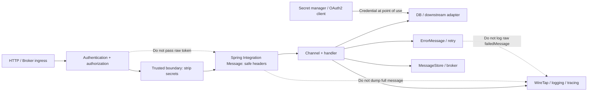
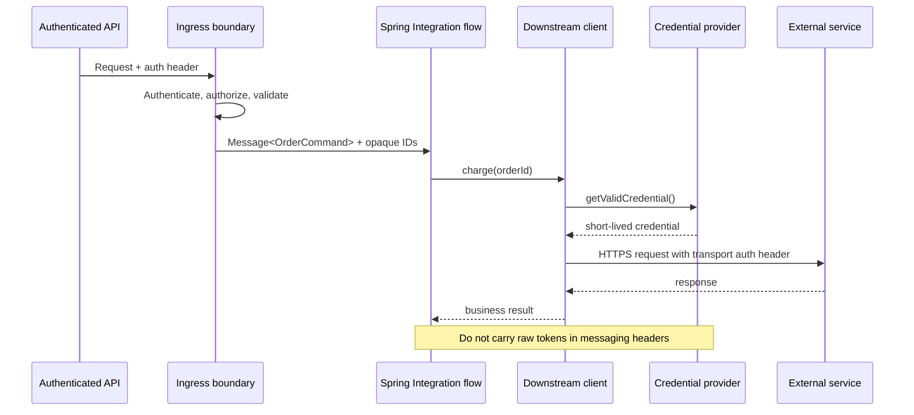
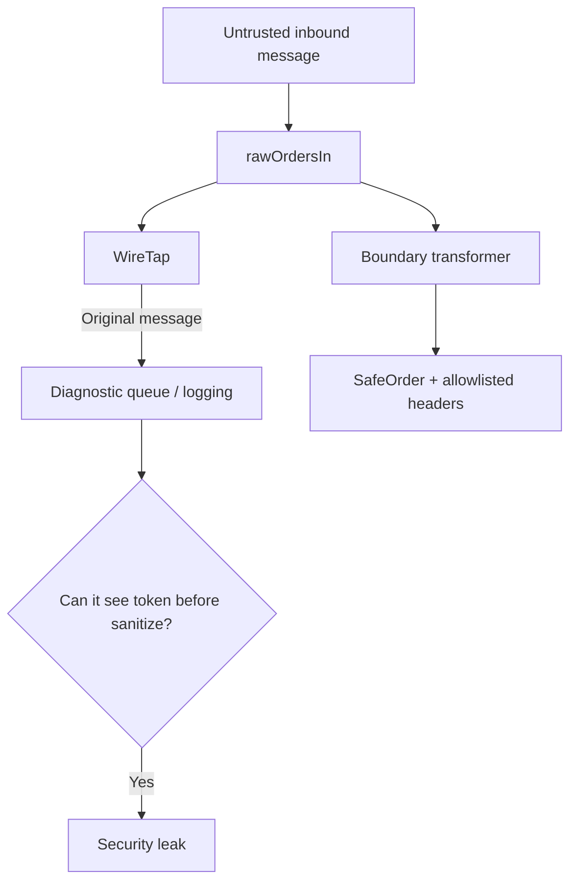
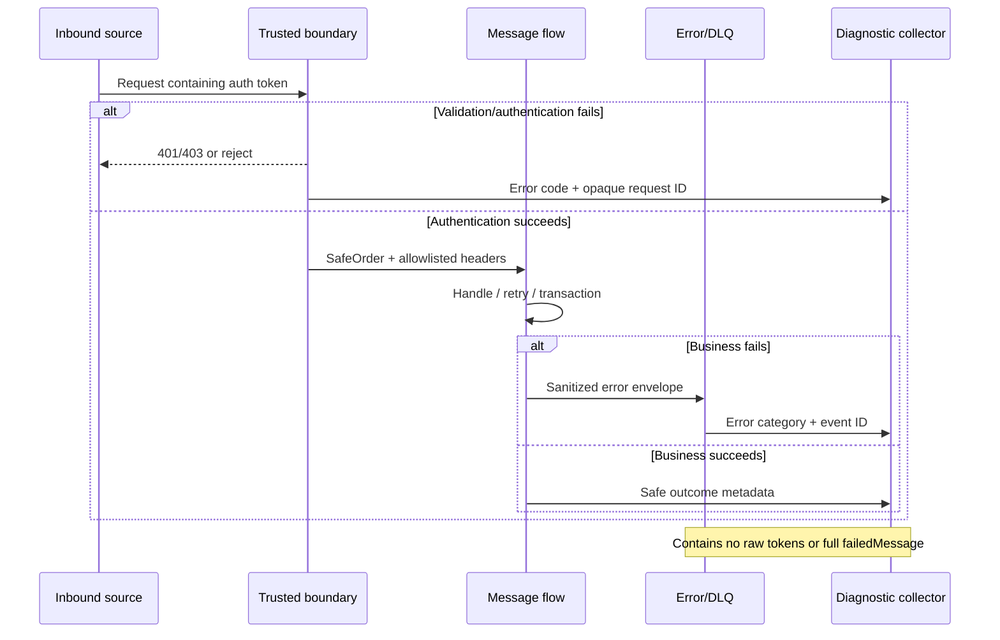

# Never Put Secrets in Message Headers or Logs in Spring Integration

## 1. The Real Security Problem: Messages Travel Beyond the Initial Handler

In the **Runtime Security** chapter of the `SPRING_INTEGRATION_RUNTIME` module, Spring Integration orchestrates messages across **channels, endpoints, consumers, pollers, and executors**, combined with `IntegrationFlow` lifecycle, transactions, retries, message stores, errors, correlation, and runtime observability. A message can pass through many components, be retried, enter an error channel, be persisted to a JDBC message store, or be sent across a broker. Consequently, a secret inadvertently placed in `MessageHeaders` or a `log.info(...)` call can be copied and retained far beyond where it originated.

Suppose an HTTP inbound gateway receives a request carrying an HTTP `Authorization: Bearer ...` header. If the application copies that raw header into a Spring Messaging message and sends it through `ordersIn`:

- A transformer producing a reply may **preserve inbound headers** unless configured to exclude them.
- A `WireTap` or logging adapter can observe the entire message, including the secret.
- `ErrorMessage`/`MessagingException` can hold a reference to the failed message when a handler throws.
- A `QueueChannel` backed by a persistent message store or an outbound adapter can carry the data outside the JVM.
- When switching threads via an `ExecutorChannel`, the log writer may have no idea which adapter originated the sensitive header.
- During incident troubleshooting, an innocent `log.error("Failed: {}", message)` statement can create a second leakage incident.

**Guiding principle:** secrets must be fetched from a **credential management source** right at the point of use—never use Spring Integration messages as a credential transport vehicle. Logging must follow an **allowlist of safe fields**, never dumping raw payloads, headers, or exceptions.

> "Secrets" include access tokens, refresh tokens, API keys, passwords, private keys, session cookies, client secrets, connection strings with passwords, and similar authentication data. PII or payment data may not be credentials, yet still require dedicated restriction policies.

### Learning Objectives

After this lesson, you will be able to:

1. Identify leakage points across `MessageHeaders`, header propagation, error paths, logging adapters, `WireTap`, message stores, and outbound header mappers.
2. Distinguish **HTTP transport headers** needed for authentication from **Spring Messaging headers** used for internal processing and routing.
3. Design an ingress boundary that **does not transfer credentials into messages**, building new messages from a safe allowlist.
4. Configure credentials on clients/adapters and inject them via secret management rather than placing them in payloads, headers, or logs.
5. Write diagnostic loggers, error handlers, and log expressions that capture only **opaque event IDs, validated trace IDs, statuses, and latencies**.
6. Write JUnit 5 tests verifying synthetic secrets do not traverse channels, appear in output/error logs, or appear in outbound mappings.
7. Assess the impact of retries, executors, persistence, tracing, multi-instance deployments, and cleanup when a secret leak is detected.

## 2. Threat Model: Where Can Secrets Be Exposed?

A `Message<?>` has a payload and `MessageHeaders`. Both parts can be read by components. Headers are not a "private" vault or credential store; as a message is forwarded, many endpoints propagate headers per Spring Integration's contract.



| Surface | How leakage occurs | Observable consequences |
|---|---|---|
| Inbound header mapping | Copying `Authorization`, `Cookie`, `X-Api-Key` from HTTP headers into `MessageHeaders` | Credentials remain in memory and travel through downstream endpoints |
| Header propagation | A handler/transformer returns a new payload and the framework preserves certain inbound headers | Secrets cross boundaries unseen by business-logic authors |
| `LoggingHandler` and DSL `.log()` | Logs payload by default; `log-full-message` logs headers too; uncontrolled expressions | Tokens/PII end up in stdout, centralized logging, and backups |
| `WireTap` | Sends the message to a diagnostic branch; does not automatically deep-copy or sanitize | Debug branches, executors, or secondary message stores retain secrets |
| `ErrorMessage`/exceptions | Exceptions retain the failed message, payload, or third-party error messages containing credentials | Exposed via stack traces, error channels, DLQs/quarantine |
| Persistent `MessageStore` | Serializes messages and headers to survive restarts | Credentials outlive their original token lifetime |
| Broker / HTTP header mapper | Internal headers are mapped back out onto transport headers | Credentials spread to external systems or unauthorized clients |
| Metrics, tracing, baggage | Using tokens/customer IDs as tags, span attributes, or baggage | High cardinality and exposure in telemetry collectors |
| Heap dumps, diagnostic endpoints, JMX | Runtime objects/stacks/metadata can be inspected | Secrets can be read by operators with dump access |
| Incident debugging | Enabling `TRACE` and logging "raw requests" to find a bug | Generates sensitive data precisely under peak traffic |

**Not every component automatically logs secrets.** Risk stems from how the application configures messages, loggers, mappings, persistence, and access controls. The goal is to **prevent secrets from entering propagatable data structures**, not merely hiding a single log statement.

## 3. HTTP Authentication Headers Differ from Spring `MessageHeaders`

In an HTTP request, `Authorization` or a cookie may be how the client proves identity. The HTTP server and Spring Security should verify credentials **before** constructing a business-processing message.

In Spring Integration, `MessageHeaders` serve routing, replies, correlation, protocol metadata, and application-attached context. This is the **data plane of the message flow**, not a credential vault.

| Location | Data that belongs here | Data that does NOT belong here |
|---|---|---|
| Spring Security filter/authentication boundary | Transient credentials needed for authentication per framework mechanisms | Do not retain/log tokens longer than needed |
| Spring Integration business message | Opaque `businessEventId`, verified `traceId`, event type, schema version, required correlation | Raw bearer tokens, session cookies, passwords, API keys |
| Outbound HTTP client | `Authorization` header set by an OAuth2/client credential provider at call time | Never take tokens from `MessageHeaders` set by untrusted callers |
| Diagnostic logs | Event type, opaque IDs, component name, outcome, latency | Header dumps, full message `toString()`, raw request bodies, or raw error messages |
| Durable message store/broker | Classified business data with appropriate encryption and retention limits | Session-scoped credentials or overly broad secrets |

**Important:** "Never put secrets into Spring `MessageHeaders`" does **not** mean every HTTP `Authorization` header must vanish on calls to partners. An outbound HTTP client may still need to send that standard header over TLS. The difference is that **the client constructs the transport header at the point of egress**, rather than carrying tokens across the entire flow in messaging headers.

### 3.1. Flow-Control Headers Are Also Sensitive Data

Beyond credentials, certain headers exert **control behavior**, such as:

- `replyChannel` and `errorChannel` determine where replies and errors are sent.
- `routingSlip` alters the processing itinerary.
- `kafka_topic`, `mqtt_topic`, or destination names influence where messages are published.
- `file_name`, `file_remoteDirectory`, or destination expressions can write files to unintended locations.
- `jmx_objectName`/`jmx_operationName` can influence which management operation is invoked.

When messages arrive from **untrusted sources**, not only strip secrets—also **validate or overwrite routing metadata**. An attacker does not need to place a password in a header to cause harm: controlling `replyChannel` or a destination name at an unguarded point is enough.

Spring Integration provides header selectors and filters, yet **schema and business-permission validation remain the application's responsibility**. Never treat a header's existence as proof it was validated.

## 4. Header Propagation: Why "Stripping Once at the End" Is Not Enough

Message-producing endpoints in Spring Integration often copy eligible inbound headers when producing a new output message. For example, a transformer returning **only a payload** is typically wrapped by the framework into a message with propagated headers. When a transformer returns a **complete `Message`**, the application controls which headers appear on that message.

```text
HTTP request headers:
    Authorization = Bearer <redacted>
    X-Trace-Id    = trace-900

Message at ingress (if copied indiscriminately):
    headers.Authorization = <credential>    <-- Unwanted
    headers.traceId       = trace-900

Transformer returns OrderCommand:
    framework may propagate eligible headers
    => credential can still exist on the outbound message!
```

### Layered Defense Approach

1. **Ingress allowlist:** build a new business message, attaching **only** permitted metadata; never `copyHeaders(request.getHeaders())` unconditionally.
2. **Disable propagation on needed endpoints:** `setNotPropagatedHeaders(...)` or DSL `notPropagatedHeaders(...)` on supporting handlers if a header could arrive from legacy paths.
3. **Header filter:** `headerFilter(...)` removes known header names at specific boundaries.
4. **Outbound allowlist:** mappers from messages to Kafka/AMQP/HTTP export only approved protocol headers.
5. **Log allowlist:** loggers use an explicit field set; never log raw messages even if you believe headers were stripped.

`headerFilter("Authorization", "Cookie")` is a **supplementary measure**, insufficient if secrets arrive under other names such as `jwt`, `credentials`, `oauth_access_token`, or inside the payload. **Prefer allowlists over denylists** when crossing into a new trust zone.

DSL example intentionally removing specific headers at one point:

```java
@Bean
public IntegrationFlow scrubKnownHeaders() {
    return IntegrationFlow.from("beforeBoundary")
            .headerFilter("Authorization", "Cookie",
                          "X-Api-Key", "access_token")
            .channel("afterBoundary")
            .get();
}
```

This fragment requires the `beforeBoundary` and `afterBoundary` beans/channels. Not every Spring Integration component propagates headers identically to a transformer; bridges, routers, inbound adapters, and mappers have their own rules. The best defense remains keeping credentials **out of the flow from the start**.

## 5. Configure Secrets on Clients, Not on Messages

In real production systems, secrets can be managed by:

- A secret manager / Kubernetes Secrets mounted or injected into the service with access controls and rotation.
- Spring Security OAuth2 Client / Authorized Client Manager for short-lived access tokens.
- Vault/KMS or a dedicated credential provider.
- Managed identity/workload identity instead of static API keys where supported by infrastructure.

Never hardcode secrets in source code, `application.yml` committed to Git, test snapshots, exception messages, or business headers.

### The Right Pattern



Example interface separation in Java:

```java
package example.integration;

public record OrderCommand(String orderId, String traceId) {}
```

```java
package example.integration;

public interface BillingClient {
    void charge(String orderId);
}
```

```java
package example.integration;

import org.springframework.integration.annotation.MessageEndpoint;
import org.springframework.integration.annotation.ServiceActivator;

@MessageEndpoint
public class BillingHandler {

    private final BillingClient billingClient;

    public BillingHandler(BillingClient billingClient) {
        this.billingClient = billingClient;
    }

    @ServiceActivator(inputChannel = "billingCommands")
    public void handle(OrderCommand command) {
        // Credentials belong to BillingClient/OAuth2 provider,
        // NOT to OrderCommand or MessageHeaders.
        billingClient.charge(command.orderId());
    }
}
```

This is a code skeleton; the application must supply the `BillingClient` bean, `billingCommands` channel, and client/adapter implementation. When using `WebClient`, a credential provider can attach `Authorization` when constructing the **HTTP request to the billing server**. HTTP client logging must also apply redaction or disable wire-level header dumps; **moving credentials out of messages is not enough if the HTTP wire logger prints the token**.

**Do not place a secret into a message `String` expecting GC to clear it immediately.** Immutable `String` instances can linger in the heap, thread dumps, or serialized messages far longer than expected; minimizing copies is the first line of defense.

## 6. Runnable Example: Transforming an Inbound Message into a Safe Message

This section uses a minimal Spring Integration example with Java 17+, `spring-integration-core`, and Spring Context. An ingress request may carry untrusted metadata. We build a **new `Message`** from an allowlist and then verify on `QueueChannel` that secrets are absent from the Spring message.

### 6.1. Inbound DTO and Business Payload

File `OrderRequest.java`:

```java
package example.integration;

public record OrderRequest(String orderId, String customerRef) {}
```

File `SafeOrder.java`:

```java
package example.integration;

public record SafeOrder(String orderId) {}
```

`customerRef` in this example exists only at ingress; if it contains personal data, it must not enter logs or headers. Flows that genuinely require `customerRef` must apply appropriate access and storage controls rather than arbitrarily dropping needed data. In this demo, processing needs only `orderId`.

### 6.2. Transformer Building a New Message from an Allowlist

File `TrustedBoundaryTransformer.java`:

```java
package example.integration;

import org.springframework.integration.annotation.Transformer;
import org.springframework.messaging.Message;
import org.springframework.messaging.support.MessageBuilder;

public class TrustedBoundaryTransformer {

    @Transformer(
            inputChannel = "rawOrdersIn",
            outputChannel = "safeOrdersOut")
    public Message<SafeOrder> sanitize(Message<OrderRequest> incoming) {
        OrderRequest request = incoming.getPayload();

        if (request.orderId() == null
                || !request.orderId().matches("[A-Za-z0-9_-]{1,80}")) {
            throw new IllegalArgumentException("Invalid order ID");
        }

        MessageBuilder<SafeOrder> builder = MessageBuilder
                .withPayload(new SafeOrder(request.orderId()));

        // Only accept an opaque trace ID validated against an allowed format.
        Object candidateTrace = incoming.getHeaders().get("traceId");
        if (candidateTrace instanceof String trace
                && trace.matches("[A-Za-z0-9_-]{1,64}")) {
            builder.setHeader("traceId", trace);
        }

        // Never copyHeaders(incoming.getHeaders())!
        // replyChannel/errorChannel/Authorization/Cookie/API key do not pass through.
        return builder.build();
    }
}
```

**Why does the transformer return `Message<SafeOrder>` instead of just `SafeOrder`?** Returning a complete `Message` gives the application control over which headers exist on the output, rather than letting the framework propagate inbound headers as happens when returning a bare payload. Standard `id`/`timestamp` headers are generated by `MessageBuilder`.

**Applicability condition:** this boundary is designed for **one-way flows** that do not need to preserve a temporary ingress reply channel. When using a request–reply gateway, do not silently drop `replyChannel` and expect callers to receive replies normally. Design a verified reply envelope/correlation and dedicated reply mechanism, or use a hardened gateway/mapping that preserves the internal reply address without accepting it from external clients.

**Note:** regex does not prove `traceId` was generated by a trusted system. If trace IDs arrive from clients, validate source and permissions; for sensitive events, generate a dedicated trace ID at the trusted gateway.

### 6.3. Channels and Test Configuration

File `SafeBoundaryConfig.java`:

```java
package example.integration;

import org.springframework.context.annotation.Bean;
import org.springframework.context.annotation.Configuration;
import org.springframework.integration.channel.DirectChannel;
import org.springframework.integration.channel.QueueChannel;
import org.springframework.integration.config.EnableIntegration;

@Configuration
@EnableIntegration
public class SafeBoundaryConfig {

    @Bean("rawOrdersIn")
    public DirectChannel rawOrdersIn() {
        return new DirectChannel();
    }

    @Bean("safeOrdersOut")
    public QueueChannel safeOrdersOut() {
        return new QueueChannel(32);
    }

    @Bean
    public TrustedBoundaryTransformer trustedBoundaryTransformer() {
        return new TrustedBoundaryTransformer();
    }
}
```

In this example, `QueueChannel` is used solely as a **test output**, with no active consumer. It resides in RAM and is **not** durable across restarts; real systems should use channels/handlers appropriate for the business domain with dedicated retention and error/recovery policies.

Here, `TrustedBoundaryTransformer` is registered solely via the `@Bean` method in `SafeBoundaryConfig`, **without** adding `@Component` on the class. In component-scanned applications, never declare both simultaneously, as that can create two unintended transformer instances/endpoints.

### 6.4. JUnit 5 Verifying No Token Passes Through

```java
package example.integration;

import org.junit.jupiter.api.Test;
import org.springframework.context.annotation.AnnotationConfigApplicationContext;
import org.springframework.integration.channel.QueueChannel;
import org.springframework.messaging.Message;
import org.springframework.messaging.support.MessageBuilder;

import static org.junit.jupiter.api.Assertions.*;

class TrustedBoundaryTest {

    @Test
    void excludesSecretHeadersFromOutputMessage() {
        try (var context =
                new AnnotationConfigApplicationContext(
                        SafeBoundaryConfig.class)) {

            var input = context.getBean("rawOrdersIn",
                    org.springframework.messaging.MessageChannel.class);
            var output = context.getBean("safeOrdersOut",
                    QueueChannel.class);

            String syntheticSecret =
                    "SYNTHETIC_TOKEN_DO_NOT_USE_IN_PRODUCTION";

            Message<OrderRequest> incoming = MessageBuilder
                    .withPayload(new OrderRequest("ORDER_901", "private-ref"))
                    .setHeader("Authorization", "Bearer " + syntheticSecret)
                    .setHeader("Cookie", "session=" + syntheticSecret)
                    .setHeader("X-Api-Key", syntheticSecret)
                    .setHeader("traceId", "trace_901")
                    .setHeader("replyChannel", "untrustedReply")
                    .build();

            assertTrue(input.send(incoming));

            Message<?> safe = output.receive(1_000);
            assertNotNull(safe);
            assertEquals(new SafeOrder("ORDER_901"), safe.getPayload());
            assertEquals("trace_901", safe.getHeaders().get("traceId"));

            assertFalse(safe.getHeaders().containsKey("Authorization"));
            assertFalse(safe.getHeaders().containsKey("Cookie"));
            assertFalse(safe.getHeaders().containsKey("X-Api-Key"));
            assertFalse(safe.getHeaders().containsKey("replyChannel"));
            assertFalse(safe.toString().contains(syntheticSecret));
        }
    }

    @Test
    void invalidTraceIdIsNotCopied() {
        var transformer = new TrustedBoundaryTransformer();
        var incoming = MessageBuilder
                .withPayload(new OrderRequest("ORDER_902", "not-used"))
                .setHeader("traceId", "bad\\ntrace")
                .build();

        var safe = transformer.sanitize(incoming);
        assertNull(safe.getHeaders().get("traceId"));
    }
}
```

The secret values in these tests are **synthetic strings**; never use real credentials. The test verifies both **header presence** and the output message's string representation. It does **not** prove no secret existed in the already-created input object or heap dumps: in production, authenticate HTTP beforehand and **avoid creating `incoming` with secret headers in the first place**.

### 6.5. Do Not Rely on End-of-Flow Sanitization Alone

In the test above, the secret existed on `incoming` prior to the transformer. If a `WireTap` or `LoggingHandler` sits on `rawOrdersIn`, the data can be observed or stored **before** reaching the boundary. Therefore:

- Perform authentication and drop transport credentials **before constructing the Spring message** whenever possible.
- If a framework adapter maps headers automatically, configure the header mapper/exclusions on the adapter itself.
- If a zone holding untrusted data must exist, isolate it: no wire taps, no persistence, no payload/header logging, tight ACLs, and an allowlist transformer at the very first step.

## 7. Logging Channel Adapter: Even the "Default" Can Be Dangerous

Spring Integration provides `<int:logging-channel-adapter>` and `LoggingHandler`. By documentation, the adapter logs the **payload** by default, and `log-full-message="true"` logs the entire message including headers. Thus:

- **Not logging headers by default** does not mean safe, because the **payload may contain secrets/PII**.
- Enabling full-message logging can expose `Authorization`, `Cookie`, or sensitive routing metadata.
- A SpEL expression logging the raw `payload` or `headers` carries the same risk.
- `.log()` in Java DSL actually creates a wire-tap-based logging branch; do not assume it is a "zero-impact" logger across all topologies.

### Anti-Patterns to Avoid

```xml
<!-- DO NOT USE on messages that may carry tokens/PII -->
<int:logging-channel-adapter
        id="unsafeLogger"
        level="DEBUG"
        log-full-message="true"/>
```

Or:

```java
// DO NOT USE in production:
log.info("message={}", message);
log.error("failure={}", exception); // exception message may contain secrets.
```

Even when `log.debug(...)` is disabled by log level, arguments **constructed before** the logger call (such as serializing the whole payload to a string) still consume CPU/heap—and when debug is turned on during an incident, the data immediately surfaces.

### Replace with Minimal Metadata

Java DSL supports message-based logging expressions:

```java
@Bean
public IntegrationFlow safeLoggingFlow() {
    return IntegrationFlow.from("safeInput")
            .log(LoggingHandler.Level.INFO, "integration.safe",
                    m -> "eventType=order"
                       + " messageId=" + m.getHeaders().getId())
            .channel("businessChannel")
            .get();
}
```

This fragment requires importing `IntegrationFlow`, `LoggingHandler`, and declaring `safeInput`/`businessChannel`. Here the logger **captures neither the payload nor all headers**. `MessageHeaders.ID` is only a message instance ID, not a business idempotency key. If event IDs/trace IDs are needed, log only values **generated or validated at a trusted boundary**.

**Never use `message.getHeaders().toString()`, `message.toString()`, or `exception.getMessage()` inside the expression.** These can contain secrets or user-controlled data.

### Controlled Structured Logging

A safe typed-message logger:

```java
package example.integration;

import org.slf4j.Logger;
import org.slf4j.LoggerFactory;
import org.springframework.messaging.Message;

public final class SafeDiagnosticLogger {

    private static final Logger log =
            LoggerFactory.getLogger(SafeDiagnosticLogger.class);

    public void received(Message<SafeOrder> message) {
        String orderId = message.getPayload().orderId();

        // orderId in this demo is opaque, yet real systems must still classify it.
        log.info("eventType=ORDER_ACCEPTED orderId={} messageId={}",
                orderId, message.getHeaders().getId());
    }

    public void failure(String eventId, Throwable exception) {
        String category = exception.getClass().getSimpleName();

        // Never log exception object / getMessage() or raw stack traces.
        log.warn("eventType=ORDER_FAILED eventId={} errorType={}",
                eventId, category);
    }
}
```

In production, `eventId`/`orderId` must be generated/validated as opaque identifiers with log-viewing access controls. Do not assume an order ID safe for SQL is safe for every operator to view; if an ID links to a specific customer, consider managed-key tokenization/HMAC while avoiding plain hashes of guessable PII.

## 8. WireTap: Risk of Leakage Before Loggers Redact

`WireTap` is a `ChannelInterceptor` that forks an observation branch on `preSend`. It can dispatch the **exact same `Message` object** to a diagnostic channel; this is **not a deep copy of the payload or a redacted version**.



**Rule:** never attach a global wire tap or `patterns="*"` to zones containing messages that have not crossed a trusted boundary. If ingress diagnostics are needed, emit a **dedicated diagnostic event** with allowlisted fields from inside the boundary instead of sending the raw message to a queue/log.

`WireTap` **is not asynchronous by default**: it calls `send` on the secondary channel. If the secondary channel is a `DirectChannel` with a slow logger, log I/O slows down the main request; if it is an `ExecutorChannel`, queuing retains the message (and any embedded secrets) longer. Switching threads isolates latency **but does not scrub sensitive data**.

A `MessageSelector` can filter which messages are tapped, yet a selector **only filters sending**—it does not convert a message into a sanitized DTO. To guarantee the diagnostic subsystem never receives secrets, place it **after** the boundary or use a custom interceptor that builds a safe diagnostic payload.

## 9. `ErrorMessage`, `failedMessage`, Retries, and Dead-Letter Storage

When a handler throws an exception, Spring Integration error paths emit an `ErrorMessage` whose payload is the `Throwable`. A `MessagingException` can hold `failedMessage`, and `ErrorMessage` can carry `originalMessage` depending on the emitter. Consequently, logging:

```java
log.error("ErrorMessage: {}", errorMessage);
log.error("Exception", errorMessage.getPayload());
```

can expose payloads, headers, or exception messages produced by third-party libraries; do not assume this is safe merely because the logger sits on `errorChannel`.

### Error Handler Logging Only Classified Events

```java
package example.integration;

import org.slf4j.Logger;
import org.slf4j.LoggerFactory;
import org.springframework.integration.annotation.MessageEndpoint;
import org.springframework.integration.annotation.ServiceActivator;
import org.springframework.messaging.support.ErrorMessage;

@MessageEndpoint
public class SafeErrorObserver {

    private static final Logger log =
            LoggerFactory.getLogger(SafeErrorObserver.class);

    @ServiceActivator(inputChannel = "safeDiagnosticsErrors")
    public void observe(ErrorMessage error) {
        Throwable cause = error.getPayload();

        // Log only the error class, never exception.getMessage()
        // or failedMessage.toString().
        log.warn("failureType={} diagnosticEvent=HANDLER_FAILED",
                cause.getClass().getSimpleName());
    }
}
```

`safeDiagnosticsErrors` is a **dedicated error channel** configured by the application; it does not exist automatically just from `@EnableIntegration`. To handle the global `errorChannel`, configure the error publisher, consumer, and logging/diagnostic policy across **the entire error path**. Never replace a global error handler with a log-only consumer if that drops the system's retry/DLQ policy.

### Tests Must Attack the Error Path Too

1. Create a test message with a synthetic secret at ingress.
2. Force the transformer/handler to throw both before and after sanitization.
3. Capture logs from the error handler, retry interceptor, adapters, and root logger.
4. Verify the synthetic secret **never** appears in logs, persisted error envelopes, or observable DLQs.
5. Verify business IDs/error categories remain sufficient for operator investigation.
6. Verify errors inside the recovery sink itself do not log raw `failedMessage` data.

**Retries do not scrub sensitive data.** When a failing message is retried three times, the same header token can be logged three times, queued three times, or written to the DLQ. The fix is to **sanitize before the retry boundary** or architect the flow so messages never carry credentials.

### When Must Raw Failed Messages Be Stored?

Some workflows must persist failed data for replay, yet storing raw payloads/headers always requires security review. Prefer:

- Error envelopes containing an opaque `eventId`, `errorCode`, `schemaVersion`, timestamp, and a `payloadRef` pointing to an access-controlled store.
- Storing business data in an encrypted store with TTL and audited access; never persist real credentials for replay.
- On replay, fetching **fresh credentials** from the provider at send time rather than reusing tokens from the old message.
- Designing dead-letter retention around data policies, never keeping them "forever for debugging".

## 10. Message Stores and Header Mapping Across Boundaries

### 10.1. Persistence Turns Transient Leaks into Long-Lived Leaks

A `QueueChannel` with `JdbcChannelMessageStore`, a `MessageStore`/`MessageGroupStore`, or a broker can persist messages and headers across restarts. If `Authorization` is stored there:

- Tokens can linger in DB backups, replicas, debug SQL dumps, and dead-letter records.
- Tokens can be re-read across schema/serializer upgrades.
- Even after key revocation, copies remain in the store.
- Log deletion jobs do not purge copies inside message stores or brokers.

**Encryption at rest does not replace data minimization.** Encryption protects against storage theft/unauthorized reads, but secrets that do not need persistence should **never enter the record in the first place**.

### 10.2. Mapping Out to HTTP/Kafka/AMQP

Spring Integration adapters provide dedicated `HeaderMapper` implementations. For instance, HTTP header mapping maps standard HTTP headers by default; when customized, header patterns determine what crosses onto the wire.

Never enable wildcards like `mapped-request-headers="*"` or equivalents without understanding the allowlist. When an adapter sends messages to external systems:

- Allowlist only genuinely needed transport headers, such as content type, a validated opaque trace ID, and schema ID.
- Never export internal routing headers like `replyChannel`, `errorChannel`, or unneeded business credentials.
- Never allow client-supplied data to choose `kafka_topic`/HTTP URL/recipient without authorization and validation.
- For outbound HTTP, credentials are **supplied by the client security layer**, never copied from messages.
- Use integration tests verifying actual headers sent to an HTTP mock server/test broker, not just mapper unit tests.

**Watch out for "harmless" headers that are high-cardinality or PII:** customer email, IP address, device ID, ticket title, or phone number can still flow through logging/tracing even when they are not authentication secrets.

## 11. `SecurityContext` Propagation Across Thread Switches: Clarifying Exceptions

Spring Security typically binds `SecurityContext` to the current thread. When a flow uses `DirectChannel`, synchronous steps on that thread can access the context. When switching to `ExecutorChannel` or `QueueChannel`, the new processing thread **does not automatically inherit** `SecurityContext`.

Spring Security Messaging offers `SecurityContextPropagationChannelInterceptor` to propagate security context across channels in appropriate cases. However:

- This is a **framework mechanism for trusted flows**, not a license to place raw bearer tokens or passwords into application-defined headers.
- The context can contain `Authentication` or sensitive principal details; inspect whether it could be captured by wire taps, persistent stores, broker mappers, or raw logging.
- Never forward `SecurityContext` across a trust boundary to an external system assuming the recipient will treat it as pre-authenticated.
- Drop credentials after authentication, scope down identities/privileges, and clear `ThreadLocal` after handling to avoid leaking principals into the next task.
- If internal policy **forbids any credential-bearing object in `MessageHeaders`**, use signed opaque identity/authorization claims instead of propagating the full security context, or **re-authenticate on the trusted worker** with freshness constraints.

Since Spring Integration 6.3, the legacy `spring-integration-security` module was removed; channel security integration moved to `spring-security-messaging`. When reading older tutorials, verify dependencies/versions and never copy classes from the removed module.

**Thread-bound security and transactions are separate concerns.** Enabling security context propagation does not make a producer's JDBC `@Transactional` cross an `ExecutorChannel`. Conversely, a message without secrets can still carry an identity requiring authorization; enforcement remains at boundaries and sensitive services.

## 12. Observability: Logs, Traces, and Metrics Can All Leak

Log files are not the only place data is stored:

| Channel | Anti-pattern | Safe approach |
|---|---|---|
| Structured logs | `log.info("headers={}", headers)` | Allowlist `eventType`, opaque ID, result, duration |
| SLF4J exception logging | `log.error("failed", exception)` with token in message | Error code/exception class; stack traces only in controlled/redacted sinks |
| Micrometer metric tags | `tag("token", apiKey)` or `tag("userEmail", email)` | Low-cardinality tags like component/result/error category |
| Distributed tracing | Span attributes/baggage containing tokens or PII | Trace IDs, safe operation names; baggage allowlist |
| Message history | Retains endpoint/channel metadata for diagnostics | Never treat history as storage for credentials/PII |
| JMX/Actuator | Exposes bean properties/config/dumps | Restrict network/auth/roles, omit secrets, restrict heap dumps |
| HTTP client debug logs | Prints Authorization headers/wire bytes | Redact transport headers or disable wire logging |
| Dead-letter records | Saves all original headers | Sanitize envelopes and apply encrypted/ACL-protected retention |

Even using per-`eventId` metric tags causes massive cardinality explosion. Never put secrets or PII into metric labels, even for an internal `Prometheus` or `OpenTelemetry` collector.

### Suggested Log Schema

```text
event_type=ORDER_PROCESSED
trace_id=trace_901
component=billingHandler
outcome=SUCCESS
duration_ms=34
attempt=2
```

Do not log:

```text
Authorization=Bearer ...
Cookie=session=...
customer_email=...
request_body=<full JSON>
failedMessage=GenericMessage[payload=..., headers=...]
```

Even with a safe schema, access controls and retention remain required. User-supplied `trace_id` or order IDs can contain newlines or control characters enabling log injection; validate, normalize, and bound length before writing.

## 13. Testing: Proving "No Secret Leaks" Layer by Layer

Verify **each boundary** rather than searching for a single string in the final log.

### 13.1. From HTTP into Messages

- Send a test request carrying `Authorization` and `Cookie` headers with synthetic secrets.
- Inspect the very first message produced from the request; verify `MessageHeaders` **does not contain** raw credentials.
- When using an HTTP inbound gateway/header mapping, test the real mapper configuration rather than just a POJO sanitizer.
- Verify control headers like `replyChannel`, `routingSlip`, and target topics are stripped or overwritten per trust policy.
- Verify safe business IDs and trace IDs are retained to support retries/correlation.

### 13.2. Across Transformers, Aggregators, and Retries

- Pass sanitized messages through both payload-returning and `Message<?>`-returning transformers.
- Assert no secrets reappear after propagation or enrichment.
- With splitters/aggregators, inspect group stores, correlation metadata, and released output messages.
- Inject exceptions so messages retry; logs from **every attempt** must exclude synthetic secrets.
- Route a work item to a test DLQ/persistent queue; read back the serialized message and headers.

### 13.3. Testing Loggers with `OutputCaptureExtension`

Use `spring-boot-starter-test` with `OutputCaptureExtension` on the classpath. This example tests the logger from Section 7 without starting an HTTP endpoint:

```java
package example.integration;

import org.junit.jupiter.api.Test;
import org.junit.jupiter.api.extension.ExtendWith;
import org.springframework.boot.test.system.CapturedOutput;
import org.springframework.boot.test.system.OutputCaptureExtension;
import org.springframework.messaging.support.MessageBuilder;

import static org.junit.jupiter.api.Assertions.*;

@ExtendWith(OutputCaptureExtension.class)
class SafeDiagnosticLoggerTest {

    @Test
    void doesNotLogPayloadOrSyntheticToken(CapturedOutput output) {
        SafeDiagnosticLogger logger = new SafeDiagnosticLogger();
        String synthetic = "FAKE_SECRET_001";

        var safe = MessageBuilder
                .withPayload(new SafeOrder("ORDER_901"))
                .setHeader("traceId", "trace_901")
                .setHeader("Authorization", synthetic)
                .build();

        logger.received(safe);
        logger.failure("ORDER_901",
                new IllegalStateException("failure token=" + synthetic));

        String logs = output.getAll();
        assertTrue(logs.contains("ORDER_ACCEPTED"));
        assertTrue(logs.contains("ORDER_FAILED"));
        assertFalse(logs.contains(synthetic));
        assertFalse(logs.contains("Authorization"));
        assertFalse(logs.contains("failure token="));
    }
}
```

This is a **safe-logger test**, not proof that tokens are permitted inside production messages. In the test, a synthetic secret is intentionally attached to prove the logger **does not print it**; in real systems, still use Section 6's boundary to **strip tokens before messages are created**.

When using logging backends other than Logback or appenders shipping to external systems, `OutputCaptureExtension` may not capture every sink. In production readiness, run integration tests against real appender/collector configs (using synthetic data) to prove per-sink redaction.

### 13.4. Negative Test for the Error Path

```java
@Test
void errorObserverDoesNotLogThrowableMessage(CapturedOutput output) {
    var observer = new SafeErrorObserver();
    var error = new org.springframework.messaging.support.ErrorMessage(
            new IllegalStateException("password=FAKE_SECRET_002"));

    observer.observe(error);

    assertTrue(output.getAll().contains("HANDLER_FAILED"));
    assertFalse(output.getAll().contains("FAKE_SECRET_002"));
}
```

Place this test in a test class annotated with `@ExtendWith(OutputCaptureExtension.class)` or an equivalent capture setup. Do not test only the error observer; verify that the **root logger**, broker adapters, and client libraries do not log the same exception elsewhere.

### 13.5. Asserting Outbound Mapping

Using an HTTP mock server or test broker, emit a `SafeOrder` and verify the outbound request:

- Only `Content-Type`, validated correlation/trace IDs, and required protocol headers are sent.
- Outbound HTTP `Authorization` (if needed) comes from the **client credential provider**, never matching the inbound synthetic secret.
- No inbound `Cookie`/`X-Api-Key` headers leak when forwarding is disallowed.
- No routing slips or internal error channel names appear in outbound headers.
- Nothing leaks in HTTP request/response logs on 401/5xx errors.

For debugging, rely on opaque IDs and test fixture checksums; never store real credentials in snapshots or golden files.

## 14. Runtime Scenarios: Retries, Restarts, and Incident Response

### 14.1. Errors Before and After Sanitization



If an exception occurs **before** the boundary and captures the raw request, inbound web/server error loggers also need redaction. A Spring Integration flow protects only paths **after** the boundary; it cannot erase data already logged by a reverse proxy or authentication filter.

### 14.2. Rolling Restarts and Persistent Backlogs

When an application restarts, persistent `MessageStore`s retain previously stored messages and headers. If an older version stored credentials inside messages, deploying a new version that only fixes the logger **does not remove old records from the store**. Prepare a migration/quarantine and rotation plan:

1. Identify potentially affected records using restricted-access queries without dumping contents to consoles.
2. Revoke/rotate exposed tokens and assess the exposure window and blast radius.
3. Fix message construction and adapter header mappings before resuming consumers.
4. Handle residual data per policy: sanitize/migrate, re-enqueue fresh envelopes, or quarantine under access controls.
5. Purge logs, DLQs, backups, and telemetry per retention/compliance policies with auditing.
6. Re-test with synthetic data and confirm no credentials cross the new boundary.

### 14.3. If a Secret Is Found in Logs

Credential exposure must be handled as a security incident, not merely "deleting a log line":

- **Assess secret type and scope:** token usage, lifetime, and which systems can read logs, backups, exporters, and snapshots.
- **Revoke/rotate:** prioritize invalidating the credential before it can be exploited.
- **Restrict access:** temporarily tighten log/telemetry access and preserve evidence per organizational procedure.
- **Locate the source:** raw message logging, HTTP wire logging, error stack traces, wire taps, broker DLQs, message history, or custom metric tags.
- **Fix the root cause:** boundary allowlists, secret providers, safe loggers, mapper exclusions, and regression tests.
- **Recover and verify:** re-enable debug/taps only with minimal fields and an approved time window.

**Never paste the secret into tickets, chats, incident reports, or unit test outputs.** Use a securely managed token ID/fingerprint instead of the raw value.

## 15. Where Should Policies Be Enforced?

| Control point | Acceptance criteria | Example assertion |
|---|---|---|
| HTTP ingress/security filter | Credentials used solely for auth; raw tokens not forwarded into SI headers | `message.getHeaders().containsKey("Authorization") == false` |
| Flow-entry transformer/normalizer | Only allowlisted fields enter business messages | Header set = framework headers + safe application headers |
| Channel interceptor/`WireTap` | Does not observe unsanitized messages | Tap placed after boundary; diagnostic payload safe |
| Handler/retry advice | Errors do not log raw payloads or exception text | Synthetic secret absent from every attempt's logs |
| `MessageStore`/broker | Serialized records contain no transport secrets | Inspect persisted message header map |
| Outbound adapter | Mapper emits only required transport fields | HTTP mock confirms inbound token is not forwarded |
| Logging/metrics/tracing | Event fields/tags bounded in cardinality and PII | Snapshot allowlist, static errorCode instead of throwable message |
| Management/JMX/Actuator | Credentials not exposed via endpoints/dumps; access restricted | Probe exposes only health/status, no config secrets |
| Rotation/incident | Revocation, cleanup, and verification runbook exists | Old-token revocation tests and regression tests pass |

Include these checks in code review checklists/CI so adding `.log()`, `WireTap`, or new adapters cannot accidentally reopen a leak path.

## 16. Boundary-by-Boundary Verification Lab

Run in a test environment using **strictly synthetic secrets**; never use real company or production tokens.

1. **Header propagation:** inject `Authorization=FAKE_SECRET_001` at a test boundary, run a payload-only transformer, and observe propagated headers; fix using a transformer returning a full sanitized `Message`.
2. **Ingress mapper:** configure an HTTP inbound adapter, send a request with a fake auth header, and verify the flow's first message **does not** retain the raw auth value.
3. **Null/empty values:** send empty `Authorization`, malformed bearer strings, huge cookies, and newline-containing values; confirm policy rejection/stripping without logging raw text.
4. **Gateway request–reply:** preserve **trusted internal** correlation/reply routes while blocking credential forwarding; ensure removing `replyChannel` carelessly does not cause gateway timeouts.
5. **Logging adapter:** compare logs with `log-full-message` on vs. off in tests and explain why **it must stay off in production**. Never use real data.
6. **WireTap:** attach taps before and after the boundary in two test configs; verify only post-boundary taps are allowed in production.
7. **Exceptions:** have a handler throw an exception embedding a fake secret in `getMessage()`; verify the error observer logs neither exception text, `failedMessage`, nor header dumps.
8. **Retries:** force 3 attempts and count log entries; confirm every attempt logs only event type/error code with zero fake secrets.
9. **Persistence:** write sanitized messages to a test JDBC store/broker and read back after restart; inspect persisted headers and observable dumps.
10. **Outbound HTTP:** supply client credentials from a test provider and verify outbound headers via a mock server; the inbound test credential must **not** be forwarded directly.
11. **Executor/threads:** route through an `ExecutorChannel`; verify ThreadLocal security, MDC, and log contexts are cleared post-task with no principal bleed across tasks.
12. **Tracing:** inspect span attributes/baggage on errors; confirm no emails/tokens/URL query secrets appear.
13. **Unauthorized routing:** send client-controlled `replyChannel`/`kafka_topic` headers; ensure they are ignored or rejected at the trusted boundary.
14. **Incident drill:** simulate a **local** log secret leak, execute the revoke/rotate/quarantine/cleanup runbook, and add regression tests.

Each test should record:

| Evidence | Observation required |
|---|---|
| Trust boundary | Was the secret stripped **before or after** the first channel? |
| Headers before/after | Are any sensitive values or untrusted routing metadata present? |
| Channel/endpoint | Which `DirectChannel`/`ExecutorChannel`/poller/adapter did it traverse? |
| Log collector | Logger category, sink, level, synthetic secret count = **0** |
| Error/retry | Are exception causes, `failedMessage`, error channels, and DLQ envelopes sanitized? |
| Persistent storage | Which headers/payloads remain after restart? |
| Outbound network | Which headers are actually sent on the wire? |
| Identity/context | Which threads carried the principal, and did any leak to other tasks? |
| Cleanup | Retention, token rotation, access audits, and regression tests |

## 17. Anti-Patterns to Avoid

| Anti-pattern | Why it is dangerous | Replacement |
|---|---|---|
| `MessageBuilder.setHeader("Authorization", token)` | Credentials spread via header propagation, persistence, tracing | Keep tokens in client/auth layers; carry only business identity in flows |
| `log.info("{}", message)` | `Message.toString()` can print payloads and headers | Log allowlisted fields |
| `log.error("error", ex)` without checking content | Exception messages/causes may hold tokens or raw requests | Error category/code; stack traces only in secure redacted sinks |
| `log-full-message="true"` | Prints all headers | Metadata-only log expressions/typed loggers |
| `headerFilter` as the sole defense | Misses unknown secret names; payloads may still carry tokens | Ingress allowlist + outbound mapping |
| `WireTap` before validation | Debug branch sees raw messages | Tap only trusted zones post-sanitization |
| `QueueChannel` with persistent store retaining raw tokens | Secrets survive restarts and backups | Store token-free envelopes; fetch fresh credentials at send time |
| Logging client-provided `traceId` raw | Log injection, spoofing, PII leaks | Validate/normalize/generate opaque trace IDs |
| Putting tokens in metric tags | Telemetry leaks + cardinality explosion | Tag component/result/error category |
| Using `MessageHeaders` as an end-to-end principal store | Principals/credentials may serialize/propagate across trust zones | Controlled security context propagation or re-auth/opaque claims |
| Only deleting logs after credential exposure | Tokens remain exploitable; copies linger in DLQs/backups | Rotate/revoke + scope containment + retention and source-leak fixes |

## 18. Summary

- Spring Integration `MessageHeaders` are **message-processing metadata**, not credential storage; their contents can propagate across many endpoints and external systems.
- Secrets must be **authenticated/fetched at the point of use** by the appropriate client/security provider, never passed as raw tokens inside messages. HTTP transport `Authorization` on outbound clients is a distinct concept.
- **Ingress allowlisting** is the primary control; `headerFilter` and `notPropagatedHeaders` are secondary layers, not substitutes for data minimization.
- `LoggingHandler` logs payloads by default, which may already be sensitive; `log-full-message=true` adds headers too. `.log()` and `WireTap` do not sanitize automatically.
- `ErrorMessage`/`MessagingException`/`failedMessage`, retries, message stores, brokers, DLQs, and exception messages are frequently overlooked leak paths.
- Use **opaque event IDs, validated trace IDs, error codes, components, outcomes, and latencies** for logs/metrics; never log `message`, `headers`, full payloads, or raw throwables.
- With executors and security context propagation, distinguish identities needed for authorization from credentials needing protection, bound trust zones, and clear `ThreadLocal`.
- Runtime security requires **end-to-end regression tests** covering logging, outbound mappings, error paths, and persistence—not just unit-testing a single transformer.

### Official Reference Documentation

- [Spring Integration Reference — Message and Header Propagation](https://docs.spring.io/spring-integration/reference/message.html): header propagation, `notPropagatedHeaders`, and payload-returning vs. `Message`-returning transformer semantics.
- [Spring Integration Reference — Logging Channel Adapter](https://docs.spring.io/spring-integration/reference/logging-adapter.html): default payload logging, `log-full-message`, `expression`, and logger categories.
- [Spring Integration Reference — Operator log()](https://docs.spring.io/spring-integration/reference/dsl/java-log.html): Java DSL logging via `WireTap`/`LoggingHandler`.
- [Spring Integration Reference — Configuring Message Channels](https://docs.spring.io/spring-integration/reference/channel/configuration.html): `WireTap`, channel interceptors, and asynchronous conditions.
- [Spring Integration Reference — Transformer / Header Filter](https://docs.spring.io/spring-integration/reference/transformer.html): `headerFilter` for removing known headers.
- [Spring Integration Reference — Security](https://docs.spring.io/spring-integration/reference/security.html): security channel interceptors, propagation, and sensitive metadata.
- [Spring Integration Reference — Error Handling](https://docs.spring.io/spring-integration/reference/error-handling.html): error channels, `ErrorMessage`, and `MessagingException`.
- [Spring Integration Reference — HTTP Header Mapping](https://docs.spring.io/spring-integration/reference/http/header-mapping.html): configuring inbound/outbound transport header mappings.
- [Spring Integration Reference — Message Store](https://docs.spring.io/spring-integration/reference/message-store.html): message persistence and headers across restarts.
- [Spring Boot Reference — Externalized Configuration](https://docs.spring.io/spring-boot/reference/features/external-config.html): runtime configuration, separating secrets from source code.
