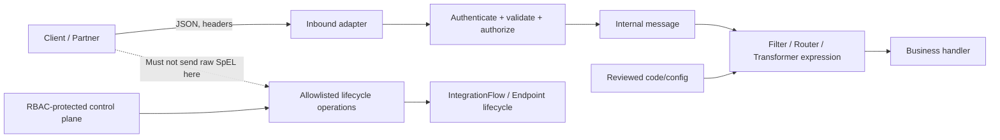
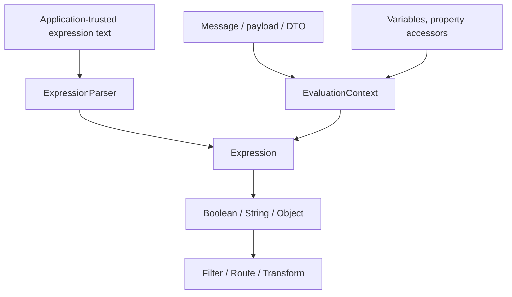
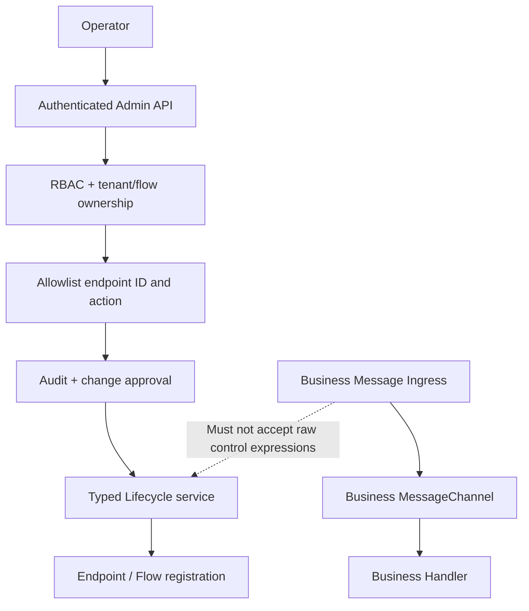
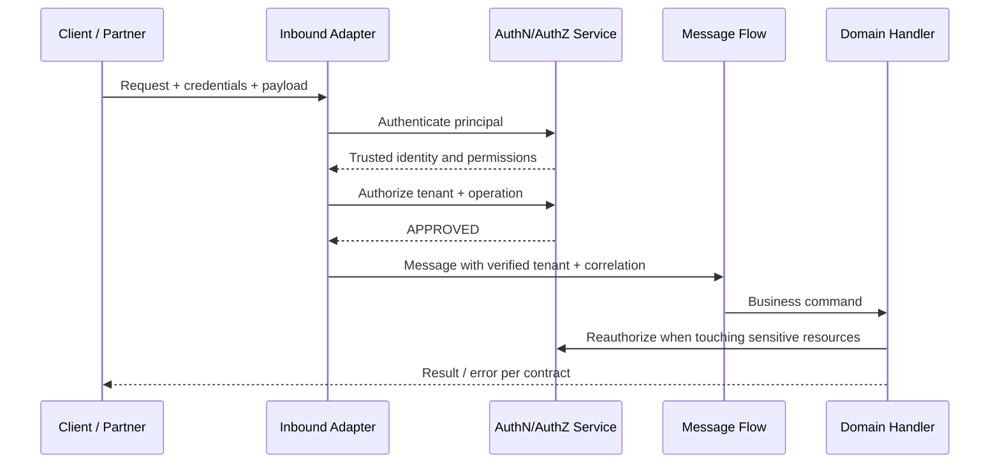
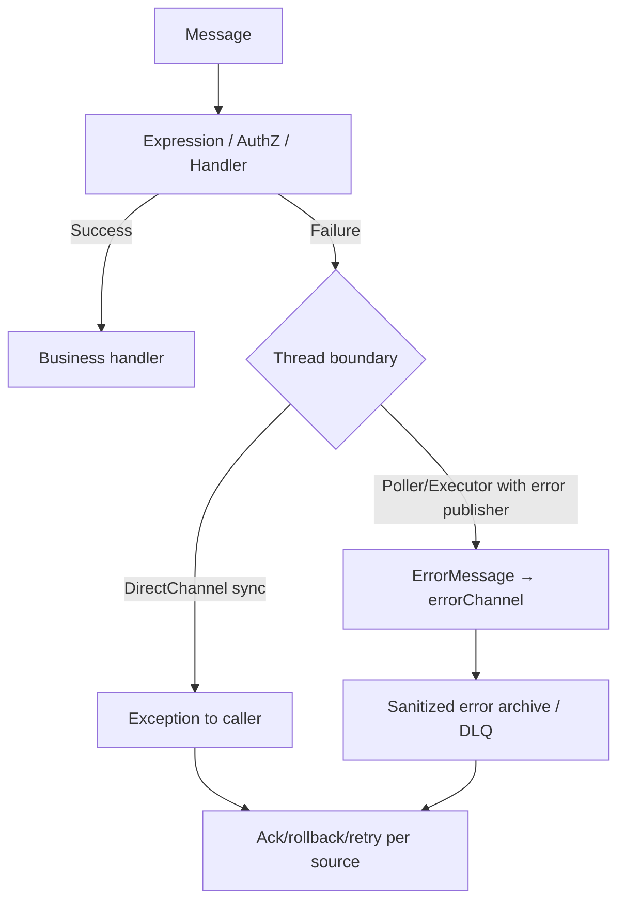

# Expression Evaluation and Runtime Access Control in Spring Integration

## Learning Objectives

Spring Integration frequently uses expressions to filter messages, determine routes, extract headers, transform payloads, or perform administrative operations. A fixed expression written by a developer, such as `headers['region'] == 'APAC'`, can be very useful. However, if a system allows users to submit **raw expression strings** for runtime evaluation, or lets an external API invoke the Control Bus directly, message-handling privileges can escalate into access to application beans, data, and lifecycle.

The lesson **Expression Evaluation and Runtime Access Control** belongs to the **Runtime Security** chapter in the **SPRING_INTEGRATION_RUNTIME** module. It frames security right where messages actually execute across channels, endpoints, consumers, pollers, and executors; and examines `IntegrationFlow` lifecycle, transactions, retries, message stores, errors/correlation, threading, performance, and administrative tools such as the Control Bus, Actuator, and JMX.

After this lesson, you will be able to:

- Identify the **trust boundary** between a reviewed expression in application configuration and a string/attribute supplied by a user or partner.
- Explain where Spring Expression Language (SpEL) is used and the roles of `ExpressionParser`, `EvaluationContext`, root objects, variables, and bean resolution.
- Distinguish `StandardEvaluationContext` from `SimpleEvaluationContext`; understand why a restricted context **must not be treated as an absolute sandbox** for arbitrary untrusted expressions.
- Design filters/routers using typed rules, allowlists, and immutable configuration instead of executing arbitrary SpEL strings.
- Protect the Control Bus and start/stop/register/remove flow APIs using authentication, authorization, least privilege, auditing, and without exposing administrative expressions.
- Understand `SecurityContext` boundaries when messages move to `ExecutorChannel`, pollers, schedulers, or reactive flows; never mistake client-sent headers for verified identity.
- Build protections for tenant partitioning, correlation, message stores, metadata, retries, and error archives.
- Write positive and negative tests verifying no unintended access occurs and no messages are lost or duplicated during runtime changes.

> **Core principle:** **User data must never become executable programs or administrative commands.** Application-defined expressions should read only necessary data; permission to start/stop flows, access beans, or mutate state must pass through a separately authenticated, authorized, and audited control path.

## 1. Why Is Expression Evaluation a Security Boundary?

A message may carry a JSON payload sent by a partner, HTTP/Kafka/AMQP headers, tenant info, and correlation IDs. Those values are **data**. Meanwhile, Spring Integration lets you **configure** many components using expressions:

- Filters use conditions to accept or drop messages.
- Routers compute a channel name or routing key.
- Transformers extract parts of a payload and build new values.
- Header enrichers set header values from an expression.
- Service activators/advice can use configured expressions.
- The Control Bus can execute expressions to invoke operations on managed beans.

The crucial distinction lies in **who decides the expression code**:

```text
Safer:
  Trusted code/config -> fixed expression
  Untrusted message   -> payload/headers as data
  Evaluation context  -> minimal privileges needed to read data

Dangerous:
  Untrusted HTTP body / message header -> expression source
  Expression evaluation context        -> permitted to invoke beans/methods
  Result                               -> unintended runtime control
```

It is especially dangerous when an application reads expression strings from a database editable by multiple teams, or from user-editable tenant configurations, and evaluates them in a permissive `StandardEvaluationContext`. **Storing data in a database does not make it trusted.**

### 1.1. Trust Boundary Diagram



The data plane and control plane must be separated. Never let headers like `operation=stopAll`, `targetBean`, or client parameters decide which methods to invoke on Spring beans.

### 1.2. Minimum Threat Model

| Asset to protect | Attack vector / risk | Consequence | Defense layer |
| --- | --- | --- | --- |
| Spring context beans | Expression can resolve/invoke beans | Access to non-business capabilities | Never evaluate arbitrary expressions; restrict context |
| Endpoint lifecycle | Uncontrolled Control Bus/start/stop APIs | Stopped consumers, SLA loss, duplicate redeliveries | RBAC, ID/action allowlists, audit, approvals |
| Tenant/principal headers | Trusting client-supplied headers | Cross-tenant reads/writes | Authenticate at ingress; re-authorize at sink |
| Message store/DLQ | Overly broad read/write/delete permissions | Payload leaks, loss of recovery capability | DB ACLs, encryption, retention, isolation |
| Poller/metadata | Unauthorized checkpoint resets | Data reprocessing or skipped records | Dedicated admin APIs, snapshots, idempotency |
| Executor/thread context | Assuming `SecurityContext` auto-propagates | Lost identity or wrong privileges applied | Explicit context propagation and reauthorization |
| Errors/logs/metrics | Logging expressions, headers, secrets | Data or credential exposure | Sanitization, masking, low-cardinality tags |
| Dynamic flow registry | Malicious config or missing quotas | Misrouted data, unbounded endpoints | Schema, allowlists, quotas, signed configs |

Not every expression-related incident is an attack. A typo in a route expression, a method with unexpected side effects, an I/O-blocking getter, or a CPU-heavy expression can also disrupt the runtime.

## 2. How Does SpEL Work in Spring Integration?

Spring Expression Language (SpEL) is used across many Spring components. At a basic level, an `ExpressionParser` parses an expression string into an `Expression`, and an `EvaluationContext` provides access to data.



Example conditions a filter might use:

```text
payload.status == 'READY'
headers['authenticatedTenant'] == 'tenant-a'
headers['priority'] > 5
```

These expressions **make sense when the data types and root object match**. A route expression string is not guaranteed to yield a channel bean; many routers map the result to a channel name, bean, or configured channel mapping.

### 2.1. SpEL Capabilities Depend on Context

SpEL generally supports property access, indexers, method invocation, type references, constructors, and bean references under appropriate conditions. **Language support does not mean every `EvaluationContext` permits everything.**

| Capability | Conceptually valid example | Risk if exposed to untrusted input |
| --- | --- | --- |
| Property read | `payload.status` | Deep object-graph traversal, getters with side effects |
| Map/list access | `headers['region']` | Exposing unauthorized header data |
| Comparisons/logic | `payload.amount > 0` | Complex expressions, type errors, resource exhaustion |
| Method calls | `payload.isReady()` | Methods with side effects, not pure reads |
| Bean references | `@beanName` | Touching services/repositories/endpoints in the context |
| Type references/constructors | Referencing Java types | Unnecessarily expanding the execution surface |
| Assignments/state mutation | Assigning properties if context permits | Mutating messages or shared objects |
| Collections/projections | Selecting/filtering values | High CPU and memory usage on large inputs |

An expression that looks "read-only" yet invokes a non-pure DTO getter or method can still trigger I/O, locking, or sensitive data access. Expose only **simple, normalized objects**.

### 2.2. Do Not Confuse Parse-Time with Evaluation-Time

```text
Parse:
  "payload.status == 'READY'" -> Expression created

Evaluate:
  Expression + Message + EvaluationContext -> Boolean
```

Parsing successfully **does not mean the expression is safe or succeeds** on every payload. Type mismatches, nulls, access denials, invalid paths, or oversized runtime data can cause evaluation to throw exceptions. In synchronous flows, exceptions can return to the caller; across executors/pollers, errors can enter error handlers, trigger retries, or send messages to DLQs.

### 2.3. Understanding the Message Root and Header Scope

In many Spring Integration components, expressions evaluate with the message as root or via related helpers. DSL configurations typically expose `payload` and `headers`. When using `SpelExpressionParser` directly in application code, **the root object is whatever you pass in**—there is no automatic `payload` variable if you simply pass an `OrderDto`.

```text
Spring Integration filter:
  root is typically Message
  expression = payload.amount > 0

Application evaluating an OrderDto directly:
  root = OrderDto
  expression = amount > 0
```

Tests must use the exact context and root used in production. Never copy an expression from DSL into a custom parser and assume identical behavior.

## 3. `StandardEvaluationContext` vs. `SimpleEvaluationContext`

### 3.1. `StandardEvaluationContext`: Powerful, Must Use Trusted Sources

`StandardEvaluationContext` is a general-purpose evaluation environment supporting customizable property accessors, method resolvers, type locators, and bean resolvers. It fits **developer-reviewed** configuration expressions, and should not be used by default to execute client-supplied strings.

```java
import org.springframework.expression.Expression;
import org.springframework.expression.ExpressionParser;
import org.springframework.expression.spel.standard.SpelExpressionParser;
import org.springframework.expression.spel.support.StandardEvaluationContext;

ExpressionParser parser = new SpelExpressionParser();

OrderView order = new OrderView("tenant-a", true);
Expression expression =
        parser.parseExpression("tenantId == 'tenant-a'");

StandardEvaluationContext context =
        new StandardEvaluationContext(order);

Boolean matches = expression.getValue(context, Boolean.class);
```

`OrderView` here is a data-only DTO defined in Section 3.2. Setting a DTO as root does not replace authorization checks, and `StandardEvaluationContext` must never be treated as a sandbox for raw user expressions.

### 3.2. `SimpleEvaluationContext`: Read-Only Property Example

Spring Framework provides `SimpleEvaluationContext` to restrict expression capabilities compared to the full context. The example below uses read-only property binding on a DTO with side-effect-free getters:

```java
import org.springframework.expression.Expression;
import org.springframework.expression.ExpressionParser;
import org.springframework.expression.EvaluationContext;
import org.springframework.expression.spel.standard.SpelExpressionParser;
import org.springframework.expression.spel.support.SimpleEvaluationContext;

final class OrderView {
    private final String tenantId;
    private final boolean expedited;

    OrderView(String tenantId, boolean expedited) {
        this.tenantId = tenantId;
        this.expedited = expedited;
    }

    public String getTenantId() {
        return tenantId;
    }

    public boolean isExpedited() {
        return expedited;
    }
}

final class ReadOnlyRuleEvaluator {
    private final ExpressionParser parser = new SpelExpressionParser();
    private final EvaluationContext context =
            SimpleEvaluationContext.forReadOnlyDataBinding().build();

    boolean matches(OrderView view) {
        Expression rule = parser.parseExpression(
                "tenantId == 'tenant-a' and expedited == true");

        return Boolean.TRUE.equals(
                rule.getValue(context, view, Boolean.class));
    }
}
```

Here, the **expression source is a code-defined constant**. `SimpleEvaluationContext.forReadOnlyDataBinding()` supports more restricted data property access; by design, it omits full `StandardEvaluationContext` capabilities such as type references and bean references.

**Do not treat `SimpleEvaluationContext` as certification that "any user-submitted SpEL can be executed safely."** It does not automatically solve dangerous getters, overly complex expressions, exposing unreadable properties, computational DoS, oversized inputs, or unintended allowlist changes. The strongest defense remains **not accepting raw SpEL from untrusted parties**.

### 3.3. Why Restricting `EvaluationContext` Is Defense-in-Depth

If part of a system **must** evaluate expressions from a source less trusted than application code, layer multiple controls:

1. Minimal input types that do not expose the Spring context's object graph from the root.
2. Permit only the grammar/features strictly required (ideally a custom DSL, not general-purpose SpEL).
3. Read-only context without bean resolvers or broad method resolvers.
4. Limits on expression length, condition count, nesting depth, and operators in your own grammar.
5. Allowlist field names instead of permitting free traversal of the property graph.
6. Quotas on requests, execution time, and resource capacity at the execution layer.
7. Audit who creates/updates rules, versions, and activation times.
8. Test with oversized payloads, nulls, wrong types, and denied operations.

A regex blocking a few "dangerous" tokens cannot make full SpEL safe; the language grammar and composition mechanisms are far too rich.

## 4. Fixed Expressions in Filters/Routers: Trust Scope

The practical, low-risk way to use SpEL is keeping **expressions in reviewed source code**, while messages supply only validated data.

### 4.1. Example of a Spring Integration Filter

```java
import org.springframework.context.annotation.Bean;
import org.springframework.integration.dsl.IntegrationFlow;

@Bean
IntegrationFlow validatedOrdersFlow() {
    return IntegrationFlow.from("orders.input")
            .filter("payload.amount > 0")
            .channel("orders.validated")
            .get();
}
```

This example assumes the message payload has a numeric `amount` property and upstream already validated/normalized the DTO. `orders.input` and `orders.validated` are configured channel endpoints; a real consumer is needed downstream to perform business work. `filter` only checks a condition—it **does not verify authorization to place orders**.

If messages can arrive with incompatible payload types, validate schemas upfront rather than letting expressions probe arbitrary objects via reflection. For critical security rules (tenant ownership, data access rights), place logic in well-tested services with explicit authorization rather than scattering hard-to-audit expressions.

### 4.2. Router Mappings Are Safer Than Routing to Arbitrary Beans

Suppose an authenticated message is assigned a `trustedRoute` header from an allowlisted enum. A router must never take a client-set `targetChannel` header and send it to an arbitrary bean/channel.

```text
From external API:
  request.shippingTier = "GOLD"

After validation and authorization:
  internal trustedRoute = GOLD

Router:
  GOLD     -> validatedGoldOrders
  STANDARD -> validatedStandardOrders
  anything else -> reject/quarantine
```

Use a fixed mapping set and reject unknown routes. Inside messages, treat `trustedRoute` as **provenance-sensitive data**: transformers or other adapters might copy or recreate headers. For sensitive resources, enforce authorization at the **destination handler**, not solely at the router.

### 4.3. Security Filters Must Fail Closed

```text
If tenant, principal, or policy is missing:
  reject/quarantine + report error clearly
  do not route to a broad-privilege default channel

If expression throws type/null error:
  do not let the message pass by default
  store safe error info without dumping secrets
```

Any fallback such as "if unmapped, send to default channel" must be carefully reviewed. A business default channel is usually inappropriate as a **sink for unverified data**.

## 5. Anti-Pattern: User-Controlled Expressions and Alternatives

### 5.1. Anti-Pattern to Avoid

```java
// Never use this pattern for client/tenant input!
String expressionText = request.getRuleExpression();

var parser = new org.springframework.expression.spel.standard.SpelExpressionParser();
var expression = parser.parseExpression(expressionText);

// Danger: taking raw expressions and evaluating in an overly broad context.
Object result = expression.getValue(runtimeContext, inputMessage);
```

Here `request`, `runtimeContext`, and `inputMessage` are illustrative placeholders, not runnable standalone code. The danger lies in **turning user input into expression source**, especially when the context can access beans, methods, or internal objects.

Do not "fix" this merely by blacklisting strings like "class", "Runtime", or special characters. That is neither a real parser nor an allowlist, and it creates a false sense of security.

### 5.2. Replacing Raw Expressions with Typed Policies

For example, let tenants pick routing conditions from **predefined rule types**:

```java
import java.math.BigDecimal;
import java.util.Set;

enum OrderRule {
    POSITIVE_AMOUNT,
    EXPEDITED_ONLY,
    APPROVED_CURRENCY
}

record OrderFacts(
        BigDecimal amount,
        boolean expedited,
        String currency) {
}

final class ApprovedRuleEngine {
    private static final Set<String> CURRENCIES =
            Set.of("VND", "USD", "EUR");

    boolean evaluate(OrderRule rule, OrderFacts facts) {
        if (facts == null || rule == null) {
            return false;
        }
        return switch (rule) {
            case POSITIVE_AMOUNT ->
                    facts.amount() != null
                    && facts.amount().signum() > 0;
            case EXPEDITED_ONLY -> facts.expedited();
            case APPROVED_CURRENCY ->
                    CURRENCIES.contains(facts.currency());
        };
    }
}
```

Clients can only select an `OrderRule` from a server-curated enum; `OrderFacts` data is already validated. If rules must be combined, build a bounded AST/DSL with a schema like `ALL/ANY/NOT`, maximum node count, permitted fields, and explicit operators—not general-purpose SpEL.

**Note:** a rule engine evaluates business data; it is not a full authentication/authorization system. Each tenant should only be granted authorized rules, routes, and downstream destinations.

### 5.3. When Policies Must Update Without Code Deployment

A configuration registry can store:

```json
{
  "policyId": "tenant-a-order-routing",
  "revision": 12,
  "rule": "APPROVED_CURRENCY",
  "enabled": true,
  "allowedDestinations": ["validatedGoldOrders"],
  "owner": "integrations-team"
}
```

This is an **application-designed schema**, not a built-in Spring Integration object. On load, validate schema, owner, tenant, revision, and allowlists; record an audit log and **activate an immutable revision**. Users must never be allowed to turn `rule` into arbitrary Java/SpEL or add unreviewed channel names.

## 6. Control Bus: Expressions Can Become Administrative Operations

Spring Integration's Control Bus supports sending control messages and executing expressions against beans/runtime components. Syntax often used in administrative configurations looks like:

```text
@ordersHandlerEndpoint.isRunning()
@ordersHandlerEndpoint.stop()
@ordersHandlerEndpoint.start()
```

These commands are **administrative**, not business data messages. When the Control Bus is configured with bean resolution, expressions can invoke methods on Spring-managed objects. Therefore, **never** connect an inbound HTTP/WebSocket/broker channel receiving user input directly to the Control Bus.

### 6.1. Safe Control Architecture



If using an internal Control Bus instead of a typed service, you still need a **policy gate before constructing expressions** and must never let users pick bean or method names. However, the simpler approach is usually **not exposing the Control Bus**, using a Java service that invokes only permitted lifecycle methods instead.

### 6.2. The Control Plane Must Be Isolated from the Data Plane

| Data plane | Control plane |
| --- | --- |
| Receives and processes business messages | Starts/stops endpoints, updates routes/versions |
| Input may come from clients/partners | Only authorized operators/service accounts |
| Usually scales with message rate | Strictly rate-limited, mandatory auditing |
| Errors may retry/redeliver | Operations require approval, idempotency, and change logs |
| Headers support correlation | Identity/role/flow ownership verified independently |
| Protects payloads/business side effects | Protects runtime/metadata control rights |

Never treat a business API access token as implicitly authorized to call the Control Bus. Message-processing job tokens/service accounts should hold only necessary permissions, never permission to stop all flows.

### 6.3. Real Impact of Start/Stop/Remove

- `Lifecycle.stop()` stops an endpoint per contract; it **does not automatically roll back** already-committed HTTP calls or DB transactions.
- `Lifecycle.start()` does not replay already-acked messages or messages lost from an in-memory queue.
- `IntegrationFlowContext.remove(registrationId)` removes a dynamic registration from the current context; it does not clean up brokers, message stores, metadata, or DLQs.
- Changing active routes/flow versions can push retrying messages through the wrong schema without version pinning.
- Resetting metadata checkpoints can reprocess old data or skip incomplete messages.

Consequently, authorizing a start/stop operation cannot rely solely on "user has ADMIN role"; you must know **which flow, which tenant, which time window, whether the message source is durable, and who owns rollback**.

## 7. Replacing Raw Control Bus Expressions with a Typed Management Service

A clear approach is maintaining the list of controllable endpoints in reviewed code or a reviewed registry. The admin API accepts **aliases and action enums**, never SpEL.

### 7.1. Java Example with an Allowlist

```java
import java.util.Map;

import org.springframework.context.ApplicationContext;
import org.springframework.context.Lifecycle;
import org.springframework.security.access.prepost.PreAuthorize;
import org.springframework.stereotype.Service;

enum EndpointAction {
    START, STOP, STATUS
}

@Service
final class ApprovedEndpointControl {

    private final Map<String, Lifecycle> endpoints;

    ApprovedEndpointControl(ApplicationContext context) {
        endpoints = Map.of(
                "orders-consumer",
                context.getBean("ordersHandlerEndpoint", Lifecycle.class),
                "inventory-consumer",
                context.getBean("inventoryHandlerEndpoint", Lifecycle.class));
    }

    @PreAuthorize("hasAuthority('integration:operate')")
    public boolean execute(String alias, EndpointAction action) {
        Lifecycle endpoint = endpoints.get(alias);
        if (endpoint == null || action == null) {
            throw new IllegalArgumentException(
                    "Unknown endpoint or action");
        }

        return switch (action) {
            case STATUS -> endpoint.isRunning();
            case START -> {
                if (!endpoint.isRunning()) {
                    endpoint.start();
                }
                yield endpoint.isRunning();
            }
            case STOP -> {
                if (endpoint.isRunning()) {
                    endpoint.stop();
                }
                yield !endpoint.isRunning();
            }
        };
    }
}
```

This example assumes both endpoints already exist in the Spring context. For `@PreAuthorize` to execute, the application needs **Spring Security method security** (e.g., `@EnableMethodSecurity`), invocation through the proxy, and valid authentication. **Self-invocation** within the same object bypasses proxies; do not rely on method annotations if security configuration is inactive.

This is only a minimal skeleton. Production needs:

- Permission checks **per tenant/flow/instance**, not only a coarse `integration:operate` role.
- Separation of **read status**, **start**, and **stop** permissions due to differing impact.
- Verification of desired state, planned maintenance, and source/queue/in-flight state before stopping.
- Auditing actor, request ID, endpoint alias, old/new state, approval, timestamp, and outcome.
- Rate limiting and command replay protection; never let one request accidentally stop the entire cluster.
- Never returning internal bean names/paths or exception stacks on public APIs.
- Checking `isRunning()` after the action and then verifying business progress; returning a boolean does not prove SLA recovery.

### 7.2. Never Map Client Aliases to Arbitrary Bean Names

An anti-pattern:

```java
// Never do this in an API accepting untrusted input:
String beanName = request.getTargetBean();
Lifecycle bean = applicationContext.getBean(beanName, Lifecycle.class);
bean.stop();
```

Even with authentication, this lets clients pick any bean directly. An administrative API must **map reviewed aliases → allowlisted endpoints** and verify ownership. Even a strong role must not bypass auditing and change-safety checks.

### 7.3. Governing by Flow Version

When using `IntegrationFlowContext`, IDs should be immutable, such as `tenant-a.orders.v2-r7`. Allowlist only **registrations belonging to the tenant** and matching the current generation in the desired-state registry. Removing a v1 flow while it is DRAINING can drop unfinished v1 work; check queues/backlogs, in-flight work, pending groups, and error archives before retiring.

If node A removed v1 while node B still runs v1, management requests must report **per-instance** status rather than assuming a single command affected the whole cluster.

## 8. Authentication at Ingress and Authorization at Sink

Expression controls do not replace request/message authentication. An inbound adapter can receive a message with headers:

```text
headers:
  tenantId: "tenant-a"
  userRole: "ADMIN"
  route: "priorityOrders"
```

If these headers come from a client, they are **not proof of verified tenant or privilege**. The system must authenticate via the transport channel (mTLS/JWT/OAuth2 or appropriate source mechanism), validate claims, and build trusted internal metadata.

### 8.1. Building a Message After Authentication



Do not automatically assume every header inside Spring Integration is safe. Transformers may copy source headers, bridges may reconstruct messages, and other adapters may emit new internal payloads. Sensitive endpoints must know the **provenance of identity** and enforce authorization where side effects occur.

### 8.2. Example Checking Tenant Before Creating a Message

```java
import org.springframework.security.access.AccessDeniedException;
import org.springframework.security.core.Authentication;
import org.springframework.messaging.Message;
import org.springframework.messaging.support.MessageBuilder;

record OrderCommand(String orderId, String tenantId, long amount) {
}

interface TenantAccessService {
    boolean canCreateOrder(Authentication actor, String tenantId);
}

final class AuthenticatedOrderMessageFactory {
    private final TenantAccessService access;

    AuthenticatedOrderMessageFactory(TenantAccessService access) {
        this.access = access;
    }

    Message<OrderCommand> create(
            Authentication actor, OrderCommand command) {

        if (actor == null
                || !actor.isAuthenticated()
                || command == null
                || !access.canCreateOrder(actor, command.tenantId())) {
            throw new AccessDeniedException(
                    "Not permitted to create order for tenant");
        }

        return MessageBuilder.withPayload(command)
                .setHeader("verifiedTenant", command.tenantId())
                .setHeader("businessKey",
                        command.tenantId() + ":" + command.orderId())
                .build();
    }
}
```

This assumes `TenantAccessService` checks claims/permissions against a trusted source rather than merely reading a client-sent `tenantId` field. `Authentication.isAuthenticated()` alone is insufficient; `canCreateOrder` determines resource-specific permission. Never copy `verifiedTenant` from an HTTP header of the same name and treat it as authentic.

### 8.3. Security Headers Are Not the Sole Authorization Mechanism

A message persisted in a DB, replayed from a DLQ, or emitted by an internal adapter may **lack the original `Authentication`**, or belong to a principal whose permissions have expired. Therefore:

- Retain audit fields like verified `actorId`/`tenantId` and issuer, rather than blindly serializing an entire `SecurityContext`.
- When processing delayed/replayed work, re-check **current permissions or persisted authorization policy** as required by the business domain.
- Distinguish messages processed under a worker's **service identity** from messages bound by **end-user authorization**.
- Never convert a `principalName` header into a high-privilege `Authentication` object without verification.

## 9. `SecurityContext` Across `DirectChannel`, `ExecutorChannel`, and Pollers

By default, Spring Security stores `SecurityContext` in `SecurityContextHolder` using a thread-bound strategy. This creates important differences when Spring Integration switches threads.

### 9.1. Same-Thread vs. Cross-Thread Execution

| Component | Typical execution thread | What to verify |
| --- | --- | --- |
| `DirectChannel` + handler | Thread calling `send()` | `SecurityContext` may remain on the same call stack, yet source must still be authenticated |
| `ExecutorChannel` | Executor worker | ThreadLocal `SecurityContext` **does not auto-propagate** |
| `QueueChannel` + poller | Poller/scheduler thread | Never assume the caller's principal still exists |
| Broker inbound adapter | Adapter thread/container | Identity is service-level or claims verified at source |
| Reactive bridge | Reactor subscription/scheduler | Reactor Context and ThreadLocal differ |
| Dynamic flow | Depends on internal channel/endpoint | Never infer identity from registration ID |
| Retry/recovery worker | May run later or on another node | Identity/permissions may have expired or changed |

If a request moves from `DirectChannel` to `ExecutorChannel`, `@PreAuthorize` on the worker handler may see no user—or see an identity improperly propagated by code. **Never fix this by making every worker a SUPERUSER.**

### 9.2. Propagation Example When Truly Needed

Spring Security provides executor wrappers to propagate `SecurityContext` across execution boundaries. This applies to **short-lived work within the request lifecycle**, not durable messages processed days later:

```java
import java.util.concurrent.ExecutorService;
import java.util.concurrent.Executors;

import org.springframework.beans.factory.annotation.Qualifier;
import org.springframework.context.annotation.Bean;
import org.springframework.integration.channel.ExecutorChannel;
import org.springframework.messaging.MessageChannel;
import org.springframework.security.concurrent.DelegatingSecurityContextExecutor;

@Bean(name = "messageWorkers", destroyMethod = "shutdown")
ExecutorService messageWorkers() {
    return Executors.newFixedThreadPool(4);
}

@Bean("securedAsyncInput")
MessageChannel securedAsyncInput(
        @Qualifier("messageWorkers") ExecutorService workers) {

    return new ExecutorChannel(
            new DelegatingSecurityContextExecutor(workers));
}
```

The wrapper runs tasks with the supplied/captured context per its constructor contract, yet **does not replace** resource authorization, propagate imperative JDBC transactions, or prove end-user permissions remain valid long afterward. For broker inbound or standalone schedulers, design proper service identities/verified claims and authorization rather than relying on expired HTTP request contexts.

### 9.3. Risks You Must Test

- Reused worker threads: does `SecurityContext` **leak from a previous message** to the next?
- Concurrent tenant A/B traffic: can tenant B's handler ever receive tenant A's context?
- Retried tasks after a delay: are original tokens/claims still valid?
- Consumers running under a service account: are they granted broader permissions than necessary?
- After Reactor `publishOn` or `subscribeOn`: do logs/MDC lose context, and does that affect authz decisions?
- When exceptions/recovery run on another thread: does the error store use proper permissions without writing to the wrong tenant?

Never place secrets or bearer tokens in `MessageHeaders` just to "pass context", especially when messages can reach persistent stores, DLQs, or logs.

## 10. Multi-Tenant Boundaries: Routing, Stores, and Correlation

Spring Integration frequently routes multiple tenants through a single application. How headers and keys are constructed determines whether messages can mix or leak across tenants.

### 10.1. Routing Keys Must Come from Trusted Sources

```text
Do not trust:
  headers['tenantId'] self-created by client

Conditionally trust:
  verifiedTenant attached by ingress authz
  and verified against resource permissions at the target handler
```

If a router uses `headers['tenantId']` to pick channels, clients can spoof another tenant and drive messages to unintended handlers. An upfront filter is insufficient if bypass paths, replays, or internal adapters exist.

### 10.2. Partitioning Keys by Tenant and Version When Needed

```text
businessKey:
  tenant-a:ORD-42

groupId (aggregator):
  tenant-a:orders-v2:workflow-run-42

metadata key:
  si:orders:tenant-a:checkpoint

error record:
  tenant=tenant-a
  flowVersion=orders-v2
  businessKey=tenant-a:ORD-42
```

These strings are **logical key examples**, not default row keys across all stores. Normalize and validate IDs; if tenant/order IDs can contain delimiters, use encoding or unambiguous key structures. A unique constraint scoped only by `orderId` without tenant causes collisions; conversely, a key with only tenant and no event ID blocks unrelated messages.

### 10.3. `MessageGroupStore` and Correlation Leakage

An aggregator uses `correlationId` to group messages. If two tenants both send `ORD-42` and the group ID is simply `ORD-42`, parts can be merged across tenants. Include tenant/workflow scope in the group ID or partition stores/regions appropriately, and validate all parts before release.

**`MessageHeaders.ID` differs from group ID.** A specific message UUID guarantees neither group ownership nor tenant ownership. When replaying from a DLQ, preserve correlation/verified tenant per contract and never accept client-modified headers as proof.

## 11. Persistent Stores, Metadata, and Data Access Control

### 11.1. Three Store Abstractions, Three Responsibilities

| Abstraction | Stored data | Security risks | Prevention |
| --- | --- | --- | --- |
| `MessageStore` | `Message<?>` by UUID | Payloads/headers contain PII/credentials; overly broad reads | Encryption, DB ACLs, retention, serializer testing |
| `MessageGroupStore` | Groups by correlation key | Mixing messages across tenants/versions, group content leaks | Group isolation, key strategy, authorization |
| `MetadataStore` | String key/value checkpoints/dedupe | Key reset causes replays; keys leak tenant/file paths | Namespacing/ACLs, guarded maintenance, auditing |
| Error archive/DLQ | Payload references + exceptions + retry state | Stack traces or payloads containing secrets | Sanitization, retention, replay permissions |
| Business ledger/outbox | Business keys, commit state | Idempotency bypass or cross-tenant writes | Unique constraints, transactions, resource authz |

Persisting a message does not mean **permission to process it** remains valid forever. A user's privileges may be revoked between message creation and recovery worker replay. Define the contract explicitly: process under an authorized service identity, re-check current permissions, or rely on a durably recorded authorization decision per policy.

### 11.2. Protecting Metadata Lifecycle

Operations like "clear all accept-once markers", "reset checkpoint to 0", or "purge old groups" can cause thousands of messages to be reprocessed or skipped. Never expose them as arbitrary administrative expressions.

Sensitive maintenance requires:

1. An actor/service account authorized on the **exact flow, tenant, and resource**.
2. Pre-change state snapshots and rollback capability where technically feasible.
3. Verification of business idempotency/acks prior to replay.
4. Scoped keys/regions; never wildcard-delete across other tenants.
5. Auditing expected record counts, modified record counts, and error paths.
6. Post-operation verification of business outcomes, queue lag, and duplicates.

### 11.3. Retention and Serialization

Headers may hold channel references or runtime objects that serialize poorly. Persisting an entire `SecurityContext`, `Authentication`, or stack trace alongside payloads creates versioning/serialization bugs and data leaks. Store only **minimal identity metadata**, sanitized payloads, or references to access-controlled storage; enforce retention and deletion per data governance policies.

Changing DTOs/schemas or flow versions requires a plan for reading older messages and testing replay. Never force v1 messages through v2 merely because v2 is ACTIVE, especially if authz rules or tenant partitions changed.

## 12. Retries, Transactions, and Error Flows on Security Failures

A filter expression can throw on null/wrong-type fields; a security handler can deny missing permissions; a downstream call can time out. **Classify errors** rather than retrying them all identically.

### 12.1. Error Classification Table

| Error type | Retry? | Suggested handling path |
| --- | --- | --- |
| Validation/schema failure | Generally no | Reject/quarantine, return clear error |
| Unauthorized tenant | No | Access denied, security audit |
| Invalid expression in config | Do not retry message infinitely | Fail config/roll back version, alert owner |
| Missing bean/router mapping | Generally no | Fix deployment/config, quarantine |
| Transient DB/broker outage | May retry with backoff | Bounded attempts, durable source |
| API timeout after side effect | Retry only with idempotency | Check status/unique business key |
| Control plane unauthorized | No | Audit and return denial |
| Error archive unavailable | Do not auto-ack if durable error required | Pause/requeue/fail closed per policy |

### 12.2. Exceptions and `ErrorMessage`



`ErrorMessage.getPayload()` is a `Throwable`, not the business payload. Context comes from `getOriginalMessage()` or `MessagingException.getFailedMessage()` if provided by the publisher. Never log raw `Throwable.toString()` or payloads if they may hold auth tokens, credentialed URIs, or personal data.

An `AccessDeniedException` in a synchronous handler can propagate to the caller; across executors/pollers, it may be published by an error handler if configured. Simply **having an `errorChannel`** does not guarantee every exception lands there.

### 12.3. A Recovery Callback Returning Normally Changes Ack Semantics

If retry advice exhausts attempts and a recovery callback merely logs "permission denied" and returns normally, the source may treat the message as handled and acknowledge it depending on adapter/transaction configuration. For permanent authorization denials, that can be appropriate **provided** you recorded an error/quarantine record per policy—but wrong if an important message vanishes silently.

For side effects committed before an error, retries/redeliveries must use business idempotency keys rather than `MessageHeaders.ID`, since redelivered messages may carry new UUIDs.

### 12.4. Transactions Do Not Follow `SecurityContext`

`DelegatingSecurityContextExecutor` propagates security context per wrapper contract, yet **does not propagate imperative JDBC transactions from the caller thread**. An async handler can commit independently while the source already acked. For durable handoffs, use a queue/broker/outbox with clear contracts and enforce authorization/tenant and idempotency checks in the worker.

## 13. Dynamic `IntegrationFlow`: Do Not Turn the Registry into Arbitrary Code Execution

`IntegrationFlowContext` can register flows while the application is running. This flexibility requires a controlled manifest: configuration data must never arbitrarily select Java beans, expressions, endpoint URLs, or method names.

### 13.1. Designing a Safe Manifest

```json
{
  "tenant": "tenant-a",
  "flowType": "ORDER_ROUTING",
  "version": "2.1.0",
  "revision": 7,
  "inputChannelAlias": "tenant-a-orders",
  "processingPolicy": "STANDARD",
  "destinationAlias": "approved-partner-a",
  "maxConcurrency": 4,
  "enabled": true
}
```

Values are validated against an allowlist before building the `IntegrationFlow`:

- `flowType` belongs strictly to code-supported types.
- `inputChannelAlias` and `destinationAlias` map to system-provisioned resources, never becoming raw bean names or URLs.
- `maxConcurrency` is capped by tenant quotas and pool/resource budgets.
- `processingPolicy` maps to reviewed filters/handlers, never parsed as expressions.
- Execution identity is not an arbitrary user header; downstream resource access is controlled.
- Immutable revisions/digests and audits on every register/start/route switch/stop/remove.

### 13.2. Security Considerations in Rollouts and Rollbacks

A v2 flow with updated rules must be validated before becoming ACTIVE. Messages pinned to v1 may still sit in persistent queues or error archives; retiring v1 must handle them per version policy. If v1 contained a vulnerability, quarantine or migrate them rather than letting them keep running—yet never push them through v2 without checking schema, authz, and idempotency.

An orchestration controller must coordinate state across pods; `IntegrationFlowContext` in pod A does not grant/revoke registrations in pod B. Never treat flipping an `AtomicReference` active alias in one JVM as a cluster-wide policy enforcement point.

### 13.3. Resource and Expression Limits

When accepting multiple tenant flow configs, enforce limits:

| Quota | Why |
| --- | --- |
| Active flows/endpoints per tenant | Prevent exhausting beans, subscribers, schedulers |
| Worker count and queue capacity | Prevent thread starvation/OOM |
| Message and header sizes | Prevent memory pressure or log floods |
| Condition count in rule AST | Prevent expensive evaluation |
| Policy create/update rate | Prevent config churn and rollback storms |
| Retries/backoff | Prevent infinite API loops |
| Pending groups and retention | Protect `MessageGroupStore` |
| Error record counts and DLQ capacity | Protect error stores/recovery capability |

Quotas should be enforced both at **registration** and during **processing**, not only when the config form is submitted.

## 14. Protecting Administrative Surfaces: Actuator, JMX, Logs, and Secrets

Aside from the Control Bus, production may enable Spring Boot Actuator, JMX, or Spring Integration management tools. Separate **read-only status** endpoints from endpoints **capable of mutating runtime state**.

### 14.1. Administrative Permission Matrix

| Capability | Suggested role | Additional controls |
| --- | --- | --- |
| View aggregate health | Monitoring reader | Limit details, network scope |
| View metrics/graph | Operations reader | Avoid leaking sensitive topology or tenants |
| View sanitized error archive | Incident responder | Tenant scope, access auditing |
| Replay a message | Recovery operator | Idempotency, approval, rate limit |
| Start/stop an endpoint | Integration operator | Alias allowlist, desired state, audit |
| Update active flow version | Release controller | Manifest digest, multi-node coordination |
| Reset checkpoints/cleanup groups | Privileged maintenance | Snapshot, two-person approval if critical |
| Change credentials/broker connections | Infrastructure/security operator | Secret manager, rotation, never pass via messages |

Never assume `/actuator/health`, `/actuator/integrationgraph`, or a JMX MBean always exists: availability depends on dependencies, configuration, and versions. When enabled, place them on dedicated management listeners/networks with authentication, authorization, and controlled exposure.

### 14.2. Example Actuator Exposure Principles

```yaml
management:
  endpoints:
    web:
      exposure:
        include: health,info
  endpoint:
    health:
      show-details: when_authorized
```

This merely **narrows the surface**; it does not replace security filter chains, network policies, or management-port authorization. `show-details: when_authorized` requires proper authorization; moreover, health indicators must never accidentally return secrets in `Health.withDetail(...)`.

If Actuator metrics or integration graphs are needed operationally, enable them **deliberately with proper authorization**; never enable wildcard exposure or expose management interfaces to the Internet for convenience.

### 14.3. Auditing and Redaction

Logs should capture:

```text
event=FLOW_CONTROL_REQUEST
  actorId=svc-release-controller
  action=STOP
  endpointAlias=orders-consumer
  tenant=tenant-a
  requestId=chg-2026-042
  allowed=true
  outcome=SUCCESS

event=EXPRESSION_POLICY_REJECTED
  actorId=tenant-a-config-editor
  policyRevision=13
  reason=UNSUPPORTED_RULE
  outcome=DENIED

event=MESSAGE_AUTHZ_FAILURE
  businessKeyHash=...
  flowVersion=orders-v2-r7
  reason=TENANT_NOT_ALLOWED
  errorArchiveCommitted=true
```

These are **application-instrumented sample logs**. Never put untrusted raw expressions, bearer tokens, full payloads, or secret-bearing exception stacks into logs; to analyze a policy, store digests and sanitized configs in access-controlled storage. Lifecycle audits must record **denied attempts as well**, not just successes.

## 15. Testing Expressions and Runtime Access Control

Security must be verified through **both positive and negative tests**. A test showing "valid expression returns true" is insufficient if the same API still permits accessing out-of-scope beans.

### 15.1. Testing Read-Only `SimpleEvaluationContext`

```java
import org.junit.jupiter.api.Test;
import org.springframework.expression.EvaluationContext;
import org.springframework.expression.EvaluationException;
import org.springframework.expression.spel.standard.SpelExpressionParser;
import org.springframework.expression.spel.support.SimpleEvaluationContext;

import static org.junit.jupiter.api.Assertions.*;

class ReadOnlySpelTest {

    private final SpelExpressionParser parser =
            new SpelExpressionParser();

    private final EvaluationContext context =
            SimpleEvaluationContext.forReadOnlyDataBinding().build();

    @Test
    void evaluatesApprovedPropertyRule() {
        OrderView view = new OrderView("tenant-a", true);

        Boolean allowed = parser
                .parseExpression("tenantId == 'tenant-a' and expedited")
                .getValue(context, view, Boolean.class);

        assertEquals(Boolean.TRUE, allowed);
    }

    @Test
    void doesNotProvideBeanReferences() {
        OrderView view = new OrderView("tenant-a", true);

        assertThrows(EvaluationException.class, () ->
                parser.parseExpression("@sensitiveBean")
                        .getValue(context, view));
    }
}
```

This test illustrates the capabilities of the chosen context. It **does not prove arbitrary SpEL is safe against every malicious input**; verify grammars, DTO/field allowlists, resource budgets, policy management permissions, and actual Spring Framework version behavior.

### 15.2. Testing Management Service Authorization

Suppose `ApprovedEndpointControl` is called through a Spring proxy with `@EnableMethodSecurity`. Cases to cover:

| Test | Input/actor | Expected |
| --- | --- | --- |
| Valid operator | Has authority + matching tenant/flow | Operates only on allowlisted endpoint |
| Business user | Lacks `integration:operate` | Access denied, endpoint unchanged |
| Tenant A operator | Target belongs to tenant B | Denied despite holding role |
| Unknown alias | `endpointAlias=otherBean` | Rejected, no fallback to bean resolver |
| Unsupported action | Invalid JSON enum | Validation error, never parsed as SpEL |
| Repeated stop command | Endpoint already stopped | Idempotent behavior, properly audited |
| Flow with in-flight work | Stop while unprotected work runs | Rejected or requires drain/approval |
| Multiple pods | Only pod A receives command | Per-instance status accurately recorded |
| Unproxied security annotation | Self-invocation or misconfiguration | Test fails rather than assuming protection |
| Audit backend failure | Sensitive command | Explicit fail-closed/escalation policy, never silently skips audit |

### 15.3. Testing Thread Boundaries

In a Spring Test context:

1. Create two principals authorized for tenants A and B.
2. Have `DirectChannel` invoke a handler reading identity per contract.
3. Route the same message across an `ExecutorChannel` with and without proper propagation.
4. Verify zero context leakage between worker tasks.
5. When context is missing, the handler must **deny or run under an explicitly authorized service identity**, never fabricating an implicit superuser.
6. Verify the source's transaction does not automatically follow the worker.
7. Redeliver a message after permissions changed and test the reauthorization policy.

Never rely on tests asserting only a `principalName` header, since headers can be spoofed and do not prove a valid `SecurityContextHolder`/principal.

### 15.4. Testing Multi-Tenancy and Correlation

- Two tenants using the same `orderId` are never merged in an aggregator group.
- Messages lacking `verifiedTenant` are rejected even if `headers['tenantId']` is present.
- DLQ messages cannot be replayed under another tenant's authority.
- Error archives only let operators read records belonging to authorized tenants.
- Dedupe/idempotency keys include tenant and business event scope.
- Dynamic flows v1/v2 do not unintentionally share mutable security policies.

## 16. Test Matrix and Incident Simulation

| Scenario | Setup | Required evidence |
| --- | --- | --- |
| Valid fixed expression | Filter on validated DTO | Right messages accepted, headers intact |
| Expression evaluates missing field | Null/wrong-schema payload | Reject/error flow per policy, never default-allow |
| User submits raw expression | Config API accepts only enums/AST | Validation rejects, never evaluated |
| Read-only context | Expression references bean | No bean resolution |
| Impure getter | DTO getter with side effects | Never expose such objects to rule evaluators |
| Oversized rule | Many nodes/conditions | Quota rejects before execution |
| Unknown route | Route header outside allowlist | Quarantine/reject, never dispatch to privileged channel |
| Control Bus receives external input | Miswired ingress topology | No path from client to command processor |
| Under-privileged admin | Wrong role | Access denied + audit |
| Right role, wrong tenant | Target belongs to another tenant | Access denied, endpoint unchanged |
| Bypassed method security | Self-invocation | Test catches missing enforcement |
| Same-thread `DirectChannel` | Handler runs on sender thread | `SecurityContext` per contract, authz still checked |
| Cross-thread `ExecutorChannel` | Two principals interleaved | No identity leak, proper worker reauthorization |
| Poller without end-user context | Delayed source processing | Explicit service identity policy |
| Replay after privilege revocation | Old message from DLQ | Re-checked per policy, never blindly trusts stale claims |
| Tenant collision on group ID | Two tenants share order ID | Groups remain isolated |
| Retry after external commit | Client timeout | Idempotency prevents duplicate side effects |
| Error archive with sensitive headers | Failed message | Payloads/logs sanitized, read restricted to authorized operators |
| Unauthorized checkpoint reset | Operator lacks maintenance permission | Denied, metadata unchanged |
| Misconfigured dynamic flow | Non-allowlisted destination | Never registered/activated |
| Flow version rolling update | v1 DRAINING, v2 ACTIVE | Version-pinned messages handled cleanly, none lost |
| Audit service outage | Admin sends stop request | Explicit fail-closed/escalation policy, no silent un-audited changes |
| Public health/management | Public client probes endpoint | No sensitive details or control actions exposed |

**QA rule:** every test must verify **protected outcomes** such as endpoint state, DB rows, queues, headers, error archives, or audit logs; checking HTTP 403 alone is insufficient if the method already ran before blocking.

## 17. Investigation Runbook for Suspected Expression/Control Plane Abuse

### Step 1 — Identify Symptoms and Scope

Did an endpoint stop on its own? Did a new rule suddenly misroute messages? Are workers spending too long evaluating expressions or logging SpEL errors? Record timestamps, instances, logical flows, versions/revisions, actors, sources, and sample business keys.

### Step 2 — Separate Data Plane from Control Plane

Trace input paths: are inbound HTTP/broker messages entering business handlers or reaching a Control Bus path? Is any user-supplied header/payload being used as an expression source, target bean, channel name, or dynamic flow definition?

### Step 3 — Isolate Risky Administrative Access

If a control API exposure is suspected, prioritize disabling **the operation privilege or dangerous ingress path** per policy rather than blindly stopping all consumers. Preserve durable message sources and in-flight state before changing topology.

### Step 4 — Gather Evidence Without Exposing More Secrets

Preserve audit logs, policy revisions/digests, authenticated principals, registration IDs, endpoint states, metrics, error flows, and thread dumps as needed. Never paste raw credentials/tokens or full payloads into incident tickets. Inspect logs for header-based identity spoofing.

### Step 5 — Inspect Execution Context and Policies

Where was the expression parsed from? `StandardEvaluationContext` or `SimpleEvaluationContext`? Which objects were on the root? Were bean resolvers/method access enabled? Did rule/route allowlists exist? Were validation and quotas applied before evaluation?

### Step 6 — Reconcile Messages and Business State

Check whether messages were processed for the wrong tenant, routed to unintended channels, or called external APIs before failing. Reconcile `businessKey`, `correlationId`, source acks, idempotency ledgers, and error archives. Never replay before verifying side effects.

### Step 7 — Choose the Minimal Remediation

Depending on root cause: revoke credentials, restrict management exposure, roll back policy revisions, block non-allowlisted rules, decouple input channels, fix sink authorization, or restore flow registrations from trusted manifests. Never let a health indicator automatically invoke start/stop on failure.

### Step 8 — Regression Test Before Reopening

Run positive and negative tests on the fixed policy; verify unauthorized actors cannot touch endpoints, tenants cannot mix, and error/ack/retry semantics remain sound. Use non-mutating canaries to confirm routing.

### Step 9 — Restore Traffic Gradually

Re-enable flows/tenants or pods incrementally per rollout policy. Monitor queue lag, in-flight work, error rates, rejected requests, audit records, and business duplicates. Separately assess messages processed before the vulnerability was patched.

### Step 10 — Close with a Postmortem

Document which expressions/policies were active, who held permissions, why tests/authorization missed it, affected data, and newly added safeguards. Never close an incident solely because `isRunning=true` or Actuator health reports `UP`.

## 18. Hands-On Exercises

### Exercise A — Comparing Evaluation Contexts

Use `OrderView` and `ReadOnlyRuleEvaluator` from Section 3. Verify property-reading conditions return expected results. Try referencing a bean in the simple context and confirm it is rejected. Contrast with `StandardEvaluationContext` privileges and document why raw user expressions must not be used.

**Expected outcome:** understand language and context limits, without treating a single test as general sandbox certification.

### Exercise B — Replacing User Expressions with Typed Policies

Build an API allowing tenants to select an `OrderRule` enum instead of submitting SpEL strings. Add rules checking amount, currency, and expedited status. Test null inputs, out-of-allowlist values, and cross-tenant configurations.

**Expected outcome:** client data only selects developer-reviewed capabilities; no arbitrary expression evaluation exists.

### Exercise C — Protecting the Control Bus and Endpoint Lifecycle

Set up an endpoint with an explicit ID. Implement `ApprovedEndpointControl`, enable method security via Spring config, and create identities with varying permissions. Test STATUS/START/STOP and verify audits, out-of-allowlist aliases, wrong tenants, and self-invocation.

**Expected outcome:** knowing a bean name is never enough to invoke `stop()`; operations are authenticated, authorized, and audited.

### Exercise D — Locating `SecurityContext` Boundaries

Send messages from an authenticated request through `DirectChannel` and then `ExecutorChannel` using a test executor with fixed thread names. Compare without a wrapper vs. with `DelegatingSecurityContextExecutor`, verifying tenant A/B privileges and context cleanup.

**Expected outcome:** `ThreadLocal` does not auto-cross executors; propagation must be explicit and free of cross-tenant leakage.

### Exercise E — Multi-Tenant Router

Send messages from tenants A and B sharing `orderId=ORD-42`. Set verified tenant at ingress after authz, route via an allowlist mapping, and use tenant/version-scoped group keys. Intentionally inject spoofed tenant headers.

**Expected outcome:** spoofed headers do not escalate privileges; the aggregator never mixes tenant data; sinks verify permissions before side effects.

### Exercise F — Replay After Failure and Privilege Change

Persist a valid message to a durable error archive, then revoke the original actor's permissions before replay. Implement an appropriate service identity or reauthorization policy; test retrying after an API commits and times out.

**Expected outcome:** replay operators are audited, revoked identities are not reused, and duplicate side effects are prevented.

### Exercise G — Safe Dynamic Flow Manifests

Build a registry for two flow versions using allowlisted `flowType` and `destinationAlias` values; cap concurrency and registration counts. Test manifests with out-of-list bean names/URLs. Activate v2 via register → ready → switch → drain → retire.

**Expected outcome:** new configs cannot act as arbitrary commands, older messages remain pinned to their versions, and durable sources are protected.

### Exercise H — Control-Plane Privilege Incident Drill

Simulate an account with read-only health permissions attempting to stop an endpoint. Collect denial logs and verify the endpoint stays unchanged. Then simulate a misconfigured rule causing the router to reject all messages: roll back the revision, preserve error records, verify correlation, and reopen via canary.

**Expected outcome:** the runbook protects both runtime and data; post-recovery evidence confirms authorization, auditing, business progress, and zero duplicate side effects.

## 19. Self-Check Questions

1. Why must a message's `payload`/`headers` generally be treated as data rather than part of the program?
2. How does an expression defined in reviewed code differ from a client-submitted expression?
3. What are the roles of `ExpressionParser`, `Expression`, and `EvaluationContext`?
4. Why can the root object of a Spring Integration expression differ from the root when you invoke `SpelExpressionParser` yourself?
5. Which capabilities of `StandardEvaluationContext` require security scrutiny?
6. `SimpleEvaluationContext.forReadOnlyDataBinding()` narrows capabilities, yet which risks does it fail to solve?
7. Why does blocking a few tokens like "class" fail to create a reliable sandbox?
8. Why should DTOs used in evaluation have pure getters that neither hit a DB nor cause side effects?
9. Does a `payload.amount > 0` filter prove the sender is authorized to create an order?
10. Why should a router never take a raw `targetChannel` from a client and route to arbitrary beans/channels?
11. When a route key is not in the allowlist, what should fail-closed behavior do?
12. How does the Control Bus differ from data-plane channels in permissions and impact?
13. Should knowing an endpoint bean name be enough to call `stop()`? Why or why not?
14. What conditions are required for `@PreAuthorize` to work via proxies in Spring Security?
15. How does self-invocation affect method security?
16. How do you prevent a tenant A operator from stopping tenant B's endpoint?
17. Does `Lifecycle.stop()` automatically roll back HTTP side effects or delete durable queues?
18. Does `IntegrationFlowContext.remove(...)` manage flows across all pods simultaneously?
19. Why does a `tenantId=tenant-a` message header not prove the sender belongs to tenant A?
20. When moving from `DirectChannel` to `ExecutorChannel`, does `SecurityContextHolder` auto-propagate to workers?
21. Does `DelegatingSecurityContextExecutor` automatically propagate JDBC transactions?
22. Why should replaying a message from a DLQ days later not blindly trust the original ingress end-user authorization?
23. Which scopes must an aggregator's group ID include to prevent mixing messages across tenants/versions?
24. How do `MessageStore`, `MessageGroupStore`, and `MetadataStore` require different security measures?
25. Why can resetting accept-once metadata/checkpoints cause duplicates or skipped data?
26. An `ErrorMessage` contains a `Throwable`; where do you inspect the original/failed message if available?
27. Why should authorization failures generally not be retried indefinitely?
28. If a recovery callback swallows an exception and returns normally, how might the source handle acks?
29. To govern tenant-configured dynamic flows, which fields and resources should be bounded?
30. When Actuator reports `UP`, what evidence is still needed to prove safe business processing?
31. Which security tests must assert **no side effects occurred**, rather than checking HTTP status alone?
32. In an incident of suspected Control Bus abuse, in what order should you protect messages and collect evidence?

**Remember:** **Expression evaluation is an execution boundary**, while **runtime access control is an administrative boundary**. Keep SpEL inside reviewed configuration and never run raw expressions from clients/tenants; use allowlists and typed policies for routing, separate data and control planes, and enforce authn/authz at both ingress and sink. Across `DirectChannel`, `ExecutorChannel`, pollers, dynamic flows, and retry/recovery, always verify identity, thread boundaries, tenant/correlation isolation, persistent state, and transactions. A well-secured system not only blocks unauthorized commands, it keeps **messages, audits, and business outcomes** accurate whenever the runtime changes.
