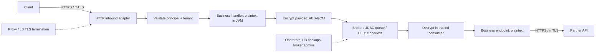
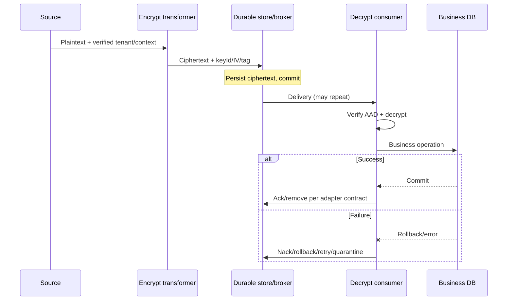

# Payload Encryption and TLS at Adapter Boundaries in Spring Integration

## 1. Why Protect Payloads and Transport Separately?

An `IntegrationFlow` can receive data over HTTP, process it on a `DirectChannel`, send it to a `QueueChannel`, persist it in a `JdbcChannelMessageStore`, and forward it to an outbound HTTP/AMQP/TCP adapter. Every **adapter boundary** is a point where data enters or leaves the JVM, process, or trust zone. If the payload carries customer data, credentials, payment instructions, or internal state, you must answer two **distinct** questions:

1. **Is data protected while traversing the network?** → TLS (or SSH for SFTP), endpoint authentication, certificates/host keys, and connection protection.
2. **Does data remain confidential while passing through brokers, databases, DLQs, files, logs, or intermediate infrastructure?** → payload encryption at the **application/message layer**, key management, and data access controls.

In the **Runtime Security** chapter of the `SPRING_INTEGRATION_RUNTIME` module, **Payload Encryption and TLS at Adapter Boundaries** examines how to apply both defense layers in a realistic Spring Integration runtime: channels, endpoints, consumers, pollers, executors, `IntegrationFlow` lifecycle, transactions, retries, message stores, errors, and correlation.

**Learning objectives:**

- Distinguish TLS/mTLS, payload encryption, disk encryption, and signatures/MACs.
- Determine where to encrypt/decrypt in a message flow and which metadata must be protected.
- Configure TLS for HTTP servers/outbound REST and TCP adapters; understand FTPS vs. SFTP and broker-specific TLS.
- Implement AES-GCM with non-repeating nonces/IVs, authentication tags, AAD, versioning, key IDs, and key rotation.
- Define transaction/retry/thread boundaries that neither leak plaintext nor break replayability.
- Test certificate validation, tampering, wrong-tenant access, key rotation, restarts, and DLQ/logging paths.

> **Illustrative context:** Java 17, Spring Boot 3.5.x with matching Spring Integration 6.5.x via dependency management. API paths and configurations may differ in Spring Boot 4 or Spring Integration 7.x. Keys and certificates in examples are **paths or references only**, containing no real private keys.

## 2. Threat Model: Protecting What from Whom?

### 2.1. Draw Trust Boundaries Before Writing Java DSL



Identify the **assets to protect**:

| Asset | Where it appears | Risks |
|---|---|---|
| Plaintext payload | Handlers, converters, debug logs, heap, error flows | Insiders or logging bugs expose data. |
| Ciphertext | Brokers, JDBC stores, DLQs, files, backups | Can still be copied/replayed/tampered despite encryption. |
| Message headers | Tenant ID, request ID, reply channel, route, auth context | Metadata leaks or routing spoofing, crossing tenant boundaries. |
| Key material | KMS, Vault, HSM, keystores, or process memory | If keys leak, stored data can be decrypted. |
| TLS credentials | Certificates, private keys, trust roots | MITM if host verification is skipped; private key leaks under weak management. |
| Business state | DB results, idempotency markers, transactional outbox | Encryption does not prevent duplicate or invalid business processing. |

A secure design protects more than HTTP ingress. It must account for proxy-to-app hops, app-to-broker hops, retry/DLQ access by operators, and JVM-to-downstream hops.

### 2.2. TLS, Payload Encryption, and Disk Encryption Do Not Replace Each Other

| Mechanism | Primary protection | What it does NOT automatically protect |
|---|---|---|
| **TLS** | Transport channel between **two TLS termination points**; server auth, confidentiality/integrity in transit | Data after TLS termination, queues/databases, or authorized endpoint users. |
| **mTLS** | TLS plus certificate authentication of **both client and server** | Tenant-level business authorization or stored message encryption. |
| **AES-GCM payload encryption** | Payload contents across multiple hops while detecting ciphertext/AAD tampering | Stolen keys, metadata excluded from AAD, or plaintext inside endpoints permitted to decrypt. |
| **Database/broker encryption at rest** | Disks, volumes, backups per storage configuration | DBAs/services with API or storage read privileges. |
| **Application signature/MAC** | Message authenticity and integrity | Payload confidentiality unless combined with encryption. |
| **Authorization** | Ensures only legitimate users/services access actions/data | Does not replace encryption and TLS. |

**Rule:** TLS is mandatory for network hops, yet does not provide end-to-end payload protection across proxies, brokers, or intermediate storage. Payload encryption protects data wherever ciphertext resides, yet **does not** replace TLS for metadata protection, peer authentication, and MITM prevention.

## 3. Determining Encryption and Decryption Points

Three ways to place crypto transformers:

### 3.1. Encrypt Right Before the Outbound Boundary

```text
Plaintext business processing
    -> encrypt transformer
    -> outbound adapter (HTTPS / AMQPS / TLS TCP)
    -> remote receiver
```

Suitable when internal steps need plaintext payloads and downstream expects ciphertext. Encrypting near egress minimizes components dealing with encrypted formats, though plaintext still exists in channels/stores **before** the transformer.

### 3.2. Encrypt Before Persisting to a Message Store

```text
Inbound adapter -> auth/validate -> encrypt -> persistent QueueChannel
                                             -> consumer -> decrypt -> business
```

Suitable when databases, brokers, DLQs, or backups must not see plaintext data. Ensure the store's converter/serializer receives only **ciphertext bytes**, rather than accidentally serializing plaintext objects in another header.

### 3.3. End-to-End Encryption from Producer to Final Consumer

```text
Producer encrypts -> TLS hop -> broker -> TLS hop -> trusted consumer decrypts
                        ciphertext across every intermediate hop
```

Suitable when brokers and transport intermediaries are treated as **unauthorized to read** data. Requires both ends to agree on envelope schemas, key IDs, replay/idempotency rules, and decryption policies. Any intermediate router needing plaintext inspection can no longer do so unless metadata is explicitly separated under tight controls.

### 3.4. Which Headers Need Encryption?

The payload of a `Message<?>` is **not all the data** in the message. Headers can contain:

- `tenantId`, `correlationId`, `replyChannel`, file paths, resource URIs, request IDs.
- Authentication/tokens if the application misuses headers.
- Custom business fields, routing keys, or PII.

If you encrypt only the payload, headers often **remain exposed** in brokers, metrics/logs, or message stores depending on serializers/adapters. Retain only truly needed routing headers; never put tokens/passwords in headers. Fields that must remain outside ciphertext yet resist tampering can be bound as **AAD (Additional Authenticated Data)**; AAD authenticates data, it **does not encrypt** it.

## 4. Choose AES-GCM Instead of "Homegrown" Encryption

AES-GCM is an **Authenticated Encryption with Associated Data (AEAD)** algorithm. On each encryption, it produces:

- Ciphertext: encrypted data.
- Authentication tag: detects tampering of ciphertext or AAD (typically 128 bits).
- Nonce/IV: a unique value for **every encryption under the same key**; typically 12 bytes for GCM.
- AAD: authenticated non-secret metadata, such as tenant, business ID, schema version, and key ID.

### 4.1. Things You Must Strictly Avoid

- **Never reuse the same key + IV** in AES-GCM: doing so severely compromises confidentiality and integrity.
- Never use ECB, static IVs, unauthenticated cipher modes, or AES-CBC without a MAC.
- Never place passwords or raw AES keys in Java source, YAML in Git, debug logs, or DLQs.
- Never use ciphertext bytes as proof a message was processed: encryption does not solve replay/idempotency.
- Never decrypt using a `keyId` from an untrusted header without verifying tenant/key authorization.
- Never log exceptions with raw plaintext/ciphertext or a full `Message<?>`.
- Never "try every key on decryption error" without bounds, which leaks policy and overloads KMS.

### 4.2. Envelope Format Should Be Versioned

An encrypted payload carrying enough context for replay after restart should include:

```text
formatVersion = 1
keyId         = public key reference, not a secret
nonce         = 12 bytes, random per encryption
ciphertext    = encrypted payload || authentication tag
```

Metadata such as `tenantId`, `businessId`, and `schemaVersion` used as AAD must match **exact values on the decryption side**. If altered, decryption must fail closed. Even metadata like a `keyId` string can reveal key naming conventions; avoid embedding tenant secrets in key IDs.

**Encoding:** use versioned binary framing, or a JSON/CBOR envelope with Base64 for bytes. Never persist Java serialization of `SecretKey`, `Cipher`, or unversioned classes lacking a migration policy.

## 5. Java Practice: AES-256-GCM with Envelope, AAD, and `KeyResolver`

The next example uses standard JCA, independent of Spring Integration. Each encryption creates a fresh `Cipher` because `Cipher` is **not thread-safe**, fitting concurrent consumers/pollers.

### 5.1. Key Contract from KMS/Vault/HSM

```java
import javax.crypto.SecretKey;

public interface KeyResolver {
    // Active encryption key provisioned per tenant & key reference.
    SecretKey encryptionKey(String tenantId, String keyId);

    // Older keys must remain readable during rotation/grace periods.
    SecretKey decryptionKey(String tenantId, String keyId);
}
```

In production, implement `KeyResolver` with KMS/HSM/Vault or a tenant-scoped secret management service. The interface has **no** method exposing plaintext keys to logs. With KMS envelope encryption, applications typically encrypt data using a **data-encryption key (DEK)** and store the KMS-wrapped DEK alongside the envelope; the illustrative code below takes `SecretKey` directly and **does not implement** DEK wrapping/KMS API calls.

### 5.2. Self-Contained `byte[]` Framing JCA Service

The code below illustrates a frame formatted as:

```text
[version:1][keyIdLength:2][keyId UTF-8][IV:12][ciphertext + GCM tag]
```

Sizes and key IDs are validated prior to allocation or decryption. AAD is encoded with **length prefixes** to avoid delimiter ambiguity.

```java
import java.nio.ByteBuffer;
import java.nio.charset.StandardCharsets;
import java.security.GeneralSecurityException;
import java.security.SecureRandom;
import java.util.Objects;

import javax.crypto.Cipher;
import javax.crypto.SecretKey;
import javax.crypto.spec.GCMParameterSpec;

public final class GcmPayloadCrypto {

    private static final int VERSION = 1;
    private static final int IV_BYTES = 12;       // 96-bit nonce
    private static final int TAG_BITS = 128;      // 16-byte auth tag
    private static final int TAG_BYTES = 16;
    private static final int MAX_KEY_ID_BYTES = 128;
    private static final int MAX_CONTEXT_BYTES = 1_024;
    private static final int MAX_FRAME_BYTES = 10 * 1024 * 1024;

    private final SecureRandom secureRandom = new SecureRandom();
    private final KeyResolver keys;

    public GcmPayloadCrypto(KeyResolver keys) {
        this.keys = Objects.requireNonNull(keys);
    }

    public byte[] seal(byte[] plaintext,
                       String tenantId, String businessId,
                       String schemaVersion, String keyId)
            throws GeneralSecurityException {
        Objects.requireNonNull(plaintext);
        validateContext(tenantId, businessId, schemaVersion, keyId);

        byte[] keyName = keyId.getBytes(StandardCharsets.UTF_8);
        if (keyName.length == 0 || keyName.length > MAX_KEY_ID_BYTES) {
            throw new IllegalArgumentException("Invalid key ID size");
        }

        int overhead = 1 + Short.BYTES + keyName.length
                + IV_BYTES + TAG_BYTES;
        if (plaintext.length > MAX_FRAME_BYTES - overhead) {
            throw new IllegalArgumentException("Plaintext too large");
        }

        byte[] nonce = new byte[IV_BYTES];
        secureRandom.nextBytes(nonce); // FRESH for every encryption.

        SecretKey key = Objects.requireNonNull(
                keys.encryptionKey(tenantId, keyId), "Unknown key");

        Cipher cipher = Cipher.getInstance("AES/GCM/NoPadding");
        cipher.init(Cipher.ENCRYPT_MODE, key,
                new GCMParameterSpec(TAG_BITS, nonce));
        cipher.updateAAD(aad(
                tenantId, businessId, schemaVersion, keyId));
        byte[] encrypted = cipher.doFinal(plaintext); // Includes GCM tag

        int size = 1 + Short.BYTES + keyName.length
                + IV_BYTES + encrypted.length;
        if (size > MAX_FRAME_BYTES) {
            throw new IllegalArgumentException("Encrypted frame too large");
        }

        return ByteBuffer.allocate(size)
                .put((byte) VERSION)
                .putShort((short) keyName.length)
                .put(keyName)
                .put(nonce)
                .put(encrypted)
                .array();
    }

    public byte[] open(byte[] frame,
                       String trustedTenantId, String businessId,
                       String schemaVersion)
            throws GeneralSecurityException {
        Objects.requireNonNull(frame);
        if (frame.length > MAX_FRAME_BYTES
                || frame.length < 1 + Short.BYTES + 1
                        + IV_BYTES + TAG_BYTES) {
            throw new IllegalArgumentException("Invalid frame size");
        }

        ByteBuffer buf = ByteBuffer.wrap(frame);
        int version = Byte.toUnsignedInt(buf.get());
        if (version != VERSION) {
            throw new IllegalArgumentException("Unsupported frame version");
        }

        int keyLen = Short.toUnsignedInt(buf.getShort());
        if (keyLen == 0 || keyLen > MAX_KEY_ID_BYTES
                || buf.remaining() < keyLen + IV_BYTES + TAG_BYTES) {
            throw new IllegalArgumentException("Malformed frame");
        }

        byte[] keyName = new byte[keyLen];
        buf.get(keyName);
        String keyId = new String(keyName, StandardCharsets.UTF_8);

        byte[] nonce = new byte[IV_BYTES];
        buf.get(nonce);
        byte[] encrypted = new byte[buf.remaining()];
        buf.get(encrypted);

        validateContext(trustedTenantId, businessId, schemaVersion, keyId);
        // KeyResolver MUST verify keyId belongs to the authenticated tenant.
        SecretKey key = Objects.requireNonNull(
                keys.decryptionKey(trustedTenantId, keyId),
                "Key unavailable for tenant");

        Cipher cipher = Cipher.getInstance("AES/GCM/NoPadding");
        cipher.init(Cipher.DECRYPT_MODE, key,
                new GCMParameterSpec(TAG_BITS, nonce));
        cipher.updateAAD(aad(
                trustedTenantId, businessId, schemaVersion, keyId));

        // Throws AEADBadTagException if nonce/AAD/ciphertext/key mismatch.
        return cipher.doFinal(encrypted);
    }

    private static void validateContext(
            String tenant, String business, String schema, String keyId) {
        for (String v : new String[]{tenant, business, schema, keyId}) {
            if (v == null || v.isBlank()) {
                throw new IllegalArgumentException(
                        "Crypto context is required");
            }
            if (v.getBytes(StandardCharsets.UTF_8).length
                    > MAX_CONTEXT_BYTES) {
                throw new IllegalArgumentException(
                        "Crypto context field too large");
            }
        }
    }

    private static byte[] aad(String tenant, String business,
                              String schema, String keyId) {
        String[] fields = {"v1", tenant, business, schema, keyId};
        byte[][] values = new byte[fields.length][];
        int length = 0;

        for (int i = 0; i < fields.length; i++) {
            values[i] = fields[i].getBytes(StandardCharsets.UTF_8);
            length += Integer.BYTES + values[i].length;
        }

        ByteBuffer encoded = ByteBuffer.allocate(length);
        for (byte[] value : values) {
            encoded.putInt(value.length);
            encoded.put(value);
        }
        return encoded.array();
    }
}
```

**Security highlights of this example:**

- `GCMParameterSpec(128, nonce)` enforces a 128-bit tag and 96-bit nonce.
- Each `seal()` call generates a fresh IV via `SecureRandom`, even on retries of the same event. **Never** derive deterministic IVs from business IDs or timestamps.
- `AAD` binds tenant, business ID, schema version, and key ID to the ciphertext. Altering any field causes authentication failure.
- `KeyResolver` enforces which tenant can access which key ID. Swapping the key ID inside the envelope cannot select another tenant's key.
- Frames are versioned to support migration. Size bounds curb memory abuse.
- A fresh `Cipher` is instantiated per call so mutable crypto state is never shared across poller/executor threads.

**Limitations:** This code targets moderate payloads, holds byte arrays in RAM, and does not scrub plaintext remnants from the JVM heap. For very large objects, enforce size limits, properly designed streaming/segmented AEAD, and audited libraries. This code does not replace KMS/key rotation policies, sender signatures, or authorization.

### 5.3. Ingress Responsibility

The decrypting side must never take `tenantId` solely from a client-writable header and treat it as permission to decrypt. AAD integrity **does not prove** the sender is authorized for that tenant. Identity and tenant scope must be authenticated from an HTTP principal, trusted broker ACL/destination, or controlled identity mapping.

## 6. Wiring Crypto Transformers into `IntegrationFlow`

Spring Integration provides `org.springframework.integration.transformer.Transformer` with `transform(Message<?>)`. We can implement transformers that swap the payload to **ciphertext `byte[]`**, preserve permitted metadata, and adjust content types.

### 6.1. Outbound Encryption Transformer

```java
import java.security.GeneralSecurityException;

import org.springframework.integration.transformer.Transformer;
import org.springframework.messaging.Message;
import org.springframework.messaging.MessageHeaders;
import org.springframework.messaging.support.MessageBuilder;
import org.springframework.util.MimeTypeUtils;

public final class SealingTransformer implements Transformer {

    private final GcmPayloadCrypto crypto;
    private final String activeKeyId;

    public SealingTransformer(
            GcmPayloadCrypto crypto, String activeKeyId) {
        this.crypto = crypto;
        this.activeKeyId = activeKeyId;
    }

    @Override
    public Message<?> transform(Message<?> message) {
        if (!(message.getPayload() instanceof byte[] plaintext)) {
            throw new IllegalArgumentException(
                    "Expected byte[] plaintext payload");
        }

        String tenant = required(message, "tenantId");
        String event = required(message, "businessId");
        String schema = required(message, "schemaVersion");

        try {
            byte[] sealed = crypto.seal(
                    plaintext, tenant, event, schema, activeKeyId);
            return MessageBuilder.withPayload(sealed)
                    .copyHeaders(message.getHeaders())
                    .setHeader(MessageHeaders.CONTENT_TYPE,
                            MimeTypeUtils.APPLICATION_OCTET_STREAM)
                    .setHeader("cryptoFormat", "AES-GCM-v1")
                    .build();
        }
        catch (GeneralSecurityException e) {
            throw new IllegalStateException(
                    "Payload encryption failed", e);
        }
    }

    private static String required(Message<?> m, String name) {
        String value = m.getHeaders().get(name, String.class);
        if (value == null || value.isBlank()) {
            throw new IllegalArgumentException(
                    "Missing trusted crypto context: " + name);
        }
        return value;
    }
}
```

The example copies existing headers merely for flow readability. **Production must use a header allowlist** before crossing a trust boundary: never copy `replyChannel`, authentication objects, tokens, filesystem paths, or PII out to brokers/external adapters. The new content type is binary ciphertext, no longer plaintext JSON.

### 6.2. Inbound Decryption Transformer

```java
import java.security.GeneralSecurityException;

import org.springframework.integration.transformer.Transformer;
import org.springframework.messaging.Message;
import org.springframework.messaging.MessageHeaders;
import org.springframework.messaging.support.MessageBuilder;

public final class OpeningTransformer implements Transformer {

    private final GcmPayloadCrypto crypto;

    public OpeningTransformer(GcmPayloadCrypto crypto) {
        this.crypto = crypto;
    }

    @Override
    public Message<?> transform(Message<?> message) {
        if (!(message.getPayload() instanceof byte[] ciphertext)) {
            throw new IllegalArgumentException(
                    "Expected byte[] encrypted frame");
        }

        // These headers must be verified at the ingress/auth boundary.
        String tenant = required(message, "tenantId");
        String event = required(message, "businessId");
        String schema = required(message, "schemaVersion");

        try {
            byte[] clear = crypto.open(
                    ciphertext, tenant, event, schema);
            return MessageBuilder.withPayload(clear)
                    .copyHeaders(message.getHeaders())
                    .setHeader(MessageHeaders.CONTENT_TYPE,
                            "application/json")
                    .build();
        }
        catch (GeneralSecurityException e) {
            // Never print payload/key/nonce or full Message.
            throw new IllegalStateException(
                    "Payload decryption/authentication failed", e);
        }
    }

    private static String required(Message<?> m, String name) {
        String value = m.getHeaders().get(name, String.class);
        if (value == null || value.isBlank()) {
            throw new IllegalArgumentException(
                    "Missing verified context: " + name);
        }
        return value;
    }
}
```

For non-JSON payloads, set the post-decryption content type from **verified schema metadata/policy** rather than hardcoding as in the example. Never treat successful decryption as proof the data is safe to deserialize: schema, size, field values, and authorization must still be validated.

### 6.3. Two Flows at the Boundary

```java
import org.springframework.context.annotation.Bean;
import org.springframework.context.annotation.Configuration;
import org.springframework.integration.dsl.IntegrationFlow;

@Configuration
public class CryptoBoundaryFlows {

    @Bean
    IntegrationFlow outboundEncrypted(SealingTransformer sealing) {
        return IntegrationFlow.from("orders.plain.out")
                .transform(sealing)
                .channel("partner.encrypted.out")
                .get();
    }

    @Bean
    IntegrationFlow inboundDecrypted(OpeningTransformer opening) {
        return IntegrationFlow.from("partner.encrypted.in")
                .transform(opening)
                .channel("orders.decrypted")
                .get();
    }
}
```

A real adapter consumes `partner.encrypted.out` and sends bytes over HTTPS/AMQPS/TCP TLS; another inbound adapter pushes ciphertext into `partner.encrypted.in`. **These two flows do not send network traffic by themselves**, perform authentication, or provision KMS keys. Place endpoints on the right channels and inspect `QueueChannel`/consumer/transaction configuration when persisting and processing asynchronously.

### 6.4. Operation Ordering Affects Security

| Sequence | Consequence |
|---|---|
| Validate identity → authorize tenant → encrypt → persist/route | Preferred when stores/brokers must not read plaintext. |
| Persist plaintext → encrypt at outbound adapter | DB/backups prior to the transformer still retain plaintext. |
| Decrypt → log full message → handler | Logs may expose plaintext despite sound TLS and crypto. |
| Encrypt → compress | Ciphertext is largely incompressible; typically ineffective. |
| Compress untrusted data alongside secrets → encrypt | Can create length side channels; evaluate protocol/threat model. |
| Decrypt → unbounded deserialization | Risk of resource exhaustion and deserialization attacks; validate size/schema. |

## 7. TLS for HTTP Inbound Adapters via Spring Boot SSL Bundles

Spring Integration HTTP inbound gateways/adapters run **on the application's HTTP server** (Servlet or WebFlux depending on stack). TLS is typically configured at the **web server / load balancer / ingress**, not by calling `.encrypt()` on an `IntegrationFlow`.

### 7.1. HTTPS Server with PEM Certificates

Boot 3.5 example using an SSL bundle for server TLS:

```yaml
spring:
  ssl:
    bundle:
      pem:
        inbound-api:
          keystore:
            certificate: "file:/etc/tls/server.crt"
            private-key: "file:/etc/tls/server.key"

server:
  port: 8443
  ssl:
    bundle: inbound-api
```

These are **mounted secret file paths** — never embed real private keys in articles or Git. Restrict file permissions, govern certificate issuance/rotation, and disable plaintext HTTP listeners when policy requires HTTPS-only.

### 7.2. mTLS for Inbound APIs

To require client certificates, the bundle needs appropriate trust roots:

```yaml
spring:
  ssl:
    bundle:
      pem:
        inbound-mtls:
          keystore:
            certificate: "file:/etc/tls/server.crt"
            private-key: "file:/etc/tls/server.key"
          truststore:
            certificate: "file:/etc/tls/client-ca.crt"

server:
  port: 8443
  ssl:
    bundle: inbound-mtls
    client-auth: need
```

**mTLS is transport-layer authentication.** It proves only that the client holds the private key matching a trusted certificate. Mapping the certificate identity to a service/tenant/role still requires security policy; never automatically grant every client certificate access to every tenant's data.

If TLS terminates at a proxy, configure mTLS on the **proxy** and ensure the proxy→app hop prevents clients from spoofing identity headers; ideally use mTLS on internal hops as well or a trusted identity-forwarding mechanism. Never trust `X-Forwarded-Client-Cert` sent directly by Internet clients.

## 8. TLS for Outbound HTTP Adapters: SSL Bundles on the HTTP Client

When a Spring Integration handler calls a partner API, TLS protection belongs to `RestClient`, `WebClient`, or the underlying HTTP client connector; **message channels do not configure truststores**.

### 8.1. Configuring Truststore + Client Certificate When Partners Require mTLS

```yaml
spring:
  ssl:
    bundle:
      pem:
        partner-api:
          truststore:
            certificate: "file:/etc/tls/partner-ca.crt"
          keystore:
            certificate: "file:/etc/tls/partner-client.crt"
            private-key: "file:/etc/tls/partner-client.key"
```

For standard outbound TLS not requiring a client certificate, omit `keystore` and configure only the trusted truststore/CA.

### 8.2. `RestClientSsl` (Spring Boot 3.5)

```java
import org.springframework.boot.autoconfigure.web.client.RestClientSsl;
import org.springframework.context.annotation.Bean;
import org.springframework.context.annotation.Configuration;
import org.springframework.web.client.RestClient;

@Configuration
class PartnerClientConfig {

    @Bean
    RestClient partnerClient(RestClient.Builder builder,
                             RestClientSsl ssl) {
        return builder
                .baseUrl("https://api.partner.example")
                .apply(ssl.fromBundle("partner-api"))
                .build();
    }
}
```

From a one-way service activator, send only **ciphertext `byte[]`** to the partner if the receiver contract permits:

```java
import org.springframework.http.MediaType;
import org.springframework.integration.annotation.ServiceActivator;
import org.springframework.stereotype.Component;
import org.springframework.web.client.RestClient;

@Component
class EncryptedPartnerSender {
    private final RestClient client;

    EncryptedPartnerSender(RestClient client) {
        this.client = client;
    }

    @ServiceActivator(inputChannel = "partner.encrypted.out")
    public void send(byte[] sealedFrame) {
        client.post()
                .uri("/events")
                .contentType(MediaType.APPLICATION_OCTET_STREAM)
                .body(sealedFrame)
                .retrieve()
                .toBodilessEntity();
    }
}
```

This method returns `void` and produces no reply. For a request–reply outbound gateway, explicitly define reply types, timeouts, idempotency, and error channels. **A successful TLS handshake does not prove the partner processed the message**; 202 Accepted or network timeouts must still be interpreted per the HTTP/business contract.

**Boot note:** `RestClientSsl.fromBundle(...)` may replace an already-configured request factory; if you also customize pooling/timeouts/proxies, use an appropriate factory builder and verify TLS remains active. Never install an all-trusting `TrustManager` or disable hostname verification as a "quick fix" for certificate errors.

## 9. TCP/IP Adapters: TLS at the Connection Factory

Spring Integration TCP supports TLS in two modes:

- **Blocking sockets:** using `SSLSocketFactory`/`SSLServerSocketFactory`.
- **NIO:** using `SSLEngine` via `TcpNioConnectionSupport`.

### 9.1. Configuring `TcpNioClientConnectionFactory`

This snippet illustrates Spring Integration 6.5 APIs with JKS truststores/keystores (matching `DefaultTcpSSLContextSupport` defaults). Passwords come from environment/secret providers — **never** hardcoded in Java.

```java
import org.springframework.beans.factory.annotation.Value;
import org.springframework.context.annotation.Bean;
import org.springframework.context.annotation.Configuration;
import org.springframework.integration.ip.tcp.connection.DefaultTcpNioSSLConnectionSupport;
import org.springframework.integration.ip.tcp.connection.DefaultTcpSSLContextSupport;
import org.springframework.integration.ip.tcp.connection.TcpNioClientConnectionFactory;

@Configuration
class TcpTlsConfig {

    @Bean
    TcpNioClientConnectionFactory secureTcpFactory(
            @Value("${TLS_KEYSTORE_PASSWORD}") String keyPassword,
            @Value("${TLS_TRUSTSTORE_PASSWORD}") String trustPassword) {

        var ssl = new DefaultTcpSSLContextSupport(
                "file:/etc/tls/tcp-client.jks",
                "file:/etc/tls/trusted-servers.jks",
                keyPassword, trustPassword);

        // true: DO NOT disable hostname verification.
        var nioSsl = new DefaultTcpNioSSLConnectionSupport(ssl, true);

        var factory = new TcpNioClientConnectionFactory(
                "tcp.partner.example", 7443);
        factory.setTcpNioConnectionSupport(nioSsl);
        factory.setSslHandshakeTimeout(10);
        return factory;
    }
}
```

**Checks:**

- The truststore contains trusted server CAs/certificates; SAN/hostname on the certificate must match the connected host.
- Never call `new DefaultTcpNioSSLConnectionSupport(ssl, false)` or `new DefaultTcpSocketSupport(false)` in production to bypass hostname verification.
- If the TCP protocol requires mTLS, the client connection factory must hold a valid keypair/certificate, and the server must enforce client authentication.
- With NIO, handshake timeout prevents stalled connections; it does not replace business reply timeouts.
- Configure serializers/deserializers, frame boundaries, max message sizes, and business-protocol authentication independently of TLS.

### 9.2. TCP Server mTLS

For NIO servers, customize `DefaultTcpNioSSLConnectionSupport` to require client certificates via `SSLEngine.setNeedClientAuth(true)` (per *Advanced Techniques* docs) and wire that support into `TcpNioServerConnectionFactory`.

Certificate governance must separate:
- **Server identity:** server certificate + private key and client truststore.
- **Client identity (mTLS):** client certificate + private key and server truststore.
- **Authorization:** map certificate principals to tenants/permissions in application logic, not merely `needClientAuth=true`.

TCP TLS does not solve framing: if a serializer/decoder receives an oversized or malformed binary frame, length and schema must still be validated before instantiating objects.

## 10. FTPS Uses TLS; SFTP Uses SSH, Not TLS

Both FTPS and SFTP transfer files, yet they use **different protocols and security mechanisms**:

| Adapter/protocol | Transport protection | What must be verified |
|---|---|---|
| **Plain FTP** | Unencrypted by default | Never use for sensitive data over untrusted networks. |
| **FTPS** (FTP over TLS) | TLS for control connection and data connection when configured | Certificate trust/hostname, control + data protection, explicit/implicit mode. |
| **SFTP** (SSH File Transfer Protocol) | SSH transport and server host key | `known_hosts`/host-key verification, user authentication, cipher policy. |
| **HTTPS file upload** | TLS | Certificate validation, authentication/authorization, and upload size limits. |

### 10.1. FTPS `SessionFactory`

Spring Integration 6.5 provides `DefaultFtpsSessionFactory`. Example of **explicit FTPS**, also protecting the data channel:

```java
import org.springframework.integration.ftp.session.DefaultFtpsSessionFactory;

// passwordFromSecretProvider: secret provisioned per policy.
// trustManager: TrustManager built from trusted truststore/CA.
DefaultFtpsSessionFactory factory = new DefaultFtpsSessionFactory();
factory.setHost("ftps.partner.example");
factory.setPort(21);
factory.setUsername("service-transfer");
factory.setPassword(passwordFromSecretProvider);
factory.setProtocol("TLS");
factory.setImplicit(false);
factory.setProt("P"); // PRIVATE: protects the data connection.
factory.setTrustManager(trustManager);
```

This snippet shows configuring the factory inside a bean/method already holding the secret and trust manager. **Never** use a trust-all manager in production. Verify whether the client library checks **hostnames** on control/data connections and whether the server requires TLS session reuse, passive mode, or specific firewall rules. If the partner uses implicit FTPS, port and `setImplicit(true)` must match.

FTP/FTPS uses **two connection types**: control and data. Encrypting only the control connection does not protect file transfer bytes. `PROT P` plus proper data-channel configuration is essential.

### 10.2. SFTP `SessionFactory` and `known_hosts`

SFTP **does not use TLS certificates/truststores**. Spring Integration's `DefaultSftpSessionFactory` uses Apache MINA SSHD with SSH host keys:

```java
import org.springframework.core.io.FileSystemResource;
import org.springframework.integration.sftp.session.DefaultSftpSessionFactory;

DefaultSftpSessionFactory sftp = new DefaultSftpSessionFactory();
sftp.setHost("sftp.partner.example");
sftp.setPort(22);
sftp.setUser("service-transfer");
sftp.setPrivateKey(
        new FileSystemResource("/etc/ssh/transfer_id_ed25519"));
sftp.setKnownHostsResource(
        new FileSystemResource("/etc/ssh/known_hosts"));
sftp.setAllowUnknownKeys(false);
```

**Never set `setAllowUnknownKeys(true)` in production** to ignore unfamiliar or changed host keys. When a host key legitimately rotates, verify the fingerprint out-of-band before updating `known_hosts`. If the private key uses a passphrase, retrieve the passphrase from a secret manager.

### 10.3. Locally Cached Files Are Not Automatically Encrypted

Secure FTPS/SFTP transit does not mean files are encrypted in a local inbox, temporary directory, metadata store, or backups. Spring Integration inbound adapters can download into local directories and emit `File` payloads. Enforce OS permissions, volume encryption, and retention/cleanup; if partners require end-to-end encrypted files, encrypt the **file contents** before upload in addition to transport security.

## 11. TLS for RabbitMQ, Kafka, and Other Brokers

Spring Integration adapters typically **delegate to the underlying protocol library's connection factory/client**, so TLS lives there rather than on `IntegrationFlow.channel()`.

### 11.1. RabbitMQ / AMQP

With Spring Boot 3.5, you can reference an SSL bundle:

```yaml
spring:
  ssl:
    bundle:
      pem:
        rabbit-broker:
          truststore:
            certificate: "file:/etc/tls/rabbit-ca.crt"
  rabbitmq:
    host: rabbit.internal.example
    port: 5671
    ssl:
      enabled: true
      bundle: rabbit-broker
```

If the broker requires **mTLS**, add the client certificate/private key to the bundle and configure the broker to verify clients. Verify that `CachingConnectionFactory` actually uses TLS, server hostname verification, and per-vhost/queue/exchange broker permissions. Listener acknowledgment policies remain independent of TLS.

**RabbitMQ TLS protects only the application↔broker connection.** The broker, queue storage, DLQs, and backups can still read payloads unless producers encrypt before publishing.

### 11.2. Kafka

Kafka clients use Kafka Client properties and `spring-kafka`. Truststore example for TLS:

```yaml
spring:
  kafka:
    bootstrap-servers: "kafka.internal.example:9093"
    properties:
      security.protocol: SSL
      ssl.truststore.location: "/etc/tls/kafka-truststore.p12"
      ssl.truststore.type: PKCS12
      ssl.truststore.password: "${KAFKA_TRUSTSTORE_PASSWORD}"
```

Add `ssl.keystore.*` if the broker requires client certificates. Keep **endpoint identification/hostname verification** enabled; never set `ssl.endpoint.identification.algorithm` to empty to disable hostname checks. Kafka TLS does not replace SASL/ACLs when identity and authorization are needed.

`KafkaMessageDrivenChannelAdapter` hands records into the message flow, yet source offset commits, retries, and DLTs must still align with **decryption + business processing completion**. A TLS handshake does not mean records succeeded.

### 11.3. JMS, MQTT, SMTP, and Other Protocols

For JMS (Artemis, ActiveMQ, IBM MQ, etc.), TLS depends on the provider-specific `ConnectionFactory`, truststores/certificates, and broker configuration. Spring Integration's JMS adapter uses the configured connection factory; it does not pick a CA on your behalf.

MQTT, SMTP STARTTLS, WebSocket, and LDAP(S) also configure transport security in their client/server libraries. SMTP STARTTLS must enforce **mandatory** TLS upgrade when encryption is required; opportunistic "use if available" configs risk downgrade attacks on untrusted networks.

## 12. Securing Channels and `SecurityContext` at Runtime

TLS and payload encryption do not replace authentication and authorization. A valid inbound HTTPS request can pass through an `ExecutorChannel` and execute on another thread where the security context is no longer present by default.

### 12.1. Spring Integration 6.5 Uses `spring-security-messaging`

Since Spring Integration 6.3, the `spring-integration-security` module was removed; channel authorization APIs moved to `spring-security-messaging`.

Example pattern-based channel authorization:

```java
import org.springframework.context.annotation.Bean;
import org.springframework.integration.config.GlobalChannelInterceptor;
import org.springframework.security.authorization.AuthorityAuthorizationManager;
import org.springframework.security.messaging.access.intercept.AuthorizationChannelInterceptor;

@Bean
@GlobalChannelInterceptor(patterns = "secured*")
AuthorizationChannelInterceptor securedChannels() {
    return new AuthorizationChannelInterceptor(
            AuthorityAuthorizationManager.hasRole("INTEGRATION"));
}
```

This example illustrates **authorization**, not message encryption. A generic `ROLE_INTEGRATION` permission is insufficient to block cross-tenant access; verify tenant identity, resource scope, and trust boundaries at ingress and handlers.

### 12.2. `SecurityContext` Across Thread Switches

- `DirectChannel` normally runs on the caller's thread, keeping the thread-bound `SecurityContext` accessible.
- `ExecutorChannel`, `QueueChannel`, or `PublishSubscribeChannel` running asynchronously can lose `SecurityContextHolder`.
- Spring Security provides `SecurityContextPropagationChannelInterceptor` to propagate context across messages/channels per framework semantics.
- Never blindly copy an `Authentication` header sent by an untrusted producer and treat it as an authorized principal.

When decrypting, verify the tenant ID from a trusted identity. **AAD prevents tampering with authenticated metadata; it does not grant business privileges.**

## 13. Transactions, Retries, and Message Stores After Encryption

Even a properly encrypted flow can still suffer duplicate processing, message loss, or broken replay:



### 13.1. Encryption Is Not a Transaction

`Cipher.doFinal()` computes only in RAM; it does not commit/roll back with a database. If the source redelivers, the same event may be encrypted a second time with a **different IV**, yielding different ciphertext. This is expected: use a **business ID/idempotency key** to recognize duplicates, never a ciphertext hash.

If the business DB commits yet the broker ack/reply fails, the source may redeliver the encrypted message. Post-decryption handlers need idempotency; payload encryption and TLS do not provide exactly-once semantics.

### 13.2. Key Rotation Affects Replayability After Restarts

If ciphertext sits in a queue for a month while the key is deleted after one day, a restarted consumer cannot decrypt the backlog, DLQ, or backups. Safe rotation:

1. Create a new key version in KMS/Vault/HSM.
2. Start encrypting with the new key while still **allowing decryption with old keys** during the grace window.
3. Count records, message stores, DLQs, and backups still referencing old keys.
4. Re-encrypt when needed using a **fresh nonce**, storing the new envelope/key ID.
5. Retire/destroy old keys only when sure no ciphertext remains eligible for replay under retention policy.
6. Audit rotations without logging key bytes or plaintext payloads.

**TLS certificate rotation differs from AES key rotation**: the two credential types have distinct lifetimes, owners, and compatibility lifecycles.

### 13.3. Classifying Decryption Errors

| Error | Interpretation | Handling direction |
|---|---|---|
| `AEADBadTagException` | Key/AAD/nonce/ciphertext mismatch or tampering | Fail closed; quarantine ciphertext, never retry infinitely. |
| Unknown key ID | Key mismatch, retired key, or forged data | Check tenant scope/key catalog; never brute-force all keys. |
| KMS/Vault timeout | Infrastructure may be transiently unavailable | Bounded retry/backoff or pause during widespread outages. |
| Unsupported envelope version | Incompatible schema version | Compatibility reader/migration, preserve data. |
| Malformed/oversized frame | Corrupt input or attack | Reject/quarantine per size policy before deserialization. |
| Decrypt OK, business rule fails | Business poison message | Apply business retry/DLQ policy. |

An `ErrorMessage` sent to `errorChannel` that merely logs and returns **does not prove** the broker or JDBC queue rolled back. Source ack/commit behavior depends on adapters and transaction/error propagation boundaries.

### 13.4. Quarantine Must Not Recreate Plaintext

A usable recovery record typically retains the encrypted frame (or reference), trusted source/tenant mapping, business ID, schema version, key ID, error code, timestamp, and attempt count. Avoid writing decrypted plaintext back into a DLQ purely for debugging convenience. When investigation is required, decrypt via access-controlled tooling with auditing and short retention.

## 14. TLS Certificates, Secret Rotation, and `IntegrationFlow` Lifecycle

### 14.1. Certificate Reloading Does Not Happen Automatically

Replacing keystore/truststore files on disk **does not guarantee** active connections pick up new credentials. Depending on the client/server library:

1. Check whether the SSL bundle/connector supports live reload for that connection type.
2. Reinitialize SSL contexts, recycle connection pools, or recreate connection factories per documentation.
3. Stop/drain sources before closing connections to avoid dropping in-flight messages.
4. Restart managed endpoints and perform handshakes verifying the new certificates.
5. Maintain overlapping trust roots during rolling rotations; track expiration and identity validation.
6. Monitor handshake/reconnect failures, poller lag, and retries during rollout.

**Never assume** calling `IntegrationFlowContext.stop()/start()` automatically reloads every secret or keystore. SSL resources, connection factories, and flow registrations can have distinct ownership and lifecycles.

### 14.2. Per-Tenant Resource Ownership

A `RestClient`, connection factory, or `SslBundle` may be shared across multiple tenants. When destroying a dynamic tenant flow, clean up only beans owned by that flow—never close a shared TLS pool and break connections for other tenants.

AES-GCM key selection must use the verified tenant; never store `currentTenant` in a mutable singleton that concurrent requests could overwrite.

### 14.3. Protecting Secrets

- Use mounted secrets, a secret manager, or KMS/HSM; **never** embed PEM private keys, passwords, or raw AES keys in source, Git, or Docker images.
- Restrict OS permissions, container service accounts, and per-tenant encrypt/decrypt/unwrap privileges.
- Avoid logging full YAML configs, headers, `Message<?>`, or exceptions containing credentials.
- Bound KMS latency/concurrency; cache key material per threat model, never indefinitely.
- Alert on upcoming certificate expiration and prepare controlled rollback/trust-overlap plans.

## 15. Observing Security Errors Without Leaking Data

A log event should state **which boundary**, **which error category**, and **which correlation** — never automatically dumping payloads or credentials:

```text
event=TLS_HANDSHAKE_FAILED
component=partnerTcpConnectionFactory
destination=tcp.partner.example:7443
instanceId=worker-02
reasonCode=HOSTNAME_MISMATCH
traceId=req-456
```

```text
event=DECRYPT_FAILED
component=orders.decrypt
envelopeVersion=1
keyId=k2026-11
businessId=evt-456
reasonCode=AEAD_TAG_INVALID
attempt=1
traceId=req-456
```

These are **application-suggested log fields**, not Spring Integration's default logging output. Log `keyId` only if naming conventions reveal nothing sensitive; **never** log secrets, raw ciphertext, raw plaintext, JWTs, private keys, or an entire `Message<?>`.

| Metric | Purpose |
|---|---|
| TLS handshake failures by adapter/errorCode | Distinguish trust, hostname, expiry, and mTLS failures. |
| Certificate expiry horizon | Rotate proactively before expiration. |
| Decrypt/authentication failure count | Detect schema, key, or tampering anomalies. |
| Envelope version distribution | Track remaining backlog on older versions. |
| KMS latency/errors | Spot bottlenecks or outages in the key service. |
| Queue/DLQ oldest age by key version | Determine retention period for old decryption keys. |
| Endpoint reconnect/start/stop | Monitor certificate rollouts. |
| Business retry/duplicate count | Separate transport/crypto errors from redeliveries. |

Never place ciphertext, per-request IDs, or payloads into unbounded-cardinality metric labels. With the JDK, `javax.net.debug=ssl,handshake` helps troubleshoot yet generates huge logs, exposes connection details, and adds overhead; enable only temporarily under controlled access/retention without exporting session secrets.

## 16. Testing AES-GCM Independently of Spring Integration

Use JUnit 5 with `GcmPayloadCrypto` from Section 5. Generate **random AES keys strictly for tests**—never use production keys or hardcode secrets in source.

### 16.1. Round-Trip, Tampering, and Wrong AAD

```java
import static org.junit.jupiter.api.Assertions.*;

import java.nio.charset.StandardCharsets;
import javax.crypto.AEADBadTagException;
import javax.crypto.KeyGenerator;
import javax.crypto.SecretKey;

import org.junit.jupiter.api.BeforeEach;
import org.junit.jupiter.api.Test;

class GcmPayloadCryptoTest {

    private GcmPayloadCrypto crypto;

    @BeforeEach
    void setup() throws Exception {
        KeyGenerator generator = KeyGenerator.getInstance("AES");
        generator.init(256);
        SecretKey key = generator.generateKey();

        KeyResolver resolver = new KeyResolver() {
            @Override
            public SecretKey encryptionKey(String tenant, String keyId) {
                check(tenant, keyId);
                return key;
            }

            @Override
            public SecretKey decryptionKey(String tenant, String keyId) {
                check(tenant, keyId);
                return key;
            }

            private void check(String tenant, String keyId) {
                if (!"tenant-a".equals(tenant)
                        || !"test-k1".equals(keyId)) {
                    throw new IllegalArgumentException(
                            "Tenant/key not authorized");
                }
            }
        };

        crypto = new GcmPayloadCrypto(resolver);
    }

    @Test
    void roundTrip() throws Exception {
        byte[] clear = "{\"total\":123}".getBytes(
                StandardCharsets.UTF_8);

        byte[] frame = crypto.seal(clear,
                "tenant-a", "event-1", "order-v1", "test-k1");

        assertArrayEquals(clear, crypto.open(frame,
                "tenant-a", "event-1", "order-v1"));
        assertFalse(java.util.Arrays.equals(clear, frame));
    }

    @Test
    void rejectsCiphertextTampering() throws Exception {
        byte[] frame = crypto.seal("hello".getBytes(
                StandardCharsets.UTF_8),
                "tenant-a", "event-1", "order-v1", "test-k1");

        frame[frame.length - 1] ^= 1;

        assertThrows(AEADBadTagException.class,
                () -> crypto.open(frame,
                        "tenant-a", "event-1", "order-v1"));
    }

    @Test
    void rejectsChangedAad() throws Exception {
        byte[] frame = crypto.seal("hello".getBytes(
                StandardCharsets.UTF_8),
                "tenant-a", "event-1", "order-v1", "test-k1");

        assertThrows(AEADBadTagException.class,
                () -> crypto.open(frame,
                        "tenant-a", "event-OTHER", "order-v1"));
    }

    @Test
    void refusesAnotherTenantsKey() throws Exception {
        byte[] frame = crypto.seal("hello".getBytes(
                StandardCharsets.UTF_8),
                "tenant-a", "event-1", "order-v1", "test-k1");

        assertThrows(IllegalArgumentException.class,
                () -> crypto.open(frame,
                        "tenant-b", "event-1", "order-v1"));
    }
}
```

In `rejectsChangedAad()`, the key is valid yet a different event ID triggers an authentication tag mismatch. In `refusesAnotherTenantsKey()`, `KeyResolver` rejects the key **before** invoking `Cipher`; both failure modes need proper security and error-handling policies without leaking excessive details to untrusted sources.

### 16.2. Testing Rotation and Older Records

When adding key `test-k2` to the resolver:

1. Encrypt new events with `test-k2` and decrypt with the matching key/version.
2. Retain the ability to decrypt older events using `test-k1` during the grace period.
3. Simulate a retired old key while a DLQ record remains → the system must report key unavailable and **must not delete the record**.
4. Re-encrypt via an authorized migration process using a **fresh nonce**, verifying checksums/business IDs.
5. Replay an old message after restart and verify idempotency in the business handler.

Do not rely on a probabilistic IV assertion as absolute proof that "two encryptions **always** differ"; verify the design of fresh IV generation per invocation along with key usage/rotation policies.

## 17. Testing TLS/SSH on Real Adapters

A unit test of `Cipher.doFinal()` does not prove TLS or certificate hostname verification works. Use integration tests with a **test CA** and a real server/broker or protocol-compatible simulator.

| Scenario | Setup | Expected result |
|---|---|---|
| HTTPS with valid certificate | Trusted CA, matching host SAN | Handshake and authorized HTTP request succeed. |
| Wrong CA | Server CA absent from truststore | Handshake fails; no HTTP fallback. |
| Hostname mismatch | SAN differs from connected hostname | Client rejects certificate. |
| Expired certificate | Expired test cert | Handshake fails per TLS policy. |
| mTLS missing client certificate | Server requires client auth | Connection rejected. |
| mTLS valid cert, wrong tenant | Transport passes, policy denies | Business authorization fails. |
| TCP NIO TLS | SSL engine/connection factory with host verification enabled | Framed communication succeeds; rogue peer rejected. |
| FTPS | TLS control + `PROT P` | Data channel encrypted; transfer succeeds. |
| SFTP | Valid `known_hosts` and rotated host key | Valid host passes; unknown key fails. |
| RabbitMQ/Kafka | Broker TLS and ACLs | Valid TLS cert alone is insufficient without broker permissions. |
| DLQ/store ciphertext | Business failure after encryption | Storage holds no plaintext; recovery metadata preserved. |
| Replay after restart | Old ciphertext + valid old key | Decrypts/replays safely without business duplicates. |

**Notes:**

- Test both positive and negative cases; never use a trust-all manager just to turn certificate tests green.
- Read broker/JDBC queue/DLQ records from an independent test client to verify ciphertext at rest.
- Verify AAD mismatches and authentication failures route to error/quarantine within the right transaction boundary.
- When `ExecutorChannel` switches threads, test security context/tenant propagation.
- Restarts must be verified against durable processes/stores; in-memory `QueueChannel` does not prove durability.
- Test TLS handshakes alongside TCP frame serializers/deserializers: connection security does not stop oversized or malformed protocol frames.

## 18. Runbook When Crypto/TLS Flows Fail

### 18.1. Symptom Table

| Symptom | Causes to check | Action |
|---|---|---|
| `SSLHandshakeException` | Certificate chain/trust or client auth | Check CA, expiry, client cert/keystore. |
| `No subject alternative names matching` | SAN/hostname mismatch | Connect to matching hostname or issue proper cert; never disable validation. |
| TLS `unknown_ca` | Incompatible trust roots | Update truststore via rotation procedure. |
| SFTP host key changed | `known_hosts` out of sync with server | Verify fingerprint out-of-band before updating. |
| FTPS login OK yet transfer fails | Data channel `PROT P`, passive mode, firewall | Check TLS on both control and data connections. |
| Kafka/RabbitMQ TLS OK yet publish denied | Topic/vhost ACLs | Separate transport authentication from authorization. |
| `AEADBadTagException` | Wrong or tampered key/AAD/nonce/ciphertext | Fail closed, quarantine, preserve evidence. |
| Decrypt fails after restart | Old key retired, changed schema version/headers | Keep compatibility readers/keys until retention ends. |
| Handshake OK yet business timeout | Slow downstream, reply/ack, retries | Inspect business transactions/idempotency/correlation. |
| JDBC store/DLQ holds plaintext | Encryption placed after persistence or PII in headers | Move encryption boundary earlier; sanitize headers. |
| Tenant A reads tenant B's data | Wrong auth/`KeyResolver`/tenant mapping | Audit policies and AAD; separate keys if needed. |
| Cert rotated yet old cert still served | Pool/SSL context not reloaded | Reconnect/recreate resources per contract. |
| JSON conversion fails after decrypt | Unsupported schema/contentType | Validate schema, size, and version before deserializing. |
| Error flow logs then message vanishes | Source acked/committed when error handler returned | Check error propagation and source disposition. |

### 18.2. Incident Handling Sequence

1. Identify the **adapter boundary**, inbound/outbound direction, instance, tenant, and destination.
2. Classify the failure: **TLS/SSH**, **AEAD/key/AAD**, **authorization**, or **business/transaction**.
3. Collect business ID, trace ID, and key ID/version if safe; **never dump plaintext** from `ErrorMessage`.
4. For TLS: verify certificate chains, SANs, truststores, mTLS mappings, expiry, and reload policies.
5. For crypto: verify trusted tenant context, envelope version, key lifecycle, AAD, and integrity.
6. For message stores: verify ack/rollback status, poison redeliveries, and whether DLQ records remain intact.
7. During widespread TLS/KMS outages, pause/throttle consumers to prevent retry storms and mass DLQ writes.
8. Test fixes with test certificates/keys and isolated data, including negative failure cases.
9. Resume while monitoring backlogs, decrypt errors, duplicates, latency, and DLQs.
10. Audit changes to certificate/key policies, and update runbooks and regression tests.

## 19. Production Checklist

1. **Map trust zones**: ingress, egress, proxies, brokers, message stores, DLQs, and backups.
2. **TLS on every network hop needing protection**, not only user→ingress load balancer.
3. **Enable hostname/chain verification**; never trust-all or disable TLS validation.
4. **Use mTLS for service-to-service authentication where needed**, mapping certificate identity to tenant/permissions.
5. **FTPS uses TLS for control + data**, SFTP uses SSH `known_hosts`/host keys; never confuse the protocols.
6. **Encrypt payloads with AEAD** whenever intermediaries must not view plaintext.
7. **Fresh AES-GCM nonce per encryption under the same key**, 96-bit IV and 128-bit authentication tag for the example scheme.
8. **Bind tenant/business ID/schema/key version in AAD**, without treating AAD as encryption or authorization.
9. **`KeyResolver` enforces tenant scope**; key IDs are references only, never hardcoded secrets.
10. **Versioned, bounded envelopes**, validating sizes before decrypting/deserializing.
11. **Sanitize headers**: never store tokens, `replyChannel`, plaintext, or private keys in brokers/DLQs/logs.
12. **Encrypt prior to persistence** when JDBC/brokers/backups must hold ciphertext only.
13. **Design retries, transactions, acks, and idempotency**; encryption/TLS do not create exactly-once delivery.
14. **Retain old decryption keys** across replay/DLQ/backup retention and migration windows.
15. **Rotate certificates safely**, accounting for SSL client pools and active connections.
16. **Limit runtime plaintext exposure**, validate size/schema, and protect error flows/logs.
17. **Negative-test TLS/SSH, tampering, and wrong-tenant access**; never rely solely on unit crypto tests.
18. **Monitor TLS/KMS/decrypt errors and key retirement**, without attaching PII to metric labels.
19. **Protect Control Bus/JMX/Actuator and flow management** to prevent security bypasses.
20. **Stop/drain endpoints before credential reload/offboarding** per the in-flight message contract.

## 20. Self-Check Questions

**1.** An HTTP request uses HTTPS, yet the payload is stored plaintext in a JDBC queue. Does TLS protect that backup?  
**Answer:** No. TLS protects only the network hop; encrypt before persisting or apply appropriate storage security.

**2.** Does mTLS automatically determine which tenants a caller may process?  
**Answer:** No. The application must still map the certificate identity to tenants/roles and enforce authorization.

**3.** Can a fixed GCM IV derived from `businessId` be used so retries yield identical ciphertext?  
**Answer:** No. AES-GCM must never reuse key + nonce; generate a fresh IV on every encryption call.

**4.** Does AAD keep the tenant ID confidential?  
**Answer:** No. AAD authenticates metadata without encrypting it.

**5.** Is it safe to read `keyId` from a frame and fetch whichever key matches?  
**Answer:** No. `KeyResolver` must verify that the key belongs to the authenticated tenant and is permitted for use.

**6.** Does successful AES-GCM decryption prove the inner JSON is valid?  
**Answer:** No. Schema, size, and business rules still require validation.

**7.** Does SFTP use a TLS truststore or SSH `known_hosts`?  
**Answer:** SFTP uses SSH server host keys/`known_hosts`, unlike FTPS.

**8.** Why must FTPS verify `PROT P`?  
**Answer:** FTP separates control and data connections; encrypting control alone does not encrypt transferred file bytes.

**9.** Does a successful TLS handshake and HTTP 202 response mean business state committed?  
**Answer:** No. Completion/status/correlation contracts and idempotency are still required.

**10.** Why can decryption fail after a restart even when the encrypted frame is unchanged?  
**Answer:** The old key was retired, tenant/key mapping changed, envelope/schema versions are incompatible, or AAD context changed.

**11.** If an `ErrorMessage` logs `AEADBadTagException`, will the source definitely redeliver?  
**Answer:** No. Adapter ack/transaction configuration and error flow return/throw behavior decide.

**12.** After rotating a certificate on disk, do existing TLS connections automatically use the new cert?  
**Answer:** Not guaranteed; it depends on reload support, connection pools, and connection factories.

**13.** Does a security principal automatically cross an `ExecutorChannel` to worker threads?  
**Answer:** Not by default; explicit propagation or per-message/boundary context verification is needed.

**14.** Do AES payload encryption and TLS make broker delivery exactly-once?  
**Answer:** No. Broker/DB transactions, acks, retries/redelivery, and business idempotency are still required.

## 21. Official Reference Documentation

1. [Spring Integration 6.5 — Security in Spring Integration](https://docs.spring.io/spring-integration/reference/6.5/security.html): channel authorization, security context propagation, and `spring-security-messaging`.
2. [Spring Integration 6.5 — TCP SSL/TLS Support](https://docs.spring.io/spring-integration/reference/6.5/ip/ssl-tls.html): `TcpSSLContextSupport`, keystores/truststores, host verification.
3. [Spring Integration 6.5 — TCP Advanced Techniques](https://docs.spring.io/spring-integration/reference/6.5/ip/tcp-advanced-techniques.html): custom SSL support and mTLS servers.
4. [Spring Integration 6.5 API — TcpNioClientConnectionFactory](https://docs.spring.io/spring-integration/docs/6.5.0/api/org/springframework/integration/ip/tcp/connection/TcpNioClientConnectionFactory.html): `setTcpNioConnectionSupport()`.
5. [Spring Integration 6.5 — FTP Session Factory](https://docs.spring.io/spring-integration/reference/6.5/ftp/session-factory.html): `DefaultFtpsSessionFactory` and `PROT P`.
6. [Spring Integration 6.5 — SFTP Session Factory](https://docs.spring.io/spring-integration/reference/6.5/sftp/session-factory.html): SSH, `known_hosts`, and private keys.
7. [Spring Integration 6.5 API — DefaultSftpSessionFactory](https://docs.spring.io/spring-integration/docs/6.5.0/api/org/springframework/integration/sftp/session/DefaultSftpSessionFactory.html): `setKnownHostsResource()` and `setAllowUnknownKeys()`.
8. [Spring Boot 3.5 — SSL Bundles](https://docs.spring.io/spring-boot/3.5/reference/features/ssl.html): PEM/JKS SSL bundles.
9. [Spring Boot 3.5 — Embedded Server TLS](https://docs.spring.io/spring-boot/3.5/how-to/webserver.html): `server.ssl.bundle`.
10. [Spring Boot 3.5 API — RestClientSsl](https://docs.spring.io/spring-boot/3.5/api/java/org/springframework/boot/autoconfigure/web/client/RestClientSsl.html): `ssl.fromBundle(...)`.
11. [Spring Boot 3.5 — Application Properties](https://docs.spring.io/spring-boot/3.5/appendix/application-properties/index.html): AMQP SSL bundle and client TLS options.
12. [Spring Security 6.5 — Crypto Module](https://docs.spring.io/spring-security/reference/6.5/features/integrations/cryptography.html): authenticated AES-GCM primitives.
13. [Spring Integration 6.5 — Transaction Support](https://docs.spring.io/spring-integration/reference/6.5/transactions.html): transactions/pollers/threads.
14. [Spring Integration 6.5 — Error Handling](https://docs.spring.io/spring-integration/reference/6.5/error-handling.html): error channels and exception propagation.
15. [NIST SP 800-38D — GCM and GMAC](https://csrc.nist.gov/pubs/sp/800/38/d/final): AEAD, nonce uniqueness, and authentication tags.
