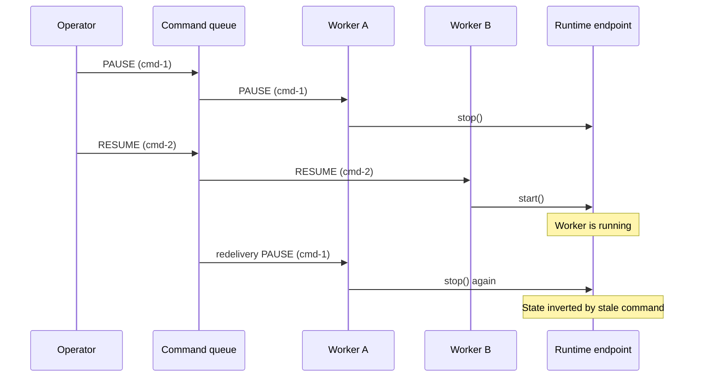
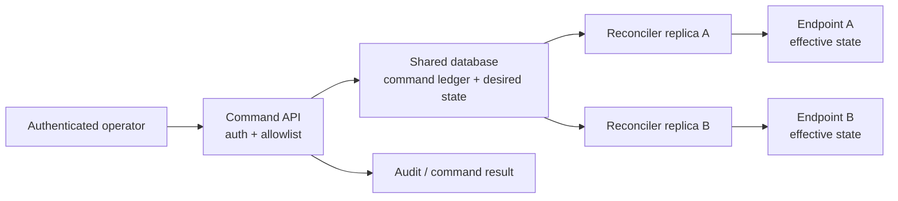
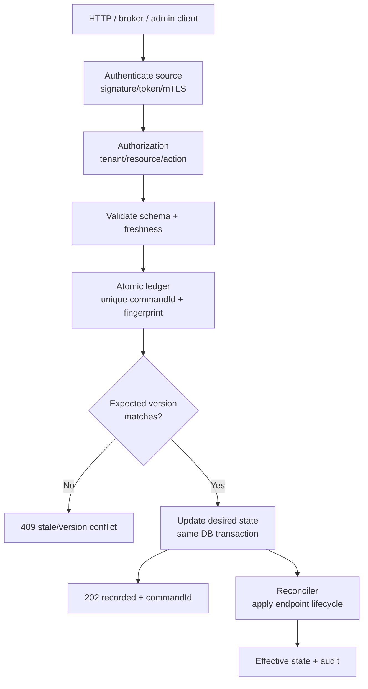
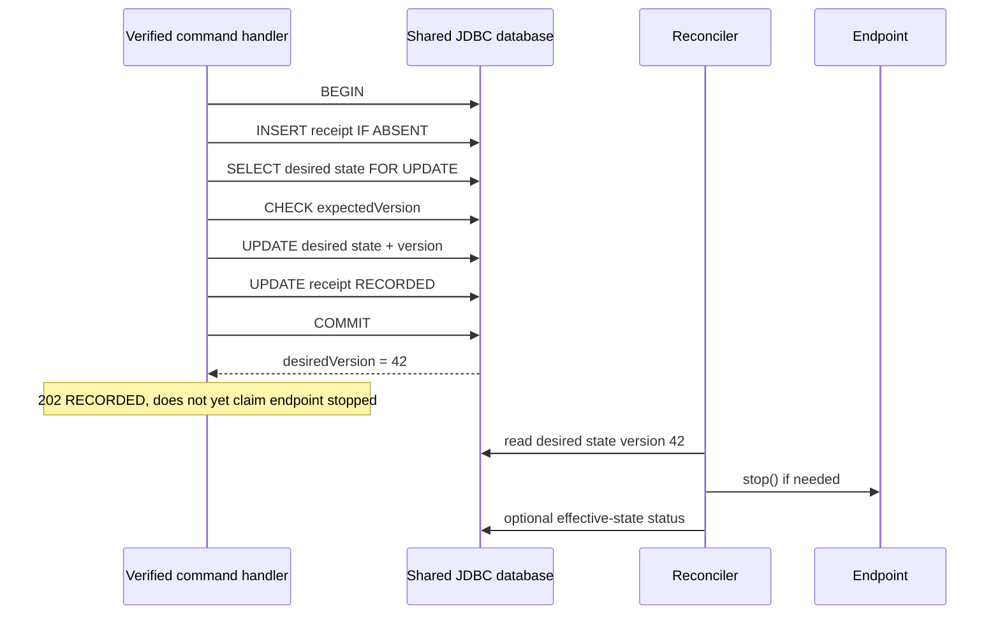
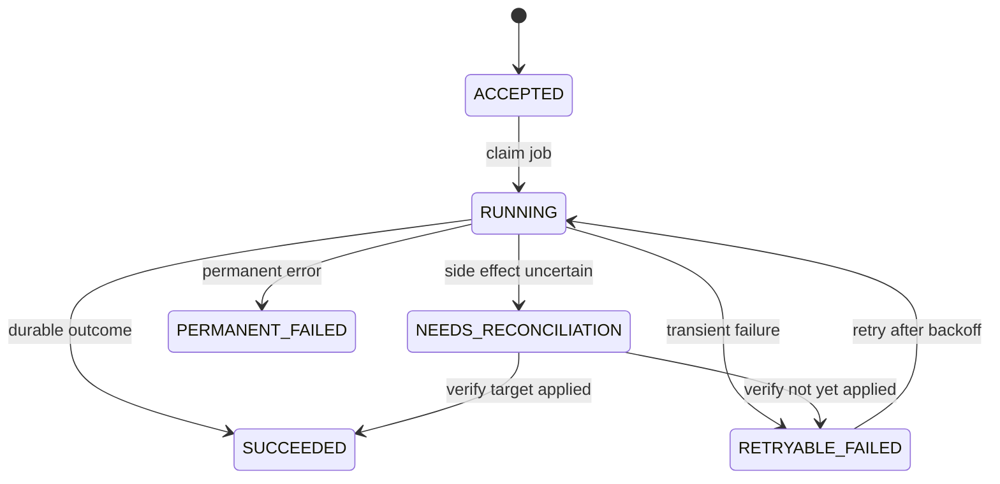
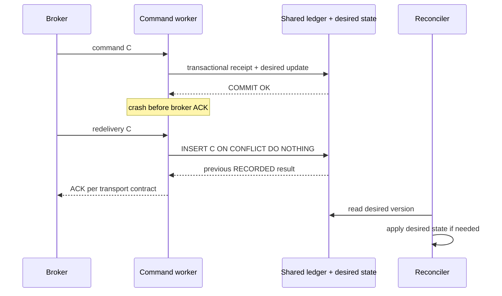

# Preventing Replay Attacks and Duplicate Commands

## 1. Why Can a Command Be Executed Multiple Times?

Spring Integration routinely transports **business messages** across channels, endpoints, consumers, pollers, and executors. Yet the system also handles **runtime control commands**: `PAUSE` a polling consumer, `RESUME` an `IntegrationFlow`, trigger a reconciliation job, run a batch replay, or alter routing. These commands can change the state of many other messages.

An administrative command can arrive repeatedly for several reasons:

- **Legitimate retry:** an HTTP client sends `PAUSE`, the server records it successfully, but the response is lost; the client retries.
- **Legitimate redelivery:** a broker redelivers the command because the consumer died after updating state but before acknowledging.
- **Concurrent submission:** two threads or two replicas receive the same command ID simultaneously.
- **Reordering:** `PAUSE` logically precedes `RESUME`, yet the two messages execute in reverse order.
- **Intentional replay:** an actor retains a previously authenticated request and re-submits it to cause disruption, even though the old request was once valid.
- **Reused command ID:** a client reuses the same ID for a different action, resource, or payload.

Unchecked, a retry can stop an endpoint twice, register duplicate `IntegrationFlow`s, re-open a paused consumer, or replay a batch that already produced side effects. For destructive commands such as purging queues or resetting metadata, the consequences can be far worse.

The topic **"Preventing Replay Attacks and Duplicate Commands"** belongs to the **Runtime Security** chapter of the **SPRING_INTEGRATION_RUNTIME** module. Its goal is to protect the control plane while preserving message-flow retry and recovery capabilities: authentication, authorization, freshness, idempotency, durable command ledgers, versioning, transactions, errors/retries, multi-instance coordination, and state observability.

> **Principle:** do not try to stop **every message redelivery**. Allow at-least-once delivery where needed, yet guarantee that **a valid command produces only its authorized effect**, old commands cannot overturn newer state, and invalid commands never cross the security boundary.

## 2. Distinguishing Replay Attacks, Duplicate Deliveries, and Valid Repeated Operations

| Case | Nature | How to respond |
| --- | --- | --- |
| Same `commandId`, same actor/resource/action, and same content | Usually a retry or redelivery of the **same command** | Return the previously recorded outcome; **produce no new side effects**. |
| Same `commandId` yet different content | Identity collision or tampering attempt | Reject with `CONFLICT`; never overwrite stored content. |
| Old command re-sent after expiration | Replay outside the valid window | Refuse re-execution; if needed, offer status lookup via an authorized read-only API. |
| New command ID yet stale `expectedVersion` | Stale or out-of-order command | Reject with optimistic concurrency conflict. |
| New command ID, current version, and valid permissions | A **new** administrative operation | Accept normally; never reject solely because it resembles an earlier action. |
| Broker redelivers a business message | Delivery guarantee mechanism | Deduplicate business events by business key and transaction; do not substitute the command ledger. |
| Batch replay requested explicitly by an operator | Authorized business operation with defined scope | Requires its own **job ID, approval, scope, limits, and idempotency**. |

**Security and reliability complement each other:** replay prevention governs whether an old request may still execute; idempotency allows retries/redeliveries without duplicating effects. Timestamps alone without a ledger still fail to stop requests replayed repeatedly **within the valid timestamp window**.

## 3. How Can a `PAUSE`/`RESUME` Race Invert State?

Suppose an authorized operator issues:

1. `PAUSE` worker at 10:00 for maintenance.
2. `RESUME` worker at 10:03 once maintenance finishes.

If both commands travel through a broker and multiple executors, **handler execution** order may not match the order sent by the operator. An old copy of `PAUSE` can arrive after `RESUME`:



Deduplicating by `commandId` can block the final duplicate of `cmd-1`. Yet if a client **assigns a new ID to an old `PAUSE`**, ID-based dedupe cannot tell it is stale. State-changing commands therefore need a **logical ordering** mechanism, such as `expectedVersion` or a sequence number stored and checked atomically in the state store.

### Desired State, Not "Execute Immediately" Imperatives

For `PAUSE`/`RESUME`, a strong pattern is persisting **versioned desired state** and having each instance reconcile toward that state.



An old command cannot directly toggle the endpoint again; it can only affect desired state if **allowed to write a new version**. After a crash, the desired state persists in the database so the reconciler continues converging.

## 4. Four Coordinated Defense Layers

An anti-replay design requires multiple layers; no single header or UUID solves everything.

1. **Authentication:** verify the sender's user or service identity via trusted mechanisms such as OIDC/JWT (validating signature, issuer, audience, expiry) or mTLS for machine identity. Never trust self-asserted `actorId`/`role` in payloads.
2. **Authorization + allowlist:** verify which action the principal may perform on which resource, tenant, and scope. Never accept arbitrary SpEL expressions, bean names, or method names from clients.
3. **Freshness + replay window:** validate issuance/expiration timestamps, clock-skew policy, and tokens/nonces per client type; expired requests must never mutate state.
4. **Durable idempotency + ordering:** record command IDs and request fingerprints in a shared backend with atomic uniqueness; check version/CAS to block stale commands.

Add **auditing, rate limits, quotas, alerts, and recovery** to detect abuse and observe actual state.

| Measure | What it blocks | What it is NOT enough to block |
| --- | --- | --- |
| TLS | Eavesdropping/tampering on the wire within TLS scope | A valid client re-sending the same command. |
| JWT/mTLS authentication | Commands from unauthenticated sources | Replay of an active request/token without binding/nonces. |
| Random `commandId` | Identifies a single command | Ineffective unless **stored and checked atomically**. |
| Timestamp/expiry | Overly old commands | Requests replayed repeatedly while still within the valid window. |
| Unique constraint | Two transactions claiming the same ID | A **new** command ID carrying a stale or non-idempotent destructive command. |
| `expectedVersion` | Stale-version commands overwriting newer versions | Retries with identical ID and body lacking durable receipts, or off-DB side effects. |
| Idempotent desired state | Repeating `PAUSE`/`RESUME` creates no extra state transitions | Does not prove all in-flight messages committed/acked. |

## 5. Designing a Command Envelope with Stable Identity

Commands need an explicit, versioned data contract independent of Spring's auto-generated message IDs.

```json
{
  "commandId": "57a7e6f7-4ee8-4df6-a24c-0183d427f116",
  "resourceId": "shipments-worker",
  "action": "PAUSE",
  "expectedVersion": 41,
  "issuedAt": "2026-11-22T02:10:00Z",
  "expiresAt": "2026-11-22T02:12:00Z"
}
```

Interpret fields as follows:

| Field | Meaning | Rule |
| --- | --- | --- |
| `commandId` | Identity of a **logical** request | Keep identical on retry; generate a new ID only for a genuinely new request. |
| `resourceId` | Allowlisted logical ID | Never accept arbitrary bean names, SpEL, or system paths. |
| `action` | Enum such as `PAUSE` or `RESUME` | Never accept arbitrary method names. |
| `expectedVersion` | Desired-state version read by the client | Must be atomically compared against current version. |
| `issuedAt` | Command issuance timestamp | Reject if too old or too far in the future. |
| `expiresAt` | Acceptance deadline | Bounded by server policy; never arbitrarily extended by clients. |
| `tenantId` | Resource scope | Derived from **authenticated context**; never trust tenant in body. |
| `principalId` | Commanding user/application | Derived from verified identity; used in authorization and audit. |
| `schemaVersion` | Command contract version | Useful across mixed client/server versions. |

The last two fields can live in a **verified internal envelope**, not necessarily sent in the client body. If HTTP/brokers allow a producer to attach `authenticated=true`, `role=ADMIN`, or `tenant=production` headers, those headers are **merely data** until verified by a trusted layer.

### Why Not Use `MessageHeaders.ID`?

Spring Messaging supplies `MessageHeaders.ID`, yet when a message is rebuilt across transformers, adapters, or redeliveries, that ID can change. A retried logical command must preserve the **same `commandId`** even if transport layers mint new Message IDs. `correlationId` links traces or message groups and is **not inherently an anti-replay key**.

### Freshness Does Not Replace Permissions

An unexpired `PAUSE` command from an unauthorized user is still rejected. A previously succeeded command retried after expiration may be rejected as expired; authorized callers should use a read-only **receipt lookup by ID** API instead of endlessly replaying old bodies.

## 6. Trust Boundaries in Spring Integration



**Never route untrusted payloads straight to the Control Bus.** The Control Bus can evaluate expressions to invoke bean methods; feeding unchecked HTTP payloads or broker messages into it risks unintended administrative execution. For `PAUSE`/`RESUME`, prefer a **service accepting validated actions and allowlisted resources** that invokes `SmartLifecycle` or an explicit reconciler.

### Thread Hops Can Break Security Context Assumptions

If a command moves from an HTTP thread across an `ExecutorChannel` or poller, Spring Security's `SecurityContextHolder`/ThreadLocal **does not automatically follow** to the worker. Never read a client-set `principal` header assuming authorization is satisfied. Two paths exist:

- Perform authentication and authorization at ingress **before** crossing the async boundary; construct an **internal verified envelope** via trusted code carrying the verified audit identity.
- If workers must re-check authorization, use controlled context propagation or a **policy service** that re-verifies resource/actor against trusted data rather than assuming every thread holds a valid `Authentication`.

Even an internal envelope is not a standalone credential: if arbitrary beans can construct envelopes and send to the channel, restrict producers and enforce policy in the command-recording service.

## 7. Why In-RAM Deduplication Is Insufficient

A simple demo might write:

```java
Set<UUID> seen = ConcurrentHashMap.newKeySet();

if (!seen.add(commandId)) {
    return; // Duplicate in this JVM.
}
applyCommand();
```

Yet this has at least four operational flaws:

1. JVM restart → the `seen` set vanishes → old commands can execute again.
2. Multiple replicas → each instance has its own set → two instances both apply the command.
3. Crash after `seen.add` before `applyCommand` → command marked seen yet **no side effect occurred**.
4. Same ID with different content → the set fails to notice the body changed.

`ConcurrentMetadataStore.putIfAbsent` helps with atomic claims, yet if a `DONE` marker is not in the same transaction as the business effect, a crash window remains. For critical administrative actions, prefer a **durable ledger and conditional state transitions** backed by real unique constraints or CAS in shared storage.

## 8. Data Model: Separating Receipts from Desired State

For `PAUSE`/`RESUME`, persist the **desired intent** as a durable row rather than calling `endpoint.stop()` inside the command-recording transaction. PostgreSQL is used as an example; adjust SQL and upsert syntax for other databases.

```sql
CREATE TABLE runtime_desired_state (
    tenant_id       VARCHAR(80) NOT NULL,
    resource_id     VARCHAR(120) NOT NULL,
    desired_state   VARCHAR(16) NOT NULL
        CHECK (desired_state IN ('RUNNING', 'PAUSED')),
    version         BIGINT NOT NULL CHECK (version >= 0),
    updated_at      TIMESTAMPTZ NOT NULL DEFAULT CURRENT_TIMESTAMP,
    PRIMARY KEY (tenant_id, resource_id)
);

CREATE TABLE runtime_command_receipt (
    tenant_id       VARCHAR(80) NOT NULL,
    command_id      UUID NOT NULL,
    principal_id    VARCHAR(160) NOT NULL,
    fingerprint     CHAR(64) NOT NULL,
    resource_id     VARCHAR(120) NOT NULL,
    action          VARCHAR(16) NOT NULL,
    expected_version BIGINT NOT NULL,
    desired_version BIGINT,
    outcome         VARCHAR(24) NOT NULL DEFAULT 'PENDING',
    received_at     TIMESTAMPTZ NOT NULL DEFAULT CURRENT_TIMESTAMP,
    PRIMARY KEY (tenant_id, command_id)
);

CREATE INDEX idx_runtime_receipt_resource
    ON runtime_command_receipt (tenant_id, resource_id, received_at);

INSERT INTO runtime_desired_state
    (tenant_id, resource_id, desired_state, version)
VALUES
    ('tenant-demo', 'shipments-worker', 'RUNNING', 41);
```

Explanation:

- `(tenant_id, command_id)` is unique, blocking two transactions from recording the same logical command for that tenant.
- `fingerprint` binds the command ID to the **exact content and identity**, rejecting reuse of the ID with a different payload.
- `expected_version` records the version the client expected; `desired_version` is the new version once recorded.
- `runtime_desired_state` holds **versioned desired state**. Reconcilers read this row to start/stop endpoints on each JVM.
- `outcome='RECORDED'` means only that desired state was **committed to the database**—not that every replica's endpoint has already stopped or started.
- Desired-state rows in the demo are pre-provisioned. Never auto-create resources from client-supplied bean names.

### Why Not Use a Single `processed` Boolean?

A `processed=true` flag does not show which content was processed, whether the version changed, whether applying to the endpoint failed, or whether the database committed before a crash. Separating **command receipt**, **desired state**, and **effective runtime state** enables auditing and crash recovery.

## 9. Java Domain Model: Separating Client Data from Verified Identity

In this example, DTOs omit `tenantId`/`role` from the request. Verified callers must be converted into `OperatorIdentity` by a trusted layer, never built by producers from unchecked headers.

```java
package example.runtime.security;

import java.time.Instant;
import java.util.Set;
import java.util.UUID;

public enum RuntimeAction {
    PAUSE, RESUME
}

public record RuntimeCommand(
        UUID commandId,
        String resourceId,
        RuntimeAction action,
        long expectedVersion,
        Instant issuedAt,
        Instant expiresAt) {}

public record OperatorIdentity(
        String tenantId,
        String principalId,
        Set<String> authorities) {}

public record CommandReceipt(
        UUID commandId,
        String outcome,
        long desiredVersion) {}
```

These are **separate Java types**: in real projects, each `public` top-level type belongs in its own `.java` file, or drop `public` to group them in one file where appropriate. They are shown together here to make the contract easy to read.

### Resource- and Action-Based Authorization

```java
package example.runtime.security;

import org.springframework.security.access.AccessDeniedException;

public final class RuntimeCommandPolicy {

    public void requireManage(
            OperatorIdentity actor, String resourceId, RuntimeAction action) {

        if (actor == null || actor.tenantId() == null ||
                actor.principalId() == null ||
                actor.authorities() == null) {
            throw new AccessDeniedException("Unauthenticated operator");
        }

        // Allowlist logical endpoints; never accept bean names from clients.
        if (!"shipments-worker".equals(resourceId)) {
            throw new AccessDeniedException("Resource not permitted");
        }

        if (!actor.authorities()
                .contains("integration:manage:shipments")) {
            throw new AccessDeniedException("Permission denied");
        }
    }
}
```

This code is an **illustrative policy class**, not a full authentication configuration. `OperatorIdentity` must be built from a properly verified SecurityContext/JWT and trusted ingress tenant policy; if an API lets users supply arbitrary `authorities`, this check loses all value. Production also needs granular tenant/resource policies rather than a single hardcoded resource.

## 10. Fingerprint: Same ID Must Bind to Same Payload

Comparing `commandId` alone is not enough. If the same UUID arrives first with `PAUSE` and next with `RESUME`, silently returning the old receipt masks a client bug or spoofing attempt.

The fingerprint should cover **every field determining command semantics**, including trusted scope and actor. With Java 17+, compute SHA-256 over a canonical string built **in fixed field order with field lengths**.

```java
package example.runtime.security;

import java.nio.charset.StandardCharsets;
import java.security.MessageDigest;
import java.security.NoSuchAlgorithmException;
import java.util.HexFormat;
import java.util.List;
import java.util.stream.Collectors;

public final class CommandFingerprint {

    private CommandFingerprint() {}

    public static String of(RuntimeCommand c, OperatorIdentity identity) {
        List<String> fields = List.of(
            identity.tenantId(),
            identity.principalId(),
            c.commandId().toString(),
            c.resourceId(),
            c.action().name(),
            Long.toString(c.expectedVersion()),
            c.issuedAt().toString(),
            c.expiresAt().toString()
        );

        // Length-prefix avoids ambiguity when fields contain delimiters.
        String canonical = fields.stream()
            .map(s -> s.length() + ":" + s)
            .collect(Collectors.joining("|"));

        try {
            byte[] digest = MessageDigest.getInstance("SHA-256")
                .digest(canonical.getBytes(StandardCharsets.UTF_8));
            return HexFormat.of().formatHex(digest);
        } catch (NoSuchAlgorithmException impossible) {
            throw new IllegalStateException("SHA-256 unavailable", impossible);
        }
    }
}
```

**A fingerprint is not a digital signature.** The hash detects **a command ID reused with altered content** in the ledger. It does not prove who sent the request; authentication, transport security, and permission checks remain mandatory. For systems requiring request signatures (such as webhooks), verify signatures/HMAC, key rotation, freshness, and binding separately at ingress before recording commands.

Never include access tokens or secrets in fingerprints or logs. When JSON permits multiple equivalent serializations, normalize into typed fields as shown rather than hashing raw JSON with arbitrary field order or whitespace.

## 11. Validating Freshness Window and Clock Skew

An old request might still hold a valid access token yet exceed the **command validity window**. The server must check:

- `issuedAt` is not too far in the future, accounting for bounded clock skew.
- `issuedAt` is not older than the allowed window, e.g., two minutes in this lab.
- `expiresAt > issuedAt`, capped by server policy.
- `expiresAt > serverNow` at acceptance time.
- Callers cannot request multi-hour/multi-day expiry to bypass replay windows.

```java
package example.runtime.security;

import java.time.Clock;
import java.time.Duration;
import java.time.Instant;

public final class CommandFreshness {

    private static final Duration MAX_AGE = Duration.ofMinutes(2);
    private static final Duration MAX_FUTURE_SKEW =
        Duration.ofSeconds(30);

    private final Clock clock;

    public CommandFreshness(Clock clock) {
        this.clock = clock;
    }

    public void validate(RuntimeCommand c) {
        if (c == null || c.commandId() == null ||
            c.action() == null || c.resourceId() == null ||
            c.issuedAt() == null || c.expiresAt() == null) {
            throw new IllegalArgumentException("Invalid command envelope");
        }

        Instant now = clock.instant();

        if (c.issuedAt().isAfter(now.plus(MAX_FUTURE_SKEW)) ||
            c.issuedAt().isBefore(now.minus(MAX_AGE)) ||
            !c.expiresAt().isAfter(c.issuedAt()) ||
            c.expiresAt().isAfter(c.issuedAt().plus(MAX_AGE)) ||
            !c.expiresAt().isAfter(now)) {
            throw new IllegalArgumentException("Stale/invalid command");
        }
    }
}
```

**Important limitation:** a compromised client with valid credentials can still mint **new commands with fresh timestamps**. Timestamps cannot prevent that; combine least privilege, mTLS or proof-of-possession where appropriate, rate limits, auditing, and revocation. Keep clocks synchronized across systems; never "fix" clock skew by widening replay windows indefinitely.

### Nonces and Token `jti`

`commandId` can serve as the unique nonce of a **logical command** when generated with sufficient randomness and stored durably. A JWT `jti` identifies a token, **not necessarily a command**; one token may authorize multiple commands. If the threat model requires single-use tokens or request-bound proofs, use a dedicated nonce store/protocol rather than overloading `commandId` for every identity purpose.

## 12. Transactional Ledger: Atomic ID Claim and Desired-State Update

The easiest mistake is splitting two operations:

```text
insert receipt(COMPLETED)
-- JVM crash --
endpoint.stop()   // Not yet executed
```

On redelivery, the receipt says completed so the command is skipped forever. Conversely:

```text
endpoint.stop()
-- JVM crash --
insert receipt(COMPLETED)  // Not yet recorded
```

On redelivery, the side effect runs again. For `PAUSE`/`RESUME`, a better pattern is **writing desired state and receipt in the same database transaction**, letting a reconciler apply lifecycle changes idempotently.



With this design, a **crash after DB commit before `stop()`** does not lose intent: the reconciler reads desired state after restart. Redelivering the same ID post-commit returns the stored receipt. If the DB transaction rolls back, neither receipt nor desired state commits, so retries can still accept the command.

## 13. Java Service: Handling Duplicates, Conflicts, and Stale Versions

Assuming Spring JDBC, Spring Transaction Management, and PostgreSQL, the code below focuses on **atomic acceptance**, without executing lifecycle methods inside the transaction.

```java
package example.runtime.security;

import java.time.Clock;
import java.util.Objects;
import java.util.UUID;

import org.springframework.jdbc.core.JdbcTemplate;
import org.springframework.stereotype.Service;
import org.springframework.transaction.annotation.Transactional;

@Service
public class RuntimeCommandService {

    private final JdbcTemplate jdbc;
    private final RuntimeCommandPolicy policy;
    private final CommandFreshness freshness;

    public RuntimeCommandService(
            JdbcTemplate jdbc,
            RuntimeCommandPolicy policy,
            Clock clock) {
        this.jdbc = jdbc;
        this.policy = policy;
        this.freshness = new CommandFreshness(clock);
    }

    @Transactional
    public CommandReceipt accept(
            RuntimeCommand command, OperatorIdentity actor) {

        // Identity must already be verified at trusted ingress before reaching here.
        Objects.requireNonNull(actor, "actor");
        freshness.validate(command);
        policy.requireManage(actor, command.resourceId(), command.action());

        String fingerprint = CommandFingerprint.of(command, actor);

        int inserted = jdbc.update(
            "INSERT INTO runtime_command_receipt " +
            "(tenant_id, command_id, principal_id, fingerprint, " +
            " resource_id, action, expected_version) " +
            "VALUES (?, ?, ?, ?, ?, ?, ?) " +
            "ON CONFLICT (tenant_id, command_id) DO NOTHING",
            actor.tenantId(), command.commandId(),
            actor.principalId(), fingerprint,
            command.resourceId(), command.action().name(),
            command.expectedVersion());

        if (inserted == 0) {
            StoredReceipt previous = jdbc.queryForObject(
                "SELECT fingerprint, outcome, desired_version " +
                "FROM runtime_command_receipt " +
                "WHERE tenant_id = ? AND command_id = ?",
                (rs, n) -> new StoredReceipt(
                    rs.getString("fingerprint"),
                    rs.getString("outcome"),
                    rs.getLong("desired_version")),
                actor.tenantId(), command.commandId());

            if (previous == null ||
                !fingerprint.equals(previous.fingerprint())) {
                throw new IllegalArgumentException(
                    "Command ID reused with different content");
            }
            // Produce no new side effects. Return previously recorded result.
            return new CommandReceipt(
                command.commandId(),
                previous.outcome(),
                previous.desiredVersion());
        }

        Long version = jdbc.queryForObject(
            "SELECT version FROM runtime_desired_state " +
            "WHERE tenant_id = ? AND resource_id = ? FOR UPDATE",
            Long.class, actor.tenantId(), command.resourceId());

        if (version == null ||
            version.longValue() != command.expectedVersion()) {
            // @Transactional also rolls back the receipt INSERT above.
            throw new IllegalStateException(
                "Stale command version; refresh state");
        }

        String desired = switch (command.action()) {
            case PAUSE -> "PAUSED";
            case RESUME -> "RUNNING";
        };

        int updated = jdbc.update(
            "UPDATE runtime_desired_state " +
            "SET desired_state = ?, version = version + 1, " +
            "    updated_at = CURRENT_TIMESTAMP " +
            "WHERE tenant_id = ? AND resource_id = ? AND version = ?",
            desired, actor.tenantId(), command.resourceId(), version);

        if (updated != 1) {
            throw new IllegalStateException("Concurrent state conflict");
        }

        long newVersion = version + 1;

        jdbc.update(
            "UPDATE runtime_command_receipt " +
            "SET outcome = 'RECORDED', desired_version = ? " +
            "WHERE tenant_id = ? AND command_id = ?",
            newVersion, actor.tenantId(), command.commandId());

        return new CommandReceipt(
            command.commandId(), "RECORDED", newVersion);
    }

    private record StoredReceipt(
        String fingerprint, String outcome, long desiredVersion) {}
}
```

### Why Does Ordering Inside the Service Matter?

1. **Validate and authorize first**, preventing unauthorized callers from probing receipts of other commands.
2. `INSERT ... ON CONFLICT DO NOTHING` with a unique key handles concurrent submissions of the same `commandId` across replicas. In PostgreSQL, the second transaction waits for the first to resolve conflict; if the first rolls back, a valid request can proceed with insertion.
3. On duplicates, verify **matching fingerprints** and return the **committed outcome** without triggering lifecycle calls.
4. For new IDs, lock the desired-state row with `FOR UPDATE` and verify `expectedVersion`, updating only when versions match.
5. Write `outcome='RECORDED'` and the new desired version **in the same transaction**; results return through the proxy only after transaction commit succeeds.
6. Any runtime exception rolls back the transaction, including both the receipt insert and desired-state update.

**Preconditions:** `RuntimeCommandService` must be invoked via its Spring transaction proxy backed by the matching `PlatformTransactionManager`/`DataSource`—never via `new RuntimeCommandService(...)` or AOP-bypassing self-invocation. Resource rows must be pre-provisioned and the PostgreSQL schema present. Real adapters must map `IllegalStateException`/`IllegalArgumentException` to appropriate HTTP `409`/`400` responses; this demo omits full controllers/security filters.

**Post-commit response note:** if the HTTP response is lost and the client retries with the same `commandId` and envelope, the committed receipt is returned. If retried after expiration, the server can reject the replayed body while offering an authorized read-only `GET /commands/{id}` endpoint.

### Do Not Equate Outcomes

`RECORDED` means **desired state was committed**. It does **not** mean endpoints across every replica have already entered that state. Track `EFFECTIVE_APPLIED`/`PENDING`/`FAILED` per instance in a dedicated metric or store.

## 14. Wiring the Service into a Spring Integration Flow

An internal entrypoint should receive data **that has already passed authentication and authorization**. The Java DSL example below simply shows a strongly typed message flowing through a `DirectChannel` to the transactional service.

```java
package example.runtime.security;

public record VerifiedRuntimeCommand(
    RuntimeCommand command, OperatorIdentity operator) {}
```

```java
package example.runtime.security;

import java.time.Clock;

import org.springframework.context.annotation.Bean;
import org.springframework.context.annotation.Configuration;
import org.springframework.integration.channel.DirectChannel;
import org.springframework.integration.channel.QueueChannel;
import org.springframework.integration.config.EnableIntegration;
import org.springframework.integration.dsl.IntegrationFlow;
import org.springframework.messaging.MessageChannel;
import org.springframework.messaging.PollableChannel;

@Configuration
@EnableIntegration
public class SecureCommandFlowConfig {

    @Bean
    Clock commandClock() {
        return Clock.systemUTC();
    }

    @Bean
    RuntimeCommandPolicy commandPolicy() {
        return new RuntimeCommandPolicy();
    }

    @Bean("ops.command.in")
    MessageChannel commandInput() {
        return new DirectChannel();
    }

    @Bean("ops.command.receipts")
    PollableChannel commandReceipts() {
        return new QueueChannel(100);
    }

    @Bean
    IntegrationFlow secureCommandFlow(RuntimeCommandService service) {
        return IntegrationFlow.from("ops.command.in")
            .handle(VerifiedRuntimeCommand.class,
                (envelope, headers) ->
                    service.accept(
                        envelope.command(),
                        envelope.operator()))
            .channel("ops.command.receipts")
            .get();
    }
}
```

**Security warning:** the `VerifiedRuntimeCommand` record **is not self-authenticating**. Only trusted producers post-authentication may instantiate and send it; the service still enforces policy. Never wire an inbound HTTP/broker adapter taking raw payloads straight into `ops.command.in` and trust a client-supplied `operator.authorities()`.

In practice, controllers/adapters should derive `OperatorIdentity` from the verified `Authentication` and send through an internal gateway or call the service directly—never constructing identity from self-asserted `@Header("role")`/`@Header("tenant")`. Across an `ExecutorChannel`, verify identity/provenance at ingress and ensure policy enforcement never depends on a `ThreadLocal` lost across async hops.

The `QueueChannel(100)` output here is a test/demo convenience for reading receipts, **not a durable audit store**. Durable receipts live in JDBC. For real HTTP request/response flows, use an appropriate gateway/reply channel and prevent output queues from filling; if an output queue overflows after DB commit, the command is still recorded even if the caller sees an error—query the receipt to reconcile.

## 15. Reconciler: Safely Applying Desired State on Each JVM

Suppose an API wrote `PAUSED` to the DB, and the JVM crashed right after commit. On restart, a reconciler reads desired state and applies it to the right endpoint instead of relying on an in-memory control task.

```java
package example.runtime.security;

import org.springframework.context.ApplicationContext;
import org.springframework.context.SmartLifecycle;
import org.springframework.jdbc.core.JdbcTemplate;
import org.springframework.scheduling.annotation.Scheduled;
import org.springframework.stereotype.Component;

@Component
public class ShipmentLifecycleReconciler {

    private final JdbcTemplate jdbc;
    private final ApplicationContext context;

    public ShipmentLifecycleReconciler(
            JdbcTemplate jdbc, ApplicationContext context) {
        this.jdbc = jdbc;
        this.context = context;
    }

    @Scheduled(fixedDelay = 1_000)
    public void reconcile() {
        // Demo uses a fixed tenant/resource. Never take bean names from clients.
        String desired = jdbc.queryForObject(
            "SELECT desired_state FROM runtime_desired_state " +
            "WHERE tenant_id = ? AND resource_id = ?",
            String.class, "tenant-demo", "shipments-worker");

        SmartLifecycle worker = context.getBean(
            "shipments.pollerEndpoint", SmartLifecycle.class);

        if ("PAUSED".equals(desired) && worker.isRunning()) {
            worker.stop();
        } else if ("RUNNING".equals(desired) && !worker.isRunning()) {
            worker.start();
        }
    }
}
```

For this scheduler to run, enable Spring scheduling with `@EnableScheduling` in configuration. The `shipments.pollerEndpoint` bean must exist, implement `SmartLifecycle`, and be managed strictly by the reconciler/control plane within its intended scope. When desired state is `PAUSED`, consider `autoStartup(false)` so the worker **does not briefly start processing on context startup** before the first reconcile tick.

**Distinguish states:**

- `desiredState`: committed value in the database.
- `effectiveState`: whether the worker is actually running/stopped on each instance, verified post-lifecycle call.
- `drainedState`: whether message backlogs, in-flight tasks, and open transactions have reached a safe quiescent point.

`isRunning()==false` does not prove messages were acked or business transactions rolled back. A `PAUSE` may require **quiesce + drain** before stopping per policy; a production reconciler must coordinate that workflow and report `PENDING` until complete rather than calling `stop()` blindly.

### Concurrency and Reconciliation

If multiple threads touch one endpoint, or a delayed scheduler run attempts to apply version 41 after version 42 was written, serialize reconciliation per resource and check the latest version. Read desired state fresh before each apply rather than holding stale snapshots. Across multiple instances, each replica reconciles for its own instance identity/resource and reports effective status for control-plane aggregation.

## 16. Non-Idempotent Commands: `RESTART`, `REPLAY`, `PURGE` Need Different Models

Not every command behaves like `PAUSE`/`RESUME`. Some actions are **edge-triggered**: each execution can create new side effects.

| Command | Fits simple desired state? | Additional requirements |
| --- | --- | --- |
| `PAUSE worker` | Usually yes, transition to `PAUSED` | Version/CAS, quiesce, and in-flight policy. |
| `RESUME worker` | Usually yes, transition to `RUNNING` | Version/CAS and readiness checks. |
| `SET_CONCURRENCY 4` | Possible if config/runtime supports it | Versioning, bounds, executor/poller impact. |
| `RESTART flow` | Not a simple static state | Job/generation ID, `STOPPING`/`STARTING` phases, timeout/recovery. |
| `REPLAY batch` | No; can re-emit many business events | Replay job ID, scope, approval, durable progress, and downstream idempotency. |
| `PURGE queue` | No; destructive | High privilege, confirmation, audit, snapshots/backups, duplicate guard. |
| `RESET metadata` | No; alters redelivery behavior | Schema, blast radius, replay strategy, and approval. |

For edge-triggered commands, maintain a **durable job record** with an idempotency key, state machine, and resumable worker:



If a command calls an external HTTP API and the API **succeeds** yet the JVM dies before marking `SUCCEEDED`, another worker might repeat it. **A command ledger alone does not guarantee cross-system exactly-once side effects.** You need idempotency keys at target resources, transactional outbox/inbox where appropriate, or state reconciliation prior to retrying.

## 17. Crash Windows: What to Write First, What to Apply Next?

| Crash point | With desired state + ledger in same DB transaction | What to test |
| --- | --- | --- |
| Before `INSERT receipt` | No changes yet | Valid unexpired command can be retried. |
| After `INSERT` before commit | Transaction rolls back; receipt not durable | Retry is not skipped due to uncommitted marker. |
| After updating desired state before commit | Both receipt and desired state roll back | No half-written state. |
| After commit before HTTP response | Receipt and desired state exist | Retry with same ID returns old result, no version bump. |
| After commit before reconciler start/stop | Desired state exists | Reconciler applies state after restart. |
| JVM dies while reconciler stops endpoint | Effective state may lag | Next reconcile checks and reapplies safely. |
| Endpoint stopped yet messages unfinished | Desired state `PAUSED`, work still in flight | Drain/ack/retry separately; do not treat receipt as business completion. |
| Edge-triggered external API called before recording result | Cannot tell from ledger alone | Reconcile or rely on target idempotency before retrying. |



This is a solid model for control-plane state. **Broker acks and database transactions rarely share a single transaction**; at-least-once delivery plus durable dedupe is a practical choice. Test each inbound adapter and real nack/requeue behavior rather than assuming from diagrams.

## 18. Multi-Instance Coordination, Distributed Locks, and Fencing

Across multiple replicas, an in-memory `ConcurrentHashMap` or `DefaultLockRegistry` **does not coordinate across JVMs**. Ledger solutions need a **shared database** or backend supporting real unique inserts/CAS, properly namespaced by tenant.

### Race Between Two Replicas Receiving the Same ID

Suppose A and B simultaneously receive `cmd-77`:

1. A begins a transaction and inserts a row with primary key `(tenant, cmd-77)`.
2. B also attempts to insert that row.
3. The database resolves uniqueness: one transaction records it; the other hits the conflict and reads the committed receipt (or proceeds if the first rolls back).
4. Only the winning transaction **is allowed** to increment desired version.

Never rely on `SELECT to check if command exists -> if missing then INSERT` without a unique constraint. Two workers can both read "missing" and both execute side effects.

### `LockRegistry` Does Not Replace CAS Versioning

A distributed lock serializes execution, yet if a lease expires while a worker stalls on a GC pause, the old worker can resume running. For desired state, monotonically increasing DB versions prevent old commands from **overwriting newer versions**. For side effects on external systems, **fencing tokens** verified by the target may be needed; never assume every `LockRegistry` automatically issues fencing tokens.

### Global Pause Requires a Global Control Plane

A `PAUSE shipments-worker` command might target instance A or the entire cluster. Explicitly define `scope`/tenant/resource, store desired state at the right scope, and track effective state **per replica**. Receiving a response from A does not prove B and C stopped. New instances must read desired state before accepting work.

## 19. Retention, TTL, and Forgetting Command IDs

Ledgers cannot grow forever without a retention plan. Yet purging receipts too early can make a replayed old command look new.

Distinguish several time horizons:

- **Command acceptance window:** how long a request may be accepted, e.g., up to two minutes.
- **Broker retry/redelivery horizon:** a message may reappear hours/days later via DLQ replay.
- **Audit retention:** how long records are kept for compliance/investigation.
- **Idempotency retention:** how long old IDs must be remembered to prevent duplicate effects.
- **Business side-effect lifetime:** may outlast all of the above.

If the ledger TTL is 10 minutes while a DLQ message can replay three days later, ID-based dedupe fails after the TTL. Handle this via policy:

1. Never allow expired old commands to **re-execute**; allow read-only outcome lookup only.
2. Keep receipts/tombstones long enough for the threat model and real redelivery horizon.
3. Use versioning/CAS or durable state machines so stale commands **cannot invert state**, even after ID cleanup.
4. For edge-triggered jobs, retain idempotency keys at the side-effect sink or durable job record for the business lifecycle.
5. Run cleanup via audited jobs with verified cutoffs; never delete `PENDING`/`NEEDS_RECONCILIATION` unresolved records.

**Never use JWT expiry as the sole idempotency TTL:** authentication token lifetimes and logical command memory horizons are separate concerns.

## 20. Retries, Error Channels, and HTTP/Broker Responses

A request can fail at different stages:

| Failure | Response path to design |
| --- | --- |
| Missing authentication | Reject before entering command flow; create no receipt. |
| Authenticated yet unauthorized | Reject and audit denial; never leak another user's command state. |
| Invalid schema/enum/resource | `400` or validation error; create no desired state. |
| Expired/clock-skewed command | Reject as stale; direct caller to receipt lookup if needed. |
| Same ID, different fingerprint | `409 conflict`; leave state unchanged. |
| `expectedVersion` mismatch | `409 version conflict`; client reads state and mints a **new command with a new ID** if still desired. |
| Transient DB timeout/glitch | May retry with **same ID and payload**, using backoff and retry limits. |
| DB commit succeeded, HTTP response lost | Retry with same ID returns the committed receipt. |
| Reconciler fails to apply lifecycle | Command remains `RECORDED`, effective status `PENDING/FAILED`; separate retry and alerting. |
| Broker redelivery post-DB commit | Handler checks receipt and acks per transport contract. |

### Error Channels Do Not Replace the Ledger

With `DirectChannel`, exceptions can unwind synchronously to the caller. With `ExecutorChannel` or polling consumers, errors may surface on `ErrorMessage`/error channels per configuration. If commands flow through retry advice and redeliver, **idempotency must still reside in the state store**, not only in an error handler.

In particular, never return raw exceptions leaking sensitive actor/token details or SQL in HTTP responses. Return structured error codes and `commandId`/trace IDs, keeping detailed stack traces in controlled logs.

### Bounded Retries

Never retry instantaneously forever when the DB or executor is saturated. Apply backoff, jitter, retry budgets, and proper DLQ/recovery. For dangerous commands, DLQ replay must re-check **permissions, expiry, current state/version, and receipts** per policy; never assume past authentication suffices to execute today.

## 21. Auditing, Observability, and Privacy

A command ledger serves as both an idempotency mechanism and operational record, yet does not replace a controlled audit system. Audit records should capture:

| Field | Example | Purpose |
| --- | --- | --- |
| `commandId` | Stable UUID | Links requests, retries, broker deliveries, and receipts. |
| `tenantId`/`resourceId` | `tenant-demo/shipments-worker` | Identifies blast radius. |
| `principalId`/authn mechanism | Operator from verified token | Tracks who acted without trusting self-asserted headers. |
| `action` and `fingerprint` | `PAUSE` / SHA-256 | Confirms payload immutability for the same ID. |
| `expectedVersion`/`desiredVersion` | 41 → 42 | Investigates staleness/reordering. |
| `receivedAt`/`expiresAt` | UTC timestamps | Verifies replay windows and clock issues. |
| `receiptOutcome` | `RECORDED`/`CONFLICT` | Distinguishes command acceptance from runtime application. |
| `effectiveState`/`instanceId` | `PAUSED` / instance-A | Reconciles which replicas applied the state. |
| `traceId`/`deliveryAttempt` | Trace, attempt count | Correlates Spring Integration and broker logs. |

Recommended metrics: new commands recorded, duplicates with matching fingerprint, conflicts with mismatched fingerprint, stale versions, expired requests, unauthorized attempts, DB transaction retries, latency from `RECORDED` to effective apply, un-reconciled replica count, and edge-triggered commands needing reconciliation.

**Never log:** JWTs, API keys, secrets, full raw requests containing sensitive data, or stack traces exposing credentials. Fingerprints used for content comparison and audits are not authentication proof; restrict read access to the ledger table, especially when it contains actor/resource IDs.

### When `RECORDED` Yet Endpoint Has Not Stopped

Diagnose in order: does the desired row have the right tenant/resource/version? Is the reconciler running? Does the `SmartLifecycle` endpoint bean have the right ID and registration? Are other workers/replicas still running? Are in-flight messages still draining? Did the error handler catch a lifecycle exception? **Never** issue a fresh `PAUSE` with a new command ID merely because a metric has not flipped yet without finding the root cause.

## 22. Testing Replay and Concurrency Under Controlled Conditions

Critical tests must use a **real shared database or test database supporting equivalent unique constraints and row locks**, not just mocked `JdbcTemplate`. With PostgreSQL, use a dedicated integration-test database resetting schema and data between tests.

| ID | Scenario | Expected |
| --- | --- | --- |
| R01 | Send valid new `PAUSE` command version 41 | One `RECORDED` receipt, desired `PAUSED` version 42. |
| R02 | Retry same `commandId` and envelope before expiry | Returns version 42 receipt; **does not increment version again**. |
| R03 | Retry same `commandId` with `RESUME` action | `409 conflict`, desired state unchanged. |
| R04 | Retry same `commandId` as different actor | Does not leak prior actor's receipt; policy/fingerprint blocks. |
| R05 | Different ID with `expectedVersion=41` after version 42 | `409 stale`; no new desired state written. |
| R06 | Valid new `RESUME` with `expectedVersion=42` | Desired `RUNNING` version 43. |
| R07 | Stale `PAUSE` arrives after `RESUME` | Duplicate receipt or version conflict; never flips `RUNNING`. |
| R08 | Two threads submit **one** command ID concurrently | One transaction writes receipt; the other reads the same outcome. |
| R09 | Two distinct command IDs share `expectedVersion` | At most one updates version; the other conflicts. |
| R10 | DB exception after receipt insert before commit | No half-written receipt/desired state; retry succeeds cleanly. |
| R11 | Crash after DB commit before response/ack | Retry causes no second update; reconciler applies desired state. |
| R12 | Expired request or excessive `issuedAt` skew | Rejected; state unchanged. |
| R13 | Self-asserted HTTP header `role=admin` | Not treated as privilege; authn/authz from trusted context. |
| R14 | Payload contains SpEL/non-allowlisted bean name | Schema/resource validation rejects; never touches Control Bus. |
| R15 | Replica A applying v42 while DB already holds v43 | Reconciler converges to latest version without stale snapshot overwrite. |
| R16 | Reconciler fails or does not start | Desired state stays durable; effective state raises pending/alert. |
| R17 | Broker redelivery from DLQ after expiry | Old command not executed; authorized lookup/troubleshooting path exists. |
| R18 | Edge-triggered command calls API successfully then crashes | Job ID/reconciliation/sink idempotency prevents duplicate effect. |
| R19 | Command from another tenant reuses UUID | Keyed/authorized by tenant; never reads wrong receipt. |
| R20 | JVM restarts while desired state is `PAUSED` | Endpoint does not accept work against desired policy before reconciliation. |

### Same-ID Double-Submit Test

The JUnit snippet below uses **Java 17**, `ExecutorService`, and `CountDownLatch`; `service` must be a proxy-injected Spring bean, and `command`/`actor` valid fixtures. In real tests, import `assertEquals` from JUnit:

```java
var pool = java.util.concurrent.Executors.newFixedThreadPool(2);
try {
    var gate = new java.util.concurrent.CountDownLatch(1);
    var a = pool.submit(() -> {
        gate.await();
        return service.accept(command, actor);
    });
    var b = pool.submit(() -> {
        gate.await();
        return service.accept(command, actor);
    });
    gate.countDown();

    var ra = a.get(5, java.util.concurrent.TimeUnit.SECONDS);
    var rb = b.get(5, java.util.concurrent.TimeUnit.SECONDS);
    assertEquals(ra.desiredVersion(), rb.desiredVersion());
} finally {
    pool.shutdownNow();
}
```

`service`, `command`, `actor`, and `assertEquals` are JUnit test fixtures/imports. Never run multi-threaded tests inside **a single transaction opened and rolled back on the test thread**; Spring transactions bind to threads, so ensure worker calls execute through the Spring proxy in independent transactions and query state after futures complete.

## 23. Anti-Patterns and Replacements

| Anti-pattern | Why it is wrong | Replacement |
| --- | --- | --- |
| Dedupe via local `ConcurrentHashMap` | Lost on restart; each replica has isolated state | Shared durable ledger/unique constraints. |
| Non-atomic `get` then `put` on metadata | Two workers can both observe "absent" | `putIfAbsent`/CAS or DB unique insert. |
| Writing `DONE` before side effect | Crash skips command without effect | Transactional desired state/outbox/recoverable state machine. |
| Side effect before recording receipt | Crash causes retry to duplicate side effect | Idempotent sink or reconciliation; avoid assuming exactly-once. |
| Timestamps alone without remembering IDs | Replays within valid window still run | Ledger + freshness. |
| Generating a fresh UUID on each retry | Dedupe cannot recognize the same logical command | Keep `commandId` and payload identical across retries. |
| Same UUID with modified body | Result no longer binds to fixed identity | Fingerprint and return conflict. |
| Accepting bean names/SpEL from clients | Grants arbitrary bean control | Action enums, resource allowlists, and explicit lifecycle services. |
| Trusting `role`/`tenant` from message headers | Client/producer-set headers can be spoofed | Trusted authentication context + server-side policy. |
| Calling `stop()` inside JDBC transaction | DB rollback cannot undo lifecycle calls | Post-commit desired-state reconciliation. |
| Omitting `expectedVersion` | Old `PAUSE` with new ID can invert new `RESUME` | CAS/versioning or sequence/fencing. |
| Purging receipts after a few minutes | Late DLQ/replays slip past dedupe | Retention matched to threat model and expiry/version policies. |
| Returning `SUCCESS` upon writing desired state | Effective worker may not have stopped/started yet | Separate `RECORDED` from `EFFECTIVE_APPLIED`. |
| Tight infinite retries when DB/executor full | Amplifies load, races, and blind spots | Backoff, quotas, rate limits, durable retries. |
| Stopping replica A and reporting cluster paused | B/C may still be consuming | Shared desired state + per-replica effective status. |

## 24. Incident Response Runbook for Suspected Command Replay

1. **Scope the incident:** command ID, tenant, resource, action, actor, and all instances receiving the message.
2. **Check the ledger:** does a receipt exist, does the fingerprint match, what are `outcome` and `desiredVersion`?
3. **Compare desired vs. effective:** which workers are actually paused/running, what is the latest version, and what are backlog/in-flight levels?
4. **Inspect authentication:** which credential originated the initial/replayed request, is the token active, are there signs of key compromise or service-account abuse?
5. **Trace transport paths:** HTTP retries, broker redeliveries, DLQ replays, message IDs, and delivery attempts; separate normal operations from abuse.
6. **Contain abuse paths** safely: revoke compromised credentials/unsafe routes, rate-limit, and disable improperly exposed raw Control Bus endpoints without blindly killing critical error/monitoring flows.
7. **Preserve evidence:** audits, ledgers, transaction/ack logs, trace IDs; never share or log tokens/secrets.
8. **Recover at the right version:** if `RESUME` is needed, issue a **new** command with current `expectedVersion` and valid privileges; never edit old receipts directly.
9. **Assess side effects:** inspect messages processed while a worker was unexpectedly resumed and determine replay/reconciliation/idempotency needs.
10. **Add regression tests:** cover same-ID duplicates, reused-ID mismatched bodies, new-ID stale commands, crashes, and multi-instance races.

If a command already triggered external side effects, merely "flipping desired state back" may **not undo** the outcome; execute dedicated business data remediation and auditing.

## 25. Hands-On Exercises and Self-Check Questions

**Exercise 1 — Designing idempotency keys.** Analyze why `commandId` must stay stable across HTTP client retries and why `MessageHeaders.ID` cannot block redeliveries. Write a rule determining command identity/tenant/resource.

**Exercise 2 — Building the schema.** Create `runtime_command_receipt` and `runtime_desired_state` in a test database. Send `PAUSE` at version 41 and verify receipt `RECORDED` and desired state version 42 commit in the same transaction.

**Exercise 3 — Identical-content duplicate.** Resend the same envelope within the valid window. Verify the receipt row count does not grow, desired version remains 42, and the returned result matches the first call.

**Exercise 4 — Same ID, modified body.** Keep the UUID but change `PAUSE` to `RESUME`. Verify conflict is returned and state stays unchanged. Explain why silently returning the prior result is unsafe.

**Exercise 5 — Stale version.** After version 42 commits, submit a new command UUID with `expectedVersion=41`. Verify it cannot invert desired state; read the new version and issue a fresh command when an actual change is intended.

**Exercise 6 — Two-thread race.** Use `CountDownLatch` so two workers submit the same command ID concurrently to shared PostgreSQL. Compare both receipts, row counts, and versions; contrast with a `SELECT`-then-`INSERT` implementation lacking a unique constraint.

**Exercise 7 — Crash injection.** Use a test failpoint after `INSERT receipt` before commit, and after commit before the HTTP response. Verify rollback/duplicate behavior without assuming SQL execution means commit succeeded.

**Exercise 8 — Freshness + clock skew.** Use `Clock.fixed(...)` in tests to send overly old `issuedAt`, overly future `issuedAt`, overly long `expiresAt`, and valid unexpired requests. Assert each case.

**Exercise 9 — Authorization across async boundaries.** Send an authenticated HTTP request into an `ExecutorChannel`. Demonstrate that reading `SecurityContext` on the worker is not automatically safe; use a typed verified envelope from trusted ingress and re-check policy without trusting a `role=ADMIN` header.

**Exercise 10 — Reconciler after restart.** Commit desired state `PAUSED` and simulate JVM death before lifecycle application. Restart the instance, read desired state, and ensure the worker does not start against policy; measure time from `RECORDED` to effective state.

**Exercise 11 — Two replicas.** Have A and B both read desired state. Verify each instance reconciles the target version and reports `PARTIAL` while one instance lags; never treat one local pause as a cluster-wide pause.

**Exercise 12 — Edge-triggered replay.** Design a `REPLAY_BATCH` command with job ID, progress state, quotas, approvals, and target idempotency. Simulate an external API succeeding right before app death; explain why a DB ledger alone does not provide automatic exactly-once.

**Exercise 13 — Retention.** Assume a two-minute command TTL while a broker DLQ replays seven days later. Propose expiry, receipt retention, version-check, and status-lookup policies.

**Exercise 14 — Operational audit.** Build a dashboard tracking duplicate/expired/stale/conflict/unauthorized counts, desired/effective versions, and in-flight messages. Write a response procedure for repeated stale `PAUSE` commands arriving after `RESUME`.

### Self-Check Questions

1. How does a replay attack differ from a legitimate duplicate delivery?
2. Why is a timestamp alone insufficient to stop a request replayed while still valid?
3. What role does `commandId` play that differs from `MessageHeaders.ID` or `correlationId`?
4. Why must reusing a `commandId` with a different action return a conflict?
5. Why must authentication/authorization run **before** exposing a receipt?
6. What problem does `expectedVersion` solve that `commandId` deduplication cannot?
7. Why does `INSERT ... ON CONFLICT DO NOTHING` require a unique constraint in the database?
8. What happens if a `DONE` receipt is committed before `endpoint.stop()` runs?
9. How do desired state and effective state differ?
10. How does a reconciler help when the JVM crashes after DB commit but before applying lifecycle changes?
11. For commands calling external APIs, does a DB ledger guarantee exactly-once execution?
12. Why must `role=ADMIN` from message headers or request bodies never be trusted?
13. Does `SecurityContextHolder` automatically cross an `ExecutorChannel`?
14. Why can receipt TTLs not be based solely on access-token expiration?
15. Can two replicas using separate `ConcurrentHashMap`s block system-wide duplicates?
16. If a worker stopped yet transactions remain in flight, can it be reported as "drained"?
17. How do you distinguish command-flow submission/retry errors from reconciler lifecycle errors?
18. Under what conditions do `CallerRunsPolicy`/retry storms affect command latency and effectiveness?
19. What mechanisms does a `REPLAY_BATCH` command need beyond `PAUSE`/`RESUME`?
20. When detecting a replayed old `PAUSE`, which evidence must you verify before issuing a new `RESUME`?

**Operational principle:** prevent replays using a command contract with **stable identity, verified permissions and scope, bounded lifetime, content-bound fingerprints, and an atomically checked durable ledger**. Use **`expectedVersion`/CAS** to block stale commands from overturning newer state; for `PAUSE`/`RESUME`, commit desired state and receipt in one transaction and reconcile lifecycle post-commit. Across retries, executors, brokers, multiple replicas, and off-database side effects, also protect **acknowledgements, target idempotency, reconciliation, auditing, and effective-state observability**—never treating command acceptance as proof that every message or endpoint has finished.
