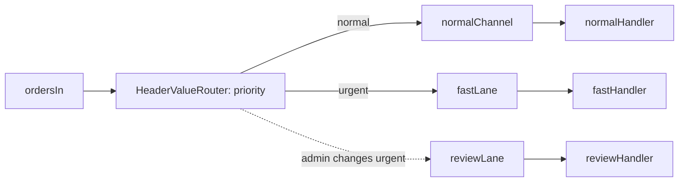
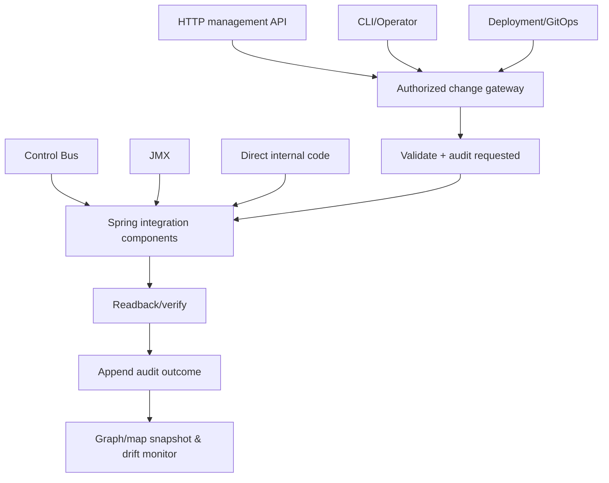
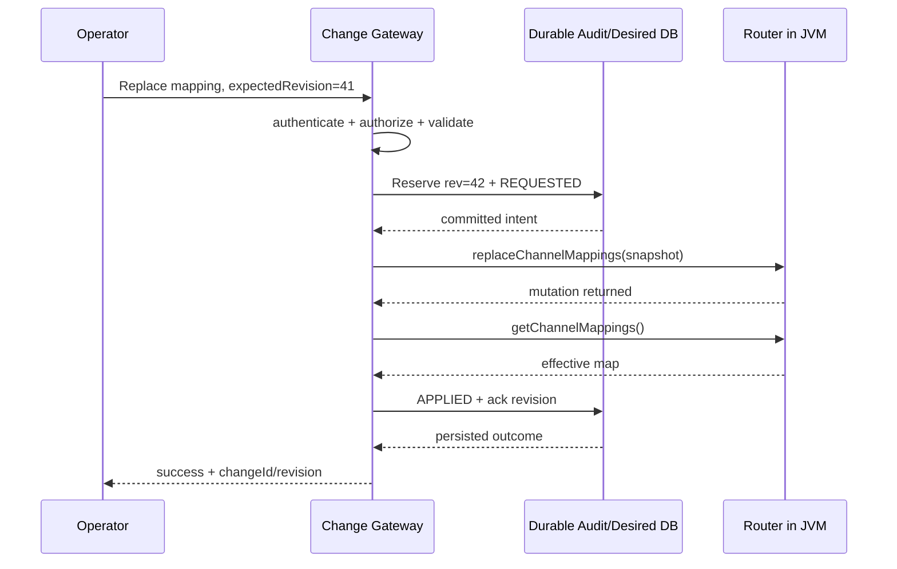
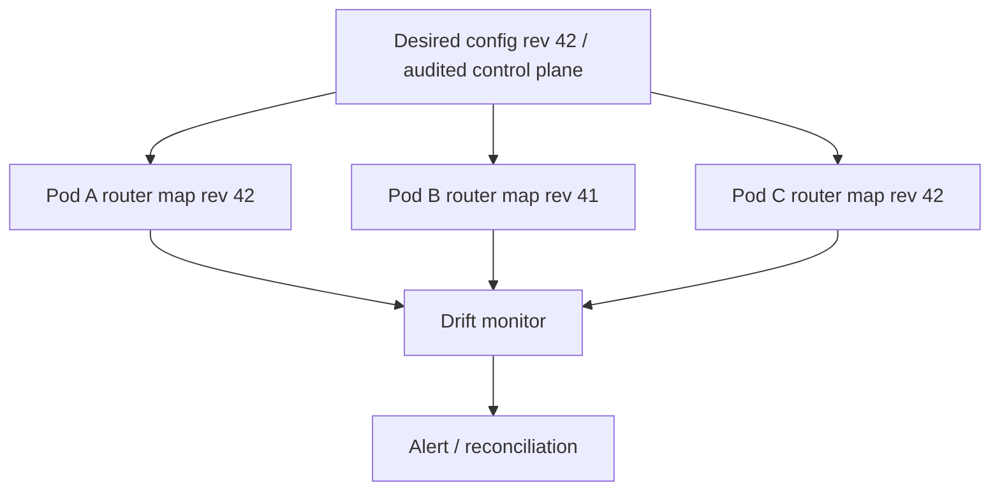
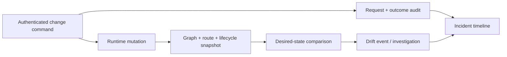
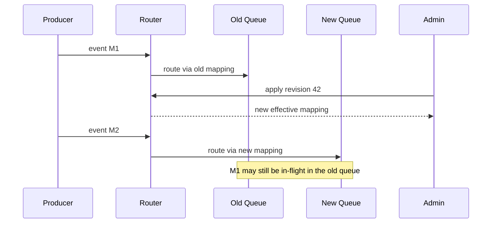

# Auditing Topology or Route Changes in Spring Integration Runtime

## 1. Why Must Runtime Changes Be Audited?

In **SPRING_INTEGRATION_RUNTIME**, a message flow can ingest data from brokers, HTTP, or files, pass through `MessageChannel`, `Router`, `ServiceActivator`, `PollingConsumer`, and `ExecutorChannel`, and update business resources. Many applications also permit **registering, starting, stopping, or destroying an `IntegrationFlow`**, or **updating router mappings while the JVM is running**.

That operational capability is valuable, yet also a risk surface: a route change can divert payments to a different handler; stopping a consumer can cause backlogs; destroying a dynamic flow can sever active processing paths. None of these incidents necessarily throws an exception at the moment of the administrative action.

This lesson belongs to the **Runtime Security** chapter and answers:

> When topology or routing tables change at runtime, how do you know **who requested it**, **whether it was permitted**, **what was intended to change**, **what actually changed**, **on which instance**, **whether in-flight messages were affected**, and **how to trace/recover**?

An **audit log** is more than a `logger.info("route changed")` line. Auditing supports accountability, incident investigation, unauthorized-change detection, and cross-instance drift control. It does not by itself guarantee every message routed properly or an external resource committed.

After this lesson, you will be able to:

- Distinguish **desired configuration**, **runtime topology**, **dynamic route mappings**, **lifecycle state**, **control-plane commands**, and **audit events**.
- Identify APIs capable of mutating the runtime: `IntegrationFlowContext`, `IntegrationFlowRegistration`, router management, `Control Bus`, JMX, and management endpoints.
- Design a centralized change gateway with authentication/authorization, validation, change IDs, before/after snapshots, outcomes, and append-only auditing.
- Understand atomicity boundaries: router mappings can update in one call, yet **in-memory mutations do not share a DB transaction with audit records**; across multiple JVMs, there is no single atomic commit.
- Use `IntegrationGraphServer.getGraph()`/`rebuild()` to capture and compare topology snapshots cleanly, without mistaking graphs for history.
- Manage routers via `setChannelMapping`, `removeChannelMapping`, `replaceChannelMappings`, and `getChannelMappings`, keeping `channelKeyFallback=false` when allowlisting is required.
- Protect `Control Bus`, Spring Boot Actuator, and other admin APIs against unauthorized changes, route injection, and privilege escalation.
- Write audit tests for authorized/denied requests, before/after diffs, failed mutations, concurrency, restarts, dynamic flow removal, and reconciliation.
- Combine auditing with metrics, traces, business correlation, incident runbooks, and retention/redaction policies.

Examples use Java 17+, Spring Integration **6.5.x**, and Spring Framework 6.x; Spring Security, JDBC, and Spring Boot Actuator appear where applicable. This lesson presents an **illustrative design** rather than assuming Spring Integration records audit history automatically on every topology change.

## 2. Scope: "Topology Changes" Differ from "Route Changes"

First, distinguish the technical events:

| Activity | API/change source | Entity modified | Should audit? |
| --- | --- | --- | --- |
| Registering a flow at runtime | `IntegrationFlowContext.registration(...).register()` | New beans/endpoints/channels | Yes |
| Starting/stopping a dynamic flow | `IntegrationFlowRegistration.start()/stop()` | Lifecycle state | Yes |
| Destroying a dynamic flow | `IntegrationFlowRegistration.destroy()` | Registration and dependent beans | Yes |
| Starting/stopping a static endpoint | `SmartLifecycle.start()/stop()`, Control Bus/JMX | Consumer/poller activity | Yes |
| Adding/updating a route key | `setChannelMapping(key, channel)` | Router lookup map | Yes |
| Removing a route key | `removeChannelMapping(key)` | Router lookup map | Yes |
| Replacing the entire mapping table | `replaceChannelMappings(Properties)` or matching programmatic API | A mapping snapshot | Yes |
| Modifying managed executor/poller settings | Control Bus/JMX/custom management | Runtime capacity/timing | Yes when operationally impactful |
| Calling `IntegrationGraphServer.rebuild()` | Graph management/Actuator POST | **Cached graph model**, does not alter flows | Audit as admin read/refresh per policy; **do not label as topology mutation** |
| Message routed to a branch | Router during data processing | Path of a single message | Belongs to **traces/business logs**, not config-change audits |
| Deploying code changes | GitOps/CI-CD | Desired config + new process instances | Audit deployment/change request |

Key nuance: **route mappings can change even when the node/link graph changes little or not at all**. A router keeps the same name and channel links, yet the key `"priority"` moved from `fastLane` to `manualReview`. Therefore, route audits must capture **before/after mappings** from router APIs—not solely graph diffs.

Conversely, `IntegrationFlowRegistration.stop()` can leave the topology intact in the graph: the change is primarily lifecycle rather than node removal. Audits need `operation=STOP` and the actual `isRunning()` readback.

### Example Topology



An administrator changes the mapping from `urgent → fastLane` to `urgent → reviewLane`. Afterward:

- Messages **already routed** before the change may remain in the old executor/queue.
- Messages entering the router after the change can route to the new destination.
- Messages processed **concurrently with the change** depend on the implementation's concurrency semantics.
- There is no guarantee that business transactions for earlier messages rolled back.
- Rebuilding the graph after changing the mapping **does not** prove every message followed the new configuration.

## 3. Threat Model for the Control Plane

Management endpoints typically carry low traffic yet wield high privilege. A single route change can disrupt service or divert data to unintended targets.

### Actors and Risks

| Actor or condition | Threat | Mitigation |
| --- | --- | --- |
| Anonymous caller | Calls route-change endpoint | Deny by default, authn/authz |
| Logged-in user lacking privileges | Escalates via management API | RBAC/ABAC and least privilege |
| Compromised API key | Mass topology changes | Secrets hygiene, short-lived credentials, rotation |
| Producer sets `routeKey` header | Router falls back to non-allowlisted channel | `setChannelKeyFallback(false)`, mapping allowlist |
| Operator invokes Control Bus directly | Bypasses audit wrapper | Lock down entry points; force all mutations through admin gateway |
| Broadly exposed JMX/Actuator | Remote bean state mutation | Bind management to private interface, auth, TLS, firewall |
| Concurrent admins edit router | Lost updates/overwrites | Revisions/CAS, serialization, conflict policy |
| Two pods hold diverging mappings | Messages route differently per pod | Desired-state store + per-instance reconciliation |
| Audit DB fails while runtime changes | Missing reliable outcome record | Durable intent + reconciliation; fail-safe procedure |
| Audit record captures payloads/secrets | Leaks PII/tokens/credentialed URLs | Strict schema/allowlist/redaction/encryption |
| Operator deletes logs | Loss of forensic evidence | Append-only storage, RBAC, retention, central shipping |

### Separating Permissions by Action

- **VIEW_TOPOLOGY:** view graphs and route mappings stripped of sensitive details.
- **CHANGE_ROUTE:** modify mappings within router/channel allowlists.
- **MANAGE_FLOW:** register/start/stop/destroy dynamic flows, scoped by application/instance.
- **MANAGE_CONTROL_BUS:** high-sensitivity permission for allowed operations only.
- **AUDIT_READ:** read audit logs per scope and retention policy.
- **AUDIT_ADMIN:** manage audit storage/retention, separated from route editors.

Holding `ROLE_ADMIN` in another service does **not** automatically authorize every control-plane action. Permissions and intent must bind to the **specific target resource**.

## 4. Change Sources That Must Be Tracked

A system may expose multiple ways to mutate runtime state concurrently.



For comprehensive auditing, **every mutation path** must be controlled or detected:

1. Prefer a **central change gateway** inside the application; only this wrapper invokes mutable APIs.
2. Lock down or restrict `Control Bus`/JMX/Actuator/private management endpoints to eliminate bypasses.
3. Where internal code could still call routers directly, add **drift detection** comparing desired state and live state periodically/post-deploy.
4. Capture Git/CI-CD audits for **build/deploy-time** changes, since not all config updates happen via runtime APIs.
5. Record whether mutations came from a **human operator** or an **automated reconciler**; automation identities must also undergo authorization checks.

**Do not assume** Spring Integration emits standard `RouteMappingChangedEvent` or `IntegrationFlowChangedEvent` objects for every mutation. Such events in this lesson are **application-defined**, not framework contracts.

## 5. Minimum Contents of an Audit Event

A solid record answers 7 questions: **who, where, when, why, what changed, what outcome, and how verified**.

| Field | Example | Meaning |
| --- | --- | --- |
| `auditId` | `aud-01J...` | Unique ID of an audit record |
| `changeId` | `chg-2026-0142` | Groups records belonging to the same request |
| `operation` | `ROUTE_REPLACE` | Operation type |
| `actorType`/`actorId` | `HUMAN/alice` or `SERVICE/reconciler` | Identity from authenticated boundary |
| `authorizationDecision` | `ALLOW`/`DENY` | Policy decision |
| `targetType`/`targetId` | `ROUTER/ordersRouter` | Affected resource |
| `application`/`instance` | `orders-runtime/pod-a` | JVM/replica scope |
| `occurredAt` | UTC timestamp | When the event was recorded |
| `requestedRevision` | `42` | Target revision for the change |
| `expectedRevision` | `41` | CAS/precondition preventing lost updates |
| `beforeHash`/`afterHash` | SHA-256 of canonical route map | Detects drift/tampering |
| `changedFields` | `urgent:fastLane→reviewLane` | Only modified settings |
| `outcome` | `REQUESTED`, `APPLIED`, `REJECTED`, `FAILED`, `UNKNOWN` | Verifiable result |
| `reason`/`ticket` | `INC-2417` | Business justification/approval |
| `traceId` | `abcd...` | Links distributed traces when present |
| `errorCode` | `CONFLICT_REVISION` | Error classification without secrets |

### Outcomes Should Be Strictly Defined

- **REQUESTED:** intent recorded, runtime change not yet confirmed.
- **REJECTED:** policy, validation, or revision check denied; mutation not invoked.
- **APPLIED:** mutation returned and readback matched **on the verified target instance**.
- **FAILED:** mutation failed per contract or readback mismatched.
- **UNKNOWN:** mutation may have occurred yet outcome/audit commit could not be confirmed; reconciliation required.
- **RECONCILED:** re-verification confirmed live state synchronized with desired state.

Never mark `APPLIED` merely on HTTP 202 or when `send()` to a management channel returns true. Commands can queue for async handling; audits must distinguish **accepted** from **effective**.

### What Should Never Be Stored?

- Raw Spring `Message<?>`, payloads, message-group contents, or business PII.
- Authorization headers, JWTs, passwords, OAuth client secrets, or broker credentials.
- Raw user-submitted SpEL command strings if they might hold sensitive data.
- Full `SecurityContext`, `Reactor ContextView`, or bean objects.
- Full stack traces in the primary audit DB lacking security/retention controls.
- Unfiltered full graph JSON, since custom properties might contain sensitive values.

If richer forensic evidence is needed, store **redacted** artifacts in a secured store and put only digests/references in the audit record.

## 6. Distinguishing Request Logs, Audit Logs, and Message Traces

| Data | Example | Retention and purpose |
| --- | --- | --- |
| Application logs | "router initialized", exception stacks | Technical diagnostics; may be sampled |
| HTTP access logs | POST /admin/routes, latency, status | Access monitoring; lacks before/after |
| Audit events | actor=alice, mapping urgent→review, APPLIED, revision=42 | Administrative change traceability; should not be sampled |
| Distributed traces | Controller → validation → router update → DB audit writer | Correlation/latency; may be sampled |
| Message history | Event M12 traversed handlers A/B/C | Data-plane execution trail |
| Desired-state records | Revision 42: app-wide route map | Authoritative config for recovery |
| Runtime snapshots | Graph + live mappings on pod A | Point-in-time state evidence |

An operator may ask "**who changed the route?**" — message history cannot answer that. Conversely, a `ROUTE_REPLACE` audit event cannot answer "**which channel did message M12 take?**" without tracing or business evidence.

Use `changeId` to correlate admin operations, reserving `eventId`/`correlationId` for business events. Never use business event IDs as Prometheus metric labels due to high cardinality.

## 7. Dynamic Routers: APIs and Fallback Vulnerabilities

Routers based on `AbstractMappingMessageRouter` (including `HeaderValueRouter`) expose management methods:

```java
router.getChannelMappings();

router.setChannelMapping("urgent", "reviewLane");
router.removeChannelMapping("urgent");

// Replace mapping snapshot via Properties:
Properties next = new Properties();
next.setProperty("normal", "normalLane");
next.setProperty("urgent", "reviewLane");
router.replaceChannelMappings(next);
```

Here `router` is an injected `MappingMessageRouterManagement`/`HeaderValueRouter` bean, and `Properties` is `java.util.Properties`. These methods mutate **runtime configuration**, not a business transaction.

### Choosing Operations by Atomicity

| API | Characteristics | Use case |
| --- | --- | --- |
| `setChannelMapping(key, name)` | Adds/overwrites one key | Update a single route |
| `removeChannelMapping(key)` | Removes one key | Retire a single route |
| Remove then set | **Two non-atomic operations** | Risk of intermediate state |
| `replaceChannelMappings(Properties)` | Replaces the whole mapping table as a documented atomic management op | Update multiple routes together |
| `setChannelMappings(Map<String,String>)` | Type-safe programmatic mapping API | Update mappings in code; check version semantics |
| `getChannelMappings()` | Returns an unmodifiable view/map of mappings | Before/after snapshots |

Per Spring Integration documentation, **removing a mapping and adding a new one are two separate, non-atomic operations**. `replaceChannelMappings(Properties)` updates the whole table. "Atomic map replacement" refers strictly to updating the router's **mapping table**, **not** changing all flows, DBs, and brokers in one transaction.

### Route Key Fallback Can Open Unwanted Paths

By default, when no mapping matches, a router can treat the channel key itself as a channel name. If a message producer controls routing headers, it can target internal channels never meant to receive external input.

Example:

```text
Input header routeKey = "ordersRouterInput"

No mapping exists for this key
If channelKeyFallback=true:
    router attempts to resolve channel name="ordersRouterInput"
    may loop back to router input or expose unintended paths
```

For routes driven by untrusted input, you should:

- Call `setChannelKeyFallback(false)` or DSL `channelKeyFallback(false)`.
- Permit only keys/channels from a curated allowlist.
- Configure a safe default output channel for unknown keys, or fail closed.
- Check for loops, sensitive channels, dead-letter paths, and missing-destination behavior.
- Audit all allowlist/mapping changes, not only successful sends.

**Auditing does not replace authorization.** A record saying "anonymous changed route" is post-facto evidence, not a preventive control.

## 8. Java Example: A Change Gateway with Before/After Auditing

This is an **illustrative application pattern** for Spring Integration 6.5. Router APIs belong to the framework; `AuditStore`, `ChangeRequest`, and policies here are **custom business layers**, not provided out of the box by Spring Integration.

### 8.1. Declaring Immutable Commands and Outcomes

```java
package example.audit;

import java.util.Map;

public record RouteChangeRequest(
        String changeId,
        String routerId,
        long expectedRevision,
        Map<String, String> desiredMappings,
        String reason) {
}

public record RouteChangeResult(
        String changeId,
        String routerId,
        long newRevision,
        Map<String, String> effectiveMappings) {
}
```

In real Java projects, each public top-level record belongs in its own file. `desiredMappings` is request data; the service must **copy, validate, and normalize** it before use rather than retaining a caller-mutable `Map` reference.

### 8.2. Audit Store and Revision Store Contract

```java
package example.audit;

import java.time.Instant;
import java.util.Map;

public interface RouteAuditStore {

    void append(
            String changeId,
            String stage,
            String actorId,
            String routerId,
            Map<String, String> before,
            Map<String, String> after,
            Instant occurredAt,
            String reason);

    long currentRevision(String routerId);

    // Compare-and-set on persistent desired-state revision.
    // Requires a DB/registry implementation guaranteeing concurrency safety.
    long reserveRevision(
            String routerId, long expectedRevision, String changeId);

    void markRevisionApplied(String changeId);
}
```

This is a **demo interface** without an implementation; production needs a DB schema, unique constraints, transaction management, idempotency, and consistency policies. `reserveRevision` must be atomic/CAS on a durable store, never an unlocked `get() + set()`.

### 8.3. Change Management Service

```java
package example.audit;

import java.time.Instant;
import java.util.Map;
import java.util.Properties;
import java.util.TreeMap;

import org.springframework.beans.factory.ListableBeanFactory;
import org.springframework.integration.support.management.MappingMessageRouterManagement;
import org.springframework.messaging.MessageChannel;
import org.springframework.security.access.prepost.PreAuthorize;
import org.springframework.stereotype.Service;

@Service
public class AuditedRouteManager {

    private final MappingMessageRouterManagement router;
    private final RouteAuditStore audit;
    private final ListableBeanFactory beans;

    public AuditedRouteManager(
            MappingMessageRouterManagement router,
            RouteAuditStore audit,
            ListableBeanFactory beans) {
        this.router = router;
        this.audit = audit;
        this.beans = beans;
    }

    @PreAuthorize("hasAuthority('INTEGRATION_ROUTE_WRITE')")
    public RouteChangeResult replace(
            RouteChangeRequest request,
            String verifiedActorId) {

        // verifiedActorId is supplied by a trusted authentication/authorization
        // layer, NEVER taken verbatim from request headers.
        if (!"ordersRouter".equals(request.routerId())) {
            throw new IllegalArgumentException("Router not permitted");
        }

        Map<String, String> desired =
                Map.copyOf(request.desiredMappings());

        for (var entry : desired.entrySet()) {
            String key = entry.getKey();
            String channel = entry.getValue();

            if (!java.util.Set.of("normal", "urgent").contains(key)) {
                throw new IllegalArgumentException(
                        "Unknown route key");
            }
            if (!java.util.Set.of("normalLane", "reviewLane")
                    .contains(channel)) {
                throw new IllegalArgumentException(
                        "Destination not allowed");
            }

            // Fail closed if bean is missing or wrong type.
            beans.getBean(channel, MessageChannel.class);
        }

        // Enforce that callers on the same JVM go through this gateway
        // or use a change coordinator serializing mutations.
        Map<String, String> before =
                new TreeMap<>(router.getChannelMappings());

        // Only reserveRevision is atomic here;
        // it does NOT wrap the in-RAM mutation.
        long revision = audit.reserveRevision(
                request.routerId(),
                request.expectedRevision(),
                request.changeId());

        audit.append(
                request.changeId(),
                "REQUESTED",
                verifiedActorId,
                request.routerId(),
                before,
                desired,
                Instant.now(),
                request.reason());

        try {
            Properties mappings = new Properties();
            desired.forEach(mappings::setProperty);

            // Single operation replacing the whole mapping table.
            router.replaceChannelMappings(mappings);

            Map<String, String> effective =
                    new TreeMap<>(router.getChannelMappings());
            if (!effective.equals(desired)) {
                throw new IllegalStateException(
                        "Runtime mapping mismatch");
            }

            audit.append(
                    request.changeId(),
                    "APPLIED",
                    verifiedActorId,
                    request.routerId(),
                    before,
                    effective,
                    Instant.now(),
                    request.reason());

            audit.markRevisionApplied(request.changeId());
            return new RouteChangeResult(
                    request.changeId(),
                    request.routerId(),
                    revision,
                    Map.copyOf(effective));
        }
        catch (RuntimeException failure) {
            // In production, wrap audit failure in its own try/catch
            // and record UNKNOWN if mutation outcome cannot be confirmed.
            // Never fake a rollback.
            audit.append(
                    request.changeId(),
                    "FAILED_OR_UNKNOWN",
                    verifiedActorId,
                    request.routerId(),
                    before,
                    new TreeMap<>(router.getChannelMappings()),
                    Instant.now(),
                    request.reason());
            throw failure;
        }
    }
}
```

**Scope of this code:** this is a step-by-step illustrative pattern, **not a service guaranteeing end-to-end atomicity**. It lacks a `RouteAuditStore` implementation and cross-thread/cross-pod serialization, and `@PreAuthorize` only takes effect when Spring Method Security is enabled and called through a proxy. The API layer must extract actor IDs from verified authentication, never from JSON input.

Production hardening needed:

1. **Authorizing before validation prevents leaking router/channel names**; Spring Method Security denies early, provided every ingress uses the bean proxy.
2. **Validate `reason`, `changeId`, request size, key/value lengths**, and protect against replay.
3. **Serialize mutations per router**. `reserveRevision` checks revisions, yet does not lock in-memory updates if multiple requests proceed concurrently; add per-router locks/queues/coordinators.
4. **Persist durable intent before applying**. Here `reserveRevision` and `append REQUESTED` are separate calls; production should combine them into one durable operation or handle orphaned reservations.
5. **Post-mutation audit writes can fail**. Runtime changed yet `APPLIED` is missing; record `UNKNOWN` via an independent path and reconcile.
6. **Never attach `@Transactional` expecting router mutations to roll back with the DB**: runtime mappings are in-memory state outside local JDBC transactions.
7. **Never store raw secrets/PII** in `desiredMappings`/`reason`; permit only approved business channel IDs.
8. **Block bypass paths** such as Control Bus/JMX mutating `ordersRouter` without going through the gateway and audit/reconciliation.
9. **Verification is point-in-time**: after readback, another flow could still alter the route; pair with continuous drift detection and revision checks.

### 8.4. Router Configuration and Input Wiring

```java
package example.audit;

import org.springframework.context.annotation.Bean;
import org.springframework.context.annotation.Configuration;
import org.springframework.integration.router.HeaderValueRouter;

@Configuration
public class RouterConfig {

    @Bean("ordersRouter")
    public HeaderValueRouter ordersRouter() {
        HeaderValueRouter router =
                new HeaderValueRouter("priority");

        router.setChannelKeyFallback(false);
        router.setChannelMapping("normal", "normalLane");
        router.setChannelMapping("urgent", "reviewLane");
        return router;
    }
}
```

This creates only the router bean. For it to actually receive Spring Messages, an **endpoint/`IntegrationFlow`** must connect it to an input channel alongside `normalLane`/`reviewLane` channel beans. Do not treat it as a standalone runnable flow before wiring it into a message pipeline.

If multiple routers implementing `MappingMessageRouterManagement` exist in the context, `AuditedRouteManager`'s constructor needs `@Qualifier("ordersRouter")` or by-name injection; the example assumes a single matching router bean.

## 9. Multi-Step Auditing and Transaction Boundaries

Governance design should distinguish three milestones:



If the JVM crashes after `REQUESTED` before `replaceChannelMappings`, the audit still holds the incomplete intent. If it crashes after the runtime mutation before `APPLIED`, the record lacks a confirmed outcome. That is not a reason to skip auditing—it is why **reconciliation** is necessary.

### Failure Windows

| Crash/failure point | Durable audit | Runtime mapping | Required action |
| --- | --- | --- | --- |
| Before `REQUESTED` commit | No intent yet | Unchanged | Caller retries with idempotency key |
| After `REQUESTED`, before mutation | Intent exists | Unchanged | Reconciler inspects and proceeds/aborts |
| During mutation | Intent exists | Indeterminate | Readback to determine effective state |
| After mutation, before `APPLIED` | Intent still pending | May have changed | Reconcile and write actual outcome |
| After `APPLIED` | Applied record durable | Verified at that instant | Monitor for drift/restarts |
| Audit sink fails post-mutation | Outcome may be missing | May have changed | Fail-safe: `UNKNOWN` + alert + reconcile |
| Pod A updated, Pod B lagged | Applied on A | Cluster out of sync | Per-instance rollout/acks |

A local `@Transactional` does not combine DB auditing and in-memory routers into one atomic transaction. Use **desired state + intent/audit + applied acknowledgment + periodic drift reconciliation**, anchored on a single source of truth for revisions.

### Never Arbitrarily Auto-Roll Back Routes

If an audit write fails after the route already changed, calling `replaceChannelMappings(before)` automatically can make things worse:

- Meanwhile, admin B may have applied a newer revision.
- Messages already routed under the intermediate mapping; rolling back does not recall them.
- An automatic rollback can overwrite a newer, valid change.

Rollbacks must use **revision compare-and-set**, verify current state, and execute as a **separate audited change request**, never a silent mutation.

## 10. Auditing `IntegrationFlow` Start, Stop, Register, and Destroy

`IntegrationFlowContext` allows registering flows at runtime:

```java
IntegrationFlow flow = ...;

IntegrationFlowContext.IntegrationFlowRegistration registration =
        flowContext.registration(flow)
                .id("orders-runtime-v2")
                .autoStartup(false)
                .register();

registration.start();
registration.stop();
registration.destroy();
```

These are Spring Integration APIs; `flowContext` is an injected bean and `flow` is a matching DSL flow. Code must ensure unique registration IDs and proper lifecycle scope.

### Audit Events for Each Action

| Operation | Before snapshot | After snapshot | Outcome to verify |
| --- | --- | --- | --- |
| `REGISTER` | Registration ID absent; graph lacks new nodes | Registration ID, new nodes/links | Beans/endpoints registered properly |
| `START` | `registration.isRunning=false` | `isRunning=true` | Lifecycle changed; test message flow if needed |
| `STOP` | `isRunning=true` | `isRunning=false` | Stops accepting new work per contract |
| `DESTROY` | Registration exists | Registration gone | Dependent beans/graph refreshed |
| `REPLACE_FLOW` | Flow version A | Version B | Traffic cutover/rollback plan tracked |

**Crucial fact:** `STOP` does not necessarily halt all in-flight handlers immediately. Tasks already submitted to an `ExecutorChannel` may keep running. `DESTROY` does not delete messages from external brokers/JDBC stores, roll back remote HTTP calls, or guarantee queue draining.

Therefore, audits should record:

- `requestedAt`, `effectiveAt`, and `observedAt`.
- `drainPolicy`: stop intake first, await in-flight completion, timeout, then stop consumers.
- `pendingMessageCount` at measurement time, if known.
- `instanceId` and `registrationId`.
- `flowVersion/hash` or reference to a signed deployment manifest.

### Pseudocode Wrapper for Dynamic Registration

```java
// Pseudocode: AuditWorkflow, guards, and registry are application layers.
// There is no automatic transaction spanning FlowContext and Audit DB.
auditWorkflow.authorizedChange(
        actor,
        "FLOW_REGISTER",
        "orders-runtime-v2",
        changeId,
        () -> {
            var reg = flowContext
                    .registration(flowFactory.build(version))
                    .id("orders-runtime-v2")
                    .autoStartup(false)
                    .register();

            try {
                graphServer.rebuild();
                verifyRegistration(reg);
                reg.start();
                verifyFlowReady(reg);
                return reg.getId();
            }
            catch (RuntimeException ex) {
                // Cleanup/compensation policy must be explicitly defined.
                reg.destroy();
                graphServer.rebuild();
                throw ex;
            }
        });
```

`verifyFlowReady` is a flow-specific check beyond `isRunning()`. Never send a real business payment message as a health probe; use a marked canary/synthetic message or safe wiring/lifecycle checks.

### Two Flow Versions Running Concurrently

During rolling upgrades, old flow A and new flow B may coexist. Audits must answer **when traffic shifted**, **whether any messages were duplicated or lost during cutover**, and **whether flow A drained**. A `REGISTER/APPLIED` log alone does not guarantee exactly-once business effects.

## 11. Control Bus: A Powerful Admin Channel That Must Be Tightly Locked

Spring Integration provides `Control Bus` to invoke management operations over a message channel. Per 6.5 docs, commands typically take the form `beanName.methodName` with arguments in the `IntegrationMessageHeaderAccessor.CONTROL_BUS_ARGUMENTS` header.

Example managing router mappings:

```java
import java.util.List;
import java.util.Properties;

import org.springframework.integration.IntegrationMessageHeaderAccessor;
import org.springframework.messaging.Message;
import org.springframework.messaging.support.MessageBuilder;

Properties mappings = new Properties();
mappings.setProperty("normal", "normalLane");
mappings.setProperty("urgent", "reviewLane");

Message<?> command = MessageBuilder
        .withPayload("'ordersRouter'.replaceChannelMappings")
        .setHeader(
                IntegrationMessageHeaderAccessor.CONTROL_BUS_ARGUMENTS,
                List.of(mappings))
        .build();

// Send ONLY on a properly protected, authorized,
// and fully audited management channel.
// operationChannel.send(command);
```

The actual router-management bean name may be another endpoint/handler bean depending on registration. The command payload is an **administrative string**, not an ordinary business message.

### Why Is the Control Bus Sensitive?

- It can invoke eligible `@ManagedOperation`/`@ManagedAttribute` methods or framework-allowed lifecycle operations.
- It can start/stop components, alter mappings, or reconfigure executors/schedulers on exposed APIs.
- If a Control Bus `MessageChannel` accepts messages from untrusted users/producers, it creates a system mutation path bypassing HTTP admin APIs.

Spring Integration filters eligible commands/methods, **yet that never replaces sender authentication and authorization**.

### Defense Patterns

1. Expose the Control Bus only on a secured management ingress; never wire it to business input channels.
2. Enforce authentication/authorization before dispatching commands.
3. Prefer an **allowlisted management facade**, never letting operators supply arbitrary bean/method strings.
4. Apply channel security interceptors or matching policy enforcement where Spring Security Messaging is used.
5. Audit `actor, action, target, filtered arguments, outcome` at the facade layer rather than logging raw message payloads.
6. Never let anonymous/untrusted producers supply `CONTROL_BUS_ARGUMENTS`.
7. Lock down JMX and all other admin interfaces so they cannot bypass the audit path.
8. Protect the management network with TLS, private routing, firewalls, and short-lived identities.

**Do not assume Control Bus payloads are unrestricted arbitrary SpEL**; newer versions use command registries/allowed methods. Yet even an allowed method can have huge impact, requiring resource-level authorization and auditing.

## 12. Atomic Router Mapping Update Does Not Mean Cluster-Wide Simultaneous Cutover

`replaceChannelMappings(Properties)` updates a router's mapping table in one call rather than sequential removes/adds. Yet deployments usually span multiple JVMs or pods.



**There is no built-in distributed atomicity** across `HeaderValueRouter` instances in different pods. An update `APPLIED` on pod A does not mean pod B updated. Use a strategy:

- Mint unique revisions in a **desired-state registry** (database/GitOps/config service).
- Each instance receives the revision, validates, applies, and reads back effective mappings.
- Record **per-instance `APPLIED` acks** and timestamps.
- Declare rollout complete only when quorum/all-instances criteria are met.
- If a pod is offline, audit `PENDING` and reconcile when it returns.
- Use canary/blue-green route cutovers or pause intake when two routing versions must not coexist.

### Drift Detection

```text
desiredRevision = 42
desiredHash     = sha256(canonical map rev42)

pod-a: effectiveHash = desiredHash  -> IN_SYNC
pod-b: effectiveHash = oldHash      -> DRIFT
pod-c: not reachable                 -> UNKNOWN
```

Compute hashes over a stable canonical representation: sorted keys, UTF-8 encoding, explicit escaping/lengths, and versioned serialization. `Map.toString().hashCode()` is not a trustworthy audit digest.

### Concurrency on a Single Instance

Two admins editing mappings simultaneously can race:

```text
Admin A reads revision 41, wants map X
Admin B reads revision 41, wants map Y
A reserves rev42 and applies X
B without CAS/coordinator applies Y afterward
A returns success yet route no longer has X
```

Enforce CAS on revisions and **serialize mutations per router**, or funnel updates through a single-threaded reconciliation pipeline. Synchronizing `getChannelMappings()` on reads alone is insufficient.

## 13. `IntegrationGraphServer`: A Snapshot, Not an Audit Log

`IntegrationGraphServer` builds a runtime object model:

```java
IntegrationGraphServer graphServer = ...;

Graph cached = graphServer.getGraph();
Graph current = graphServer.rebuild();
```

`getGraph()` returns the cached graph, while `rebuild()` rescans integration components to reflect added/removed flows. It has **no** API answering "who changed the route at 13:32" and stores no revision history.

### What Is in a Graph Snapshot?

- `Graph.getContentDescriptor()`: provider, version, application name, etc.
- `Graph.getNodes()`: integration nodes with `nodeId`, name, component type, and properties.
- `Graph.getLinks()`: `from/to/type` links between nodes.

Snapshots after `rebuild()` can differ even without a change request—for instance, due to dynamic components registered by other code. Conversely, dynamic router mappings can change without graph link metadata capturing every key/value detail.

### Avoiding False Diffs from `nodeId`

`nodeId` is an identifier scoped **to a single graph snapshot** and must not be treated as stable across rebuilds/restarts. When diffing:

1. Map `nodeId → stable name/type` within the same snapshot.
2. Normalize links as `sourceStableName + linkType + targetStableName`.
3. Compare node/link sets and verify component names are neither duplicated nor opaque auto-generated IDs.
4. Compute a canonical snapshot hash with application/instance/version metadata.
5. **Supplement with explicit route mappings** from `MappingMessageRouterManagement.getChannelMappings()`.
6. For lifecycle state, inspect `SmartLifecycle.isRunning()` rather than treating graph presence as running.

### Canonical Link Diff Pseudocode

```java
Graph graph = graphServer.rebuild();

Map<Integer, String> byId = graph.getNodes().stream()
        .collect(java.util.stream.Collectors.toMap(
                node -> node.getNodeId(),
                node -> node.getName()
                        + "#" + node.getComponentType()));

Set<String> links = graph.getLinks().stream()
        .map(link -> byId.get(link.getFrom())
                + "|" + link.getType()
                + "|" + byId.get(link.getTo()))
        .collect(java.util.stream.Collectors.toCollection(
                java.util.TreeSet::new));
```

This illustrative snippet needs imports for `Map`, `Set`, and `Graph`. In production, names may not be cluster-wide unique; include namespace/bean registration ID/instance version before hashing. Do not rely on this code to audit detailed route mappings if router maps are absent from link metadata.

### Actuator `integrationgraph`

Spring Boot exposes `GET /actuator/integrationgraph` to view the graph and can support `POST` to request a rebuild when write access is enabled. **`POST` rebuild does not mutate flow topology**; audit it as a management read/refresh operation if policy requires, never as `FLOW_REGISTER`/`ROUTE_UPDATE`.

Secure Actuator exposure, especially endpoints with write actions. `management.endpoint.integrationgraph.access=read-only` in Boot restricts operations, yet does not authenticate users by itself when custom Spring Security is configured.

## 14. Two-Layer Topology Auditing: Command Audit + Snapshot Diff

Recording commands alone misses direct/bypassed mutations; diffing snapshots alone cannot tell who caused the change. Combine both:



**Command audits** answer *who requested it and why*. **Snapshot diffs** answer *how actual state differs between two points in time*. **Traces/logs/message history** help investigate *which messages were impacted*.

### When Should Snapshots Be Captured?

- After `ApplicationContext` startup, before accepting critical traffic.
- Before and after any approved management change.
- After registering/destroying dynamic flows, before marking the operation applied.
- After deploys/rolling restarts and when a pod rejoins.
- Periodically at bounded intervals to detect unaudited direct mutations.
- During incidents involving "misrouted traffic" or "stopped endpoints".

Never call `graphServer.rebuild()` per processed message: graph refreshes are control-plane operations. Do not store huge raw graphs repeatedly if they contain sensitive details; store digests + filtered snapshots.

### Comparing Routes from the Right Source

```text
Graph diff:
    are handler A and channel X still wired together?

Mapping diff:
    which channel does route key "urgent" currently point to?

Lifecycle diff:
    is the endpoint running?

Deployment diff:
    which instance/pod runs which code/config revision?
```

All four are needed when investigating multi-version incidents.

## 15. Durable Audit Event Storage: Illustrative Schema

A PostgreSQL table can be designed as:

```sql
-- Illustrative: JSONB/timestamptz types are PostgreSQL-specific.
CREATE TABLE integration_control_audit (
    audit_id          UUID PRIMARY KEY,
    change_id         VARCHAR(80) NOT NULL,
    event_sequence    INTEGER NOT NULL,
    operation         VARCHAR(48) NOT NULL,
    stage             VARCHAR(32) NOT NULL,
    actor_type        VARCHAR(24) NOT NULL,
    actor_id          VARCHAR(128) NOT NULL,
    application_id    VARCHAR(128) NOT NULL,
    instance_id       VARCHAR(128),
    target_type       VARCHAR(48) NOT NULL,
    target_id         VARCHAR(160) NOT NULL,
    expected_revision BIGINT,
    resulting_revision BIGINT,
    before_hash       CHAR(64),
    after_hash        CHAR(64),
    diff_redacted     JSONB,
    reason_code       VARCHAR(64),
    ticket_id         VARCHAR(80),
    occurred_at       TIMESTAMPTZ NOT NULL,
    CONSTRAINT uq_audit_change_seq
        UNIQUE(change_id, event_sequence)
);

CREATE INDEX idx_audit_target_time
    ON integration_control_audit (
        application_id, target_type, target_id, occurred_at
    );
```

This schema covers only **audit event storage**; real deployments also need desired-state/revision tables, indexing/retention/partitioning strategies, stage-transition constraints, and DB privileges.

### Append-Only Must Be Enforced, Not Merely Named

- Application DB roles hold only `INSERT`/`SELECT`; no `UPDATE`/`DELETE` on the audit table for regular accounts.
- Retention/purging runs through an approved job with separate history.
- Backups, separated access controls, encryption at rest, and TLS are enforced.
- For high tamper-evidence requirements, use hash chains, signed digests, or WORM storage in an independent store.
- Alert on audit pipeline append failures, lag, or storage saturation.
- Never "fix" missing records by fabricating actors or outcomes during reconciliation.

If the application can update or delete any record, a plain table **does not guarantee tamper resistance**.

### Ensuring Change-Request Idempotency

An HTTP client may time out after the runtime already mutated; re-sending the same `changeId` must not apply the revision twice blindly.

```text
POST changeId=chg-42, expectedRevision=41

Attempt 1:
   reserve+apply -> rev42
   client times out before response

Attempt 2 (same changeId):
   look up record/desired state
   return effective result or reconciliation status
   never silently mint rev43
```

Enforce unique constraints on `changeId`/target/operation per contract, and pin content hashes to catch clients reusing a key for **different content**.

## 16. Actor Identity: Security Context Does Not Automatically Cross Async Boundaries

In Spring MVC imperative requests, authentication is accessible via `SecurityContextHolder`. Yet when management commands travel across `ExecutorChannel`, `QueueChannel`, or a broker, the HTTP request's `ThreadLocal` **does not automatically propagate to workers**.

Dangerous mistake:

```java
// Inside an asynchronous worker:
Authentication auth =
        SecurityContextHolder.getContext().getAuthentication();

// auth may be null or no longer match the requesting principal
// if proper propagation is missing.
```

Right approach:

1. Authenticate requests at **trusted ingress** (API gateway/app controller).
2. Authorize the actor for the action and target resource.
3. Build an immutable `AuthorizedChangeCommand` containing verified `actorId`, needed `scopes`, `changeId`, revision, and expiry.
4. Across worker handoffs, ensure users cannot tamper with the command; over networks, use authenticated transport/signatures or re-verify at the consumer.
5. In the worker, **re-check policies** if execution is delayed or scope/revision changed.
6. Audit using the actor identity from the trusted context/verified command—never from an `"actor"` field in an anonymous producer's body/header.

### Reactive Security Context Is a Separate Mechanism

Reactive Spring Security uses `ReactiveSecurityContextHolder` backed by Reactor `Context`, whereas imperative `SecurityContextHolder` is typically thread-bound. Spring Integration's `REACTOR_CONTEXT` header can help restore Reactor Context across certain bridges, yet:

- Context propagation does **not** grant permissions by itself.
- Externally supplied headers must never substitute for authentication.
- Never persist raw `SecurityContext`, bearer tokens, or Reactor `ContextView` into audit/event stores.
- Every management ingress must enforce authentication/authorization at the actual boundary.

### Authorization Model for Long-Running Jobs

A change request may be approved at 10:00 while a worker applies it at 10:30. Policy must define:

- How long does an approval remain valid?
- Could the actor's role have been revoked?
- Is the target still in allowed scope?
- Is the expected revision still current?
- Is two-person approval required for financial/sensitive route changes?
- What privileges does a reconciliation service account hold, and who approved the original desired revision?

Never treat an opaque "was once permitted" flag as permanent authority on the control plane.

## 17. Protecting Admin APIs, Control Bus, JMX, and Actuator

### Defense in Depth

```text
Operator / CI/CD
  -> Identity provider (MFA / short-lived token)
  -> Gateway authentication
  -> Action + target authorization
  -> Approval/change ticket
  -> Validation/CAS
  -> Durable audit intent
  -> Serialized mutation executor
  -> Runtime readback
  -> Durable audit outcome
  -> Drift monitoring / alert
```

For Spring Security Web/MVC, method authorization can be added:

```java
@EnableMethodSecurity
@Configuration
class ManagementAuthorizationConfig {
    // SecurityFilterChain and authentication providers configured separately.
}

@Service
class FlowAdminFacade {

    @PreAuthorize("hasAuthority('INTEGRATION_FLOW_MANAGE')")
    public void stop(String registrationId) {
        // Validate target, audit REQUESTED, apply,
        // verify isRunning=false, audit outcome.
    }
}
```

Illustrative snippet: full implementations require Spring Security imports, complete security chains, CSRF policies, audit persistence, and error handling. **Method security is not enabled merely by adding `@PreAuthorize`**; `@EnableMethodSecurity` or equivalent config is required, and self-invocation bypasses proxy interception.

### Do Not Expose All Actuator Endpoints by Default

For example, `/actuator/integrationgraph` can reveal endpoint names and topology. Write-capable management operations need dedicated permissions and often should not be exposed over HTTP at all.

- Expose only genuinely needed Actuator endpoints.
- Bind management interfaces to private networks with TLS and authentication.
- Separate permissions for GET graph vs. POST refresh if supported by your framework version.
- Never allow HTTP requests to send arbitrary Control Bus commands directly.
- Remote JMX requires its own policies, firewalls, and encryption; never assume "no HTTP endpoint" equals safe by default.
- Audit both **access denied** and **successful privileged mutations**, with rate limiting to prevent log storms.

### Preventing Route Injection

When message headers can influence destinations:

- Disable key-to-channel-name fallback for untrusted input.
- Allowlist channel names per business route semantics.
- Audit default/discard channels too; unknown keys must never fall into sensitive handlers.
- Guard against routing loops and enforce hop-count/timeout bounds if flows can re-enter inputs.
- Never let callers supply arbitrary bean names or expressions in management requests.
- Use router config revisions to detect out-of-band mapping mutations.

## 18. Auditing Topology Changes Under Load

When changing routes or flows under live traffic:



An `APPLIED rev42` audit event does not guarantee that **every message after a client-observed timestamp** used rev42, due to concurrent routing, async queues, clock skew, or multiple pods.

To trace specific messages:

- Attach safe **business correlation IDs** and trace contexts to messages.
- If compliance/business logic requires knowing **the exact route revision per message**, have the trusted router attach a version/hop marker or emit a separate data-plane audit.
- Never infer route revisions from the nearest `event.occurredAt`, since queued messages may dequeue much later.
- Avoid putting per-message `messageId` tags on Micrometer meters due to cardinality explosion.
- When strict cutover ordering is needed, pause/quiesce sources, drain, checkpoint barriers/offsets, and restart via an audited procedure.

### Testing Messages During Changes

Tests need at least three cases:

1. Message before change → old destination.
2. Message after readback confirms new config → new destination.
3. Message concurrent with mutation → outcome lies within policy-allowed possibilities; never silently dropped or sent to a non-allowlisted channel.

Case (3) must rely on framework-guaranteed concurrency semantics and explicit concurrency test controls—never assuming a DB transaction wraps route lookups.

## 19. Testing Authorization and Audit Correctness

### Test Matrix

| Case | Action | Expected |
| --- | --- | --- |
| Anonymous route change | Call management API | 401/403 per auth setup, zero mutation |
| Under-privileged user | `CHANGE_ROUTE` | DENY audit, mapping unchanged |
| Authorized single-key update | Valid mapping | Requested + Applied events, exact before/after |
| Non-allowlisted destination | `urgent→sensitiveAdminChannel` | Rejected, old mapping unchanged |
| Non-existent channel bean | `urgent→missingChannel` | Rejected prior to mutation |
| Stale expected revision | Concurrent A/B requests | CAS conflict, no lost update |
| Duplicate `changeId` with same payload | Client retry | Idempotent result, no new revision |
| Reused `changeId` with different payload | Replay collision | Rejected/conflict |
| Audit DB unavailable before intent | Change request | Not applied; errors or durably queues per policy |
| Audit DB unavailable post-apply | Outcome append fails | `UNKNOWN`/reconciliation, never reports certain success |
| Direct Control Bus bypass | Command sent from business channel | Rejected / no path available |
| Dynamic flow register/start | New registration | Audits IDs/revision/instance; appears after graph rebuild |
| Dynamic flow stop/destroy | Stop/quiesce/destroy | Accurate lifecycle and graph readback |
| Application restart | Desired state rev42 | Reconciles runtime map to desired; audits restart/applied |
| Two pods drift | A rev42, B rev41 | Alert/queued reconciliation, per-instance evidence |
| Logs contain secrets | Change reason/diff | Redacted, schema rejects sensitive values |

### JUnit Example: Route Before/After

```java
import static org.assertj.core.api.Assertions.assertThat;

import java.util.Map;
import org.junit.jupiter.api.Test;

class AuditedRouteManagerTest {

    // Pseudocode fixture: real HeaderValueRouter, in-memory
    // fake AuditStore with revision/CAS, MessageChannels in
    // Spring context, and authorized invocation via Spring proxy.

    @Test
    void allowedChangeProducesAppliedAuditAndEffectiveMap() {
        RouteChangeRequest request = new RouteChangeRequest(
                "chg-42",
                "ordersRouter",
                41L,
                Map.of(
                    "normal", "normalLane",
                    "urgent", "reviewLane"),
                "INC-2417");

        RouteChangeResult result =
                authorizedManager.replace(request, verifiedActorId);

        assertThat(result.newRevision()).isEqualTo(42L);
        assertThat(router.getChannelMappings())
                .containsEntry("urgent", "reviewLane");
        assertThat(fakeAudit.eventsFor("chg-42"))
                .extracting("stage")
                .contains("REQUESTED", "APPLIED");
    }
}
```

This is a **pseudocode JUnit fixture**, not an independently compilable test: `authorizedManager`, `verifiedActorId`, `router`, and `fakeAudit` must be wired in the test context, with a fake `RouteAuditStore` and initialized revision. Policy tests using `@PreAuthorize` must invoke the Spring proxy, never calling `new AuditedRouteManager(...)` directly and assuming method authorization ran.

### Concurrent Updates

Use two `CountDownLatch`/`CyclicBarrier` primitives and an `ExecutorService` to fire two change requests sharing `expectedRevision=41`:

- One request receives revision 42.
- The other receives a conflict.
- The final router mapping matches **the policy winner**, with no mixed state.
- Audits contain one `APPLIED` and one `REJECTED`/`CONFLICT`.
- All futures/awaits use finite timeouts and clean up in `finally`.

Never use `Thread.sleep(100)` to "trigger a race"; scheduler jitter and CI load make tests flaky.

### Testing Control-Plane Bypasses

Do not test only the HTTP security filter and declare the system secure. Test:

- Sending a message to the Control Bus channel from a channel accepting business input.
- Invoking JMX managed operations under an under-privileged identity.
- Calling the management facade via self-invocation/proxy bypass.
- Having an internal bean/plugin call `setChannelMapping` directly without auditing; verify the drift detector flags it.
- Restarting a pod with stale config; verify desired-state reconciliation fixes the map.

## 20. Testing Drift Detectors and Graph Snapshots

### Graph Diff Test

1. Capture initial `graphServer.getGraph()`.
2. Register a dynamic flow via `IntegrationFlowContext`.
3. Call `graphServer.rebuild()` and verify new nodes/links by stable names.
4. Stop the flow; verify `isRunning()` flips while topology may remain.
5. Destroy the flow; rebuild and confirm the flow's nodes/links disappeared.
6. Record audit events for test commands and compare against effective snapshots.

Never assert that `nodeId` stays identical across rebuilds. Where flows auto-generate bean names, assign explicit flow/endpoint IDs in tests.

### Mapping Diff Test

1. Snapshot `new TreeMap<>(router.getChannelMappings())`.
2. Apply a new mapping through the audited gateway.
3. Snapshot the new mapping.
4. Compute the diff covering only added/removed/modified destination keys.
5. Verify the audit event records the exact **approved** diff.
6. Simulate a direct mutation bypassing the gateway; the drift detector must emit **`UNAUTHORIZED_DRIFT`/`UNKNOWN_ACTOR`** rather than misattributing it to the most recent change's actor.

### Scope of Tests

A single-JVM JUnit test proves neither cluster-wide atomicity, process crash recovery, nor log tamper resistance. Those properties require integration/process tests with real DB/audit sinks, multiple app instances, and production-like authorization and network configurations.

## 21. Metrics, Alerts, and Forensic Timelines

Metrics fit low-cardinality signals:

| Suggested metric | Type | Tags | Meaning |
| --- | --- | --- | --- |
| `integration_control_change_requests_total` | Counter | `operation`, `decision` | Administrative requests |
| `integration_control_change_outcomes_total` | Counter | `operation`, `outcome` | Apply/unknown outcomes |
| `integration_control_change_duration_seconds` | Timer | `operation`, `outcome` | Verify/apply latency |
| `integration_control_pending_changes` | Gauge | `application` | Unconfirmed intents |
| `integration_control_drift_instances` | Gauge | `application` | Drifting instances |
| `integration_control_audit_append_failures_total` | Counter | `sink` | Audit storage failures |
| `integration_control_last_reconcile_timestamp_seconds` | Gauge | `application` | Reconciliation heartbeat |

These are **custom application business/management metrics**, not built-in Spring Integration meter names. Built-in `spring.integration.send`/`receive` or Observation `producer`/`handler` metrics monitor the data plane but do not replace audit events.

Never use `changeId`, `actorId`, or raw route keys as Prometheus labels if high-cardinality or sensitive; keep those details in access-controlled audit records.

### When Should You Alert?

- Unauthorized change attempts on the control plane.
- Audit sink append failures or rising `UNKNOWN` rates.
- Runtime desired-revision drift exceeding a time threshold.
- A pod repeatedly losing graph/mapping snapshots or stuck in a restart/reconcile loop.
- Unexpected dynamic flow count changes outside deployment windows.
- Critical endpoints stopped when expected to run.
- Route changes causing spikes in oldest pending age, DLQ depth, or business failures.

**Do not page on every `Graph.rebuild()`.** A dashboard refresh is entirely different from an unauthorized route mutation.

### Forensic Timeline

```text
14:00:00  Authenticated operator Alice requests chg-42
14:00:00  AuthZ ALLOW, expectedRevision=41
14:00:01  Audit REQUESTED rev42 committed
14:00:01  Pod A mapping applied, readback hash H42
14:00:02  Pod A audit APPLIED
14:00:03  Pod B reports hash H41 -> drift
14:00:10  Pod B reconciliation applies H42
14:00:10  Audit RECONCILED pod B
14:01:00  Backlog warning resolves
```

This is illustrative data. Timelines must use UTC timestamps from clock-synchronized sources; use sequence/change IDs to handle clock skew rather than ordering cross-JVM events by timestamps alone.

## 22. Runbook: Unauthorized Route Change Detected

**Signal:** live router map diverges from desired revision/hash, or a `CHANGE_ROUTE` appears without authorization/audit outcomes.

1. **Verify monitoring:** are target instances and metric timestamps current? Which pod produced the graph/map snapshot?
2. **Scope the impact:** application, router ID, before/after mapping keys, traffic volume, lifecycle state.
3. **Find the actor/change:** search `changeId`, request logs, audit events, Git/CI-CD deployments, and approvals.
4. **Distinguish benign drift:** pod lagging reconciliation post-deploy, approved change with delayed audit, or a direct mutation bypass?
5. **Assess business impact:** which messages may have hit the wrong destination? Any data leaks, duplicate effects, or DLQ entries?
6. **Stop further harm:** isolate management ingress, revoke credentials if needed; consider pausing/quiescing sources per non-lossy policy.
7. **Restore safely:** issue a **new change request with revision/CAS and auditing**—never silently edit the map and wipe logs.
8. **Verify every instance:** check desired/effective hashes and test-route messages across all pods, not just the first.
9. **Reconcile business outcomes:** inbox/outbox, DB transactions, redeliveries, correlation IDs, and remote side effects.
10. **Preserve evidence:** audit records, sanitized snapshots, redacted logs/traces, incident timeline; never copy tokens/PII into tickets.
11. **Postmortem:** close bypass paths, tighten authorization, adjust reconcile cadence, alerts, and regression tests.

**Never purge queues, message groups, or reset broker offsets just to "clean up route state."** Messages processed under the old config may require separate idempotent replay or compensation.

## 23. Common Anti-Patterns

### Anti-Pattern 1 — Relying Solely on `logger.info`

Logs can be filtered, lost in crashes, or omit actor/snapshot details. Use durable append-only audits and treat logs as supplemental signals.

### Anti-Pattern 2 — Auditing "Success" Before Mutation

An `APPLIED` record written before calling the router proves only intent. Separate `REQUESTED` from `APPLIED`, with `UNKNOWN` for crash windows.

### Anti-Pattern 3 — Auditing Only the HTTP Controller

Control Bus, JMX, or direct bean calls can bypass HTTP. Close bypass paths or pair centralized governance with drift detection.

### Anti-Pattern 4 — Treating the Graph as History

`IntegrationGraphServer` gives only a topology snapshot, not a list of admin changes. Store versioned audit records and mapping snapshots separately.

### Anti-Pattern 5 — Using `nodeId` as a Stable Component Key

`nodeId` can change across rebuilds and restarts. Use stable flow IDs, bean names, instance identities, and canonicalized links.

### Anti-Pattern 6 — Changing Routes via Remove Then Set

Two calls create an intermediate gap. For related multi-key updates, use atomic replacement APIs while still managing concurrency/revisions.

### Anti-Pattern 7 — Assuming `@Transactional` Rolls Back Router Mutations

Runtime maps are not JDBC resources. Use audited intent + reconcile/compensation; never claim ACID across memory + DB.

### Anti-Pattern 8 — Trusting Caller-Supplied `actorId` Headers

Unverified headers can be spoofed. Read identities from trusted authentication contexts or signed/verified commands.

### Anti-Pattern 9 — Leaving `channelKeyFallback` Enabled for Untrusted Route Keys

Producers could target unmapped channels. Disable fallback and allowlist destinations.

### Anti-Pattern 10 — Using Audit Logs as Payload Archives

Logging full `Message`s, JWTs, bearer tokens, or PII creates security and storage hazards. Record filtered diffs, references, and hashes.

### Anti-Pattern 11 — Treating `isRunning=true` as Proof of Readiness

A running endpoint does not guarantee broker connectivity, draining queues, or healthy downstreams. Readiness/canaries and observability are separate checks.

### Anti-Pattern 12 — Assuming One Pod Applied Means Cluster Applied

Each JVM maintains its own router state. Track per-instance applied revisions and drift.

### Anti-Pattern 13 — Silent Rollback After Audit Failure

An automatic rollback can overwrite another admin's mutation; require revision checks, audited rollback requests, and reconciliation.

### Anti-Pattern 14 — Restoring Mappings After Restart from Arbitrary Log Lines

Desired revisions belong in an authoritative store or GitOps manifest, never inferred from the last log line of a pod that may have missed records.

## 24. Hands-On Exercises

### Exercise A — Router Allowlist

1. Create `HeaderValueRouter("priority")` with `normal→normalLane` and `urgent→reviewLane`.
2. Disable `channelKeyFallback` and add both destination channel beans.
3. Send messages with `priority=normal`/`urgent` and verify outputs.
4. Send an unknown key such as `sensitiveAdminChannel`; confirm it is **not** arbitrarily resolved.
5. Record validation/authorization decisions without storing raw payloads.

### Exercise B — Audited Change Gateway

1. Build a fake `RouteAuditStore` with monotonic revisions and append-only events.
2. Submit an authorized change with `expectedRevision=41`.
3. Assert `REQUESTED` and `APPLIED` with accurate before/after mappings.
4. Submit a stale revision and assert conflict with mappings unchanged.
5. Submit a non-allowlisted destination and assert denial.
6. Test duplicate `changeId` with matching and differing payloads.
7. Inject an audit-append failure post-mutation; assert `UNKNOWN` state and run reconciliation.

### Exercise C — Dynamic Flows

1. Register an `IntegrationFlow` with an explicit ID and `autoStartup(false)`.
2. Record `REGISTER/REQUESTED`, call `register()`, and verify the registration ID.
3. Call `start()` and record `START/APPLIED` after `isRunning()`.
4. Send a test message and verify channel output.
5. Call `stop()` and inspect in-flight/queue semantics.
6. Call `destroy()` and `graphServer.rebuild()`; confirm nodes disappeared.
7. Audit all outcomes and clean up in `finally` if tests fail.

### Exercise D — Cross-JVM Drift

1. Store desired revision 42 in the DB/shared config.
2. Apply mapping 42 on pod A while pod B stays at 41.
3. Run the drift detector querying `getChannelMappings()` on both pods.
4. Assert pod B is flagged `DRIFT` without fabricating an actor.
5. Have the reconciler update B from the desired snapshot and record `RECONCILED`.
6. Test B going offline and returning after restart, ensuring it converges to the right revision.

### Exercise E — Control Bus Security

1. Expose the Control Bus only on a secured management channel.
2. Verify anonymous/untrusted producers cannot send commands.
3. Verify operators with only `VIEW_TOPOLOGY` cannot invoke `replaceChannelMappings`.
4. Verify holders of `CHANGE_ROUTE` can only edit routers in their scope.
5. Verify JMX/Actuator paths cannot act as bypasses.
6. Verify audits still capture actor, operation, revision, and outcome when commands run asynchronously.

## 25. Production Checklist

- [ ] Clearly separate desired-state/config revisions, runtime route maps, graph topology, and lifecycle.
- [ ] Inventory all critical mutation APIs: `IntegrationFlowContext`, router mappings, Control Bus, JMX, custom admin APIs.
- [ ] Management ingress enforces authentication, action/target authorization, and rate limiting.
- [ ] No audit bypasses via Control Bus/JMX, backed by reliable drift detection.
- [ ] Actor IDs derive from trusted identities, never unauthenticated message headers.
- [ ] Sensitive changes carry reason/ticket/approval and idempotent request IDs.
- [ ] Audit events distinguish `REQUESTED`, `REJECTED`, `APPLIED`, `FAILED`, and `UNKNOWN`.
- [ ] Canonicalized before/after diffs/hashes recorded; no secrets or raw payloads logged.
- [ ] Immutable/durable audit storage with retention, ACLs, and append-failure alerts.
- [ ] Revision CAS, per-router mutation serialization, and conflict policies enforced.
- [ ] Route keys/channels allowlisted; `channelKeyFallback=false` for untrusted inputs.
- [ ] Related multi-mapping updates use whole-map replacement rather than separate remove/set.
- [ ] Never confuse atomic router updates with DB audit or multi-pod atomicity.
- [ ] Post-mutation readback checks effective mappings/lifecycle; rebuild graph on topology changes.
- [ ] Graph snapshot diffs never use `nodeId` as a stable cross-restart ID.
- [ ] Per-instance applied revisions and drift monitoring active.
- [ ] Flow stop/destroy defines drain/ack/transaction/idempotency policies; zero lost messages.
- [ ] Restarts load desired config from authoritative stores and reconcile rather than trusting in-memory state.
- [ ] Audit/control metrics remain low-cardinality; traces/correlation obey security policies.
- [ ] Alerts configured for unauthorized changes, unknown outcomes, audit sink failures, and prolonged drift.
- [ ] Rollback runbook executes as an audited, revisioned change rather than silent auto-rollback.
- [ ] Tested for authorized/denied calls, CAS conflicts, duplicates, audit failures, multi-instance drift, and restarts.
- [ ] Forensic procedure preserves snapshots/evidence during incidents.

## Reference Documentation

- [Spring Integration 6.5 — Dynamic Routers](https://docs.spring.io/spring-integration/reference/6.5/router/dynamic-routers.html): `setChannelMapping`, `removeChannelMapping`, `replaceChannelMappings`, fallback risks.
- [Spring Integration 6.5 — Control Bus](https://docs.spring.io/spring-integration/reference/6.5/control-bus.html): commands, `CONTROL_BUS_ARGUMENTS`, managed operations, and security boundaries.
- [Spring Integration — Dynamic and Runtime Flows](https://docs.spring.io/spring-integration/reference/dsl/java-runtime-flows.html): `IntegrationFlowContext` registration, lifecycle, and destroy.
- [Spring Integration 6.5 Javadoc — MappingMessageRouterManagement](https://docs.spring.io/spring-integration/docs/6.5.0/api/org/springframework/integration/support/management/MappingMessageRouterManagement.html): router mapping management interface.
- [Spring Integration 6.5 Javadoc — AbstractMappingMessageRouter](https://docs.spring.io/spring-integration/docs/6.5.0/api/org/springframework/integration/router/AbstractMappingMessageRouter.html): fallback, mappings, and dynamic channel names.
- [Spring Integration 6.5 Javadoc — IntegrationGraphServer](https://docs.spring.io/spring-integration/docs/6.5.0/api/org/springframework/integration/graph/IntegrationGraphServer.html): `getGraph`/`rebuild` and topology model.
- [Spring Integration — Integration Graph](https://docs.spring.io/spring-integration/reference/graph.html): `nodes`/`links`, routes, and runtime snapshots.
- [Spring Integration — Security](https://docs.spring.io/spring-integration/reference/security.html): security integration and channel-level authorization.
- [Spring Security — Method Security](https://docs.spring.io/spring-security/reference/servlet/authorization/method-security.html): `@EnableMethodSecurity` and `@PreAuthorize`.
- [Spring Security — Servlet Authorization](https://docs.spring.io/spring-security/reference/servlet/authorization/authorize-http-requests.html): request authorization.
- [Spring Boot 3.5 — Actuator Endpoints](https://docs.spring.io/spring-boot/3.5/reference/actuator/endpoints.html): exposure/access/security of management endpoints.
- [Spring Framework — Transaction Management](https://docs.spring.io/spring-framework/reference/data-access/transaction.html): local transaction boundaries.
- [OWASP — Logging Cheat Sheet](https://cheatsheetseries.owasp.org/cheatsheets/Logging_Cheat_Sheet.html): security event logging, sensitive data, and integrity.

**Remember:** **Auditing topology or route changes** must capture the **authenticated requester, checked permissions, desired/before/after state, target instance, actual outcome, and revision**. `IntegrationGraphServer` gives a current map rather than a history log; `Control Bus` and router mapping APIs are surfaces that must be guarded. An in-JVM mapping update is not atomic with JDBC audits or across pods; combine **durable intent, allowlists, authorization, revisions/CAS, readback, and drift reconciliation** so changes stay traceable and safely recoverable.
