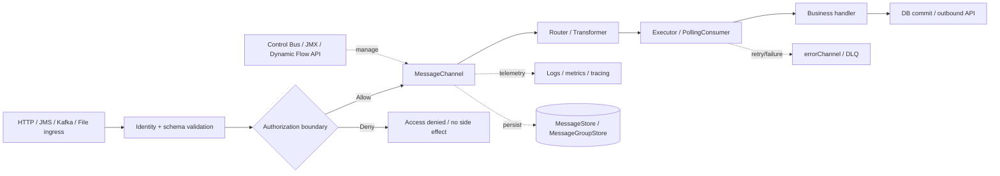
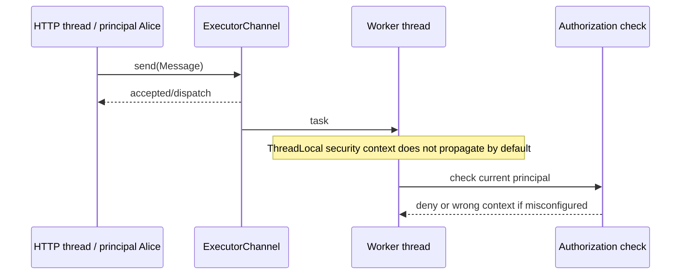
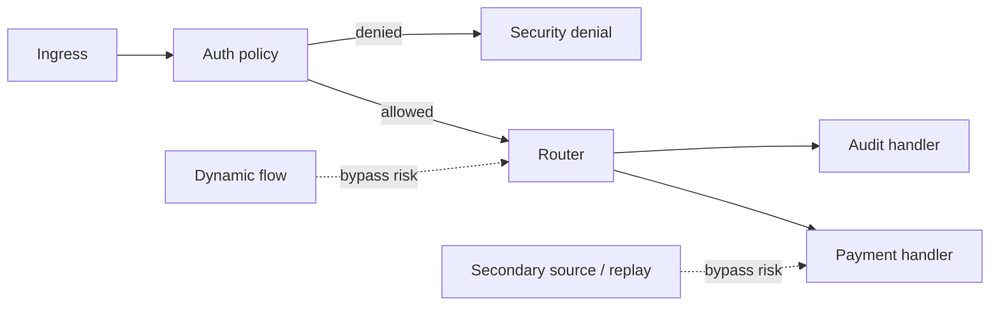
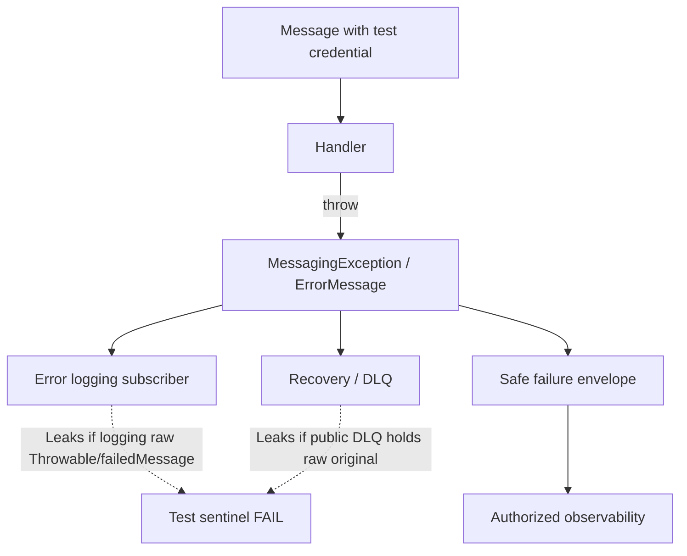

# Testing Permissions and Sensitive Data in Spring Integration Flows

## 1. Goal: A Denied Message Must Produce Zero Side Effects

In a **Spring Integration** system, messages travel across `MessageChannel`, gateways, transformers, routers, service activators, pollers, executors, and retry advice, and may be stored in a `MessageStore` or sent to `errorChannel`. Security testing cannot stop at checking that an HTTP endpoint returns `401` or `403`.

Consider a multi-tenant order system:

- User `alice` holds `ORDER_WRITE` permission on tenant A.
- User `bob` holds only read permission on tenant A.
- A message enters the flow carrying header `tenantId=B` and a payload requesting a refund.
- The handler may execute on another thread via `ExecutorChannel`, or hours later via `QueueChannel` and a poller.
- A failed message may undergo retries and then land in a dead-letter queue (DLQ).

A solid test suite must prove **three specific things**:

1. **Permissions:** is the sender/consumer genuinely authorized to perform the action at the exact boundary?
2. **Isolation:** unauthorized messages never reach side effects and cannot "sneak past" via secondary channels, spoofed headers, or replays.
3. **Data protection:** credentials, personal data, and sensitive payloads never leak into logs, traces, metric tags, error flows, DLQs, stores, or management interfaces.

The lesson **"Testing Permissions and Sensitive Data in Flows"** belongs to the **Runtime Security** chapter of the **SPRING_INTEGRATION_RUNTIME** module. Its scope covers the **runtime message flow**, especially across thread switches, poller execution, retries, transactions, persistence, correlation, and dynamic flow management.

> **Success criterion:** A "DENY" test PASSES only when access is rejected **and zero side effects occur**, no message is stored/forwarded to an unintended branch, and no sensitive data is emitted to telemetry.

## 2. Four Test Categories That Must Not Be Lumped Together

| Layer | Security question | Typical tests |
| --- | --- | --- |
| **Authentication** | Who sent the message? Is identity verified? | Anonymous, invalid/expired tokens, invalid service identities |
| **Authorization** | Does that identity hold permission for this action, on this resource/tenant, right now? | Roles, permissions, tenant isolation, record ownership |
| **Data confidentiality** | Is sensitive data kept inside its trust boundary? | Redaction, header mapping, DLQs, logs, traces, stores, backups |
| **Integrity and replay protection** | Can a message be tampered with, reprocessed, or routed to an overprivileged branch? | Header tampering, business keys, retries, restarts, idempotency |

**Successful authentication does not mean successful authorization.** A validly logged-in `ROLE_USER` account may still be forbidden from issuing refunds. A `ROLE_ADMIN` account in tenant A does not automatically have permission to read tenant B's data.

**Encrypted data does not mean safe logs.** A message may be encrypted on the broker while the application decrypts it and logs `Message.toString()`. Conversely, logs lacking tokens do not prove payloads stored in the DB are protected.

## 3. Threat Model of an `IntegrationFlow`



Every dotted line is **a separate point that must be tested**. An `AuthorizationChannelInterceptor` on `securedOrders` does not automatically protect:

- A service method invoked directly by another bean.
- An alternate channel not matching the protected pattern.
- A poller firing internally long after any HTTP request exists.
- A recovery consumer reading data from a DLQ.
- An endpoint dynamically registered via `IntegrationFlowContext` under a different name.
- An administrator sending commands over the Control Bus.

Defense in depth may require **ingress permission checks**, **service action/resource checks**, **critical channel protection**, and **dedicated controls for replay/management**.

## 4. Permission Matrix: Start from a Verifiable Policy

Before writing tests, lock down a policy matrix:

| Identity | Submit order tenant A | Refund tenant A | Submit order tenant B | Flow management |
| --- | --- | --- | --- | --- |
| Anonymous | Deny | Deny | Deny | Deny |
| Tenant A `VIEWER` | Deny | Deny | Deny | Deny |
| Tenant A `ORDER_WRITER` | Allow | Deny | Deny | Deny |
| Tenant A `REFUND_OPERATOR` | Per policy | Allow, within limits | Deny | Deny |
| `PLATFORM_OPERATOR` | Per specific permission | Not automatically permitted to refund | Per permission | Allow on approved flows |
| Job service account | Only granted machine-to-machine actions | Per granted workflow | Per tenant scope | Deny without explicit privilege |

Turn the matrix into test cases:

- **Positive cases**: sufficient role and matching tenant.
- **Negative cases**: anonymous, authenticated yet lacking role, right role yet wrong tenant, resource owned by another party.
- **Boundary cases**: permission revoked after enqueue; token expired by poll time; permissions changed between retries.
- **Bypass cases**: sending via alternate channels, direct bean invocations, DLQ replays, dynamic flows.
- **Side-effect checks**: zero DB rows or outbound calls when denied.

Never use a broad `ADMIN` role as the template for every test; testing "admin can do anything" verifies neither tenant isolation, least privilege, nor separation of duties.

## 5. Trust Boundary: Headers Are Not Proof of Identity

A message may arrive carrying:

```text
headers:
  tenantId: tenant-B
  requestedRole: PLATFORM_ADMIN
  userId: alice
  Authorization: Bearer <UNTRUSTED_INPUT>
payload:
  operation: REFUND
  orderId: ORDER-42
```

**These values are producer-supplied data**, proving neither that the sender is Alice nor that they hold admin privileges. An HTTP gateway or broker adapter may pass through client-controlled headers verbatim. If a handler reads `headers["requestedRole"]` to grant privileges, an attacker only needs to edit the message.

Rules:

1. **Identity** comes from a verified security boundary (Spring Security HTTP/JWT, mTLS/service auth, broker auth + trusted mapping).
2. **Tenant scope** is verified from signed claims or internal authorization sources; a client-supplied `tenantId` is merely a requested target.
3. **Authorization** checks principal, action, and resource in a service with data access.
4. **Business metadata** can travel inside messages; never treat it as authority by naming headers `role` or `authenticated`.
5. **Async/durable paths** need their own identity model: never assume an HTTP `SecurityContext` lives forever across restarts.

### Two Mandatory Tests

- Send a `PLATFORM_ADMIN` role header under a `VIEWER` principal → still denied.
- Send valid `ROLE_ORDER_WRITER` while changing `tenantId` from A to B → still denied.

A test checking only `headers["role"] == "ADMIN"` is an anti-pattern: it proves **you trusted an attacker-controlled header**, not that the flow is secure.

## 6. Security APIs by Spring Integration Version

**Important change:** starting in Spring Integration **6.3**, the `spring-integration-security` module was removed; current documentation recommends using **`spring-security-messaging`** APIs.

| Version | Approach | Test-writing notes |
| --- | --- | --- |
| Legacy pre-6.3 | Legacy Spring Integration security APIs and XML namespaces | Do not copy old `ChannelSecurityInterceptor` examples into new projects |
| Spring Integration 6.3+ | `AuthorizationChannelInterceptor` from `spring-security-messaging` | Verify compatible Spring Security dependencies and confirm interceptor attachment to target channels |
| Modern versions | `SecurityContextPropagationChannelInterceptor` from `spring-security-messaging` | Verify thread-switching semantics and cleanup |
| Modern method security | `@EnableMethodSecurity` + `@PreAuthorize` | Verify calls go through Spring AOP proxies rather than bypassing via self-invocation |

A typical test dependency set includes:

```text
spring-integration-core
spring-security-messaging
spring-security-config / spring-security-core (per configuration)
spring-security-test (test scope)
spring-integration-jdbc (if testing persistent queues/groups)
spring-boot-starter-test or JUnit 5 + Spring Test
```

**Do not pin a fixed version in examples** without knowing the application's Spring Boot/BOM. When migrating from 6.2 or earlier, check actual security APIs and behavior for your version instead of assuming classes/packages stayed identical.

## 7. Example: `AuthorizationChannelInterceptor` for a Secured Channel

Per current Spring Integration docs, an `AuthorizationChannelInterceptor` can be registered as a global channel interceptor for channels matching a pattern. This example uses `ROLE_ORDER_WRITER`.

```java
import org.springframework.context.annotation.Bean;
import org.springframework.context.annotation.Configuration;
import org.springframework.integration.config.EnableIntegration;
import org.springframework.integration.config.GlobalChannelInterceptor;
import org.springframework.integration.channel.DirectChannel;
import org.springframework.messaging.MessageChannel;
import org.springframework.security.authorization.AuthorityAuthorizationManager;
import org.springframework.security.messaging.access.intercept.AuthorizationChannelInterceptor;

@Configuration
@EnableIntegration
public class ChannelSecurityConfiguration {

    @Bean("securedOrders")
    public MessageChannel securedOrders() {
        return new DirectChannel();
    }

    @Bean
    @GlobalChannelInterceptor(patterns = "securedOrders")
    public AuthorizationChannelInterceptor orderAuthorization() {
        return new AuthorizationChannelInterceptor(
                AuthorityAuthorizationManager.hasRole("ORDER_WRITER"));
    }
}
```

Prerequisites: Spring Integration manages the channel and interceptor bean; the project uses **6.3+**-compatible APIs. `hasRole("ORDER_WRITER")` checks the `ROLE_ORDER_WRITER` authority; do not double-prefix `ROLE_`.

**Important:**

- `@GlobalChannelInterceptor(patterns=...)` applies only to **channels whose names match the pattern**. Channels in dynamic flows must be checked by their real bean names.
- A channel named `ordersIn` or `securedOrdersV2` may **not** be protected by the pattern `securedOrders`.
- Channel interceptors are **one** checkpoint. They do not replace business resource/tenant or outbound API permissions.
- For channels read by pollers/workers, design permission policies **on the receiving thread as well**; without a principal, the consumer may be denied or someone may propose turning off checks, creating a vulnerability.

### Avoiding the "Fix by Disabling Security" Trap

If messages in a `QueueChannel` fail to poll after enabling an interceptor, distinguish **identity propagation bugs** from **genuine permission denials**. Never "fix" it by changing patterns to `permitAll`. Identify trusted producers, source authorization, and durable job models as covered in later sections.

## 8. JUnit 5 Test: Allow and Deny Directly on `DirectChannel`

The example below is a **minimal integration test** for `@GlobalChannelInterceptor`. It needs no HTTP server; the test boundary is `MessageChannel.send()`.

```java
import static org.junit.jupiter.api.Assertions.*;

import java.util.List;
import java.util.concurrent.CopyOnWriteArrayList;

import org.junit.jupiter.api.BeforeEach;
import org.junit.jupiter.api.Test;
import org.springframework.beans.factory.annotation.Autowired;
import org.springframework.beans.factory.annotation.Qualifier;
import org.springframework.context.annotation.Bean;
import org.springframework.context.annotation.Configuration;
import org.springframework.integration.channel.DirectChannel;
import org.springframework.integration.config.EnableIntegration;
import org.springframework.integration.config.GlobalChannelInterceptor;
import org.springframework.integration.dsl.IntegrationFlow;
import org.springframework.messaging.MessageChannel;
import org.springframework.messaging.support.MessageBuilder;
import org.springframework.security.access.AccessDeniedException;
import org.springframework.security.authorization.AuthorityAuthorizationManager;
import org.springframework.security.messaging.access.intercept.AuthorizationChannelInterceptor;
import org.springframework.security.test.context.support.WithMockUser;
import org.springframework.test.context.junit.jupiter.SpringJUnitConfig;

@SpringJUnitConfig(classes = ChannelPermissionTest.Config.class)
class ChannelPermissionTest {

    @Autowired
    @Qualifier("securedOrders")
    MessageChannel channel;

    @Autowired
    Recorder recorder;

    @BeforeEach
    void reset() {
        recorder.values.clear();
    }

    @Test
    @WithMockUser(roles = "ORDER_WRITER")
    void writerCanSend() {
        assertTrue(channel.send(
                MessageBuilder.withPayload("ORDER-42").build()));
        assertEquals(List.of("ORDER-42"), recorder.values);
    }

    @Test
    @WithMockUser(roles = "VIEWER")
    void viewerCannotSendOrExecuteHandler() {
        assertThrows(AccessDeniedException.class, () ->
                channel.send(
                        MessageBuilder.withPayload("ORDER-42").build()));
        assertTrue(recorder.values.isEmpty());
    }

    static class Recorder {
        final List<String> values = new CopyOnWriteArrayList<>();
        void record(String value) { values.add(value); }
    }

    @Configuration
    @EnableIntegration
    static class Config {
        @Bean("securedOrders")
        MessageChannel input() {
            return new DirectChannel();
        }

        @Bean
        @GlobalChannelInterceptor(patterns = "securedOrders")
        AuthorizationChannelInterceptor authz() {
            return new AuthorizationChannelInterceptor(
                    AuthorityAuthorizationManager.hasRole("ORDER_WRITER"));
        }

        @Bean
        Recorder recorder() {
            return new Recorder();
        }

        @Bean
        IntegrationFlow securedFlow(Recorder recorder) {
            return IntegrationFlow.from("securedOrders")
                    .handle(message -> recorder.record(
                            (String) message.getPayload()))
                    .get();
        }
    }
}
```

Prerequisites to run: add `spring-security-messaging`, `spring-security-test`, Spring Test/JUnit 5, and compatible Spring Integration. `@WithMockUser` populates a mock `SecurityContext` **on the test execution thread**; `DirectChannel` dispatches synchronously so the test can assert results immediately.

### Stronger Assertions

In real tests, do not assert only `recorder.values.isEmpty()`. When handlers touch DBs or remote APIs, use spies/mocks or DB assertions to prove:

- Zero DB writes.
- Zero outbound calls.
- Zero outbox records or published events.
- No denied message leaked to fallback/business error channels.

Some configurations may throw a different authentication exception when **no principal exists at all**. For anonymous tests, check the expected status/exception of your **real boundary**, always preserving the invariant **deny and zero side effects**.

## 9. Testing Method/Service Permissions: Blocking Channel Bypasses

Channel interceptors are insufficient if other code can call `OrderService` directly.

Example:

```java
import org.springframework.security.access.prepost.PreAuthorize;
import org.springframework.stereotype.Service;

@Service
public class OrderActionService {

    private final TenantPolicy tenantPolicy;
    private final OrderRepository repository;

    public OrderActionService(
            TenantPolicy tenantPolicy,
            OrderRepository repository) {
        this.tenantPolicy = tenantPolicy;
        this.repository = repository;
    }

    @PreAuthorize(
        "hasAuthority('ORDER_WRITE') and " +
        "@tenantPolicy.canWrite(authentication, #command.tenantId())")
    public void submit(OrderCommand command) {
        repository.saveCommand(command);
    }
}
```

`TenantPolicy`, `OrderRepository`, and `OrderCommand` are application-defined types. The expression `@tenantPolicy.canWrite(...)` assumes a `tenantPolicy` bean checking permissions against a trusted source. `@PreAuthorize` requires `@EnableMethodSecurity` and invocation **through the Spring proxy**. If code calls `this.submit(...)` within the same bean, the method-security proxy is bypassed.

For SpEL parameter name `#command`, ensure parameter-name discovery is enabled (typically compiler `-parameters`) or explicit Spring Security metadata is present. Never assume an expression that looks right is actually intercepted: **test both flow-driven calls and direct service calls via the injected bean**.

### Tenant Isolation Test Matrix

```text
Principal A, ORDER_WRITE, command.tenantId=A  => ALLOW
Principal A, ORDER_WRITE, command.tenantId=B  => DENY
Principal A, VIEWER,      command.tenantId=A  => DENY
Anonymous,               command.tenantId=A  => DENY
Principal B, ORDER_WRITE, resource.tenant=A   => DENY
```

When acting on an existing record, load `resource.tenantId` from the DB and compare against permissions rather than trusting `tenantId` in the payload alone. If an attacker changes the request's tenant while keeping `orderId` pointing at another tenant's record, checking payload tenant alone misses an **IDOR/BOLA** vulnerability.

## 10. Async: `DirectChannel` Keeps the Thread, `ExecutorChannel` Does Not

By default `SecurityContextHolder` uses `ThreadLocal`. With synchronous `DirectChannel`, handlers normally run on the authenticated thread. With `ExecutorChannel`, `QueueChannel` + poller, `PublishSubscribeChannel` with an executor, or async gateways, consumers can run on **a different thread**.



There are two separate test objectives:

1. **Propagation correctness:** when a flow legitimately needs user privileges across threads, the right principal is established on the worker.
2. **Context isolation:** after a message finishes or throws, the worker **never retains the previous user's security context** and leaks it to the next message.

Per Spring Integration 6.3+ docs, `SecurityContextPropagationChannelInterceptor` comes from `org.springframework.security.messaging.context`. It propagates context across message-channel handoffs and uses lifecycle callbacks to clean up.

### Selective Propagation Configuration

```java
import org.springframework.context.annotation.Bean;
import org.springframework.integration.config.GlobalChannelInterceptor;
import org.springframework.security.messaging.context.SecurityContextPropagationChannelInterceptor;

@Bean
@GlobalChannelInterceptor(patterns = "userAsync*")
SecurityContextPropagationChannelInterceptor userContextPropagation() {
    return new SecurityContextPropagationChannelInterceptor();
}
```

This applies only when channels matching the pattern **genuinely require execution under the user's identity**. When multiple interceptors modify/clone messages, verify ordering: the propagation interceptor may wrap messages carrying context, so another interceptor rebuilding messages at the wrong point can drop context. Never assume `@GlobalChannelInterceptor` ordering based solely on bean names.

### Testing Two Principals on One Worker

A test far more valuable than "principal is not null":

1. Set executor pool size = 1 to force reuse of the **exact same worker thread**.
2. Send message M1 under Alice; the handler records `principalName=alice` in a **test recorder**, never logging secrets.
3. Send message M2 under Bob; the handler must observe `bob`.
4. Have M2 throw an exception; await error handling completion.
5. Send M3 with no identity if policy expects anonymous → must be denied, seeing neither Alice nor Bob.
6. Inspect `SecurityContextHolder` on the worker post-cleanup: no leftover principal.

Use `CountDownLatch` or `CompletableFuture` with timeouts to await handlers; **never assert outcomes immediately after `send()` on an `ExecutorChannel`**, since the producer can return before the worker executes.

### Async Gateways Have Their Own Path

For `@MessagingGateway(asyncExecutor=...)`, Spring Security offers `DelegatingSecurityContextAsyncTaskExecutor` to wrap the executor and propagate context for async invocations. Test both gateways and real channels rather than assuming a single interceptor covers every thread boundary in the flow.

## 11. Durable `QueueChannel`/Pollers: Should Principals Be Serialized?

A message may sit in `JdbcChannelMessageStore` for hours or survive restarts. Putting an HTTP request's `Authentication`/`SecurityContext` into persistent headers is **a sensitive design choice**:

- Principals/credentials may contain secrets or personal data.
- Roles may be revoked while the message waits.
- Objects may not serialize/deserialize safely or may break across versions.
- Messages may replay in another process long after the original request ended.
- Trusting an `authentication=...` header attached by an untrusted producer enables privilege escalation.

### Better Design Pattern for Long-Lived Jobs

Store minimal **job intent** and verified references:

```json
{
  "commandId": "CMD-42",
  "operation": "SUBMIT_ORDER",
  "tenantRef": "tenant-A",
  "actorRef": "internal-user-123",
  "requestAuthorizationVersion": 7,
  "schemaVersion": 1
}
```

A trusted ingress checks permissions before committing the command and records necessary actor references/audits. After a restart, the poller runs under a scoped **service identity**, revalidating **operation/resource/tenant policy** per published business rules.

Two valid policies exist depending on the business domain; **choose explicitly and test**:

- **Authorization-at-submission:** if allowed at enqueue time, the job proceeds per the committed decision even if user roles later change. Requires auditing version/expiry/scope and revocation rules.
- **Authorization-at-execution:** the poller must verify the user/tenant still holds permission when execution actually runs; if revoked, deny/quarantine or follow an appropriate exception workflow.

Never mix both policies arbitrarily. Refunds/payouts usually require checks at side-effect time; a legitimately accepted report might proceed after the request ends depending on compliance requirements.

## 12. Replay, Retry, and TOCTOU: When Are Permissions Checked?

**Time-of-check to time-of-use (TOCTOU):** permissions are checked at T1 while side effects happen at T2.

```text
T1: Alice is allowed to create a payout
T2: command is enqueued into persistent queue
T3: Alice's payout permission is revoked
T4: poller picks up command after restart
T5: outbound payment API is invoked
```

Security tests must define expected outcomes after T3, not just test the initial request. For example:

- Under `authorization-at-execution`, T5 is blocked and a safe security decision is recorded.
- Under `authorization-at-submission`, the job may continue if command contents were unaltered and remain within granted policy; requires auditing and tamper protection.
- If the command was altered from `amount=100` to `amount=100000` while queued, the T1 decision **no longer applies unchanged**.

### Preventing Replays from Causing Duplicate Side Effects

- Keep `commandId`/`idempotencyKey` stable across retries, redeliveries, and DLQ replays.
- Enforce DB unique constraints/business state and target-system idempotency.
- Require dedicated admin privileges for replays rather than reusing expired HTTP tokens.
- Replay flows must re-run validation/authorization at the appropriate boundary.
- Never treat a new `MessageHeaders.ID` as a new business command when `commandId` is unchanged.
- Exceptions and rollbacks must preserve work per policy without turning `AccessDeniedException` into an "infinite retry loop".

**Security denials are rarely transient errors.** Never retry a denied message every 100 ms until attempts exhaust like a network timeout; classify as terminal/quarantine and alert appropriately.

## 13. No Path May Bypass Authorization

A flow can have multiple paths:



Bypass paths to test:

- Sending messages to a downstream channel **outside the pattern** of the authorization interceptor.
- Registering a dynamic flow via `IntegrationFlowContext` that feeds directly into a handler.
- A test/admin invoking a service method without traversing the AOP proxy.
- An error/recovery handler re-invoking business logic with improperly elevated privileges.
- A poller/source adapter reading files or brokers without verifying source and resource scope.
- An internal gateway using a "trusted" route that actually accepts messages from unverified tenants.

### Channel Security Does Not Define Business Authority

Just because an actor can **send to `securedOrders`** does not mean they can **modify every order**. Services must verify ownership/tenant/resource. With multiple entry paths, policies must sit at an **unbypassable business checkpoint** in addition to edge interceptors.

In tests, try **calling the injected service bean directly** under the wrong role. If it succeeds even though the flow test denies, protection lives only on the channel and is insufficient.

## 14. Header and Payload Tampering: Test Beyond Fake Roles

Build tampered test messages to uncover validation/authorization flaws:

| Tampered data | Risk | Assertion |
| --- | --- | --- |
| `tenantId` header differs from principal's tenant | Cross-tenant access | Deny; zero side effects |
| Client-sent `role=ADMIN` header | Privilege escalation | Ignore client value; deny |
| Non-existent `actorRef` | Unauthorized internal identity | Reject/quarantine |
| `orderId` points to tenant B, `tenantId=A` | IDOR/BOLA | Compare against DB record's tenant |
| `correlationId` collides with another tenant's batch | Mixing message groups | Never merge cross-tenant fragments |
| Client-supplied `replyChannel` or routing key | Diverting data to unauthorized channels | Route only via internal allowlists |
| Payload swaps operation from READ to REFUND | Policy mismatch | Authorize against actual operation |
| Forged/unsupported `schemaVersion` | Deserialization/validation bypass | Reject safely without execution |
| Extra fields such as `isAdmin=true` | Mass assignment | DTO schema allowlist; unauthorized fields ignored/rejected |
| Modified body on signed webhook | Integrity failure | Verify signature over canonical raw bytes per protocol |

Do not check only for thrown exceptions. A Spring Integration `filter` can **discard messages** and return normally; if that is your deny policy, tests must also verify discard/recovery handling and confirm zero business output.

## 15. Sensitive Data in Payloads, Headers, and `SecurityContext`

Classify data to test:

| Data | Examples | Common leak paths |
| --- | --- | --- |
| Credentials | Bearer tokens, API keys, passwords, private keys | `MessageHeaders`, outbound headers, DEBUG/`log-full-message` |
| Sessions | Cookies, refresh tokens, CSRF tokens | Header mappers, exceptions, DLQs |
| Personal data | Emails, phone numbers, addresses, identifiers | JSON payloads, structured logs, trace attributes |
| Financial | Payment tokens, account details | `MessageStore`, retry snapshots, audits |
| Tenant/authz metadata | Owner IDs, roles, tenant scopes | Routing, dynamic flow IDs, metric labels |
| Infrastructure details | Internal URLs, JDBC DSNs, file paths | Exception messages, management graphs |
| Business commands | Order/refund events | Persistent queues, replay stores, correlation groups |

There is no rule that "all headers are safe to log". `Authorization`, `Cookie`, and custom tokens generally must be excluded from telemetry, whereas a curated `safeCorrelationRef` header can correlate events.

### Safe Path for a Message

```text
Inbound verified identity
    ├── auth decision → controlled audit
    └── minimal business command
          ├── business processing (protected)
          ├── safe summary logs
          ├── low-cardinality metrics
          ├── traces with attribute allowlist
          └── durable store/DLQ with ACLs + encryption + retention
```

**Redaction and authorization serve two distinct goals.** A handler allowed to read a secret to call an API must never write that secret to logs. An operator allowed to view dashboards is not necessarily permitted to replay protected originals from a DLQ.

## 16. Sentinel Testing Plan to Detect Data Leakage

Use **synthetic test-only secrets** with distinctive strings easy to search in logs/exporters:

```text
TEST_BEARER_TOKEN_X7A29
TEST_API_KEY_Q6P13
TEST_PRIVATE_DATA_M2K84
test.user@example.invalid
```

Place these values in multiple locations:

1. `Authorization` header (with mixed casing).
2. Custom header `X-Partner-Secret` and nested `Map`.
3. JSON payload fields `accessToken`, `email`, `paymentToken`.
4. Exception messages simulating URLs with query tokens.
5. `MessagingException.failedMessage` and `ErrorMessage`.
6. Dead-letter records and replay envelopes.
7. Messages persisted in queue/group stores.
8. Micrometer tags, tracing attributes, baggage, and MDC.
9. Management responses containing component metadata.

**PASS if** sinks **unauthorized to receive originals** contain zero sentinels. For protected replay stores holding originals, tests do **not** require deleting business commands; instead, verify encryption, ACLs, and zero raw exposure in dashboards/logs.

### Never Test with Real Credentials

Never place production tokens/passwords into unit tests, fixtures, commits, screenshots, test reports, or CI artifacts. To test credential rotation, use a short-lived test-vault secret with dedicated auditing.

## 17. Java: Emit Only Safe Summaries to Logs

An **allowlist-based** summary function avoids accidentally calling `message.toString()` or iterating all headers:

```java
import java.util.LinkedHashMap;
import java.util.Map;
import org.springframework.messaging.Message;

public final class SafeFlowSummary {

    private SafeFlowSummary() {}

    public static Map<String, Object> of(
            String flowId,
            String endpointId,
            Message<?> message) {

        Map<String, Object> safe = new LinkedHashMap<>();
        safe.put("event", "integration.message.observed");

        // flowId/endpointId come from a controlled registry,
        // never from raw client-supplied input.
        safe.put("flow", flowId);
        safe.put("endpoint", endpointId);
        safe.put("messageId", String.valueOf(
                message.getHeaders().getId()));

        // Never call message.toString(), payload.toString(),
        // or message.getHeaders().entrySet().
        return Map.copyOf(safe);
    }
}
```

Usage:

```java
import org.springframework.integration.handler.LoggingHandler;
import org.springframework.integration.dsl.IntegrationFlow;

IntegrationFlow flow = f -> f
        .log(LoggingHandler.Level.DEBUG,
                "app.orders.safe",
                message -> SafeFlowSummary
                        .of("orders", "orderWorker", message).toString())
        .handle(orderService, "process");
```

This is **illustrative DSL**, assuming `orderService` exists. `.log(...)` protects only **that log branch**; it does not sanitize the message itself or other loggers. Avoid printing full `Throwable`s/stack traces to public sinks when exception chains may contain payloads, URLs, or headers.

### Sentinel Unit Test for Summaries

```java
import static org.junit.jupiter.api.Assertions.*;
import java.util.Map;
import org.junit.jupiter.api.Test;
import org.springframework.messaging.Message;
import org.springframework.messaging.support.MessageBuilder;

class SafeFlowSummaryTest {

    @Test
    void noSecretInSummary() {
        String sentinel = "TEST_BEARER_TOKEN_X7A29";

        Message<?> source = MessageBuilder
                .withPayload(Map.of(
                        "accessToken", sentinel,
                        "orderId", "ORDER-42"))
                .setHeader("Authorization", "Bearer " + sentinel)
                .setHeader("X-Partner-Secret", sentinel)
                .build();

        String text = SafeFlowSummary
                .of("orders", "orderWorker", source)
                .toString();

        assertFalse(text.contains(sentinel));
        assertFalse(text.contains("Authorization"));
        assertFalse(text.contains("accessToken"));
        assertTrue(text.contains("orderWorker"));
    }
}
```

This is a helper test; it **does not prove the entire logging pipeline is safe**. Add appender/log-exporter assertions in integration tests to catch exception handlers, `WireTap`, HTTP clients, or other adapters still logging raw data.

## 18. `ErrorMessage` and Retries: Failure Paths Are Riskier Than Happy Paths

When a handler throws, the framework can emit an `ErrorMessage` whose payload is the `Throwable`. If it is a `MessagingException`, `getFailedMessage()` may retain the **original message** with credentials/PII.



### Tests Must Cover Error Paths

- Handler throws **before** producing a business result.
- Retries 2–3 attempts, including `RecoveryCallback`.
- Recovery sink fails and rethrows; ensure source is not falsely acked.
- Exceptions thrown by converters/deserializers **before** the handler method runs.
- Poller tasks or `ExecutorChannel` throwing on a background thread.
- Reactive publishers emitting `onError` without routing to Spring Integration's global `errorChannel`.
- DLQ consumers/"Replay" APIs printing original commands to logs.

**Do not equate "error logs have no secrets" with "errors need no handling".** Safe error records can hold `errorCategory`, `flowId`, `attempt`, `failureId`, `safeCorrelationRef`, and recovery status, while replay data lives in a separate protected store.

### Testing Expected Outcomes on Authorization Denial

`AccessDeniedException` is typically **terminal by policy**, not retried indefinitely. If a poller transaction keeps rolling denied messages back to the head of the queue forever, the whole flow stalls. Test isolation policies:

1. Access denied is classified separately from timeouts/connection errors.
2. Zero side effects occur.
3. Messages go to a **protected quarantine/rejection record** if business investigation is needed.
4. Source ack/dequeue runs only under defined conditions after the durable sink commits properly.
5. No credentials or full failed messages are logged.

## 19. DLQs and `MessageStore`s: Testing Both Confidentiality and Recovery

From a runtime standpoint, queues/stores can hold authenticated messages that are **not yet finished**, including:

- `JdbcChannelMessageStore` for `QueueChannel`.
- `JdbcMessageStore`/`MessageGroupStore` for aggregators/resequencers.
- `JdbcMetadataStore` or Redis metadata holding checkpoints/idempotency keys.
- Broker DLQs, retry topics, outboxes, and object storage for replay.

These are **not logging backends**; sometimes they must retain original content for recovery. Tailor tests to the contract:

| Consumer | Permitted | Must be blocked |
| --- | --- | --- |
| Ops dashboard | Failure ID, category, timestamps, attempt count | Full payloads/tokens, private headers |
| Retry worker | Minimal protected command and business key | Dispatching over unauthenticated channels or crossing tenants |
| Authorized replay API | Retrieving original per RBAC/audit | Arbitrary replays or reusing stale user credentials |
| Restricted DB admin | Controlled maintenance | Exporting raw records to public environments |
| Shared monitoring service | Metrics and safe summaries | Secrets/PII in tags, spans, log bodies |
| Tenant A user | Only tenant A outcomes/records within scope | Reading tenant B's DLQ/metadata/groups |

### Testing Crashes and Restarts

1. Enqueue an authorized command into a persistent store.
2. Stop the poller and restart the application against the same datasource/schema/region.
3. Re-register flows/endpoints and authorize under the service-identity model.
4. Verify the command executes only if current policy permits.
5. If a partial external side effect committed before rollback, verify idempotency.
6. Query test dashboards/logs/DLQs to verify zero sentinels in unauthorized sinks.

**Do not require raw SQL queries to display decrypted originals as "proof of redaction".** An encrypted persistent store may store ciphertext that still supports authorized replay when decrypted through controlled paths.

## 20. Multi-Tenant Correlation and Group State

Messages can be grouped in `MessageGroupStore` by `correlationId`. If tenants A and B both use `correlationId=order-42`, or clients supply IDs directly, a weakly configured aggregator can **mix fragments across tenants**.

```text
Tenant A → correlationId=IMPORT-7 → [part 1]
Tenant B → correlationId=IMPORT-7 → [part 2]
                      |
               Insecure group key
                      |
             Output mixes A+B data
```

Solutions:

- Internal correlation keys combine **trusted tenant identity + business group ID + run/version**.
- Never trust client-supplied raw `correlationId` to isolate tenants.
- Test two tenants sending identical IDs concurrently and verify zero cross-tenant grouping/release.
- For shared multi-instance `MessageGroupStore`, test concurrency locks and store access controls.
- Completion markers and late arrivals must never emit output to another tenant.
- Group timeouts/expiry/reapers must log and write **sanitized** failure records without dumping all fragments.

**Security does not stop at ingress authorization.** A correlation/group-state bug can leak data across tenants even when every user logged in legitimately.

## 21. Dynamic `IntegrationFlow` and Control Bus: Test Management Permissions Separately

Spring Integration supports `IntegrationFlowContext` to register/stop/remove flows at runtime and Control Bus for managed operations. This is the **control plane**, wielding power over many message flows.

Regular users must never be permitted to:

- Call `registration.stop()` on another tenant's flow.
- Register flows forwarding messages to arbitrary external URLs.
- Reconfigure `errorChannel`/`WireTap` to dump raw payloads onto unprotected channels.
- Enable DEBUG or change log levels to read secrets.
- Invoke `POST /control-bus/{beanName.methodName}` or JMX operations directly.
- Read `/actuator/env`, `/actuator/configprops`, or Integration Graphs containing sensitive metadata.

**Spring Integration 6.4+** uses Control Bus syntax `beanName.methodName` instead of older SpEL syntax. That is a command syntax, **not an RBAC mechanism**: management endpoints still require HTTP/JMX/network authorization.

### Testing Management APIs

| Actor | Action | Expected |
| --- | --- | --- |
| Anonymous | Stop flow | 401/403 per API contract; lifecycle unchanged |
| Tenant A admin | Stop flow B | Denied; B unaffected |
| Tenant A admin | Stop flow A | Allowed if policy permits, audited |
| Platform operator | Create outbound connector | Only when URL/secret reference is allowlisted |
| Read-only monitoring | GET graph/metrics | Safe metadata only |
| Read-only monitoring | POST control commands/loggers | Denied; zero mutations |

For dynamic flows, also test whether **global channel interceptors attach to newly registered channels**. User-supplied flow/bean names might miss security patterns; control IDs and namespaces to prevent bypasses.

## 22. HTTP Security Testing: `@WithMockUser` Differs from Real Requests

`@WithMockUser` works well for Spring method/channel tests running on the test thread. Yet in **tests sending real HTTP requests to an embedded server**, the JUnit thread's security context **does not cross over to the server thread**.

Test levels:

- **Unit/flow tests:** `@WithMockUser` + sending to `DirectChannel`/service beans.
- **MockMvc tests:** configured security filter chain and request post-processors or mock JWTs.
- **Full HTTP integration tests:** send valid/invalid credentials **inside HTTP requests** to an embedded server; assert statuses and downstream side effects.
- **Broker/JMS/Kafka tests:** send messages via real adapters or test brokers; verify identity mapping/tenant isolation and DLQs.
- **Async/poller tests:** use latches/await + test executors, never asserting right after `send`.

### Full Request Matrix

```text
POST /orders
  no Authorization            → 401 per security policy
  expired bearer              → 401
  valid VIEWER token          → 403
  valid ORDER_WRITER tenant A → accepted/processed (A)
  valid ORDER_WRITER tenant A + tenant B payload → 403
  valid user + malformed body → 400, no business side effect
```

Codes are **illustrative contract examples**: an async inbound gateway may return `202 Accepted` after durable handoff; ingress authorization must still execute **before** returning acceptance per policy. If the handler fails after `202`, that is an async outcome, not the same HTTP response.

## 23. Testing Structured Logs, Traces, and Metrics with Test Exporters

A test asserting "the sentinel string is absent from console" can miss other leaks:

- `WireTap` and `LoggingHandler` using different logger categories.
- `ErrorMessage` logged with full exceptions by another handler.
- Outbound HTTP client wire debug logs.
- Micrometer tags / Observation span attributes containing `tenantId`/email/tokens.
- MDC on pooled executors retaining the previous request's principal or business ID.
- Management graphs exposing client-injected bean/endpoint names.

**A strong testing approach** plugs in fake telemetry sinks:

1. Test SLF4J/Logback/Log4j appenders per framework.
2. In-memory `MeterRegistry` or test registry inspecting **tag keys/values**.
3. In-memory test span exporters/`ObservationHandler`.
4. Fake DLQ writers/failure repositories with inspectable records.
5. Test HTTP client/interceptors recording sanitized metadata without request bodies.
6. Inspect management API responses by role.

Check **all outputs** of unauthorized sinks, not just `SafeFlowSummary`. If sampling is enabled, run tests with telemetry forced active to prove **sampled spans still leak nothing**.

### Controlling Cardinality

Never put `email`, `authorization`, `accessToken`, `businessId`, `correlationId`, or raw URL queries into metric tags. Write a test emitting many distinct business IDs and verify **meter/tag combinations remain bounded to low-cardinality dimensions** rather than growing with message count.

## 24. Testing Negative Paths and `ThreadLocal` Cleanup

A security bug may appear only after an exception is thrown:

```text
Worker thread #1:
  Message Alice → handler throws
  context not cleared
  Message Bob / anonymous → handler inherits Alice
```

To catch this:

- Use a single-worker executor to force thread reuse.
- Send a succeeding message, a failing message, then an anonymous message.
- Verify the principal on every handler call and `SecurityContextHolder` after cleanup.
- Verify `MDC` is cleared in `finally`.
- When callbacks/reactive pipelines switch schedulers, test context propagation and restoration.
- Test cancellation/timeouts: cleanup must still run when pipelines cancel.
- Never use `SecurityContextHolder.MODE_INHERITABLETHREADLOCAL` as a blanket fix for long-lived thread pools; it can cause unintended retention or propagation of security contexts.

Do not treat a passing `DirectChannel` test as proof for `ExecutorChannel` or `QueueChannel`. Threading is **part of the security boundary**, not just a performance detail.

## 25. CI-Ready Test Matrix

| ID | Scenario | Expected result |
| --- | --- | --- |
| AUTH-01 | Anonymous sends to secured channel | Denied; handler not invoked |
| AUTH-02 | Authorized role, right tenant | Allowed with expected business outcome |
| AUTH-03 | Insufficient role | Denied; zero DB/API side effects |
| AUTH-04 | Right role, another tenant's resource | Denied; zero side effects |
| AUTH-05 | Spoofed role/tenant headers | Does not override trusted identity |
| AUTH-06 | Direct service call bypassing channel | Still enforced by method/business policy |
| ASYNC-01 | Executor worker receives right principal | No security context loss |
| ASYNC-02 | Two principals share pooled worker | Zero identity leak |
| ASYNC-03 | Handler throws, next task anonymous | Does not inherit stale context |
| QUEUE-01 | Durable queue and restart | Policy revalidation per contract |
| QUEUE-02 | Role revoked while pending | Outcome matches submission/execution policy |
| QUEUE-03 | DLQ replay without old token | Reauthorized and idempotent |
| GROUP-01 | Two tenants share correlation ID | No message group mixing |
| FLOW-01 | New dynamic flow | Proper interceptor and authorization coverage |
| FLOW-02 | Tenant admin touches another's flow | Denied; lifecycle unchanged |
| DATA-01 | Credentials in payload/headers | Absent from logs/traces/metrics |
| DATA-02 | Exception containing fake token | Absent from error logs/DLQ visible envelopes |
| DATA-03 | Protected original kept for replay | Proper ACLs/encryption/retention |
| DATA-04 | High-cardinality business IDs | Never become meter tags |
| DATA-05 | Outbound header mapper | Forwards only approved headers |
| RECOVERY-01 | Denied message enters retry path | Never retries infinitely |
| RECOVERY-02 | DLQ sink fails | Never falsely acks/commits |
| MGMT-01 | Monitoring user sends control command | Denied |
| MGMT-02 | Read-only management endpoint | Exposes no sensitive secrets/configs |

**Do not rely solely on mocked controller tests.** `ASYNC`, `QUEUE`, `GROUP`, and `RECOVERY` rows require real integration tests with schedulers, channels, advice, stores, or brokers.

## 26. Lab A — Role-Based Channel Protection

1. Create `DirectChannel securedOrders` and `@GlobalChannelInterceptor` as in Section 7.
2. Run the JUnit test from Section 8 with `ROLE_ORDER_WRITER` and `ROLE_VIEWER`.
3. Add an anonymous case; verify the policy-defined error while asserting zero side effects.
4. Create another channel outside the pattern and attempt a direct send.
5. Do not "fix" failures by setting channels to `permitAll`; lock down the exact boundaries to protect.
6. Record **allow, deny, auth failure, and side-effect counts**.

**PASS:** Only authorized principals can send to protected channels, and bypass paths are identified/protected.

## 27. Lab B — Tenant Isolation and IDOR/BOLA

1. Provision tenants A/B, orders per tenant, and users with matching roles.
2. Have `ORDER_WRITER` A operate on order A → allowed.
3. Have the same principal target order B even with `tenantId=A` in payload → denied based on the **DB record's tenant**.
4. Inject `requestedRole=ADMIN` header → permissions unchanged.
5. Call the service bean directly from tests; verify method/business policy still enforces.
6. Assert DB/outbound mocks show zero side effects on all denied tests.

**PASS:** No payload/header modification can bypass tenant policy.

## 28. Lab C — `ExecutorChannel` and Context Leakage

1. Build `DirectChannel → ExecutorChannel → secured handler`.
2. Configure `SecurityContextPropagationChannelInterceptor` or a compatible executor wrapper.
3. Use pool size 1 and `CountDownLatch`; send M1 as Alice and M2 as Bob.
4. Force M2 to throw, then send anonymous M3.
5. Inspect the principal on the worker and cleanup after each message.
6. Test without the interceptor to observe failure, then fix scope/ordering.

**PASS:** Context works when required and leaves zero residue on pooled workers, including error paths.

## 29. Lab D — Permissions Across Pollers, Restarts, and Revocation

1. Build a persistent `QueueChannel` using `JdbcChannelMessageStore` on a test database.
2. Enqueue an authenticated command **without serializing raw bearer tokens**.
3. Stop the poller; revoke the actor's role or disable the tenant.
4. Restart the application, re-register endpoints, and restore the source.
5. Verify the project's chosen `authorization-at-submission` or `authorization-at-execution` policy.
6. Verify unauthorized jobs are safely quarantined/denied without infinite retries or side effects.

**PASS:** Restarts never drop access control or "resurrect" stale principals/credentials.

## 30. Lab E — Secret Sentinels Across Success, Errors, DLQs, and Logs

1. Use the synthetic sentinels from Section 16.
2. Embed them in JSON payloads, nested headers, and exception messages.
3. Run happy paths, retryable failures, and terminal failures.
4. Capture test appenders, test spans, meter tags, DLQ visible records, and management responses.
5. Search verbatim for every sentinel; unauthorized sinks must score 0 hits.
6. For original commands kept for replay, verify roles/ACLs/encryption instead of requiring full deletion.

**PASS:** Telemetry stays clean while protected originals remain replayable through an authorized path.

## 31. Lab F — Multi-Tenant Correlation, Routing, and Replay

1. Send tenant A and tenant B fragments sharing the same client-provided `correlationId`.
2. Configure group keys using trusted tenant + run ID; verify no mixing.
3. Send invalid client `replyChannel`/routing headers; routing must obey allowlists.
4. Fail one fragment, retry and redeliver, verifying stable business idempotency keys.
5. Replay from the DLQ under an unauthorized actor → denied.
6. Replay under an authorized operator → scoped strictly to permitted tenant/resource, audited, and no double commits.

**PASS:** Zero cross-tenant output or unauthorized replays.

## 32. Lab G — Management and Dynamic Flows

1. Create a dynamic `IntegrationFlow` with a managed channel ID.
2. Verify interceptors attach to the new channel per pattern.
3. Register a flow with an inappropriate user-proposed name; policy must reject or normalize IDs to avoid bypasses.
4. Test a read-only monitoring role viewing graphs/metrics without stopping/starting flows.
5. Test tenant A admin attempting to stop/remove tenant B's flow → denied.
6. Verify error/management responses expose no secrets from connection configs.

**PASS:** The control plane enforces its own authorization and dynamic registration creates no unprotected channels.

## 33. Lab H — Failure Sinks and Transactions

1. Build a transactional poller over a persistent queue.
2. Have the handler hit `AccessDeniedException` and verify terminal/quarantine classification.
3. Intentionally fail quarantine/DLQ persistence; confirm the source does not falsely ack/commit against policy.
4. Have an external side effect succeed before rolling back the source; verify idempotency blocks duplicates on redelivery.
5. Confirm zero payloads/credentials in exception logs and failure envelopes.
6. After restart, verify business state, retry state, and audits match expectations.

**PASS:** Denied permissions neither trigger side effects nor silently drop work when recovery sinks fail.

## 34. Runbook When Permission Bugs or Data Leaks Are Found

### If an Unauthorized Message Was Processed

1. Identify `flowId`, channel, endpoint, principal, tenant/resource, timestamp, and side-effect type.
2. Contain ongoing abuse (disable routes, revoke credentials, or isolate ingress) per operational procedure.
3. Check whether interceptors matched the right channel/pattern, method security ran through proxies, and async workers handled context.
4. Reconcile business audits/DB/outbox/brokers to determine **what actually committed**.
5. If cross-tenant impact occurred, isolate affected tenants and notify per policy.
6. Add a negative test reproducing the bypass before fixing; verify zero side effects post-fix.
7. Check DLQs/replays/dynamic flows for the same bypass path.
8. Roll out and monitor deny rates, abnormal routes, and transaction outcomes; record an incident audit.

### If Tokens/PII Appear in Logs or Traces

1. Identify affected sinks, exposure duration, and who has read access.
2. Halt further emission (safe summaries, disable scoped DEBUG, fix header mappings).
3. Rotate/revoke tokens and preserve evidence per policy.
4. Inventory DLQs, JDBC stores, broker replicas, tracing backends, log backups, and management responses.
5. Never manually delete queue rows while pending business work remains; execute a safe migration/retention plan.
6. Run sentinel tests across all error/retry/restart paths.
7. Write a postmortem covering root cause, missing security tests, and change-control fixes.

**Note:** Permission or leak incidents are never solved merely by adding metrics or hiding fields in a UI. Block at real boundaries and remediate data already sitting in storage.

## 35. Pre-Production Checklist

- **Trusted identity:** never trust roles, tenants, or authentication written in raw message headers.
- **Channel authorization:** `AuthorizationChannelInterceptor` on the right channels; never rely on guessed name patterns for dynamic flows.
- **Business authorization:** roles, tenants, record ownership, operations, amount/limits, proxied method security.
- **Async correctness:** explicit security context/identity policies for `ExecutorChannel`, `QueueChannel`, pollers, and async gateways.
- **Context cleanup:** pooled threads retain no principal/MDC from prior messages; error/cancel paths tested.
- **Retry/replay:** explicit submission vs. execution policy, stable idempotency keys, and dedicated DLQ replay authorization.
- **Persistent state:** minimal command schemas, never persist raw bearer tokens; `MessageStore`/DLQs protected with ACLs, encryption, retention.
- **Tenant correlation:** group/sequence/routing keys built from trusted metadata to avoid cross-tenant mixing.
- **Sensitive data:** payloads/headers/`Throwable`/`MessageHistory` never emitted raw to logs, traces, metrics, or management endpoints.
- **Management:** Actuator, Control Bus, JMX, and `IntegrationFlowContext` enforce RBAC/allowlists/auditing.
- **Observability:** separate denied vs. auth failures vs. business failures; zero high-cardinality IDs/secrets in meter tags.
- **Tests:** allow/deny matrix, alternate paths, service bypasses, multi-threading, revocation, restarts, error/DLQ paths, sentinels, and multi-tenancy.
- **Runbooks:** containment, revoke/rotate, safe replay, auditing, and postmortems ready.

## 36. Conclusion

Security testing in Spring Integration must span the **entire lifecycle of a message**. Blocking an HTTP request does not prove broker messages or DLQ replays are blocked. An `AuthorizationChannelInterceptor` working on `DirectChannel` does not prove it works across `ExecutorChannel`, pollers, or restarts. A log sanitizer working on the happy path does not prove `ErrorMessage`, DLQs, and persistent stores are safe from unauthorized exposure.

A trustworthy test suite simultaneously verifies: **verified identity, role/tenant/resource authorization, zero bypass paths, no cross-thread context leaks, zero side effects on denial, zero credentials/PII in telemetry, and policy-compliant recovery/replay**. Combining tests across channels, services, adapters, transactions, persistence, correlation, and the management plane turns security into a **provable runtime property**, not merely an entry-point config.

## Reference Documentation

- [Spring Integration Reference — Security in Spring Integration](https://docs.spring.io/spring-integration/reference/security.html)
- [Spring Integration Reference — Configuring Message Channels and Global Interceptors](https://docs.spring.io/spring-integration/reference/channel/configuration.html)
- [Spring Security Reference — Method Security](https://docs.spring.io/spring-security/reference/servlet/authorization/method-security.html)
- [Spring Security Reference — Testing Method Security](https://docs.spring.io/spring-security/reference/servlet/test/method.html)
- [Spring Security Reference — Concurrency Support](https://docs.spring.io/spring-security/reference/servlet/integrations/concurrency.html)
- [Spring Security Reference — Authorization Architecture](https://docs.spring.io/spring-security/reference/servlet/authorization/architecture.html)
- [Spring Integration Reference — Error Handling](https://docs.spring.io/spring-integration/reference/error-handling.html)
- [Spring Integration Reference — Message Store](https://docs.spring.io/spring-integration/reference/message-store.html)
- [Spring Integration Reference — Dynamic Runtime Flows](https://docs.spring.io/spring-integration/reference/dsl/java-runtime-flows.html)
- [Spring Integration Reference — Metrics and Management](https://docs.spring.io/spring-integration/reference/metrics.html)
- [Spring Boot Reference — Actuator Endpoints](https://docs.spring.io/spring-boot/reference/actuator/endpoints.html)
- [OWASP Cheat Sheet — Authorization](https://cheatsheetseries.owasp.org/cheatsheets/Authorization_Cheat_Sheet.html)
- [OWASP Cheat Sheet — Logging](https://cheatsheetseries.owasp.org/cheatsheets/Logging_Cheat_Sheet.html)
