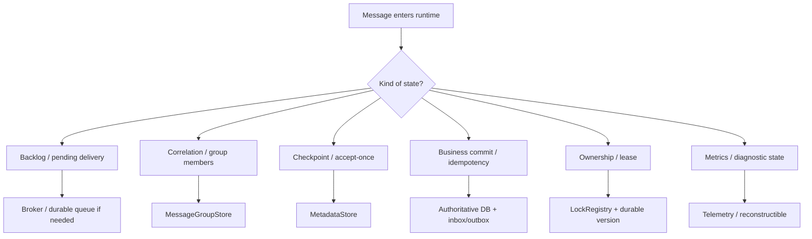
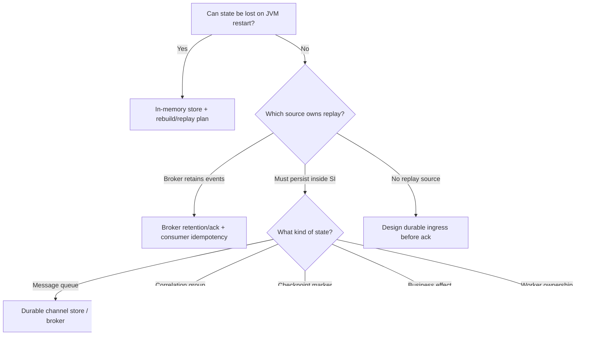
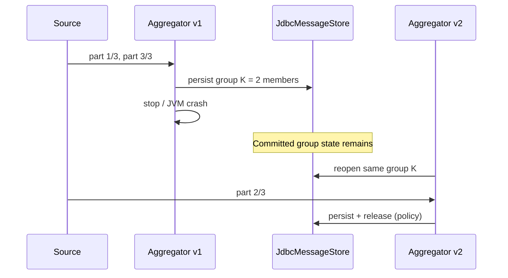
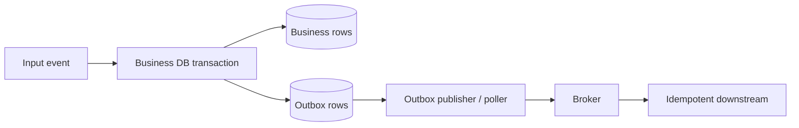
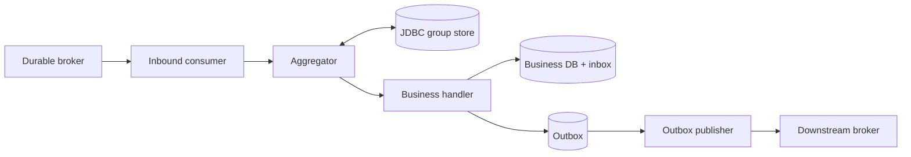
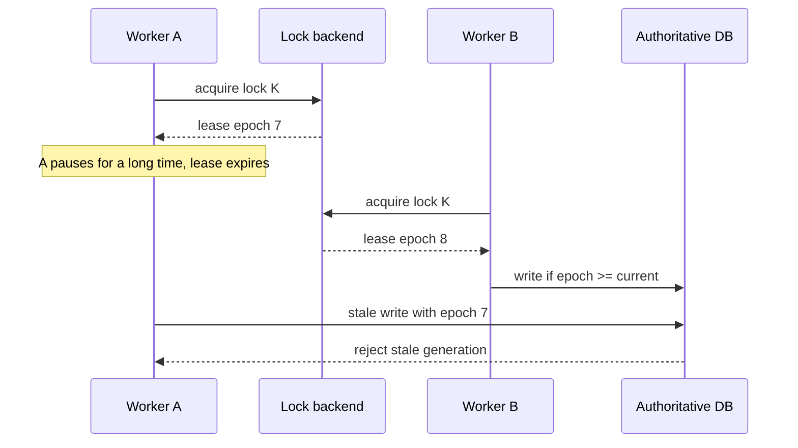
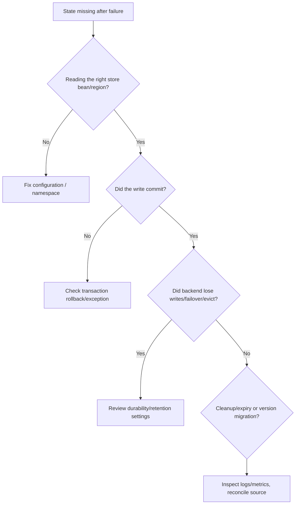

# Choosing a State Store by Failure Mode

In **Spring Integration runtime**, state is not limited to data stored in a database. A `QueueChannel` may hold messages awaiting a poller; an aggregator/resequencer stores parts belonging to the same correlation group; a file adapter needs to record already-received files; retries and redeliveries need to know whether a business event has already been processed; and a dynamic flow needs to preserve in-flight work state when replaced. Each kind of state has a different **lifetime, owner, transaction boundary, and recovery mechanism**.

Therefore, the design question should not be "should we use Redis or JDBC for speed?", but rather **"after each type of failure, what is allowed to be lost, what must be preserved, and which component is responsible for recovery?"**. Choosing a state store by failure mode avoids two extremes: keeping everything in RAM and losing data on restart, or pushing everything into a database without solving atomicity, duplicates, locking, and timeouts.

This lesson belongs to the **Runtime Design** chapter of the `SPRING_INTEGRATION_RUNTIME` module. Its content connects state store selection with channels, endpoints, consumers, pollers, executors, `IntegrationFlow` lifecycle, transactions, retries, correlation, error handling, performance, and runtime state observability.

> **Core Principle:** A state store only protects the data and operations that fall **within its consistency and durability contract**. A persistent store does not make the entire message flow exactly-once on its own; a lock does not replace a transaction; a cache does not replace a broker; and an `ACCEPTED` marker does not prove the work has been `COMMITTED`.

## 1. Start with Failure Modes, Not Technology

A **failure mode** is a way a system can fail or degrade: a process crash, node network loss, database rollback, broker redelivery, cancelled task, re-read file, an incomplete correlation group, or an old instance continuing to run after its lease expired.

Each mode raises its own question:

| Failure Mode | What Can Be Affected | Design Question |
| --- | --- | --- |
| JVM/pod crash | Heap, RAM queues, RAM group state, futures | Is there a durable source to replay from? |
| Host loses disk/volume | State on local storage | Is there replication/backup and a recovery plan? |
| Database outage | Store reads/writes, commits, dequeues | Does the flow block, reject, or accumulate backlog somewhere? |
| Transaction rollback | State newly written inside the transaction | Do the marker and business update roll back together? |
| Crash after commit before ack | Broker redelivers an already-processed message | Does an idempotency key prevent duplicate side effects? |
| Network partition | Nodes/clusters observe different state | Who has authority to process, and is data consistent? |
| Lease expiration | Old worker still executes after a new worker takes over | Is there fencing/conditional update? |
| Incomplete correlation group | Group never meets release condition | Is there TTL, partial policy, or recovery? |
| Duplicate/late arrival | Group or business state gets reprocessed | How long are completed markers/inbox records retained? |
| Schema/serializer upgrade | Old state fails to deserialize | Is there backward compatibility or migration? |
| Wrong cleanup/expiry | State deleted while still in use, or grows unboundedly | Is retention aligned with business obligations? |
| Overload/burst | Queues, DB, broker, and executors fill up | Are there bounded admission/backpressure and overflow policies? |

Read the table top-down before picking a technology; working backward easily yields a "persistent" solution with the wrong recovery semantics.

## 2. Classify State Before Choosing Where to Store It

A typical flow has multiple kinds of state, and **the same criterion should not be applied to all of them**.



| Kind of State | Example | Purpose | Impact If Lost |
| --- | --- | --- | --- |
| **Backlog** | Messages waiting for a consumer | Deliver work after the producer sends | Events may be lost if the source already acked |
| **Correlation state** | Parts 1/3, 3/3 of `batch-42` | Hold messages until release | Group never completes; must replay or migrate |
| **Checkpoint/metadata** | Seen files, scan offsets, accept-once markers | Reduce re-reads, track progress | Incorrect replay/skip depending on design |
| **Business inbox** | Event `E-42` committed | Prevent duplicate business effects | Payments/orders executed twice |
| **Outbox** | Events to publish after DB commit | Recover publishing across crashes | Business DB changed but downstream unaware |
| **Ownership/lease** | Worker A owns partition `P-7` | Avoid multiple workers processing simultaneously | Contention or stale writers |
| **Diagnostic** | Counters, histograms, log sampling | Observe runtime state | Reconstructible or partial loss acceptable |

**Note:** `MessageStore`, `MessageGroupStore`, `MetadataStore`, and `LockRegistry` are abstractions solving **different problems**. They cannot substitute for one another merely because all of them "store state".

## 3. Choose Recovery Points: RPO, RTO, and Acknowledgement Boundaries

Before building a store selection matrix, define two targets:

- **RPO (Recovery Point Objective):** how much data can be lost during an incident. Payment commands typically require **zero loss of validly accepted events**; telemetry sampling may tolerate losing a few records.
- **RTO (Recovery Time Objective):** acceptable time for the system to resume operation or catch up on backlog.

For message flows, you also need the **acknowledgement boundary**:

```text
T0  Source creates event E42
T1  Ingress receives E42
T2  Channel/store accepts E42
T3  Handler starts
T4  Business transaction commits
T5  Source ack/offset commit
T6  Downstream event is published/confirmed
```

If you report "received" at T2 while T2 only writes to a RAM queue, a crash between T2–T4 can lose E42. If the source acks at T5 after business commit, a crash between T4–T5 can **redeliver an already-processed event**. A suitable store must be evaluated by **when the source commits not to resend** and **when the business effect becomes durable**.

### 3.1. Failure Window Matrix

| Failure Window | Risk | Protective Condition |
| --- | --- | --- |
| Received but not durably stored | Message lost on node crash | Source retains delivery or durable enqueue before ack |
| Stored in queue but unprocessed by consumer | Does backlog survive restart? | Durable broker/queue store and recovery |
| Marker written before business commit | Incorrectly skipped on next attempt | Marker and business update in same transaction or claimed via state machine |
| Business committed but ack did not reach source | Redelivery causes duplicates | Inbox/idempotent business operation |
| Business committed but outbound publish fails | Downstream misses event | Transactional outbox or equivalent protocol |
| Group complete but downstream output fails | Group marked complete while business output is missing | Transaction/recovery and idempotent downstream |
| Old worker runs after lease expiry | Overwrites new owner's state | Fencing/conditional update on authoritative store |

**This is where store selection ties into business correctness**, not just `put/get` speed.

## 4. Initial Decision Tree



This tree is only a **starting point**. Critical business flows typically need to **combine two or more mechanisms**, such as a durable broker + DB inbox + outbox, or a JDBC message group store + group lock + idempotent output.

## 5. Comparing Common State Storage Options

| Option | Suitable Data | What It Protects | What It Does Not Protect Automatically |
| --- | --- | --- | --- |
| `SimpleMessageStore` | Transient groups/messages in one JVM | State while process is alive | Crashes/restarts, shared state across multiple JVMs |
| `JdbcMessageStore` | Durable messages/groups | State committed in JDBC backend, readable after restart | Exactly-once output outside DB, serialization upgrades, automatic lock protocols across all setups |
| `JdbcChannelMessageStore` | Backing store for JDBC channel queues | Backlog in DB, transactional dequeue per config | Cross-resource business commit/ack, group release |
| `SimpleMetadataStore` | Transient markers/checkpoints | In-process lookups, local atomic ops when supported by API | Restarts or multiple independent replicas |
| `JdbcMetadataStore` | Durable key-value markers/checkpoints | Durable key-value with DB transactions and atomic ops per implementation | Atomic business side effects across different transactions/resources |
| `RedisMetadataStore` | Distributed markers/counters per API | Suitable shared atomic primitives and low latency | Durability if Redis persistence/HA/eviction is misconfigured |
| Redis message/group store (if module supports) | Shared pending messages/groups | Out-of-process storage accessible from multiple nodes | Transaction consistency with business DB, durability regardless of Redis policy |
| JMS/AMQP/Kafka Broker | Backlog/event delivery | Retention/redelivery per broker and ack/offset config | Resource-level authorization, business idempotency, automatic group assembly |
| Business DB inbox/outbox | Processed events and events to publish | Unique constraints, local transactions, auditability | Distributed exactly-once with external APIs without idempotent protocols |
| `LockRegistry` | Synchronizing processing authority by key | Reduces concurrent execution | Storing payloads, crash recovery, preventing stale writers without fencing |

The table above is a **classification by design characteristics** and does not replace verifying the actual API and durability/consistency modes of your specific Spring Integration, broker, Redis, or database version.

## 6. When Is In-Memory State the Right Choice?

RAM is not always "wrong". Choose an in-memory store when **state loss is acceptable and there is a clear recovery path**.

Appropriate examples:
- Computed caches that can be rebuilt from an authoritative source.
- Short-lived groups inside a **partition-pinned** worker, if the message source can fully replay unacked parts and rebuild the group accurately.
- Unit/integration tests for correlation logic within a single JVM.
- Diagnostic counters or transient display state.

### 6.1. Non-Negotiable Conditions

If using `SimpleMessageStore` for an aggregator:
1. Input messages must be **redeliverable** when a node crashes, or the application accepts losing groups.
2. Two replicas must not process **parts of the same group** into two independent RAM stores unless proper partitioning is in place.
3. Verify source acknowledgement: a message acked upon being added to a RAM group **is no longer in the broker for reconstruction** if the JVM crashes.
4. TTL/recovery for incomplete groups must follow an explicit contract.
5. Do not call it persistent just because the Spring context stays alive across multiple tests.

```text
Unsafe:
  Broker delivery -> add to in-memory group -> ACK broker
  JVM crashes before group release -> group lost, no replay

Potentially recoverable:
  Broker retains uncommitted messages -> JVM crash
  New consumer replays all needed members -> group rebuilt
```

The second scenario is safe only when **ack/offset semantics genuinely preserve all parts required for replay**, not just the final message.

## 7. When Should You Use JdbcMessageStore for Correlation?

An aggregator may need to hold parts for minutes or hours, or survive restarts and rolling deployments. When **correlation group state must survive crashes**, `JdbcMessageStore` is often a natural choice if the system already has a reliable SQL database.



### 7.1. Illustrative Java DSL Configuration

```java
import javax.sql.DataSource;

import org.springframework.context.annotation.Bean;
import org.springframework.context.annotation.Configuration;
import org.springframework.integration.annotation.EnableIntegration;
import org.springframework.integration.dsl.IntegrationFlow;
import org.springframework.integration.jdbc.store.JdbcMessageStore;

@Configuration
@EnableIntegration
class PersistentGroupFlow {

    @Bean
    JdbcMessageStore orderGroupStore(DataSource dataSource) {
        return new JdbcMessageStore(dataSource);
    }

    @Bean
    IntegrationFlow orderPartsFlow(JdbcMessageStore orderGroupStore) {
        return IntegrationFlow.from("orderPartsInput")
                .aggregate(spec -> spec
                        .messageStore(orderGroupStore)
                        .correlationStrategy(
                                m -> m.getHeaders().get("batchKey"))
                        .releaseStrategy(group -> group.size() >= 3))
                .channel("orderBatchesCompleted")
                .get();
    }
}
```

This is an **illustrative fragment** requiring `orderPartsInput`/`orderBatchesCompleted` channels to be declared, the `spring-integration-jdbc` dependency, and the matching version of the message-store DB schema. The `group.size() >= 3` logic only clarifies the release point; it **is insufficient to prevent duplicates or guarantee three distinct business members**. In production, the release strategy must check sequence/member identities and real business rules.

### 7.2. Questions to Answer Before Choosing JDBC

- Can a group outlive a single application run?
- Do replicas need to **share the same store/region**?
- Are payloads/headers serializable and compatible with newer versions?
- When a transaction rolls back, does group state roll back along with the business operation?
- Do correlation groups have hot keys causing lock contention?
- How long are completion markers kept to block late arrivals?
- Does the backend have sufficient capacity for group counts, row growth, cleanup, and p99 latency?

**JDBC durability for group state does not mean release and outbound calls are atomic.** If a group is marked completed in the DB but the downstream API call fails afterward, separate output recovery/idempotency is required.

## 8. Group MessageStore Differs from Channel Queue Store

Similar names, different purposes:

| Contract | Example | Goal |
| --- | --- | --- |
| `MessageGroupStore` / `JdbcMessageStore` | Aggregator holds group K with 2/3 parts | **Correlation and completion state** |
| `ChannelMessageStore` / `JdbcChannelMessageStore` | Poller reads messages from a JDBC queue | **Enqueue/dequeue and backlog** |
| Broker queue/topic | JMS/AMQP/Kafka | **Source distribution and retention** |
| `MetadataStore` | File `F` has been accepted | **Checkpoints/key-value** |

Do not see an `INT_MESSAGE` table in a database and assume all state is safe. **Which component uses which exact store instance** must be verified from runtime configuration.

### 8.1. The In-Memory `QueueChannel` Trap

```text
Producer -> QueueChannel (RAM) -> poller -> handler

T1: send() returns success
T2: JVM crashes before poller receives
T3: QueueChannel contents lost
```

If the producer/source already acked at T1, the message may be lost. If backlog must survive restarts, use a durable channel store **or keep backlog in a durable broker** and coordinate acknowledgements properly.

### 8.2. There Is No Free Lunch with a JDBC-Backed Queue

A JDBC queue carries real costs:
- SQL round trips, transaction commits, and disk I/O.
- Connection pools, indexes, and lock contention.
- Message serialization/deserialization.
- Cleanup of dequeued messages.
- Retries/deadlocks under multiple pollers.

Benchmarks must measure **unique goodput, end-to-end p95/p99, rollback/redelivery, and queue depth**, not merely `send()` rate. Crash correctness can be worth far more than a fast microbenchmark result.

## 9. Choosing a MetadataStore for Markers: Accept-Once Is Not Completed

`MetadataStore` typically holds small key-value entries such as seen files, checkpoints, or processing tokens. Some implementations support `ConcurrentMetadataStore` for atomic operations like `putIfAbsent`/`replace`.

```text
Source accepted marker:
  file:/incoming/a.csv = "seen"

Business completion record:
  import-job:123 = "COMMITTED"
```

These two markers **mean different things**. If a file accept-once filter marks `seen` before the business import finishes, a crash can prevent the file from being re-scanned even though the import never committed.

### 9.1. Atomic Claim via putIfAbsent

```java
import org.springframework.integration.metadata.ConcurrentMetadataStore;

public final class SourceClaim {
    private final ConcurrentMetadataStore metadata;

    public SourceClaim(ConcurrentMetadataStore metadata) {
        this.metadata = metadata;
    }

    public boolean tryClaim(String namespace, String sourceId) {
        String key = namespace + ":" + sourceId;
        // A null return means the key did not exist prior to this operation.
        return metadata.putIfAbsent(key, "CLAIMED") == null;
    }
}
```

This example demonstrates an **atomic claim on a supporting backend**, not a recipe for exactly-once processing. After `CLAIMED`, you still need to handle crashes before commit, stale claims, expiry, ownership, and recovery. A `SimpleMetadataStore` in a single JVM does not replace a shared durable store across multiple replicas.

### 9.2. Why Not Use get Followed by put?

```java
// Unsafe when two workers compete for the same key:
if (metadata.get(key) == null) {
    metadata.put(key, "CLAIMED");
    processJob();
}
```

Both workers can observe null and process simultaneously. Atomic `putIfAbsent` resolves the **initial claim race**, but neither stops an old worker from continuing to write after lease expiry nor rolls back business side effects automatically.

### 9.3. JDBC/Redis for Metadata

`JdbcMetadataStore` can be a good fit when checkpoints/markers must be durable, a database is already available, and atomic operations across instances are needed. `RedisMetadataStore` can suit low-latency shared metadata, but you must verify **AOF/RDB, replication/failover, key eviction, and TTL policies**. If Redis can lose "processed" markers during failover, replays will increase; the business inbox must remain responsible for idempotency.

## 10. Business Inbox Is the Authoritative Commit Record

When the requirement is **never apply a business event twice**, `MessageStore` or `MetadataStore` is not inherently the authoritative source. You need a marker committed **atomically with the business change**, typically via an **inbox table and unique constraint** inside the same database transaction.

```sql
-- Illustrative PostgreSQL schema. Event ID is a business ID stable across retries.
CREATE TABLE processed_event (
    tenant_id     text NOT NULL,
    producer_id   text NOT NULL,
    event_id      text NOT NULL,
    processed_at  timestamptz NOT NULL DEFAULT now(),
    PRIMARY KEY (tenant_id, producer_id, event_id)
);
```

A logical transaction:

```sql
BEGIN;

INSERT INTO processed_event (tenant_id, producer_id, event_id)
VALUES (:tenantId, :producerId, :eventId)
ON CONFLICT (tenant_id, producer_id, event_id) DO NOTHING
RETURNING event_id;

-- If INSERT returns a row:
--   1. Check business invariants and tenant ownership.
--   2. UPDATE/INSERT business records in the same transaction.
-- If no row is returned:
--   Event was already recorded for this business key; do not reapply side effect.

COMMIT;
```

**Decisive condition:** the marker and business update **must belong to the same transaction**. If the update fails, the entire transaction rolls back and the new marker disappears; once committed, broker redeliveries can be handled idempotently.

Do not use `MessageHeaders.ID` alone as the key: messages may be reconstructed with a new ID upon redelivery. The key must be a stable `eventId`/business operation ID with **verified producer/tenant scope**; if input arrives from untrusted callers, apply proper validation and authentication.

## 11. Why Dual Writes Break the "Durable Store Is Enough" Assumption

Suppose a handler writes state to the DB and then publishes an event to a broker:

```text
BEGIN TX
  update order in database
COMMIT

publish "OrderCreated" to broker
```

If the JVM crashes **after commit but before publish**, the database changed while the broker never received the event. This is the **dual-write gap**. Switching to `JdbcMessageStore` does not automatically merge these two operations into one transaction.

A common design pattern:



A **transactional outbox** writes the record to be published **in the same DB transaction as the business update**. A publisher sends it after commit, with retries. If a crash occurs after publishing but before marking the outbox row sent, the event may be published again: downstream still needs idempotency.

**An outbox solves lost publishes across crashes; it does not automatically guarantee single delivery** to the broker or single business effects in other consumers.

## 12. One Flow Often Requires Multiple State Stores

Consider an order processing flow with a message source, aggregator, business DB, and outbound event:



| State | Recommended Store | Failure Mode Addressed |
| --- | --- | --- |
| Undelivered to consumer | Durable broker | Consumer/JVM crash before ack |
| Incomplete members awaiting aggregation | Persistent group store | Restart while group is still pending |
| Event that caused business effect | Inbox in same business transaction | Broker redelivery/duplicates |
| Event to emit after commit | Outbox in same business transaction | Crash between DB commit and publish |
| Group processing ownership | Appropriate lock/coordination | Two consumers contending for the same group |
| Diagnostic counters | Metrics system | Observing overload/recovery |

This is an **example architecture**; not every small application needs every single piece. What matters is preserving the distinction between **delivery state, correlation state, and committed business state**.

## 13. Ack Timing Determines Whether a State Store Is Sufficient

For broker/JMS/AMQP/Kafka integrations, semantics vary by adapter, transaction, and ack mode. Never treat `onNext`, `send()`, or `handler started` as source acknowledgement.

| Ack Timing | On JVM Crash | Risk |
| --- | --- | --- |
| Ack immediately after receiving into RAM | Message may be lost before commit | Accidental at-most-once |
| Ack after enqueue into durable store | Recoverable from durable queue | Must verify enqueue committed |
| Ack after business DB commit | Broker may redeliver after commit | Requires inbox/idempotency |
| Ack after outbound API call | Call may have succeeded even if ack fails | Requires destination idempotency/reconciliation |
| Manual ack without deadline/policy | Unacked grows, unpredictable redelivery | Backlog and retry storms |

A durable broker cannot rescue a message that **has already been acked** if its sole remaining copy sits inside a RAM `QueueChannel`. That is a boundary design flaw between source and store.

## 14. Network Partitions and Clusters: Shared Stores Do Not Automatically Give Single Ownership

Two replicas can see the same `JdbcMessageStore` or Redis instance, yet still experience:
- Two workers receiving duplicate deliveries from a broker simultaneously.
- Two transactions contending on the same group.
- One node timing out on the DB after already sending an external request.
- A lock lease expiring while the old worker keeps running.
- A replica running an older schema/correlation version.



**A lock grants processing authority for a time window; it does not physically halt execution of a stale worker.** When invariants are critical, authoritative state must use **fencing tokens/generations or conditional updates** to reject writes from older workers, per protocols supported by the store.

### 14.1. When Distributed Locks Are Unnecessary

If a broker partition is exclusively assigned to one consumer at a time and the business DB has unique constraints/idempotency, you may **not need an extra distributed lock per message**. However, you must examine rebalances, redeliveries, and ordering requirements. Adding a lock without failure analysis often increases latency without improving correctness.

## 15. Atomic Claims, Leases, and Fencing Solve Three Different Problems

| Mechanism | Question It Answers | What It Does Not Answer |
| --- | --- | --- |
| `putIfAbsent` claim | Who received the job first? | Did the job commit? Did the worker crash? |
| Lease with timeout | Which owner still holds time-bounded authority? | Did the old worker stop producing side effects in time? |
| Fencing token/owner generation | Which write does the authoritative DB accept? | Does an outbound API understand the token? |
| Unique constraint + transaction | Did this event commit its business effect? | Did an external network request execute only once? |
| Durable store | Does data survive a restart? | Was it emitted/committed properly? |

If an external API does not support idempotency keys or fencing, after a timeout you may **not know** whether the old call succeeded or failed. The solution may require reconciling destination state before retrying, rather than simply increasing retry counts.

## 16. Correlation Groups: Correct State Under Missing, Duplicate, and Late Parts

An aggregator usually relies on three components:
1. **CorrelationStrategy** producing the group key.
2. **MessageGroupStore** holding members/metadata.
3. **ReleaseStrategy** deciding whether emission is allowed.

Suppose group `INV-42` expects three members:

```text
Received: part 1/3, part 3/3
Store:    group INV-42 -> [1,3]
Release:  false
```

Failure cases and store policies:

| Scenario | Risk | Policy to Test |
| --- | --- | --- |
| Part 2 never arrives | Group waits indefinitely | TTL/expiry/recovery for missing members |
| Part 2 arrives after timeout | Late arrival | Discard, reopen, or versioned group key |
| Duplicate part 2 with new Message ID | Count increments falsely | Business-member deduplication |
| Two tenants share batch `42` | Cross-tenant group mixing | Verified namespace in group key |
| Rolling upgrade changes group processor | Old state incompatible | Pin version/migrate/replay |
| Completed marker deleted too early | Redelivery produces second output | Retention/idempotency |
| Store reset on restart | Pending groups lost | Durable group state or replay policy |

**Persisting groups alone is not enough to prevent duplicates.** Message IDs can change on redelivery; a release strategy checking `group.size()` does not prove distinct business members have arrived.

## 17. Expiry and Retention Are Part of Correctness

Picking a store with TTL without understanding its semantics can lose data.

```text
Key state:
  ACCEPTED -> PROCESSING -> COMMITTED

Retention goal:
  - pending job: must not expire before recovery is assured
  - completed idempotency record: retain across redelivery/replay window
  - diagnostic cache: can expire sooner
```

| State | When Can It Be Cleaned Up? | Dangerous Mistake |
| --- | --- | --- |
| Pending group | After release or controlled expiry/recovery | Hard TTL deletes before final part arrives |
| Completed group marker | After retention covering late arrivals per policy | Immediate deletion lets duplicates recreate the group |
| Inbox processed_event | Once valid replays are no longer possible or archived | TTL shorter than broker retention |
| Metadata accept-once | When source checkpoint/replay plan allows | Deleting marker causes reprocessing without idempotency |
| Pending outbox | After publish confirmation and appropriate retention | Age-based deletion despite never sending successfully |
| Lock lease | When owner loses authority or heartbeat expires | Confusing "lease expired" with "old worker definitely stopped" |

You can **separate stores used for correctness** from **stores used for caches/metrics** so they can have distinct TTL policies.

## 18. Store Durability vs. Real Infrastructure Guarantees

"Durable JDBC" or "replicated Redis" is not an absolute guarantee. You must verify:

- Database synchronous commit/replication and backup/restore.
- Redis AOF/RDB/failover, eviction policy, and potential loss of recent writes.
- Broker quorum/replication/retention and acknowledgement modes.
- Local disks/volumes, container restarts, or node loss.
- Network partitions between producer, broker, consumer, and store.
- Cross-region replication (if any) and actual RPO.
- Transaction isolation and write visibility.
- Store retention/capacity/quotas.
- Encryption, secrets, ACLs, and tenant isolation.

If a persistent backend permits losing a few seconds of writes during failover, it may suit a **cache**, yet should not be the sole record of a **payment committed marker** when the business forbids losing that marker. Conversely, demanding strict fsync/quorum for every diagnostic counter can waste resources unnecessarily.

## 19. Outage Policy: What Should Happen When a Store Cannot Write?

Sometimes the most important decision is not which store to pick, but **what the flow must do when the store is unavailable**.

| Situation | Potentially Correct Response | Condition |
| --- | --- | --- |
| Cannot write durable inbox | Fail/rollback/nack or withhold source ack | Source supports redelivery; avoids non-idempotent processing |
| Cannot write group store | Pause/stop receiving, retry with backoff | Never ack messages held only in RAM |
| Redis metadata unavailable | Pause accept-once or switch to durable job queue | Never silently skip checkpoints |
| Diagnostic metrics exporter fails | Do not fail business flow if telemetry is optional | Bounded buffer/drop policy and health reporting |
| Prolonged DB outage | Backpressure/admission control, keep backlog in broker | Adequate broker retention/capacity, DLQ/recovery |
| Mandatory audit cannot be written | Fail-closed or durable pending audit per policy | Determined by business/compliance requirements |
| Lock backend timeout | Do not proceed as sole owner | Protocol to verify/reclaim ownership |

**Fail-open** can preserve throughput temporarily while breaking correctness. **Fail-closed** may reduce availability while protecting state. Decisions must match message impact and RPO rather than applying one blanket rule to all endpoints.

## 20. Error Handling and Retries Alter Store Load

A message can go through multiple attempts and deliveries:

```text
Delivery #1
  attempt #1 -> DB timeout
  attempt #2 -> DB timeout
  attempt #3 -> rollback / errorChannel / nack
Delivery #2
  attempt #1 -> success + commit
```

If a handler writes group/metadata state on every attempt, the store can suffer write amplification. If a recovery callback returns normally without recording a durable failure outcome, the source may ack an unprocessed message.

### 20.1. Counts You Must Distinguish

- `sourceDeliveryCount`: number of times the source delivered the message.
- `handlerAttemptCount`: number of times retry logic invoked the handler.
- `storeWriteCount`: number of store write operations.
- `businessCommittedCount`: number of unique events producing business effects.
- `deadLetterCount`: number of events routed to DLQ/quarantine.
- `pendingRecoveryCount`: how many unresolved obligations remain.

A test showing **3 attempts** does not mean **3 unique business events**. Store selection and capacity planning must account for retry amplification, whereas correctness should be measured by **unique outcomes**.

## 21. When Is a Broker Better Than an Internal Queue Store?

A durable broker is usually preferable when:
- Producers and consumers run across multiple processes.
- Backlog/retention must be independent of consumer JVMs.
- You need competing consumers, partitioning, rebalancing, and flow control.
- You need source-driven retry/redelivery, DLQ, and transport-level observability.
- You want to avoid adding queue write load directly onto the business DB.

A JDBC-backed queue can fit when:
- Workload is moderate and the database is already core infrastructure.
- You need local transactions/claims and job status queries in the same DB.
- You prefer simpler infrastructure and operational procedures.
- Retention/cleanup and lock contention are well-measured.

**Do not assume a broker is always right or JDBC is always slow.** Benchmark on a representative workload/topology and decide based on failure modes, throughput, latency, consistency, and operational expertise.

### 21.1. Even with a Broker, You Need an Inbox for Business Side Effects

Even when a broker offers "exactly-once processing" within a bounded scope, **end-to-end correctness into an external SQL DB or HTTP API** is not guaranteed automatically. Explicitly document the transaction/sink boundary the broker mechanism actually covers; where needed, enforce inbox/idempotency at the destination system.

## 22. When Should You Choose Redis for State?

Redis is useful for fast key-value access, coordination, or distributed state when the Spring Integration module/adapter provides an appropriate implementation.

**Do not decide solely because Redis is fast.** Verify these characteristics:

| Question | Design Impact |
| --- | --- |
| What persistence is enabled? | Can crashes/failovers lose recent writes? |
| How does replication/failover consistency behave? | Can two nodes see divergent state during role changes? |
| Is eviction enabled under memory pressure? | Could correctness keys be evicted unexpectedly? |
| Is TTL set on keys or group members? | Could pending groups vanish before release? |
| Are atomic operations sufficient for claim/CAS? | Are there get/put or check-then-act races? |
| Does it share a transaction with the business DB? | Dual-write gap if marker and business update live in two systems |
| How are payloads serialized/versioned? | Can state be read after deploying a new version? |

For **reconstructible caches/checkpoints**, a small non-zero RPO may be acceptable. For **business committed markers**, usually prefer an authoritative DB transaction over a Redis key that cannot commit atomically with the business update.

## 23. Message Ordering and Partition Ownership

If ordered processing by `orderId` or `correlationId` is required, a store does not guarantee ordering on its own.

```text
Input:  ORDER-42 event#1, event#2, event#3
Threads: executor-1, executor-2, executor-3
Commit: event#2, event#3, event#1  (possible)
```

Mechanisms to consider:
- Partition/route messages by verified business key.
- Serial processing per key when mandatory.
- Sequence numbers and resequencers when order must be restored.
- Version/expected-state conditional updates in the business DB.
- Durable message group stores if out-of-order parts must be buffered.
- Handling group ownership during rebalances/rolling deployments.

A `JdbcMessageStore` can retain every member, yet **does not automatically ensure business commits occur in sequence** once outputs pass through a concurrent executor.

## 24. Schemas and Serializers: Failure Modes That Surface Only During Upgrades

A group may sit in the store for hours while the application deploys a new version:

```text
Version A writes:
  com.example.orders.v1.OrderPart

Version B reads after restart:
  com.example.orders.v2.OrderPart
```

If the serializer or class schema is incompatible, the group remains in the DB yet **cannot make progress**. Treat deployments/schema evolution as a store failure mode.

Checklist:
1. Are payloads/headers formatted with versioning?
2. Can a new consumer read state written by the previous version?
3. Did you test writing in A, stopping A, and reading in B against the same store?
4. Could group/region identifiers change unintentionally across configuration updates?
5. If migration is needed, are active writers quiesced first?
6. If migration fails partway, is there a rollback/recovery plan?
7. Are undeserializable groups handled via **audited quarantine** rather than blind deletion?

Never persist objects like live `MessageChannel` instances or non-serializable lambdas/futures inside durable payloads expecting restarts to restore them. Use durable business references instead of JVM object identity.

## 25. Multi-Tenant Isolation and Data Security

A store shared across tenants requires clear boundaries:
- Group keys and namespaces include a **verified tenant**.
- Inbox unique keys include proper scope (`tenantId`, `producerId`, `eventId`).
- DB queries constrain tenant from authenticated identity.
- Sensitive message payloads/headers in stores are encrypted/protected.
- Minimal-privilege ACLs on message stores, Redis, brokers, and DLQs.
- TTL/retention compliant with regulations and recovery needs.
- Error logs never dump raw `Message<?>`, exceptions/failedMessage, or group members.

A producer placing `tenantId=tenant-B` in a header **does not** prove authority to write into group `tenant-B:batch-42`. Key namespacing prevents collisions, yet **does not replace authentication and authorization**.

## 26. Observability: Measure the Right State in the Right Store

A dashboard may report 1,000 successful handler executions while 800 pending groups or 500 DLQ messages sit untouched. You need layer-by-layer observability.

| Signal | Where to Read | What It Diagnoses |
| --- | --- | --- |
| Broker lag/unacked | Broker/source | Backlog upstream of consumer |
| Queue depth | Channel/backing store | Backlog inside the flow |
| Pending/expired/completed groups | `MessageGroupStore` or instrumentation | Stuck or expiring correlations |
| Metadata claim age | `MetadataStore`/claim table | Stale claims |
| Business inbox collisions | Business DB | Duplicate deliveries/events |
| Outbox pending age | Outbox table | Blocked publishing after commit |
| Lock wait/lease expiry | Lock backend | Contention/stale owners |
| DB pool wait, transaction rollbacks | JDBC/DB metrics | Store or business DB bottlenecks |
| Retry attempts/redeliveries | Advice/source | Failure amplification |
| Unique business goodput | Authoritative outcome | True processing capacity |
| Recovery duration | Application control plane | Actual RTO |

Not all of these metrics **are built in by default** in Spring Integration. Verify what instrumentation your application version exposes and add observers where needed.

### 26.1. Avoid Logging Raw Payloads and Correlation Keys

A safe diagnostic record:

```json
{
  "event": "state_store_decision",
  "flow": "orders-v42",
  "state_kind": "correlation_group",
  "store_kind": "jdbc",
  "group_key_ref": "hmac:example-token",
  "pending_members": 2,
  "expected_members": 3,
  "group_age_ms": 13000,
  "outcome": "WAIT"
}
```

Use enums/allowlists for metric tags; never use raw `messageId`, `orderId`, or correlation keys as high-cardinality metric labels.

## 27. Benchmarking: Choose Stores Based on Goodput and Correctness

A theoretically sound store choice that misses SLOs still needs adjustment. However, **comparing `put/get` throughput alone is insufficient**.

Key measurements:
- End-to-end latency from source arrival to business commit/ack.
- Unique business goodput, excluding retries from new event counts.
- Queue wait, handler service time, and transaction commit latency.
- p95/p99 under realistic payload and group sizes.
- Hot-key group lock contention.
- JDBC pool wait, index/SQL cost, Redis failover latency.
- Burst backlog, bounded capacity, and recovery drain time.
- Retention/cleanup soak tests to catch unbounded store growth.
- Crash/restart with pending groups, measuring actual RTO/RPO.

**Do not use in-memory RAM benchmarks to draw conclusions for durable JDBC/Redis/brokers.** Run backend and transaction configurations close to production, including fault injection and safe synthetic data.

## 28. Case Study A: File Import with Accept-Once

Context: a file adapter scans a directory every minute; one file may take 10 minutes to import.

### 28.1. Insufficient Design

```text
File poller
  -> FileSystemPersistentAcceptOnceFileListFilter
  -> handler imports DB
```

The filter can mark the file as accepted before the business transaction finishes. If the process crashes after marking yet before import commit, the file may **not be picked up again** depending on the marker/modification policy. Persistent accept-once only tracks **source selection state**, not business completion.

### 28.2. Design with Recovery

```text
File poller
  -> validate file identity
  -> create durable import-job record / enqueue job
  -> worker reads job
  -> business import + inbox/outcome transaction
  -> COMPLETE or RETRYABLE_FAILURE
```

Choose:
- `JdbcMetadataStore` or an appropriate metadata backend for accept-once when checkpoints must be shared.
- A durable job queue/table/broker for unfinished work.
- A business DB record with `PENDING/PROCESSING/COMMITTED/FAILED` statuses, retries, and leases.
- Inbox/idempotency keyed by file fingerprint or business import ID if deduplication is needed.
- Expiry/recovery for stale jobs.

**Important:** accepting a file without ensuring a durable job is recorded still leaves a gap. Verify ordering and rollback/retry behavior at the **source accepted → job durably recorded** boundary.

## 29. Case Study B: Aggregator with Pending Groups Across Rolling Deployments

Context: each batch has 5 parts arriving over 20 minutes; the application runs 3 replicas and deploys several times a day.

Requirements:
- Never lose a group when a pod restarts.
- Never mix parts across two tenants.
- Retries must not inflate the valid member count.
- State written by version A must be readable by version B, or pinned/migrated.
- Incomplete groups must have explicit expiry/recovery.

Viable approach:
1. Shared `JdbcMessageStore` with managed schema/region.
2. Correlation key combining **verified tenant + batch/run ID**.
3. Release strategy checking **5 unique business members**, not merely `group.size()`.
4. Appropriate locking/transactions for concurrent updates.
5. Completed marker retention covering the late-arrival window.
6. A→B restart and serializer compatibility tests.
7. Outbound idempotency/outbox if downstream targets another resource.

You do not need **Redis just because you have multiple nodes** if JDBC meets SLOs, transactions, and operational simplicity. Conversely, if group volume is high and JDBC lock contention is measured as a bottleneck, consider another store with equivalent failure semantics.

## 30. Case Study C: Broker Event Processing Money

Context: the broker may redeliver events after a consumer crash; the DB must never credit/charge twice.

Recommended design:
1. Ingress authenticates source and validates `eventId`/tenant.
2. Consumer receives the event; broker retains the message until acked per configured mode.
3. Business transaction inserts inbox marker with a unique key and updates ledger/order state.
4. Acknowledge the source per protocol only after commit.
5. If new events must be emitted, write outbox records inside the same business transaction.
6. Publisher retries outbox; downstream enforces idempotency.
7. When an external payment API times out, reconcile using the idempotency key/destination state.

```mermaid
sequenceDiagram
    participant BR as Broker
    participant C as Consumer
    participant DB as Business DB
    BR->>C: deliver E42
    C->>DB: BEGIN; inbox insert + business update
    DB-->>C: COMMIT
    C-->>BR: ack attempt
    Note over C,BR: If ack is lost, broker may redeliver
    BR->>C: redeliver E42
    C->>DB: inbox conflict -> no repeated business update
    C-->>BR: ack
```

**Key takeaway:** unique constraints and local transactions prevent **duplicate side effects within that DB**. If an external HTTP API is involved, separate destination idempotency/reconciliation is required. Do not label the entire flow "exactly-once" when steps outside the transaction remain unsolved.

## 31. Case Study D: Telemetry Allowed to Drop Under Overload

Context: an application samples temperature 1,000 times/second. Users only need approximate statistics over a short window; losing some samples during an outage is acceptable.

Choosing a lighter state store can be right:
- Bounded in-memory queue to minimize overhead.
- Drop/last-value policy permitted by the product contract.
- Aggregate metrics rather than storing every raw sample.
- Recovery relies on fresh sensor readings without replaying individual past events.
- Track dropped sample counts to monitor actual data loss.

This is a case where **non-zero RPO is permitted**. Never use this pattern as a template for payments, orders, or mandatory audit logs.

## 32. Failure-Injection Testing Per Store

Do not test only `put()` followed by `get()`. Run scenarios proving **what data remains after an incident**.

| Test | Intentional Stop/Failure Point | Assertion |
| --- | --- | --- |
| JVM crash | After enqueue before handler | Backlog persists in durable source/store if required |
| Group restart | Persist 2/3 parts then close context | New context reads the pending group accurately |
| Metadata rollback | After writing marker before business commit | No orphaned "COMMITTED" marker |
| Lost ack | After business commit before broker ack | Redelivery produces no duplicate effect |
| Lost outbox publish | Broker received it before publisher marked sent | Can resend; downstream stays idempotent |
| Two workers claim | Both run concurrently | Only one atomic claim succeeds at a time |
| Lease expiry | Worker A pauses, B acquires authority | A cannot overwrite authoritative state |
| Redis failover | Terminate primary in test environment | Compare actual RPO against assumptions |
| DB outage | Backend unavailable for writes | Flow fails/queues/retries per policy without false acks |
| Group expiry | Final part missing past deadline | Partial/discard/recovery matches contract |
| Late arrival | Part arrives after group completed | No unintended double output |
| Schema upgrade | A writes, B reads | Payloads/headers compatible or migrated |
| Multi-node | Parts split across replicas | Shared group stays consistent, no missed release |
| Retention | Cleanup runs near idempotency horizon | Replays cannot trigger duplicates |
| High load | Buffers/stores approach capacity | Clear rejection/backpressure/retention |

For real crash tests, **never use `@Transactional` on the test thread assuming state committed**: test transactions usually roll back at completion. Verify actual commits and open a fresh context/process against the same backend.

### 32.1. Testcontainers for Real Backends

A solid strategy:
1. PostgreSQL Testcontainers with the exact Spring Integration schema.
2. Context A writes pending group/metadata/inbox rows and commits.
3. Close context A while preserving the database.
4. Context B reads back and finishes processing.
5. Add commit/ack failure and multi-consumer test cases.
6. Compare output/business DB state, not merely row existence.

**A `SimpleMessageStore` unit test does not prove JDBC restarts**; nor does a Redis mock prove production replication or eviction.

## 33. What to Check When State "Disappears"?



Investigation runbook:
1. Record pseudonymized `eventId`/group key and timestamp.
2. Identify the exact store bean, DB/Redis cluster, region, tenant, and schema.
3. Determine whether the missing state is **pending**, **accepted**, **committed**, or **completed**.
4. Inspect transaction boundaries and rollback logs.
5. Check source acks/offsets, broker lag, DLQ, and replay capability.
6. Check expiry/reaper/cleanup jobs.
7. Check recently deployed versions/serializers.
8. Verify whether all replicas share the same state view.
9. Modify/restore state only after establishing an idempotency and audit plan.

**Never delete groups or force-reset metadata just to "unstick the flow".** You risk destroying recovery evidence or triggering duplicate business effects.

## 34. Diagnosing When the Store Becomes the Bottleneck

| Symptom | Hypothesis | Evidence to Measure |
| --- | --- | --- |
| Low app CPU, low throughput | DB/Redis network wait, lock contention | Store latency, pool wait, lock duration |
| Slow hot-key groups | Per-group serialization, long transactions | p99 by key cohort, lock queue |
| Rising queue depth | Arrival rate > completed goodput | Accepted vs. committed rate |
| Retry storm | Store outage or failing business dependency | Attempts/delivery, error codes |
| DB tables growing endlessly | Missing cleanup for completed markers/outbox | Row age/count and retention |
| Rising Redis memory | Misconfigured TTL or eviction policy | Key count, memory/evictions |
| Very slow restarts | Large pending backlog, slow deserialization | Recovery throughput/time |
| Node A sees state, B does not | In-memory store or region mismatch | Bean config, namespaces |
| Full acks yet missing business outcomes | Premature ack before durable commit | Source/transaction event timeline |
| One event creates multiple ledger rows | Non-atomic idempotency marker | Unique constraints, transaction boundaries |

Tuning should begin with **measurable hypotheses**, such as shortening lock hold times or sizing DB connection pools within real DB limits, rather than increasing thread counts indefinitely.

## 35. Pre-Deployment Decision Checklist

- [ ] Identified all state kinds: backlog, group, checkpoint, inbox, outbox, lease, cache.
- [ ] Modeled failure modes: crash, rollback, redelivery, network partition, upgrade, expiry.
- [ ] Clear RPO/RTO and definition of "completed message".
- [ ] Source ack/offset occurs after the proper durable milestone.
- [ ] Store durability/replication/eviction aligns with RPO.
- [ ] Authoritative business store and stable idempotency keys where needed.
- [ ] Clear transaction boundary for markers and business updates.
- [ ] Analyzed dual-write gaps whenever using two stores across different resources.
- [ ] Inbox/outbox/recovery present where required.
- [ ] Multi-replica deployments use proper shared state, partition ownership, and coordination.
- [ ] Locks/leases are not treated as fencing without a fencing protocol.
- [ ] Correlation keys and namespaces never mix tenants or versions.
- [ ] Policies defined for sequencing/duplicates/late arrivals and group expiry.
- [ ] Schemas/serializers can read state across deploys/restarts.
- [ ] Completed marker retention is at least as long as the replay horizon.
- [ ] Backup/restore procedures and real recovery tests exist.
- [ ] Bounded capacity, overload policy, and observability in place.
- [ ] Performance benchmarks cover p95/p99, goodput, retries, and group skew.
- [ ] Failure-injection tests verify business outcomes, not just row counts.
- [ ] Logging and store access controls never expose payloads/credentials.

## 36. Practice Exercises

### Exercise 1 — Draw the Failure Timeline

Diagram the flow `JMS → QueueChannel → ExecutorChannel → handler → DB`. Mark receive, enqueue, handler start, DB commit, and ack milestones. Simulate killing the JVM at each point; identify whether messages can be lost or duplicated and which store resolves each case.

### Exercise 2 — RAM Group vs. Persistent Group

Build an aggregator with `SimpleMessageStore`, send 2/3 parts, and restart the context. Observe the lost state. Switch to `JdbcMessageStore` with a retained database, commit before restarting, and verify the new context reads the pending group.

### Exercise 3 — Accept-Once Is Not Completion

Create a file inbound adapter with a persistent accept-once filter, mark a file accepted, then intentionally throw an exception before business DB commit. Verify replay behavior and design a durable import-job + inbox/recovery mechanism without creating duplicates.

### Exercise 4 — Atomic Metadata Claim

Have two workers concurrently call `putIfAbsent` on a shared metadata backend. Test that only one claim succeeds; then simulate the winning worker crashing before commit. Design stale claim recovery without confusing claim with completion.

### Exercise 5 — Inbox in the Same Transaction

Create a `processed_event` table with a unique key alongside a business table. Inject a fault after inserting the marker but before the business update, rolling back the transaction. Resend the event and verify it still commits exactly one business effect.

### Exercise 6 — Dual-Write and Outbox

Create a handler that commits an order to the DB and then attempts to publish an event, injecting a crash before publishing. Migrate to a transactional outbox. Test crashing after publishing but before marking sent, verifying downstream does not apply duplicate side effects.

### Exercise 7 — Correlation Hot Keys and Duplicates

Create a 5-part group, send duplicate parts with new Message IDs, and skew hot-key distribution. Test a release strategy counting unique business members, lock contention, and completed marker retention.

### Exercise 8 — Redis Failover Policy

In a dedicated test environment, configure Redis metadata with chosen persistence/eviction settings. Perform a controlled failover or restart, measure lost markers and replay impact; document actual RPO instead of assuming "shared Redis = durable".

### Exercise 9 — DB Outage and Backpressure

Make the `JdbcMessageStore` or inbox DB temporarily unavailable. Monitor source ack/nack, broker lag, QueueChannel capacity, and error paths. Prove the system never acks messages whose state was lost just to maintain throughput.

### Exercise 10 — Groups Across Rolling Deployments

Version A writes pending groups using an old DTO/schema; stop A and start B sharing the same DB. Verify serializer compatibility and decide between pinning, migrating, or replaying when incompatible.

### Exercise 11 — Leases and Stale Owners

Worker A holds lease K, pauses for a long time, and B acquires a new lease and commits generation 8. Let A resume with generation 7; use conditional updates to prove stale writes are rejected.

### Exercise 12 — Store Selection Across Four Workloads

Write individual decision records for (a) droppable telemetry, (b) replayable file imports, (c) restart-surviving aggregators, and (d) non-double-charging payment commands. For each case, specify RPO, RTO, state owner, ack timing, store, lock/idempotency, expiry, and failure tests.

## 37. Common Mistakes

| Mistake | Consequence | Fix |
| --- | --- | --- |
| Choosing Redis/JDBC based solely on latency | Unclear which data must be durable | Analyze failure modes and RPO first |
| Using `SimpleMessageStore` while source already acked | Pending groups lost on crash | Durable group/replay boundary |
| Confusing `JdbcMessageStore` with `JdbcChannelMessageStore` | Testing wrong durability/rollback behavior | Distinguish group store vs. queue store |
| Treating `accept-once` as completed | Crash after marker skips work | Separate source claim and business commit |
| `get` then `put` for claiming | Two workers process simultaneously | Atomic `putIfAbsent`/CAS |
| Treating atomic claim as exactly-once | Crashes or stale workers still produce duplicates | Inbox/transactions/fencing |
| Putting inbox in Redis and business DB in SQL without a protocol | Marker and business update diverge | Same-DB transaction or clear recovery |
| Publishing to broker after DB commit without outbox | Lost publishes on crash | Transactional outbox |
| Assuming broker redelivery prevents duplicates | Repeated side effects | Business idempotency |
| Keeping group completed markers too briefly | Replays form new groups/duplicate outputs | Retention aligned to replay horizon |
| Checking only `group.size()` | Duplicates trigger premature release | Business-member validation |
| Using local locks across multiple replicas | Fails to serialize across JVMs | Shared coordination/partition ownership |
| Assuming expired lease means old worker stopped | Stale writer overwrites state | Fencing/conditional updates |
| Shared store with mismatched region/namespace | Nodes see different groups | Verify config and tenant/version scope |
| Skipping schema upgrade tests | Pending state fails deserialization | A-write/B-read restart tests |
| Lacking an outage policy | Store failures cause false acks or OOM | Clear fail/retry/backpressure rules |
| Using unbounded queues to absorb bursts | Heap/disk grows to exhaustion | Bounded queues and admission control |
| Manually clearing stores to "unstick" flows | Loses recovery state/duplicates side effects | Read-only diagnostics, runbooks |
| Benchmarking only `put/get` | Misses business goodput and commit cost | E2E benchmarks/failure injection |
| Logging entire message groups | Leaks payloads/headers and credentials | Log projections/pseudonymization |

## 38. Self-Check Questions

1. **Why choose a state store by failure mode rather than speed?** Because the store must protect the right data and obligations across crashes, rollbacks, replays, and outages.
2. **Does `SimpleMessageStore` preserve groups across a JVM restart?** No; in-memory state is lost when the process terminates.
3. **How do `JdbcMessageStore` and `JdbcChannelMessageStore` differ?** One typically stores messages/correlation groups, while the other backs JDBC-based channel queues.
4. **Does a durable broker protect messages that have already been acked and exist only in a RAM queue?** No.
5. **Does an `ACCEPTED` marker imply a business commit?** No.
6. **Does `putIfAbsent` prevent crashes between claim and commit?** No; recovery/leases and business transactions are still required.
7. **Why is get–put unsafe for claiming?** Both workers may concurrently observe the key as absent.
8. **Where should the business inbox live when updating a business SQL database?** Typically in the same authoritative DB transaction so the marker and update are atomic.
9. **Why can broker redelivery after DB commit easily cause duplicates?** The ack can be lost even though the commit succeeded.
10. **What failure does a transactional outbox solve?** The gap between business DB commit and outbound publishing.
11. **Does an outbox mean the broker receives events strictly once?** No; the publisher may resend, so downstream needs idempotency.
12. **Does a persistent group store prevent duplicate sequence parts automatically?** Not without member validation/release policies.
13. **Why must inbox TTL relate to the replay horizon?** Early deletion lets old events trigger repeated side effects.
14. **Is Redis replication enough to guarantee zero write loss on failover?** Not by default; you must check persistence/ack/HA settings and RPO.
15. **Is `LockRegistry` authoritative business state?** No; it coordinates processing authority by key.
16. **How does fencing help when a lease expires?** The authoritative store rejects writes from stale worker generations.
17. **Why does sharing a `MessageGroupStore` across nodes still require concurrency analysis?** Because add/release/complete operations can contend across separate transactions.
18. **What besides crashes can cause state to disappear after deploy?** Wrong region, serializer/schema incompatibility, cleanup jobs, or transaction rollbacks.
19. **How do RPO and RTO differ?** RPO is tolerable data loss; RTO is tolerable recovery time.
20. **When a database store is unavailable, should you fall back to RAM and ack the source?** Not if data must be durable; fail/roll back/retain backlog per policy.
21. **Why measure unique goodput?** Retries and duplicates increase attempt counts without producing additional valid business outcomes.
22. **When can an in-memory queue be valid?** When loss is acceptable or full reconstruction/replay is guaranteed by contract.
23. **What do multi-tenant correlation keys require?** Verified scope, clear namespaces, and access controls.
24. **What is the ultimate criterion when selecting a store?** Business correctness after failures, durability/recovery, consistency, latency, capacity, and operational fit.

## 39. Version-Specific References

- [Spring Integration Reference Documentation](https://docs.spring.io/spring-integration/reference/): message stores, message channels, aggregators, metadata, transactions, retries, and lifecycle.
- [Spring Integration — Message Store](https://docs.spring.io/spring-integration/reference/message-store.html): message/group storage contracts (verify URLs/APIs per version).
- [Spring Integration — JDBC Support](https://docs.spring.io/spring-integration/reference/jdbc.html): JDBC message stores, SQL schemas, and transactions.
- [Spring Integration — Aggregator](https://docs.spring.io/spring-integration/reference/aggregator.html): correlation/release/expiry and group state.
- [Spring Integration — Transactions](https://docs.spring.io/spring-integration/reference/transactions.html): transaction boundaries for pollers/sources and message processing.
- [PostgreSQL Documentation](https://www.postgresql.org/docs/): unique constraints, transactions, and conditional updates.
- [Redis Documentation](https://redis.io/docs/latest/): persistence, replication, eviction, and atomic operations.

Class names/constructors, transaction semantics, timeouts, and persistence capabilities may vary across **Spring Integration versions and actual backends**. The illustrative Java/SQL examples must be integrated with your application's schema, transaction manager, adapters, and failure policies; they do not represent a compiled/tested system or guarantee cross-resource exactly-once semantics.

## 40. Summary

**Choosing a state store by failure mode means determining upfront: which state may be lost, which state must survive crashes, who owns replay, when the source is acked, and when business effects count as committed.** Only then should you place RAM, brokers, JDBC/Redis message stores, metadata stores, inboxes/outboxes, or lock registries at the right positions.

In Spring Integration, distinguish **backlog delivery state**, **correlation group state**, **accept-once/checkpoint state**, **business committed state**, and **ownership state**. Map each against failure windows and transaction boundaries. A system may need a durable broker to hold messages, `JdbcMessageStore` to hold waiting groups, an inbox to prevent duplicates, and an outbox to recover outbound publishing. **No single component makes an entire flow safe across all crashes and redeliveries on its own.**

The real value of design lies not in picking the "strongest" store, but in **proving via failure-injection tests** that after rollbacks, restarts, lease expiries, outages, duplicates, and schema upgrades, the system still meets its RPO/RTO, drops no unfinished obligations, and never duplicates business side effects outside its contract.
