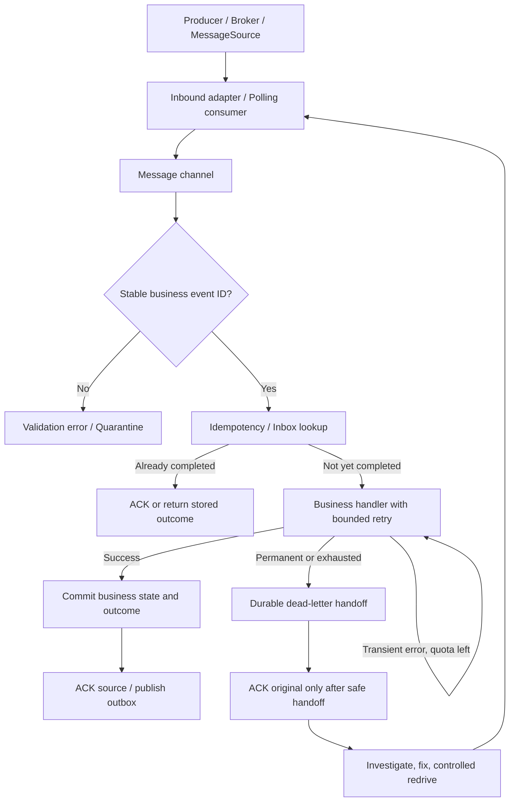
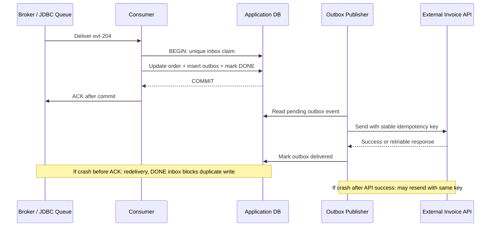
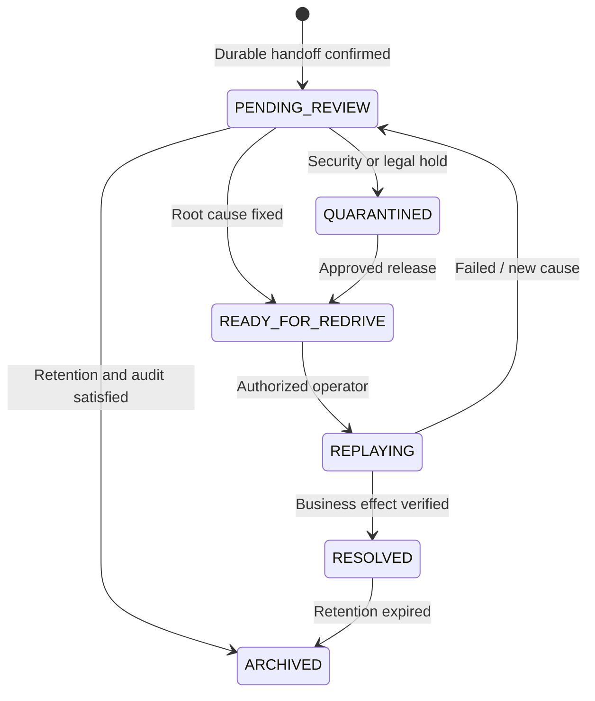
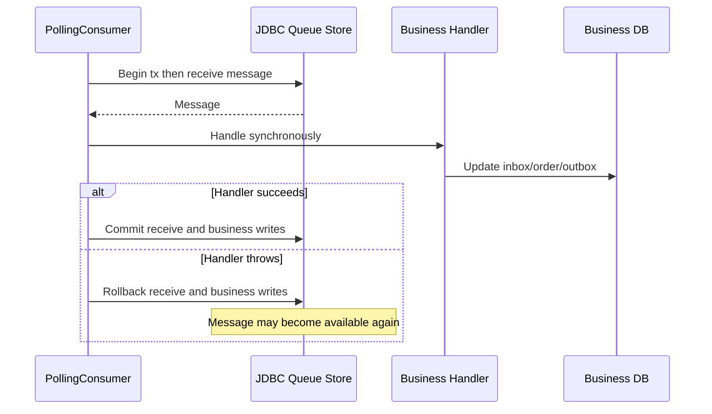
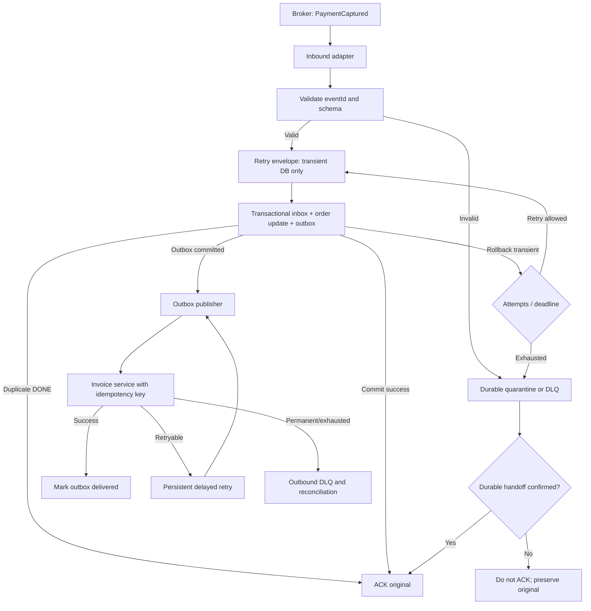

# Designing Retries Together with Idempotency and Dead-Lettering in Spring Integration Runtime

## 1. The Problem: Retrying Without Duplicating Side Effects or Losing Messages

A system receives an `OrderPaid` message from a broker, writes the order status to a database, and then calls an invoicing service. When the invoicing service times out, there are at least three possibilities: the request never reached the destination, reached it and failed, or **issued the invoice successfully while the response was lost**. Retrying unconditionally risks issuing two invoices. Marking the message "processed" upon receipt risks a crash before the business write causing the message to be permanently skipped. Retrying forever lets a poison message tie up consumers and grow the backlog.

A reliable runtime design must coordinate **retries** (bounded attempts), **idempotency** (the same business event does not produce unintended duplicate side effects), and **dead-lettering** (moving unprocessable messages to a durable place for diagnosis and replay). None of these three mechanisms solves the other two on its own.

This lesson belongs to the **Runtime Design** chapter of the **SPRING_INTEGRATION_RUNTIME** module. It connects with how Spring Integration orchestrates messages through channels, endpoints, consumers, pollers, and executors; `IntegrationFlow` lifecycle, transactions, retries, message stores, errors, correlation, threading, performance, and operational state.

After this lesson, you will be able to:

1. Distinguish handler retries, poller/source/broker retries, and dead-letter redrives.
2. Design stable business-level idempotency keys rather than relying on transient message IDs.
3. Choose transaction boundaries across message receipt, business writes, inbox/outbox, and source acknowledgement.
4. Configure `RequestHandlerRetryAdvice`, recovery channels, and dead-letter routing in Java DSL.
5. Understand the limitations of `IdempotentReceiverInterceptor`/`MetadataStoreSelector` when markers are written before the handler.
6. Test crash windows, retry amplification, duplicate deliveries, poison messages, and replays.
7. Measure outcomes by **committed business effects**, not merely attempt counts or `send()` calls.

> **Example Scope:** Spring Integration **6.5.x**, Spring Framework 6.x, Spring Retry 2.x, Java 17+, and JUnit Jupiter. Examples using in-memory queues to illustrate wiring are explicitly noted as **not crash-durable**; production requires a persistent backing store/broker and an explicit acknowledgement workflow.

## 2. Placing the Three Mechanisms at the Right Positions in a Message Flow



This diagram is a **logical design**, not an out-of-the-box framework pipeline. `ACK`, `commit`, and `DLQ handoff` steps may sit in separate transactions depending on JDBC queues, JMS/AMQP/Kafka, or HTTP ingress. They do not become a single distributed transaction merely by sharing an `IntegrationFlow`.

### 2.1. Responsibilities of Each Layer

| Layer | Target Guarantee | What It Does Not Guarantee Automatically |
| --- | --- | --- |
| `RequestHandlerRetryAdvice` / retry template | Re-invokes the handler on matching exceptions, honoring max attempts and backoff. | Does not guarantee transaction rollback, idempotency, crash durability, or DLQ persistence. |
| `IdempotentReceiverInterceptor` + metadata store | Recognizes previously seen keys; can mark/discard duplicates. | Writing a marker does not prove the business effect committed; not exactly-once side effects. |
| Business inbox / unique key | Prevents applying the same business event twice to transactional business state. | Cannot automatically undo an external HTTP side effect outside the transaction. |
| Outbox | Persists outbound message intent within the business transaction for later publishing. | Receiving consumers must still tolerate duplicate deliveries. |
| Durable dead-letter store/queue | Preserves unprocessable messages with error metadata for investigation/replay. | Does not auto-fix poison payloads, guarantee exact redrives, or prevent DLQ duplicates. |
| Broker acknowledgement / JDBC receive transaction | Controls when a message is considered received/removed from the source. | Does not unify state across downstream systems and external services. |

A system can achieve **at-least-once delivery** and **effectively-once business effects** only by combining stable keys, transactions, and idempotency at the right downstream boundaries. Avoid claiming "end-to-end exactly-once" when an external HTTP API does not participate in the same transaction.

### 2.2. Four State Milestones Never to Confuse

```text
RECEIVED      : Message arrives at the consumer.
ATTEMPTED     : Business handler is invoked (possibly multiple times).
COMMITTED     : Business state / outbox is durably committed.
ACKNOWLEDGED  : Source or broker accepts processing confirmation.
```

If the process crashes **after COMMITTED but before ACKNOWLEDGED**, the message may be redelivered; idempotency must recognize the business event already committed. If ACKNOWLEDGED occurs before COMMITTED, a crash can leave business data unwritten while the source never redelivers.

## 3. Classify Errors Before Choosing a Retry Policy

Retries help when errors have a reasonable chance of clearing over time or across attempts. Retrying every exception inflates latency, wastes worker threads, and spins bad data in circles.

| Error Category | Examples | Recommended Behavior |
| --- | --- | --- |
| **Transient** | Connection reset, DB deadlock, HTTP 503/429 with `Retry-After`. | Bounded retries with backoff/jitter, shared budget, and timeouts. |
| **Permanent / non-retryable** | Missing required field, unsupported enum, unrecognized schema version, invalid signature. | Do not waste invocations retrying; reject/quarantine/DLQ with reason. |
| **Success with unknown outcome** | Client timeout after receiver may have executed the side effect. | Query status by business/idempotency key before retrying; use idempotent receiver APIs. |
| **Prolonged dependency outage** | Database unreachable for minutes, external service down. | Circuit breaker, delayed retries, or pause ingress—do not occupy threads with tight retries. |
| **Contention / concurrency** | Optimistic locking, deadlocks, hot partitions. | Retry with backoff if safe while reducing contention; do not just raise attempt limits. |
| **Poison message** | Corrupted/undeserializable payload or persistent invariant violation. | Route to durable quarantine and alert; never block the poller infinitely. |
| **Recovery/DLQ failure** | Dead-letter broker unavailable. | Never ACK original before safe handoff; alert and follow an explicit fallback policy. |

**Classify by root cause, not just the outer exception.** Spring Integration may wrap errors in `MessagingException`, and Spring Retry offers options to traverse the cause chain. Only traverse cause chains when you know which exceptions are transient; never blindly retry `Exception.class` or `Throwable.class` for every message.

### 3.1. Thresholds That Must Be Designed Together

- **Per-attempt timeout:** total I/O duration of a single invocation.
- **Max local attempts:** number of times the advice invokes the handler within *one delivery*, including the first try.
- **Backoff/jitter:** wait interval and jitter to keep pods from retrying in lockstep.
- **Global delivery budget:** number of times the broker/poller may redeliver a business event.
- **Max age / deadline:** how should an event past its business expiration be handled?
- **Error budget:** acceptable failure ratio before pausing the source or switching to delayed retries.

Never set local max attempts in isolation while forgetting broker redeliveries. For example, 3 attempts per delivery across up to 5 deliveries can yield **15 handler attempts for one event**, excluding manual replays:

\[
\text{Max handler attempts} \leq
N_{\text{local}} \times N_{\text{deliveries}}
\]

This is the theoretical upper bound when every delivery exhausts local attempts; successful recovery or non-retryable failures can make the actual count lower.

## 4. Three Retry Tiers and Where Retry State Lives

| Retry Tier | Who Controls It? | Where Does Retry State Live? | When Appropriate? |
| --- | --- | --- | --- |
| **Synchronous handler retry** | `RequestHandlerRetryAdvice` + `RetryTemplate`. | Current thread/JVM; usually lost on process crash. | Very brief glitches, low attempt counts, no need to free workers between tries. |
| **Source/poller/broker redelivery** | Transaction rollback, NACK/requeue, listener retry, or source-specific adapter. | Broker/JDBC queue and backend-specific delivery state. | Failures needing message redelivery after error/restart; at-least-once. |
| **Scheduled delayed retry** | Broker delayed queues, retry topics, job schedulers, or persistent workflows. | Durable store with `nextAttemptAt` and attempt counts. | Prolonged outages, freeing consumers, minute/hour-scale backoffs. |

### 4.1. Synchronous Retries Do Not Replace Durable Redelivery

If retry advice invokes a handler three times and then the JVM crashes, the retry template does not persist those three attempts to a durable database. The source/broker decides whether to redeliver the message. Once a message is ACKed before business commit, in-memory retries cannot bring it back.

**Synchronous backoff holds resources:** workers block while backing off; when many messages fail together, hundreds of workers are quickly tied up by stalled tasks. For prolonged outages, publish to a durable delayed-retry queue or pause ingress per policy.

### 4.2. Distinguish Handler Retry Advice from Poller Retries

`RequestHandlerRetryAdvice` wraps **only the advised handler**. It does not automatically cover:

- `MessageSource.receive()` failures occurring before the handler;
- Deserialization/conversion errors occurring upstream of the advised endpoint;
- Exceptions in downstream endpoints after crossing an asynchronous channel;
- Broker acknowledgements or source-level retries outside the handler;
- External side effects that succeeded while the response timed out.

With `DirectChannel`, synchronous handler exceptions can propagate back to the caller. With `ExecutorChannel` or `QueueChannel` + poller, exceptions may route to an error channel instead of appearing on the producer thread. Tests must observe the **exact boundary**, not assert `send()` throws across every flow.

### 4.3. Calculate Total Retry Time Before Deploying

Suppose an attempt has a 2-second timeout, up to 3 attempts, and backoffs of 100 ms then 300 ms. Worst-case duration for one delivery is approximately:

\[
T_{\text{delivery}} \approx 3 \times 2\text{ s}
+ 0.1\text{ s} + 0.3\text{ s} = 6.4\text{ s}
\]

If the listener/broker visibility timeout, gateway reply timeout, or HTTP request deadline is **shorter than 6.4 seconds**, callers may time out before the handler finishes. Designs must align source deadlines, transaction timeouts, and retry budgets. This formula excludes queue wait, serialization, GC, transaction commits, and network jitter.

## 5. Idempotency: Business Keys and Completion State

Idempotency does not mean the handler always runs strictly once. In an at-least-once system, the handler **may be invoked multiple times**, yet the business outcome must be equivalent to processing once per contract.

### 5.1. Which Key Represents "The Same Unit of Work"?

| Key | Suitable? | Reason |
| --- | --- | --- |
| `MessageHeaders.ID` | Usually **no**. | Message IDs can regenerate on transform/rebuild or upstream redelivery. |
| `correlationId` | Only when the contract guarantees it is a unique business event ID per operation. | May represent an entire aggregator group or request chain, not each event. |
| `orderId` | Often insufficient. | One order undergoes multiple valid operations: `CREATED`, `PAID`, `REFUNDED`. |
| Stable producer-assigned `eventId` | Usually suitable. | Must be unique per source/tenant and remain unchanged across retries, DLQ, and replays. |
| `tenant + consumerName + eventId` | Suitable when event IDs are only unique per tenant/source. | Prevents collisions across tenants or flows applying two distinct side effects. |
| Single HTTP attempt `requestId` | Usually no. | Client retries may mint a new request ID for the same business action. |

A clearly namespaced key:

```text
orders.payment-captured:v1:tenant-7:evt-204
```

Define the **business effect** before selecting the key. If one event updates a DB and triggers an invoice, you may need an inbox key for event ingestion plus a stable idempotency key **at the invoicing service**, rather than relying on a single "seen" flag to prove both side effects succeeded.

**Key lifecycle:** retain markers at least for the system's maximum accepted redelivery + replay window. Expiring too early lets old events re-execute; keeping forever causes unbounded storage growth. When changing key formats/regions/tenant mappings, implement migration/dual-read and reconciliation rather than switching prefixes in one release.

### 5.2. IdempotentReceiverInterceptor: Endpoint Duplicate Detection

Spring Integration provides `IdempotentReceiverInterceptor` using `MetadataStoreSelector` and `ConcurrentMetadataStore`. The selector typically calls `putIfAbsent(key, value)` to compete for a claim; an appropriate implementation prevents **an instance/cluster sharing the store** from claiming the same key concurrently via atomic operations.

However, the interceptor's default behavior **does not block the handler on its own**: for rejected messages, it may attach the `duplicateMessage=true` header and still pass the message to the handler. To discard duplicates, configure `discardChannel`/`setDiscardChannelName("nullChannel")` or inspect the header yourself; you can also throw an exception on rejection depending on your contract.

```java
import org.springframework.integration.handler.advice.IdempotentReceiverInterceptor;
import org.springframework.integration.metadata.ConcurrentMetadataStore;
import org.springframework.integration.selector.MetadataStoreSelector;

IdempotentReceiverInterceptor duplicateGuard(
        ConcurrentMetadataStore metadataStore) {

    MetadataStoreSelector selector = new MetadataStoreSelector(
            message -> {
                String eventId = (String) message.getHeaders().get("eventId");
                String tenant = (String) message.getHeaders().get("tenantId");
                if (eventId == null || eventId.isBlank()
                        || tenant == null || tenant.isBlank()) {
                    throw new IllegalArgumentException(
                            "Missing eventId or tenantId");
                }
                return "orders.rx.v1:" + tenant + ":" + eventId;
            },
            metadataStore);

    IdempotentReceiverInterceptor advice =
            new IdempotentReceiverInterceptor(selector);
    advice.setDiscardChannelName("nullChannel");
    return advice;
}
```

**This is only an ingress duplicate filter.** If a marker is durably persisted **before** the business handler runs and does not roll back with the business write, an exception/crash can cause future retries of that event to be rejected despite never finishing. Moreover, `SimpleMetadataStore` lives only in RAM and loses markers on restart; it does not prove multi-pod idempotency. For production, consider `JdbcMetadataStore` within transactions or a **business inbox** with unique constraints and explicit states as shown next.

### 5.3. Distinguish SEEN, IN_PROGRESS, and DONE

| State | Meaning | Safe to ACK and Discard Duplicates? |
| --- | --- | --- |
| No key | No evidence the event has been processed yet. | Can claim and process transactionally. |
| `SEEN` / claimed | Selector observed or claimed the key. | **Not enough** to prove business success. |
| `IN_PROGRESS` | A worker is processing it, or may have crashed. | Requires locks/leases/timeouts/recovery; never blindly ACK. |
| `DONE` | Required business effects committed with evidence. | Safe to return stored outcome or ACK duplicate. |
| `FAILED_RETRYABLE` | Incomplete; eligible to retry. | Do not mark complete; retry conditionally. |
| `FAILED_PERMANENT` / `DEAD_LETTERED` | No further automatic processing; durably handed off. | ACK original only after durable DLQ handoff per contract. |

`MetadataStoreSelector` does not implement this entire state machine by itself. If you need leases, version fencing, crash recovery, and multi-worker coordination, build an **application-level inbox/workflow state machine**; metadata markers serve only as an optimization or coordination aid.

## 6. Transactional Inbox and Outbox: Preventing "Marked Seen Yet Unprocessed"

An effective design when the business DB is the source of truth places the inbox, business rows, and outbox **inside the same database transaction**. Then:

1. The worker claims `(consumer_name, event_id)` via a unique constraint.
2. If the record is already `DONE`, treat it as a duplicate and skip side effects.
3. If newly claimed, perform DB writes, insert outbox events, update inbox to `DONE`, and commit in one transaction.
4. On failure, roll back **all** of claim, business writes, and outbox. The source can redeliver.
5. An outbox worker dispatches messages externally after commit using an idempotency key; the receiver must also tolerate duplicates.



### 6.1. Illustrative PostgreSQL Schema

The `app_order_inbox` and `app_order_outbox` tables below are **application-owned**, not Spring Integration's `INT_MESSAGE` or `INT_METADATA_STORE` tables. This DDL is an educational example; production requires proper migrations, indexes, data retention, security, and constraints.

```sql
CREATE TABLE app_order_inbox (
    consumer_name VARCHAR(80) NOT NULL,
    event_id VARCHAR(160) NOT NULL,
    status VARCHAR(20) NOT NULL
        CHECK (status IN ('IN_PROGRESS', 'DONE')),
    processed_at TIMESTAMPTZ,
    PRIMARY KEY (consumer_name, event_id)
);

CREATE TABLE app_order_outbox (
    outbox_id UUID PRIMARY KEY,
    event_id VARCHAR(160) NOT NULL,
    destination VARCHAR(120) NOT NULL,
    payload_json JSONB NOT NULL,
    created_at TIMESTAMPTZ NOT NULL DEFAULT CURRENT_TIMESTAMP,
    sent_at TIMESTAMPTZ,
    UNIQUE (event_id, destination)
);
```

If one event produces multiple outbound commands to the same destination, `UNIQUE (event_id, destination)` is insufficient; include a dedicated `effect_type`/`business_operation_id`. Conversely, if multiple independent consumers handle the same event ID, `consumer_name` in the inbox is essential so one consumer does not block another from doing valid work.

### 6.2. Java 17: Single Transaction for Claim and Business Write

The following example assumes an existing business table `orders(order_id, payment_status)`, with `JdbcTemplate` and the transaction manager configured against the same DataSource. It illustrates **transactional DB effects + outbox**; broker ACKs are managed separately by the inbound adapter/container.

```java
import java.util.Map;
import java.util.UUID;

import com.fasterxml.jackson.core.JsonProcessingException;
import com.fasterxml.jackson.databind.ObjectMapper;

import org.springframework.jdbc.core.JdbcTemplate;
import org.springframework.stereotype.Service;
import org.springframework.transaction.annotation.Transactional;

record PaymentCaptured(String eventId, String orderId, String tenantId) {}

@Service
class PaymentCapturedService {
    private static final String CONSUMER = "orders.payment-captured.v1";
    private static final ObjectMapper JSON = new ObjectMapper();
    private final JdbcTemplate jdbc;

    PaymentCapturedService(JdbcTemplate jdbc) {
        this.jdbc = jdbc;
    }

    @Transactional
    public void process(PaymentCaptured event) {
        if (event.eventId() == null || event.eventId().isBlank()
                || event.orderId() == null || event.orderId().isBlank()
                || event.tenantId() == null || event.tenantId().isBlank()) {
            throw new IllegalArgumentException("Invalid payment event");
        }

        // Key in this example is tenant:producerEventId; producer must be stable.
        String eventKey = event.tenantId() + ":" + event.eventId();
        int inserted = jdbc.update("""
                INSERT INTO app_order_inbox(consumer_name, event_id, status)
                VALUES (?, ?, 'IN_PROGRESS')
                ON CONFLICT DO NOTHING
                """, CONSUMER, eventKey);

        if (inserted == 0) {
            String state = jdbc.queryForObject("""
                    SELECT status
                    FROM app_order_inbox
                    WHERE consumer_name = ? AND event_id = ?
                    """, String.class, CONSUMER, eventKey);

            if ("DONE".equals(state)) {
                return; // Duplicate of an already-committed business effect.
            }
            // Never blindly ACK a record still IN_PROGRESS.
            throw new IllegalStateException("Inbox state needs reconciliation");
        }

        int updated = jdbc.update("""
                UPDATE orders
                SET payment_status = 'PAID'
                WHERE order_id = ? AND tenant_id = ?
                """, event.orderId(), event.tenantId());
        if (updated != 1) {
            throw new IllegalArgumentException(
                    "Unknown or ambiguous order");
        }

        String invoiceJson;
        try {
            invoiceJson = JSON.writeValueAsString(Map.of(
                    "eventId", event.eventId(),
                    "orderId", event.orderId()));
        }
        catch (JsonProcessingException ex) {
            // Runtime exception triggers default transaction rollback.
            throw new IllegalStateException("Cannot encode outbox", ex);
        }
        jdbc.update("""
                INSERT INTO app_order_outbox(
                    outbox_id, event_id, destination, payload_json)
                VALUES (?, ?, 'invoice-service', CAST(? AS jsonb))
                """, UUID.randomUUID(), eventKey, invoiceJson);

        jdbc.update("""
                UPDATE app_order_inbox
                SET status = 'DONE', processed_at = CURRENT_TIMESTAMP
                WHERE consumer_name = ? AND event_id = ?
                """, CONSUMER, eventKey);
    }
}
```

**Production adjustments needed:** the demo `orders` table needs a `tenant_id` column and appropriate unique/primary keys. The codec snippet uses Jackson `ObjectMapper`, requiring Jackson dependencies and serializer settings matching your application's data contract. Ensure `@Transactional` is active via Spring proxy invocation and the transaction manager manages the **exact same DataSource** as `JdbcTemplate`. Store results/replies if duplicates must return prior responses rather than simply returning void.

**Atomicity:** when `process()` runs inside a new JDBC transaction, the inbox INSERT, orders UPDATE, outbox INSERT, and DONE UPDATE all commit or roll back together. If two workers claim the same key in concurrent transactions, the unique constraint protects you; the second transaction typically waits for the first and then sees the conflict or retries. If another process commits `IN_PROGRESS` independently without transitioning to DONE, leases/reapers/reconciliation are required; **never** treat `inserted == 0` as success for an incomplete state.

### 6.3. Coordinating with Source ACKs

- **Store-backed JDBC QueueChannel:** if both receive and handler share the same DataSource and the transaction starts at the poller, message dequeue and business writes can roll back together. Verify transaction configuration on the **poller**, not just `@Transactional` on the handler.
- **JMS/AMQP:** listener containers have their own ack/transaction semantics; JDBC transactions and broker ACKs do not form a single atomic transaction by default. If a crash occurs after DB commit before ACK, the broker redelivers and the DONE inbox safely skips duplicate side effects.
- **Kafka:** offset commits and DB commits are distinct milestones; at-least-once redeliveries still require business-key deduplication. Kafka transactions do not automatically enclose external HTTP calls or unrelated databases.
- **HTTP sources:** caller retries may resend payloads with new request IDs; require client-supplied stable idempotency keys or mappings derived from business operations.

### 6.4. Side Effects Outside the Database: Why You Need an Outbox

Never invoke an HTTP API with side effects inside a JDBC transaction assuming a DB rollback will undo the HTTP call. A safer flow:

1. Inside the business transaction: update DB + insert outbox event.
2. Commit.
3. Outbox publisher reads committed events and sends external requests with a stable idempotency key.
4. Upon success or verified outcome, mark the outbox row delivered.
5. If a crash happens after external success before `sent_at` is written, the publisher may resend with the **same key**. The receiver must be idempotent or expose a lookup API for reconciliation.

The outbox itself can publish duplicates. Therefore, never treat outbox + retries as an end-to-end exactly-once guarantee; it prevents lost publishes and turns duplicates into a manageable concern.

## 7. Dead-Lettering: Durable Quarantine, Not a Trash Can

A dead-letter queue/topic/table (DLQ/DLT) stores **messages that cannot proceed under the current policy**. Its purpose is to unblock valid message traffic, preserve enough diagnostic evidence for investigation, and support controlled replay after fixing the root cause.

### 7.1. When Should a Message Move to Dead-Letter?

- **Immediately permanent:** unsupported schema, contract violation, missing required header key, or undeserializable payload without a compatibility strategy.
- **Transient budget exhausted:** all local attempts and/or maximum deliveries or business deadlines exceeded.
- **Poison message:** the same message repeatedly crashes consumers, stalling a backlog or partition.
- **Manual quarantine:** an operator isolates a message to investigate sensitive data or broken business rules.

Do not send a message to DLQ after a single HTTP 503 if delayed retry makes sense. Conversely, do not retry `IllegalArgumentException` thousands of times when a required field is missing.

### 7.2. What Fields Should a Dead-Letter Envelope Carry?

An **application-defined record** example, not an automatic format produced by `ErrorMessageSendingRecoverer`:

```json
{
  "deadLetterId": "b687c7e7-15c9-4fbc-9876-7c1d8607477b",
  "source": "orders-paid-subscription",
  "businessEventId": "evt-204",
  "tenantId": "tenant-7",
  "originalMessageId": "broker-message-8812",
  "payloadSchemaVersion": 2,
  "payloadRef": "secured-object-store://dlq/2026/11/evt-204",
  "failedStage": "invoiceDispatch",
  "failureCategory": "TRANSIENT_EXHAUSTED",
  "exceptionType": "RemoteServiceUnavailable",
  "localAttempts": 3,
  "deliveryCount": 5,
  "firstReceivedAt": "2026-11-22T01:50:00Z",
  "deadLetteredAt": "2026-11-22T02:01:00Z",
  "retryPolicyVersion": "invoice-v3",
  "traceId": "4b0d9d85f02e4d7b",
  "state": "PENDING_REVIEW"
}
```

Fields to consider:

| Group | Data to Retain | Purpose |
| --- | --- | --- |
| Identity | Stable business event ID, tenant/source, original transport ID | Deduplication and source tracing. |
| Payload | Raw payload **or** reference to original bytes, schema/codec version | Readable/replayable even if current Java models changed. |
| Headers | Selected routing/correlation/partition headers | Preserves processing semantics without copying credentials. |
| Failure | Stage/endpoint, classification, root cause, stack trace reference | Distinguishes poison payloads from transient outages. |
| Attempts | Local attempts, broker delivery count, prior retry intervals | Prevents infinite loops after redrive. |
| Timing | First received, last attempted, dead-lettered timestamps | SLO tracking, retention, and business deadlines. |
| Governance | Policy version, redrive count, reviewer, state, change ID | Approval and replay auditing. |

Never write raw OAuth tokens/passwords/PII into logs. Dead-letter payloads may hold sensitive data: encrypt at rest, enforce least-privilege access, define retention/deletion policies, and audit downloads. To preserve payload bytes, avoid blindly converting every binary object into schemaless JSON; Java-serialized objects can also fail deserialization after upgrades.

### 7.3. Dead-Letter Lifecycle States



**A durable dead-letter differs from an in-memory error channel.** A default `QueueChannel` holds messages only inside the JVM. `ErrorMessageSendingRecoverer` sends an `ErrorMessage` to a recovery channel; if that channel is just an in-memory queue, messages vanish on a crash. A trustworthy DLQ requires an adapter/handler writing to a JMS/AMQP/Kafka topic, JDBC dead-letter table, or object store with transactions/acks and publish confirmation.

### 7.4. ACK Boundaries During DLQ Handoff

| When Original Is ACKed | Risk |
| --- | --- |
| **Before** DLQ publish/commit | If DLQ publish fails or the process crashes, the message is lost from both original and DLQ. |
| **After** DLQ publish is confirmed | Safer against message loss; crashing between publish and ACK can still create a **duplicate DLQ item**. |
| Single atomic transaction across original JDBC receive and DLQ table in same DB | Can commit/roll back both receive and dead-letter row if sharing DataSource/transaction. |
| Broker and DB/HTTP in separate transactions | Not inherently atomic; use outbox/inbox, reconciliation, or verified broker-native DLX. |

If the broker supports a native dead-letter exchange/topic on reject, verify its durability, routing, and delivery count limits on your broker/container. Never claim every NACK guarantees durable DLQ publishing; each transport has distinct ack/transaction behavior.

### 7.5. Designing Redrives Without Multiplying Duplicates

Redrive must be an **operational workflow**, not a "resend everything" button:

1. Investigate and classify the root failure; fix the consumer, schema, credentials, or dependency before replaying.
2. Select target messages by source, tenant, time range, and failure category; verify payloads and retention.
3. Inspect business state/inbox: is it already `DONE` or still `SEEN/IN_PROGRESS`?
4. Keep the **original businessEventId/idempotency key**, adding separate `redriveId`, `redriveCount`, and `changeId` fields; never change event IDs just to "bypass dedup".
5. Dry-run or canary a small batch; monitor business effects, error rates, and downstream rate limits.
6. Mark `RESOLVED` only after verifying outcomes; if still failing, return to quarantine per policy instead of spinning an infinite DLQ → main → DLQ loop.

If an idempotency marker is stuck in claimed-but-incomplete state, a replay may be wrongly rejected. Recover the **inbox state machine** (or transactional marker) carefully rather than wiping all keys for unrestricted replay.

## 8. Java DSL: Retrying Three Times and Routing Failures to a Recovery Channel

The example below is a **single-JVM test flow core**. `DirectChannel` dispatches synchronously into the handler so attempts are easy to observe; `QueueChannel` collects the `ErrorMessage` once retries are exhausted. It demonstrates advice wiring, **not a durable dead-letter guarantee**.

### 8.1. Spring Configuration

```java
import java.util.concurrent.ConcurrentHashMap;
import java.util.concurrent.ConcurrentMap;
import java.util.concurrent.atomic.AtomicInteger;

import org.springframework.beans.factory.annotation.Qualifier;
import org.springframework.context.annotation.Bean;
import org.springframework.context.annotation.Configuration;
import org.springframework.integration.annotation.EnableIntegration;
import org.springframework.integration.channel.DirectChannel;
import org.springframework.integration.channel.QueueChannel;
import org.springframework.integration.dsl.IntegrationFlow;
import org.springframework.integration.handler.advice.ErrorMessageSendingRecoverer;
import org.springframework.integration.handler.advice.RequestHandlerRetryAdvice;
import org.springframework.messaging.Message;
import org.springframework.messaging.MessageChannel;
import org.springframework.messaging.PollableChannel;
import org.springframework.retry.support.RetryTemplate;

@Configuration
@EnableIntegration
class RetryRecoveryDemoConfiguration {
    static class FakeInvoiceHandler {
        private final ConcurrentMap<String, AtomicInteger> calls =
                new ConcurrentHashMap<>();

        public void handle(Message<String> message) {
            String eventId = (String) message.getHeaders().get("eventId");
            if (eventId == null) {
                throw new IllegalArgumentException("Missing eventId");
            }
            int attempt = calls.computeIfAbsent(
                    eventId, ignored -> new AtomicInteger())
                    .incrementAndGet();

            if (eventId.startsWith("transient-") && attempt <= 2) {
                throw new IllegalStateException("Temporary API outage");
            }
            if (eventId.startsWith("poison-")) {
                throw new IllegalStateException("Always failing in demo");
            }
            // Fake: success. Production must enforce DB/API idempotency.
        }

        int attemptsFor(String eventId) {
            AtomicInteger value = calls.get(eventId);
            return value == null ? 0 : value.get();
        }
    }

    @Bean
    FakeInvoiceHandler invoiceHandler() {
        return new FakeInvoiceHandler();
    }

    @Bean
    MessageChannel invoiceInput() {
        return new DirectChannel();
    }

    @Bean
    PollableChannel invoiceRecoveryErrors() {
        return new QueueChannel();
    }

    @Bean
    RequestHandlerRetryAdvice invoiceRetryAdvice(
            @Qualifier("invoiceRecoveryErrors")
            MessageChannel recoveryChannel) {
        RetryTemplate template = RetryTemplate.builder()
                .maxAttempts(3)
                .retryOn(IllegalStateException.class)
                .noBackoff() // Test-only: production should use backoff/jitter.
                .build();

        RequestHandlerRetryAdvice advice = new RequestHandlerRetryAdvice();
        advice.setRetryTemplate(template);
        advice.setRecoveryCallback(
                new ErrorMessageSendingRecoverer(recoveryChannel));
        return advice;
    }

    @Bean
    IntegrationFlow invoiceFlow(
            FakeInvoiceHandler handler,
            RequestHandlerRetryAdvice invoiceRetryAdvice) {
        return IntegrationFlow.from("invoiceInput")
                .handle(handler, "handle",
                        endpoint -> endpoint.advice(invoiceRetryAdvice))
                .get();
    }
}
```

Explanation:

- `RetryTemplate.maxAttempts(3)` includes **the initial call plus up to two retries**, not three retries on top of the initial call.
- `retryOn(IllegalStateException.class)` only illustrates simulated transient errors. In production, use adapter-specific exceptions or classifiers distinguishing HTTP 429/503, validation errors, and unknown outcomes.
- `noBackoff()` keeps tests fast; **do not use this default** when downstream has rate limits or outages.
- `ErrorMessageSendingRecoverer` sends an `ErrorMessage` to `invoiceRecoveryErrors`. Recovery can make sending to `DirectChannel` return **normally** even though the business handler failed three times. Therefore, seeing `send() == true` **does not** confirm the invoice was issued.
- The error channel here resides **in RAM**, providing no durability across restarts. Production requires routing to a durable DLQ and source-appropriate ACK handling.

### 8.2. JUnit 5: Success After Retry and Exhausted Retries

```java
import org.junit.jupiter.api.Test;
import org.springframework.beans.factory.annotation.Autowired;
import org.springframework.beans.factory.annotation.Qualifier;
import org.springframework.integration.test.context.SpringIntegrationTest;
import org.springframework.messaging.Message;
import org.springframework.messaging.MessageChannel;
import org.springframework.messaging.PollableChannel;
import org.springframework.messaging.support.ErrorMessage;
import org.springframework.messaging.support.MessageBuilder;
import org.springframework.test.annotation.DirtiesContext;
import org.springframework.test.context.junit.jupiter.SpringJUnitConfig;

import static org.junit.jupiter.api.Assertions.*;

@SpringJUnitConfig(RetryRecoveryDemoConfiguration.class)
@DirtiesContext(classMode = DirtiesContext.ClassMode.AFTER_EACH_TEST_METHOD)
class RetryRecoveryDemoTest {

    @Autowired @Qualifier("invoiceInput")
    MessageChannel input;

    @Autowired @Qualifier("invoiceRecoveryErrors")
    PollableChannel recovery;

    @Autowired
    RetryRecoveryDemoConfiguration.FakeInvoiceHandler handler;

    @Test
    void transientFailureSucceedsOnThirdInvocation() {
        assertTrue(input.send(MessageBuilder
                .withPayload("invoice-request")
                .setHeader("eventId", "transient-42")
                .build()));

        assertEquals(3, handler.attemptsFor("transient-42"));
        assertNull(recovery.receive(0));
    }

    @Test
    void exhaustionProducesRecoveryEventNotBusinessSuccess() {
        assertTrue(input.send(MessageBuilder
                .withPayload("invoice-request")
                .setHeader("eventId", "poison-99")
                .build()));

        assertEquals(3, handler.attemptsFor("poison-99"));
        Message<?> error = recovery.receive(1_000);
        assertNotNull(error);
        assertInstanceOf(ErrorMessage.class, error);
        assertNotNull(((ErrorMessage) error).getPayload());
    }
}
```

**What the tests prove:** the first test proves three invocations resulted in an empty recovery channel. The second test proves **three attempts failed** and the failure reached the recovery channel; it does not claim the message committed, was ACKed at a broker, or sits in a durable DLQ.

To verify production readiness, replace the in-memory recovery queue with a persistent test adapter/topic/table, inject failures during DLQ publishing, check ACK/rollback behavior, then restart the context and verify the dead-letter record remains readable.

## 9. Advice Ordering: Idempotency, Retries, and Transactions Must Wrap the Right Layers

Spring Integration allows attaching advice to endpoints/handlers. When combining multiple advices, **nesting order dictates behavior**. Two similar-looking configurations can behave completely differently when a handler throws.

### 9.1. Three Nesting Orders and Their Risks

| Logical Order (Outer → Inner) | What Happens When the Handler Fails? | Primary Risk |
| --- | --- | --- |
| `Idempotent → Retry → Handler` | Idempotent guard runs once per delivery; Retry can invoke Handler multiple times inside. | If the marker commits before business success, crashes/exhaustion can cause false duplicates after redelivery. |
| `Retry → Idempotent → Handler` | Every retry attempt runs the selector; the first attempt may claim the key, causing later attempts to see a duplicate. | Retries get blocked by the prior attempt's marker even though the handler never succeeded. |
| `Retry → Transaction → Idempotent → Business DB` | Each retry attempt starts a new transaction; claim and DB writes roll back together when the handler throws. | Requires correct DataSource manager, proxy/advice ordering, and no external side effects outside the transaction. |

In this table, arrows indicate **logical nesting**, not guaranteed annotation/proxy ordering for every configuration. Spring AOP, `RequestHandlerRetryAdvice`, `TransactionInterceptor`, and DSL endpoint advice must be tested against your actual flow. If a transaction wraps **outside the entire retry loop**, an SQL exception on the first attempt can mark the transaction rollback-only, leaving subsequent attempts unable to commit cleanly.

### 9.2. A Viable Design Pattern

**When business state is protected by the same JDBC database**, a straightforward approach is:

```text
Inbound delivery
  -> Bounded retry
       -> New business transaction per attempt
            -> Claim inbox with unique constraint
            -> Update business state + append outbox
            -> Mark inbox DONE
          COMMIT or ROLLBACK
  -> On exhaustion, durable dead-letter handoff
  -> ACK only after business commit or safe handoff
```

On business processing failures, each attempt rolls back both the claim and DB writes. On outbox publishing failures, the outbox worker retries independently without re-running the business handler. Across multiple app instances, the database unique constraint protects concurrent claims.

If you add `IdempotentReceiverInterceptor` outside as an optimization, verify whether the marker rolls back with DB effects **and** how duplicates are handled when an event is `IN_PROGRESS`. In many workloads, the **business inbox is the primary safeguard**, while the interceptor merely reduces redundant work and aids observability.

### 9.3. Poller Transactions Differ from Handler Transactions

Suppose a `QueueChannel` uses `JdbcChannelMessageStore` and a consumer polls messages:



This diagram holds only if:

1. The poller genuinely opens the transaction **before `receive()`**, using an appropriate transaction manager.
2. `JdbcChannelMessageStore` and business JDBC writes use matching transactional resources/DataSource.
3. Downstream handlers run **synchronously** inside that transaction boundary.
4. Exceptions **propagate outward** so the transaction rolls back; recovery must not accidentally swallow the exception and commit the receive.

Putting `@Transactional` only on the handler may fail to enclose the dequeue occurring **before the handler begins**. Placing an `ExecutorChannel` between poller and handler cuts the transaction at the thread boundary. Always test real JDBC rollbacks rather than inferring behavior from annotations in source code.

### 9.4. Recovery Callbacks Change What "Success" Means

If `RequestHandlerRetryAdvice`'s recovery callback forwards errors to `ErrorMessageSendingRecoverer` and **returns normally**, the outer endpoint may interpret the handler invocation as complete, allowing the source to ACK/commit. This is valid only when the recovery channel delivers the message to durable storage **before** ACK.

For zero-loss at-least-once requirements, design:

- Business commit succeeds: ACK or commit offset per source contract.
- Transient error with budget left: roll back/NACK or confirmed delayed retry.
- Permanent error/budget exhausted: **persist DLQ + confirm handoff**, then ACK original.
- DLQ persistence fails: propagate failure/roll back original, alert, and apply backpressure.

Never assume an `ErrorMessage` sent to an in-memory channel constitutes a durable handoff.

## 10. Transport Integration: JDBC, JMS, AMQP, Kafka, and HTTP

Spring Integration-level retry/idempotency/dead-lettering does not replace **adapter and broker semantics**. Java error handlers can choose recovery actions, yet ACK/offset/delivery counts belong to the transport.

| Source | ACK / Transaction Behavior to Understand | Common Dead-Letter Pattern | Key Limitations |
| --- | --- | --- | --- |
| **JDBC-backed polling queue** | Poller transaction can span dequeue and business JDBC writes if sharing DataSource. | Dead-letter table in same DB or outbox publish to broker. | Schema/region/group, locking/rollback, and serializers must match; RAM `QueueChannel` lacks these guarantees. |
| **JMS** | Transacted sessions / broker redelivery per provider and listener container. | Provider DLQ or application recovery destination. | Redelivery policies/poison thresholds vary by broker; not automatically atomic with business DB. |
| **RabbitMQ / AMQP** | ACK/NACK/requeue, listener retries, and broker DLX/TTL per configuration. | Dead-letter exchange/queue, delayed retry queue, or parking lot. | Must verify broker confirms, routing/bindings, and dead-letter cycles; NACK does not guarantee durable handoff on its own. |
| **Kafka** | Offset commits/rebalances, partition ordering, and consumer error handling. | Retry topics / dead-letter topic with corresponding recoverer. | Offsets are not business DB commits; retries must respect partition/key semantics when ordering matters. |
| **HTTP / Gateway** | Response codes/deadlines; clients retry on their own. | Application quarantine or durable job inbox/outbox. | Request timeouts leave external side-effect success ambiguous. |
| **File/SFTP/FTP polling** | File filters, metadata stores, rename/move, checkpoints. | Quarantine directory plus audit or durable error event. | Marking files seen prior to processing can prevent rescanning after crashes; needs idempotent ingestion. |

**Distinguish frameworks:** for instance, Spring Kafka's `DefaultErrorHandler` or `DeadLetterPublishingRecoverer` belongs to Spring Kafka; RabbitMQ/JMS listener containers have their own mechanisms. Do not plug those APIs directly into `RequestHandlerRetryAdvice` assuming Spring Integration core natively controls every broker.

### 10.1. Per-Key Ordering Traps

In a Kafka partition or per-account sequential queue, message A may fail ahead of message B. Routing A to a delayed retry topic while letting B proceed **alters business order**. Conversely, blocking the head of the partition on A until retries finish can lag the entire partition.

Choose explicitly:

- **Strict ordering:** pause the partition/key or serialize per key, accepting throughput trade-offs.
- **Eventual ordering:** let B proceed while downstream enforces versions/sequences, conditional updates, reconciliation, and idempotency.
- **Business quarantine:** pause only the affected account/tenant or record pending state without stalling unrelated tenants.

`correlationId` and sequence headers link messages but do not enforce execution ordering. With aggregators, preserve group state and late-arrival semantics when DLQing/redriving individual parts.

### 10.2. Restarts and Payload Versioning

Messages in persistent queues or DLQs may be processed **after one or more deployments**. During replay, new code may fail to deserialize payloads if Java classes changed packages/`serialVersionUID` or JSON schemas evolved; persist raw payloads + schema versions and build backward readers or upcasters.

Never treat an old metadata store's `status=DONE` entry as proof all side effects of newer code completed if event/handler semantics changed. Version idempotency namespaces, routes, and retry policies when appropriate, without arbitrarily mutating the same event's key to bypass duplicate checks.

## 11. Controlling Performance and Preventing Retry Storms

### 11.1. Retry Amplification Reduces Useful Throughput

Suppose fresh traffic arrives at 200 events/s, 20% of events require three attempts to succeed, and 80% succeed on the first try:

\[
E[\text{attempts per event}] =
0.8 \times 1 + 0.2 \times 3 = 1.4
\]

To sustain 200 business events/s, the handler must handle roughly **280 invocations/s** ignoring overhead. If downstream tolerates only 220 requests/s, retries can make the backlog **grow faster** instead of recovering.

When multiple pods retry after the same fixed backoff, they can hit the API in synchronized bursts. Add jitter/randomized backoff where needed, pair with rate limiters/circuit breakers, and enforce a system-wide retry budget. Never let every layer (HTTP client, handler advice, broker redelivery, DLQ redrive) configure independent unbounded retries.

### 11.2. Backpressure Must Precede Severe Incidents

| Symptom | Runtime Signal | Design Action |
| --- | --- | --- |
| Executor workers tied up by backoff | High active threads, low committed/s. | Reduce local attempts; move to durable delayed retries. |
| In-memory queue ballooning | Rising queue depth/oldest age. | Bounded capacity, throttle ingress, durable buffering if needed. |
| DB deadlocks rise when scaling consumers | Rising rollbacks/lock wait, high p99. | Lower concurrency, shorten transactions, partition by business key. |
| Continuous broker redeliveries | High delivery counts, same message ID repeating. | Max deliveries, poison isolation, error classification. |
| Spiking DLQ throughput | Rising permanent/exhausted errors. | Alert, preserve payloads, analyze dependencies and schema drift. |
| External API timeouts with unknown outcomes | Rising errors while receiver applies side effects. | Stable idempotency keys, status queries/reconciliation, no blind retries. |

**Throughput must be measured in business commits/s**, not total handler attempts/s or ErrorMessage counts. During heavy retries, invocation counts climb while useful throughput drops.

## 12. Holistic Design for an Invoicing Service

To tie all three mechanisms into an operable system, consider a flow ingesting `PaymentCaptured` to update orders and instruct an invoicing service:



**Two independent retry domains:** (a) ingesting `PaymentCaptured` into inbox/business DB/outbox; (b) outbox publisher calling the invoice service. When the invoice API suffers an outage, there is no need to roll back already-PAID orders and make the broker redeliver `PaymentCaptured`. The outbox worker maintains its own deadlines and DLQ.

### 12.1. Explicit State Contracts

| Component | Source of Truth Owned | Success Criteria |
| --- | --- | --- |
| Inbound adapter | Broker/JDBC queue delivery state. | ACK once business transaction commits or durable quarantine handoff confirms. |
| Business inbox | Unique `(consumer,eventKey,status)`. | `DONE` committed, not merely `SEEN`. |
| Business table | Order/tenant state adhering to invariants. | Commit meets constraints; duplicates behave as controlled no-ops. |
| Outbox | Intent to emit invoice command. | Outbox row committed atomically with business state. |
| Outbox publisher | Attempts, next retry timestamp, delivered state. | Receiver confirms via idempotency key or reconciliation succeeds. |
| Dead-letter | Original payload, failure cause, review/redrive state. | Durable record with proper auditing and access control. |

Do not collapse "business event processed" and "invoice delivered" into a single shared boolean. Separating states allows precise recovery at each stage during prolonged outages.

### 12.2. Example Application-Owned Dead-Letter Table

To keep dead-letters in the same PostgreSQL database, a minimal schema might be:

```sql
CREATE TABLE app_dead_letter (
    dead_letter_id UUID PRIMARY KEY,
    source_name VARCHAR(120) NOT NULL,
    source_message_id VARCHAR(160) NOT NULL,
    failed_stage VARCHAR(120) NOT NULL,
    business_event_id VARCHAR(160),
    schema_version INTEGER,
    original_payload BYTEA NOT NULL,
    failure_category VARCHAR(80) NOT NULL,
    attempts INTEGER NOT NULL CHECK (attempts >= 1),
    dead_lettered_at TIMESTAMPTZ NOT NULL DEFAULT CURRENT_TIMESTAMP,
    state VARCHAR(30) NOT NULL DEFAULT 'PENDING_REVIEW',
    replay_count INTEGER NOT NULL DEFAULT 0,
    UNIQUE (source_name, source_message_id, failed_stage)
);
```

Here the unique constraint provides an idempotent handoff for **one transport message ID at one stage**. If the broker assigns fresh IDs on redelivery or an event spans multiple envelopes, choose another durable key such as `(source, businessEventId, failedStage, processingVersion)` per contract. Avoid unique keys that overwrite genuinely distinct failures when one event triggers multiple side effects.

**DLQ transaction principles:**

- If the original JDBC queue and dead-letter table live in the same database, you can design the move/ack in one **application-controlled** transaction; verify how `JdbcChannelMessageStore` dequeuing interacts with transactions.
- If the business transaction already rolled back, inserting a dead-letter row requires an **independent managed transaction**, never a transaction already marked rollback-only.
- If the source is an external broker, DLQ INSERT success and broker ACK span two systems. Crashes can duplicate DLQ items or redeliveries; use idempotent inserts, reconciliation, and ACK only after confirmed handoff.
- Never store exception stack traces containing credentials or raw payloads in unprotected columns. Store failure categories and secured error detail references instead.

### 12.3. Application Recovery Interface

An example interface stating recovery **must durably confirm** or throw:

```java
import org.springframework.messaging.Message;

interface DurableDeadLetterPublisher {
    /**
     * Returns only after the original payload + metadata have been
     * durably written and acknowledged by the backend.
     *
     * Throws an exception if handoff was not confirmed.
     * Callers must never ACK the source without durable handoff.
     */
    void publishAndConfirm(
            Message<?> original,
            Throwable rootFailure,
            String failedStage,
            int totalAttempts);
}
```

This is an **application contract**, not a Spring Integration interface. Implementations must align transaction/ack handling with JDBC, JMS, AMQP, or Kafka. When recovery code simply calls `channel.send(errorMessage)` to a RAM queue and returns, this contract **is violated**.

## 13. Mandatory Testing Matrix: Correct Under Failures and Crashes

### 13.1. Happy-Path Tests Are Not Enough

To validate a retry + inbox + DLQ architecture, include at minimum:

| Scenario | Fault Injection | Meaningful Assertions |
| --- | --- | --- |
| **T1: First-try success** | None. | One business commit, one inbox DONE, one outbox row, proper ACK. |
| **T2: Transient then success** | Handler throws twice then succeeds. | Exact attempt/backoff count, single business effect, empty DLQ. |
| **T3: Non-retryable** | Missing payload field / unsupported schema. | No tight retry loop; durable quarantine/DLQ, original ACKed only after handoff. |
| **T4: Exhausted local retries** | Handler always throws transient error. | Bounded attempts, recovery invoked; no false business success. |
| **T5: Broker redelivery** | Crash after DB commit before ACK. | Event redelivered, inbox DONE produces no-op; no extra outbox/side effects. |
| **T6: Crash before business commit** | Kill process between inbox claim and commit. | Transaction rolls back, message remains receivable, no orphaned DONE marker. |
| **T7: DLQ unavailable** | Dead-letter store/broker publish fails. | Original is **not** ACKed as successful; clear alert raised. |
| **T8: Crash after DLQ publish before ACK** | Simulate failure window. | Idempotent DLQ insert, duplicate delivery reconcilable. |
| **T9: External API unknown outcome** | API accepts request but client times out. | Retry with same idempotency key or query status; no duplicate side effects. |
| **T10: Retry advice ordering** | Vary Retry/Idempotent nesting. | Handler runs expected attempts; markers do not block valid retries. |
| **T11: Async error channel** | Place `ExecutorChannel` between source and handler. | Exceptions/recovery observed on worker/error channel; producer `send()` does not throw. |
| **T12: Concurrent same event** | 16 workers receive same business key. | Only one unique business effect commits; others observe controlled duplicate/pending. |
| **T13: DLQ redrive success** | Fix handler/schema and replay. | Preserves original event ID, processes once, marks DLQ RESOLVED after verification. |
| **T14: DLQ redrive still failing** | Replay unfixed payload. | No infinite loop; replay count increments, state returns to PENDING_REVIEW. |
| **T15: Restart/schema migration** | V1 writes queue/DLQ, V2 reads. | Payload/headers/correlation decode cleanly, no data loss or broken dedup across versions. |
| **T16: Two pods, shared store** | Two instances claim same ID on real DB. | Unique constraints, transactions, and regions work across JVMs. |

Never write all these tests using `SimpleMetadataStore` or RAM `QueueChannel` and conclude production safety. Tests T5–T8, T12, and T15–T16 require **real persistent databases/brokers or Testcontainers**, booting multiple application contexts and explicitly simulating crash/commit windows.

### 13.2. Testing Idempotency Key Concurrency

A unit test for key claiming can use `ConcurrentMetadataStore.putIfAbsent`:

```java
import java.util.ArrayList;
import java.util.List;
import java.util.concurrent.CountDownLatch;
import java.util.concurrent.ExecutorService;
import java.util.concurrent.Executors;
import java.util.concurrent.Future;
import java.util.concurrent.TimeUnit;

import org.junit.jupiter.api.Test;
import org.springframework.integration.metadata.ConcurrentMetadataStore;
import org.springframework.integration.metadata.SimpleMetadataStore;

import static org.junit.jupiter.api.Assertions.*;

class AtomicClaimTest {
    @Test
    void onlyOneThreadClaimsSameKeyInOneJvm() throws Exception {
        ConcurrentMetadataStore store = new SimpleMetadataStore();
        int workers = 12;
        CountDownLatch start = new CountDownLatch(1);
        ExecutorService executor = Executors.newFixedThreadPool(workers);

        try {
            List<Future<Boolean>> futures = new ArrayList<>();
            for (int i = 0; i < workers; i++) {
                futures.add(executor.submit(() -> {
                    start.await();
                    return store.putIfAbsent("orders:t7:evt-204", "SEEN")
                            == null;
                }));
            }
            start.countDown();

            int claimed = 0;
            for (Future<Boolean> future : futures) {
                if (future.get(3, TimeUnit.SECONDS)) {
                    claimed++;
                }
            }
            assertEquals(1, claimed);
        }
        finally {
            start.countDown();
            executor.shutdownNow();
        }
    }
}
```

This test only proves atomic claiming **within a single JVM** using `SimpleMetadataStore`. It does not prove crash durability, marker transaction rollback, or exactly-once business effects. For `JdbcMetadataStore`, test with two JVMs/contexts sharing a DataSource and assert against business tables. Always bound `Future.get(timeout)` in tests so failing workers cannot hang the suite forever.

### 13.3. Verifying Transactions with Real Data

Using a test PostgreSQL instance and `PaymentCapturedService`:

1. Create inbox/outbox/orders tables via test migrations and seed a sample order.
2. Call `process(evt-204)`, then inspect committed rows: inbox DONE, order PAID, one outbox row.
3. Call again with the **same event key** and re-check row counts—no new outbox row or business update.
4. Inject an exception after `UPDATE orders` before `UPDATE inbox DONE`, confirming real transaction rollback removes **both the inbox marker and order update**.
5. Invoke again after rollback: it must claim and complete cleanly.
6. Run two concurrent calls for the same event; only one commits the business effect with no permanent deadlock.
7. Run a dedicated test simulating external API success followed by publisher crash before `sent_at`; restarting the publisher must reuse the **same idempotency key**.

Do not merely assert `@Transactional` appears in source code: verify bean proxies, transaction managers, DataSources, isolation levels, SQL constraints, and actual rollback state in the DB.

### 13.4. Testing Deadlines, Attempt Counts, and Duplicate ACKs

A thorough recovery test must distinguish three outcomes:

```text
BUSINESS_COMPLETED  -> ACK allowed, DLQ must not receive event.
RECOVERY_CONFIRMED  -> ACK allowed by policy, DLQ contains durable record.
NO_SAFE_OUTCOME     -> ACK forbidden; message must remain retryable/alarmed.
```

A handler throwing while `ErrorMessageSendingRecoverer` returns normally **must never be classified as BUSINESS_COMPLETED**. A full or unavailable error queue must register as a recovery handoff failure.

## 14. Runtime Observability: Separating Deliveries, Attempts, Commits, and Dead-Letters

You cannot operate retries reliably from error logs alone. You need layered metrics sharing correlation/traces to connect milestones:

| Metric | Suggested Definition | Alert When |
| --- | --- | --- |
| `events_received_total` | Business events/deliveries received from source (distinguish new vs. redelivery). | Delivery spikes or source stops sending completely. |
| `handler_attempts_total` | Handler invocations; one event may contribute multiple attempts. | Attempts/event climbs above baseline. |
| `business_effects_committed_total` | **Unique** committed business events. | Committed/s drops while received/s stays high. |
| `idempotency_duplicates_total` | Events hitting DONE inbox or metadata duplicates. | Abnormal spikes from producer retries, stale ACKs, or key drift. |
| `inbox_in_progress_age` | Age of non-DONE claims (when persisted). | Exceeds lease/deadline, signaling stuck/abandoned work. |
| `retry_scheduled_total` / `retry_attempt_total` | Scheduled retries and executed retries by cause category. | Retry storms, downstream timeouts, exhausting budgets. |
| `dead_letter_enqueued_total` | **Durably confirmed** DLQ handoffs. | Rapid DLQ growth, especially from schema/validation errors. |
| `dead_letter_publish_failure_total` | Failed recovery handoff attempts. | **Any** sustained failure risking unsafe ACKs. |
| `dead_letter_oldest_age` | Age of the oldest unresolved DLQ item. | Exceeds review/redrive SLA. |
| `redrive_success_total` / `redrive_failure_total` | Replays with verified business outcomes. | Repeated replay failures, ineffective fixes. |
| `queue_depth` / `oldest_message_age` | Backlog and lag of source/retry queues. | Steadily rising or breaching operational thresholds. |
| `transaction_rollback_total` | Rolled-back business/receive transactions. | Retries paired with contention or schema errors. |

These names are **suggested application metrics**, not default Spring Integration meter names. Spring Integration 6.5 and Micrometer add channel send/receive timers, handler metrics, and queue gauges; they illuminate message flow yet cannot know which exact business effect committed unless the application instruments that point.

### 14.1. Measurement Principles

- **Separate fresh events from redeliveries:** the same event ID delivered five times must show five deliveries but at most one final business effect.
- **Never count success before commit:** incrementing counters inside a handler before a transaction rollback reports false success. Emit counts on committed outcome events or reconcile from DB/outbox tables.
- **Never put businessEventId into metric labels:** vast key spaces trigger cardinality explosions. Use allowlisted tenant tiers, flows, result categories, and error classes; keep event IDs in secured traces/logs.
- **Monitor DLQ age, not just depth:** a queue with 1 critical message stranded for 30 days is still a serious incident.
- **Track ultimate completion ratios:** high ingress rates and busy retries do not prove healthy service delivery.

### 14.2. One Trace Connecting Three Systems

```text
traceId=tr-982, businessEventId=evt-204
  ├─ inbound delivery #1: start
  │    ├─ inbox claim + business tx: committed
  │    └─ broker ACK: timeout, result unknown
  ├─ inbound delivery #2: duplicate, inbox DONE -> ACK
  ├─ outbox delivery #1: invoice API timeout
  ├─ outbox delivery #2: same idempotency key -> existing result
  └─ outbox state: DELIVERED, DLQ: none
```

Message headers like `correlationId`, `traceId`, and `businessEventId` serve different roles. Trace IDs follow execution paths; business IDs govern deduplication; correlation IDs group messages belonging to one workflow. Before writing headers to dead-letters or logs, strip credentials, authorization tokens, and sensitive fields.

## 15. Runbook: Abnormal Retries or DLQ Growth in Production

### 15.1. Scenario A — Sudden Spike in Dead-Letters

1. **Quantify scope:** break down by source, endpoint, failure category, schema version, tenant tier, and application release; avoid exposing raw payloads.
2. **Confirm root cause:** validation/schema incompatibility, downstream outage, DB deadlocks, permissions, timeouts, or recovery handoff errors.
3. **Protect data:** verify DLQ publishes are confirmed and original ACKs never happen before handoff; if the DLQ itself fails, pause ingress/pollers or expand durable buffering appropriately.
4. **Stop retry storms:** lower concurrency, trip circuit breakers/lengthen backoff, or shift to budgeted delayed retries.
5. **Fix the root cause:** roll back/roll forward code or repair dependencies/schemas; preserve backward compatibility for older payloads.
6. **Canary redrive:** pick a small subset, inspect inbox state and external side effects first, and keep original business IDs intact.
7. **Gradual replay:** rate-limit replays while watching committed outcomes, DLQ return rates, oldest age, backlog, and p99 latency.
8. **Close the incident:** audit operator, change ID, root cause, data reconciliation, and regression tests.

### 15.2. Scenario B — An Event Treated as Duplicate Despite Being Incomplete

1. Locate the **exact idempotency key**: consumer name, tenant, event ID, namespace/version, store region.
2. Read marker/inbox state; distinguish `SEEN`, `IN_PROGRESS`, and `DONE`.
3. Cross-check transaction logs and business rows/outbox instead of trusting a `putIfAbsent` marker alone.
4. Check whether an external API call may have succeeded despite a response timeout.
5. For stale claims, follow the designed lease/reconciliation procedure; **never wipe all metadata markers** just to "rerun everything".
6. Replay with the same business event ID; record an audit log and confirm a single final business effect.

### 15.3. Scenario C — Handler Invoked Multiple Times Despite Idempotency

Possible causes:

- Default idempotent interceptor **only flags duplicates** while still passing messages to the handler.
- Keys include a message ID regenerated on every redelivery, or omit proper tenant/source scoping.
- Each pod uses a local `SimpleMetadataStore` instead of a shared persistent `ConcurrentMetadataStore`.
- Markers rolled back or expired; this **may be intentional** if the business transaction also rolled back.
- Advice ordering `Retry → Idempotent → Handler` runs the selector on each attempt; or `Idempotent → Retry` executes multiple attempts within one delivery.
- Downstream external side effects lack an idempotency key/unique constraint even though ingress filtered duplicates.

Distinguish **handler attempts** from **committed business effects**. A resilient design does not require attempts to equal one during transient errors; it requires **one business operation never producing unintended duplicate effects**.

### 15.4. Authorization Policies for Redrive and Control Operations

Dead-letters may contain payment records and external messages processed under elevated system privileges. Therefore:

- Only authenticated users/automation authorized for the specific tenant/source may inspect payloads or trigger redrives.
- Purge/delete commands, bulk redrives, and retry policy edits require audit trails/change tickets; high-risk actions may require dual approval.
- Never expose raw `Control Bus` or management endpoints to business event producers; expose only allowlisted operational APIs.
- Enforce max item limits, rate limits, and time windows on every replay rather than unbounded button clicks.
- Persist replay state; a timeout does not prove a replay failed to execute.

### 15.5. When to Stop, Drain, Update Flows, and Restart

When changing serializers, inbox key strategies, DLQ schemas, or transaction boundaries, hot-swapping a single handler is rarely safe. You should:

1. Inventory original backlogs, delayed retries, DLQs, outboxes, and partial aggregator groups.
2. Quiesce producers/ingress as far as possible without dropping external messages.
3. Verify in-flight transactions/acks and tasks before stopping/destroying an `IntegrationFlow`.
4. Upgrade code/schemas with backward readers for older persisted data.
5. Open a canary, verify retry/dedup/DLQ handoffs, then shift traffic.
6. Roll back code only if older code can still read newly written payloads/store state; otherwise perform a controlled roll-forward.

**Stopping an endpoint does not mean queues are empty.** `QueueChannel` or persistent stores may still hold messages; aggregators hold partial groups; outboxes hold pending rows; delayed retries hold future schedules. Every state store needs its own cleanup/migration plan.

## 16. Practice Exercises and Self-Check Questions

**Exercise 1 — Error classification:** build an error matrix covering HTTP 429, 503, 400 validation errors, ambiguous request timeouts, and SQL deadlocks. Specify retryability, max attempts, backoff, deadlines, and dead-letter criteria; explain how duplicate side effects are prevented.

**Exercise 2 — RetryAdvice:** run `RetryRecoveryDemoConfiguration` with events `transient-42` and `poison-99`. Count handler calls and recovery events; add `IllegalArgumentException` to verify non-retryable behavior on another exception type.

**Exercise 3 — Advice ordering:** combine `IdempotentReceiverInterceptor` and `RequestHandlerRetryAdvice` in both orders. Make the handler throw twice then succeed, observing markers, attempts, duplicate headers, and recovery. Explain why retries can get blocked.

**Exercise 4 — Inbox transaction:** implement `PaymentCapturedService` against a test PostgreSQL DB; send the same event twice and confirm one DONE inbox row, one business effect, and one outbox row. Inject crashes/rollbacks between the business update and DONE.

**Exercise 5 — Outbox unknown outcome:** simulate an invoice API succeeding while the client receives a timeout. Have the publisher retry with the same idempotency key and receive the original outcome without issuing a second invoice.

**Exercise 6 — Concurrent deliveries:** have 12 workers concurrently process one `businessEventId`. Compare a single-JVM `SimpleMetadataStore` test against a multi-context JDBC inbox test; document each approach's limits.

**Exercise 7 — DLQ handoff failure:** create a mock durable DLQ adapter that always throws after retries exhaust. Prove the original message is not falsely ACKed; retry once the DLQ recovers.

**Exercise 8 — Redrive:** place three events in DLQ—one already DONE in the inbox, one still pending, and one with an unreadable schema. Design a classified canary redrive that preserves original event IDs.

**Exercise 9 — Total budget:** local max attempts = 3, broker deliveries = 5, per-attempt timeout = 1 s, backoffs = 100/300 ms. Estimate worst-case invocations and duration including redelivery delays; check against gateway SLAs.

**Exercise 10 — Transport migration:** migrate the source from a JDBC-backed QueueChannel to Kafka. List assumptions around transactions/ACKs/DLQ/ordering that no longer hold and how to re-test them.

**Exercise 11 — Schema evolution:** store a dead-letter with a V1 payload, upgrade the app to V2, and redrive it. Write a backward reader or upcaster, keep the original event ID, and ensure business state remains valid.

**Exercise 12 — Incident drill:** simulate a DB outage driving up retries and DLQ depth. Write a runbook covering message preservation, stopping retry storms, outbox reconciliation, rate-limited replay, and verifying committed business effects.

### Self-Check Questions

1. Why does a successful handler retry not equate to a committed business effect?
2. Does `maxAttempts=3` mean three total invocations or three retries after the first invocation?
3. Why is `MessageHeaders.ID` usually unsuitable as an idempotency key?
4. How do `SEEN`, `IN_PROGRESS`, and `DONE` differ in meaning and ACK eligibility?
5. When a marker is saved before the business handler outside its transaction, what crash risk arises?
6. Why can a single event trigger multiple handler attempts yet produce only one valid commit?
7. Why is `ErrorMessageSendingRecoverer` alone insufficient to claim a durable DLQ?
8. When a DLQ publish succeeds but the original ACK fails, what can happen?
9. Why can an outbox still publish duplicates after a crash?
10. Why cannot a JDBC transaction roll back an HTTP side effect?
11. What can `Retry → Idempotent → Handler` do to the second attempt?
12. Why can increasing consumer concurrency during a downstream outage reduce useful throughput?
13. When replaying from DLQ, why should you keep the original business event ID?
14. Which metrics are needed to separate messages delivered, handler attempts, and business commits?
15. What must be verified before rolling back code once V2 data exists in persistent queues or DLQs?

## 17. Official References

- Spring Integration **6.5** — [Retry and More](https://docs.spring.io/spring-integration/reference/6.5/handler-advice/retry.html): `RequestHandlerRetryAdvice`, `RetryTemplate`, recovery callbacks, and handler advice scoping.
- Spring Integration **6.5** — [Idempotent Receiver](https://docs.spring.io/spring-integration/reference/6.5/handler-advice/idempotent-receiver.html): `IdempotentReceiverInterceptor`, `MetadataStoreSelector`, duplicate headers, and discard channels.
- Spring Integration **6.5** — [Metadata Store](https://docs.spring.io/spring-integration/reference/6.5/meta-data-store.html) and [JDBC Metadata Store](https://docs.spring.io/spring-integration/reference/6.5/jdbc/metadata-store.html): `ConcurrentMetadataStore`, persistence, and transactions.
- Spring Integration **6.5** — [Error Handling](https://docs.spring.io/spring-integration/reference/6.5/error-handling.html): `ErrorMessage`, error channels, and async boundaries.
- Spring Integration **6.5** — [Transaction Support](https://docs.spring.io/spring-integration/reference/6.5/transactions.html): poller/endpoint transactions and thread boundaries.
- Spring Integration **6.5** — [Message Store](https://docs.spring.io/spring-integration/reference/6.5/message-store.html) and [JDBC Message Store](https://docs.spring.io/spring-integration/reference/6.5/jdbc/message-store.html): persistent queues, message groups, and rollback redelivery.
- Spring Integration **6.5** — [Message Endpoints](https://docs.spring.io/spring-integration/reference/6.5/endpoint.html): `PollingConsumer`, `maxMessagesPerPoll`, execution threading.
- Spring Retry **2.x** — [Reference Guide](https://docs.spring.io/spring-retry/reference/): retry policies, backoff, recovery, and building `RetryTemplate`.
- Spring Integration **6.5** — [Metrics and Management](https://docs.spring.io/spring-integration/reference/6.5/metrics.html): Micrometer, message-channel/handler metrics, and observability.

**Conclusion:** a trustworthy runtime design does more than set `maxAttempts=3` and wire an `errorChannel`. You must define **business effects**, keep idempotency keys stable, protect commits with inbox/transactions, emit external side effects via outbox where appropriate, confirm durable dead-letter handoffs before ACKs, and test crash windows between milestones. Retries are bounded to let systems recover; idempotency preserves correctness; dead-letters preserve evidence and a recovery path when automatic processing is no longer safe.
