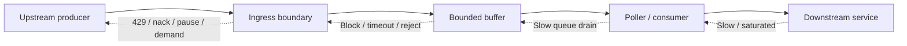
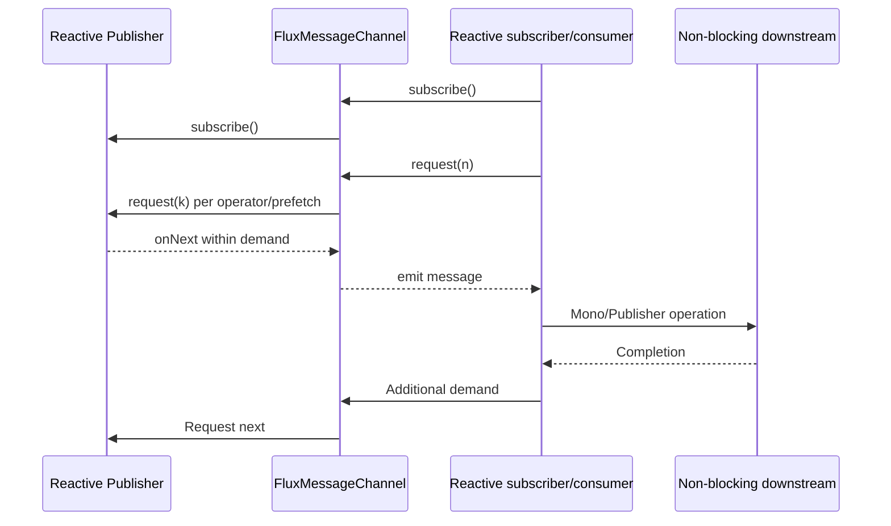
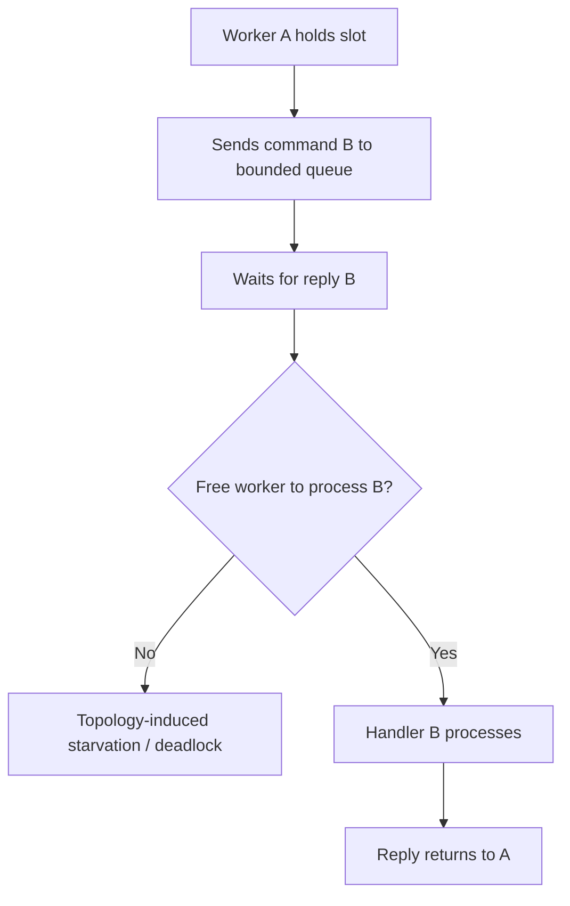

# Queue Bounds and Backpressure in Spring Integration

## 1. Why Is an Unbounded Queue a Runtime Design Bug?

In the **Runtime Design** chapter of the `SPRING_INTEGRATION_RUNTIME` module, a Spring Integration application orchestrates messages through **channels, endpoints, consumers, pollers, and executors**. These components may combine with `IntegrationFlow` lifecycles, transactions, retries, message stores, error channels, and correlation. When a source emits faster than the destination processes, some stage in the flow starts buffering messages. Without explicit bounds upfront, backlog storage quietly shifts from visible queues into **executor work queues, client buffers, brokers, Reactor prefetch buffers, or the JVM heap**, gradually degrading latency until memory runs out.

Consider an order event ingestion system:

```text
HTTP / Broker
  -> inbound adapter
  -> ordersQueue
  -> poller
  -> reserveStock handler
  -> downstream database / HTTP
```

If the source injects 1,000 messages/second while downstream completes only 700 messages/second, the **300 messages/second** surplus accumulates somewhere unless the source is throttled or work is rejected/routed to a controlled durable store. Adding a `QueueChannel` does not erase the mismatch. It merely determines **where** pressure builds and **when** the system reacts.

**Design goal:** not to build a system that "never blocks", but to build a system with **finite limits, transparent overload responses, restart recovery, and measurable SLOs**.

After this lesson, you will be able to:

1. Distinguish **buffering**, **backpressure**, **flow control**, **rate limiting**, **load shedding**, and **durable buffering**.
2. Configure a `QueueChannel` with capacity, use `send(message, timeout)`, and accurately test full-queue behavior.
3. Configure an `ExecutorChannel` with a bounded `ThreadPoolTaskExecutor`, analyzing rejections and `CallerRunsPolicy`.
4. Choose `maxMessagesPerPoll`, `receiveTimeout`, and scheduler/concurrency settings without pollers creating unintended pressure.
5. Distinguish synchronous backpressure on `DirectChannel` from Reactive Streams demand via `FluxMessageChannel`.
6. Size backlogs using arrival/service rates, bursts, message sizes, in-flight work, and drain times.
7. Coordinate queue limits with broker ACKs, persistent message stores, transactions, retries, idempotency, and shutdown.
8. Write JUnit/failure tests for full queues, task rejections, stalled consumers, crashes, and sources that cannot slow down.

## 2. One Word "Backpressure", Many Different Mechanisms

| Mechanism | Where Pressure Builds | Behavior | Limits to Know |
|---|---|---|---|
| **Blocking synchronous handoff** | Producer thread blocked inside send/processing call | Producer naturally slows to consumer pace on same call stack | Thread blocking is not `Subscription.request(n)` |
| **Bounded queue** | Queue with finite slots | When full, `send` waits/times out/returns false per contract | Limit is usually by **message count**, not bytes |
| **Executor admission control** | Thread pool + executor task queue | When full, rejects, runs on caller, or applies another policy | A single task can hold a huge message |
| **Reactive Streams backpressure** | Subscriber requests item count via `request(n)` | Cooperative publisher emits only within demand | Effective only across components that **honor** the contract |
| **Rate limiting** | Producer/gateway caps events/second | Smooths bursts/rates via quotas/token buckets | Does not automatically bound in-memory queues |
| **Broker flow control** | Broker and consumer protocol | Prefetch, pause/resume, credits, offsets/ACKs | Depends on the specific adapter and broker |
| **Load shedding** | API/ingress rejects work under overload | 429/503, NACK, retry-after, or intentional drops | Safe only if sources retry or work is droppable |
| **Durable buffering** | JDBC store/broker/disk | Preserves work across restarts for later processing | Still needs quotas, retention, lag budgets, and disk-full policies |

**Backpressure does not mean "messages can never be lost".** A bounded queue can return `false` when sending fails; the producer still has to handle that outcome. A reactive source may obey demand, yet if the pod dies without a broker/persistence, emitted in-flight items may not recover automatically.

**Rate limiting also does not replace backpressure.** A rate limiter may keep average intake below 1,000 events/s, yet a downstream capable of only 200 events/s will still accumulate backlog. Conversely, demand expresses how many elements downstream is ready to accept, not necessarily a 200 requests/second API quota.

### 2.1. Pressure Propagation Path from Destination Back to Source



The dashed backward arrows represent **throttling policies that must be designed explicitly**, not automatic defaults. If a source keeps emitting without handling rejection signals, pressure spills into internal adapter memory or drops messages.

## 3. Four Questions to Answer Before Picking a Queue

Before choosing `QueueChannel(500)` or 5,000, you must know:

1. **Can the source slow down?** Synchronous HTTP can receive 429/503; Kafka has pause/resume and offset commits; legacy callbacks may offer no flow control at all.
2. **Must messages survive restarts?** Orders/payments typically tolerate zero loss; transient telemetry sometimes permits sampling or dropping events.
3. **What is the maximum wait-time SLO?** A huge queue avoids rejections yet introduces hours of wait time, still violating business SLAs.
4. **Where do terminal errors go?** Bounded retries, DLQ/quarantine, error channels, and replay by business ID must be defined.

From those answers, define the **acceptance contract** for producers:

| Acceptance Outcome | What the App May Promise | What Is Not Yet Promised |
|---|---|---|
| Accepted into bounded in-memory queue | Buffered inside the **current JVM** | Durably persisted; will finish after crash |
| Durably written in transaction/store | Accepted by store per transaction/ACK contract | Business side effects executed |
| `send(message, timeout)` returns `false` | Channel did not accept the message within timeout | Nothing elsewhere in the pipeline retained/ACKed it |
| Executor accepts task | Task scheduled/handed off to worker | Worker completed or DB committed |
| Downstream finishes with confirmation | One stage in the flow completed | Broker ACKed or external HTTP side effect is exactly-once |

If a source ACKs before a message is durably saved, a crash can lose work. If a handler commits business state before broker ACK, redelivery can create duplicates. **Queue capacity does not bridge these two gaps**; proper transactions and idempotency are required.

## 4. Bounded QueueChannel: Enforcing Message Limits Right at the Channel

`QueueChannel` is a point-to-point `PollableChannel`: producers send messages into the queue, and polling consumers pull via `receive()`. With its default constructor, the queue can grow to a very large element limit—effectively **unbounded relative to heap budgets** in practice. Spring Integration recommends setting an explicit capacity to avoid running out of memory.

### 4.1. Java Configuration

```java
import org.springframework.context.annotation.Bean;
import org.springframework.context.annotation.Configuration;
import org.springframework.integration.channel.QueueChannel;

@Configuration
public class BoundedChannelConfig {

    @Bean("ordersQueue")
    public QueueChannel ordersQueue() {
        return new QueueChannel(256);
    }
}
```

`256` is the maximum **number of messages** in the queue at once, not 256 KiB or 256 concurrent HTTP requests. If each payload is several MiB, 256 slots can still hold hundreds of MiB and create severe heap/GC pressure.

### 4.2. XML Configuration

```xml
<int:channel id="ordersQueue">
    <int:queue capacity="256"/>
</int:channel>
```

This fragment requires the proper Spring Integration `int` namespace. Configuring `<int:queue/>` without `capacity` creates an unbounded queue useful only in narrow scenarios bounded externally. Never use it as a production default.

### 4.3. When the Queue Is Full, What Does send Do?

On a full queue, `send(message, timeout)` can **wait up to timeout milliseconds for a slot**, or return `false` if the timeout expires without acceptance. A timeout of `0` attempts a non-blocking offer. Calling `send(message)` without a timeout can **block indefinitely** on a full bounded `QueueChannel` when no receiver drains it; never use the timeout-less form on request paths with strict deadlines.

```java
import org.springframework.integration.channel.QueueChannel;
import org.springframework.messaging.support.MessageBuilder;

QueueChannel queue = new QueueChannel(2);

boolean first = queue.send(MessageBuilder.withPayload("A").build(), 0);
boolean second = queue.send(MessageBuilder.withPayload("B").build(), 0);
boolean third = queue.send(MessageBuilder.withPayload("C").build(), 0);

// first == true, second == true, third == false when no consumer drains.
var received = queue.receive(0); // Immediately pulls A without waiting.
boolean retried = queue.send(
        MessageBuilder.withPayload("C").build(), 0); // Slot is now free.
```

Distinguish clearly:

- `send(..., 0)==false` means the channel rejected the message **on this attempt**; the producer must apply a policy for unaccepted work.
- `receive(0)` retrieves an available message immediately or returns `null`; it does not mean "no future messages will arrive".
- `send(message, timeout)` succeeding does not prove the **consumer** has executed or the database has committed.
- Calling `send(message)` from a servlet thread can exhaust request threads if the queue stays full; use finite timeouts and appropriate responses.

**Never write a `while (!queue.send(message, 0)) {}` loop**: a busy spin burns CPU and starves other components trying to recover. If retrying at ingress, use bounded delays/backoffs and deadlines aligned with business SLOs.

## 5. End-to-End Example: Bounded Queue and Polling Consumer

This example uses Java 17+, `spring-integration-core`, and Spring Context. Place public classes in separate Java files under package `example.integration`. It demonstrates **single-JVM admission control**, not a restart-durable queue.

### 5.1. Business Message with a Stable ID

```java
package example.integration;

public record OrderCommand(String eventId, String sku, int quantity) {}
```

`eventId` is the business key stable across retries/redeliveries. Never use framework-generated `MessageHeaders.ID` as an idempotency key when replays can construct fresh message instances.

### 5.2. Configuring QueueChannel and Poller

```java
package example.integration;

import java.util.concurrent.atomic.AtomicInteger;

import org.springframework.context.annotation.Bean;
import org.springframework.context.annotation.Configuration;
import org.springframework.integration.annotation.Poller;
import org.springframework.integration.annotation.ServiceActivator;
import org.springframework.integration.channel.QueueChannel;
import org.springframework.integration.config.EnableIntegration;

@Configuration
@EnableIntegration
public class OrderFlowConfig {

    @Bean("ordersQueue")
    public QueueChannel ordersQueue() {
        return new QueueChannel(256);
    }

    @Bean
    public OrderWorker orderWorker() {
        return new OrderWorker();
    }

    public static class OrderWorker {
        private final AtomicInteger handled = new AtomicInteger();

        @ServiceActivator(
                inputChannel = "ordersQueue",
                poller = @Poller(
                        fixedDelay = "100",
                        maxMessagesPerPoll = "8",
                        receiveTimeout = "0"))
        public void process(OrderCommand command) {
            // Demo: do not block threads with sleep or make network calls.
            // Production: call a service enforcing transactions + idempotency.
            handled.incrementAndGet();
        }

        public int handledCount() {
            return handled.get();
        }
    }
}
```

`@Poller(fixedDelay="100", maxMessagesPerPoll="8")` caps the number of receives per poll cycle. It **does not guarantee 80 messages/second throughput**: each cycle includes handler execution time, scheduler jitter, fixed-delay spacing, consumer count, and downstream capacity. `receiveTimeout="0"` prevents a poll from lingering on an empty queue in the example; tune intentionally when long polling is needed.

### 5.3. Admission Service Sending with a Finite Timeout

```java
package example.integration;

import org.springframework.beans.factory.annotation.Qualifier;
import org.springframework.integration.channel.QueueChannel;
import org.springframework.messaging.support.MessageBuilder;
import org.springframework.stereotype.Service;

@Service
public class OrderIngress {

    public enum Result { ACCEPTED, OVERLOADED }

    private final QueueChannel ordersQueue;

    public OrderIngress(
            @Qualifier("ordersQueue") QueueChannel ordersQueue) {
        this.ordersQueue = ordersQueue;
    }

    public Result tryAccept(OrderCommand command) {
        if (command.eventId() == null
                || command.eventId().isBlank()
                || command.quantity() <= 0) {
            throw new IllegalArgumentException("Invalid command");
        }

        boolean accepted = ordersQueue.send(
                MessageBuilder.withPayload(command)
                        .setHeader("businessEventId", command.eventId())
                        .build(),
                20); // Wait at most 20 ms for a slot at ingress.

        return accepted ? Result.ACCEPTED : Result.OVERLOADED;
    }
}
```

**This contract is in-memory.** An HTTP endpoint can map `OVERLOADED` to HTTP 429 or 503 with a client retry policy per contract. If the source is Kafka/JMS, never treat `ACCEPTED` as durable persistence; offset commits/ACKs must match actual application recovery guarantees. `20 ms` is illustrative—choose it based on request deadlines, latency SLOs, and overload handling.

**Rejecting before acceptance** differs from accepting and then dropping messages. When a producer receives `OVERLOADED`, the message was never accepted at this boundary. Yet if an upstream step already ACKed it earlier, rejecting here turns into **data loss**. Place the receipt/ACK point so upstream can retry/redeliver until work is durably stored.

### 5.4. Behavior When Stopping the Application

Stopping a polling consumer does not empty the queue automatically. Once stopped, `ordersQueue` can still accept up to 256 items; if the JVM exits, RAM backlog vanishes. Recovery requires a replayable broker/source or a persistent message store. `ReadinessState.REFUSING_TRAFFIC` can curb HTTP traffic to a pod, yet does not pause broker listeners or file pollers on its own.

## 6. JUnit 5: Proving Bounds and Timeouts Without Sleeps

Test `QueueChannel` directly to verify its contract **without depending on poller scheduling**:

```java
package example.integration;

import org.junit.jupiter.api.Test;
import org.springframework.integration.channel.QueueChannel;
import org.springframework.messaging.support.MessageBuilder;

import static org.junit.jupiter.api.Assertions.*;

class QueueCapacityTest {

    @Test
    void rejectsWhenFullAndAcceptsAfterReceive() {
        QueueChannel queue = new QueueChannel(2);

        assertTrue(queue.send(
                MessageBuilder.withPayload("A").build(), 0));
        assertTrue(queue.send(
                MessageBuilder.withPayload("B").build(), 0));

        // No consumer: the 3rd slot is rejected immediately.
        assertFalse(queue.send(
                MessageBuilder.withPayload("C").build(), 0));

        assertEquals("A", queue.receive(0).getPayload());
        assertTrue(queue.send(
                MessageBuilder.withPayload("C").build(), 0));

        assertEquals("B", queue.receive(0).getPayload());
        assertEquals("C", queue.receive(0).getPayload());
        assertNull(queue.receive(0));
    }

    @Test
    void finiteTimeoutDoesNotBlockIndefinitely() {
        QueueChannel queue = new QueueChannel(1);

        assertTrue(queue.send(
                MessageBuilder.withPayload("A").build(), 0));

        // No consumer frees the slot; finite timeout expires.
        assertFalse(queue.send(
                MessageBuilder.withPayload("B").build(), 30));

        // Timed-out message was not auto-enqueued afterward.
        assertEquals("A", queue.receive(0).getPayload());
        assertNull(queue.receive(0));
    }
}
```

Never assert an exact runtime of `30 ms`: CI schedulers and OS thread scheduling introduce jitter. What matters is that the call **returns within a finite bound** while the queue remains full, not millisecond-exact wall-clock timing.

### 6.1. Testing That a Waiting Producer Unblocks

To test that `send(message, timeout)` **waits** while full and **succeeds** once a consumer frees a slot, use `CountDownLatch` and `Future` with deadlines rather than `Thread.sleep()` to "time" the receiver.

```java
import java.util.concurrent.*;
import org.springframework.integration.channel.QueueChannel;
import org.springframework.messaging.support.MessageBuilder;

QueueChannel queue = new QueueChannel(1);
queue.send(MessageBuilder.withPayload("A").build(), 0);

ExecutorService executor = Executors.newSingleThreadExecutor();
CountDownLatch attemptStarted = new CountDownLatch(1);

try {
    Future<Boolean> pending = executor.submit(() -> {
        attemptStarted.countDown();
        return queue.send(
                MessageBuilder.withPayload("B").build(),
                2_000);
    });

    if (!attemptStarted.await(1, TimeUnit.SECONDS)) {
        throw new AssertionError("Producer task did not start");
    }

    // Free a slot; the waiting producer can proceed.
    queue.receive(0);

    boolean accepted = pending.get(2, TimeUnit.SECONDS);
    if (!accepted) {
        throw new AssertionError("Expected B to be accepted");
    }
} finally {
    executor.shutdownNow();
}
```

This is a standalone illustrative snippet; in real tests, wrap it in a `@Test` method and assert final queue contents. `attemptStarted` only proves the task started, not that it entered the exact wait state. Therefore do not assert nanosecond ordering; verify the outcome once the slot is freed.

## 7. ExecutorChannel: Bound Both Workers and Task Queues

`ExecutorChannel` delegates dispatch to a `TaskExecutor`. It typically returns fast once the task is accepted, yet the producer **has no guarantee the handler finished**. When a task executor uses an unbounded work queue, switching from `QueueChannel` to `ExecutorChannel` does not eliminate backlogs—it merely hides them deeper inside the executor.

### 7.1. Bounded ThreadPoolTaskExecutor

```java
package example.integration;

import org.springframework.beans.factory.annotation.Qualifier;
import org.springframework.context.annotation.Bean;
import org.springframework.context.annotation.Configuration;
import org.springframework.integration.channel.ExecutorChannel;
import org.springframework.messaging.MessageChannel;
import org.springframework.scheduling.concurrent.ThreadPoolTaskExecutor;

@Configuration
public class BoundedExecutorConfig {

    @Bean("ordersExecutor")
    public ThreadPoolTaskExecutor ordersExecutor() {
        ThreadPoolTaskExecutor executor = new ThreadPoolTaskExecutor();
        executor.setThreadNamePrefix("orders-");
        executor.setCorePoolSize(2);
        executor.setMaxPoolSize(4);
        executor.setQueueCapacity(64);
        return executor;
    }

    @Bean("asyncOrdersIn")
    public MessageChannel asyncOrdersIn(
            @Qualifier("ordersExecutor") ThreadPoolTaskExecutor executor) {
        return new ExecutorChannel(executor);
    }
}
```

Meaning of these parameters:

- `corePoolSize=2`: baseline pool size retained per lifecycle, not the total messages allowed in flight.
- `maxPoolSize=4`: maximum workers allowed under pool expansion during load spikes.
- `queueCapacity=64`: maximum **queued tasks inside the executor**, separate from any `QueueChannel` capacity elsewhere in the flow.
- Total messages held by the executor include both **running and queued tasks**, excluding client futures, retries, and broker-prefetched messages.
- `ThreadPoolTaskExecutor` typically queues tasks once core threads are busy and only grows workers toward `maxPoolSize` when the queue fills. Thus never assume 4 workers run immediately when 4 messages arrive.

In a flow containing both `QueueChannel(256)` and an `ExecutorChannel` backed by a 64-slot executor queue, **total buffering is not just 256**. Sum every buffer layer plus downstream in-flight items.

### 7.2. Rejection Policy: Choosing Business Behavior

| Policy | When Pool + Queue Are Full | When Appropriate |
|---|---|---|
| `AbortPolicy` (JDK executor default) | Throws rejection exception; Spring wrapper may throw `TaskRejectedException` | Ingress must know no more work can be accepted; source must retry/NACK properly |
| `CallerRunsPolicy` | Producer thread runs the task while executor is still running | Throttles by slowing the producer; can spike latency or stall callback threads |
| `DiscardPolicy` | Drops task without throwing | Only for **non-critical** signals with loss metrics and explicit contract permission |
| `DiscardOldestPolicy` | Drops oldest queued task and retries enqueue | Easily loses business work and breaks ordering; rarely safe |
| Custom policy | Bounded blocking, return overload, or durable fallback | Must prevent deadlocks, enforce timeouts, emit metrics, and be thoroughly tested |

**Never claim `CallerRunsPolicy` is always safe backpressure.** When the queue is full, it runs the handler on the **sending thread**, changing thread boundaries, inflating latency, and risking long stalls on broker callback threads or HTTP request threads. Spring Integration also warns against relying on this behavior for transaction propagation: executing on the caller thread is **load-dependent**, not a stable contract.

To configure the rejection policy explicitly:

```java
import java.util.concurrent.ThreadPoolExecutor;

executor.setRejectedExecutionHandler(
        new ThreadPoolExecutor.AbortPolicy());
```

This fragment goes inside `ordersExecutor()` before bean initialization. Even when `ExecutorChannel.send` returns `true`, the worker handler can still throw exceptions later; configure an explicit error channel/error handler for the async path.

### 7.3. Testing Executor Rejection Deterministically

```java
import java.util.concurrent.CountDownLatch;
import java.util.concurrent.TimeUnit;
import org.junit.jupiter.api.Test;
import org.springframework.core.task.TaskRejectedException;
import org.springframework.scheduling.concurrent.ThreadPoolTaskExecutor;

import static org.junit.jupiter.api.Assertions.*;

class ExecutorCapacityTest {

    @Test
    void rejectsWhenOneWorkerAndOneQueueSlotAreOccupied()
            throws InterruptedException {

        ThreadPoolTaskExecutor executor = new ThreadPoolTaskExecutor();
        executor.setCorePoolSize(1);
        executor.setMaxPoolSize(1);
        executor.setQueueCapacity(1);
        executor.initialize();

        CountDownLatch started = new CountDownLatch(1);
        CountDownLatch release = new CountDownLatch(1);

        try {
            executor.execute(() -> {
                started.countDown();
                try {
                    release.await();
                } catch (InterruptedException interrupted) {
                    Thread.currentThread().interrupt();
                }
            });

            assertTrue(started.await(1, TimeUnit.SECONDS));
            executor.execute(() -> {}); // Occupies the sole queue slot.

            assertThrows(TaskRejectedException.class,
                    () -> executor.execute(() -> {}));
        } finally {
            release.countDown();
            executor.shutdown();
        }
    }
}
```

This test isolates the `ThreadPoolTaskExecutor` contract. When testing through `ExecutorChannel`, the exception may be wrapped by messaging/dispatcher layers; assert the cause or version-appropriate exception family. Complete integration tests must also verify the producer **does not ACK the source message** when the task is rejected.

## 8. Pollers: Bounding Work Pulled Per Cycle

`PollingConsumer` pulls messages from a `PollableChannel`. `SourcePollingChannelAdapter` invokes `MessageSource.receive()` to produce messages from a source. Both endpoints have **different defaults** and must be configured intentionally.

Per the Spring Integration Reference:

- `maxMessagesPerPoll` caps the maximum receives within **each poll cycle**.
- Default for `PollingConsumer` in many versions is `-1` (continues until `receive()` returns `null`).
- Default for `SourcePollingChannelAdapter` is `1`.
- Setting `0` (since Spring Integration 5.5) **skips receiving temporarily** as a form of pause.
- `receiveTimeout` is how long the poller waits when no message is immediately available; it is not the handler's execution timeout.

XML example:

```xml
<int:service-activator
        input-channel="ordersQueue"
        ref="orderWorker"
        method="process">
    <int:poller fixed-delay="100"
                max-messages-per-poll="8"
                receive-timeout="0"/>
</int:service-activator>
```

This fragment requires `ordersQueue`, bean `orderWorker`, and the `int` namespace. Do not declare this alongside the `@ServiceActivator` in Section 5 sharing the same queue unless you intentionally want competing consumers.

### 8.1. What maxMessagesPerPoll Does NOT Do

- **Does not** limit how many messages wait in `QueueChannel`; it only caps receives per poll cycle.
- **Does not** enforce an exact per-second throughput cap; handlers vary in speed.
- **Does not** bound total in-flight messages if the poller delegates to a `task-executor`, or if multiple consumers/endpoints exist.
- **Does not** throttle a broker producer directly unless the broker adapter configures pause/prefetch/ACK properly.
- **Does not** guarantee FIFO completion when workers run concurrently or retry asynchronously.

If a poller pulls `8` messages every 100 ms and submits them to an executor with a 1,000-slot queue, pressure simply moves from the channel queue into the executor. Size capacity and concurrency **across the entire chain**.

### 8.2. Fixed-Delay, Receive-Timeout, and Thread Starvation

A poller with `fixedDelay=100 ms` and `receiveTimeout=5,000 ms` can tie up a scheduler thread waiting on an empty queue for a long time. Use long polling only when minimizing receive latency and enough scheduler threads exist; never set large receive timeouts across shared schedulers without measuring impact.

Especially avoid running multi-second blocking handlers on the same scheduler thread serving hundreds of other pollers. Separate schedulers/executors by workload, remembering that every thread handoff introduces a **transaction boundary and potential buffer**.

## 9. Reactive Streams: True Demand vs. Uncontrolled Push

`FluxMessageChannel` implements `Publisher<Message<?>>` and `ReactiveStreamsSubscribableChannel`. When the source is a `Publisher` honoring `Subscription.request(n)`, the channel connects via `subscribeTo(Publisher)`, and `ReactiveStreamsConsumer` lets downstream process reactively.



Here request count `k` may differ from `n` due to `flatMap`, prefetch, `limitRate`, and bridge behavior. **Key point:** upstream must genuinely receive and obey demand.

### Two Very Different Ways to Feed FluxMessageChannel

- `fluxChannel.subscribeTo(publisher)`: source is a Reactive Streams Publisher. Downstream demand **can** throttle upstream via the contract.
- `fluxChannel.send(message)` inside an imperative callback/loop: the caller **does not magically become a `request(n)`-respecting Publisher** just by sending to a reactive channel. If the callback cannot slow down, you still need bounded overflow/broker/pause policies.

Reactive handlers should use **truly non-blocking** clients. A method returning `Mono.just(jdbcTemplate.queryForObject(...))` still executes blocking JDBC synchronously while constructing the Mono; it provides no end-to-end backpressure. When bridging blocking calls, use bounded schedulers/concurrency and measure scheduler queues and connection pools.

### 9.1. Concurrency Limits Differ from Buffer Limits

Standalone Reactor example:

```java
import java.time.Duration;
import reactor.core.publisher.Flux;
import reactor.core.publisher.Mono;

Flux<Integer> source = Flux.range(1, 20);

Flux<Integer> results = source.flatMap(
        item -> Mono.delay(Duration.ofMillis(80))
                .thenReturn(item),
        8); // At most 8 active inner Publishers in this operator.
```

This is an **illustrative Reactor pipeline** using `Mono.delay(...)` to simulate non-blocking work; nothing runs until subscribed. In real systems, replace it with demand-aware adapter Publishers and reactive clients, then verify cancellation/errors/ACKs with the source. `flatMap(..., 8)` does not bound upstream prefetch or external buffers outside this operator. `onBackpressureBuffer(capacity)` establishes a finite buffer when a stage ignores demand, yet **does not make an external callback producer stop**; overflow still needs an explicit policy.

## 10. Sizing Queues: From Bursts, Throughput, and Latency to Heap

**Never guess capacity by intuition.** Use a quantitative model and calibrate with load tests.

Notation:

- `λ`: arrival rate (messages/second).
- `μ`: downstream completion rate (messages/second).
- `T`: burst duration (seconds).
- `S`: average serialized payload size (bytes); also measure p95/p99.
- `H`: heap/header/object-reference/queue/task and serializer overhead.
- `Q`: messages waiting in a specific queue.
- `C`: concurrent in-flight operations.
- `L`: average downstream operation latency.

### 10.1. Backlog Grows Whenever Producers Outpace Consumers

During a relatively steady burst, approximate:

\[
B_{\text{burst}} \approx \max(0,\lambda-\mu)\times T
\]

For example, if the source emits 240 messages/s for 60 seconds while downstream completes 200 messages/s:

\[
B \approx (240-200)\times60=2{,}400\ \text{messages}
\]

If each serialized message averages 12 KiB, raw payload alone is roughly:

\[
2{,}400 \times 12\ \text{KiB}=28{,}125\ \text{MiB}
\]

Using an illustrative `2.5×` overhead multiplier, retained heap could reach ~**70 MiB**, before counting other queue/buffer layers, retry records, or large p99 payloads. **This is only a rough back-of-the-envelope estimate**, not a heap guarantee from Spring Integration.

If `λ > μ` **persists indefinitely**, **no finite capacity is ever enough**. You must reduce intake, scale processing capacity, offload to a durable buffer with quotas/retention, or renegotiate the SLA contract.

### 10.2. Estimating Drain Time

Given backlog `B`, downstream capacity `μ` messages/s, and post-burst arrival rate `λ_{\text{after}}` smaller than `μ`:

\[
T_{\text{drain}}\approx\frac{B}{\mu-\lambda_{\text{after}}}
\]

With `B=2,400`, `μ=200`, and `λ_{\text{after}}=100`, draining takes roughly **24 seconds** assuming steady operation without extra retries or concurrency changes.

If backlog hits 2,400 while the SLO requires queue wait under 3 seconds for every message, raising capacity to 10,000 **will not save the SLA**. You must evaluate p99 latency, destination quotas, concurrency, and admission control.

### 10.3. Little's Law for Sizing In-Flight Concurrency

Under **steady-state** traffic with average operation latency `L`, target in-flight concurrency is roughly:

\[
C \gtrsim \mu\times L
\]

To achieve 200 operations/s when each downstream call averages `0.25 seconds`, you need around **50** concurrent operations if client and server support it. However, if the DB pool holds only 20 connections and each operation holds one for 250 ms, raising reactive concurrency to 50 simply creates **a queue inside the connection pool**. Measure real limits and p95/p99 latencies.

### 10.4. Bound by Bytes, Not Just Count

A bounded `QueueChannel(256)` caps **message count**, yet a message can carry a 1–10 MiB blob. To protect heap:

- Enforce **payload size limits right at ingress**.
- Check serialized sizes and header counts/sizes, especially from JSON/brokers.
- For large payloads, offload bytes to an object/blob store with retention and pass a small **reference message** (claim-check pattern).
- Measure total process heap + direct buffers + executor queues + retry/metric objects, not just `getQueueSize()`.
- Load-test with **p95/p99 payloads and bursts**, not tiny "hello" messages.
- If a byte-aware queue is truly needed, enforce a byte + count admission budget in a dedicated component with concurrency control and quota release on removal; do not assume `QueueChannel` natively enforces byte capacities.

## 11. Bounded Does Not Mean Durable: Surviving Restarts

By default, `QueueChannel` stores messages in RAM. When the process stops abruptly, the queue loses its backlog. For critical work, consider a durable broker or persistent channel message store.

### 11.1. Persistent QueueChannel

Spring Integration supports backing a queue with a `message-store`, such as `JdbcChannelMessageStore`:

```xml
<int:channel id="ordersDurableQueue">
    <int:queue message-store="jdbcChannelStore"/>
</int:channel>
```

`jdbcChannelStore` is a bean properly configured with a `DataSource`, query provider/schema, serializer, transaction manager, and version. **Important:** per the Spring Integration Reference, **you must not specify `capacity` on the `<int:queue>` element when using `message-store`**. Therefore the following XML is **invalid**:

```xml
<!-- ANTI-PATTERN: do not configure capacity alongside message-store -->
<int:channel id="invalidQueue">
    <int:queue message-store="jdbcChannelStore" capacity="256"/>
</int:channel>
```

To keep durable storage bounded, enforce policies **outside the queue capacity attribute**: ingress admission control, database byte/row quotas, in-flight limits, TTL/retention, DB size alerts, and recovery plans when the database fills up.

A persistent queue is **not** "safely unbounded". If the database exhausts disk/quotas, failures cascade across the application. Quotas and retry/overload behaviors must be defined upfront.

### 11.2. Poller Transactions and Dequeue

With `JdbcChannelMessageStore`, when a polling consumer uses an appropriate transaction, receiving/removing from the store participates in the transaction, allowing rollback so messages are not lost if the handler fails **before commit**. Illustrative XML example:

```xml
<int:service-activator
        input-channel="ordersDurableQueue"
        ref="orderService"
        method="process">
    <int:poller fixed-delay="200"
                max-messages-per-poll="5">
        <int:transactional transaction-manager="transactionManager"/>
    </int:poller>
</int:service-activator>
```

A real setup also requires the `transactionManager` bean matching the store's DataSource, adapters, and serializers.

**Do not confuse with `ExecutorChannel`**: when a message is handed off to an executor thread, the poller's transaction **does not travel with it**; store dequeue and business effects happen in separate transactions. Verify durability boundaries with real DB and process-kill tests rather than assuming `@Transactional` in code covers everything.

### 11.3. At-Least-Once and Idempotency

A flow backed by a broker or JDBC queue can still reprocess messages after a crash (for example, business DB commits before source ACK). Your design should include:

1. A stable `businessEventId` and unique constraint/inbox ledger.
2. Bounded retries for transient errors and poison-message classification.
3. DLQ/quarantine with sufficient diagnostic metadata and no leaked secrets.
4. Source ACK/offset commit only after achieving the promised durability level.
5. Restart replay with idempotent handlers and reconciliation of external side effects.

**Bounded queues control memory; durable stores retain work; idempotency protects replays.** These three mechanisms complement rather than replace one another.

## 12. Overload Responses: No One-Size-Fits-All Policy Across Sources

### 12.1. Synchronous HTTP Ingress

When downstream queues are full:

- Stop accepting or return `429 Too Many Requests` for rate/quota limits, or `503 Service Unavailable` when instance capacity is exhausted.
- When protocol permits, include `Retry-After` or equivalent headers; never promise job acceptance when `send(...,0)==false`.
- Enforce request timeouts and never block servlet threads indefinitely.
- For commands requiring **durable acceptance**, confirm acceptance only after persistent storage confirms write commit.

### 12.2. Kafka/JMS/AMQP Inbound

- Use adapter/broker **pause/resume, consumer concurrency, prefetch/credit, and commit/ack** mechanisms to throttle intake.
- When unable to accept downstream work, **never ACK success and drop the message**; choose NACK/requeue/seek/retry per adapter semantics.
- Kafka ACKs depend on offsets/partitions and ack modes; JMS/AMQP have channel/session/transaction modes. Never apply one uniform API across all transports.
- If a consumer already pulled a batch right before the queue filled, handle in-flight messages per contract rather than merely slowing future polls.
- Monitor broker lag/rebalances and avoid indefinite pauses without deadlines or alerts.

### 12.3. File/Polling Sources

- Cap `maxMessagesPerPoll` and file scan/claim rates; never pull thousands of files ahead when downstream lacks capacity.
- If `MessageSource.receive()` has side effects (marking files seen, moving/deleting files), a failed downstream send can leave an inconsistent checkpoint.
- Use `MetadataStore`/persistent filters alongside rollback/replay strategies at the source boundary.
- Never treat `receive()==null` on an idle source as a system error.

### 12.4. Push Callbacks Without Pause Support

If a driver continuously invokes callbacks with no way to signal slowdown, **end-to-end backpressure** cannot be achieved merely by swapping channels. Choose one of: **durable staging**, protocol-level rejections, bounded queues with permitted dropping, or throttling at an upstream network/proxy. Explicitly document data-loss policies if dropping is unavoidable.

### 12.5. Rejecting/Dropping Messages Must Never Be "Silent"

Only use `nullChannel`, `onBackpressureDrop`, `DiscardPolicy`, or drop filters when data loss is an explicitly approved business choice (such as telemetry sampling). For payment/order commands, **reject loudly** or persist to durable storage—never silently discard under overload.

## 13. How Do Retries Amplify Pressure?

A single downstream failure not only lowers `μ`—it also generates extra attempts:

- Handler retries hold work in flight and sometimes block workers during backoffs.
- Error channels can receive floods of errors; error loggers/DLQs themselves have queues.
- Broker redeliveries after NACK/restart can dump waves of old messages simultaneously.
- HTTP client retries, Integration advice retries, and broker redeliveries multiply total call volume.
- When many messages await a recovering downstream service, a **retry storm** erupts.

For example, 1,000 logical events retrying 3 times each generate up to **3,000 handler attempts** from just one retry layer, excluding broker replays. Therefore:

| Component | Required Guardrails |
|---|---|
| Retry template/advice | Finite `maxAttempts`, exponential backoff/jitter where needed, deadlines |
| DLQ/recovery | Quotas and monitoring; error paths must never trigger infinite loops |
| Worker concurrency | Cap total in-flight work; circuit breakers for failing downstreams |
| Business effects | Stable idempotency keys; never duplicate side effects on retry |
| Producer ingress | Admission tied to real capacity and SLAs; no busy-loop retries |
| Post-restart recovery | Controlled drain rates, priority between old/new work, DB resource quotas |

Avoid long backoffs on scarce worker threads without assessing throughput impact. In some systems, rather than sleeping threads, messages should be **rescheduled in a store/broker** to free worker slots; this requires source support and duplicate protection.

## 14. Deadlocks, Starvation, and Less Visible Risks

### 14.1. Producer and Consumer Sharing a Full Executor

If a task running on an executor sends another message into the same queue/executor and **waits synchronously for a reply**, while all workers wait on one another, deadlock/starvation occurs.



Prevention:

- Never block waiting for replies inside the same pool that might be exhausted and is solely responsible for processing those replies.
- Separate ingress, business worker, and diagnostic executors; enforce appropriate concurrency limits.
- Configure end-to-end timeouts on gateways/reply channels, noting timeouts do not auto-roll back external side effects.
- Map the call graph to uncover synchronous cycles across `DirectChannel`/`QueueChannel`/`ExecutorChannel`.
- Never blindly apply `CallerRunsPolicy` when handlers perform recursive sends or hold locks.

### 14.2. Ordering and Shared Correlation IDs

Raising poller concurrency can break processing/completion order. If the business requires events sharing an `aggregateId` to run sequentially, partition by key, use sequence/correlation strategies, or enforce controlled serial processing. Never rely solely on FIFO queue order once multiple workers are introduced.

Spring Integration provides `PartitionedChannel` to dispatch by partition key and maintain per-partition thread ordering under proper conditions. However, **partitioning does not automatically provide persistence or byte budgets**—you still need overload, stop/restart, and replay policies.

### 14.3. "Hidden" Bottlenecks in Clients

Even when the primary queue looks empty, downstream work may be piling up inside:

- JDBC connection pool pending-acquire queues.
- HTTP client connection pools, Reactor prefetch buffers, and pending request queues.
- Broker client local buffers/prefetch caches.
- Serializer/GC queues or callback event loops.
- Logging/wire-tap executors or tracing exporters.

Therefore total backlog spans **a network of queues**, not merely `QueueChannel.getQueueSize()`.

## 15. Observability: Measure Pressure, Not Just Heap

A minimal metric set scoped per **flow/instance/tenant** with controlled cardinality:

| Suggested Metric | Meaning |
|---|---|
| `input_messages_total` | Logical messages observed at ingress |
| `admission_accepted_total` / `admission_rejected_total` | Intake accepted vs. rejected by capacity checks |
| `queue_depth` / `queue_capacity` | Current queued count and configured slot limit |
| `oldest_message_age_seconds` | How long the oldest waiting item has sat |
| `handler_inflight` / `handler_completed_total` | Active concurrency and real completion throughput |
| `handler_p95/p99_latency` | Downstream latency impact on queue wait |
| `executor_active_threads` / `executor_queued_tasks` | Worker pool saturation |
| `executor_rejected_total` | Dispatches rejected by executor |
| `poller_last_success_timestamp` / `poller_receive_total` | Proves poller makes progress, not merely running |
| `source_lag` / `unacked_count` | External backlog in broker/source outside JVM |
| `db_store_rows` / `db_store_bytes` | Remaining durable infrastructure quota |
| `retry_attempts_total` / `dlq_total` | Pressure from failures and poison messages |
| `gc_pause_p99` / `heap_used` | Heap pressure and JVM pauses |
| `drain_duration_seconds` | Time to clear backlog during shutdown/recovery |

Names in this table are **application instrumentation suggestions**, not all built-in Spring Integration/Micrometer meter names. Combine Micrometer Spring Integration metrics, tracing, broker admin metrics, and JDBC monitoring.

**False-positive warning:** low queue depth does not prove a healthy flow—pollers may simply be draining messages fast into a massive executor queue. Conversely, high queue depth does not automatically require reporting NOT READY if work is durably stored within lag/SLA budgets.

### 15.1. Hysteresis and Alerting

A sample policy (do not apply directly without benchmarking):

- Begin throttling new intake once queues exceed 85% capacity across several measurement windows.
- Restore full intake only after queues drop below 60% capacity and handler errors/rejections return to healthy thresholds.
- Alert early on **oldest message age**, rather than waiting for full queues.
- If backlog grows continuously (`λ > μ`), trigger a capacity incident even before queues fill completely.
- Incorporate downstream pool saturation, broker lag, p99 response latency, and timeout budgets.

Hysteresis prevents readiness/ingress from flapping around a single threshold. However, when safety invariants are breached (e.g., inability to persist an accepted order), **fail fast** per contract rather than continuing to accept work just because alert windows have not elapsed.

## 16. Repeatable Overload Testing

A runtime design test suite must cover both small unit tests and realistic failure scenarios.

### 16.1. Testing Matrix

| Scenario | How to Trigger | Oracle to Verify |
|---|---|---|
| Queue below capacity | Send `capacity` messages with no receiver | Every send returns `true`, exact depth |
| Queue full | Send one more with timeout `0` | Immediately returns `false`, not enqueued |
| Waiting producer | Send with finite timeout while receiver frees a slot | Accepted or times out per contract, never hangs |
| Stopped consumer | Stop endpoint, continue bounded ingress | Backlog grows to capacity, then rejects |
| Busy executor | Hold all workers with latches, fill queue | Deterministic rejections, no silent loss |
| CallerRunsPolicy | Dedicated test when executor is full | Handler runs on producer thread; measure p99 and transaction impact |
| Slow downstream | Controlled stub delays | Queue depth/oldest age climb as expected |
| Retry storm | Persistent transient errors with finite retry budget | Bounded attempts, DLQ, saturation, no infinite retries |
| Full persistent store | Restrict disk/quota in test | Explicit errors, no false ACK/acceptance |
| Crash after RAM enqueue | Kill process | Explicit awareness of data loss, never pretend durable |
| Crash during JDBC polling | Kill before commit | Message replayed per transaction/store contract |
| Crash after business commit | Kill before source ACK | Idempotency prevents duplicates |
| Multi-instance | Two consumers sharing broker/store | Combined throughput/replay, ordering, and error paths hold |
| Reactive upstream | `StepVerifier` requests finite counts | Compliant Publisher never emits beyond demand |
| Push callback overload | Unthrottled producer | Explicit overflow policy and reject/drop/lag metrics |
| Graceful shutdown | Stop ingress, wait for in-flight within deadline | Rejects new work, pending items have replay path |

### 16.2. Never Use Sleeps to "Force Failure Reliably"

For concurrency tests, use `CountDownLatch`, `QueueChannel.receive(timeout)`, `Future.get(timeout)`, and attempt-indexed fault injection. `Thread.sleep(200)` flakes under slow CI schedulers and leaves thread states ambiguous.

Put finite timeouts on every test so pipeline deadlocks never hang the entire build. With brokers/databases, use test resources with clear readiness checks and cleanup; verify **final business outcomes**, not merely `"sent message"` logs.

### 16.3. Large Payloads and Byte Controls

In load tests, include at least three payload sizes:

1. Small: event metadata of a few hundred bytes.
2. Typical: average/p95 sizes observed in production.
3. Large: p99 or maximum allowed size.

Measure retained heap, GC pauses, latency, serialization CPU, queue depth, and total in-flight volume. If a 10 MiB message is copied across multiple `byte[]` or `String` instances in transformers, actual memory usage far exceeds `slots × serialized payload size`. Consider passing blob-store object references instead of carrying raw files inside messages.

## 17. Runbook When Queues Fill or Throughput Drops

**Step 1 — Identify where backlog accumulates.** Check broker lag, queue channel depth, executor queues, DB pool pending waits, HTTP client queues, and Reactor buffers. Never blindly raise capacity on the first queue you see if the bottleneck sits elsewhere.

**Step 2 — Compare arrival vs. completion rates.** Estimate `λ`, `μ`, time-to-full, and time-to-drain using p95/p99 metrics to distinguish brief spikes from sustained imbalance.

**Step 3 — Verify full-queue policies.** Are any producers blocking indefinitely? Did `send(..., timeout)` return false while the source still ACKed? Are executor rejections being swallowed? Is a diagnostic WireTap flooding a queue?

**Step 4 — Inspect downstreams and retries.** Check DB deadlocks/connection pools, API 429/503 responses, backoffs, retry multipliers, poison messages, and DLQ saturation.

**Step 5 — Throttle intake at the true source.** Apply HTTP load shedding/rate limits, broker pause/credits, or lower poller `maxMessagesPerPoll` without losing pending/ACK state; adjust per role and SLO.

**Step 6 — Protect durability.** To preserve critical messages, route to durable storage with proper transactions/ACKs; never trade a heap OOM for an unquotaed database disk-full outage.

**Step 7 — Drain systematically.** Once intake slows, let consumers drain if safe; monitor oldest age, remaining backlog, in-flight counts, and rollbacks/ACKs. During shutdown, do not stop all consumers before draining if the business requires it.

**Step 8 — Resume intake with hysteresis.** Reopen only once error rates, backlogs, and downstream capacity fall below recovery thresholds; avoid slamming a recovering service with full traffic immediately.

**Step 9 — Post-incident review.** Reconcile accepted/rejected/redelivered counts, business effects, DLQ/poison messages, idempotency, data-loss budgets, and update capacity tests.

### Design Mistakes to Avoid

| Anti-Pattern | Why It Is Wrong | Solution |
|---|---|---|
| Default `new QueueChannel()` for all work | Easily grows heap unboundedly | Use finite capacity and an overflow policy |
| Large RAM queue labeled a "reliable queue" | Restarts still lose messages | Persistent store/broker and proper ACKs |
| Monitoring `QueueChannel` while ignoring executor queues | Backlog hides invisibly in executors | Aggregate all buffer/in-flight layers |
| Calling `send(message)` on HTTP request threads | Blocks indefinitely when queue fills | `send(message, timeout)` and 429/503/retry policies |
| Adding `capacity` to XML queue with `message-store` | Unsupported configuration | Enforce admission quotas/size policies outside the store |
| Choosing `DiscardPolicy` to stop OOM | Silently drops business work | Reject/NACK/durable fallback for commands |
| Using `CallerRunsPolicy` to "preserve transactions" | Execution thread depends on saturation | Place transaction boundaries on proper threads, never rely on rejection |
| Raising `maxMessagesPerPoll` when handlers slow down | Can flood executors/stores further | Measure and bound the entire pipeline |
| Infinite retries during DB outages | Retry storms, long-held workers, growing backlogs | Bounded retries/backoff, circuit breakers, DLQ |
| Assuming `FluxMessageChannel.send()` is demand-driven | Imperative producers receive no demand | Use `subscribeTo(Publisher)` and true reactive/flow-control sources |
| Acking broker before durable acceptance | Messages lost if downstream fills/crashes | ACK only when contract permits; use replay/transactions |
| Assuming high queue depth always means unhealthy | Durable buffering may fit within SLA | Combine oldest age, drain time, and business SLOs |

## 18. Pre-Deployment Design Checklist

- [ ] Measured `λ` and `μ` under normal load, bursts, and slow downstream conditions.
- [ ] Identified **which sources can slow down** and how reject/ACK/NACK/credit signals operate.
- [ ] Every key buffer has explicit capacity/quotas: QueueChannel, executors, brokers, DB, prefetch, clients.
- [ ] Computed p95/p99 message sizes, heap overhead, and max payloads; byte budgets in place.
- [ ] Ingress `send` uses finite timeouts and explicit outcome handling; never blocks request threads indefinitely.
- [ ] Executor pools have bounded threads/queues/rejection policies, metrics, and saturation tests.
- [ ] Pollers have verified `maxMessagesPerPoll`, `receiveTimeout`, schedulers, and transaction boundaries.
- [ ] Reactive flows use genuinely demand-aware Publishers/Subscribers rather than wrapping blocking code in Mono.
- [ ] Persistent stores/brokers have quotas, retention, serializers, schemas, and replay/restore policies.
- [ ] Source ACK/offset commits align with promised durability levels.
- [ ] Business handlers are idempotent by business event ID; retries and DLQs have finite budgets.
- [ ] SLOs defined for **oldest queue age, p95/p99 completion latency, and drain time**.
- [ ] Metrics cover accepted/rejected/dropped, queue/in-flight/retry/DB-size, plus overload alerts.
- [ ] Tests cover full queues, executor rejections, broker outages, push callbacks, restarts, and multi-instance runs.
- [ ] Readiness/drain controls actually throttle adapters/sources, not just HTTP health status.

## 19. Key Takeaways

- **Queue bounds are a work-acceptance contract.** Full queues must lead to finite blocking, informative rejection, source throttling, or durable persistence; no queue makes `λ > μ` disappear.
- `QueueChannel` capacities count **messages**, not bytes. `send(message,0)` tries immediately; `send(message,timeout)` waits finitely; `send(message)` can block indefinitely on a full bounded queue.
- `ExecutorChannel` separates threads and transaction contexts, requiring bounded `ThreadPoolTaskExecutor` pools and explicit rejection policies. `CallerRunsPolicy` is neither a transaction guarantee nor a latency guarantee.
- `maxMessagesPerPoll` regulates receives per poll cycle; it neither caps queue capacity nor guarantees exact per-second throughput.
- `FluxMessageChannel` propagates reactive demand when upstream is a cooperating Publisher; repeated imperative `send()` calls do not automatically become end-to-end backpressure.
- Persistent `QueueChannel` protects backlog across restarts with an appropriate store, but XML `message-store` forbids setting `capacity` on the same element; enforce quotas/admission at another boundary.
- **Safety and liveness matter equally:** never lose ACKed messages, never duplicate business side effects on replay, and never let backlogs stall indefinitely.
- Evaluate systems by **total buffers/in-flight**, queue age, throughput, p99 latency, errors/retries, rollbacks/ACKs, and post-incident drainability.

### Official References

- [Spring Integration Reference — Message Channel Implementations](https://docs.spring.io/spring-integration/reference/channel/implementations.html): `QueueChannel`, `ExecutorChannel`, `DirectChannel`, `FluxMessageChannel`, and thread/queue limits.
- [Spring Integration Reference — Configuring Message Channels](https://docs.spring.io/spring-integration/reference/channel/configuration.html): `QueueChannel(capacity)`, XML `<queue capacity>`, persistent `<queue message-store>`, and capacity restrictions.
- [Spring Integration Reference — Message Endpoints](https://docs.spring.io/spring-integration/reference/endpoint.html): `maxMessagesPerPoll`, `receiveTimeout`, poller scheduling, and transactions.
- [Spring Integration Reference — Channel Adapter](https://docs.spring.io/spring-integration/reference/channel-adapter.html): differences between `SourcePollingChannelAdapter` and `PollingConsumer`.
- [Spring Integration Reference — Reactive Streams Support](https://docs.spring.io/spring-integration/reference/reactive-streams.html): `FluxMessageChannel.subscribeTo`, `ReactiveStreamsConsumer`, and `ReactiveMessageHandler`.
- [Spring Framework Reference — Task Execution and Scheduling](https://docs.spring.io/spring-framework/reference/integration/scheduling.html): `ThreadPoolTaskExecutor`, core/max/queue capacity, and thread lifecycle.
- [Spring Integration Reference — Message Store](https://docs.spring.io/spring-integration/reference/message-store.html): persistent message/group/channel stores.
- [Spring Integration Reference — Transaction Support](https://docs.spring.io/spring-integration/reference/transactions.html): poller transactions and thread boundaries.
- [Spring Integration Reference — Error Handling](https://docs.spring.io/spring-integration/reference/error-handling.html): `errorChannel`, async errors, and recovery.
- [Project Reactor Reference — Backpressure](https://projectreactor.io/docs/core/release/reference/subscribe-backpressure.html): `Subscription.request(n)`, prefetch, `limitRate`, and buffer policies.
