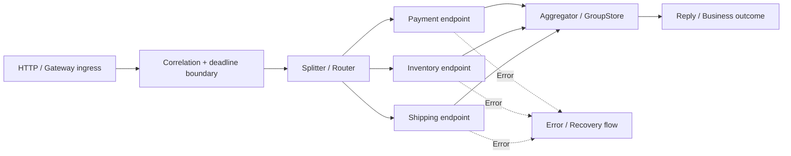
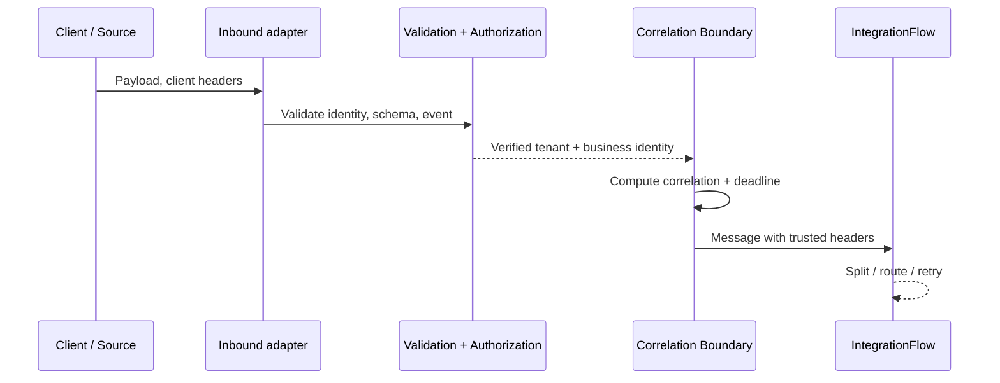
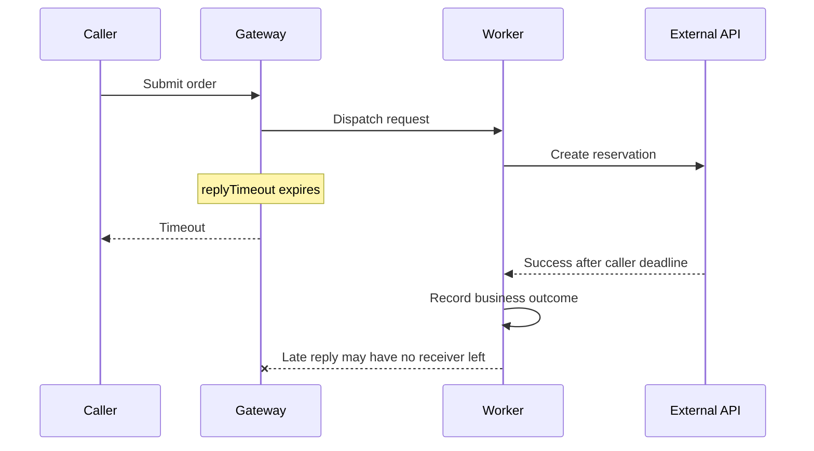
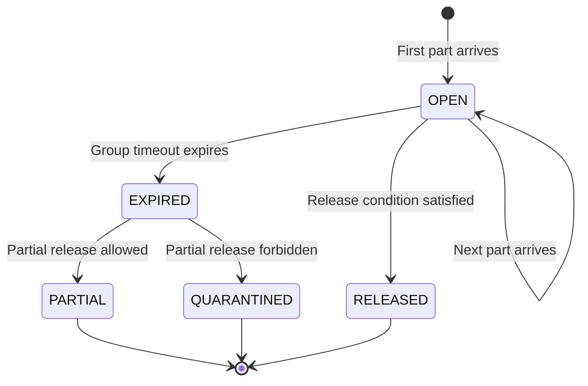

# Setting Correlation Boundaries and Timeouts in Spring Integration

## Learning Objectives

An order request enters a Spring Integration application, splits into three branches checking payment, inventory, and shipping, and then aggregates the results. If one branch takes 12 seconds while the HTTP caller only waits 5 seconds, what happens to the late result? If the gateway already timed out yet a handler still called an external API successfully, will the message be retried? If two tenants share the same `orderId`, will the aggregator accidentally merge them into one group?

To answer these questions, the system must design **correlation boundaries** (boundaries establishing and maintaining the identity of a unit of work) alongside **timeout boundaries** (time bounds, waiting rights, and expiration policies). Neither boundary becomes right automatically just because a flow has a `correlationId` and a `replyTimeout` parameter.

This lesson, **Setting Correlation Boundaries and Timeouts**, belongs to the **Runtime Design** chapter of the **SPRING_INTEGRATION_RUNTIME** module. It focuses on how messages flow and are coordinated through channels, endpoints, consumers, pollers, and executors, connecting both boundaries to `IntegrationFlow` lifecycles, transactions, retries, message stores, errors, threading, performance, and runtime state.

After this lesson, you will be able to:

- Distinguish `MessageHeaders.ID`, `correlationId`, business keys, event IDs, trace IDs, sequence metadata, and message group IDs.
- Choose the **correlation origin point**, identity ownership scope, and propagation rules across HTTP ingress, adapters, splitters, aggregators, gateways, brokers, and async workers.
- Design a **shared workflow deadline** while configuring per-layer timeouts without confusing poll intervals, send timeouts, reply timeouts, I/O timeouts, and message-group expirations.
- Explain why a gateway timeout does not automatically cancel handlers, roll back transactions, or guarantee no side effects occurred.
- Configure correlation/release strategies protecting tenant isolation, duplicates, late arrivals, and persistent message groups.
- Design explicit recovery/timeout policies: rejection, partial results, budgeted retries, DLQ/quarantine, compensation, or returning known outcomes.
- Test clocks/deadlines, correlation across executors/pollers, late replies, restarts, timeouts, and idempotency; observe with metrics, logs, and runbooks.

> **Principle:** Correlation answers **"which messages belong to the same unit of work?"**; timeouts answer **"until when may each component wait, and what must happen when time expires?"**. Both must be established at business boundaries with an end-to-end contract.

## 1. Two Boundaries in the Same Runtime

Consider an order intake flow:



At ingress, the application knows who sent the request, which tenant was authenticated, which business operation is starting, and how long the caller is willing to wait. Once split into branches, message UUIDs may change and handlers may execute on different threads; **correlation must be stable enough** to reunite the three branches. Meanwhile, a 5-second deadline cannot turn into "an extra 5 seconds added" at every step across branches.

If the caller already timed out, still-running work might:

- Complete and require persisting its outcome so the caller can query it later;
- Be cancelled, yet an external API **already received the command** and may have committed;
- Transition to durable retry/recovery continuing past the HTTP deadline;
- Return a partial result per contract, or fail and compensate.

You cannot decide which strategy applies merely from `MessageTimeoutException` or from `MessageChannel.send()` returning `true`.

### 1.1. Boundary Map to Draw Before Coding

| Boundary | Key Question | Data / Design to Lock Down |
| --- | --- | --- |
| **Ingress identity** | Who created the work, which tenant, which event? | Verified tenant, event ID, business key, authz |
| **Correlation scope** | Which messages belong to the same workflow? | Stable `correlationId`, workflow run ID |
| **Split/group** | Which parts must join and when does the group finish? | Group key, part identity, expected parts, release policy |
| **Async handoff** | Which component owns the work after sending? | Durable queue, ack/transaction, worker identity |
| **Request/reply** | How long does the caller wait for a result? | Request send timeout, reply timeout, late-reply policy |
| **External I/O** | How long may connections/APIs wait? | Connect/read/response timeouts, retries |
| **Recovery** | Where do messages go when time expires before completion? | Error archive/DLQ, retry schedule, idempotency |
| **Persistence/restart** | If the process dies, can outcomes be reconstructed? | Message/group store, schema/version, checkpoints |

Identify the **owner** of each timeout. When every team arbitrarily sets `timeout=5000`, a workflow traversing 5 services can wait 25 seconds or longer despite a 5-second caller SLA.

## 2. Five Identifiers Commonly Confused

| Identifier | Example | Usage Scope | What Not to Do |
| --- | --- | --- | --- |
| `MessageHeaders.ID` | Message instance UUID | Trace a specific message instance at one step | Use for business deduplication across redeliveries |
| **Business key** | `tenant-a:ORD-42` | Identify the business entity; idempotency per operation | Use alone when the same order has multiple workflow runs |
| **Event ID** | `evt-13d...` | Deduplicate a source event | Assume event ID always equals request ID |
| **Correlation ID** | `tenant-a:order-42:run-3` | Link parts of the same workflow/request | Mutate the ID on each transform/attempt |
| **Trace ID** | `trace-...` | Distributed tracing observing a request | Use as authorization or default group key |
| **Group ID** | `tenant-a:v2:order-42:run-3` | Internal key for `MessageGroupStore` | Mix incompatible tenants/versions |
| **Sequence metadata** | `sequenceNumber=2`, `sequenceSize=3` | Track position/count in a splitter/group | Assume every external event carries valid sequences |

In Spring Integration, the correlation header is commonly accessed via `IntegrationMessageHeaderAccessor.CORRELATION_ID` with header name `correlationId`. `MessageHeaders.ID` is a per-instance UUID; transforms, retries/replays, or adapters can construct new messages with different UUIDs.

**Example:** events `PaymentConfirmed`, `InventoryReserved`, and `ShippingQuoted` have three distinct message IDs yet share the same workflow correlation ID. If all three enter an aggregator, the group key must be chosen by `CorrelationStrategy` per contract, not automatically inferred from the name `orderId`.

### 2.1. Business Keys and Workflow Runs Must Separate When Operations Repeat

An order may request re-shipment multiple times:

```text
orderId      = ORD-42
businessKey  = tenant-a:ORD-42

workflow 1:
  operation  = initial-fulfillment
  runId      = run-1
  correlationId = tenant-a:ORD-42:run-1

workflow 2:
  operation  = re-fulfillment
  runId      = run-2
  correlationId = tenant-a:ORD-42:run-2
```

If you only use `orderId` as correlation across all runs, a late event from run-1 can get mixed into run-2. Keep the business key to locate the order; let the **workflow run ID** scope correlation.

### 2.2. Tenants, Versions, and Uniqueness

In multi-tenant systems, two tenants can both have `ORD-42`. Aggregator groups must partition by **verified tenant**, never treating a client-supplied header as proof of ownership. If v1 and v2 have incompatible schemas/release contracts, group keys or store regions must also separate versions.

```text
Risky key:
  groupId = ORD-42

Properly scoped key:
  groupId = tenant-a:orders-v2:run-3

Business identity:
  businessKey = tenant-a:ORD-42
```

These strings merely illustrate application key schemas. In production, use unambiguous canonical encoding and length bounds; avoid naive string concatenation if ID components might contain delimiter characters.

## 3. Placing the Correlation Boundary at Ingress: Validate First, Mint After

The **correlation boundary** is the point where trusted flow logic decides: "which workflow is this message a new event for?", "where did this ID come from?", and "across which hops is it protected?". A natural spot is **immediately after ingress authentication, authorization, and schema validation**, before splitting/enriching/routing.



### 3.1. Never Blindly Trust Raw Client Correlation Headers

Headers from HTTP/JMS/AMQP are useful for tracing, yet **are not authorization**. If a partner sends `correlationId=tenant-b:ORD-42` while authenticated as tenant A, using that header directly in a shared `MessageGroupStore` risks cross-tenant grouping.

A sound approach:

1. Authenticate the principal/service identity through the adapter.
2. Verify tenant identity and authorization on the order.
3. Normalize the event ID and workflow run ID from trusted data or a business registry.
4. Establish the correlation ID server-side; if retaining an upstream ID, store it separately as `upstreamCorrelationId` after validation.
5. Mint or bound the deadline per server policy with a maximum cap.
6. Forward the message into the flow with headers of trusted provenance and clear schemas.

### 3.2. Java Example: Attaching Correlation and Deadline Once

```java
import java.time.Clock;
import java.time.Duration;
import java.time.Instant;
import java.util.Objects;

import org.springframework.integration.IntegrationMessageHeaderAccessor;
import org.springframework.messaging.Message;
import org.springframework.messaging.support.MessageBuilder;

record OrderCommand(
        String tenantId,
        String orderId,
        String workflowRunId,
        int quantity) {
}

final class OrderIngressBoundary {
    private static final Duration WORKFLOW_BUDGET =
            Duration.ofSeconds(15);

    private final Clock clock;

    OrderIngressBoundary(Clock clock) {
        this.clock = Objects.requireNonNull(clock);
    }

    Message<OrderCommand> establish(
            Message<OrderCommand> inbound,
            String verifiedTenant) {

        OrderCommand payload = inbound.getPayload();

        if (verifiedTenant == null || verifiedTenant.isBlank()
                || !verifiedTenant.equals(payload.tenantId())
                || payload.orderId() == null
                || payload.orderId().isBlank()
                || payload.workflowRunId() == null
                || payload.workflowRunId().isBlank()) {
            throw new IllegalArgumentException(
                    "Invalid order identity / tenant");
        }

        String businessKey =
                verifiedTenant + ":" + payload.orderId();
        String correlationId =
                businessKey + ":" + payload.workflowRunId();
        Instant deadline =
                clock.instant().plus(WORKFLOW_BUDGET);

        return MessageBuilder.fromMessage(inbound)
                .setHeader("verifiedTenant", verifiedTenant)
                .setHeader("businessKey", businessKey)
                .setHeader(
                        IntegrationMessageHeaderAccessor.CORRELATION_ID,
                        correlationId)
                .setHeader("deadlineEpochMillis",
                        deadline.toEpochMilli())
                .build();
    }
}
```

**Assumptions:** `verifiedTenant` comes from a trusted authentication and authorization step, **never** copied verbatim from a client header; `OrderCommand` is a demo business DTO. The 15-second `WORKFLOW_BUDGET` is illustrative, not a universal recommendation. Multi-run workflows must guarantee collision-free IDs, size quotas, and canonical encoding.

If a request already carries a valid deadline from a trusted upstream caller, the boundary should take the **earlier effective deadline** between local policy and upstream deadline rather than adding 15 seconds, preventing SLA inflation at every hop.

### 3.3. When Should a New Correlation Be Created?

- **New business workflow:** create a new correlation.
- **New message that is part of an existing workflow:** inherit correlation.
- **Retry/redelivery of the same event:** preserve correlation and event ID; attempt count changes.
- **Separate compensation saga:** may mint a new correlation for compensation while retaining `parentCorrelationId` pointing to the original workflow.
- **Completely independent task:** never merge merely because it touches the same order ID.

Parent/child lineage helps trace multi-workflow chains:

```text
parentCorrelationId = tenant-a:ORD-42:run-3
correlationId       = tenant-a:ORD-42:refund-run-1
operation           = refund-compensation
```

Do not conflate "every message gets a UUID" with "every message opens a workflow".

## 4. Propagating Correlation Across Transformers, Splitters, and Channels

A `Message<?>` has a payload and immutable headers. Many Spring Integration components retain/copy headers per contract, yet when custom code builds new messages, implements adapters/header mappers, or serializes across brokers, headers can be dropped or change types.

### 4.1. Intentional Header Copying

```java
import org.springframework.messaging.Message;
import org.springframework.messaging.support.MessageBuilder;

Message<?> transformed = MessageBuilder
        .withPayload(newPayload)
        .copyHeaders(originalMessage.getHeaders())
        .build();
```

`originalMessage` and `newPayload` represent values already present in the flow. `MessageBuilder.withPayload(...).copyHeaders(...)` builds a new payload while copying relevant headers; check actual header mappers when crossing custom code or adapters. When only modifying headers without changing the payload, `MessageBuilder.fromMessage(originalMessage)` can be used.

**Do not** rely on `MessageHeaders.ID` staying unchanged after transformations. What must survive by contract are `businessKey`, `correlationId`, `verifiedTenant`, `eventId`, deadline, and schema/version where applicable.

### 4.2. Splitters Carry Sequence Metadata, Not Business Correlation Alone

When a splitter breaks an order into three parts, Spring Integration can attach `sequenceNumber`, `sequenceSize`, and correlation headers per sequencing configuration. This metadata helps aggregators, yet you must verify **the splitter configuration in use** and what happens across nested splits.

```text
OrderCommand (1 message)
     |
     v
Splitter
  +-- part PAYMENT   (sequenceNumber=1)
  +-- part INVENTORY (sequenceNumber=2)
  +-- part SHIPPING  (sequenceNumber=3)

All three must share the workflow correlation.
Each part has its own message ID.
```

A default splitter may assign its own correlation for the split sequence; if the business needs parent correlation ID preserved across nested splits, design explicit header lineage/strategies. **Never** assume post-split correlation header values from pre-split values without testing your actual topology's framework behavior.

### 4.3. DirectChannel, ExecutorChannel, and QueueChannel

| Channel | Delivery | Can Correlation Disappear Automatically? | Boundary Considerations |
| --- | --- | --- | --- |
| `DirectChannel` | Synchronous on sender thread per dispatcher | Headers stay as message data when forwarded | Exceptions and thread-bound transactions |
| `ExecutorChannel` | Worker executes later; `send()` may return early | Message headers can still be preserved | `ThreadLocal`/MDC/SecurityContext do not transfer automatically |
| `QueueChannel` | Buffered for consumer `receive()` or poll | Depends on channel/store/serialization | Capacity, persistence, and message age |
| Broker adapter | Crosses serialization/header mapping | Headers may be stripped or coerced in type | Version mapping, shared deadlines, redelivery |
| Reactor/`FluxMessageChannel` | Demand-driven publisher/subscription | Do not assume Reactor Context translates to headers | Schedulers, cancellation, terminal errors |

**Correlation is not identical to MDC.** An executor thread may lack the caller's `MDC` or `SecurityContextHolder`, while the message still carries `correlationId` if headers were forwarded properly. Logging/tracing requires explicit context propagation and cleanup when pooled workers are reused.

## 5. Distinguishing Correlation ID from MessageGroupStore Group ID

In an aggregator, `CorrelationStrategy` derives a group key from each message; `MessageGroupStore` uses that key to store parts. The group ID may come from `headers['correlationId']`, the payload, or a composite expression.

```text
Business workflow:
  correlationId = tenant-a:ORD-42:run-3

Aggregator instance for orders-v2:
  groupId = tenant-a:orders-v2:ORD-42:run-3
```

Why separate them? The same workflow correlation serves observability and compensation, while an `orders-v2` aggregator must not mix persistent groups with `v1` when release strategies or schemas differ. You do not have to alter the business correlation header just to namespace groups: **the strategy can construct an internal group ID**.

### 5.1. Illustrative CorrelationStrategy

```java
import org.springframework.integration.IntegrationMessageHeaderAccessor;
import org.springframework.messaging.Message;

final class GroupKeyPolicy {

    Object groupId(Message<?> message) {
        Object tenant =
                message.getHeaders().get("verifiedTenant");
        Object version =
                message.getHeaders().get("flowVersion");
        Object correlation = message.getHeaders().get(
                IntegrationMessageHeaderAccessor.CORRELATION_ID);

        if (!(tenant instanceof String t) || t.isBlank()
                || !(version instanceof String v) || v.isBlank()
                || !(correlation instanceof String c) || c.isBlank()) {
            throw new IllegalArgumentException(
                    "Missing trusted correlation scope");
        }

        return t + ":" + v + ":" + c;
    }
}
```

This snippet is a **policy function** serving as the basis for an aggregator's `CorrelationStrategy`, not an auto-registered Spring bean. In real configuration, wire it into the aggregator and ensure `flowVersion` is a controlled server-side header rather than client-trusted input. If correlation ID already embeds the tenant, prepending tenant again is just extra namespacing; design a canonical key structure to avoid redundancy.

### 5.2. ReleaseStrategy Must Check "All Right Parts", Not Just Group Size

If an aggregator expects PAYMENT, INVENTORY, and SHIPPING, a condition like `group.size() >= 3` fails badly when one part is redelivered three times.

```java
import java.util.Set;
import java.util.stream.Collectors;

import org.springframework.integration.store.MessageGroup;
import org.springframework.messaging.Message;

final class ExpectedPartsPolicy {
    private static final Set<String> EXPECTED =
            Set.of("PAYMENT", "INVENTORY", "SHIPPING");

    boolean canRelease(MessageGroup group) {
        if (group.size() != EXPECTED.size()) {
            return false;
        }

        Set<String> present = group.getMessages().stream()
                .map(this::partType)
                .collect(Collectors.toSet());

        return present.equals(EXPECTED);
    }

    private String partType(Message<?> message) {
        Object value = message.getHeaders().get("partType");
        return value instanceof String text ? text : "";
    }
}
```

This condition verifies three distinct part types **when the group holds exactly three messages**. It does not deduplicate on its own: if redelivery leaves 4 messages in the group, it will refuse to release; combine it with an idempotent receiver/duplicate policy and stuck-group timeout/recovery. In production, multiple independent events of the same type may be valid, requiring `partId`, expected counts, or an explicit manifest.

### 5.3. Define Release Conditions by Business Contract

Three valid completion modes exist depending on business semantics:

- **All required parts:** release only when all parts match keys and schemas.
- **Partial result on deadline:** emit a "DEGRADED/PENDING" result if business allows, noting missing parts.
- **Quarantine + compensation:** if a critical part is missing, never emit success; retain group/error records for follow-up.

Choose the mode before configuring group timeouts. Never switch to partial release just to silence "aggregator produced no output" alerts.

## 6. Timeout Boundaries: Different Timeouts Mean Different Things

An application can have many independent timers:

| Timeout / Duration | Controlling Layer | When It Expires | **What It Does NOT Guarantee** |
| --- | --- | --- | --- |
| **HTTP request deadline** | Client/edge/gateway | Caller stops waiting / sees timeout | Handler or external API was cancelled |
| **Gateway request timeout** | Sending request to channel | Failed to send within budget | Bounded execution of synchronous handlers |
| **Gateway reply timeout** | Waiting for reply | Caller did not receive reply in time | Side effects were rolled back |
| **Channel send timeout** | Channel blocking when full | Send fails / returns false / throws per contract | Business operation failed or succeeded |
| **Poller receive timeout** | Poller waiting for a message | Poll finishes without receiving data | Business SLA was violated |
| **Poll interval/trigger** | Scheduler | Next poll fires | Every handler finishes on time |
| **Connect timeout** | TCP/HTTP client | Connection not established in time | Remote did not process request if already sent |
| **Read/response timeout** | HTTP/DB client | Client did not receive response in time | Remote did not commit |
| **Reactor `Mono.timeout`** | Reactive operator | Publisher signals timeout/cancels subscription per semantics | Blocking code or side effects definitely stopped |
| **Retry backoff/max duration** | Retry advice/operator | Retry budget exhausted | Source was ACKed or error archive committed |
| **Aggregator group timeout** | Group expiration policy | Releases/expires/quarantines per config | Gateway caller receives answer by deadline |
| **Transaction timeout** | Transaction manager/DB | Can roll back/time out per resource | External API rolled back alongside DB |
| **Message retention/TTL** | Store/broker | Message may expire per policy | Equivalent to request reply timeout |

**Exact defaults, error behaviors, and API names depend on Spring Integration/Spring Boot/broker versions.** Never assume every timeout in this table uses milliseconds or that an automatic "whole-flow" timeout exists.

### 6.1. Timeouts Are Not Reliable Side-Effect Cancellation



A caller observing a timeout **cannot conclude the order failed**. If the client immediately retries with a new event ID, it risks creating two reservations. APIs should return an uncertain/pending state or allow status lookup by idempotency key when required by the business contract.

## 7. Design End-to-End Deadlines Instead of Adding Local Timeouts

A deadline is an **absolute target timestamp**, such as epoch milliseconds, attached at a trusted boundary and propagated with the message. At each hop, handlers compute **remaining budget**. Thus a chain of three branches/hops never accidentally stacks waits far beyond the original SLA.

### 7.1. Illustrative Budget

```text
Client request SLA:                15.0 s
Ingress validation + routing:       0.5 s
Queue/Executor wait expected:       1.0 s
External API critical path:         8.0 s
Aggregation + reply:                1.5 s
Safety margin:                      4.0 s

Total planned:                     15.0 s
```

These numbers are a **budget design example**, not Spring Integration defaults. With three parallel branches, the **critical path** is not the sum of all three durations when truly concurrent; however, contention, retries, and queue wait can inflate real times. Measure p95/p99 and bound tail latency.

### 7.2. Java Helper to Compute Remaining Time

```java
import java.time.Clock;
import java.time.Duration;
import org.springframework.messaging.Message;

final class DeadlinePolicy {
    private static final String DEADLINE_HEADER =
            "deadlineEpochMillis";

    static Duration remaining(
            Message<?> message, Clock clock) {

        Object raw = message.getHeaders().get(DEADLINE_HEADER);
        if (!(raw instanceof Long deadlineMillis)) {
            throw new IllegalArgumentException(
                    "Missing or invalid trusted deadline");
        }

        long remainingMillis =
                deadlineMillis - clock.millis();

        return Duration.ofMillis(
                Math.max(0L, remainingMillis));
    }

    static void requireTimeLeft(
            Message<?> message, Clock clock) {

        if (remaining(message, clock).isZero()) {
            throw new WorkflowDeadlineExceededException(
                    "Workflow deadline expired");
        }
    }

    static final class WorkflowDeadlineExceededException
            extends RuntimeException {
        WorkflowDeadlineExceededException(String message) {
            super(message);
        }
    }
}
```

This header is set by the ingress boundary—**never accept a raw client-declared deadline** without validation. `Clock` simplifies testing; across nodes, system clocks must remain reasonably synchronized. Within one process, measure actual elapsed durations with a monotonic clock rather than wall-clock time subject to NTP jumps; when persisting deadlines across restarts/nodes, use a serializable instant like UTC epoch millis.

### 7.3. Having 1 ms Left Does Not Mean You Should Start an Operation

If `remaining=100ms` while the external API's p99 is 2 seconds, sending the request almost certainly causes a side effect followed by a timeout. A practical policy reserves **reply/commit time** and refuses to start new operations when remaining budget is too low.

```java
import java.time.Duration;

static boolean enoughBudgetForRemoteCall(
        Duration remaining,
        Duration expectedWorstCase,
        Duration replyReserve) {

    return remaining.compareTo(
            expectedWorstCase.plus(replyReserve)) > 0;
}
```

`expectedWorstCase` is a **design threshold** derived from client SLOs/timeouts, not an arbitrary guess. If budget is insufficient, fail fast, perform durable async handoff, return `202 Accepted` per HTTP contract, or invoke appropriate error/recovery—never extend the deadline on your own.

### 7.4. Mitigating Clock Skew and Forged Deadlines

If a broker adapter on node A stamps a deadline using a system clock skewed 20 seconds relative to node B, node B may view messages as already expired or overly generous. Enforce NTP/clock monitoring, trusted timestamp sources, and explicit tolerance policies. For endpoints accepting external deadlines, enforce max-age/max-budget caps and validate anomalies before use.

## 8. Gateway requestTimeout, replyTimeout, and Send/Receive Timeouts

A Spring Integration Gateway layers request/reply semantics over messaging. Usually two distinct waits exist: time to **send the request** and time to **await the reply**.

### 8.1. Illustrative Annotation

```java
import org.springframework.integration.annotation.Gateway;
import org.springframework.integration.annotation.MessagingGateway;

@MessagingGateway(
        name = "orderGateway",
        defaultRequestChannel = "orders.request",
        defaultRequestTimeout = "1000",
        defaultReplyTimeout = "5000")
interface OrderGateway {

    @Gateway
    OrderReply submit(OrderCommand command);
}

record OrderReply(
        String orderId,
        String outcome) {
}
```

The annotation timeout arguments in this example are shown as **millisecond strings** per the Spring Integration Java annotation contract; check your exact version and expression/configuration options when writing production code. `orders.request` must connect to a flow producing an appropriate reply. This is a **Gateway interface**, not a business handler implementation itself.

**Important limitation:** if the gateway sends to a `DirectChannel` and a synchronous handler blocks for 30 seconds, sending the request can tie up the thread for the full duration; `defaultReplyTimeout=5000` will not necessarily cap **synchronous handler execution time inside send()**. To manage processing time independently from the caller, establish a proper async boundary and real I/O timeouts in the handler.

### 8.2. Request Timeout Is Not a Network Timeout for All Downstreams

`requestTimeout` governs sending the request to the request channel. On a full `QueueChannel`, producers may wait for capacity; on a `DirectChannel`, synchronous delivery can block inside the handler. Gateway timeouts **do not replace** HTTP client connect/read timeouts or JDBC query timeouts.

### 8.3. Reply Timeouts and Late Replies

The gateway may stop waiting after reply timeout while the worker keeps running. Late replies require an explicit policy:

- Drop the late reply while **persisting the outcome durably** by business key;
- Deliver the result to a callback/durable reply queue if supported by protocol;
- Allow the client to query job status;
- If requests are truly cancellable per contract, have workers check cancellation/deadlines before side effects while still handling races.

`replyChannel` is a header supporting reply routing. **Never assume a gateway's temporary reply channel object persists across brokers/restarts:** temporary channels may not serialize, or the caller may already be gone. For long-running work, store correlation IDs, allowlisted callback destinations, or durable request/status records.

### 8.4. Gateway Errors and errorChannel

A gateway may observe synchronous exceptions, reply timeouts, or an error reply depending on configuration. The `errorChannel` header does not automatically force every synchronous handler exception into an error flow. Inspect thread boundaries, error publishers/handlers, and gateway policies. Tests must separate **request accepted**, **reply received**, **reply timed out**, and **business succeeded**.

## 9. Pollers, ExecutorChannel, and Brokers: Who Owns the Timeout?

### 9.1. Pollers and QueueChannel

```text
QueueChannel:
  producer.send(message, sendTimeout)
  consumer.receive(receiveTimeout)

Poller:
  trigger / fixedDelay / cron
  maxMessagesPerPoll
  receiveTimeout
  transaction/advice chain
```

`receiveTimeout` is solely how long a poll waits to pull one message from a channel/source, not the business processing deadline. A poller firing every 5 seconds might pull only 1 message per tick and rapidly build backlog if the handler takes 3 seconds. Do not try to fix throughput by raising `receiveTimeout`.

### 9.2. ExecutorChannel

With `ExecutorChannel`, `send()` typically submits a task to an executor; wait time **inside the executor queue** can consume the entire workflow deadline before the handler even starts. Workers should therefore check `deadlineEpochMillis` **when starting execution**, not only at ingress.

An appropriate check:

```text
At ingress:
  message accepted at T0, deadline = T0 + 15 s

At worker start:
  queued for 12 s
  remaining = 3 s

Decision:
  If the remote call needs 5 s + reserve,
  do not start the side-effecting operation.
  Route expired work per policy.
```

If an in-memory queue vanishes on pod restart, even a correct deadline header cannot recover lost data. For durability, pair with a broker/persistent channel or outbox and aligned source ACKs.

### 9.3. Brokers and Delivery Timeouts

Brokers implement visibility timeouts, heartbeat/session timeouts, prefetch, consumer ACKs, and redeliveries differently per product. **Never** equate them with HTTP reply timeouts or business SLAs.

A message redelivered by a broker because a consumer died may be picked up by a new worker after the HTTP deadline, yet business rules may require **completing it anyway** because it was durably accepted work. Distinguish:

- `callerDeadline`: caller stops waiting for a synchronous response.
- `workflowDeadline`: point until which the business accepts normal completion.
- `retentionUntil`: point until recovery data may be purged.
- `retryUntil`: cutoff for automatic retry attempts.

All four can differ. For instance, a caller waits 5 seconds, the order may finish asynchronously within 2 minutes, and the error archive retains records for 7 days.

## 10. Aggregator Group Timeouts: Group Deadlines Differ from Reply Timeouts

`AggregatingMessageHandler` and Spring Integration correlation configurations can manage message groups inside `MessageGroupStore`. When a group fails to release, the system needs an explicit expiration/timeout strategy: **keep waiting**, **release partial**, **discard/quarantine**, or **compensate**.

### 10.1. Expiration Timing Is an Independent Policy



The states in this diagram represent a **business model**, not a default Spring Integration enum. When group timeouts/expiry run via a scheduler or reaper, expiration occurs on the **check schedule**, not necessarily at the exact millisecond boundary. Options like `groupTimeout`, `sendPartialResultOnExpiry`, `expireGroupsUponCompletion`, and discard handling depend on version/configuration.

### 10.2. Two Explicit Policies

**Policy A — Order Requires All Three Parts**

```text
Expected: PAYMENT, INVENTORY, SHIPPING
Group deadline: 10 s
2/3 parts present at expiry:
  - Do not emit aggregate SUCCESS
  - Record missing-part entry with correlation
  - Route to error/quarantine or await compensation
  - Retain data needed for replay per retention policy
```

**Policy B — Dashboard Allows Partials**

```text
Expected: 3 independent status parts
Group deadline: 10 s
2/3 parts present at expiry:
  - Emit PARTIAL, missingParts=[SHIPPING]
  - Do not assume SHIPPING status = SUCCESS
  - Late arrivals follow update/ignore/quarantine policy
```

Never enable `sendPartialResultOnExpiry=true` on a critical order flow just to avoid pending groups. Define how downstream interprets partial states and which writes are permitted afterward.

### 10.3. Late Arrivals and Closed Groups

A part arriving **after the group already released/expired** needs a consistent policy:

- Audited discard;
- Error/quarantine logging;
- Applied as a new update event if allowed by business rules;
- Processed in a new workflow run with a fresh correlation.

If the store retains an "empty group"/completed group metadata or tombstone, re-creation behavior may differ from immediate full deletion. Test **late arrivals, duplicates, and group re-creation** under your exact configuration. Never rely solely on `MessageGroupStore.group.size()` to judge business completion.

### 10.4. Persistence and Group Keys Across Restarts

A persistent `MessageGroupStore` can preserve committed parts across restarts, yet **does not automatically restore Java strategies/handlers** unless the app re-registers the flow. Across deployments, new serializers, correlation strategies, and release strategies must stay compatible with older groups or provide migrations. Never wipe groups/metadata to "fix" timeouts without checking side effects.

## 11. Retry Budgets Must Fit Inside the Deadline

Suppose remaining budget is only 4 seconds, while retry advice allows 5 attempts with 3-second HTTP read timeouts and 1-second backoffs. One execution could run over 15 seconds; it does not obey the SLA merely because the gateway reply timeout is 5 seconds.

### 11.1. Illustrative Budget Calculation

```text
Workflow remaining at worker:       4,000 ms
Required reply/commit reserve:        500 ms
Available processing budget:        3,500 ms

Attempt 1 timeout:                  1,500 ms
Backoff before attempt 2:             300 ms
Attempt 2 timeout:                  1,500 ms
                                   --------
Total:                              3,300 ms

Remaining reserve:                    700 ms
```

This is a **sample calculation**. In practice, account for scheduling, queue wait, connection acquisition, and database commits—not just HTTP responses. When budget runs out, do not launch another attempt even if the retry policy still has quota left.

### 11.2. Retry at the Right Unit

- Retry a **safely repeatable operation** using an idempotency key.
- Never blindly retry an entire flow after sibling branches already committed side effects.
- Never reset deadlines on retries or broker redeliveries.
- Distinguish transient network faults from permanent validation/schema/authorization errors.
- On timeouts after a potential remote commit, query outcome by business key before issuing a new request.

A `RetryTemplate` or Reactor `retryWhen` applies per invocation; broker redelivery is a **separate retry layer**. Track `attempt`, `deliveryCount`, `replayCount`, and business outcomes separately rather than merging them into one counter.

### 11.3. Timeout Signals Can Route to Error Flows or Status Replies

A timeout can be modeled as:

```text
Exception -> rollback/nack/retry
Exception -> durable error archive + ack (if policy permits)
Reply     -> TIMEOUT/PENDING to caller
Event     -> WORKFLOW_EXPIRED for saga compensation
Quarantine -> manual review
```

Do not assume every timeout must throw an exception. In async systems, callers can receive `202 Accepted` and poll status later. If the business requires cancellation, explicitly define **cancellation semantics and races with side effects**.

## 12. Transaction Boundaries and the "Timed Out Yet Committed" Problem

### 12.1. Same Thread vs. Across Executor

```text
Caller/Poller thread:
  begin transaction
  DirectChannel.send(message)
  handler writes DB
  commit / rollback

Across ExecutorChannel:
  caller dispatches task
  caller transaction may finish
  worker later invokes handler
  worker transaction is usually separate
```

Imperative JDBC transactions are typically thread-bound. Across an executor/poller boundary, transactions do not follow correlation headers automatically; a `correlationId` is just data, not a distributed transaction.

### 12.2. Crash Windows

| Failure Window | What May Have Happened | Safe Handling |
| --- | --- | --- |
| Before durable enqueue | Message only in RAM; caller already acked | Fix handoff/ack contract |
| After durable enqueue, before source ack | Source may redeliver | Deduplicate by event/business key |
| After external API commit, before DB DONE | Gateway timed out; side effect exists | Query by idempotency key; compensate if needed |
| After DB DONE, before broker ack | Source resends message | Unique constraint/ledger prevents duplicates |
| After partial group release, final part arrives | Output may already be consumed | Late-arrival state machine |
| After reply timeout, worker keeps running | Caller left | Persist outcome durably; never assume cancellation |
| After restart, persisted deadline expired | Old message sits in store | Explicit expiry/retry/quarantine policy |

No single `replyTimeout` or `groupTimeout` guarantees "exactly once". Realistic contracts rely on **at-least-once delivery + idempotent business effects** or a clearly defined durable handoff.

### 12.3. Business States Worth Separating

```text
RECEIVED
PERSISTED
PROCESSING
COMPLETED
FAILED_RETRYABLE
FAILED_FINAL
TIMED_OUT_FOR_CALLER
EXPIRED_FOR_WORKFLOW
COMPENSATING
COMPENSATED
```

This is an **application-designed state machine**, not a built-in Spring Integration enum. `TIMED_OUT_FOR_CALLER` does not necessarily mean `EXPIRED_FOR_WORKFLOW`; an asynchronously accepted order can continue past the HTTP caller's wait window.

## 13. Error Flows, replyChannel, and Correlation During Recovery

### 13.1. ErrorMessage Can Carry the Source Message in Multiple Places

`ErrorMessage.getPayload()` is a `Throwable`. When a handler fails, the original message may appear in `ErrorMessage.getOriginalMessage()` or `MessagingException.getFailedMessage()` depending on the error publisher. Preserve correlation as close to the failure as possible and store an error archive indexed by business key.

```java
import org.springframework.messaging.Message;
import org.springframework.messaging.MessagingException;
import org.springframework.messaging.support.ErrorMessage;

final class RecoveryCorrelation {
    static Message<?> findFailedMessage(ErrorMessage error) {
        if (error.getOriginalMessage() != null) {
            return error.getOriginalMessage();
        }

        Throwable cause = error.getPayload();
        while (cause != null) {
            if (cause instanceof MessagingException messaging
                    && messaging.getFailedMessage() != null) {
                return messaging.getFailedMessage();
            }
            cause = cause.getCause();
        }
        return null;
    }
}
```

When neither original nor failed message is available, **never guess correlation from the ErrorMessage's own ID**; trace back via source records/logs/traces. When persisting error records, save event ID, business key, correlation ID, workflow version, and deadline alongside exception class/sanitized message.

### 13.2. Error Channels Do Not Automatically Catch Every Synchronous Exception

On `DirectChannel`, handler exceptions can propagate to the caller; on executors/pollers, error handlers can publish `ErrorMessage` per configuration. Do not assume the `errorChannel` header routes every synchronous exception into an error flow. With gateways, callers may see errors/timeouts separately from error archives.

### 13.3. Retrying/Replaying After Deadline Expiration

A message sitting in DLQ and replayed an hour later still carries the original workflow's correlation ID. Yet the 15-second deadline has long expired: you may need a new **recovery workflow** (with `parentCorrelationId`) or an expired-work policy, rather than stripping the deadline header and pretending the original request is still live.

If a business outcome must complete even after the caller gives up waiting, separate `callerDeadline` and `businessDeadline` from day one instead of silently refreshing one header.

### 13.4. Reply Durability

A gateway's temporary `replyChannel` belongs to a single request/reply invocation; it is not meant for multi-day reply persistence. For long-running workflows, persist:

- `requestId` or correlation ID;
- `status` and `resultReference` in DB/broker;
- Allowlisted `callbackDestinationAlias` (if using callbacks);
- `lastUpdatedAt` and retention;
- Idempotency key and tenant owner.

Never arbitrarily serialize live channel objects or security principals into a message store. Header mapping can alter types, and temporary channel objects become invalid across restarts.

## 14. Rules for Placing Timeouts

### 14.1. Place Timeouts at Ownership Boundaries

A practical heuristic:

1. **Ingress/gateway:** request deadlines and sync/async choice.
2. **Channel/queue:** send capacity timeouts, queue age/backlog policies.
3. **Executor/poller:** maximum wait before start, schedule, and receive timeouts.
4. **Remote I/O:** connect/read/call timeouts paired with retry budgets.
5. **Aggregator:** group expiration/late-arrival policies per business SLA.
6. **Transaction:** commit/lock-wait deadlines, distinct from HTTP timeouts.
7. **Error recovery:** retryUntil, DLQ retention, quarantine deadlines.
8. **Client:** user wait limits, status lookup/callback contracts.

Never rely on one "outermost" timeout as your only protection. If a handler issues a blocking HTTP call with no read timeout, an outer gateway reply timeout may fail to free the blocked thread.

### 14.2. Synchronous or Asynchronous?

| Situation | Appropriate Design | What Must Be Protected |
| --- | --- | --- |
| Fast handler reliably meeting deadlines | Sync gateway + clear I/O timeouts | Caller thread, transactions, error mapping |
| Long p99 handler needing durable completion | Async handoff + status/callback | Persist before ack, idempotency, layered deadlines |
| 3-branch fan-out needing all results before reply | Split/route + aggregator + group timeout | Distinct parts, correlation, missing-part policy |
| Analytics/best-effort fan-out | Publish/subscribe or event stream | Never block critical paths, enforce quotas |
| Delayed batch via poller | Queue/broker + poller SLA | Source lag, receive timeout, checkpoints |
| External API prone to post-commit timeouts | Idempotent API + outcome query | Duplicates/retries/compensation |
| Workflows spanning hours | Saga/process state, never hold gateway threads | Durable state, transitions, cancellation |

## 15. Observability: Finding Where Messages Stall When Boundaries Drift

A flow carrying `correlationId` without logs/metrics at key milestones remains hard to debug. Instrument:

| Metric / Log Signal (Suggested Names) | Meaning |
| --- | --- |
| `flow.ingress.count` | Newly validated/accepted messages |
| `flow.correlation.missing` | Messages missing keys past a boundary |
| `flow.deadline.remaining_ms` | Remaining budget at a stage, recorded as a histogram |
| `flow.queue.oldest_age` | Wait time ahead of handler |
| `flow.handler.inflight` | Currently executing operations |
| `flow.handler.completed` | Handlers completed successfully |
| `flow.business.committed` | Outcomes persisted to the system of record |
| `flow.gateway.reply_timeout` | Callers timing out waiting for replies |
| `flow.remote.timeout` | Timeouts at external APIs/DB |
| `flow.group.pending_age` | Groups with missing/slow parts |
| `flow.group.expired` | Groups expired per policy |
| `flow.late_reply` | Replies arriving after callers stopped waiting |
| `flow.retry.attempts` | Retries within an invocation |
| `flow.source.redelivery` | Messages redelivered by source |
| `flow.recovery.pending_age` | Oldest waiting error/DLQ record |

These are **application-designed metric names**, not all built into Spring Integration by default. Never attach `messageId`, `correlationId`, or `orderId` as per-message metric labels due to high cardinality; use access-controlled structured logs/tracing with proper retention instead.

### 15.1. Logs with Explicit Boundaries and Timestamps

```text
time=... stage=INGRESS
  businessKey=tenant-a:ORD-42
  correlationId=tenant-a:ORD-42:run-3
  deadlineEpochMillis=...
  flowVersion=orders-v2

time=... stage=WORKER_START
  correlationId=tenant-a:ORD-42:run-3
  queueAgeMs=1050
  remainingBudgetMs=12800

time=... stage=GROUP_PENDING
  groupId=tenant-a:orders-v2:ORD-42:run-3
  parts=2 required=3
  oldestGroupAgeMs=9000

time=... stage=GATEWAY_TIMEOUT
  correlationId=tenant-a:ORD-42:run-3
  callerWaiting=false

time=... stage=BUSINESS_COMMITTED
  correlationId=tenant-a:ORD-42:run-3
  outcome=COMPLETED
```

Never log tokens, raw payloads containing sensitive data, or full header dumps. When a deadline expires, log the stage and policy decision rather than merely `"Timeout"`.

### 15.2. Composite Alerting Conditions

Do not page on `"reply timeout count > 0"` for a single dropped client connection; use SLOs/error budgets. Conversely, a growing queue while workers still accept tasks can signal **backpressure** before gateway timeout rates spike.

Example conditions:

```text
IF queueDepth > 0
AND oldestQueueAge > queueSLO
AND businessCommitRate is low
THEN investigate executor/handler progress

IF groupPendingAge > groupDeadline + schedulerTolerance
THEN inspect missing parts, correlation, group expiration policy
```

Base thresholds on real workloads, poll intervals, scheduler tolerances, retry backoffs, and maintenance windows.

## 16. Runbook When Requests Time Out and Aggregators Do Not Release

### Step 1 — Gather Trusted Identity

Retrieve `businessKey`, `correlationId`, `eventId`, `flowVersion`, and deadline from verified logs/records. Never rely on client-provided tenant headers as proof of authority.

### Step 2 — Identify Which Timeout Actually Fired

Was it gateway request send, reply receive, HTTP read, DB lock, broker visibility, poll receive, retry exhaustion, or group expiration? Inspect root causes, timestamps, and component ownership.

### Step 3 — Trace How Far the Message Progressed

Check ingress, channel acceptance, worker start, handler completion, business commit, and error archive. With executors, `send(true)` does not prove a worker ran.

### Step 4 — Inspect Group Keys and Parts

Check the **actual group ID from `CorrelationStrategy`**, distinct part ID counts, duplicate counts, sequences, release conditions, and pending group age. A group of full size missing one required part type will still wait.

### Step 5 — Verify Propagated Deadlines

Confirm the deadline header survived transforms/adapters and was not reset at any hop. Check clock skew and remaining budget at worker start. If expired, determine the expired-work policy.

### Step 6 — Check Source ACKs and Transactions

Can the broker still redeliver? Are messages sitting in a persistent `MessageStore` or `MessageGroupStore`? Did DBs/external APIs partially commit? Check idempotency ledgers before replaying.

### Step 7 — Inspect Error Flows and Late Replies

Does `ErrorMessage` carry an original/failed message? Did the error archive commit? Are replies arriving after gateway timeout dropped, logged, or persisted durably?

### Step 8 — Minimal Remediation

Fix correlation strategies/key mappings, client timeouts, executor capacities, or deadline policies per root cause. Never raise all timeouts globally or force-release groups before verifying business state.

### Step 9 — Canary Test and Observe

Send a fresh request with a unique correlation; verify branches, group release, reply, and business outcomes. If older messages require replay, use stable IDs and compensation policies.

### Step 10 — Close the Incident

Document the failing boundary, versions/configs, affected messages, pending records, duplicate risks, and before/after metrics. Close the incident only once the pipeline meets SLOs and backlog/recovery has a clear owner—not merely because HTTP `replyTimeout` was bumped.

## 17. Correlation and Timeout Testing Matrix

| Case | Condition | Mandatory Assertion |
| --- | --- | --- |
| Valid ingress | Authenticated tenant, valid orderId/runId | Correlation and deadline minted exactly once |
| Spoofed tenant | Client header differs from verified tenant | Boundary rejects/distrusts client header |
| Transformer | Builds new payload | Business/correlation/deadline preserved; message UUID per contract |
| 3-part split | One order spawns three branches | Three distinct parts, same valid group key |
| Duplicate part | PAYMENT redelivered | Does not falsely release via `group.size()` |
| Two tenants, same order ID | A and B both use ORD-42 | Message groups never mix |
| Two workflow runs, same order | run-1 and run-2 | Groups/correlations stay distinct |
| Nested split | Second splitter assigns new sequence | Business lineage preserved, proper grouping |
| DirectChannel blocking | Handler slower than gateway reply budget | Test timing without assuming handler cancellation |
| Executor queue delay | Worker starts late | Re-checks remaining deadline before side effects |
| Queue full | Send timeout/rejection | Producer and recovery observe failure per contract |
| Idle poller | Empty source | Receive timeout not treated as business failure |
| Late gateway reply | Worker responds past deadline | Caller timed out; outcome handled per policy |
| Remote API commit then timeout | First try loses response | Idempotency prevents duplicate side effects |
| Retry budget left, deadline expired | Attempts remain yet deadline passed | Never starts attempt lacking budget |
| Group deadline | Missing SHIPPING | Partial/quarantine per contract, never fake SUCCESS |
| Late part after release | SHIPPING arrives late | Audited ignore/update/quarantine |
| ErrorMessage missing original | Throwable only | Recovery does not guess correlation |
| Restart after enqueue | Durable store/source | State and deadline not reset |
| Restart after reply timeout | Worker holds result | Business outcome queryable by correlation |
| Flow v1/v2 | Persistent groups across two schemas | Group/version scopes never collide |
| Clock skew | Skewed worker clock | Controlled and monitored behavior |
| Stale health metric | Collector stops updating | Never infer empty queues from stale data |
| Cancellation race | Cancelled near API commit | Outcome/idempotency ledger stays consistent |

### 17.1. Testing Deadlines Without Thread.sleep

Verify `DeadlinePolicy.remaining()` using `Clock.fixed` at two instants.

```java
import java.time.Clock;
import java.time.Instant;
import java.time.ZoneOffset;

import org.junit.jupiter.api.Test;
import org.springframework.messaging.Message;
import org.springframework.messaging.support.MessageBuilder;

import static org.junit.jupiter.api.Assertions.*;

class DeadlinePolicyTest {

    @Test
    void remainingBudgetDecreasesWithoutSleeping() {
        Instant start =
                Instant.parse("2026-11-22T00:00:00Z");
        long deadline = start.plusSeconds(15).toEpochMilli();

        Message<String> message = MessageBuilder
                .withPayload("ORD-42")
                .setHeader("deadlineEpochMillis", deadline)
                .build();

        Clock atStart = Clock.fixed(
                start, ZoneOffset.UTC);
        Clock afterTenSeconds = Clock.fixed(
                start.plusSeconds(10), ZoneOffset.UTC);
        Clock afterDeadline = Clock.fixed(
                start.plusSeconds(20), ZoneOffset.UTC);

        assertEquals(15_000L,
                DeadlinePolicy.remaining(message, atStart).toMillis());
        assertEquals(5_000L,
                DeadlinePolicy.remaining(
                        message, afterTenSeconds).toMillis());
        assertTrue(DeadlinePolicy.remaining(
                message, afterDeadline).isZero());
    }
}
```

This example checks only the deadline math inside one message. It does **not** prove the gateway request/reply, HTTP client, or aggregator uses the same budget. For integration testing, run the Spring context/adapters and verify the exact boundary.

### 17.2. Testing Release Strategies with a Fake Message Group

Build a `MessageGroup` carrying `partType` headers; test three messages `PAYMENT, PAYMENT, INVENTORY` versus `PAYMENT, INVENTORY, SHIPPING`. The first must not release despite size 3; the second must release.

Do not test only `group.size() == 3`. Also test duplicate redeliveries, late arrivals, and expired groups. With persistent stores, test across real restarts and serializer/schema compatibility.

### 17.3. Late-Reply Tests Must Verify Business Outcomes

Use a fake handler waiting on a latch instead of sleep; give the gateway/caller a finite reply timeout. Let the caller time out first, then release the handler. Assert the caller saw a timeout **and** the business outcome persisted per policy without duplicating if the request retries.

This is an **intentional race test**, not merely a timeout exception check. With synchronous `DirectChannel`, separate execution via an async channel/worker when reliably reproducing late-reply semantics.

## 18. Practice Exercises

### Exercise A — Design an Ingress Correlation Boundary

Build `OrderIngressBoundary` as in Section 3, supplying `verifiedTenant` from a fake authorization service. Send one valid order and one tenant-spoofed order; verify business keys, correlations, deadlines, and rejections.

**Expected outcome:** trusted provenance governs correlation; client headers cannot alter tenant/group scope.

### Exercise B — Preserve Headers Across Three Channel Types

Build a flow traversing `DirectChannel`, `ExecutorChannel`, and `QueueChannel` with a test poller. Log message ID, correlation ID, business key, deadline, and thread. Check header mappers when crossing broker adapters if present.

**Expected outcome:** message headers travel across threads while MDC/ThreadLocals do not automatically propagate; async tests require latches/timeouts.

### Exercise C — Distinct Parts Instead of Group Size

Build an aggregator requiring PAYMENT, INVENTORY, and SHIPPING. Send PAYMENT twice then INVENTORY, then update the policy to deduplicate by `partId` and handle missing parts.

**Expected outcome:** duplicates never trigger false releases; incomplete groups follow a timeout/recovery policy rather than hanging forever.

### Exercise D — Gateway Reply Timeouts and Late Replies

Build a gateway with a short reply timeout and an async handler awaiting a signal. Let the caller time out, then let the handler finish successfully; verify the business ledger before/after, then retry with the same idempotency key.

**Expected outcome:** caller timeout does not prove no side effect occurred; retries never duplicate orders.

### Exercise E — Deadline Budgets and Retries

Create a message with a 15-second deadline; simulate an 11-second queue delay using a test clock. Give a remote call a 5-second budget plus 1-second reserve, and use `remaining()` to reject starting expired work.

**Expected outcome:** workers never reset deadlines; retry budgets stay inside remaining budgets.

### Exercise F — Aggregator Group Timeouts and Late Parts

Set a 3-second group timeout in a fixture missing one part. Run both policies: no partial release, and valid partial result for a dashboard. After expiration, send the missing part and inspect late-arrival outcomes.

**Expected outcome:** distinguish group timeout, release policies, error archives, and reply timeouts; never emit false business SUCCESS.

### Exercise G — Restarts with a Persistent Store

Persist messages/groups in a durable backend recording correlation, `schemaVersion`, and deadline; kill the worker mid-flight and restart the flow. Verify the group persists, deadlines are not regenerated, and retries/replays remain idempotent.

**Expected outcome:** persistence and version compatibility govern recovery; correlation IDs identify work without guaranteeing durable execution on their own.

### Exercise H — Incident Combining Timeouts and Bad Correlation

Simulate a request hitting reply timeout, an aggregator holding pending groups, and a DLQ holding a failed branch. As on-call, trace business key, workflow run, group ID, late reply, source ack, and API outcome.

**Expected outcome:** pinpoint slow boundaries/bad keys and recover safely without wiping stores or blindly raising timeouts.

## 19. Self-Check Questions

1. Where should the correlation boundary live when HTTP ingress receives tenant and order IDs from clients?
2. How does `MessageHeaders.ID` differ from `correlationId` and business keys?
3. When does the same order need two different workflow correlation IDs?
4. Why should trace IDs not be used by default as aggregator group IDs?
5. How can two tenants both using `ORD-42` accidentally merge?
6. What does `IntegrationMessageHeaderAccessor.CORRELATION_ID` represent?
7. When a message is transformed, which headers must survive even if the message UUID changes?
8. Does splitter sequencing guarantee nested splits preserve parent correlation?
9. What distinct responsibilities do `CorrelationStrategy` and `ReleaseStrategy` have?
10. Why is checking `group.size() >= 3` insufficient under redelivery?
11. Should persistent store group IDs include the flow version in every scenario?
12. How do gateway `requestTimeout` and `replyTimeout` differ?
13. Why does `replyTimeout=5000` fail to interrupt a blocking handler on `DirectChannel`?
14. How should a late reply arriving after a gateway timeout be handled?
15. Should temporary `replyChannel` objects be persisted across brokers/restarts without mapping?
16. Is a poller's `receiveTimeout` a business workflow deadline?
17. If an executor queue holds a message for 12 seconds, what must the worker check when starting?
18. Why does adding 5 seconds at every hop break end-to-end SLAs?
19. Why should message deadlines be stored in a form persistable across nodes/restarts?
20. When two pods' clocks skew, what can happen to deadlines?
21. Retry advice allows 5 attempts, yet 1 second of deadline remains: what should happen?
22. Does a timeout after an HTTP API commit prove the operation failed?
23. Does `groupTimeout` necessarily expire at the exact deadline millisecond?
24. When is `sendPartialResultOnExpiry` permissible?
25. What policies can handle a part arriving after group expiration?
26. Does a persistent `MessageGroupStore` automatically restore release strategies after deploy?
27. What does `ErrorMessage.getPayload()` hold and where do you find the failed message?
28. Why does `errorChannel` not automatically catch every synchronous exception?
29. Does a `correlationId` automatically carry a transaction across `ExecutorChannel`?
30. Why can early source ACKs lose work even with an accurate deadline header?
31. Should caller deadlines and business deadlines always be identical?
32. How do you replay a message whose workflow deadline expired while keeping audit/correlation intact?
33. Which metrics distinguish queue wait, handler delay, and pending groups?
34. When an aggregator misses SHIPPING, what should the runbook check before force-releasing?
35. Which tests should use a fake clock instead of `Thread.sleep()`?
36. Which tests require a real durable broker/store to prove restart recovery and idempotency?

**Key Takeaways:** **Correlation boundaries** establish a stable identity for **a workflow with explicit tenant, run, and version scope**; **timeout boundaries** define waiting limits, ownership, and recovery at every thread/channel/gateway/API/aggregator boundary. Never confuse message UUIDs with business keys, group size with distinct parts, gateway reply timeouts with cancellation, or retries with brand-new business operations. Proper design requires **propagated deadlines, budgets for queues and I/O, group expiry policies, durable handoffs, error/late-reply handling, and idempotency**, verified by tests and business-progress observability.
