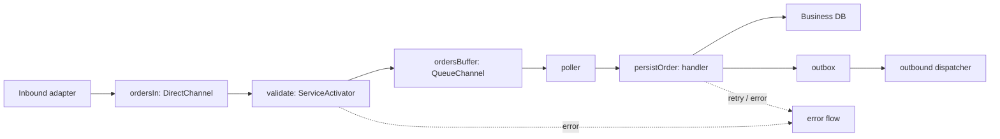
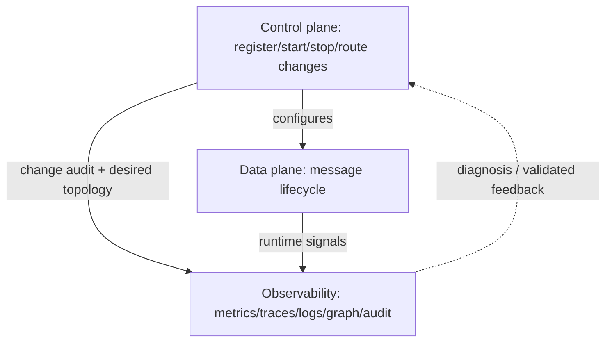
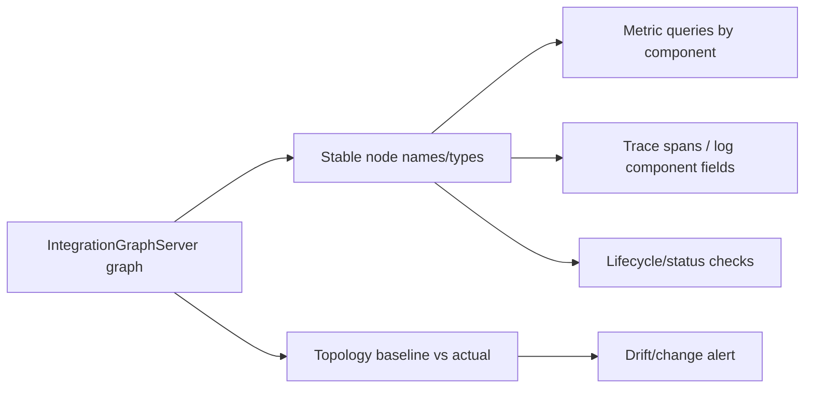
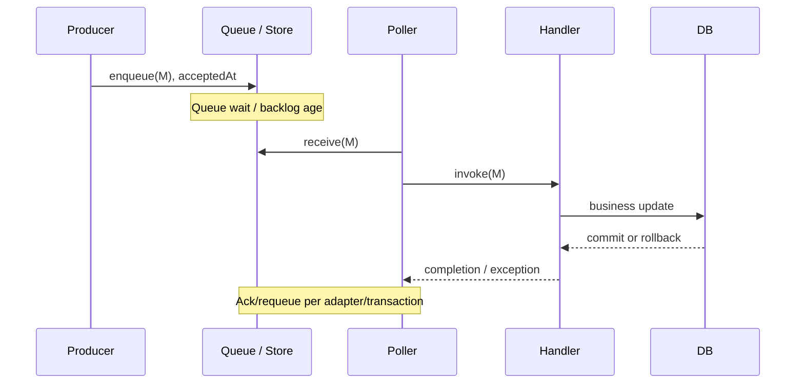
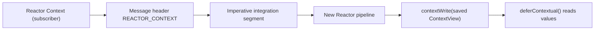
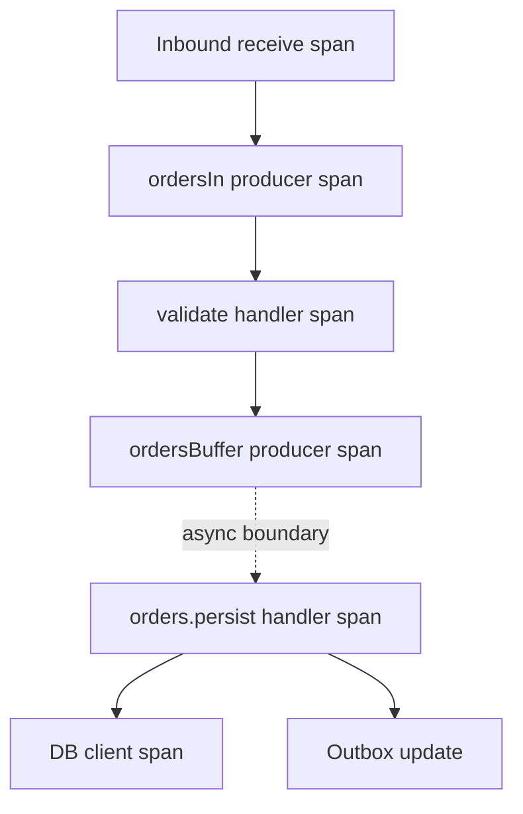
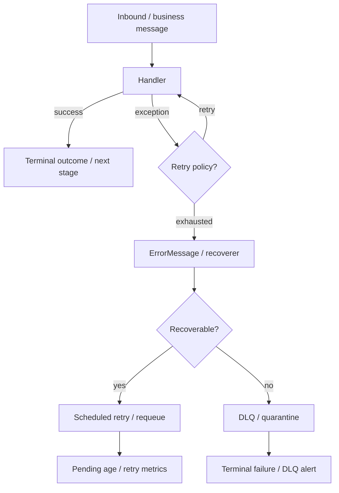
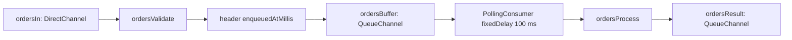
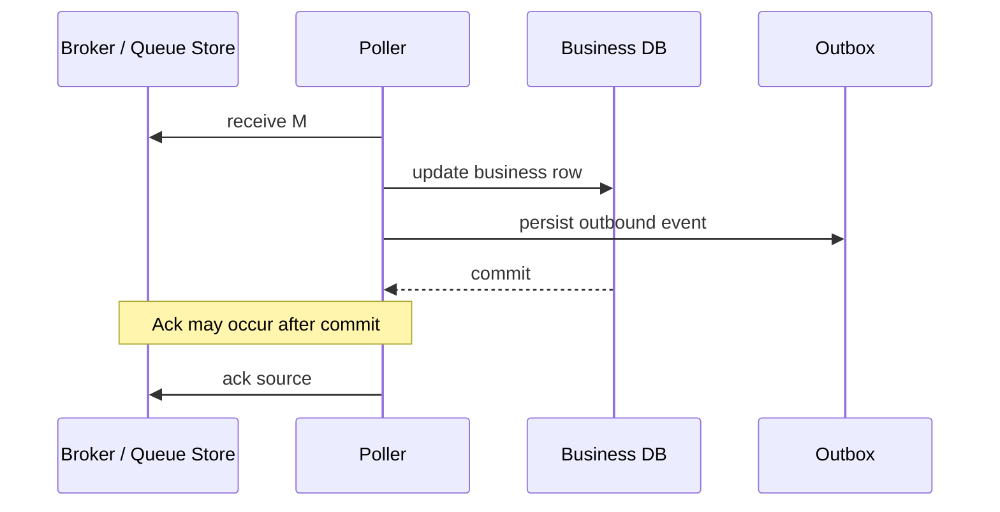
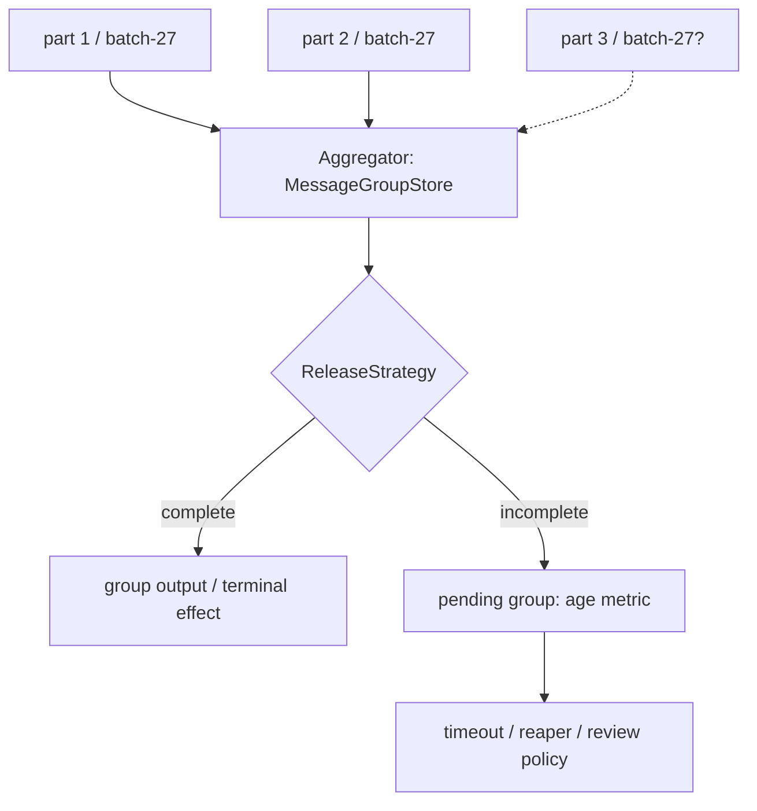

# Designing Observability into the Topology in Spring Integration Runtime

## 1. Goal: Making the Flow Observable from Design Time

In the **SPRING_INTEGRATION_RUNTIME** module, systems process messages across `MessageChannel`s, endpoints, consumers, pollers, and executors while managing `IntegrationFlow` lifecycles, transactions, retries, message stores, errors, and correlation. In production, incidents can happen at any boundary:

- The producer sends a message successfully, yet the consumer never runs.
- `DirectChannel.send()` slows down because of a synchronous handler, while the metric name suggests a channel problem.
- `ExecutorChannel.send()` returns very fast, yet the worker pool is saturated.
- Messages linger inside `QueueChannel`, `JdbcChannelMessageStore`, or a broker without any exception ever thrown.
- Retries and redeliveries drive up attempt counts while completed business events stall.
- An aggregator holds incomplete groups or uses mismatched correlation and never emits output.
- A dynamically registered flow went live, yet graphs/dashboards still show the old topology.
- Thread, subscription, or process transitions drop tracing/MDC or security context.
- The business DB commits while the broker ACK is missing, causing duplicates on restart.

**Designing observability into the topology** means that while drawing the graph and choosing channels/endpoints, you simultaneously define **which states must be visible, at which boundaries to measure, how components are named, how context propagates, where failures will surface, and how those signals are tested**.

This is not an afterthought of "adding logs after an incident". Observability is a **runtime design requirement** alongside throughput, reliability, durability, and security.

After this lesson, you will be able to:

1. Draw topologies with observation points anchored to **nodes, edges, and async boundaries**.
2. Choose **SLIs** (service-level indicators) tied to business events alongside technical metrics.
3. Name beans/channels/endpoints stably to link `IntegrationGraphServer`, Micrometer, logs, and tracing.
4. Distinguish direct `spring.integration.send`/`receive` meters from Micrometer Observation's `spring.integration.producer`/`handler`.
5. Design propagation for `trace context` and business `correlationId` across executors, pollers, reactive pipelines, and networks.
6. Measure queue wait, handler duration, terminal outcomes, retries, message age, and consumer liveness at the exact right boundaries.
7. Design error paths, recovery, DLQs, and audits alongside the happy path.
8. Build a minimally instrumented Java DSL flow and write integration tests verifying **topology + behavior + telemetry**.
9. Operate dynamic flows without drifting metric names, losing context, or exploding cardinality.
10. Draft an **observability design contract** for pre-production flow reviews.

Illustrations use Java 17+, Spring Integration **6.5.x**, Spring Framework 6.x, Micrometer, and Spring Boot 3.5.x where Actuator applies. Verify APIs/metric names against your project's actual BOM.

## 2. Topology Should Read Like a Chain of Verifiable Promises

Consider an order processing flow:



Each component has not only a function, but also its **own local success condition**:

| Location | Local Success Condition | What Remains Unproven | Signals to Add |
|---|---|---|---|
| Inbound adapter | Received request/record | Was the event processed on time? | Ingress count, accepted event ID, source lag |
| `ordersIn.send` | Channel accepted/dispatched message | Did async downstream finish? | Channel timer/counter, exceptions |
| Validate handler | Validation finished per contract | Did the business DB commit? | Handler duration, rejection outcomes |
| `ordersBuffer.send` | Enqueue succeeded | Did the consumer dequeue yet? | Queue depth, enqueue timestamp |
| Poller `receive` | Message retrieved | Did transaction/ACK commit? | Receive count, poller liveness, retries |
| Persist handler | Invocation returned | Do DB and outbox share a transaction? | Business commits, rollback/lock metrics |
| Outbox dispatcher | Delivery attempt executed | Did the final consumer apply the event? | Oldest outbox age, delivery/ACKs |
| Error flow | `ErrorMessage` received | Did recovery/DLQ complete? | Terminal failures, DLQ size/age |
| Integration graph | Component/link exists | Is the endpoint running or receiving traffic? | `SmartLifecycle`, metrics, traces |

**Design principle:** never substitute **one node's success** for **end-to-end process success**. A `send()` returning `true` may mean nothing more than a queue accepted the message.

### Data Plane vs. Control Plane

- **Data plane:** message send/receive, handler invocations, correlation, retries, DB/outbound side effects.
- **Control plane:** registering/starting/stopping/destroying flows, updating router mappings, tuning pollers, rebuilding topologies, changing versions.
- **Observability plane:** metrics, traces, structured logs, message history, graph snapshots, audit events, and alerting.



Never allow metrics or tracing to automatically purge queues or replay messages simply because an error threshold fired; those are control-plane actions requiring explicit policies.

## 3. Four Questions Before Choosing Instrumentation

When reviewing a new flow, write down the answers to:

1. **When is a message considered accepted?** At ingress? When stored in a persistent queue? When the business transaction commits?
2. **When is a message considered terminal?** On handler return? Business row committed? Outbox published? Remote ACK?
3. **Where is synchronicity lost?** Executor, poller, `QueueChannel`, Reactor subscription, broker/network, scheduler, or gateway reply timeout?
4. **Which failure states can occur silently without throwing exceptions?** Stopped poller, growing backlog, incomplete group, lost source, route with no subscribers, stuck async job.

If you cannot answer these, design an explicit boundary signal or revise the contract before building dashboards.

### An "Observability Contract" for One Edge

```yaml
edgeId: orders.validate-to-buffer
source: orders.validate
target: ordersBuffer
channelType: QueueChannel
acceptanceSemantics: enqueue
executionBoundary: synchronous-producer-to-polled-consumer
persistent: false
correlationHeader: orderEventId
tracePropagation: in-process-message-headers
primarySignal: queue-depth-and-oldest-age
failureSignal: send-failure-and-error-flow
terminalEffect: none-at-this-edge
owner: orders-runtime
```

This is an **architectural specification template**, not YAML auto-generated by Spring Integration. At this same edge, also give `QueueChannel` a bounded capacity and decide whether full-queue behavior blocks, throws, drops under control, or applies backpressure.

## 4. Name Your Topology Before Building Dashboards

Spring Integration can auto-generate bean/endpoint names—convenient for quick DSL prototypes, yet unstable for production observability.

### Recommended Naming Convention

```text
Application:      orders-runtime
Flow ID:          orders.ingest.v1
Input channel:    orders.in
Validator:        orders.validate
Buffered channel: orders.pending
Poller endpoint:  orders.persist.poller
Handler endpoint: orders.persist
Error channel:    orders.errors
Output channel:   orders.completed
```

You can use alphanumeric separators instead of dots if project naming rules dictate. What matters is that names are **meaningful, stable, and controlled**, never relying on auto-generated endpoint indexes.

| Name / Identifier | Used For | Should It Be a Metric Tag? |
|---|---|---|
| `application/service` | Grouping dashboards, alerts | Yes, bounded |
| `flowName` or logical flow ID | Linking topology, ownership | Yes, if finite in count |
| `componentName`/endpoint ID | Graph nodes, tracing/metrics | Yes, if stable |
| `componentType` | Channel/handler/poller | Yes |
| `instance/pod` | Diagnosing replicas | Yes, in infrastructure labels |
| `correlationId` | Tracking one business process | **No**, never a metric tag |
| `messageId`/`orderId` | Investigating one event | **No**, never a metric tag |
| `traceId`/`spanId` | Linking traces/logs | Never a meter tag |
| `dynamicRegistrationId` | Managing dynamic flows | Only if cardinality is bounded with TTL/cleanup |
| `tenantId` | Authorization, ownership | No, if high-cardinality or sensitive |

### Why Stable Names Matter

`IntegrationGraphServer` emits node names/types; Micrometer also tags component names. If an endpoint shifts from `orders.persist` to an auto-generated bean name on refactor, you risk:

- Graph diffs appearing as deleted and recreated components.
- Old time series stopping while new dashboards show empty panels.
- Alert rules receiving no data even though the flow still runs.
- Traces/logs becoming hard to compare across deployments.

**Explicit IDs are an observability design decision**, not merely code style.

## 5. The Graph Is a Map of Sensor Placements, Not the Sensor Itself

`org.springframework.integration.graph.IntegrationGraphServer` produces a `Graph` containing:

- `contentDescriptor`: provider/version/application metadata.
- `nodes`: `IntegrationNode` entries with `nodeId`, `name`, `componentType`, properties, etc.
- `links`: `LinkNode` entries with `from`, `to`, `type`, such as `input`, `output`, `route`, `error`, `discard`.

```java
IntegrationGraphServer server = ...;

Graph graph = server.getGraph();      // cached topology
Graph refreshed = server.rebuild();  // rescan after changes
```

`getGraph()` may return a cached topology. When `IntegrationFlowContext` registers/removes flows, `rebuild()` updates the model to reflect new components. **Never call rebuild for every message passing through**, because the graph is not a trace stream.

### Designing Around the Graph



An informative dashboard lets you click from node `orders.persist` straight to handler latency, error rate, worker pools, DB pools, logs, and traces. That linkage requires **shared naming conventions and controlled metadata**—it does not appear automatically from the graph.

### Node IDs Must Not Be Used as Long-Lived Storage Keys

`nodeId` is meaningful only for joining `links.from/to` **within a single snapshot**. Across rebuilds/restarts, node IDs can change. To diff graphs across versions:

1. Join links by `nodeId` within the current snapshot.
2. Normalize each node to `application + flowNamespace + componentName + componentType`.
3. Normalize links to `sourceName + linkType + targetName`.
4. Compare sets and record the deployment revision/instance.
5. Also inspect dynamic router mappings and lifecycle state where applicable; graph links alone do not capture everything.

### Adding Metadata Selectively

`IntegrationGraphServer.setAdditionalPropertiesCallback(...)` can enrich `NamedComponent` entries with properties:

```java
@Bean
public IntegrationGraphServer integrationGraphServer() {
    IntegrationGraphServer server = new IntegrationGraphServer();
    server.setApplicationName("orders-runtime");

    server.setAdditionalPropertiesCallback(component -> {
        if (component instanceof SmartLifecycle lifecycle) {
            return Map.of(
                    "runningAtSnapshot", lifecycle.isRunning(),
                    "autoStartup", lifecycle.isAutoStartup(),
                    "phase", lifecycle.getPhase());
        }
        return null;
    });
    return server;
}
```

Required imports include `IntegrationGraphServer`, `SmartLifecycle`, `Map`, and `@Bean`. This is method-level code inside a Spring `@Configuration` class; callback values are captured when the graph is built, not as a live health probe. To inspect whether an endpoint is **currently** running, query `SmartLifecycle.isRunning()` directly.

**Never place** credentials, raw SpEL expressions, full Messages, tokens, or tenant IDs into graph properties. Graph/Actuator endpoints are administrative surfaces that must be protected.

## 6. Choosing the Right Telemetry Layer for Each Question

### Metrics: "How Many and How Fast or Slow?"

Metrics suit throughput, latency, error rates, backlogs, queue ages, saturation, and SLOs. Tags must stay low-cardinality.

### Tracing: "Where Did One Specific Request/Event Spend Time?"

Traces record spans and parent/child relationships at instrumented boundaries. Valuable across HTTP/brokers, executors, handlers, and DBs—yet sampling drops traces, so traces are not an exact ledger of outcomes.

### Structured Logs: "What Was the Exact Event or Root Cause?"

Logs should include `timestamp`, `level`, `application`, `instance`, `flow`, `component`, `traceId`, controlled `correlationId`, `eventType`, and `errorCode`. Never log full payloads/PII/secrets by default.

### Message History: "Which Components Did the Message Traverse?"

Spring Integration offers `@EnableMessageHistory`, appending named component history into a message header as the message traverses tracked components. It is not distributed tracing and does not write durable audits.

### Runtime Graph and Audit: "What Is the Live Topology and How Did Config Change?"

The graph shows current nodes/links; audit logs record **who** modified flows/routers, desired/effective revisions, and outcomes. A runtime graph snapshot knows neither the actor nor individual message journeys.

| Question | Primary Source | Corroborating Source |
|---|---|---|
| Which handler lost throughput? | Metrics by component | Graph, logs |
| Where did message M42 go? | Traces / message history | Structured logs |
| Are messages waiting too long? | Durable oldest-age / queue gauge | Store/broker |
| Is the poller stopped or source empty? | `SmartLifecycle` + progress metric | Input backlog, error channel |
| Is a group orphaned? | `MessageGroupStore` metrics/state | Correlation logs, reaper |
| Who rerouted urgent traffic to review? | Control-plane audit | Graph + router mapping snapshot |
| Was a payment charged twice? | Durable business event ledger | Traces / attempt counters |

## 7. Designing Observation and Micrometer by Version

### 7.1. Direct Micrometer Meters

In Spring Integration 6.5, with a configured `MeterRegistry` and instrumented components, direct meters typically include:

| Meter Name | Type | Distinguishing Tag | What It Measures |
|---|---|---|---|
| `spring.integration.send` | Timer | `type=channel` | `MessageChannel.send` |
| `spring.integration.send` | Timer | `type=handler` | `AbstractMessageHandler` invocation |
| `spring.integration.receive` | Counter | `type=channel` | `PollableChannel.receive` |
| `spring.integration.receive` | Counter | `type=source` | `MessageSource.receive` |
| `spring.integration.channel.queue.size` | Gauge | `name`, `type=channel` | `QueueChannel` depth |
| `spring.integration.channel.queue.remaining.capacity` | Gauge | `name`, `type=channel` | Remaining slots in bounded queue |
| `spring.integration.channels/handlers/sources` | Gauge | Registry metadata | Component counts |

Direct timers may include `name`, `result=success|failure`, and `exception` tags. A successful `send` does not imply a business commit.

### 7.2. Micrometer Observation

Since Spring Integration 6.0, Observation unifies metrics and tracing via `ObservationRegistry` + `ObservationHandler`. Per the 6.5 reference, `@EnableIntegrationManagement(observationPatterns=...)` selects which components are instrumented; **having a registry does not enable Observation on all components by default**.

Primary naming conventions:

| Measurement Point | Observation Timer | Active Long-Task Timer | Low-Cardinality Tags |
|---|---|---|---|
| Channel/producer | `spring.integration.producer` | `spring.integration.producer.active` | `spring.integration.name`, `spring.integration.type=producer` |
| Message handler | `spring.integration.handler` | `spring.integration.handler.active` | `spring.integration.name`, `spring.integration.type=handler` |
| Gateway | `spring.integration.gateway` | `spring.integration.gateway.active` | `spring.integration.name`, `spring.integration.type=gateway`, `spring.integration.outcome` |

Since Spring Integration 6.5, `SourcePollingChannelAdapter` is also instrumented via the `IntegrationObservation.HANDLER` API on inbound polling. Do not assume every pollable receive exposes an Observation timer named `spring.integration.receive`: the published core conventions are producer, handler, and gateway.

### 7.3. Avoid Mixing Both Modes

With direct meters, handlers emit **`spring.integration.send{type=handler}`**; with Observation, handlers emit **`spring.integration.handler`**. These signals differ in creation, tags, and scope.

Never build an alert summing both names as unique handled messages, and never assume `result=failure` always exists in the Observation handler convention.

**Workflow:** pick a mode → enable instrumentation → run a test message → inspect actual meters/tags → write dashboards. Never write PromQL based on guessed metric names.

## 8. From Graph to Instrumentation Matrix

An architecture review should include a table mapping **node/edge → operation → metrics → traces → errors → owner**:

| Component | Measured Operation | Metrics | Trace / Log | Notes |
|---|---|---|---|---|
| HTTP/JMS/Kafka inbound | Accepted event | Ingress count, source lag | Extract trace carrier | Broker ACK does not mean finished |
| `ordersIn: DirectChannel` | `send` | Send timer | Producer span | Duration may include synchronous handler |
| `orders.validate` | Handler invocation | Handler timer, validation rejections | Handler span, errorCode | Business reject ≠ system failure |
| `ordersBuffer: QueueChannel` | Enqueue/dequeue | Send, receive, depth, capacity | Timestamp/correlation | Receive does not measure full queue wait |
| `orders.persist.poller` | Poll & handoff | Poll progress/empty polls (custom if absent) | Poller logs, lifecycle | Distinguish empty source from stopped |
| `orders.persist` | DB business action | Handler timer + DB spans | Correlation, transaction outcome | Handler return does not guarantee commit |
| `outbox` | Pending/delivered | Oldest outbox age, retries, DLQ | Event ID and transaction ref | Crash window between commit and publish |
| Error handler | Recovery | Error terminal outcomes, DLQ | Exception type/cause | Sending to errorChannel ≠ recovery success |
| Aggregator | Group release | Incomplete/oldest group, release count | Business correlation ID | Orphans do not necessarily throw |
| Executor thread pool | Task execution | Active threads, queue depth, rejections | Thread boundary | Channel send latency is not worker latency |

Add custom measurement points only when built-in metrics **lack the needed semantics**. Attaching timers to every operator risks overlap, double counting, and overhead without producing an end-to-end SLI.

## 9. Execution Boundaries Are Where Observability Commonly Breaks

### 9.1. DirectChannel

`DirectChannel` usually invokes its consumer synchronously on the sender thread; exceptions can propagate back to the caller. `channel.send()` timers often enclose the downstream handler, so queue wait cannot be inferred from them.

```text
send start ───── handler sync ───── send return
                <handler timer>
<------------- channel timer ----------->
```

Never add these two timers together to compute end-to-end latency because their intervals **nest**.

### 9.2. ExecutorChannel

`ExecutorChannel` dispatches to a worker. `send()` may return once the task is accepted; the handler executes later:

```text
producer thread:  send → accepted
worker thread:               scheduled → handler → outcome
                     [wait]            [duration]
```

For real visibility, add **executor queue wait**, active/pool threads, rejected tasks, handler completion, and error channel tracking. A `1 ms` send timer does not prove a `1 ms` business latency.

### 9.3. QueueChannel and Pollers

`QueueChannel` accepts messages before consumers run. Pollers call `receive()` later. Topologies should explicitly mark **enqueue time, dequeue time, and commit/ACK time**.



A poller can stop running without throwing exceptions; thus you need **progress heartbeats** and backlog/oldest-age gauges. Receive counters do not prove the DB committed.

### 9.4. Reactive Boundaries

`FluxMessageChannel`, `ReactiveMessageHandler`, and `Mono`/`Flux` carry subscriber-level context and lifecycles. A constructed `Mono` that has **not been subscribed to** performs no work. Detached inner `subscribe()` calls lose context, cancellation, and error propagation.

For reactive flows, measure **subscription→terminal signal** and distinguish `onComplete`/`onError`/`cancel` when contracts matter; never infer full reactive completion from synchronous `send()` duration.

### 9.5. Network / Persistence Boundaries

When crossing HTTP/brokers or persistent message stores:

- Enqueued data does not mean the remote consumer applied it.
- Trace context must be injected/extracted via **standard transport headers**, never by serializing Java `ContextView`.
- Message ID, event ID, and deduplication keys have different lifecycles from trace IDs.
- Runtime restarts reset in-memory counters; durable backlogs and terminal records must persist independently.

## 10. Design Correlation Right at Message Creation

A system may need all of these concurrently:

| ID Type | Purpose | Lifetime | Security Requirement? |
|---|---|---|---|
| Spring `messageId` | Identifies one `Message<?>` instance | May change when message is transformed | Never use as event dedup ID |
| `businessEventId` | Dedup/idempotency/reconciliation | Across retries, redeliveries, restarts | Validate origin/format and permissions |
| `correlationId` | Groups messages in one workflow | Across parts/gateway replies | Never blindly trust keys from untrusted producers |
| `traceId` | Distributed tracing | One trace/span context | Does not replace business event ID |
| `spanId` | Identifies one span | One operation | Never use as queue key |
| `flowRevision` | Topology/version snapshot at processing time | Across deploys/cutovers for forensics | Attached by trusted component |
| `tenantId` | Business partition/authorization | Per request/process | Sensitive; must be authenticated |

### Where Should Correlation IDs Be Set and Propagated?

- At trusted ingress, validate business event IDs and ensure deduplication capability.
- When splitting parts, preserve stable keys and valid sequence metadata if aggregators use default correlation.
- When persisting to a message store, store **essential IDs** and serializable metadata, never raw thread context.
- When publishing to a broker, pass IDs through explicit header mappings/schema contracts.
- When logging, emit `eventId`/`correlationId` under redaction policies; **never** attach them as Micrometer labels.

### Example Event Header Design

```text
Internal Message Headers:
  eventId        = "EV-1001"
  correlationId  = "batch-27"
  acceptedAt     = 2026-11-22T00:00:00Z
  flowRevision   = 42
  trace carrier  = propagated by observation/instrumentation

Broker headers:
  event-id       = EV-1001
  correlation-id = batch-27
  traceparent    = standard W3C carrier
```

Production headers require size limits and validation. Use a configured tracing propagator rather than concatenating a `traceparent` string from an arbitrary UUID.

## 11. Reactor Context, ThreadLocal, and MessageHeaders Are Not the Same Thing

Spring Integration can combine imperative and reactive execution. To keep tracing/scopes intact across thread switches, understand:

| Carrier | Scope | Strengths | Limitations |
|---|---|---|---|
| Reactor `ContextView` | Subscriber/subscription | Survives scheduler switches inside one reactive chain | Does not cross detached inner subscriptions |
| Java `ThreadLocal` / MDC | Single Java thread | Easy integration with blocking libraries | Does not cross ExecutorChannel/pollers automatically |
| Spring `MessageHeaders` | Travels with the message when propagated | Crosses send/receive and mapped adapters | Does not automatically populate MDC/Spans |
| Micrometer `ContextSnapshot` | Captures/restores registered accessors | Bridges imperative/async | Accessors must be registered; carries overhead |
| HTTP/broker trace carrier | Crosses network/processes | Standard distributed tracing | Requires explicit inject/extract at boundaries |
| `businessEventId` | Logical event | Idempotency/correlation | Does not create tracing context on its own |

Since Spring Integration 6.0.5, `IntegrationMessageHeaderAccessor.REACTOR_CONTEXT` can carry `ContextView` across imperative segments in supporting components. `StaticMessageHeaderAccessor.getReactorContext(message)` reads that value. It **does not** automatically restore MDC, security contexts, or reactive transactions on arbitrary threads.



**Security caveat:** never copy raw `SecurityContext`, bearer tokens, or arbitrary principals into message stores/brokers just to "preserve tracing". Authentication/authorization must be enforced at trusted boundaries.

### Enabling Micrometer Automatic Propagation

Reactor 3.5+ integrates with Micrometer Context Propagation when the matching dependency is present. `Hooks.enableAutomaticContextPropagation()` can restore `ThreadLocal` values from Reactor Context for new subscriptions if accessors are registered. This is a global setting—enable at bootstrap, never toggle per request.

For custom Spring executors, `ContextPropagatingTaskDecorator` is an option when capturing/restoring `ThreadLocal` values is needed. It **does not** turn a thread-bound JDBC transaction into a distributed transaction, nor does it restore objects across restarts.

## 12. Observation Spans: Design Parent-Child Trees Around Actual Runtime

A trace might look like:



However, this diagram is a **telemetry target**, not a guarantee that all spans link automatically just by turning on Observation. For trace continuity:

1. Provide an `ObservationRegistry` and appropriate tracing bridge/`ObservationHandlers`.
2. Instrument the intended components via `observationPatterns`.
3. Propagate trace carriers across message headers, executors, and network adapters.
4. Avoid detached inner subscriptions or fire-and-forget side effects outside context.
5. Verify parent-child relationships in integration tests with an exporter/test handler.
6. Accept that sampling omits some traces; SLO metrics must remain independent of sampling.

### Avoid Double Counting

If a handler invokes an instrumented HTTP client, traces can show both a handler span and an HTTP client span. They **nest**. Handler duration encloses the HTTP call in many cases; never sum span durations to compute total request latency.

### Span Cardinality

Span names should be bounded operation names like `orders.persist`, not `orders.persist.EV-1001`. Event IDs, trace IDs, and correlation IDs belong in attributes/log fields governed by retention/sampling rules—never turned into metric labels.

## 13. Message History and WireTap: Use at the Right Time and Place

`@EnableMessageHistory` tells Spring Integration to attach a history header to messages as they pass tracked named components.

```java
@Configuration
@EnableIntegration
@EnableMessageHistory({
        "ordersIn",
        "ordersBuffer",
        "orders*"
})
class MessageHistoryConfig {
}
```

Spring Integration docs note that the history header records entries with component `name`/`type` and supports patterns to restrict tracking. Since 6.3, history storage improved to an append-only model and the framework clones history appropriately across framework-managed multi-producer branches.

### When to Use Message History

- Debugging routing/splitting/aggregation inside a JVM.
- Verifying which components handled a specific message.
- Investigating discrepancies between expected graph paths and actual message paths.
- Testing wiring under controlled traffic.

### When NOT to Enable It Broadly

- Message payloads/headers are already large or serialized to brokers.
- Fan-out creates many branches, inflating message header size.
- Very high production throughput without overhead evaluation.
- Distributed tracing already provides sufficient coverage and history adds little value.

`WireTap` copies messages to an observation channel, yet creates an extra execution branch—introducing potential async dispatch, backpressure, delivery errors, and PII exposure. Never attach WireTap to every channel assuming zero data-plane impact.

**Never use MessageHistory as a durable audit log:** headers can be stripped across transforms/serialization, and history does not record which actor modified routes.

## 14. Designing Error Flows Is Designing Observability

A flow defining only the "happy path" lacks investigative data when things fail. Map error paths alongside success paths:



### Synchronous vs. Asynchronous Failures Differ

- `DirectChannel`: handler exceptions can propagate back to `send()`'s caller.
- `ExecutorChannel`: producer `send()` may succeed while exceptions occur on the worker and travel via error handlers/`errorChannel`.
- Poller/`MessageSource`: poller error handlers, transaction rollbacks, and retries govern outcomes.
- Reactive publisher: `onError` is a subscription signal; do not assume it routes to the global `errorChannel`.
- Gateway: reply timeouts differ from handler exceptions; measure both.

An `ErrorMessage` sent to `errorChannel` **does not mean recovery succeeded**. If the recovery handler itself throws, you must know its error routing and DLQ policy.

### Preserving failedMessage / Correlation

When errors happen, capture at minimum:

- Validated stable `eventId`/`correlationId`.
- Endpoint/flow ID and instance.
- Low-cardinality exception type/code.
- Technical attempt number and retry policy.
- Original/failed message **redacted of sensitive data**.
- Terminal status: retry scheduled, DLQ, manual review, or final failure.

Never dump full `Throwable`s or Message payloads into metric labels. Logs can record cause stacks per policy, while audit/business state records durable outcomes.

## 15. Measuring Queue Wait and End-to-End Latency Accurately

Built-in channel send Timers and receive Counters **do not directly report per-message queue waiting time**. If a flow has latency SLAs, stamp timestamps at **trusted milestones**.

### Timestamp Milestones

```text
sourceEventAt        when the event was truly created (if trustworthy)
ingressAcceptedAt    when ingress validated and accepted it
enqueuedAt           right before submitting into channel/queue
dequeuedAt           when poller retrieves message
processingStartedAt  when handler begins
businessCommittedAt  when business effect commits
acknowledgedAt       when broker/source ACK finishes (if applicable)
```

Formulas:

```text
Queue waiting time ≈ dequeuedAt − enqueuedAt
End-to-end timeliness ≈ terminalOutcomeAt − ingressAcceptedAt
Source-to-terminal latency ≈ terminalOutcomeAt − sourceEventAt
```

Timestamps must come from consistent sources and semantics. Across JVMs with clock skew, epoch differences can go negative or drift. Within a single JVM, `System.nanoTime()` is monotonic and helpful, yet **must never** be persisted for subtraction across restarts or other processes.

### Code to Measure Queue Wait at Handler Entry

```java
package example.runtime.observability;

import io.micrometer.core.instrument.MeterRegistry;
import io.micrometer.core.instrument.Timer;

import java.time.Clock;
import java.util.concurrent.TimeUnit;

import org.springframework.messaging.Message;

public final class ObservedOrderProcessor {

    private final MeterRegistry registry;
    private final Clock clock;

    public ObservedOrderProcessor(MeterRegistry registry, Clock clock) {
        this.registry = registry;
        this.clock = clock;
    }

    public String process(Message<String> message) {
        Object value = message.getHeaders().get("enqueuedAtMillis");

        if (!(value instanceof Number number)) {
            throw new IllegalArgumentException(
                    "Missing trusted queue timestamp");
        }

        long queueWaitMillis =
                Math.max(0L, clock.millis() - number.longValue());

        Timer.builder("orders.queue.wait")
                .description("Approximate queue wait before handler")
                .tag("flow", "orders.ingest")
                .register(registry)
                .record(queueWaitMillis, TimeUnit.MILLISECONDS);

        // Demo: business DB/transaction is not executed here.
        return "processed:" + message.getPayload();
    }
}
```

This is an **approximate measurement at handler start**. It captures queue wait plus minor poller/dispatch overhead; it **does not** measure transaction outcomes or total end-to-end latency. Clamping with `Math.max(0)` avoids negative durations from clock skew or bad headers, yet production should **count timestamp/clock-skew anomalies separately** rather than silently masking major drift.

### Timestamp Trustworthiness

- Trusted adapters/ingress stamp timestamps after input validation.
- Producers must not inject arbitrary `enqueuedAtMillis` values that distort SLIs.
- Persist headers only when message converters/stores support serializable types.
- Bound header retention and sizes.
- When business deadlines stay fixed across retries, **never overwrite `ingressAcceptedAt`** on each attempt.

## 16. Spring Integration Java DSL Example: A Topology Built for Observability

The example below includes explicit channel names, endpoint IDs, pre-enqueue timestamps, a poller boundary, measurable output, and `IntegrationGraphServer`. It uses **direct Micrometer meters** with `SimpleMeterRegistry` so it runs standalone in tests/plain Spring contexts; Observation setup is shown separately in Section 17.

```java
package example.runtime.observability;

import java.time.Clock;
import java.time.Duration;

import io.micrometer.core.instrument.MeterRegistry;
import io.micrometer.core.instrument.simple.SimpleMeterRegistry;

import org.springframework.context.annotation.Bean;
import org.springframework.context.annotation.Configuration;
import org.springframework.integration.channel.DirectChannel;
import org.springframework.integration.channel.QueueChannel;
import org.springframework.integration.config.EnableIntegration;
import org.springframework.integration.config.EnableIntegrationManagement;
import org.springframework.integration.config.EnableMessageHistory;
import org.springframework.integration.dsl.IntegrationFlow;
import org.springframework.integration.dsl.Pollers;
import org.springframework.integration.graph.IntegrationGraphServer;
import org.springframework.messaging.MessageChannel;

@Configuration
@EnableIntegration
@EnableIntegrationManagement
@EnableMessageHistory({"ordersIn", "ordersBuffer", "orders*"})
public class ObservableOrdersConfig {

    @Bean
    public MeterRegistry meterRegistry() {
        return new SimpleMeterRegistry();
    }

    @Bean
    public Clock clock() {
        return Clock.systemUTC();
    }

    @Bean
    public MessageChannel ordersIn() {
        return new DirectChannel();
    }

    @Bean
    public QueueChannel ordersBuffer() {
        return new QueueChannel(128);
    }

    @Bean
    public QueueChannel ordersResult() {
        return new QueueChannel(128);
    }

    @Bean
    public ObservedOrderProcessor orderProcessor(
            MeterRegistry registry, Clock clock) {
        return new ObservedOrderProcessor(registry, clock);
    }

    @Bean
    public IntegrationFlow ordersIntake(Clock clock) {
        return IntegrationFlow.from("ordersIn")
                .handle(
                        (payload, headers) -> {
                            String value = payload.toString().trim();
                            if (value.isEmpty()) {
                                throw new IllegalArgumentException(
                                        "Empty order event");
                            }
                            return value;
                        },
                        endpoint -> endpoint.id("ordersValidate"))
                .enrichHeaders(headers ->
                        headers.headerFunction(
                                "enqueuedAtMillis",
                                message -> clock.millis()))
                .channel("ordersBuffer")
                .get();
    }

    @Bean
    public IntegrationFlow ordersWorker(
            ObservedOrderProcessor processor) {
        return IntegrationFlow
                .from("ordersBuffer",
                        endpoint -> endpoint.poller(
                                Pollers.fixedDelay(
                                        Duration.ofMillis(100))
                                        .maxMessagesPerPoll(5)))
                .handle(processor, "process",
                        endpoint -> endpoint.id("ordersProcess"))
                .channel("ordersResult")
                .get();
    }

    @Bean
    public IntegrationGraphServer integrationGraphServer() {
        IntegrationGraphServer server = new IntegrationGraphServer();
        server.setApplicationName("orders-runtime");
        return server;
    }
}
```

### Topology Walkthrough



**Demo scope:**

- No real broker/JDBC/HTTP; in-memory `ordersBuffer` can lose messages on process crash.
- No custom error flow, retry advice, business transaction, or durable audit—those extend the flow per business requirements.
- `SimpleMeterRegistry` stores measurements in-process only; it does not export Prometheus metrics by default.
- `@EnableMessageHistory` is for learning/debugging; production must evaluate overhead and pattern selection.
- `ordersValidate`/`ordersProcess` are endpoint IDs aiding metric, graph, and log correlation.
- `enqueuedAtMillis` marks queue entry near the enqueue boundary, not a terminal event deadline.
- A handler returning output **does not** prove a business DB commit because the demo has no DB.

### Why Use QueueChannel at the Output?

`ordersResult` lets the integration test call `receive(timeout)` to await completion deterministically instead of using `Thread.sleep()`. In real flows, output may be an outbound adapter, reply channel, outbox, or business state.

### What Must Be Added for Production

1. Durable `MessageStore`/broker if restart recovery is required.
2. Business event ID + idempotent inbox/outbox.
3. `errorChannel` or recovery policy with explicit terminal outcomes.
4. Poller transaction advice when atomic dequeue + business update is needed.
5. Executor metrics/queue age, DB pool/lock metrics.
6. Proper Observation/tracing bridge and network propagation.
7. Controller/gateway authorization and security header policies.
8. Poller `SmartLifecycle`/readiness, alerts, and runbooks.

## 17. Enable Observation Selectively by Topology, Not Blindly Everywhere

When running Spring Boot with Actuator and Observation registries/handlers, configure selective instrumentation properly.

```java
import org.springframework.boot.SpringApplication;
import org.springframework.boot.autoconfigure.SpringBootApplication;
import org.springframework.integration.config.EnableIntegrationManagement;

@SpringBootApplication
@EnableIntegrationManagement(
        observationPatterns = {"ordersIn", "ordersBuffer", "orders*"})
public class ObservedBootApplication {

    public static void main(String[] args) {
        SpringApplication.run(ObservedBootApplication.class, args);
    }
}
```

In a **real application**, ensure an `ObservationRegistry` and appropriate Micrometer Observation handlers (metrics, tracing) exist; Spring Boot Actuator/Tracing auto-configuration depends on starters and BOMs. Never copy `ObservableOrdersConfig` wholesale into this app when it creates its own `SimpleMeterRegistry` and separate management config and assume you have a complete production tracing setup. Pick **one** coherent management/registry configuration.

### How to Choose observationPatterns

You can start with:

- Critical ingress channels.
- Handlers performing external I/O, transactions, or retries.
- Request/reply gateways requiring deadline tracking.
- Key pollers/source adapters.
- Error/recovery endpoints.

Expand later as needed. Instrumenting every channel across multi-hop flows can generate huge numbers of spans and metric series, especially with frequent dynamic flow registrations.

### Tracing Sampling Must Not Break SLIs

Size sampling by volume, sensitivity, and incident needs. A system might sample traces at 1–10% while keeping counters/timers exact enough to evaluate SLOs. Never compute total business event counts from sampled spans unless backed by a validated estimator.

## 18. Start from SLIs: True Completion Time of an Event

An order may traverse multiple queues, retries, and instances. Appropriate SLIs are:

```text
Timeliness SLI =
    unique eligible events completed before deadline
    -------------------------------------------------
    unique eligible events due within the window

Availability/outcome SLI =
    unique eligible terminal events with valid outcome
    --------------------------------------------------
    unique eligible terminal events
```

Define policies for canceled/rejected events, duplicates, missing events, and late arrivals before deploying.

### Never Use Timer.count() as Unique Event Count

For a single event E1:

```text
Inbound: 1 event
ordersIn.send: 1
ordersBuffer.send: 1
poller.receive: 1
ordersProcess handler: 3 attempts due to retry
DB business terminal: 1 success
```

Summing `spring.integration.send` across channels/handlers counts E1 multiple times. Technical metrics answer **how the flow behaves**, while business SLIs answer **whether events succeeded accurately**.

### Base SLIs on Durable Terminal State

For systems needing accounting/reconciliation, persist `eventId` and terminal state in a durable store, or derive them from an event/inbox/outbox ledger. Calling in-memory `Counter.increment()` after commit can miss counts if the JVM crashes right before incrementing; incrementing before commit can falsely report success if the transaction rolls back.

`@TransactionalEventListener(phase=AFTER_COMMIT)` schedules notifications post-commit, yet **does not** guarantee notifications survive crashes. For strict accuracy, reconcile against durable outbox/audit records.

## 19. Designing Observability for Transactions and Crash Windows

A flow can commit the business database before ACKing the broker, or dequeue a message before the business transaction fails.



### Where Are Signals Needed?

| Failure Window | What May Happen | Observability |
|---|---|---|
| Before receive | Message not yet pulled | Source/broker backlog, oldest age |
| After receive, before business update | In-flight message may roll back/requeue | Receive/handler start + transaction status |
| After DB write, before commit | Rollback, no terminal business effect | DB rollback/lock metrics |
| After commit, before broker ACK | Redelivery, duplicate attempts | Business event ID + inbox dedup metrics |
| After outbox commit, before dispatch | Pending outbox lingers | Oldest outbox age, dispatcher progress |
| After remote success, before local checkpoint | Side effect may retry | Remote idempotency/reconciliation |

**Never infer atomicity from sharing a tracing span.** A trace is observation, not a transaction manager. `DataSourceTransactionManager` uses thread-bound JDBC resources; `ReactiveTransactionManager` uses Reactor Context. Propagating context or switching schedulers does not link two transaction managers.

### Define "Processed" Explicitly for Dashboards

Separate states clearly:

```text
RECEIVED
  -> ACCEPTED
  -> PENDING
  -> IN_PROGRESS
  -> TERMINAL_SUCCESS | TERMINAL_FAILURE | MANUAL_REVIEW
```

This state can live in an inbox/ledger or durable event log. Handler timers are technical signals placed alongside it.

## 20. Aggregators: Correlation and Group State Must Be Observed

An `Aggregator` holds state beyond any single message: `MessageGroupStore`, correlation keys, release/expiry strategies, late-arrival policies, and lock ownership.

When sketching an aggregator topology, define:

- `partsAccepted` and unique group counts.
- `incompleteGroupCount`/`oldestIncompleteGroupAge`.
- `releasedGroupCount` and output effects.
- `groupTimeoutCount`, expired/discarded counts.
- `lateArrivalCount` or completed-group policies.
- Database/persistent group store health and distributed lock behavior.
- Correlation keys created/validated at trusted boundaries, logging no PII.



An aggregator that never releases may **throw zero exceptions**: alerting solely on `handler failure` misses orphaned groups completely. This illustrates why observability must be built directly into stateful topologies.

### Cardinality Caution

Use `correlationId` to look up groups in the message store—**never** as a Prometheus label. Measure group counts and maximum ages per bounded flow/tenant tier or application; query stores/logs under access controls to inspect individual groups.

## 21. Pollers, Schedulers, and Liveness: Do Not Confuse Idle Traffic with Failure

A poller can have `isRunning=true` yet receive zero messages because the source is empty. Conversely, producers may fill the queue while the poller is `stop()`ped.

Signals to include:

| Signal | Purpose |
|---|---|
| `isRunning` | Endpoint lifecycle state |
| `lastPollAt` | Confirms poller is still scheduled |
| `lastNonEmptyPollAt` | Last time source yielded a message |
| `lastSuccessfulProcessingAt` | Last terminal processing meeting contract |
| `emptyPollRate` | Empty poll rate (usually a custom metric) |
| `receiveRate` | Messages retrieved |
| `oldestPendingAge` | Detects stuck messages |
| `pollErrors` | Exceptions/recovery paths |
| Scheduler active tasks / executor metrics | Worker starvation |

**Do not page after 30 minutes with zero receives** for a daily batch service with an empty backlog. Conversely, if `oldestPendingAge > deadline` **and** completions stall, investigate lack of progress immediately.

### Relational Alert Design

```text
No-progress alert:
   (pending backlog > 0 OR expected source traffic is late)
AND (business completion makes no progress > threshold)
AND (maintenance window has not intentionally stopped the flow)
```

Distinguish missing metrics from genuine zero traffic; if a scrape target goes down, empty queries can mask outages.

## 22. Dynamic IntegrationFlows: Design Telemetry and Lifecycle Together

Spring Integration `IntegrationFlowContext` allows registering and destroying flows at runtime:

```java
var registration = flowContext.registration(flow)
        .id("orders.canary.v2")
        .autoStartup(false)
        .register();

try {
    registration.start();

    // Smoke test: flow receives/sends valid messages per contract.
    // Graph reflects new nodes/links after rebuild.
    graphServer.rebuild();

    // During controlled cutover:
    registration.stop();
}
finally {
    registration.destroy();
    graphServer.rebuild();
}
```

This is a **method-level snippet**, assuming `flowContext` and `graphServer` beans are injected and `flow` is built with proper namespacing.

**Telemetry design for dynamic flows:**

1. Stable logical flow IDs and versions (never mint new labels per message).
2. Control-plane audits for register/start/stop/destroy.
3. Graph rebuilds after adding/removing components; stable snapshot diffs.
4. Meter names verified after flow registration and traffic smoke tests.
5. Clean up metrics/registrations on flow destruction; never leak high-cardinality dead meters indefinitely.
6. Separate lifecycle state from readiness: `isRunning=true` does not guarantee downstreams are ready.
7. Quiesce/drain policies before stop/destroy so in-flight messages conclude safely.
8. Across multiple pods, each instance owns its own graph; updating one pod does not update others automatically.

### Adding Metadata Without Exploding Series

If you spawn 10,000 per-user dynamic flows and give every flow its own `flowId` metric label, time-series counts explode rapidly. Better design:

- Use a few finite logical flow classes/tier metrics.
- Track active registration counts and lifecycle events in the control plane.
- Log detailed registration IDs in audit records/logs.
- Reap unused flow registrations per TTL/policy.
- Enable fine-grained tracing selectively on critical flows.

## 23. Security: Observability Can Leak Sensitive Data

Message flows can carry payment IDs, customer data, auth tokens, and internal routing. Instrumentation must never turn them into public telemetry.

### Rules for Logs / Traces

- Log only intentional fields: timestamps, components, bounded error codes, trace IDs, and policy-approved event IDs.
- Never log full `Message.getPayload()`, SQL parameters, Authorization headers, or `SecurityContext` by default.
- Enforce role-based access control on traces/logs by team and data classification.
- Enforce retention and redaction; debug logging must have TTLs and enablement audits.
- If message history/WireTap runs in production, restrict tracked components and captured content.
- Never pass secrets inside baggage/tracing headers.

### Rules for Metrics

- Keep tags low-cardinality: application, environment, stage, component, result, bounded error class.
- Never tag order IDs, correlation IDs, JWTs, user IDs, or unbounded tenant IDs.
- For dynamic routers, never use raw untrusted user route keys as metric tags.
- Review `MeterFilter`, histogram buckets, and metric cardinality before rollout.

### Graph / Actuator Security

`GET /actuator/integrationgraph` exposes topology, channel names, and endpoint metadata. Protect management endpoints with network boundaries and authn/authz. `POST /actuator/integrationgraph` (if enabled) triggers a graph rebuild; it is not a topology mutation command.

Control Bus/JMX/custom management routes can mutate lifecycles/routers. Audit those operations separately; never expose management channels via business ingress.

## 24. Example Dashboard Anchored to Topology

A dashboard for `orders.ingest` should arrange rows following **positions in the graph**:

| Panel | Source | What It Answers |
|---|---|---|
| Ingress accepted rate | Custom/broker ingress | Incoming load |
| `ordersIn` send count/error/latency | Micrometer channel metrics | Producer send/dispatch |
| `ordersValidate` duration/errors | Handler metric/Observation | Validation bottlenecks |
| `ordersBuffer` queue depth & oldest age | Queue gauge / custom store metric | Backlog and timeliness |
| Poller last progress | Lifecycle / custom heartbeat | Is the consumer progressing? |
| `ordersProcess` handler p95 | Handler timer/histogram | Slow handlers |
| DB pool/lock latency | DB/Actuator client metrics | External resource saturation |
| Business terminal success/timeliness | Durable ledger / custom SLI | Are users getting valid outcomes? |
| Retry/DLQ/outbox oldest age | Broker/store metrics | Is manual intervention needed? |
| Graph revision/lifecycle | Graph/control-plane audit | Did topology change or endpoints stop? |

### Topology-Anchored Incident Workflow

1. From an `oldestPendingAge` alert, jump to the `ordersBuffer` node in the graph.
2. Compare producer send rate against consumer receive/completion rates.
3. Check whether `orders.persist.poller` is running.
4. If running without progress: inspect worker threads, retry backoffs, DB locks, and transaction timeouts.
5. If receive rate is high while business completions stay low: investigate rollbacks/recovery/idempotency.
6. If a dynamic flow recently deployed: inspect graph snapshots, component IDs, and change audits.
7. Use trace/correlation IDs to isolate specific events.
8. After recovery, confirm oldest age drops and terminal business outcomes climb without creating duplicates.

## 25. Prometheus: Queries Must Match the Exact Metric Mode and Semantics

For **direct Micrometer** with standard Prometheus naming:

```promql
# Successful channel sends by component:
sum by (job, name) (
  rate(
    spring_integration_send_seconds_count{
      type="channel",
      result="success"
    }[5m]
  )
)

# Handler invocation rate:
sum by (job, name) (
  rate(
    spring_integration_send_seconds_count{
      type="handler"
    }[5m]
  )
)

# Pollable receive rate:
sum by (job, name) (
  rate(
    spring_integration_receive_total{
      type="channel"
    }[5m]
  )
)
```

In **Observation mode**, average handler latency:

```promql
sum by (job, spring_integration_name) (
  rate(spring_integration_handler_seconds_sum[5m])
)
/
clamp_min(
  sum by (job, spring_integration_name) (
    rate(spring_integration_handler_seconds_count[5m])
  ),
  1e-9
)
```

These PromQL snippets follow **naming conventions** and do not guarantee every exporter uses the exact suffixes/labels. Always inspect raw `/actuator/prometheus` output.

### Queue Age and No-Progress Alerting

Assuming the app exports custom gauges `orders_oldest_pending_age_seconds` and `orders_last_terminal_success_timestamp_seconds`:

```promql
(
  orders_oldest_pending_age_seconds{service="orders"} > 120
)
and on(service)
(
  time()
    - orders_last_terminal_success_timestamp_seconds{
        service="orders"
      } > 600
)
```

This rule is valid only if gauges update accurately from durable stores, share matching labels, and handle the initial case before any first success. **Never** treat missing series as 0; add monitoring-health and source-freshness alerts for missing telemetry.

### Alert Design Checklist

- Thresholds justified by business SLOs/capacity, never one default across every channel.
- Use `for` / multi-window rules to suppress brief spikes.
- Add volume gates on error-rate alerts during low traffic.
- Detect missing/absent metrics, down targets, and restarts.
- Link owners/runbooks to specific nodes/flows.
- Avoid paging on secondary symptoms when a root-cause alert is already firing, unless user impact warrants separate escalation.

## 26. Observability Testing Must Live Inside Flow Tests

A flow is production-ready when tests prove:

- **Topology:** exact channels/endpoints/links.
- **Behavior:** messages follow expected paths; errors/retries obey policy.
- **Telemetry:** expected meter names/tags/spans/error fields appear at expected boundaries.
- **Control:** start/stop/dynamic registration introduces no unexpected graph/metric drift.
- **Safety:** zero leaked payloads, zero high-cardinality labels.

### 26.1. Integration Test for the Java DSL Example

```java
package example.runtime.observability;

import static org.assertj.core.api.Assertions.assertThat;

import io.micrometer.core.instrument.MeterRegistry;
import org.junit.jupiter.api.Test;
import org.springframework.beans.factory.annotation.Autowired;
import org.springframework.beans.factory.annotation.Qualifier;
import org.springframework.integration.channel.QueueChannel;
import org.springframework.integration.graph.IntegrationGraphServer;
import org.springframework.messaging.Message;
import org.springframework.messaging.MessageChannel;
import org.springframework.messaging.support.GenericMessage;
import org.springframework.test.context.junit.jupiter.SpringJUnitConfig;

@SpringJUnitConfig(ObservableOrdersConfig.class)
class ObservableOrdersTest {

    @Autowired
    @Qualifier("ordersIn")
    MessageChannel input;

    @Autowired
    @Qualifier("ordersResult")
    QueueChannel output;

    @Autowired
    MeterRegistry registry;

    @Autowired
    IntegrationGraphServer graphServer;

    @Test
    void flowHasBehaviorAndTelemetry() {
        assertThat(input.send(new GenericMessage<>(" ORD-7 ")))
                .isTrue();

        Message<?> result = output.receive(3_000);
        assertThat(result).isNotNull();
        assertThat(result.getPayload())
                .isEqualTo("processed:ORD-7");

        var nodes = graphServer.getGraph().getNodes().stream()
                .map(node -> node.getName())
                .toList();

        assertThat(nodes).contains("ordersIn", "ordersBuffer");

        var channelTimers = registry.find("spring.integration.send")
                .tags("type", "channel", "name", "ordersIn")
                .timers();

        assertThat(channelTimers)
                .anyMatch(timer -> timer.count() >= 1);

        var waitTimer = registry.find("orders.queue.wait")
                .tag("flow", "orders.ingest")
                .timer();

        assertThat(waitTimer).isNotNull();
        assertThat(waitTimer.count()).isGreaterThanOrEqualTo(1);
    }
}
```

This example uses JUnit 5, AssertJ, `spring-test`, and the configs/classes from Sections 15–16. It demonstrates **direct Micrometer mode**; if Observation mode is active, adjust assertions to `spring.integration.producer`/`handler` and low-cardinality keys. Do not hardcode exact total node counts or max timer latencies since auto-generated names and CI schedulers vary.

### 26.2. Missing Output in Tests Is Not Proof of Drop

With pollers/`ExecutorChannel`, `send()` can finish before the handler runs. Use `receive(timeout)` or a `CountDownLatch` tied to completion. Never assert `output.receive(0)==null` claiming the handler dropped the message: the worker may simply not have been scheduled yet.

### 26.3. Testing Error Flows and Metrics

1. Make the handler throw a controlled exception.
2. Verify synchronous `DirectChannel` errors propagate to the caller, or async `ErrorMessage`s reach the expected error channel.
3. Verify technical attempt metrics and business terminal outcomes **differ**.
4. Test retry followed by recovery; one input produces multiple handler attempts.
5. Verify full payloads/`correlationId` are absent from meter labels.
6. With transactions, assert DB state/rollbacks rather than handler timers alone.

### 26.4. Testing Tracing / Context

- Mint business event IDs and trace context at trusted ingress.
- Across `ExecutorChannel`/pollers, verify tracing parent/spans or context carriers per configuration.
- With `FluxMessageChannel`, test `contextWrite`/`deferContextual` and subscription semantics.
- Across brokers/test HTTP servers, verify header inject/extract works.
- Send two events concurrently; confirm tenant/correlation data never bleeds across.
- Test MDC/ThreadLocal cleanup post-request so workers never leak context to subsequent tasks.

### 26.5. Testing Dynamic Topologies

1. Capture a baseline graph.
2. Register a flow with an explicit ID via `IntegrationFlowContext`.
3. Call `rebuild()` and verify nodes/links.
4. Send a synthetic message and verify measurable output.
5. Stop/start the registration, verifying lifecycle and telemetry.
6. Destroy and rebuild, checking registration cleanup.
7. Verify audit change events and no leaked high-cardinality meters.

## 27. When Metrics Alone Are Insufficient: Combining Diagnostic Layers

Consider a case: **the service reports healthy, channel sends look steady, yet 30% of orders miss deadlines**.

```text
ordersIn.send       success = 1000/s
ordersBuffer depth  growing rapidly
poller receive      300/s
ordersProcess       p95 climbing
DB pool             exhausted
terminal success    280/s
oldest age          4 minutes
```

Topology-guided diagnosis:

- Source/ingress is healthy.
- The queue acts as a bottleneck buffer, not the final destination.
- Poller dequeue rate trails input; workers are likely stalled on the DB pool.
- `ordersProcess` p95 climbs; inspect DB/client spans and thread dumps.
- Terminal success trails receives due to rollbacks/retries/error recovery.
- Increase poller concurrency only after verifying DB capacity; over-scaling can worsen DB saturation.

### Another Case: Graph Missing a Flow After Deploy

- `IntegrationGraphServer.getGraph()` may be serving a stale cache.
- Call `rebuild()` after register/destroy to refresh.
- Inspect per-instance/pod state, `SmartLifecycle.isRunning()`, and registration IDs.
- If the flow appears in the graph with zero traffic, check sources/pollers, gateway routing, broker lag, or control-plane mutations.
- Audit who stopped/rerouted the flow rather than assuming the framework "lost a component".

## 28. Cost of Observability: Sampling, Overhead, Storage, and Privacy

Observability is itself a workload: timers/spans/logs, message history, graph snapshots, Prometheus series, and exporters consume CPU, heap, network, and disk.

### Telemetry Budget

| Component | Risk | Mitigation |
|---|---|---|
| Micrometer meters | High-cardinality tags, histogram buckets | Bounded labels, selective histograms |
| Observation spans | Too many spans per message | Curated `observationPatterns`, sensible sampling |
| Structured logs | I/O cost, secret/PII leaks | Sample debug logs, bounded fields/redaction |
| Message history | Header growth, serialization overhead | Restrict tracked-component patterns |
| WireTap | Extra async traffic, backpressure/errors | Use selectively and isolate channels |
| Graph rebuild/snapshots | Scans full context, large payloads | Rebuild only on topology changes; cache |
| Audit events | Durable storage/retention growth | Append-only schemas, partitioning/retention |
| Correlation IDs | Cardinality explosion if tagged on meters | Keep solely in logs/traces/audits |
| Exporters | Scrape latency/network load | Tune scrape intervals, timeouts, capacities |

**Never "solve" overload by turning off all production metrics/traces without a fallback.** Know which signals are mandatory for SLOs/security versus which can be sampled or toggled during incidents.

### Alert Fatigue Is an Architectural Bug

If every handler error pages, one DB outage triggers hundreds of pages. Alert on **user impact** and service-level symptoms, grouping/inhibiting root-cause alerts. Link high-level alerts to graph/handler panels to speed investigation rather than waking on-call for every low-level timer.

## 29. Observability Contract Template for an IntegrationFlow

Attach this template to each flow's architecture review/ADR:

```markdown
# Observability Contract — <logical-flow-id>

## Business contract
- Eligible event:
- Unique event ID / idempotency key:
- Success terminal state:
- Failure terminal state:
- Deadline and SLO window:
- Owner and escalation:

## Topology
- Inbound source:
- Channels: type, capacity, persistence:
- Handlers: stable IDs and external dependencies:
- Poller/executor: scheduling/concurrency/queue:
- Router/aggregator: correlation/release/timeout:
- Error channel, retry, DLQ and recovery:
- Dynamic registration/config revision:

## Boundaries and propagation
- Ingress accepted timestamp:
- Queue enqueued/dequeued timestamps:
- Trace inject/extract boundary:
- Correlation headers and privacy:
- Transaction/ack boundary:
- Restart/crash and idempotency policy:

## Signals
- Built-in metrics mode and names:
- Custom business counters/gauges:
- Latency and age histograms:
- Trace spans and sampling:
- Structured log fields:
- Message history/WireTap scope:
- Graph/lifecycle/audit metadata:

## Alerts and validation
- User-impact SLI/SLO alert:
- Backlog/no-progress alert:
- DLQ/retry/transaction alert:
- Missing telemetry/target-down alert:
- Runbook link:
- Integration tests: success/error/retry/restart:
- Cardinality, retention and access review:
```

A contract does not need hundreds of dashboards; it must let on-call answer **where load enters, what state messages sit in, where they wait, what counts as success, and how to recover safely**.

## 30. Common Design Mistakes

### 30.1. Instrumenting Only Ingress

When sources keep sending while consumers/pollers stop, ingress looks "green". Always track completion SLIs and backlog/oldest age.

### 30.2. Omitting Stable Endpoint IDs

Auto-generated names shift across refactors, breaking links across graphs, traces, and metrics. Enforce explicit names in code review rather than waiting for dashboards to break.

### 30.3. Putting Timers on Every Hop and Summing Them

Timers on `DirectChannel` and handlers often nest; summing them double-counts latency. Measure business end-to-end duration at terminal boundaries.

### 30.4. Treating `send(true)` as Processing Completion

On `QueueChannel`/`ExecutorChannel`, send typically means accepted only. Measure completions and transaction outcomes separately.

### 30.5. Treating ThreadLocal as Flow-Wide Context

Pooled threads, pollers, Reactor subscribers, and brokers break the "one request = one thread" assumption. Use `MessageHeaders`, Reactor Context, Micrometer context propagation, and transport propagators appropriately.

### 30.6. Using Trace ID as a Business Idempotency Key

Trace IDs can change across retries/operations, whereas business events need stable identities. Never derive outcome counts from sampled traces.

### 30.7. Putting Every ID into Metric Tags

`correlationId`/`orderId` create unbounded time series. Put them in policy-governed logs/traces and keep metric labels bounded.

### 30.8. Leaving Error Routes Undrawn

`ErrorMessage`, retries, recovery, and DLQs carry their own traffic and latency. Never hide terminal failures behind a recoverer that swallows exceptions.

### 30.9. Ignoring Stateful Components

Aggregators waiting on groups throw zero exceptions; monitor pending group age/timeouts and store health.

### 30.10. Treating a Cached Graph as Complete Live State

`getGraph()` returns cached topology; `rebuild()` refreshes structure. Graphs are not live health probes, message histories, or per-message traces.

### 30.11. Skipping Telemetry Tests

Flow tests assert only payloads while metric exporters break names/tags and alerts stay silent. Add tests asserting meter modes, graph links, and span propagation.

### 30.12. Ignoring Restarts and Clusters

One pod having a new flow does not mean all pods do; counters resetting on restart do not prove data loss. Use per-instance graph snapshots and durable message/terminal states.

## 31. Practice Exercises

### Exercise A — Draw Topology with Observability Boundaries

1. Take the flow `inbound → DirectChannel → ServiceActivator → QueueChannel → PollingConsumer → DB`.
2. Mark `accepted`, `enqueued`, `dequeued`, `handlerStart`, `transactionCommit`, and `ack` milestones.
3. Map available built-in meters to each node/edge.
4. Identify which queue-wait/business-success facts cannot be inferred from built-in meters.
5. Write a table of 6–10 signals with clear owners.

**Pass criterion:** never confuse channel send with terminal business events.

### Exercise B — Stable Names and IntegrationGraphServer

1. Run `ObservableOrdersConfig`.
2. Call `getGraph()` and locate channels/handler endpoints by stable names.
3. Join links inside the snapshot by `nodeId`.
4. Rename one endpoint ID and compare graph/metric names.
5. Formulate a production naming policy.

### Exercise C — Direct Metrics vs. Observation

1. Run the demo with `SimpleMeterRegistry` and send 3 messages.
2. Inspect `spring.integration.send{type=channel}`, `type=handler`, and `spring.integration.receive`.
3. Switch to a Spring Boot/Observation setup with matching dependencies.
4. Verify `spring.integration.producer` and `spring.integration.handler`.
5. Update dashboard queries for the new mode without summing both metric sets.

### Exercise D — Queue Wait and Poller Liveness

1. Stamp timestamps before enqueue and measure queue wait inside the handler.
2. Stop the poller, send 5 messages, and observe queue depth and oldest age.
3. Restart the poller and confirm queue draining and completion.
4. Simulate an empty source and ensure no-progress alerts do not fire falsely.
5. Let a pending message exceed the SLO while stopped and verify the alert fires accurately.

### Exercise E — Correlation and Tracing Across Executors

1. Send two events with distinct `businessEventId` values through an `ExecutorChannel`.
2. Configure trace context via proper instrumentation.
3. Verify logs/spans match each event without leaking ThreadLocal/MDC across threads.
4. Test without a `TaskDecorator`/accessor and pinpoint where context drops.
5. Restore propagation and run a regression test preserving the executor boundary.

### Exercise F — Crash / Retry / Outbox

1. Use real test DB/broker resources where needed.
2. Inject a failure after DB commit before broker ACK.
3. Prove redelivery creates an additional technical attempt.
4. Verify a single unique business outcome via inbox/idempotency.
5. Reconcile near-real-time counters against the durable ledger.
6. Design alerts for oldest outbox age and duplicate-effect anomalies.

### Exercise G — Dynamic Topology and Security

1. Register a dynamic flow with a controlled ID/version.
2. Call `rebuild()` and verify graph updates.
3. Verify metrics for new components appear after traffic.
4. Stop/destroy the flow and inspect metric lifecycle and graph diffs.
5. Audit actor/revision/operation; block unauthorized callers from mutating routes.
6. Verify neither payloads nor raw credentials appear in graphs or logs.

## 32. Production-Ready Checklist

- [ ] Every critical flow has an observability contract from architecture review.
- [ ] Business success/timeliness SLIs are independent of technical send/handler metrics.
- [ ] Stable names/IDs exist for channels, endpoints, pollers, gateways, and routers.
- [ ] Clear source acceptance timestamps, event IDs, and correlation policies exist.
- [ ] Every async boundary is marked: executors, pollers, queues, reactive pipelines, brokers.
- [ ] Error flows, retries/recovery/DLQ, and terminal states are defined.
- [ ] Queue depth, oldest pending age, and poller progress are measured where needed.
- [ ] Aggregators/resequencers expose pending group/timeout/late-arrival signals.
- [ ] Transaction/ACK boundaries and failure windows are mapped.
- [ ] Micrometer direct vs. Observation mode is explicitly chosen with verified names/tags.
- [ ] Tracing propagates across required boundaries; sampling does not distort SLIs.
- [ ] Message history / WireTap are selectively enabled with evaluated overhead.
- [ ] Metric tags are bounded; zero message IDs, order IDs, PII, or secrets in labels.
- [ ] Graph/Actuator endpoints are secured; graphs are never treated as per-message traces.
- [ ] Dynamic flow registration/rebuild/audits have explicit lifecycle and cleanup policies.
- [ ] Business success is recorded only after commit per contract, backed by durable reconciliation.
- [ ] Dashboards follow topology: ingress → buffer → poller → handler → terminal.
- [ ] Alerts have SLO/capacity justification and runbooks, never arbitrary thresholds.
- [ ] Tests cover success, error, retry, stop, restart, tracing, metric names, and missing telemetry.
- [ ] Telemetry cost budgets, retention, redaction, and access controls are in place.

## References

- [Spring Integration 6.5 — Metrics and Management](https://docs.spring.io/spring-integration/reference/6.5/metrics.html): direct Micrometer meters, Observation conventions, `@EnableIntegrationManagement`.
- [Spring Integration Reference — Integration Graph](https://docs.spring.io/spring-integration/reference/graph.html): topology `nodes/links` and metadata callbacks.
- [Spring Integration 6.5 Javadoc — IntegrationGraphServer](https://docs.spring.io/spring-integration/docs/6.5.0/api/org/springframework/integration/graph/IntegrationGraphServer.html): `getGraph()`, `rebuild()`.
- [Spring Integration Reference — Message History](https://docs.spring.io/spring-integration/reference/message-history.html): `@EnableMessageHistory`, history headers, tracking patterns.
- [Spring Integration Reference — Message Channels](https://docs.spring.io/spring-integration/reference/channel.html): Direct/Executor/QueueChannel and threading.
- [Spring Integration Reference — Polling Consumers](https://docs.spring.io/spring-integration/reference/endpoint.html): pollers, schedulers, consumer endpoint lifecycle.
- [Spring Integration Reference — Error Handling](https://docs.spring.io/spring-integration/reference/error-handling.html): `ErrorMessage`, `errorChannel`, sync/async exceptions.
- [Spring Integration Reference — Message Store](https://docs.spring.io/spring-integration/reference/message-store.html): durable queue/group state and persistence.
- [Spring Integration Reference — Reactive Streams Support](https://docs.spring.io/spring-integration/reference/reactive-streams.html): reactive channels, context/async boundaries.
- [Project Reactor — Context Propagation](https://projectreactor.io/docs/core/release/reference/advanced-contextPropagation.html): Micrometer context propagation and automatic mode.
- [Micrometer — Observations](https://docs.micrometer.io/micrometer/reference/observation/introduction.html): ObservationRegistry, observations, tags, and handlers.
- [Micrometer — Timers](https://docs.micrometer.io/micrometer/reference/concepts/timers.html): latency distributions and timer semantics.
- [Spring Boot 3.5 — Actuator Metrics](https://docs.spring.io/spring-boot/3.5/reference/actuator/metrics.html): MeterRegistry, exporters, and management endpoints.
- [Prometheus — Querying Functions](https://prometheus.io/docs/prometheus/latest/querying/functions/): `rate`, `histogram_quantile`, `absent`.
- [Google SRE Workbook — Alerting on SLOs](https://sre.google/workbook/alerting-on-slos/): business SLIs/SLOs, error budgets, and alerting principles.

**Key Takeaways:** A Spring Integration topology becomes truly **operable** only when every critical node and edge has **stable identifiers, explicit success semantics, timely observation points, boundary-safe context propagation, explicit error paths, and matching tests**. The graph tells you **which components exist**; metrics, traces, and logs tell you **what they are doing**; durable business state tells you **whether events completed accurately**. Design all three upfront so during incidents you never have to guess root causes from a `send(true)` call.
