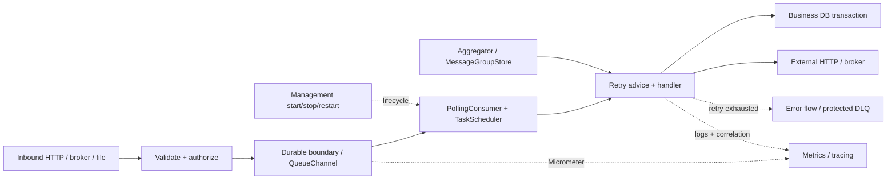
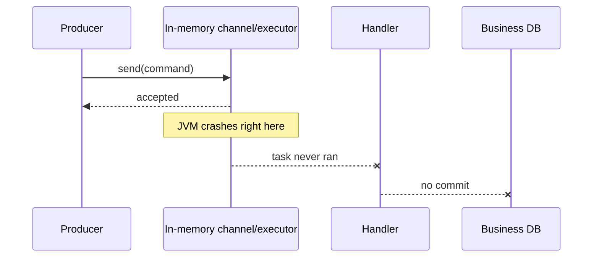
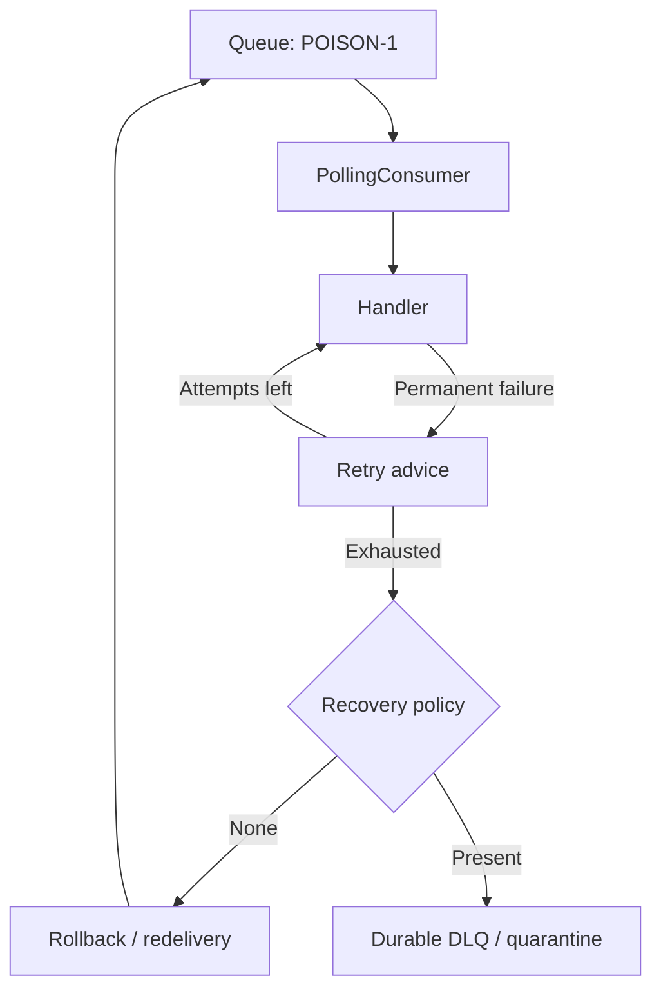
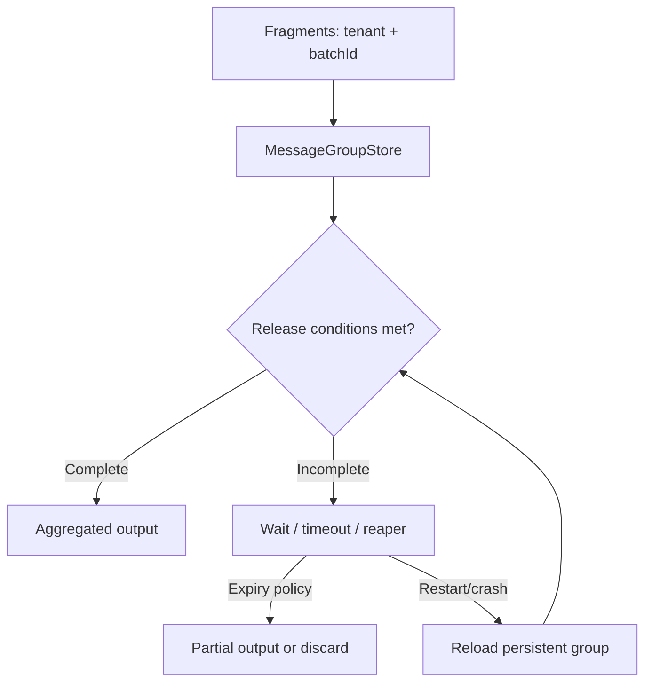
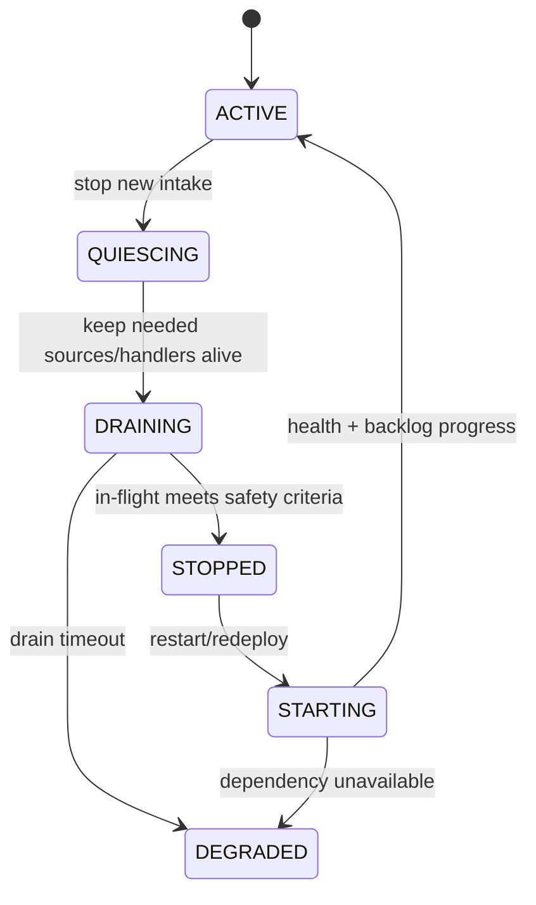
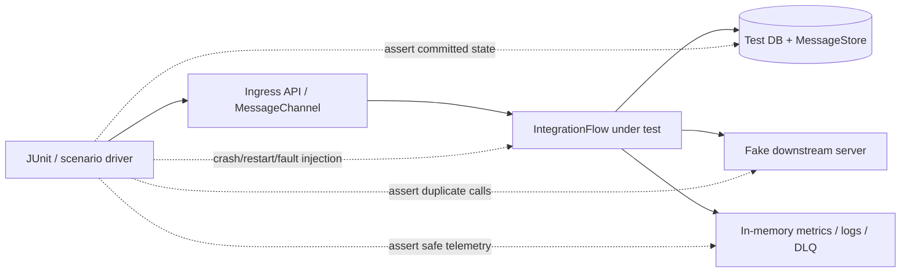

# Pre-Production Runtime Failure Mode Review in Spring Integration

## 1. Getting an IntegrationFlow Working Is Not Enough for Production

An `IntegrationFlow` can run smoothly in development: sending a message to a `DirectChannel`, running a handler, and getting a successful database response. In production, however, the system encounters scenarios outside the happy path:

- Producers emit faster than consumers; queues or executor backlogs grow until memory runs out.
- Pollers are started yet starved of `TaskScheduler` threads.
- Downstream HTTP completes a side effect and then times out before returning a response; retries create duplicate transactions.
- A worker dies mid-flight after dequeuing from a persistent store and before committing.
- A permanently failing message rolls back and blocks the head of the queue.
- An aggregator receives too few fragments, leaves groups waiting forever, or emits invalid partial results.
- A dynamically registered flow existed in the old JVM but is never recreated after restart.
- A config change alters the JDBC message store `region`, making older messages "vanish".
- `ErrorMessage` lands on a dedicated error channel while dashboards watch only the global `errorChannel`.
- DEBUG logs or DLQs accidentally capture tokens, payloads, and sensitive headers.

The lesson **"Pre-Production Runtime Failure Mode Review"** belongs to the **Runtime Design** chapter of the **SPRING_INTEGRATION_RUNTIME** module, guiding how to design and execute a **pre-production runtime failure mode review**. Scope covers channels, endpoints, consumers, pollers, executors, `IntegrationFlow` lifecycle, transactions, retries, message stores, errors, correlation, threading, performance, and runtime state.

The goal is not a pretty list of risks. Every failure mode must specify **trigger condition → effect → detection signal → blast-radius containment → recovery → verification test**.

> **Release Principle:** Never conclude "messages are processed exactly once" merely because you configured retries, a persistent `QueueChannel`, or `JdbcMessageStore`. Explicitly define what is confirmed at each boundary and how duplicate business side effects are prevented.

## 2. Unit of Review: From Message Ingress to Business Outcome

First, draw the actual **runtime graph**—do not rely solely on reading source code.



This is a reference model; your app may use `DirectChannel`, `ExecutorChannel`, `FluxMessageChannel`, JMS/Kafka adapters, or no aggregator at all. **The review must document your application's exact graph**: component IDs, channel types, input/output/error channels, transaction managers, stores, executors, pollers, and outbound calls.

For every arrow, ask:

1. **Who owns the message at this point?** Producer, channel, broker, DB queue, executor, or handler?
2. **Is it durably stored yet?** In RAM, on local disk, DB-committed, or broker-confirmed?
3. **When is success reported to the caller?** `send()` return, ACK, commit, or business result?
4. **If the JVM dies, will the message come back?** Who is responsible for redelivery?
5. **If redelivery occurs, are side effects idempotent?**
6. **If an error occurs, where does it go?** Caller, `ErrorMessage`, retry, recovery channel, DLQ, or log?
7. **What evidence proves the decision?** Metrics, traces, business audits, message stores, or recovery records?

A review must never leave these questions unanswered for steps carrying business impact.

## 3. Establish SLOs, RPO, RTO, and Delivery Contracts Before Analyzing

Failure modes only make sense relative to **acceptable consequences**.

| Property | Mandatory Question | *Illustrative* Target Example |
| --- | --- | --- |
| Business correctness | Can orders be duplicated or dropped? | One `commandId` creates at most one committed side effect |
| Availability | How long can intake or processing stop? | 99.9% service window per SLO |
| End-to-end latency | How long from enqueue to commit? | p95 under 2 s, p99 under 10 s |
| Backlog tolerance | How big and how old may queues grow? | Oldest message age under 5 minutes |
| RPO | Can client-acknowledged messages be lost? | Zero loss of durably-acked messages |
| RTO | How quickly must flows recover after a crash? | Resume processing within 10 minutes |
| Failure isolation | Can one failing tenant/downstream stall other flows? | No global shared-pool starvation |
| Recovery | Are terminal failures traceable? | Explicit failure records and replay policies |
| Security | Can telemetry leak payloads/tokens? | Zero credentials in logs/traces/tags |
| Cost / capacity | How does the system handle traffic spikes or backlog replays? | Meets peak traffic with measured headroom |

These figures are **not Spring Integration defaults**. Projects must choose real SLOs grounded in message traits, transports, business rules, and infrastructure capacity.

### Separate Every Kind of Confirmation

```text
REQUEST ACCEPTED  != MESSAGE PERSISTED
MESSAGE PERSISTED != HANDLER STARTED
HANDLER COMPLETED != BUSINESS COMMITTED
BUSINESS COMMITTED != EXTERNAL SIDE EFFECT CONFIRMED
EXTERNAL SUCCESS  != SOURCE ACK COMMITTED
```

With an `ExecutorChannel`, `send() == true` may only mean the task was dispatched/accepted into the executor. With a `DirectChannel`, the synchronous call passes through the handler and may throw back to the producer. With a broker, confirm/ACK has a different scope. Never overload one `success` boolean across all milestones.

## 4. Review Methodology: Pragmatic FMEA and Release Gates

**Failure Mode and Effects Analysis (FMEA)** works well as an analysis framework. For each failure mode, document:

- **Component / boundary:** where the incident happens.
- **Trigger:** crash, timeout, bad input, thread starvation, deploy, credential revocation, etc.
- **Failure mode:** wrong behavior or stalled progress.
- **Effect:** message loss, duplicates, latency, wrong tenant, data leak, outage.
- **Detection:** metrics, safe logs, traces, DB audits, health checks, alerts.
- **Prevention / containment:** bounded queues, timeouts, transactions, idempotency, bulkheads.
- **Recovery:** retries, redelivery, replay, rollback, flow re-registration, operator runbooks.
- **Evidence:** test IDs, fault-injection results, verified logs/metrics.
- **Owner:** person accountable for fixing and verifying.

You can score **Severity (S)**, **Likelihood (L)**, and **Detectability (D)** from 1 to 5—for example `riskScore = S × L × D`, where D=5 means very hard to detect. However, **never let a formula hide financial loss or credential leaks**: any high-severity risk needs explicit mitigation even if likelihood is low.

### Sample FMEA for a Real Flow

| Failure Mode | Effect | Detection | Primary Mitigation | Fault Test |
| --- | --- | --- | --- | --- |
| Producer acked before durable enqueue | Messages lost on crash | Ingress vs. store counts | Durable handoff before ACK | F-01 |
| Unbounded executor queue | OOM, stalls multiple flows | Heap, queue depth, rejections | Bounded capacity, backpressure | F-02 |
| Poller suffers scheduler starvation | Queue stops draining | Last poll age, thread dumps | Separate schedulers/executors, timeouts | F-03 |
| DB handler commits before source ACK | Duplicate redelivery | Business ID audits | Idempotency keys and unique constraints | F-04 |
| Poison message rolls back forever | Head-of-line blocking | Repeated attempts, oldest age | Retry budget + durable DLQ | F-05 |
| Aggregator missing fragment | Group held forever | Group age, timeouts | Expiry/partial policy/reaper | F-06 |
| Dynamic flow not rebuilt | Backlog sits unprocessed | Desired vs. actual registry | Startup reconciliation | F-07 |
| JDBC store region changed | Old messages go unpolled | Rows by region vs. receives | Migration/compatible identity | F-08 |
| Recovery swallows exception | Transaction commits despite business failure | Attempt vs. outcome metrics | Explicit recovery/ACK policy | F-09 |
| Credentials inside ErrorMessage | Data leaked in logs/DLQ | Sentinel tests | Safe envelopes and protected originals | F-10 |
| Cross-tenant correlation | Fragments mixed across customers | Tenant-scoped group assertions | Trusted composite keys | F-11 |
| Graceful shutdown skips drain | Incomplete work / lost progress | In-flight/ACK counts | Quiesce, drain, redelivery | F-12 |

**A review table alone is not enough to PASS.** Every row must link to a concrete test or operational artifact. Any unresolved failure mode requires formal risk acceptance with an owner, expiration date, guardrails, and a rollback plan.

## 5. Mapping Synchronous and Asynchronous Boundaries

The first step to avoid wrong assumptions about commits, exceptions, and threads is classifying channels.

| Channel | Runtime Boundary | Typical Failure Mode on Crash / Stop |
| --- | --- | --- |
| `DirectChannel` | Dispatches to subscriber on sender thread | Exceptions usually propagate to caller; does not persist |
| `PublishSubscribeChannel` | Broadcasts to subscribers (sync or via executor) | Slow/failing subscriber can affect fan-out per configuration |
| `ExecutorChannel` | Dispatches via `TaskExecutor`, switches thread | Send accepted != handler completed; task queue is usually RAM-only |
| `QueueChannel` | `PollableChannel`, requires consumer calling `receive()` | Default queue is RAM-only; needs a persistent store to survive restarts |
| `PriorityChannel` | Pollable by priority | Starvation of lower priorities; non-FIFO ordering |
| `RendezvousChannel` | Synchronous handoff between sender/receiver | Sender blocks when no receiver is waiting |
| `FluxMessageChannel` | Reactive Streams Publisher/Subscriber | Subscription/cancellation/backpressure; not inherently durable |
| Broker-bound adapter | Transport-specific ACK/commit/offset | Redelivery/ordering/retention depend on broker and adapter |

No channel automatically turns an external HTTP call + database transaction + broker ACK into **one exactly-once distributed transaction**.

### Synchronous Does Not Mean Safe

`DirectChannel` lets exceptions propagate easily, yet if a handler does:

```text
DB commit → HTTP remote payment → throw → producer retry
```

the producer can retry after an external side effect already happened. Even on **one thread**, correctness still depends on transaction boundaries and idempotency.

### Asynchronous Does Not Mean Faster

`ExecutorChannel` can raise concurrency, yet if downstream handles only 20 req/s while producers emit 200 req/s, the task queue balloons. Reviews must measure **ingress, service rate, backlog, oldest age, rejected tasks, and peak heap** under representative load.

## 6. Failure Mode: Message Loss Between Two Durable Points

Consider:



The producer saw `send()` succeed while the task sat in an in-memory executor queue; process death lost the task.

### Review Questions

- Where does the client receive `202 Accepted`? Before or after **durable persistence**?
- If an inbound HTTP gateway merely dispatches into `ExecutorChannel` and returns, who owns redelivery?
- Is there an inbox/outbox or broker with confirms/ACKs for critical commands?
- Is the message serialized under a stable schema with a deduplication key?
- If persistence fails, is the response/exception returned to the producer unambiguous?

### A More Durable Design

```text
HTTP/API request
  → authorize + validate
  → transactional inbox insert(commandId unique)
  → COMMIT
  → return Accepted
  → poll/process inbox record
  → business commit
  → mark processed / outbox
```

This is an **application pattern**, not a built-in feature of `MessageChannel.send()`. With brokers, verify publisher confirms, durable queues, consumer ACKs, and redelivery. With JDBC-backed `QueueChannel`, verify transactional enqueueing and client acknowledgement rules.

**Fault injection F-01:** crash the process right after returning Accepted and before the consumer runs. After restart, every confirmed command must still exist in durable storage and either finish processing or record a terminal failure. Otherwise, block release for workflows requiring zero-loss RPO.

## 7. Failure Mode: Poison Messages and Retry Storms

An invalid payload can make a handler throw **on every single attempt**. If a poller dequeues inside a transaction and rolls back, the message returns to the queue; the loop spikes CPU/logs and blocks subsequent messages.



Reviews must classify at minimum:

- **Transient:** HTTP 503, DB unavailable, network timeouts, bounded rate limits → budgeted retry/backoff.
- **Permanent:** invalid schema, unauthorized command, missing required field, business invariant violation → audited reject/quarantine.
- **Unknown outcome:** payment API timeout after accepting request → query/reconciliation/idempotency, no blind retries.
- **Systemic outage:** downstream dead for all messages → circuit breaker/quiesce/cap retries, avoid retry storms.

### F-05 Test Suite

1. Enqueue one malformed message ahead of 20 valid messages.
2. Bound attempts and apply backoff/jitter.
3. Verify POISON-1 stops retrying cleanly and does not stall the whole queue once a recovery policy exists.
4. Intentionally break the DLQ writer: if zero loss is required, **never** ACK/dequeue the source message as though recovery succeeded.
5. Restore the DLQ writer and verify the durable recovery record exists while the 20 valid messages finish.
6. Confirm logs contain zero raw payloads or credentials.

**Spring Integration trap:** `RequestHandlerRetryAdvice` with a `RecoveryCallback` can **absorb the exception and return normally**. An outer poller transaction may commit even though the business operation failed. Explicitly verify transaction advice, retry advice, recovery, and ACK ordering.

## 8. Failure Mode: Transaction Boundaries Severed at Executors or Adapters

In Spring Integration, transactions usually bind to specific boundaries:

- Poller transaction advice covers `receive()` + synchronous handler on that thread.
- `@Transactional` on a service method governs DB operations inside its proxy scope.
- Broker listeners/consumers have transport-specific ACK/transaction mechanics.
- Reactive transactions via Reactor Context differ in semantics from thread-local JDBC.
- `ExecutorChannel` switches threads without automatically propagating the prior thread's JDBC transaction.

```text
Thread A: poller transaction starts
   receive() → send(ExecutorChannel) → returns
   transaction commits
                       |
                       v
Thread B: worker invokes handler
   business operation FAILS
```

In this setup, because dequeue committed before handler B finished, rolling back on the worker does not restore the source message.

### Review Rules

1. Mark **transaction begin/end** directly on the runtime graph, noting threads and resources.
2. Verify which transactions cover enqueue/dequeue, DB business updates, outbox writes, and broker ACKs.
3. For un-rollbackable steps (HTTP/email/payment), enforce idempotency/reconciliation/compensation.
4. When recovery advice catches failures, verify commit/rollback behavior for every outcome.
5. Never assume one `@Transactional` encloses async downstreams.
6. Inject faults specifically **after external success, before source ACK**, as that window readily produces duplicates.

**Without verified evidence of transaction boundaries, never write "exactly once" in a design doc.**

## 9. Inbox, Outbox, and Idempotency Patterns for Critical Side Effects

A stronger model for business commands:

```text
Producer → durable inbox(commandId)
                     |
                 worker/poller
                     |
                     v
            local DB transaction:
              - ensure UNIQUE(tenantId, commandId)
              - apply business state
              - create outbox event
              - mark command outcome
                     |
                  COMMIT
                     |
              outbox publisher
                     |
              broker / external API
```

Goals:

- **Inbox:** commands can replay without reapplying local DB side effects once that ID completed.
- **Outbox:** business DB state and outbound event intent persist in the same local transaction, avoiding DB commit without event emission.
- **Idempotent consumer/sink:** downstreams rely on stable idempotency keys to avoid duplicates when outbox publishers retry.
- **Reconciliation:** resolves external API timeouts where remote status is uncertain.

### Illustrative SQL

```sql
CREATE TABLE command_inbox (
    tenant_id       VARCHAR(100) NOT NULL,
    command_id      VARCHAR(100) NOT NULL,
    status          VARCHAR(20)  NOT NULL,
    payload_ref     VARCHAR(200) NOT NULL,
    created_at      TIMESTAMP    NOT NULL,
    updated_at      TIMESTAMP    NOT NULL,
    PRIMARY KEY (tenant_id, command_id)
);

CREATE TABLE business_outbox (
    event_id        VARCHAR(100) PRIMARY KEY,
    tenant_id       VARCHAR(100) NOT NULL,
    command_id      VARCHAR(100) NOT NULL,
    event_type      VARCHAR(100) NOT NULL,
    payload_ref     VARCHAR(200) NOT NULL,
    status          VARCHAR(20) NOT NULL,
    created_at      TIMESTAMP   NOT NULL
);
```

This is an **illustrative application schema**, not DDL generated by Spring Integration. A unique key will not protect external side effects if code calls external APIs **before claiming/committing state**. With multiple workers, ensure claiming and updating command outcomes are atomic/transactional rather than racy `SELECT` then `INSERT`.

### Illustrative Java Service Boundary

```java
import org.springframework.stereotype.Service;
import org.springframework.transaction.annotation.Transactional;

@Service
public class CommandCommitService {

    private final InboxRepository inbox;
    private final OrderRepository orders;
    private final OutboxRepository outbox;

    public CommandCommitService(
            InboxRepository inbox,
            OrderRepository orders,
            OutboxRepository outbox) {
        this.inbox = inbox;
        this.orders = orders;
        this.outbox = outbox;
    }

    @Transactional
    public void apply(OrderCommand command) {
        // Must use an atomic insert/claim backed by the unique key.
        boolean claimed = inbox.insertIfAbsent(
                command.tenantId(), command.commandId());
        if (!claimed) {
            return; // Next, inspect status/outcome per policy.
        }

        orders.applyOrderState(command);
        outbox.insertEventFor(command);
        inbox.markCompleted(command.tenantId(), command.commandId());
    }
}
```

`InboxRepository`/`OrderRepository`/`OutboxRepository` and `OrderCommand` are application types, not Spring Integration APIs. This assumes a **single shared DB transaction manager** and full rollback on failure. If a duplicate arrives while the prior command is still `IN_PROGRESS`, production needs a state machine, timeout/lease/fencing, and explicit duplicate outcome handling rather than returning success blindly.

## 10. Failure Mode: Restarts Losing Queues or Correlation State

`QueueChannel` defaults to an in-memory store. `ExecutorChannel` and `FluxMessageChannel` are not durable queues either. On process death, queued messages vanish.

### State Inventory

| State | Example | If Lost on Restart | Protection |
| --- | --- | --- | --- |
| Pending messages | `QueueChannel` backlog | No work left to poll | `JdbcChannelMessageStore` or durable broker |
| Correlation groups | Aggregator holding 3/5 fragments | Never releases / hard to replay | Persistent `MessageGroupStore` |
| Idempotency markers | Processed command/file | Duplicates on replay | Persistent `ConcurrentMetadataStore` / DB unique |
| Retry delays | In-memory timers/`RetryContext` | Retries lost or misfired | Durable retry queues/schedulers |
| In-flight workers | Running executor tasks | Unknown outcome | Source redelivery + idempotency |
| Dynamic flow registrations | Runtime beans/endpoints in JVM | Source has data while flow is gone | Desired config + startup reconciliation |
| Authentication context | Request principal in ThreadLocal | Invalid after restart | Trusted service identity and policy revalidation |
| Metric counters | In-memory Micrometer registry | Counters reset on restart | Time-series backend + audit/source of truth |

**A persistent `MessageStore` does not rebuild a flow on its own.** An endpoint/poller consumer must bind to the exact store after restart. Dynamic flows must be reconstructed from desired configuration.

### Fault Injection F-07 / F-08

1. Stop the consumer and enqueue committed messages.
2. Restart the application preserving the exact datasource, schema, region, channel name, serializer, and flow ID.
3. Confirm the right consumer starts, drains the backlog, and commits per policy.
4. Change `region` **in staging only** to demonstrate old messages remain in DB unseen by the consumer.
5. Restore identity/migration strategy rather than deleting rows to "clear the backlog".
6. Test rolling deployments with two versions reading the same store before coexisting in production.

## 11. JDBC-Backed QueueChannel: Locking Down Pre-Production Design

With Spring Integration JDBC, `JdbcChannelMessageStore` backs persistent `QueueChannel`s. Example XML snippet (within an application context defining matching namespaces):

```xml
<bean id="ordersChannelStore"
      class="org.springframework.integration.jdbc.store.JdbcChannelMessageStore">
    <constructor-arg ref="dataSource"/>
    <property name="region" value="ORDERS_V1"/>
</bean>

<int:channel id="ordersQueue">
    <int:queue message-store="ordersChannelStore"/>
</int:channel>

<int:service-activator id="ordersWorker"
                       input-channel="ordersQueue"
                       ref="orderHandler"
                       method="handle">
    <int:poller fixed-delay="500"
                max-messages-per-poll="10"
                receive-timeout="100">
        <int:transactional transaction-manager="transactionManager"/>
    </int:poller>
</int:service-activator>
```

This requires `spring-integration-jdbc`, compatible schema and datasource, a transaction manager, and `orderHandler`. Different databases need matching query providers/dialects, indexes, and locking. This is a wiring skeleton, **not proof that a queue guarantees exactly-once delivery**.

### Mandatory Review Checks

- Schemas/tables/indexes migrated **before** endpoints start.
- Regions, channel names, and table prefixes do not drift outside migration plans.
- Serializers remain compatible across rolling deploys: can version B read records written by version A?
- Dequeue and handler transactions span the right scope without breaking across an executor.
- Connection pool withstands pollers, workers, and reconnect storms.
- Dashboards track backlog age, dequeue errors, DB lock waits, deadlocks, and deserialization failures.
- `kill -9`/forced process termination tests cover crash windows.
- Never run manual SQL `DELETE`s or call `queue.receive()` just to "peek" at messages in production.

**Enqueue durability matters only after commit.** A successful send before the producer transaction commits is not a final durable acknowledgement.

## 12. Failure Mode: Poller Running Yet Not Polling

A stalled poller may be caused by:

1. Endpoint bean missing because `@MessageEndpoint` was outside component scan.
2. `autoStartup=false` or Control Bus/JMX stopped the endpoint.
3. Misconfigured `Trigger`: huge `fixedDelay` or unexpected cron/timezone.
4. `TaskScheduler` starved because other pollers block on `receiveTimeout`/JDBC/HTTP.
5. `TaskExecutor` saturated or rejecting tasks.
6. Consumer polls the right queue name with a mismatched DB region or locked connection.
7. `receive()` returns a message, the handler throws, and the transaction rolls back repeatedly, leaving backlog unchanged.
8. Competing consumers on another node pull messages first.
9. Source adapter skips items due to accept-once metadata/checkpoints/filters.
10. Dashboards query the wrong queue, wrong instance, or stale scrapes.

### Accurate Failure Classification

| Situation | Poll Triggered? | Receive Returns Message? | Handler Started? |
| --- | --- | --- | --- |
| Endpoint stopped | No | No | No |
| Scheduler starvation | No | No | No |
| Wrong region / empty queue | Yes | No | No |
| Deserialization / DB error | Yes | Exception | No |
| Poison / rollback | Yes | Yes | Yes, and fails |
| Blocked handler | Yes | Yes | Yes, incomplete |
| Pulled by another consumer | Possibly | Possibly null | Possibly on another node |

**Stop/start may temporarily mask an issue while destroying forensic evidence.** Before restarting a poller, capture thread dumps, metrics, scheduler pool state, last poll timestamps, and DB lock stats whenever operationally feasible.

### Scheduler and Capacity Tuning

A `PollingConsumer` with `maxMessagesPerPoll=-1` loops until `receive()` returns `null`. When a queue stays non-empty, a single poll run can monopolize the thread. Pick a positive cap and thread budget matching workload. If offloading to a `TaskExecutor`, **re-evaluate transaction boundaries** since worker threads may not share the scheduler's transaction.

## 13. Failure Mode: Producer Outpaces Consumer

Never blame growing backlogs solely on the channel. Often it is **rate imbalance**:

```text
ingress_rate           = 200 messages/s
business_commit_rate   = 80 messages/s
backlog_growth         ≈ 120 messages/s
```

After 10 minutes, backlog grows by ~72,000 messages without load shedding, throttling, or scaling. At 64 KiB average encoded payload, raw payloads alone grow by ~4.4 GiB before headers, object overhead, and copies. An in-memory queue will OOM before alerts even fire.

### Five Capacity Questions

1. Does `QueueChannel` have a bounded **message-count** capacity? If payloads are large, is there a byte budget?
2. Do executor queues have finite bounds, explicit rejection policies, and alerts?
3. Is there load shedding/backpressure/rate limiting **at the producer** before queues overflow?
4. Are bulkheads isolated per tenant/downstream so one jammed flow cannot starve the shared scheduler/executor?
5. Under a 10× backlog spike, must the system auto-recover or require operator intervention?

### Before Raising Concurrency

- Is the handler CPU-bound, I/O-bound, or DB-lock-bound?
- Will more pollers/threads break ordering or increase redelivery duplicates?
- Can DB connection pools, remote API rate limits, and message store locks handle the extra load?
- In aggregation, shared correlation keys serialize behind locks; more workers do not scale throughput linearly.
- Reactive `flatMap(concurrency)` can reorder outputs; use `concatMap`/resequencers when order matters.

**Fault test F-02:** drive a 5–10× peak burst with a slowed downstream, measuring peak heap, queue age, rejected requests, and drain recovery. PASS criteria require meeting SLOs with **zero OOMs** and no silent drops of durable work.

## 14. Failure Mode: Cancellation, Async Errors, and Reactive Backpressure

`FluxMessageChannel` implements `Publisher<Message<?>>` for downstream subscribers. Yet having a reactive channel **does not automatically make a flow non-blocking, replayable, or durable**.

Failure modes:

- Missing or cancelled subscribers → hot producer messages may be missed.
- Imperative `send()` pushing fast without downstream demand → buffering/overflow or boundary memory pressure.
- Unrecovered `onError` → terminates the subscription, halting the entire stream.
- `retryWhen` wrapping the outer source instead of per-item → resubscribes and replays earlier items from cold publishers.
- Blocking JDBC/HTTP on event-loop threads → stalls, cancellations, and capacity collapse.
- `publishOn`/`subscribeOn` thread hops → JDBC `ThreadLocal` transactions do not propagate automatically.

### Essential Tests

1. No subscriber: is the producer allowed to emit? Where is durable handoff?
2. Subscriber cancels mid-batch: how do uncommitted items recover per policy?
3. Single item errors: does recovery isolate that item or terminate the whole stream?
4. Cold source replays on resubscribe: does business idempotency block duplicate side effects?
5. Downstream slows 100×: do memory/queue limits and demand hold?
6. Blocking APIs: are they isolated on dedicated schedulers with concurrency budgets?

**Dropping `FluxMessageChannel` between two blocking handlers does not make the flow reactive.** Measure thread names, saturation, queue waits, and terminal errors.

## 15. Failure Mode: Correlation, Group Releases, and Late Arrivals

Aggregators/resequencers maintain critical state:

- `correlationId` selects groups; client-controlled IDs risk mixing tenants.
- `sequenceNumber` and `sequenceSize` determine completeness and order.
- `ReleaseStrategy` may release early, late, or never.
- In-memory `MessageGroupStore` loses fragments on restart.
- `groupTimeout`/reaper/expiry may emit partials or discard depending on config.
- Concurrent threads/instances updating one group need consistent locking, typically via an appropriate `LockRegistry`.
- Completed group metadata may be retained to handle late arrivals; purging too early allows erroneous new groups.



### Invariant Review Matrix

| Invariant | Attack / Breaking Test | PASS Condition |
| --- | --- | --- |
| No cross-tenant mixing | Tenants A/B send identical client correlation ID | Group key includes trusted tenant scope |
| No double release | Two final fragments arrive concurrently | Exactly one valid business output/commit |
| No infinite waiting | Final fragment missing | Timeout/recovery/alert fires per policy |
| No false release | Duplicate fragment inflates `group.size` | Deduplication or unique-sequence validation |
| No lost group on restart | Kill process at 3/5 fragments | Persistent store recovers or source replays durably |
| No lost late arrivals | Fragment arrives post-expiry | Audited discard/recovery or new group per rules |
| No deadlocks | Group update + downstream send | Lock lifetimes and handler threading tested |

**`group.size() == sequenceSize` does not prove all unique fragments arrived** if duplicate sequences exist. Reviews must verify uniqueness, ordering, timeouts, and output transactions against business rules.

## 16. Failure Mode: MetadataStore / Idempotent Receiver Races or Stalls

`ConcurrentMetadataStore.putIfAbsent(key,value)` atomically claims a key. Yet an atomic claim **does not** guarantee exactly-once business side effects.

Example:

```text
Worker A: putIfAbsent("CMD-42", "IN_PROGRESS") → winner
Worker A: crashes before business commit
Worker B: putIfAbsent("CMD-42", "IN_PROGRESS") → loser forever
```

If a "processed" claim is persisted before the business commit, the message can be **skipped permanently**. If claims are deleted unconditionally, an old worker can delete a new worker's lease.

### Review Checks

- Deduplication keys use **stable business identity**, never replay-volatile `MessageHeaders.ID`.
- Claim/complete states track `IN_PROGRESS`, `COMPLETED`, leases/expiry, and crash recovery where needed.
- Claim updates use compare-and-set/owner versions to avoid stale worker cleanup races.
- Multi-instance apps share a store with proper atomicity scope (properly configured JDBC/Redis).
- Store keys include tenant namespaces without raw PII/credentials.
- How do idempotency state and business DB commits coordinate? Across separate resources, is there reconciliation?
- Do replays reuse the same command ID and return/respect committed outcomes?

**Critical bug:** checking `get()` then calling `put()` for deduplication is non-atomic check-then-act across threads. Use store-native atomic operations paired with unique DB constraints and concurrency tests.

## 17. Failure Mode: Broken Ordering

A FIFO queue does not guarantee ordered business completion when:

- Multiple concurrent pollers/consumers run.
- `ExecutorChannel` dispatches in parallel.
- Reactive `flatMap` completes out of order.
- One message enters a long retry while subsequent messages advance.
- Brokers rebalance partitions/concurrency.
- Messages redeliver after transaction rollbacks.
- Aggregators/resequencers lack complete sequence headers.

Example:

```text
Event v1: balance=100
Event v2: balance=200

Worker 1 gets v1, stalls 3 seconds
Worker 2 gets v2, commits first
Worker 1 commits later → state reverts to 100 (bug)
```

### Protections

- For **versioned state**, enforce optimistic locking / compare-and-set on `version`.
- For strict per-key ordering, partition by business key and process sequentially within each partition.
- For resequencing, preserve correlation/sequence headers, timeouts, and durable stores.
- Where ordering is unnecessary, make handlers commutative/idempotent to scale concurrency safely.
- Test out-of-order redeliveries and duplicates, not just ideal arrival order.

**Fault test:** deliberately delay event v1 so v2 commits first. PASS when the DB rejects reverting to the older version or reconciles deterministically.

## 18. Failure Mode: Swallowed Errors, Wrong Error Channels, or Lost Recovery

Spring Integration routes errors via `ErrorMessage` and `errorChannel` across many async boundaries, yet **not every exception reaches the global `errorChannel`**.

| Failure Point | How Errors Surface | Verification Path |
| --- | --- | --- |
| Handler behind `DirectChannel` | Exceptions propagate to sender | Caller error / transaction outcome |
| Handler behind `ExecutorChannel` | Worker error publisher, `ErrorMessage` | `errorChannel` header / global / dedicated channel |
| `PollingConsumer` | Poller error handler, transaction rollback | Poller advice, logs, DLQ |
| `RequestHandlerRetryAdvice` | Retries then recovery callback | Recovery channel and terminal state |
| Reactive stream | Reactor `onError` terminal/recovery operators | Subscriber `onError` / `onErrorResume` |
| Pre-handler converter | Deserialization / type conversion exception | Adapter/endpoint error handler |
| Aggregator expiry | Partial / discard / group expiry | Discard/recovery handler, group store |

### The "Log and Return Success" Trap

```text
try {
  handle(message);
} catch (Exception ex) {
  log.error("Failure ...");
  // return normally
}
```

When an exception is caught without propagating or persisting recovery, the outer poller commits the dequeue. The message **disappears from the queue** despite unfinished business logic. Logging alone is not a retry policy.

Reviews must enforce a **terminal outcome taxonomy**:

- `BUSINESS_COMMITTED`: business side effect confirmed.
- `RETRY_SCHEDULED`: durable source/schedule retained for retry.
- `REJECTED_PERMANENT`: audited rejection, never retried infinitely.
- `FAILED_QUARANTINED`: durable failure record with replay policy.
- `UNKNOWN_REMOTE_OUTCOME`: awaiting reconciliation.
- `DEAD_LETTER_PERSIST_FAILED`: recovery failed; never falsely ACK.

For each terminal state, specify who updates metrics/audits, when the source ACKs/commits, and how operators recover.

## 19. Failure Mode: Graceful Shutdown, Rolling Restarts, and Management Races

During new deployments, orchestrators demand rapid shutdown. Yet:

- `SmartLifecycle.stop()` does not guarantee submitted executor tasks finished.
- In-memory `QueueChannel` loses pending work when the JVM terminates.
- In-flight external API calls may have partially committed.
- Dynamic `IntegrationFlowRegistration`s may be destroyed while workers are still running.
- Stopping broker listeners can trigger redeliveries/rebalances.
- Concurrent `start`/`stop` management commands can leave endpoints in unexpected states.

### Verifiable Quiesce / Drain Workflow



This is an **application operational state machine**, not a mandatory Spring Integration enum.

### Review Questions

1. K8s/VM sends SIGTERM; which endpoints stop first?
2. Does a readiness probe flip false to block incoming traffic?
3. When do pollers/sources stop receiving, and do executors drain to a safe threshold?
4. If drain times out, how is unfinished work redelivered?
5. Do partially executed commands carry business idempotency keys?
6. On startup, are dynamic flows rebuilt, persistent queues reconnected, and schema migrations complete?
7. During rolling deploys, can old and new instances read the same store/broker concurrently without conflict?
8. What guarantees single ownership for external listeners or singleton scheduled jobs?

**Never call stop–start and treat it as a full process restart.** Fixing bad bean config, rotated secrets, or serializers may require recreating flows/beans or restarting processes—with explicit migration and rollback plans.

## 20. Dynamic Runtime: IDs, Ownership, and Desired-State Reconciliation

`IntegrationFlowContext` supports registering `IntegrationFlow`s in a running app, e.g. `registration(flow).id(flowId).useFlowIdAsPrefix().register()`. Reviews must verify:

- Are flow/endpoint IDs unique, stable, and free of secrets/PII?
- Can `autoStartup(false)` leave flows registered with idle consumers?
- Could deleting a tenant flow destroy a shared channel?
- Can v1/v2 hot-swap and drain cleanly instead of abruptly overwriting the same ID?
- Are concurrent admin registrations for the same ID serialized/versioned?
- Where is desired flow configuration persisted? JVM restarts do not restore dynamic registrations automatically.
- Do new flows inherit proper security channel interceptors, management hooks, and metrics?
- On startup, do reconcilers compare desired state against the actual registry and alert on drift?

### Runtime Registry Inspection Example

```java
import java.util.Set;
import org.springframework.integration.dsl.context.IntegrationFlowContext;

public Set<String> registeredFlowIds(IntegrationFlowContext context) {
    return Set.copyOf(context.getRegistry().keySet());
}
```

This registry is solely an **in-JVM snapshot**, not a durable source of truth. Restart tests must verify **flows rebuild from config** and continue draining older backlogs.

When flows attach helper beans via `.addBean(...)`, check ownership: a shared connection factory or scheduler must never be destroyed alongside one tenant flow while other tenants depend on it.

## 21. Security Failure Modes Are Part of Runtime Reviews

A flow can satisfy throughput and persistence yet fail security:

- Clients forge `role`/`tenantId` headers and get trusted as principals.
- An `ExecutorChannel` retains `SecurityContextHolder` from a prior worker task.
- DLQ replay jobs bypass tenant authorization boundaries.
- Error handlers log `MessagingException.getFailedMessage()` containing tokens.
- Dynamic flows register channels bypassing security interceptor patterns.
- Control Bus/JMX/Actuator management endpoints are exposed publicly.
- Aggregators mix fragments from two tenants sharing a raw `correlationId`.
- `MessageStore` needlessly persists raw bearer tokens.

### Test Invariant Templates

```text
DENIED_COMMAND:
  business DB writes = 0
  external API calls = 0
  outbox events = 0
  unauthorized queue/routing sends = 0

DATA_LEAK_TEST:
  sentinel secrets in logs/traces/tags/visible DLQ = 0

REPLAY_TEST:
  authorized actor + trusted tenant scope
  stable business idempotency key
  no reuse of expired inbound bearer token
```

Use synthetic credentials/PII **strictly for testing**—never embed production secrets in fixtures. When original commands must be retained for replay, audit ACLs/encryption/retention rather than demanding original payloads disappear from every durable store.

## 22. Observability: An Unobservable Failure Mode Is Its Own Risk

DEBUG logs alone miss global drift; metrics alone cannot debug individual commands.

### Five Required Signal Groups

| Group | Measurements | Purpose |
| --- | --- | --- |
| **Ingress** | Accepted/validated/durably-persisted rates | Separates dispatch from durable ACK |
| **Processing** | Handler starts, successes, errors, retries, p95/p99 duration | Spots latency/attempt storms |
| **Backlog** | Queue depth, oldest age, active in-flight, last poll success | Spots stuck messages and scheduler stalls |
| **Terminal outcome** | Business commits, permanent rejects, DLQ commits, unknown outcomes | Business SLOs beyond channel sends |
| **Runtime health** | Scheduler/executor active/rejected, DB pool/locks, flow running, memory/GC | Spots saturation and lifecycle drift |

Spring Integration emits Micrometer meters like `spring.integration.send`/`spring.integration.receive` on eligible components, and Micrometer Observation provides `spring.integration.handler`/`spring.integration.producer`/`spring.integration.gateway` when enabled per version/config. **Never sum all send/handler counts as business command totals**, since one message traverses multiple channels and retries.

### Logs, Traces, and Correlation

- `MessageHeaders.ID`: Spring Message ID; can change across rebuilds/replays.
- `correlationId`: group/flow link; must be scoped.
- `commandId`/business key: stable identity for idempotency.
- `traceId`: queries distributed spans when propagated/sampled.
- `attempt`: attempt counter scoped to the specific retry boundary.

Never put `commandId`, emails, access tokens, or `correlationId` into high-cardinality metric tags. In structured logs, emit safe metadata and error categories; never dump raw `Message`/`ErrorMessage`/`Throwable` objects if they may carry payloads or credentials.

### Alerts Must Map to Actions

```text
Alert: queue_oldest_age > SLO for 5m
Runbook:
  1. Which channel/region/node?
  2. Consumer running? Last poll?
  3. Scheduler/executor capacity?
  4. Receive errors, rollbacks, poison, wrong region?
  5. Can we quiesce or restart safely?
  6. Is replay idempotent?
```

An alert like `queue_depth > 1000` fails to distinguish legitimate traffic surges from stuck consumers; pair backlog **age** with ingress/commit rates and error rates.

## 23. Boundary-by-Boundary FMEA: Non-Negotiable Questions

### 23.1. Ingress / Adapters

- Bad/expired tokens or forged tenant claims → deny before durable acceptance.
- Oversized requests → bounded rejection; no OOM.
- Broker deserialization failures → quarantine without infinite loops.
- Source polling filters/checkpoints marking items seen before processing → risk permanent skips after crashes.
- Files still being written by producers → file locks/ready signals, checksums, and idempotency.
- HTTP `202` returned before enqueue commit → message loss risk.

### 23.2. Channels

- `DirectChannel` with no subscribers → dispatch failures.
- `ExecutorChannel` full queue or dead workers → rejections or lost in-memory tasks.
- In-memory `QueueChannel` → lost backlog on restart.
- Channel capacity measured in count, not bytes → huge payloads cause OOM.
- `PublishSubscribeChannel` one branch fails → impacts sibling subscribers per config.
- `FluxMessageChannel` missing subscriber / cancellation → hot messages do not replay.

### 23.3. Consumers / Pollers / Executors

- `autoStartup=false` or operator stop → backlog stalls.
- Wrong cron/`fixedDelay`/timezone → missed scheduling.
- Long `receiveTimeout` with small scheduler pool → starvation.
- Executor saturation/rejections → handlers fail to run.
- Blocking handler with no timeout → ties up threads/DB connections.
- Transaction split across async boundaries → premature ACKs/dequeues.

### 23.4. State, Correlation, and Persistence

- Mismatched JDBC region/channel name/schema/provider → rows sit in DB invisible to workers.
- Serializer incompatibility → older messages fail to decode.
- Stale metadata claims after crash → skipped items or duplicates.
- Groups missing sequences/never releasing → accumulating group backlogs.
- Missing distributed locks or stale leases → double releases.
- TTL/reapers purging groups/metadata prematurely → lost correlation/deduplication.

### 23.5. Outbound / Side Effects

- Remote timeout after commit → unknown outcomes.
- Partial batch success → retrying the whole batch creates duplicates.
- HTTP 429 / retry storms → exceeds rate limits.
- Database deadlocks / unique conflicts → transaction rollbacks and redeliveries.
- Outbox publisher crashes after publish before marking sent → republishes.
- External APIs lacking idempotency → require reconciliation/compensation or explicitly accepted risk.

### 23.6. Errors, Control, and Security

- Errors logged and swallowed → source messages falsely ACKed.
- Recovery sink fails while code swallows exceptions → lost failure records.
- `ErrorMessage` carries `failedMessage` with tokens → data leaks.
- Control Bus commands lacking RBAC → unauthorized endpoint stops.
- Dynamic flows missing security interceptors → policy bypasses.
- Principals/MDC uncleaned after worker exceptions → cross-tenant data leaks.

## 24. Building a Test Harness: Assert Outcomes Instead of Just Reading Logs

A failure-mode integration test must verify **business outcomes**, using fake remote APIs, real test-container DBs, and appropriate persistent queues:



### Sample PASS Criteria

```text
Given:  1 accepted command with stable commandId
When:   worker crashes after external success, before source ack
Then:
   - durable work is not silently lost
   - business effect occurs no more than once
   - retry/replay outcome is observable
   - a terminal failure is not counted as business success
   - no secret appears in logs/traces/metrics
```

**Tests must have timeouts** to catch stalled messages. Never use `Thread.sleep(100)` followed by immediate assertions in async flows; use `Awaitility`, `CountDownLatch`, test probes, or event recorders.

## 25. Java: Testing Async Events Without Asserting Too Early

This is an **integration test skeleton** assuming the app already wires an input bean, repository, and running flow.

```java
import static org.junit.jupiter.api.Assertions.assertEquals;
import static org.awaitility.Awaitility.await;

import java.time.Duration;

import org.junit.jupiter.api.Test;
import org.springframework.beans.factory.annotation.Autowired;
import org.springframework.beans.factory.annotation.Qualifier;
import org.springframework.messaging.MessageChannel;
import org.springframework.messaging.support.MessageBuilder;

class OrdersRuntimeIntegrationTest {

    @Autowired
    @Qualifier("ordersIn")
    MessageChannel ordersIn;

    @Autowired
    BusinessOutcomeRepository outcomes;

    @Test
    void messageEventuallyCommits() {
        String commandId = "CMD-42";

        ordersIn.send(MessageBuilder.withPayload(
                new OrderCommand("tenant-A", commandId)).build());

        // Async consumer may finish after send() returns.
        await().atMost(Duration.ofSeconds(10))
                .untilAsserted(() ->
                        assertEquals(1,
                                outcomes.countCommitted(
                                        "tenant-A", commandId)));
    }
}
```

`OrderCommand`/`BusinessOutcomeRepository` are application types and `Awaitility` is an additional test dependency. This is not yet a complete duplicate test: to prove idempotency, send the **same command ID multiple times**, inject crashes at exact boundaries, and verify business effects and outbox events **are never duplicated**.

### Outcome-Based Assertions Example

```text
assert committed_by_command(tenant, commandId) == 1
assert duplicate_external_side_effects(commandId) == 0
assert pending_or_terminal_record_exists_for_every_accepted_command()
assert queue_backlog_oldest_age_below_SLO_after_recovery()
```

This is business-level verification pseudocode, not built-in Spring Integration assertions.

## 26. Fault Injection: Where to Intentionally Break Things

Strong tests inject faults **right inside state transition windows**. Run systematically:

| Test ID | Fault Injection Point | PASS Condition |
| --- | --- | --- |
| F-01 | After Accepted, before handler | Accepted command remains durable across restart |
| F-02 | Executor/queue hit with 10× burst | Zero OOM; clear rejections/backpressure or durable backlog |
| F-03 | Entire `TaskScheduler` busy | Last-poll/oldest-age alerts fire; controlled recovery |
| F-04 | External success, before ACK | Zero double business side effects on redelivery |
| F-05 | Poison payload | Bounded attempts; durable quarantine; other messages proceed |
| F-06 | Aggregator missing final fragment | Timeout/expiry/recovery matches policy |
| F-07 | Crash while dynamic flow active | Startup reconciles flow and resumes backlog |
| F-08 | Changed region/schema/serializer | Tests catch mismatch before rollout |
| F-09 | `RecoveryCallback` returns after business error | Outcome never misreported or falsely ACKed |
| F-10 | Exception contains test token | Zero sentinel leaks in logs/traces/visible DLQ |
| F-11 | Cross-tenant identical correlation ID | Fragments/side effects never mix |
| F-12 | Stop while handler in-flight | Drains cleanly or redelivers with idempotency |
| F-13 | DB pool exhausted / locks | Timeouts and alerts fire without losing queue state |
| F-14 | Outbox publisher crashes post-publish | Downstream deduplicates and final state stays consistent |
| F-15 | Two admins start/stop same endpoint | Desired and actual states reconcile |
| F-16 | Principal revoked while queued | Outcome obeys selected authorization policy |

### Choosing Injection Techniques

- **Fake servers** returning 503s, timeouts, partial successes, or dropped responses.
- **DB test containers** holding transactions, locking rows, dropping connections, failing migrations.
- **Killing processes/containers** to simulate crashes; merely throwing exceptions does not reproduce lost memory.
- **Pausing clocks/schedulers** with virtual time where appropriate; verify real timing against real DBs/brokers.
- **Small executors** to deterministically reproduce rejections and starvation.
- **Message replays** with repeated command IDs or duplicate/out-of-order sequences.
- **Security test principals** with spoofed headers and synthetic secret sentinels.

**Never run destructive fault injection in production** unless governed by an approved chaos engineering program with tight blast radius, rollback plans, and full observability. Pre-production/staging is the default venue.

## 27. Pre-Production Practice Labs

### Lab A — Lost Messages at Non-Durable Boundaries

1. Build `HTTP ingress → ExecutorChannel → handler`, initially with no durable handoff.
2. Block the handler with a latch while letting the producer receive Accepted.
3. Terminate the process before the worker commits.
4. Restart and check whether the command survives; record the failure mode.
5. Add a durable inbox/broker/JDBC queue and repeat.
6. Confirm accepted commands either finish processing or record terminal failures.

**PASS:** Zero message-loss window after durable acceptance per required RPO.

### Lab B — Duplicates After External Success

1. Build a fake payment server that succeeds yet drops the first response.
2. Have the consumer retry/redeliver the command with the same `commandId`.
3. Verify the fake server sees repeated requests while business side effects do not duplicate thanks to idempotency.
4. Send the same command concurrently to two app instances.
5. Verify DB unique/claim behavior and status outcomes.
6. Verify attempt-count metrics differ from business-commit counts.

**PASS:** One command produces at most one committed side effect or triggers reconciliation for unknown outcomes.

### Lab C — Poller Starvation and Poison Messages

1. Set up a persistent-store queue and a small poller scheduler pool in test.
2. Block several pollers in `receiveTimeout` or downstream JDBC calls.
3. Enqueue a normal message and observe last-poll age climbing.
4. Restore scheduler/executor budgets and measure queue drain.
5. Inject a poison message with bounded retries and a DLQ.
6. Fail the DLQ once; verify zero false ACKs, then recover.

**PASS:** Reliable detection signals and recovery without losing business work.

### Lab D — Correlation and Restarts

1. Send 3 of 5 fragments sharing tenant/run ID to an aggregator using persistent `MessageGroupStore`.
2. Restart the process, then send the final two fragments.
3. Verify the group releases exactly one output.
4. Send duplicate sequences and fragments from another tenant sharing the raw correlation ID.
5. Confirm tenants never mix and duplicate counts never trigger premature releases.
6. Test group timeouts/late arrivals/reapers and record exact outcomes.

**PASS:** Group state and business identity remain safe under concurrency and restarts.

### Lab E — Transaction Boundaries and Error Recovery

1. Configure poller transactions with a persistent queue.
2. Make the handler fail before DB commit → observe rollback/redelivery.
3. Route dispatch through an `ExecutorChannel` and inspect the altered transaction boundary.
4. Add `RequestHandlerRetryAdvice` with a recovery callback; observe what happens when it returns normally.
5. Ensure DLQ failure records are durably saved before marking recovered.
6. Document exact commit/rollback semantics in the design.

**PASS:** Zero source ACKs before work reaches a durable terminal state.

### Lab F — Payload Bursts and Backpressure

1. Drive 10× peak rate using realistic distributions of 1 KiB and 1 MiB payloads.
2. Measure producer acceptance, queue counts/bytes, executor queues, heap/GC, and DB pools.
3. Slow downstream by 10×.
4. Observe queue depth, oldest age, and rejection/backpressure policies.
5. Enforce bounded capacities/byte budgets and retry-after/durable handoffs per design.
6. Recover downstream and verify backlog drains without duplicates or data loss.

**PASS:** Zero OOMs, measured SLOs/recovery, and every confirmed message reaches a policy-compliant outcome.

### Lab G — Dynamic Flows and Rolling Deployments

1. Register two tenant flows via `IntegrationFlowContext` with explicit IDs/versions.
2. Stop one flow and verify the other tenant stays unaffected.
3. Restart the app, read desired flow configurations, and re-register flows.
4. Intentionally alter one flow's channel name/store region in staging and confirm preflight checks catch it.
5. Run a rolling deploy v1/v2, checking serializer/schema compatibility and concurrency ownership.
6. Verify shared connection factories/schedulers are never destroyed with a single tenant flow.

**PASS:** Runtime registry, persistent state, and desired configuration stay consistent before/after rollouts.

### Lab H — Security and Telemetry in Failure Paths

1. Send messages containing synthetic tokens, fake PII, and client-controlled `tenantId` headers.
2. Test wrong roles/tenants and verify zero business side effects.
3. Make handlers throw to trigger `ErrorMessage`/retries/DLQ.
4. Inspect logs, metric tags, spans, and visible failure envelopes via test sinks.
5. Search for all test sentinels: must equal 0 in unauthorized sinks.
6. Verify mutating Control Bus/Actuator/JMX operations are locked down from monitoring roles.

**PASS:** Errors/restarts/replays create zero authorization bypasses or data leaks.

### Lab I — Shutdown and Drain

1. Start a multi-second handler with idempotent side effects.
2. Request adapter/flow stop while the handler is still running.
3. Measure in-flight work, queue backlogs, and transaction/ACK states.
4. Let drain time out and terminate the process.
5. Restart and verify redelivery/reconciliation.
6. Repeat with two instances and an external connector requiring single ownership.

**PASS:** Recovery procedures work even when drain budgets expire.

## 28. Incident Runbook: When Failures Actually Hit Production

An incident runbook should never start with "restart everything". Prioritize:

1. **Quantify business impact:** which SLO is breached? How many accepted commands lack outcomes?
2. **Isolate the boundary:** which channel, endpoint, poller, executor, store, or external system is jammed?
3. **Preserve evidence:** metrics, safe logs, traces, thread dumps, DB lock/transaction state, current flow registry.
4. **Prevent data loss:** never call `queue.receive()` to peek, and never delete JDBC rows, group states, or DLQs without understanding transactions/replays.
5. **Verify data correctness:** duplicate IDs, latest business commits, unknown outcomes, poison messages.
6. **Contain blast radius:** quiesce ingress, rate-limit, pause an endpoint, isolate tenants/downstreams—never blindly shut down all flows.
7. **Restore dependencies:** DB/brokers, connection pools, schedulers, error/DLQ sinks, and credentials.
8. **Resume gradually:** verify idempotency, queue ages, and retry budgets before opening full traffic.
9. **Confirm outcomes:** backlog age falls, terminal failures are recorded, business commits rise, zero duplicates occur.
10. **Conduct postmortem:** root cause, added tests, error-budget impact, owner, and remediation deadlines.

### Read-Only Inspection Principles

- Inspect `QueueChannel.getQueueSize()`/monitoring metrics instead of calling `receive()`.
- Query persistent stores via read-only queries targeting the exact region/schema/transaction.
- Inspect dynamic registrations via `IntegrationFlowContext.getRegistry()`; remember it is not a desired-state DB.
- Check `SmartLifecycle.isRunning()`, without assuming external adapters are ready.
- Use Integration Graph to trace routes; `POST /actuator/integrationgraph` only refreshes the graph, never restarts flows.
- Enforce RBAC/audits and version-correct management syntax on Control Bus.

## 29. Minimal Architecture Decision Record (ADR) Template

Every critical flow should attach an ADR or checklist alongside its design/release:

```text
FLOW_ID: orders.accept-and-charge
FLOW_VERSION: v3
BUSINESS_OWNER: Orders team
RUNTIME_OWNER: Integration/SRE team

INGRESS:
  source: HTTP gateway
  authorization: tenant + ORDER_WRITE
  acceptance: after durable inbox commit

CHANNELS:
  ingress: DirectChannel for validation
  durable handoff: persistent queue / inbox
  workers: bounded concurrency; poll interval ...

TRANSACTIONS:
  inbox + local order state + outbox: same DB transaction
  external API: outside local transaction
  source ack: after durable terminal outcome

DELIVERY:
  accepted commands: no silent loss
  duplicates: possible on replay
  dedup: UNIQUE(tenantId, commandId) + remote idempotency key

ERROR:
  transient: bounded retry + backoff
  permanent: reject/quarantine
  unknown external outcome: reconciliation
  DLQ failure: propagate; no false acknowledgment

CORRELATION:
  trusted tenant + business run ID
  persistent MessageGroupStore if required

RESTART:
  desired runtime configuration persisted
  serializer/region/schema compatible
  startup reconciliation and backlog drain

OBSERVABILITY:
  ingress, durable accept, handler attempt, business commit, DLQ
  oldest queue age, in-flight, rejection, terminal failure
  safe logs/tracing; no secrets in metrics

RELEASE GATES:
  F-01 ... F-16 test evidence
  p95/p99 SLO under peak load
  fault injection + restart test
  rollback and incident runbook
```

This is a **fill-in template**, not executable Spring Integration YAML or Java config. Its purpose is to force the design team to write down verifiable commitments and evidence.

## 30. Pre-Production GO / NO-GO Criteria

Use this checklist during reviews across developers, QA, SRE, DBAs, and security.

| Category | GO Criteria | NO-GO When |
| --- | --- | --- |
| **Delivery** | Every accepted command has an explicit durable boundary/outcome | Unaccepted accepted-then-lost windows exist |
| **Idempotency** | Duplicate/redelivery/external timeout tests pass | Duplicate side effects lack mitigation |
| **Transactions** | Begin/end/commit/ACK documented per thread/resource | "Exactly once" is merely assumed |
| **Error recovery** | Bounded retries, quarantined poison, safe DLQ failures | Errors logged and swallowed; false source ACKs |
| **Restart** | Persistent state recovers; dynamic flows reconcile | Backlog orphaned without consumers or mismatched stores |
| **Correlation** | Policies exist for missing/late/duplicate fragments | Groups hang forever or mix tenants |
| **Capacity** | Load/soak tests hit SLOs, zero OOM, proven headroom | Unbounded queues/executors lacking guardrails |
| **Lifecycle** | Quiesce/drain/start/stop runbooks and tests exist | Stopping drops unreplayable in-flight work |
| **Security** | Negative tests show zero side effects; zero telemetry leaks | Tenant bypasses or credentials in logs/DLQ |
| **Observability** | Actionable alerts; measurable business outcomes | Only DEBUG logs or channel send counts |
| **Operations** | Clear ownership, rollbacks, dashboards, incident drills | Nobody knows who handles stuck queues |
| **Compatibility** | Verified schemas/serializers/store regions/broker topics | Rolling deploys cannot decode pending work |

### Three Absolute Release Blockers to Consider

1. **Client-confirmed work can be lost** without reconciliation or formal risk acceptance.
2. **Irreversible/financial side effects can duplicate** under retries/replays without idempotency or unknown-outcome handling.
3. **Tenant boundaries can be bypassed or credentials leaked** through message flows, error paths, management endpoints, or telemetry.

Other items may receive conditional sign-off with explicit owners, deadlines, and mitigations depending on severity and SLOs.

## 31. Running the Review in Practice

Follow a structured agenda instead of asking generically "are there any bugs left?":

1. **10 min — Confirm contracts:** commands, SLOs, RPO/RTO, business invariants, who triggers ACKs/commits.
2. **15 min — Runtime graph:** channel types, endpoint IDs, pollers/executors, external dependencies, transactions, stores, and error routes.
3. **20 min — Failure modes:** walk the graph from ingress to business outcome using FMEA; prioritize loss/duplicates/security.
4. **15 min — Evidence:** review fault-injection/soak/restart results, dashboards, audit invariants, and recovery proof.
5. **10 min — Ops:** runbooks, ownership, management RBAC, rollout/rollback/serializer migrations.
6. **10 min — GO/NO-GO:** list blockers, accepted risks, owners, deadlines, and rollout guardrails.

Timings are **organizational suggestions**; systems with many endpoints or external transactions require multiple review rounds. What matters is **verifiable evidence and accountable decisions**, not merely a "reviewed" checkbox.

## 32. Interpretation Traps That Lead to Wrong Conclusions

| Misconception | Accurate Analysis |
| --- | --- |
| "`send()` returned true, so the order was processed" | May only be dispatched; verify business outcomes/commits |
| "Persistent queue means exactly-once" | Crashes between side effect and ACK still cause redelivery |
| "Poller `isRunning=true` guarantees active polling" | Scheduler starvation, crons, DB locks, or receive errors can block it |
| "Retries prevent message loss" | Retry state in RAM, exhausted recovery, and ACK policies decide |
| "All errors go to global `errorChannel`" | Sync exceptions, dedicated recovery, and reactive onError follow other paths |
| "10× workers means 10× speed" | DB/API limits and shared locks/correlation keys become bottlenecks |
| "Persistent MessageStore rebuilds dynamic flows" | Runtime registrations require desired config and reconciliation |
| "Stopping endpoints means all tasks finished" | In-flight work may remain in executors/adapters |
| "Header `role=ADMIN` proves authorization" | Client-controlled headers are not trusted Authentication |
| "Zero errors in logs means business succeeded" | Log levels, sampling, advice/recovery, and async boundaries hide errors |
| "Shrinking backlog means the problem cleared" | Messages may be dropped or falsely ACKed without business commits |
| "Aggregator reaching `group.size` means all fragments valid" | Uniqueness, sequences, and tenant isolation are still needed |
| "Turning on reactive makes flows non-blocking" | Blocking handlers and imperative sends stay blocking despite the channel |
| "Staging passed once, so chaos tests aren't needed" | Crash windows and races require targeted fault injection |

## 33. Summary

A **pre-production runtime failure mode review** verifies system correctness when components **stop behaving like the happy path**.

In Spring Integration, trace every boundary: producer → channel → endpoint/poller → executor/handler → transaction/side effect → error/recovery → persistence/restart. Distinguish **dispatch from commit**, **messages from business commands**, **retries from idempotency**, **lifecycle running from readiness**, and **clean logs from real business outcomes**.

Define failure modes using **trigger–effect–detection–containment–recovery–test evidence**, using fault injection plus restart/redelivery/correlation/concurrency/security tests to prove invariants. Ship only with **honest delivery contracts, zero silent loss, protected business side effects, bounded resources, recovery runbooks, and actionable observability** aligned with product SLOs.

## References

- [Spring Integration Reference — Message Channels](https://docs.spring.io/spring-integration/reference/channel.html)
- [Spring Integration Reference — Message Endpoints and Polling Consumer](https://docs.spring.io/spring-integration/reference/endpoint.html)
- [Spring Integration Reference — Transactions](https://docs.spring.io/spring-integration/reference/transactions.html)
- [Spring Integration Reference — Error Handling](https://docs.spring.io/spring-integration/reference/error-handling.html)
- [Spring Integration Reference — Message Store](https://docs.spring.io/spring-integration/reference/message-store.html)
- [Spring Integration Reference — Aggregator and Correlation](https://docs.spring.io/spring-integration/reference/aggregator.html)
- [Spring Integration Reference — Metadata Store](https://docs.spring.io/spring-integration/reference/metadata-store.html)
- [Spring Integration Reference — Retry Advice](https://docs.spring.io/spring-integration/reference/handler-advice.html)
- [Spring Integration Reference — Reactive Streams Support](https://docs.spring.io/spring-integration/reference/reactive-streams.html)
- [Spring Integration Reference — Dynamic Runtime Flows](https://docs.spring.io/spring-integration/reference/dsl/java-runtime-flows.html)
- [Spring Integration Reference — Orderly Shutdown](https://docs.spring.io/spring-integration/reference/shutdown.html)
- [Spring Integration Reference — Metrics and Management](https://docs.spring.io/spring-integration/reference/metrics.html)
- [Spring Integration Reference — Control Bus](https://docs.spring.io/spring-integration/reference/control-bus.html)
- [Spring Integration Reference — Security](https://docs.spring.io/spring-integration/reference/security.html)
- [AWS Builders' Library — Making retries safe with idempotent APIs](https://aws.amazon.com/builders-library/making-retries-safe-with-idempotent-APIs/)
- [OWASP Cheat Sheet — Logging](https://cheatsheetseries.owasp.org/cheatsheets/Logging_Cheat_Sheet.html)
