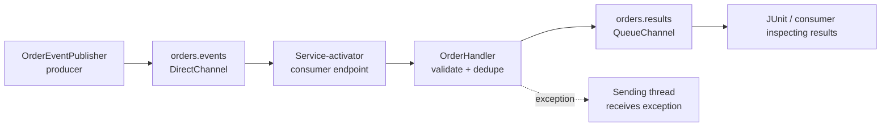
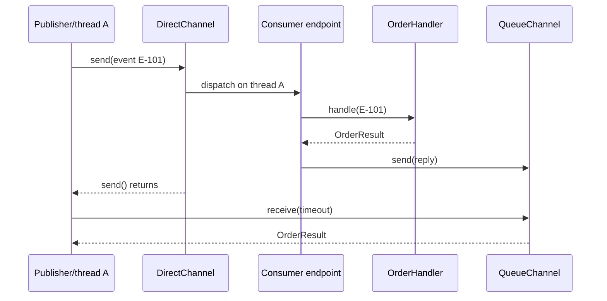
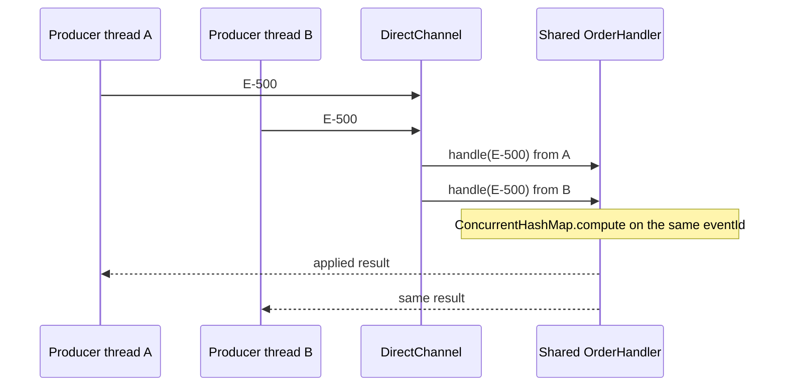
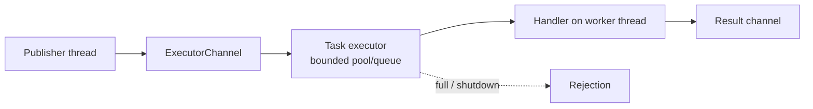
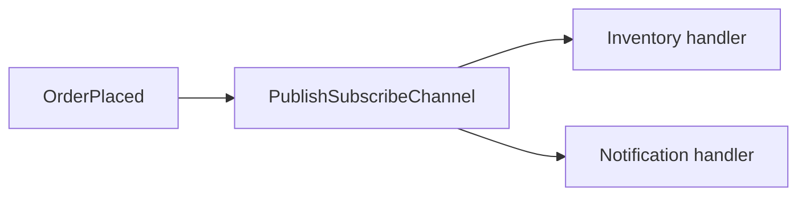
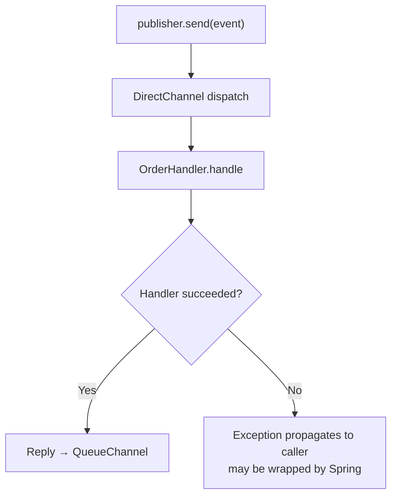
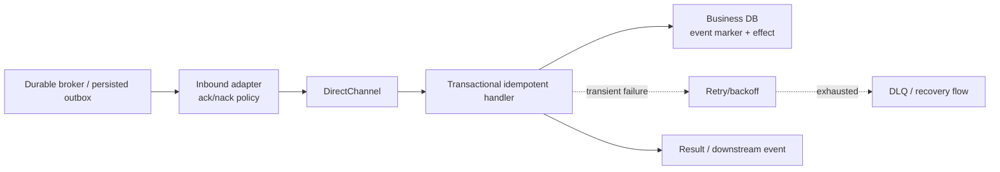
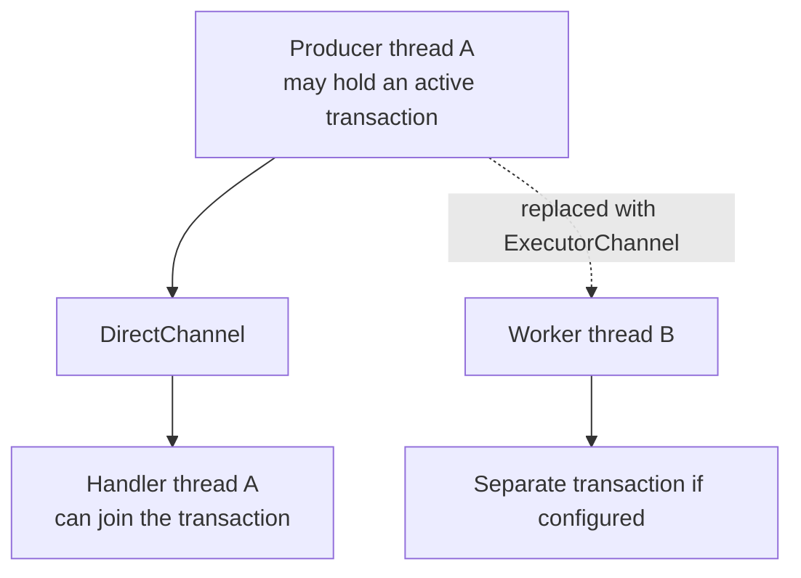
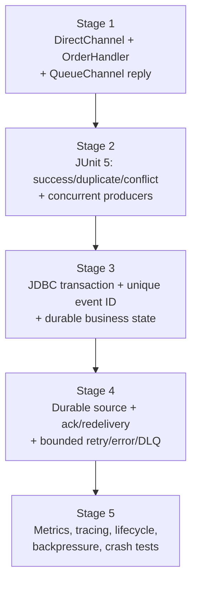

# Building an Event-Driven Flow with DirectChannel and a Handler

## 1. Project Goal: How Does an Event Travel Through Spring Integration?

In the **Hands-On Project** chapter of the **SPRING_INTEGRATION_RUNTIME** module, we will build a small application that receives an **order event** (`OrderPlaced`), routes it through a `DirectChannel` to a handler, and emits the result into a testable channel. This is a synthesis project for observing how Spring Integration actually orchestrates **messages, channels, endpoints, consumers, and lifecycle**.

Scenario:

- A producer sends an event "order O-101 has 3 items" with a stable business `eventId`.
- `DirectChannel` dispatches the message to the registered service-activator/handler.
- The handler validates the event, records the business effect in an in-memory store with deduplication for the lab, and returns an `OrderResult`.
- The result `QueueChannel` holds the reply so the test program/JUnit can receive and assert on it.
- When the same `eventId` is sent again, the handler does not re-apply the effect; if the same ID is used with different content, it rejects it.
- When an event is invalid, the error is returned to the caller in the synchronous flow and no success result is produced.

**Learning outcomes after this lesson:**

1. Distinguish **event-driven** from **asynchronous**: `DirectChannel` is event-driven, but does not automatically create worker threads.
2. Write a Java DSL flow that runs with `@EnableIntegration` and a minimal `ApplicationContext`.
3. Understand the boundaries between producer, `MessageChannel`, consumer endpoint, handler, reply channel, and business service.
4. Test message headers, results, duplicates, synchronous errors, subscribers, and lifecycle with JUnit 5.
5. Understand why an in-memory demo is not enough to claim **transactions, persistence, retries, exactly-once, or recovery**.
6. Know the plan for extending to JDBC, brokers, pollers, executors, retries, correlation, error channels, and runtime observability.

> **Intentional scope:** the main code does not require a broker, database, or HTTP server. It uses **real Spring Integration**, not direct handler invocations. Guarantees involving databases/brokers are only presented as conditional extensions and must be tested separately.

## 2. Topology and the Path of a Message



This is a **point-to-point topology with a single subscriber**. When `publish(event)` calls `send()`:

1. The producer builds a `Message<OrderPlaced>`, containing payload and headers.
2. `DirectChannel` looks up the subscriber handler and invokes the endpoint **on the sending thread**.
3. `OrderHandler` executes its logic and returns an `OrderResult`.
4. The service-activator creates a reply message and sends it to `orders.results` via the DSL configuration.
5. `send()` returns after synchronous processing completes and the reply has been sent to the output channel.
6. The test calls `receive(timeout)` to retrieve and inspect the result.

There is no scheduler or poller on the input path. The `QueueChannel` at the **output** only holds replies for the test consumer; it does not turn the input handler into a polling consumer.

### Names and Responsibilities

| Component | Role | Must Not Be Inferred |
| --- | --- | --- |
| `OrderPlaced` | Immutable event with business ID and data | Not yet a broker-persisted message. |
| `Message<OrderPlaced>` | Payload plus headers and transport metadata | Headers are not verified identity/permissions. |
| `orders.events` | `DirectChannel` pushing messages to a subscriber | Not a queue that can backlog or auto-retry. |
| Service-activator endpoint | Connects the channel to the configured handler | Does not imply a dedicated thread/executor. |
| `OrderHandler` | Validation + business processing | Does not automatically include a transaction manager or durable store. |
| `orders.results` | `QueueChannel` storing results for testing | Lives only in RAM unless backed by a persistent store. |
| `OrderEventPublisher` | Strongly typed entry point for producers | Does not automatically guarantee at-least-once delivery. |

## 3. Event-Driven Does Not Mean Asynchronous

These two terms answer **two different questions**:

- **Event-driven:** what triggers processing? Here, a message sent to a channel triggers the consumer endpoint to perform processing.
- **Asynchronous:** which thread executes the processing, and does the producer wait? A standard `DirectChannel` dispatches synchronously right on the thread calling `send()`.



If the handler makes slow JDBC or HTTP calls, **the publisher can also become slow** because they share the same call stack. Switching to `ExecutorChannel` can decouple threads, but changes exception propagation, transaction context, when a send is considered accepted, and completion ordering. Do not add an executor right from the start just because the project name contains the word "event".

### When to Choose DirectChannel?

- You need a small, fast processing step that can run on the caller thread.
- You need errors from the handler to propagate back to the producer in the same call.
- You want to preserve thread-local transaction context **when** the producer has already opened an appropriate transaction.
- You want a clear topology with minimal concurrency for learning and testing.

It is not suitable when the handler performs long blocking I/O and the producer has a tight response SLA; in that case, you need to carefully design buffering, async boundaries, and acknowledgements.

## 4. Project Plan and Completion Criteria

We will implement this in small milestones:

| Milestone | Content | PASS Criteria |
| --- | --- | --- |
| P1 | Create domain event/result | Fields `eventId`, `orderId`, `quantity` have clear semantics. |
| P2 | Write `OrderHandler` with validation and in-memory idempotency | A logical event increments the effect counter only once. |
| P3 | Configure `DirectChannel` → handler → `QueueChannel` | Spring context refreshes successfully, channel has a consumer. |
| P4 | Write `OrderEventPublisher` | Message has trace/event ID headers; channel failures are not swallowed. |
| P5 | Run end-to-end without a Spring Boot server | Valid event produces the expected reply. |
| P6 | Write JUnit 5 integration tests | Success, duplicate, conflict, and invalid payload all have assertions. |
| P7 | Observe errors and lifecycle | Understand when a subscriber is not running/is stopped. |
| P8 | Plan for production readiness | Separate business DB, durable source, retries, monitoring, and backpressure. |

**One key PASS criterion:** results must be produced by **messages traveling through real channels and endpoints**. Directly testing `new OrderHandler().handle(event)` is useful for unit tests, but does not prove Spring Integration wiring.

## 5. Project Setup and Dependencies

The snippets assume **Java 17+** and compatible Spring Framework/Spring Integration versions. Use the Spring Integration Java DSL from `spring-integration-core`. JUnit Jupiter provides test support.

If the project manages versions via the Spring Boot BOM or equivalent dependency management, the conceptual core dependencies are:

```xml
<dependencies>
    <dependency>
        <groupId>org.springframework.integration</groupId>
        <artifactId>spring-integration-core</artifactId>
    </dependency>
    <dependency>
        <groupId>org.junit.jupiter</groupId>
        <artifactId>junit-jupiter</artifactId>
        <scope>test</scope>
    </dependency>
</dependencies>
```

If not using a BOM, declare appropriate versions for the dependencies. The lab does not require `spring-boot-starter-web`, a database, or a broker. Configure your build tool to use JUnit Platform according to your project's setup, though this lesson **does not run builds automatically**.

Suggested Java file layout:

```text
src/main/java/example/runtime/project/
    OrderPlaced.java
    OrderResult.java
    OrderHandler.java
    OrderEventPublisher.java
    OrdersFlowConfig.java
    OrdersDemo.java

src/test/java/example/runtime/project/
    OrdersFlowTest.java
    OrderConcurrencyTest.java
```

Each `public` top-level class/record should live in a `.java` file with the matching name. The code blocks below include the full package declaration so they can be split into files matching the layout above.

## 6. Designing Immutable Event and Result Types

The **business event** identifier must survive retries/redeliveries; it should not be freshly generated every time code builds a Spring `Message`.

```java
package example.runtime.project;

public record OrderPlaced(
        String eventId,
        String orderId,
        int quantity) {}
```

```java
package example.runtime.project;

public record OrderResult(
        String eventId,
        String orderId,
        int quantity,
        String outcome) {}
```

Example:

```text
OrderPlaced(
    eventId = "EVT-1001",
    orderId = "ORD-77",
    quantity = 3
)

OrderResult(
    eventId = "EVT-1001",
    orderId = "ORD-77",
    quantity = 3,
    outcome = "APPLIED"
)
```

**Why separate `eventId` and `orderId`?** A single order can emit multiple valid events. If you used `orderId` as the deduplication key for every event, you could mistakenly drop other updates for the same order. Here, `eventId` represents **one specific event effect**.

### Validity Conditions

- `eventId` is non-blank and remains stable when resending the same event.
- `orderId` is non-blank.
- `quantity > 0` for an "order placed" event.
- If the same `eventId` arrives a second time, the business data must match the first time.
- If the same ID arrives with a different `orderId`/`quantity`, that is a **conflict**; never silently pick the later arrival.

Records make data immutable at the Java API level. They **do not automatically check** validity; the handler or validation layer must do that.

## 7. Writing a Handler with Validation and In-Memory Idempotency

We use `ConcurrentHashMap.compute` to demonstrate **single-time effect application** even when multiple threads process duplicate events simultaneously. This is a single-JVM illustration, not a production persistence solution.

```java
package example.runtime.project;

import java.util.concurrent.ConcurrentHashMap;
import java.util.concurrent.atomic.AtomicInteger;

public final class OrderHandler {

    private final ConcurrentHashMap<String, OrderResult> applied =
        new ConcurrentHashMap<>();

    private final AtomicInteger uniqueEffects = new AtomicInteger();

    public OrderResult handle(OrderPlaced event) {
        validate(event);

        return applied.compute(event.eventId(), (eventId, existing) -> {
            if (existing != null) {
                if (!existing.orderId().equals(event.orderId()) ||
                    existing.quantity() != event.quantity()) {
                    throw new IllegalArgumentException(
                        "Same eventId with conflicting business data");
                }

                // Same eventId and content: do not re-apply side effect.
                return existing;
            }

            // Simulate first-time business effect.
            OrderResult result = new OrderResult(
                event.eventId(), event.orderId(), event.quantity(),
                "APPLIED");

            uniqueEffects.incrementAndGet();
            return result;
        });
    }

    public int uniqueEffects() {
        return uniqueEffects.get();
    }

    private static void validate(OrderPlaced event) {
        if (event == null ||
            event.eventId() == null || event.eventId().isBlank() ||
            event.orderId() == null || event.orderId().isBlank() ||
            event.quantity() <= 0) {
            throw new IllegalArgumentException("Invalid OrderPlaced event");
        }
    }
}
```

**Why use `compute`?** For the same key in `ConcurrentHashMap`, the update operation is coordinated atomically per the map's contract; two callers racing with the same `eventId` will not independently create two new entries. `AtomicInteger` measures **the number of distinct event IDs recorded** in the example.

**Limitations you must understand clearly:**

- `applied` and `uniqueEffects` only live inside the JVM. A restart wipes state, so this does not protect against replays across crashes.
- Duplicates can receive **the same `OrderResult` multiple times** at the output. That is **two result deliveries**, while only one **business effect** is recorded in the map.
- Do not perform HTTP/DB side effects inside the `compute` callback without designing transactions and exception handling. The demo only creates a record and increments a counter.
- An `eventId` map does not replace a database unique constraint or a durable idempotency ledger.
- Do not rely on `MessageHeaders.ID` instead of `eventId`, because the Message ID can change when transport/transformation creates a new message.

### How Do Duplicate and Conflicting Events Differ?

| Input | Handler Behavior | `uniqueEffects` |
| --- | --- | --- |
| `EVT-1 / ORD-A / 3` first time | Stores result | Increments by 1. |
| `EVT-1 / ORD-A / 3` second time | Returns existing result | Does not increment. |
| `EVT-1 / ORD-A / 9` | Throws conflict exception | Does not increment. |
| `EVT-2 / ORD-A / 9` | Valid event with different ID | Increments by 1. |

**Idempotency does not mean dropping every similar message**; it applies to **the same logical operation under the defined key**.

## 8. Java DSL Configuration: DirectChannel → Handler → Reply Channel

This is the heart of the project. All you need is one `@Configuration` class enabling `@EnableIntegration` and defining the required beans.

```java
package example.runtime.project;

import org.springframework.beans.factory.annotation.Qualifier;
import org.springframework.context.annotation.Bean;
import org.springframework.context.annotation.Configuration;
import org.springframework.integration.channel.DirectChannel;
import org.springframework.integration.channel.QueueChannel;
import org.springframework.integration.config.EnableIntegration;
import org.springframework.integration.dsl.IntegrationFlow;
import org.springframework.messaging.MessageChannel;
import org.springframework.messaging.PollableChannel;

@Configuration
@EnableIntegration
public class OrdersFlowConfig {

    @Bean("orders.events")
    public MessageChannel orderEvents() {
        return new DirectChannel();
    }

    @Bean("orders.results")
    public PollableChannel orderResults() {
        return new QueueChannel(100);
    }

    @Bean
    public OrderHandler orderHandler() {
        return new OrderHandler();
    }

    @Bean
    public IntegrationFlow orderFlow(OrderHandler handler) {
        return IntegrationFlow.from("orders.events")
            .handle(OrderPlaced.class,
                (payload, headers) -> handler.handle(payload))
            .channel("orders.results")
            .get();
    }

    @Bean
    public OrderEventPublisher orderEventPublisher(
            @Qualifier("orders.events") MessageChannel input) {
        return new OrderEventPublisher(input);
    }
}
```

### Line-by-Line Breakdown

**`@EnableIntegration`** activates Spring Integration's infrastructure in the context. Do not omit it when using a minimal `AnnotationConfigApplicationContext` and expecting Spring Boot auto-configuration.

**`@Bean("orders.events")`** creates the input `DirectChannel`. The producer does not need to know which handler bean receives the message; it only knows the channel.

**`@Bean` `IntegrationFlow.from("orders.events")`** references the existing channel name. The consumer endpoint created by the DSL subscribes to `DirectChannel`.

**`.handle(OrderPlaced.class, (payload, headers) -> ...)`** is the service-activator handler receiving a payload of type `OrderPlaced`. When the business method returns `OrderResult`, the flow has a reply to pass to the next step.

**`.channel("orders.results")`** routes the reply to the output `QueueChannel`. A new reply `Message` may be created, so tests must verify that headers are preserved according to the flow's contract if they matter.

**`QueueChannel(100)`** is the lab's output buffer, not a durable queue. If more than 100 results go unreceived, the producer/handler may block or fail depending on the send policy; drain the output in tests.

### Why Not Attach `@ServiceActivator` Manually?

You could use the `@ServiceActivator(inputChannel = "...")` annotation instead of Java DSL. In this lesson, we choose **one declaration style** to keep the topology easy to see and avoid accidentally registering two subscribers, which would cause `DirectChannel` to dispatch messages to one of two handlers unexpectedly.

If you want to explore annotations later, do so in a separate configuration/test rather than enabling two endpoints on the same channel simultaneously in the same example.

## 9. Strongly Typed Producer and Tracing Headers

The producer is responsible for building the `Message`, attaching identifiers, and sending to the injected channel. Callers should not specify handler bean names or method names directly.

```java
package example.runtime.project;

import java.util.Objects;
import java.util.UUID;

import org.springframework.messaging.Message;
import org.springframework.messaging.MessageChannel;
import org.springframework.messaging.support.MessageBuilder;

public final class OrderEventPublisher {

    private final MessageChannel input;

    public OrderEventPublisher(MessageChannel input) {
        this.input = Objects.requireNonNull(input);
    }

    public void publish(OrderPlaced event) {
        Objects.requireNonNull(event, "event");

        Message<OrderPlaced> message = MessageBuilder
            .withPayload(event)
            .setHeader("eventType", "OrderPlaced")
            .setHeader("businessEventId", event.eventId())
            .setHeader("traceId", UUID.randomUUID().toString())
            .build();

        boolean accepted = input.send(message, 500);

        if (!accepted) {
            throw new IllegalStateException(
                "Input channel did not accept order event");
        }
    }
}
```

Here `send(message, 500)` sets a send timeout **to the extent supported by the channel**. With `DirectChannel`, dispatch is synchronous; if the handler throws an exception, `send` may **throw immediately** instead of returning `false`. The `send` timeout is not a deadline for the entire business handler across all implementations.

**Notes on `traceId` and `eventId`:**

- `businessEventId`/`event.eventId()` identifies a business event for deduplication and must remain unchanged on resend.
- `traceId` may vary across calls to trace individual attempts, or be preserved from upstream depending on tracing policy.
- `MessageHeaders.ID` generated by Spring is transport metadata and should not be used as the sole idempotency key.
- Self-asserted producer headers such as `userRole=ADMIN` have no value as **verified authentication proof**.

## 10. Running the Demo with `AnnotationConfigApplicationContext`

You do not need to start a web server just to watch a message move.

```java
package example.runtime.project;

import org.springframework.context.annotation.AnnotationConfigApplicationContext;
import org.springframework.messaging.Message;
import org.springframework.messaging.PollableChannel;

public final class OrdersDemo {

    public static void main(String[] args) {
        try (var context =
                new AnnotationConfigApplicationContext(
                    OrdersFlowConfig.class)) {

            OrderEventPublisher publisher =
                context.getBean(OrderEventPublisher.class);

            PollableChannel results =
                context.getBean(
                    "orders.results", PollableChannel.class);

            publisher.publish(
                new OrderPlaced("EVT-1001", "ORD-77", 3));

            Message<?> reply = results.receive(1_000);

            if (reply == null) {
                throw new IllegalStateException(
                    "No result after publishing OrderPlaced");
            }

            System.out.println(reply.getPayload());
        }
    }
}
```

Expected payload output:

```text
OrderResult[eventId=EVT-1001, orderId=ORD-77, quantity=3, outcome=APPLIED]
```

This is the standard `toString()` representation of a Java record; do not treat log string formatting as a stable integration API between services.

### What the Context Does

1. `AnnotationConfigApplicationContext` registers the configuration and calls `refresh`.
2. Spring creates the channels, handler, and `IntegrationFlow`.
3. The consumer endpoint is subscribed, so `DirectChannel` has a target receiver.
4. `publisher.publish` dispatches immediately to the handler on the caller thread.
5. When try-with-resources exits, the context is `close`d and Spring stops/destroys the lifecycle beans belonging to the context.

If you tried instantiating `OrderHandler` with `new` and calling it directly, the program would still print the right output, but would **not** prove that `IntegrationFlow`, subscribers, or channels work.

## 11. JUnit 5: Testing Events Through a Real Endpoint

Use a dedicated Spring context per test so in-memory state does not leak across tests.

```java
package example.runtime.project;

import org.junit.jupiter.api.Test;
import org.springframework.context.annotation.AnnotationConfigApplicationContext;
import org.springframework.messaging.Message;
import org.springframework.messaging.PollableChannel;

import static org.junit.jupiter.api.Assertions.*;

class OrdersFlowTest {

    @Test
    void validEventProducesResultThroughIntegrationFlow() {
        try (var context =
                new AnnotationConfigApplicationContext(
                    OrdersFlowConfig.class)) {

            OrderEventPublisher publisher =
                context.getBean(OrderEventPublisher.class);
            PollableChannel results =
                context.getBean(
                    "orders.results", PollableChannel.class);
            OrderHandler handler =
                context.getBean(OrderHandler.class);

            publisher.publish(
                new OrderPlaced("EVT-1", "ORD-A", 3));

            Message<?> message = results.receive(1_000);

            assertNotNull(message, "Flow should emit a reply");
            assertInstanceOf(
                OrderResult.class, message.getPayload());

            OrderResult result = (OrderResult) message.getPayload();

            assertEquals("EVT-1", result.eventId());
            assertEquals("ORD-A", result.orderId());
            assertEquals(3, result.quantity());
            assertEquals("APPLIED", result.outcome());
            assertEquals(1, handler.uniqueEffects());
        }
    }
}
```

**Value of this test:** the event is not passed directly to the handler; it travels through **producer → DirectChannel → Spring Integration endpoint → handler → output channel**.

**Limitations of this test:** this is an integration test **within a single JVM**. There is no real database, broker, transaction manager, network failure, or crash recovery. Do not infer once-only business side effects **across multiple instances** from a local `AtomicInteger` counter.

### Why Must `receive(1_000)` Have a Timeout?

A miswired test or a handler that fails to produce a reply could cause `receive()` to block indefinitely. Using a bounded timeout ensures CI terminates and produces a failure message. `QueueChannel.receive(1_000)` can return `null` on timeout, so always assert non-null before reading the payload.

## 12. Testing Duplicates: Two Deliveries, One Business Effect

In a synchronous topology, you can send **the same event** twice. The handler runs twice and two results may be emitted; however, `uniqueEffects` increments only once.

```java
@Test
void duplicateEventDoesNotApplyBusinessEffectTwice() {
    try (var context =
            new AnnotationConfigApplicationContext(
                OrdersFlowConfig.class)) {

        OrderEventPublisher publisher =
            context.getBean(OrderEventPublisher.class);
        OrderHandler handler = context.getBean(OrderHandler.class);
        PollableChannel results =
            context.getBean("orders.results", PollableChannel.class);

        OrderPlaced event =
            new OrderPlaced("EVT-200", "ORD-B", 5);

        publisher.publish(event);
        publisher.publish(event);

        Message<?> first = results.receive(1_000);
        Message<?> second = results.receive(1_000);

        assertNotNull(first);
        assertNotNull(second);
        assertEquals(first.getPayload(), second.getPayload());
        assertEquals(1, handler.uniqueEffects());
    }
}
```

The snippet above is an **extension placed inside the `OrdersFlowTest` class**; it reuses the imports from the first test. Do not create a second Java file with the same name `OrdersFlowTest`.

**Key distinctions:**

- **Delivery count:** 2 calls to `publish`.
- **Handler invocation count:** may be 2 in the demo.
- **Unique business effect:** 1 entry in the map.
- **Reply count:** 2, because the handler returns the same result when the event arrives again.

If downstream treats each reply as a **non-idempotent business command** and applies it again, the system can still produce duplicate side effects. Idempotency is required at every boundary that can redeliver or re-execute, not just in the first handler.

## 13. Testing Invalid Events and Same ID with Different Payload

In a synchronous `DirectChannel` flow, a handler exception normally propagates back to the `publish` call as a runtime exception from Spring messaging or the root cause, rather than appearing automatically on an asynchronous error channel.

```java
@Test
void conflictingEventIdFailsWithoutNewBusinessEffect() {
    try (var context =
            new AnnotationConfigApplicationContext(
                OrdersFlowConfig.class)) {

        OrderEventPublisher publisher =
            context.getBean(OrderEventPublisher.class);
        OrderHandler handler = context.getBean(OrderHandler.class);
        PollableChannel results =
            context.getBean("orders.results", PollableChannel.class);

        publisher.publish(
            new OrderPlaced("EVT-300", "ORD-C", 2));

        assertNotNull(results.receive(1_000));

        assertThrows(RuntimeException.class, () ->
            publisher.publish(
                new OrderPlaced("EVT-300", "ORD-C", 99)));

        assertEquals(1, handler.uniqueEffects());
        assertNull(results.receive(100));
    }
}

@Test
void invalidQuantityDoesNotProduceSuccessResult() {
    try (var context =
            new AnnotationConfigApplicationContext(
                OrdersFlowConfig.class)) {

        OrderEventPublisher publisher =
            context.getBean(OrderEventPublisher.class);
        PollableChannel results =
            context.getBean("orders.results", PollableChannel.class);

        assertThrows(RuntimeException.class, () ->
            publisher.publish(
                new OrderPlaced("EVT-400", "ORD-D", 0)));

        assertNull(results.receive(100));
    }
}
```

As in the previous section, these are **additional methods** in `OrdersFlowTest`, not a standalone file. `assertThrows(RuntimeException.class)` is used in the example to avoid coupling to version-specific Spring Integration wrapper exception types; in production tests you should **inspect the cause chain** to confirm the error is validation or conflict rather than no-subscriber or misconfiguration.

### Inspecting the Root Cause When Needed

```java
static Throwable rootCause(Throwable error) {
    Throwable current = error;
    while (current.getCause() != null &&
           current.getCause() != current) {
        current = current.getCause();
    }
    return current;
}
```

The function above is only a diagnostic helper; sometimes a domain error sits in the **middle** of the cause chain rather than as the final root cause. If you want to verify a specific exception type, walk the cause chain and compare against your application's policy.

Do not assert on the entire stack trace or exact wrapper message text because framework versions may add wrapping exception layers.

## 14. Testing Two Producers Competing on the Same `eventId`

A real event-driven application can receive multiple concurrent requests. `DirectChannel` does not create worker threads itself, yet **two producer threads** can send concurrently and invoke the handler on their respective threads.



Concurrency test example using Java 17 and JUnit 5:

```java
package example.runtime.project;

import java.util.concurrent.CountDownLatch;
import java.util.concurrent.Executors;
import java.util.concurrent.TimeUnit;

import org.junit.jupiter.api.Test;
import org.springframework.context.annotation.AnnotationConfigApplicationContext;
import org.springframework.messaging.PollableChannel;

import static org.junit.jupiter.api.Assertions.*;

class OrderConcurrencyTest {

    @Test
    void concurrentDuplicateHasOneUniqueEffect() throws Exception {
        try (var context =
                new AnnotationConfigApplicationContext(
                    OrdersFlowConfig.class)) {

            var publisher =
                context.getBean(OrderEventPublisher.class);
            var handler = context.getBean(OrderHandler.class);
            PollableChannel results =
                context.getBean(
                    "orders.results", PollableChannel.class);

            var pool = Executors.newFixedThreadPool(2);
            try {
                CountDownLatch start = new CountDownLatch(1);
                OrderPlaced event =
                    new OrderPlaced("EVT-500", "ORD-E", 7);

                var first = pool.submit(() -> {
                    start.await();
                    publisher.publish(event);
                    return true;
                });
                var second = pool.submit(() -> {
                    start.await();
                    publisher.publish(event);
                    return true;
                });

                start.countDown();

                assertTrue(first.get(5, TimeUnit.SECONDS));
                assertTrue(second.get(5, TimeUnit.SECONDS));

                assertNotNull(results.receive(1_000));
                assertNotNull(results.receive(1_000));
                assertEquals(1, handler.uniqueEffects());
            } finally {
                pool.shutdownNow();
            }
        }
    }
}
```

What this test proves is that **two concurrent producers hitting the same in-memory singleton handler** do not increment duplicate effects for the same ID. It **does not prove** exactly-once across two JVMs; each instance has its own map. Production requires a unique constraint or a shared idempotency store.

The reason for using `CountDownLatch` is to coordinate both producers starting close together, instead of using `Thread.sleep` and hoping they race. Which thread runs first does not need to be deterministic: the final outcome is what matters.

## 15. Thread Boundaries and Performance of DirectChannel

In this project, the synchronous flow makes the call path clear:

```text
publisher thread:
    input.send(event)
      -> DirectChannel.dispatch
        -> service-activator handler
          -> OrderHandler.handle(event)
          -> send(reply) to orders.results
    return to publisher
```

Consequences:

- If the handler takes 500 ms, `publish` will take roughly that long or longer.
- If the handler throws an exception, the `publish` call receives the error immediately on the same thread.
- If the producer already has a compatible thread-bound transaction, the handler can participate when on the same thread with proper transaction propagation.
- If two producers call concurrently, two handler invocations can run concurrently on **two producer threads**; "DirectChannel" **does not mean the system is single-threaded**.
- If the output `QueueChannel` is full, the caller thread may block or fail when sending the reply.

### When to Replace with `ExecutorChannel`?



Switching to `ExecutorChannel` can decouple ingestion throughput from handler duration, at the cost of trade-offs:

| Aspect | `DirectChannel` | `ExecutorChannel` |
| --- | --- | --- |
| Handler thread | Producer/caller thread | Executor worker (barring special policies). |
| When `send()` returns | After synchronous dispatch | Possibly before the handler finishes. |
| Business errors | Propagate back to caller | Usually handled on worker/error path. |
| ThreadLocal transaction | Preserved on the same call stack | Does not automatically propagate to worker. |
| Ordering | Easy to observe within one sequential sender thread | Completion order can invert. |
| Overload | Directly slows/blocks producer | Pool/queue fills or rejects; requires backpressure. |
| Crash after accepted | No task executor queue in the base example | Tasks waiting in RAM can be lost. |

**Do not** swap `DirectChannel` for `ExecutorChannel` and keep using all the "immediately after `send`" assertions from the synchronous tests. You need timeouts/awaits and a redesigned error handling path.

## 16. When a Handler Returns `null`: One-Way Events and Conditional Results

The main project intentionally produces an `OrderResult` so tests can inspect it easily. However, not every event needs a reply. A handler that only writes an audit log or forwards downstream can be a **one-way handler**.

```java
@Bean
IntegrationFlow auditOnlyFlow(OrderAuditService audit) {
    return IntegrationFlow.from("audit.events")
        .handle(OrderPlaced.class, (payload, headers) -> {
            audit.record(payload);
            return null; // Produce no reply at this endpoint.
        })
        .get();
}
```

This is an extension snippet and **assumes** an `audit.events` bean and `OrderAuditService` are already defined; do not add it to the same demo context without defining those beans. When a handler returns `null` at a terminal point, no reply message is emitted to subsequent steps.

**Common mistake:** adding `.channel("orders.results")` after a one-way handler and writing tests that always wait for a reply. If the handler returns nothing and does not publish another message itself, `receive(timeout)` returning `null` is expected.

If you need both audit logging and a result, separate a business service returning the result from an audit branch with an explicit policy; avoid "attaching two subscribers to a DirectChannel to fan out" because DirectChannel is not a broadcast channel.

## 17. One vs. Multiple Subscribers: Point-to-Point vs. Publish–Subscribe

`DirectChannel` uses **point-to-point** dispatch: with multiple subscribers, the framework selects one handler to process each message according to its dispatcher policy, rather than delivering **a copy to every handler** by default.

If you want both **inventory** and **notification** to receive the same event:



In that case, you need to design a `PublishSubscribeChannel` or an appropriate split/fan-out flow, making explicit decisions about:

- Should dispatch to subscribers be synchronous or use an executor?
- If inventory succeeds but notification fails, which error surfaces to the publisher?
- Does each subscriber have its own idempotency keyed by `eventId`?
- Are ordering or a shared transaction required?
- If one subscriber goes down, is there durable retry/outbox support for that branch?

**The main lesson avoids pub-sub** to keep a single event → handler → result path easy to test. Adding fan-out is an extension step, not an automatic side effect of `DirectChannel`.

## 18. Error Handling in a Synchronous Flow

The main path in the example:



**Do not assume** every exception on a `DirectChannel` creates an `ErrorMessage` on the default `errorChannel`. In a purely synchronous path, errors are typically propagated back to the caller. With a poller or executor, an appropriate error handler may emit an `ErrorMessage` to an error channel.

In production, the event producer needs clear policies:

- **Validation error:** invalid payload; reject or send to a DLQ if coming from a broker; do not retry a permanent error forever.
- **Temporary failure:** database timeout or HTTP 503; bounded retries with backoff and idempotency.
- **Conflict:** same event ID with different payload; route to alerts/audit; do not overwrite existing data silently.
- **No subscriber:** endpoint not started or flow miswired; this is a runtime error, not a payload error.
- **Reply/output failure:** the handler may have already applied the business effect before sending the reply failed. Do not assume a send exception means the transaction definitely rolled back.

### The Boundary Between Exceptions and Side Effects

If the handler executes a database update and then the output channel is full so the reply cannot be sent, the following can happen:

```text
DB commit successful
    ↓
reply send fails
    ↓
publisher observes exception
    ↓
producer retries same business event
```

Therefore, you must separate **committed business outcome** from **reply delivery outcome** and guarantee idempotency on retry. The in-memory example only simulates this; with JDBC you need real transactions and unique constraints.

## 19. Upgrading Idempotency to Durable JDBC Transactions

Suppose you take this project into a PostgreSQL environment. Replace the in-memory map with an **idempotency marker** and business state tables inside the same local database transaction.

### Illustrative Schema

```sql
CREATE TABLE processed_order_event (
    event_id   VARCHAR(120) PRIMARY KEY,
    order_id   VARCHAR(120) NOT NULL,
    quantity   INTEGER NOT NULL,
    applied_at TIMESTAMP NOT NULL DEFAULT CURRENT_TIMESTAMP
);

CREATE TABLE order_quantity_summary (
    order_id   VARCHAR(120) PRIMARY KEY,
    quantity   INTEGER NOT NULL
);
```

### JDBC Handler with Unique Event ID

```java
package example.runtime.project;

import java.util.Map;

import org.springframework.jdbc.core.JdbcTemplate;
import org.springframework.stereotype.Service;
import org.springframework.transaction.annotation.Transactional;

@Service
public class JdbcOrderProcessor {

    private final JdbcTemplate jdbc;

    public JdbcOrderProcessor(JdbcTemplate jdbc) {
        this.jdbc = jdbc;
    }

    @Transactional
    public OrderResult handle(OrderPlaced event) {
        if (event == null ||
            event.eventId() == null || event.eventId().isBlank() ||
            event.orderId() == null || event.orderId().isBlank() ||
            event.quantity() <= 0) {
            throw new IllegalArgumentException("Invalid event");
        }

        // PostgreSQL: only the first arrival inserts the marker.
        int inserted = jdbc.update(
            "INSERT INTO processed_order_event " +
            "(event_id, order_id, quantity) VALUES (?, ?, ?) " +
            "ON CONFLICT (event_id) DO NOTHING",
            event.eventId(), event.orderId(), event.quantity());

        if (inserted == 0) {
            Map<String, Object> stored = jdbc.queryForMap(
                "SELECT order_id, quantity " +
                "FROM processed_order_event WHERE event_id = ?",
                event.eventId());

            String storedOrder = (String) stored.get("order_id");
            int storedQty = ((Number) stored.get("quantity")).intValue();

            if (!storedOrder.equals(event.orderId()) ||
                storedQty != event.quantity()) {
                throw new IllegalArgumentException(
                    "Conflicting payload for eventId");
            }

            return new OrderResult(
                event.eventId(), event.orderId(), event.quantity(),
                "ALREADY_APPLIED");
        }

        jdbc.update(
            "INSERT INTO order_quantity_summary " +
            "(order_id, quantity) VALUES (?, ?) " +
            "ON CONFLICT (order_id) DO UPDATE SET " +
            "quantity = order_quantity_summary.quantity " +
            "           + EXCLUDED.quantity",
            event.orderId(), event.quantity());

        return new OrderResult(
            event.eventId(), event.orderId(), event.quantity(),
            "APPLIED");
    }
}
```

**This is an extension**, and does not replace the in-memory `OrderHandler` in the lab configuration unless you explicitly add a `DataSource`, schema, Spring JDBC, and an appropriate `PlatformTransactionManager`, then swap the handler wiring in the flow.

### Conditions for Transactions to Actually Take Effect

1. `JdbcOrderProcessor` must be a **Spring bean** invoked through a transaction proxy.
2. There must be a `PlatformTransactionManager` matching the `DataSource` used by `JdbcTemplate`.
3. The marker insert and summary update must run inside the **same local transaction**.
4. A runtime exception before commit must trigger rollback according to the transaction configuration.
5. Do not call `this.handle(...)` from another method in the same bean expecting `@Transactional` to go through the proxy.
6. Do not switch to `ExecutorChannel` and assume a transaction on the producer thread carries over to the worker.

If two requests with the same `eventId` arrive concurrently, the DB unique constraint coordinates the insert; the second request can only inspect committed data according to the database's semantics after conflict resolution. Test against the real backend.

**Important:** a JDBC transaction does not automatically fold broker acknowledgements or external HTTP APIs into the same atomic commit. If the DB commits before the broker acks, redelivery is a normal possibility; the duplicate branch must be safe. If an external API accepted the work and then the JVM died, you still need a target-side idempotency key or reconciliation.

## 20. Retries, Brokers, and Durability: The Path to Production

The current project has an **in-JVM producer**. If the JVM crashes after the producer creates an event but before calling `publish`, no durable source exists to replay it. If an event enters `DirectChannel` and the handler fails, the caller must decide whether to retry or report the error.

To upgrade:



### From Simple to Reliable

| Deployment Stage | What Is Added? | What Needs Testing |
| --- | --- | --- |
| In-memory lab | `DirectChannel` + handler + reply queue | Payload, in-JVM duplicates, synchronous errors. |
| JDBC idempotency | Unique event ID + business rows in same transaction | Rollback, concurrent duplicates, payload conflicts. |
| Durable inbound source | Kafka/RabbitMQ/JMS or appropriate persistent channel store | Ack/redelivery on handler failure or JVM crash. |
| Bounded retry | Retry with backoff, attempt limits, error channel/DLQ | Transient vs. permanent failure, no retry storms. |
| External output | HTTP/broker/notification side effects | Outbox/idempotency key, crash after commit before publish. |
| Multi-instance | Shared ledger/store and coordination | One event ID does not cause duplicate effects across replicas. |

**Do not call `DirectChannel` a durable queue.** It dispatches to an active subscriber. If you want in-JVM buffering, you can use `QueueChannel`, though you still have to address persistence, receive transactions, pollers, and shutdown if messages must not be lost.

### Ack Timing Determines Delivery Semantics

Suppose an adapter receives an event from a broker and passes it to the handler:

- **Ack before business commit:** a crash can lose the effect because the source thinks the message is finished.
- **Ack after business commit:** if a crash happens between commit and ack, the broker may redeliver; idempotency must block double effects.
- **Async ack right after submit:** if the adapter acks as soon as a task enters an in-memory executor queue, a crash before the worker executes can lose the message.

You cannot infer the ack policy from the Java DSL demo snippet alone; you must inspect the specific adapter/broker and test crash windows.

## 21. Transactions and DirectChannel: Connection to the Sending Thread

One advantage of `DirectChannel` is that the handler runs synchronously on the sending thread; if the producer has already opened a compatible local transaction, the handler can **join that transaction** depending on propagation and the resources in use.

However:

- Using `DirectChannel` alone **does not start a transaction**.
- `@Transactional` on the handler has no effect without a properly configured transaction manager/proxy.
- If the handler performs an HTTP call or publishes to a broker outside the transaction, a JDBC rollback does not automatically undo that action.
- If the Spring Integration flow adds an `ExecutorChannel` or a poller task executor, the thread boundary can change transaction context propagation.
- Even with proper transactions, two concurrent producers still need an appropriate unique key/locking for the same event ID.



When verifying transactions, read the **committed/rolled-back data** in the test DB rather than relying only on logs. With SQL rollback, both the marker and the business row must disappear together if an exception occurs before commit.

## 22. Correlation and Headers: Tracing Multiple Events

A message has at least two kinds of identifiers worth caring about:

- **Business identity** (`eventId`, `orderId`) governs deduplication and state updates.
- **Trace/correlation identity** (`traceId`, `correlationId`) helps stitch steps together in logs or group fragments when a flow uses an aggregator.

Example of adding headers:

```java
Message<OrderPlaced> message = MessageBuilder
    .withPayload(new OrderPlaced("EVT-901", "ORD-9", 2))
    .setHeader("businessEventId", "EVT-901")
    .setHeader("traceId", "trace-2026-001")
    .setHeader("tenantId", "tenant-demo")
    .build();
```

**Do not use a client-supplied `tenantId` for authorization.** For HTTP/broker inputs, tenant/identity must be verified from a trusted source before enforcing resource/action policies.

### Do Not Assume Every Header Survives Every Transform

Reply handlers typically copy certain headers from the request via Spring Integration's reply message mechanics, but custom transformers, message builders, or adapters can alter metadata. If you require `traceId` on the output, write a test:

```java
Message<?> reply = results.receive(1_000);
assertNotNull(reply);
assertEquals("trace-2026-001",
             reply.getHeaders().get("traceId"));
```

The snippet above is an extended assertion when sending a message with that header in a configured test flow. If it fails, inspect which step builds the new reply and configure header propagation/copying explicitly; never conflate business IDs with transport Message IDs.

### When You Need an Aggregator

If you transition to a project that processes events in batches:

- `correlationId` identifies the group (e.g., `batchId`).
- `sequenceNumber` and `sequenceSize` describe ordering/expected size.
- `CorrelationStrategy`/`ReleaseStrategy` determine how fragments are grouped and released.
- `MessageGroupStore` holds fragments; a persistent store is required to survive restarts.
- Multiple workers can create duplicate/late fragments, requiring idempotency and release semantics.

You do not need an aggregator just to process a standalone event like `OrderPlaced`.

## 23. Lifecycle, Subscribers, and "No Subscribers" Failures

Flow endpoints are created on context refresh. If the context has not been initialized, endpoints have not been started, or the flow bean was skipped, `DirectChannel` may have no subscriber to receive messages.

| Symptom | Common Cause | Diagnostic Direction |
| --- | --- | --- |
| `Dispatcher has no subscribers` | Flow not registered, endpoint stopped, or sent to wrong channel | Check `@EnableIntegration`, `IntegrationFlow`, bean name, and lifecycle. |
| `NoSuchBeanDefinitionException` | Typo in `orders.events`/`orders.results` | Use constant bean names and typed lookups. |
| `receive(timeout)` returns null | Handler returned no reply, wrong output channel, exception, or queue already drained | Check handler return value and DSL `.channel`. |
| Event processed twice unexpectedly | Producer retry, multiple sends, or another consumer | Log business event ID, unique effects, and redelivery source. |
| Reply blocked | Output `QueueChannel` full or consumer not draining | Measure queue depth, capacity, and send timeout. |
| Flow slows down when handler calls HTTP | `DirectChannel` blocks producer thread | Measure handler latency, timeouts, and consider async/durable buffering. |
| Fails only under concurrent requests | Business service is not thread-safe | Test concurrent producers and transactions/locks. |
| Data lost after restart | In-memory map/queue | Use durable DB/broker/store and test crash/recovery. |
| Breaks after adding executor | Transaction/exception handling changed threads | Check error channel, acks, task queue, and MDC. |
| Messages from multiple tenants mixed | Unverified header/tenant or wrong business key | Enforce tenant policy, namespaced idempotency key, and correlation. |

### Do Not Stop the Wrong Component

`DirectChannel` has no generic "pause entire flow" API. Lifecycle operations typically belong to endpoints/adapters or an `IntegrationFlowRegistration` if the flow is registered dynamically. If you pause the downstream consumer while the producer keeps sending into `DirectChannel`, the producer may encounter no-subscribers errors.

If you need to pause processing while still accepting new events, design an appropriate **durable source/`QueueChannel` + poller**, rather than expecting `DirectChannel` to buffer messages automatically.

## 24. Operating and Observing a Small Flow

Even in a lab project, naming components and collecting metrics early makes future upgrades less risky.

### Suggested Log Format

```text
eventId=EVT-1001 orderId=ORD-77 phase=PUBLISHED traceId=tr-001
eventId=EVT-1001 phase=HANDLER_START thread=main
eventId=EVT-1001 phase=BUSINESS_APPLIED outcome=APPLIED
eventId=EVT-1001 phase=RESULT_SENT channel=orders.results
eventId=EVT-1001 phase=DUPLICATE outcome=ALREADY_APPLIED
```

These are **sample logs**, not automatic output from the code. You need to add instrumentation to emit all phases. Never log secret payload contents or tokens; use safe IDs for tracing.

### Minimum Metrics

| Metric | What It Answers |
| --- | --- |
| `published.count` | How many times did the producer attempt to send an event? |
| `accepted.count` | How many messages were accepted by the channel? |
| `handler.invocation.count` | How many times was the handler invoked? |
| `business.unique_effects.count` | How many business event IDs were applied for the first time? |
| `duplicate.count` | How many times did duplicate events arrive? |
| `invalid.count` / `conflict.count` | How many payload errors and same-ID data conflicts occurred? |
| `handler.duration` | What is the p50/p95/p99 processing time inside the handler? |
| `reply.queue.depth` | Is the output queue filling up? |
| `error.count` | How many errors came from endpoints/handlers? |
| `source.unacked`/`broker.lag` | When using a durable source, how many events remain incomplete? |

Do not measure `send()` latency alone and draw conclusions about business throughput. In the synchronous `DirectChannel` demo, the two values are closer than with an async executor, yet they can still diverge due to the output channel and other factors.

### Tracing and Threads

With `DirectChannel`, thread-bound MDC/tracing context remains available in the handler since it runs on the same thread. When switching to `ExecutorChannel`, `ThreadLocal` values do not automatically move to workers; you need observation/context propagation per your framework and configuration. Never propagate a `SecurityContext` from untrusted headers.

## 25. Checklist Before Calling the Project Complete

- **Clear domain:** events have an `eventId` independent of `orderId`; fields are validated.
- **Correct flow:** `orders.events` is a `DirectChannel`, the handler is subscribed, and replies go to `orders.results`.
- **Threads understood:** the handler runs synchronously on the caller thread in this configuration.
- **Success test:** valid event produces the expected `OrderResult`.
- **Duplicate test:** same ID and content do not trigger a second business effect.
- **Conflict test:** same ID with different payload is rejected without mutating the old result.
- **Invalid test:** malformed event produces no success reply.
- **Concurrency test:** two concurrent producers do not create duplicate effects within one JVM.
- **Lifecycle:** context refreshes/starts and closes cleanly; no-subscriber errors have a handling plan.
- **Observability:** business ID, trace ID, receive timeouts, and success metrics are in place.
- **Trust boundaries:** self-asserted role/tenant headers are never used for authorization.
- **Explicit guarantee scope:** in-memory maps/queues are not durable; transactions/brokers/acks are not proven here.
- **Upgrade path:** clear path to replace the map with a DB unique marker and add a durable source when required.
- **Stable event semantics:** idempotency key is stable; timestamps/headers do not replace the business ID.
- **State-backed outcomes:** two deliveries can emit two replies, but the business effect must happen only once per policy.

## 26. Progressive Hands-On Exercises

**Exercise 1 — Build the project from scratch.** Create the six main Java files, run `OrdersDemo`, and send event `EVT-1`. Record the call sequence producer → channel → handler → reply and the thread name at each point.

**Exercise 2 — Add a filter.** Block events with `quantity > 1000` before the handler using a `filter` or validation endpoint. Compare filter-drop, filter-throw, and handler-thrown errors; design a clear response to the producer.

**Exercise 3 — Header tracing.** Attach a stable `traceId` to a message and verify the reply retains the appropriate header. Explain why event IDs should not rely on the Message ID.

**Exercise 4 — Send three independent events.** Send `EVT-A / ORD-1 / 3`, `EVT-B / ORD-1 / 2`, and `EVT-C / ORD-2 / 1`. Verify `uniqueEffects=3`; demonstrate that multiple valid events can share one `orderId`.

**Exercise 5 — Intentional duplicates.** Resend `EVT-A` five times; measure delivery/result counts versus unique effects. Update the handler to return outcome `ALREADY_APPLIED` without mutating the business effect.

**Exercise 6 — Conflicts.** Resend `EVT-A` with a different quantity. Assert the error, root cause, and unchanged state. Write a conflict-handling policy for DLQ/alerts when backed by a broker.

**Exercise 7 — Multiple producer threads.** Use `CountDownLatch` to launch 10 producers with the same event ID. Inspect handler thread names and `uniqueEffects=1`. Why does `DirectChannel` still experience concurrency when multiple threads send?

**Exercise 8 — Replace reply with one-way.** Change the handler to return `null` and remove the result output. Update tests for the new contract without waiting for a reply that will never arrive.

**Exercise 9 — Switch to `ExecutorChannel`.** Add a bounded pool, queue capacity, and rejection policy; measure when `publish` returns, thread names, completion order, and exception paths. Do not use a discard policy for critical business events.

**Exercise 10 — Add JDBC transactions.** Use `JdbcOrderProcessor` with a test PostgreSQL instance, validate the unique marker/summary in the same transaction, test pre-commit exceptions and concurrent duplicates. When the DB commits and then the result channel fails, verify retrying the same event ID is safe.

**Exercise 11 — Integrate a durable source.** Ingest events from a broker/testcontainer or compatible persistent channel store; define the ack policy and test JVM crashes after DB commit before ack. Do not treat an in-memory `QueueChannel` as a durable source.

**Exercise 12 — Error handling and retries.** Create a handler that intermittently throws a temporary exception, apply bounded retries at an appropriate endpoint, and verify attempts, backoff, and error/DLQ routing when exhausted. Separately test that validation errors do not retry forever.

**Exercise 13 — Fan-out.** Use `PublishSubscribeChannel` in a separate test configuration so both notification and inventory receive the event; design idempotency and failure policies per subscriber.

**Exercise 14 — Correlation.** Build an aggregator for fragments sharing a `batchId`, defining `correlationId`, `sequenceNumber`, release strategy, and message group store. Test a group holding 2/3 fragments across a restart with a persistent store.

**Exercise 15 — Observability.** Build a dashboard tracking publishes, handler invocations, unique effects, duplicates, errors, and p95/p99. Simulate a full reply queue to demonstrate that business completion differs from transport reply success.

**Exercise 16 — Lifecycle.** Properly stop the consumer endpoint in a test environment, let the producer send to `DirectChannel`, and observe the error. Design a safe pause boundary if you want to keep receiving messages while workers are stopped.

### Self-Check Questions

1. Must an event-driven `DirectChannel` be asynchronous?
2. Why might a handler run on an HTTP producer thread?
3. What role does the output `QueueChannel` play in this lesson?
4. When `send()` returns `true`, does that guarantee a database commit or broker ack?
5. Why should `eventId` be independent of `orderId` and `MessageHeaders.ID`?
6. How many replies and how many business effects can resending an event with the same ID and content produce?
7. Is the same ID with a different quantity a valid duplicate or a conflict?
8. Why is `ConcurrentHashMap` insufficient to prevent duplicates across multiple JVMs?
9. When does `@Transactional` inside a handler actually work?
10. Why can committing to a DB before broker ack lead to redelivery?
11. When switching to `ExecutorChannel`, how do errors and transaction context change?
12. Why do two subscribers on a `DirectChannel` not create automatic fan-out?
13. What does a "no subscribers" error indicate about endpoint lifecycle?
14. Why can a one-way handler returning `null` cause `receive(timeout)` to return null?
15. What should be done when the output queue is full after the handler already created a side effect?
16. Which tests can only be performed with a real broker or database?
17. Is `correlationId` the idempotency key of a business event?
18. If multiple producers send concurrently, does `DirectChannel` guarantee only one handler invocation runs at a time?
19. What is the difference between a message retry and intentionally sending a new business event?
20. When should you choose a durable broker/`QueueChannel` over a plain `DirectChannel`?

## 27. Architecture Summary and Next Steps



**Most important takeaway of the project:** an event-driven flow can be very small while still passing through **real message channels and consumer endpoints**. `DirectChannel` is the simplest way to observe dispatch mechanics, synchronous processing, and exception propagation back to the caller. The handler produces the business effect, whereas the result channel only reflects the reply; the two must have separate contracts.

When scaling up to multiple threads, multiple instances, executors, pollers, and brokers, those responsibilities do not disappear: you must add **durable idempotency, properly scoped transactions, error handling, ack/redelivery, correlation, resource bounds, and runtime observability**. Never treat a passing in-memory test as proof of recovery or end-to-end exactly-once semantics.

**Practical rule:** start with a runnable, testable `OrderPlaced → DirectChannel → handler → OrderResult` flow; verify **business event IDs**, actual effect counts, errors, and lifecycle; then expand one boundary at a time with matching tests.
