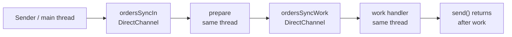
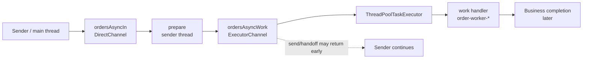
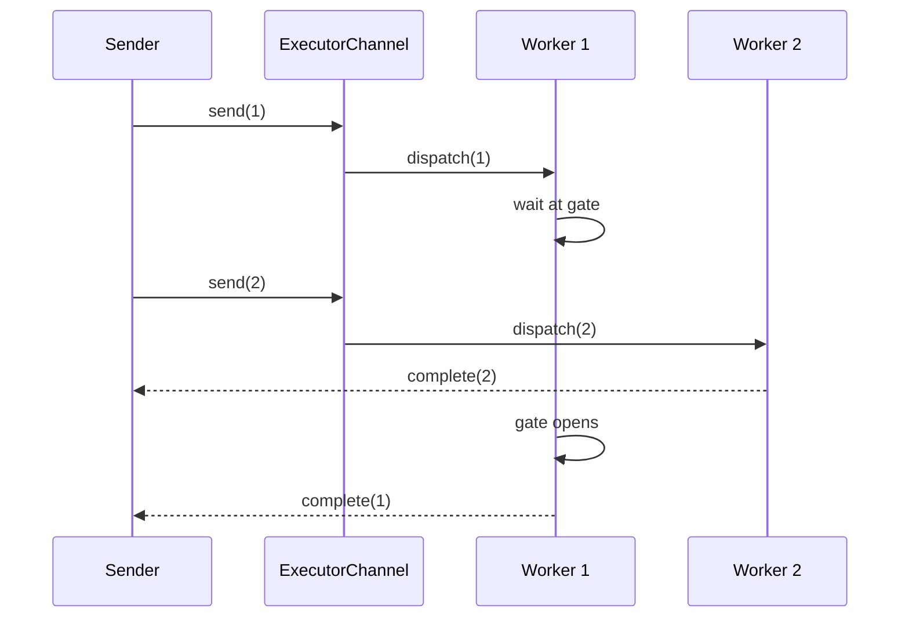
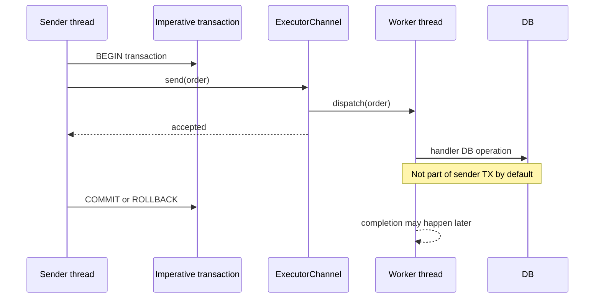
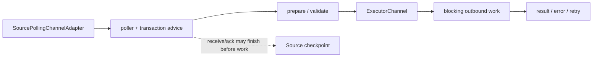

# Hands-On: Moving One Step to ExecutorChannel and Measuring the Thread Boundary

## 1. Project Context and Deliverables

A Spring Integration application receives order-processing requests, normalizes the payload, and invokes a cost-calculation step. Initially, the entire flow runs on `DirectChannel`. When the calculation step becomes slow, we want to **move only a single boundary between two steps** to `ExecutorChannel` to release the sending thread earlier. However, a faster `send()` call does not mean the order has finished processing.

This hands-on lab belongs to the **Hands-On Project** chapter of the **SPRING_INTEGRATION_RUNTIME** module. We will build **two versions with identical business logic**, measure threads, latency, and completion, and redesign error handling, transactions, ordering, backpressure, and lifecycle to match how Spring Integration orchestrates channels, endpoints, consumers, pollers, and executors.

**Final goal:** a team should be able to explain, backed by logs/tests/metrics, **which boundary switches threads, when work is handed off, when work completes, and where errors and transactions live**, rather than merely showing an `ExecutorChannel` configuration.

### 1.1. Learning Outcomes

1. Build a baseline using `DirectChannel` with two steps: `prepare` and `work`.
2. Replace **only the channel before work** with `ExecutorChannel`, keeping business logic and test inputs unchanged.
3. Use thread name, thread ID, `System.nanoTime()`, and correlation ID to record the execution path.
4. Use `CountDownLatch` to verify handoff deterministically without relying on `Thread.sleep()`.
5. Compare **send-return latency** against **end-to-end completion latency**.
6. Demonstrate that `ExecutorChannel` can alter completion order when multiple workers run.
7. Trigger a worker failure and inspect `errorChannel` instead of expecting an exception thrown back to the caller.
8. Understand thread-bound transactions, security/MDC context, retries, and broker acks after changing the channel.
9. Bound the executor pool/queue, choose a rejection policy, and read saturation metrics.
10. Write a checklist to apply the same technique to a real `IntegrationFlow` with pollers, message stores, and downstream adapters.

### 1.2. Scope

Examples use **Java 17+, Spring Integration 6.x, Spring Framework 6.x, and JUnit Jupiter 5.x**. Configuration snippets use the Java DSL and Spring Integration APIs. No broker or DB is needed to run the two core experiments; exercises covering transactions, durability, or JMS/Kafka are explicitly marked as **extensions requiring a real backend**.

Do not implicitly assume `@Transactional`, distributed tracing, or retry policies are active. Those capabilities must be configured and tested separately.

## 2. Previewing the Change

**Baseline (synchronous):**



**After the change (asynchronous at one step):**



This change **does not** mean "just add `ThreadPoolTaskExecutor` and everything becomes reactive." `ExecutorChannel` is still a message-dispatch model over an `Executor`; it has no `Subscriber.request(n)` protocol like Reactive Streams.

### 2.1. Checkpoints to Measure

| Checkpoint | Name in Lab | Meaning |
| --- | --- | --- |
| Before calling `input.send(...)` | `SEND_BEGIN` | Start of the caller invocation. |
| Entering the normalization step | `PREPARE` | Which thread runs the first handler? |
| Entering the handler after the intermediate channel | `WORK_ENTER` | Has the thread boundary been crossed? |
| Handler finishes | `WORK_DONE` | Business step finishes, not necessarily DB commit/ack. |
| `input.send(...)` returns | `SEND_RETURN` | Caller is released or completed synchronously. |

Also record `eventId` and `threadName`; use `System.nanoTime()` for **elapsed time** within the same JVM. Do not compare timestamps from two unsynchronized JVMs to calculate latency, and do not use `Thread.sleep` as proof of ordering.

### 2.2. Two Metrics Commonly Misread

```text
sendReturnLatency = time(SEND_RETURN) - time(SEND_BEGIN)
stepCompletionLatency = time(WORK_DONE) - time(SEND_BEGIN)
```

On a synchronous `DirectChannel`, both metrics are usually close. On an `ExecutorChannel`, `sendReturnLatency` is typically shorter than `stepCompletionLatency`, **but not guaranteed** under every executor or rejection policy.

### 2.3. Acceptance Criteria Before Starting

| Criterion | Baseline | ExecutorChannel |
| --- | --- | --- |
| `prepare` runs on sender thread | Yes | Yes, because it sits **before** the boundary. |
| `work` runs on sender thread when pool has capacity | Yes | Normally **no**, runs on a worker. |
| `send()` returns before `work` completes if handler is held at a gate | No | Yes, when the executor performs a real handoff. |
| `WORK_DONE` can be observed | After `send()` or right before return | After return; requires waiting on a separate signal. |
| Exception from `work` always throws back to sender | Usually yes when synchronous | No; an async error path must be defined. |
| Sender's thread-bound transaction covers `work` | Possible if configured properly | Must not be assumed. |
| Completion follows input order with multiple workers | With one synchronous sender/handler | Not guaranteed. |

## 3. Tooling, Dependencies, and Sample Layout

An existing Maven or Gradle Spring Integration project can add test dependencies compatible with the Spring Boot/Spring Integration BOM. Below is a **declaration guide**, without requiring a brand-new project scaffold:

```gradle
dependencies {
    implementation("org.springframework.integration:spring-integration-core")
    implementation("org.springframework:spring-context")

    testImplementation("org.springframework.integration:spring-integration-test")
    testImplementation("org.junit.jupiter:junit-jupiter")
}

tasks.test {
    useJUnitPlatform()
}
```

In a Spring Boot application managing dependency versions via a BOM/plugin, individual versions are not needed on the artifacts above. In a plain Gradle project, declare compatible versions or a BOM, otherwise dependency resolution will fail.

Suggested example layout:

```text
src/main/java/demo/boundary/
  WorkItem.java
  ThreadTrace.java
  WorkGate.java
  BoundaryFlowConfiguration.java
  BoundaryDemo.java

src/test/java/demo/boundary/
  BoundaryFlowTest.java
  ExecutorOrderingTest.java
```

These are **Java files presented in the lesson for learners to create in their own example project**, not a request to generate them in this workspace. All lesson code stays inside this Markdown file.

### 3.1. Choosing Clear Channel Names

Use a parallel pair of flows to keep the same logic:

- `ordersSyncIn` → `ordersSyncWork` (`DirectChannel`) → processing.
- `ordersAsyncIn` → `ordersAsyncWork` (`ExecutorChannel`) → processing.

Having no inbound adapter, broker, or poller makes the thread boundary easy to observe; later you can swap in a real input source while keeping the same core argument.

## 4. Creating the Data Model and Thread-Safe Trace Recorder

**`WorkItem.java`**

```java
package demo.boundary;

public record WorkItem(String eventId, String orderId) {
    public WorkItem {
        if (eventId == null || eventId.isBlank()) {
            throw new IllegalArgumentException("eventId is required");
        }
        if (orderId == null || orderId.isBlank()) {
            throw new IllegalArgumentException("orderId is required");
        }
    }
}
```

**`ThreadTrace.java`**

```java
package demo.boundary;

import java.util.ArrayList;
import java.util.List;
import java.util.concurrent.LinkedBlockingQueue;
import java.util.concurrent.TimeUnit;

import org.springframework.transaction.support.TransactionSynchronizationManager;

public final class ThreadTrace {

    public record Hop(
            String eventId,
            String phase,
            String threadName,
            long threadId,
            long nanoTime,
            boolean transactionActive) { }

    private final LinkedBlockingQueue<Hop> events = new LinkedBlockingQueue<>();

    public void mark(WorkItem item, String phase) {
        Thread current = Thread.currentThread();
        events.add(new Hop(
                item.eventId(),
                phase,
                current.getName(),
                current.getId(),
                System.nanoTime(),
                TransactionSynchronizationManager.isActualTransactionActive()));
    }

    public Hop next(long timeout, TimeUnit unit) throws InterruptedException {
        return events.poll(timeout, unit);
    }

    public List<Hop> drain() {
        List<Hop> result = new ArrayList<>();
        events.drainTo(result);
        return List.copyOf(result);
    }
}
```

**Why choose `LinkedBlockingQueue` instead of a plain `ArrayList`?** Once you switch to `ExecutorChannel`, producer and workers write and read trace entries from different threads. An unsynchronized `ArrayList` can lose events or suffer data races, making **the measurement harness itself** unreliable. `LinkedBlockingQueue` is simple enough for the lab; do not use an unbounded trace queue in high-traffic production without sampling or capacity bounds.

`TransactionSynchronizationManager.isActualTransactionActive()` helps **observe** whether a transaction is bound to the current thread at a checkpoint; it does not prove the transaction committed or spans all resources. Without a configured transaction manager, both flows will record `false`.

## 5. Creating a Gate to Test Handoff Without Relying on Timing

On a fast machine, the handler can finish before the caller even prints `SEND_RETURN`. That **does not invalidate** the thread switch. To observe the difference deterministically, we use `CountDownLatch` to pause the worker at a defined point.

**`WorkGate.java`**

```java
package demo.boundary;

import java.util.concurrent.CountDownLatch;
import java.util.concurrent.TimeUnit;

public final class WorkGate {
    private record Gates(CountDownLatch entered, CountDownLatch release) { }

    private volatile Gates current =
            new Gates(new CountDownLatch(0), new CountDownLatch(0));

    public void arm() {
        current = new Gates(new CountDownLatch(1), new CountDownLatch(1));
    }

    public void stopAtBoundary() {
        Gates gates = current;  // Consistent snapshot of both latches.
        gates.entered().countDown();
        try {
            if (!gates.release().await(5, TimeUnit.SECONDS)) {
                throw new IllegalStateException("Timed out at work gate");
            }
        } catch (InterruptedException ex) {
            Thread.currentThread().interrupt();
            throw new IllegalStateException("Interrupted at work gate", ex);
        }
    }

    public boolean awaitWorker(long timeout, TimeUnit unit)
            throws InterruptedException {
        return current.entered().await(timeout, unit);
    }

    public void open() {
        current.release().countDown();
    }
}
```

Never insert thread-blocking gates in production. `WorkGate` belongs strictly to the **test harness**. When an assertion fails, the test **must** call `open()` in a `finally` block so the worker does not remain blocked until timeout.

Sharing one gate between both flows is only to minimize class count in the lab. When running tests in parallel, give each test **its own application context** or test-scoped gate; never share one mutable singleton gate across concurrently executing tests.

## 6. Configuring Two Flows: Changing Only the Work Step's Channel Type

**`BoundaryFlowConfiguration.java`**

```java
package demo.boundary;

import java.util.concurrent.ThreadPoolExecutor;

import org.springframework.beans.factory.annotation.Qualifier;
import org.springframework.context.annotation.Bean;
import org.springframework.context.annotation.Configuration;
import org.springframework.integration.channel.DirectChannel;
import org.springframework.integration.channel.ExecutorChannel;
import org.springframework.integration.config.EnableIntegration;
import org.springframework.integration.dsl.IntegrationFlow;
import org.springframework.messaging.Message;
import org.springframework.messaging.MessageChannel;
import org.springframework.scheduling.concurrent.ThreadPoolTaskExecutor;

@Configuration
@EnableIntegration
public class BoundaryFlowConfiguration {

    @Bean
    public ThreadTrace threadTrace() {
        return new ThreadTrace();
    }

    @Bean
    public WorkGate workGate() {
        return new WorkGate();
    }

    @Bean("ordersSyncIn")
    public MessageChannel ordersSyncIn() {
        return new DirectChannel();
    }

    @Bean("ordersSyncWork")
    public MessageChannel ordersSyncWork() {
        return new DirectChannel();
    }

    @Bean("ordersAsyncIn")
    public MessageChannel ordersAsyncIn() {
        return new DirectChannel();
    }

    @Bean("boundaryWorkerPool")
    public ThreadPoolTaskExecutor boundaryWorkerPool() {
        ThreadPoolTaskExecutor pool = new ThreadPoolTaskExecutor();
        pool.setCorePoolSize(2);
        pool.setMaxPoolSize(2);
        pool.setQueueCapacity(8);
        pool.setThreadNamePrefix("order-worker-");
        pool.setRejectedExecutionHandler(
                new ThreadPoolExecutor.AbortPolicy());
        pool.setWaitForTasksToCompleteOnShutdown(true);
        pool.setAwaitTerminationSeconds(10);
        return pool; // Spring calls initialize()/shutdown() via bean lifecycle.
    }

    @Bean("ordersAsyncWork")
    public MessageChannel ordersAsyncWork(
            @Qualifier("boundaryWorkerPool") ThreadPoolTaskExecutor pool) {
        return new ExecutorChannel(pool);
    }

    @Bean
    public IntegrationFlow synchronousOrderFlow(
            ThreadTrace trace, WorkGate gate) {
        return IntegrationFlow.from("ordersSyncIn")
                .handle(WorkItem.class, (item, headers) -> {
                    trace.mark(item, "PREPARE_SYNC");
                    return item;
                })
                .channel("ordersSyncWork")
                .handle((Message<?> message) -> {
                    WorkItem item = (WorkItem) message.getPayload();
                    trace.mark(item, "WORK_ENTER_SYNC");
                    gate.stopAtBoundary();
                    if (item.eventId().startsWith("FAIL-")) {
                        throw new IllegalStateException("Injected sync work failure");
                    }
                    trace.mark(item, "WORK_DONE_SYNC");
                })
                .get();
    }

    @Bean
    public IntegrationFlow asynchronousOrderFlow(
            ThreadTrace trace, WorkGate gate) {
        return IntegrationFlow.from("ordersAsyncIn")
                .handle(WorkItem.class, (item, headers) -> {
                    trace.mark(item, "PREPARE_ASYNC");
                    return item;
                })
                .channel("ordersAsyncWork")
                .handle((Message<?> message) -> {
                    WorkItem item = (WorkItem) message.getPayload();
                    trace.mark(item, "WORK_ENTER_ASYNC");
                    gate.stopAtBoundary();
                    if (item.eventId().startsWith("FAIL-")) {
                        throw new IllegalStateException("Injected async work failure");
                    }
                    trace.mark(item, "WORK_DONE_ASYNC");
                })
                .get();
    }
}
```

### 6.1. Anatomy of a Single Change

In both definitions, the `prepare` and `work` code have identical behavior: record trace, enter gate, record completion. The difference:

```java
// Baseline:
@Bean("ordersSyncWork")
public MessageChannel ordersSyncWork() {
    return new DirectChannel();
}

// After:
@Bean("ordersAsyncWork")
public MessageChannel ordersAsyncWork(ThreadPoolTaskExecutor pool) {
    return new ExecutorChannel(pool);
}
```

In real code, if you want to keep a single flow, you only swap the **bean implementation** of the intermediate channel via configuration rather than modifying dozens of handlers at once. Two separate bean IDs are used in the lab to **run side-by-side comparisons** without collisions.

### 6.2. Important Java DSL Notes

`.handle(WorkItem.class, (item, headers) -> item)` is a **reply-producing** handler that forwards `WorkItem` to the next channel. `.handle((Message<?> message) -> { ... })` at the end of the flow is a **one-way terminal `MessageHandler`** that produces no reply.

Do not replace the `prepare` step with a terminal `MessageHandler` returning `void` and expect `.channel("ordersAsyncWork")` to receive a message automatically: without a reply, the flow terminates there.

In real projects you might use `@ServiceActivator` or `.transform(...)` for normalization; here `GenericHandler` returning a reply clearly highlights the boundary before and after the channel.

### 6.3. Why Use an Executor with Explicit Capacity and Policy?

With `corePoolSize=2`, `maxPoolSize=2`, and `queueCapacity=8`:

- At most two tasks run concurrently in this pool, absent caller-runs or external executors.
- At most eight tasks sit pending in **this executor's queue**.
- When neither workers nor queue slots remain, `AbortPolicy` rejects the task.
- Rejection can happen synchronously when the sender calls `send()`, even though processing itself is async.

This is a **bounded design** to prevent unbounded backlog growth. `ThreadPoolTaskExecutor` also manages thread lifecycle and shutdown. If an executor is shared with other flows, measure total utilization and do not attribute all saturation solely to this channel.

## 7. Running the Demo and Reading the Timeline

**`BoundaryDemo.java`**

```java
package demo.boundary;

import java.util.ArrayList;
import java.util.List;
import java.util.concurrent.TimeUnit;

import org.springframework.context.annotation.AnnotationConfigApplicationContext;
import org.springframework.messaging.MessageChannel;
import org.springframework.messaging.support.MessageBuilder;

public class BoundaryDemo {

    public static void main(String[] args) throws Exception {
        try (var context = new AnnotationConfigApplicationContext(
                BoundaryFlowConfiguration.class)) {
            runOne(context, "ordersSyncIn", "S-1");
            runOne(context, "ordersAsyncIn", "A-1");
        }
    }

    private static void runOne(
            AnnotationConfigApplicationContext context,
            String channelName, String eventId) throws Exception {

        ThreadTrace trace = context.getBean(ThreadTrace.class);
        MessageChannel input =
                context.getBean(channelName, MessageChannel.class);
        WorkItem item = new WorkItem(eventId, "SO-42");

        trace.mark(item, "SEND_BEGIN");
        boolean accepted = input.send(
                MessageBuilder.withPayload(item)
                        .setHeader("eventId", item.eventId())
                        .build());
        trace.mark(item, "SEND_RETURN");

        if (!accepted) {
            throw new IllegalStateException("Input channel rejected request");
        }

        List<ThreadTrace.Hop> hops = new ArrayList<>();
        for (int i = 0; i < 5; i++) {
            ThreadTrace.Hop event = trace.next(3, TimeUnit.SECONDS);
            if (event == null) {
                throw new IllegalStateException("Missing trace event " + i);
            }
            hops.add(event);
        }

        long started = hops.stream()
                .filter(h -> h.phase().equals("SEND_BEGIN"))
                .findFirst().orElseThrow().nanoTime();

        System.out.println("Flow=" + channelName);
        for (ThreadTrace.Hop hop : hops) {
            long microseconds = (hop.nanoTime() - started) / 1_000;
            System.out.printf("%s %7d us  %s  tx=%s%n",
                    hop.phase(), microseconds,
                    hop.threadName(), hop.transactionActive());
        }
    }
}
```

The demo sends one event per flow, each recording exactly **five checkpoints**:

```text
SEND_BEGIN
PREPARE_SYNC or PREPARE_ASYNC
WORK_ENTER_SYNC or WORK_ENTER_ASYNC
WORK_DONE_SYNC or WORK_DONE_ASYNC
SEND_RETURN
```

**Order can vary** in the async flow: `SEND_RETURN` may occur before or after `WORK_ENTER_ASYNC`, or even after `WORK_DONE_ASYNC` if work is very fast. That is why the tests in Section 8 use a gate to produce deterministic interleaving.

**Illustrative sample output, not pre-measured benchmark data:**

```text
Flow=ordersSyncIn
SEND_BEGIN         0 us  main           tx=false
PREPARE_SYNC     920 us  main           tx=false
WORK_ENTER_SYNC 1210 us  main           tx=false
WORK_DONE_SYNC  1230 us  main           tx=false
SEND_RETURN     1350 us  main           tx=false

Flow=ordersAsyncIn
SEND_BEGIN         0 us  main           tx=false
PREPARE_ASYNC    105 us  main           tx=false
SEND_RETURN      450 us  main           tx=false
WORK_ENTER_ASYNC 520 us  order-worker-1 tx=false
WORK_DONE_ASYNC  575 us  order-worker-1 tx=false
```

Do not treat sample thread names or sample order as invariant: threads are chosen by the scheduler, `order-worker-N` depends on the pool, and timings vary with JIT/GC/CPU scheduling. Proper tests must assert **invariants** rather than exact microsecond counts.

### 7.1. Separating "Accepted" from "Completed"

`input.send(...) == true` in an async flow usually only proves **the dispatch handoff was accepted**. A worker may still throw or stall **after** the caller has recorded `SEND_RETURN`. If the message originates from a broker, never ack or commit a business transaction solely from a boolean `send` return when the source contract requires downstream completion.

## 8. Mandatory Tests: One Gate, Two Different Behaviors

The core point of the lab is **controlling event interleaving** instead of guessing based on machine speed. We will hold `work` at the gate until the test explicitly opens it.

**`BoundaryFlowTest.java`**

```java
package demo.boundary;

import static org.junit.jupiter.api.Assertions.*;

import java.util.ArrayList;
import java.util.List;
import java.util.concurrent.ExecutorService;
import java.util.concurrent.Executors;
import java.util.concurrent.Future;
import java.util.concurrent.TimeUnit;

import org.junit.jupiter.api.Test;
import org.springframework.context.annotation.AnnotationConfigApplicationContext;
import org.springframework.messaging.MessageChannel;
import org.springframework.messaging.support.MessageBuilder;

class BoundaryFlowTest {

    @Test
    void directChannelKeepsSenderInsideWorkUntilCompletion()
            throws Exception {

        try (var context = new AnnotationConfigApplicationContext(
                BoundaryFlowConfiguration.class)) {
            ThreadTrace trace = context.getBean(ThreadTrace.class);
            WorkGate gate = context.getBean(WorkGate.class);
            MessageChannel input =
                    context.getBean("ordersSyncIn", MessageChannel.class);

            gate.arm();
            WorkItem item = new WorkItem("SYNC-1", "SO-42");
            ExecutorService sender = Executors.newSingleThreadExecutor(
                    r -> new Thread(r, "test-sender"));

            try {
                Future<Boolean> result = sender.submit(() -> {
                    trace.mark(item, "SEND_BEGIN");
                    boolean sent = input.send(
                            MessageBuilder.withPayload(item).build());
                    trace.mark(item, "SEND_RETURN");
                    return sent;
                });

                assertTrue(gate.awaitWorker(3, TimeUnit.SECONDS),
                        "Work must reach the gate");
                assertFalse(result.isDone(),
                        "DirectChannel sender should still be in the handler");

                gate.open();
                assertTrue(result.get(3, TimeUnit.SECONDS));

                List<ThreadTrace.Hop> hops = take(trace, 5);
                assertEquals(
                        phase(hops, "SEND_BEGIN").threadId(),
                        phase(hops, "WORK_ENTER_SYNC").threadId());
                assertEquals(
                        phase(hops, "WORK_ENTER_SYNC").threadId(),
                        phase(hops, "WORK_DONE_SYNC").threadId());
                assertTrue(
                        phase(hops, "SEND_RETURN").nanoTime() >=
                        phase(hops, "WORK_DONE_SYNC").nanoTime());
            } finally {
                gate.open(); // Do not leave worker stuck if an assertion fails.
                sender.shutdownNow();
                assertTrue(sender.awaitTermination(3, TimeUnit.SECONDS));
            }
        }
    }

    @Test
    void executorChannelReturnsWhileWorkerIsStillBlocked()
            throws Exception {

        try (var context = new AnnotationConfigApplicationContext(
                BoundaryFlowConfiguration.class)) {
            ThreadTrace trace = context.getBean(ThreadTrace.class);
            WorkGate gate = context.getBean(WorkGate.class);
            MessageChannel input =
                    context.getBean("ordersAsyncIn", MessageChannel.class);
            WorkItem item = new WorkItem("ASYNC-1", "SO-42");

            gate.arm();
            try {
                trace.mark(item, "SEND_BEGIN");
                assertTrue(input.send(
                        MessageBuilder.withPayload(item).build()));
                trace.mark(item, "SEND_RETURN");

                assertTrue(gate.awaitWorker(3, TimeUnit.SECONDS),
                        "Worker must reach the gate");

                // Worker is still waiting; WORK_DONE_ASYNC cannot exist yet.
                List<ThreadTrace.Hop> beforeRelease = trace.drain();
                assertEquals(4, beforeRelease.size());
                assertFalse(beforeRelease.stream()
                        .anyMatch(h -> h.phase().equals("WORK_DONE_ASYNC")));

                ThreadTrace.Hop senderStart =
                        phase(beforeRelease, "SEND_BEGIN");
                ThreadTrace.Hop prepare =
                        phase(beforeRelease, "PREPARE_ASYNC");
                ThreadTrace.Hop worker =
                        phase(beforeRelease, "WORK_ENTER_ASYNC");
                ThreadTrace.Hop sendReturn =
                        phase(beforeRelease, "SEND_RETURN");

                assertEquals(senderStart.threadId(), prepare.threadId());
                assertNotEquals(senderStart.threadId(), worker.threadId());
                assertTrue(worker.threadName().startsWith("order-worker-"));

                gate.open();
                ThreadTrace.Hop completed =
                        trace.next(3, TimeUnit.SECONDS);
                assertNotNull(completed);
                assertEquals("WORK_DONE_ASYNC", completed.phase());
                assertTrue(sendReturn.nanoTime() < completed.nanoTime());
            } finally {
                gate.open();
            }
        }
    }

    private static List<ThreadTrace.Hop> take(
            ThreadTrace trace, int count) throws InterruptedException {
        List<ThreadTrace.Hop> result = new ArrayList<>();
        for (int i = 0; i < count; i++) {
            ThreadTrace.Hop hop = trace.next(3, TimeUnit.SECONDS);
            assertNotNull(hop, "Missing hop " + (i + 1));
            result.add(hop);
        }
        return result;
    }

    private static ThreadTrace.Hop phase(
            List<ThreadTrace.Hop> hops, String name) {
        return hops.stream()
                .filter(h -> h.phase().equals(name))
                .findFirst()
                .orElseThrow(() -> new AssertionError("Missing phase " + name));
    }
}
```

### 8.1. Reading the Two Tests

**Baseline `DirectChannel`:** the test creates a dedicated sender, blocks inside the handler, and confirms the sender's `Future<Boolean>` **has not completed** while the gate is closed. Afterward, it opens the gate and observes `SEND_RETURN` arriving after `WORK_DONE_SYNC` on the same thread.

**`ExecutorChannel`:** the test thread sends the message and **returns** while the worker is still held at the gate. `PREPARE_ASYNC` runs on the sender; `WORK_ENTER_ASYNC` runs on an `order-worker-*` thread. Only after opening the gate does `WORK_DONE_ASYNC` appear.

Both tests prove **observable behavior under the configured executor**, without claiming every `ExecutorChannel` always dispatches to another thread. If you replace `AbortPolicy` with `CallerRunsPolicy`, when the pool/queue saturates the caller can execute the handler directly; Section 11 tests that case.

### 8.2. Why Not Assert Fixed Microsecond Thresholds?

`System.nanoTime()` measures elapsed time, not JVM scheduling guarantees. JIT, CPU contention, GC, logging, IDE debuggers, and OS thread schedulers cause microsecond measurements to fluctuate wildly. A test like "`sendLatency < 5 ms`" will flake in CI despite zero structural bugs.

The tests above assert **happens-before relationships** enforced by the gate. Quantitative benchmarks are run separately after warmup, with percentiles in a controlled environment.

### 8.3. Notes on Test Contexts

Each test creates a fresh `AnnotationConfigApplicationContext`, so `WorkGate`/`ThreadTrace` share no state across tests. The executor is a Spring-managed bean and is closed when the context closes. In larger suites using context caching, reset these probes/gates or use test-scoped beans to avoid leaking observations across test methods.

## 9. Ordering Test: Successful Handoff Does Not Preserve Completion Order

`ExecutorChannel` is a point-to-point channel that can dispatch multiple tasks across multiple workers. Suppose two messages are sent in order `1 → 2`:



A test can deterministically produce `2,1` **without using `Thread.sleep()`**.

**`ExecutorOrderingTest.java`**

```java
package demo.boundary;

import static org.junit.jupiter.api.Assertions.*;

import java.util.List;
import java.util.concurrent.ConcurrentLinkedQueue;
import java.util.concurrent.CountDownLatch;
import java.util.concurrent.ExecutorService;
import java.util.concurrent.Executors;
import java.util.concurrent.TimeUnit;

import org.junit.jupiter.api.Test;
import org.springframework.integration.channel.ExecutorChannel;
import org.springframework.messaging.support.MessageBuilder;

class ExecutorOrderingTest {

    @Test
    void workCanCompleteOutOfSendOrder() throws Exception {
        ExecutorService pool = Executors.newFixedThreadPool(2);
        ExecutorChannel channel = new ExecutorChannel(pool);
        ConcurrentLinkedQueue<Integer> finished = new ConcurrentLinkedQueue<>();

        CountDownLatch firstEntered = new CountDownLatch(1);
        CountDownLatch releaseFirst = new CountDownLatch(1);
        CountDownLatch secondCompleted = new CountDownLatch(1);
        CountDownLatch allCompleted = new CountDownLatch(2);

        channel.subscribe(message -> {
            int id = (Integer) message.getPayload();
            if (id == 1) {
                firstEntered.countDown();
                try {
                    if (!releaseFirst.await(5, TimeUnit.SECONDS)) {
                        throw new IllegalStateException("First handler timeout");
                    }
                } catch (InterruptedException ex) {
                    Thread.currentThread().interrupt();
                    throw new IllegalStateException(ex);
                }
            }
            finished.add(id);
            if (id == 2) {
                secondCompleted.countDown();
            }
            allCompleted.countDown();
        });

        try {
            assertTrue(channel.send(
                    MessageBuilder.withPayload(1).build()));
            assertTrue(firstEntered.await(2, TimeUnit.SECONDS));

            assertTrue(channel.send(
                    MessageBuilder.withPayload(2).build()));
            assertTrue(secondCompleted.await(2, TimeUnit.SECONDS));
            assertEquals(List.of(2), List.copyOf(finished));

            releaseFirst.countDown();
            assertTrue(allCompleted.await(2, TimeUnit.SECONDS));
            assertEquals(List.of(2, 1), List.copyOf(finished));
        } finally {
            releaseFirst.countDown();
            pool.shutdownNow();
            assertTrue(pool.awaitTermination(3, TimeUnit.SECONDS));
        }
    }
}
```

**Takeaway:** `send` order does not equal `work completed` order when multiple workers exist. If the business domain only needs higher throughput for **independent** orders, this behavior may be desirable. If the same `orderId` must process `CREATED → RESERVED → CANCELLED` in order, you need per-key ordering or version checks.

| Business Requirement | Design Approach |
| --- | --- |
| Independent processing only, no order required | `ExecutorChannel` with a bounded pool is usually suitable. |
| Total order within a single JVM | One sequential consumer/worker, trading off throughput. |
| Order **per orderId** while independent orders run in parallel | Key-based partitioning, keyed executor, or `PartitionedChannel` where supported. |
| Source includes `sequenceNumber` and outputs must follow sequence | Resequencer and `MessageGroupStore`, handling missing parts/timeouts. |
| Redelivery or concurrent updates possible | Stable event ID, optimistic locking/version checks, idempotency. |

A group-level `LockRegistry` **prevents concurrent execution**, not out-of-order arrival: if a `CANCELLED` event acquires the lock before `CREATED`, the lock still lets it run first. Enforcing business order requires sequence/state validation or partition routing.

## 10. Error Test: Exceptions Change Paths After the Thread Boundary

In Section 6's configuration, the handler deliberately throws `IllegalStateException` when `eventId` starts with `FAIL-`. This small hook lets us test the exact same failure on both channels:

```text
DirectChannel:
  sender.send(message) → work throws → exception propagates back to sender

ExecutorChannel:
  sender.send(message) → executor accepts task → send can return true
  worker thread → work throws → async error-handling path
```

### 10.1. Synchronous Error in the Baseline

Example fragment using the same `BoundaryFlowConfiguration`:

```java
MessageChannel direct =
        context.getBean("ordersSyncIn", MessageChannel.class);

assertThrows(Exception.class, () ->
        direct.send(MessageBuilder
                .withPayload(new WorkItem("FAIL-SYNC-1", "SO-42"))
                .build()));
```

`assertThrows(Exception.class)` intentionally avoids binding to a specific subtype because Spring Integration may wrap handler exceptions in `MessageHandlingException`/`MessageDeliveryException`. To assert the cause, traverse `getCause()` and inspect the cause chain instead of matching a single uncontracted wrapper class.

### 10.2. Capturing `ErrorMessage` from the Asynchronous Branch

In Spring Integration's async infrastructure, handler failures on workers normally pass through `MessagePublishingErrorHandler` and are routed to the `errorChannel` in message headers if present, or to the configured global `errorChannel`. Provide a **dedicated error channel on the test message**:

```java
import java.util.concurrent.TimeUnit;
import org.springframework.integration.channel.QueueChannel;
import org.springframework.messaging.Message;
import org.springframework.messaging.MessageChannel;
import org.springframework.messaging.MessageHeaders;
import org.springframework.messaging.support.ErrorMessage;
import org.springframework.messaging.support.MessageBuilder;

MessageChannel async =
        context.getBean("ordersAsyncIn", MessageChannel.class);
QueueChannel testErrors = new QueueChannel();

boolean accepted = async.send(MessageBuilder
        .withPayload(new WorkItem("FAIL-ASYNC-1", "SO-42"))
        .setHeader(MessageHeaders.ERROR_CHANNEL, testErrors)
        .setHeader("eventId", "FAIL-ASYNC-1")
        .build());

assertTrue(accepted); // Task was accepted, NOT business success.

Message<?> error = testErrors.receive(3_000);
assertNotNull(error, "Expected asynchronous ErrorMessage");
assertTrue(error instanceof ErrorMessage);

Throwable failure = ((ErrorMessage) error).getPayload();
assertNotNull(failure);
```

This fragment belongs in a test with the Spring context and `async` channel from Section 6. When running it, verify that the executor/channel was initialized by **Spring Integration infrastructure** and wrapped with your version's error-handling mechanism. If you use a raw custom `Executor`/handler submitting tasks outside the framework, failures may end up only in a `Future`, logs, or `UncaughtExceptionHandler` and **never reach `errorChannel`**.

**Remember:** `ErrorMessage.getOriginalMessage()` can be `null`; `MessagingException.getFailedMessage()` is not always present either. Carry a stable `eventId` and log flow ID, stage, exception type, and attempt count to correlate checkpoints across the boundary.

### 10.3. Anti-Patterns to Avoid

```java
// WRONG: false success when a worker exception happens later:
boolean accepted = async.send(request);
if (accepted) {
    markOrderCompleted(request); // No business completion yet.
}

// WRONG: catching only at the sender expecting to catch all worker errors:
try {
    async.send(request);
} catch (RuntimeException ex) {
    recoverAllBusinessFailures(ex); // Does not catch late errors.
}
```

On the async path, you need a **dedicated result/notification channel** or a gateway with defined reply/error semantics, finite timeouts, and a retry/compensation policy. A `void` one-way handler does not automatically send a success reply just because its callback finished.

## 11. Executor Saturation: Why "Async" Sometimes Runs on the Caller

`ExecutorChannel` does not promise that every dispatch uses a separate thread. That depends on the **`TaskExecutor` implementation, queue capacity, and rejection policy**.

| Policy | When Pool and Queue Are Full | Consequence for Sender |
| --- | --- | --- |
| `AbortPolicy` | Throws `RejectedExecutionException` or an adapter-translated exception | Sender may fail immediately at handoff; task does not run. |
| `CallerRunsPolicy` | Executes task directly on the thread calling `execute` if pool is not shut down | `send()` may block; the thread boundary becomes **unstable**. |
| `DiscardPolicy` | Silently drops the new task | Very dangerous for business messages without detection mechanisms. |
| `DiscardOldestPolicy` | Drops the oldest queued task and retries | Can lose previously accepted messages; requires dedicated policy and auditing. |
| Custom bounded blocking/retry handler | Waits for capacity or returns a backpressure signal | Must test timeouts, interruption, errors, and fairness. |

**Warning:** an application that previously relied on `DirectChannel` with a sender-side transaction scope will not reliably "keep transactions sometimes" under `CallerRunsPolicy`; while the pool has capacity, workers still run on another thread. Never base business correctness on thread dispatch that shifts with load.

### 11.1. Deterministic Test for `CallerRunsPolicy`

```java
import static org.junit.jupiter.api.Assertions.*;

import java.util.concurrent.ArrayBlockingQueue;
import java.util.concurrent.CountDownLatch;
import java.util.concurrent.ThreadPoolExecutor;
import java.util.concurrent.TimeUnit;
import java.util.concurrent.atomic.AtomicReference;

import org.junit.jupiter.api.Test;
import org.springframework.integration.channel.ExecutorChannel;
import org.springframework.messaging.support.MessageBuilder;

class CallerRunsBoundaryTest {

    @Test
    void thirdTaskCanRunInSenderThreadWhenSaturated()
            throws Exception {
        ThreadPoolExecutor executor = new ThreadPoolExecutor(
                1, 1, 0L, TimeUnit.SECONDS,
                new ArrayBlockingQueue<>(1),
                new ThreadPoolExecutor.CallerRunsPolicy());

        ExecutorChannel channel = new ExecutorChannel(executor);
        CountDownLatch firstEntered = new CountDownLatch(1);
        CountDownLatch releaseFirst = new CountDownLatch(1);
        CountDownLatch allDone = new CountDownLatch(3);
        AtomicReference<Thread> threadForThird = new AtomicReference<>();

        channel.subscribe(message -> {
            int id = (Integer) message.getPayload();
            if (id == 1) {
                firstEntered.countDown();
                try {
                    if (!releaseFirst.await(5, TimeUnit.SECONDS)) {
                        throw new IllegalStateException("Gate timeout");
                    }
                } catch (InterruptedException ex) {
                    Thread.currentThread().interrupt();
                    throw new IllegalStateException(ex);
                }
            }
            if (id == 3) {
                threadForThird.set(Thread.currentThread());
            }
            allDone.countDown();
        });

        try {
            assertTrue(channel.send(
                    MessageBuilder.withPayload(1).build()));
            assertTrue(firstEntered.await(2, TimeUnit.SECONDS));

            // 1 is running; 2 enters the queue with capacity=1.
            assertTrue(channel.send(
                    MessageBuilder.withPayload(2).build()));

            // Pool+queue full, CallerRunsPolicy invokes handler #3 on the caller.
            Thread caller = Thread.currentThread();
            assertTrue(channel.send(
                    MessageBuilder.withPayload(3).build()));
            assertSame(caller, threadForThird.get());

            releaseFirst.countDown();
            assertTrue(allDone.await(3, TimeUnit.SECONDS));
        } finally {
            releaseFirst.countDown();
            executor.shutdownNow();
            assertTrue(executor.awaitTermination(3, TimeUnit.SECONDS));
        }
    }
}
```

This test constructs a controlled saturation scenario rather than looping and "hoping to hit" saturation. `CallerRunsPolicy` can act as a form of throttling, yet breaks the assumption that **the sender is always released quickly** and makes call stacks/transactions/traces vary under load.

### 11.2. Testing Rejection with `AbortPolicy`

Switch the policy to `AbortPolicy`, keep one worker busy with a full queue, and send a third task. What to verify:

1. A synchronous handoff failure occurs (wrapper type depends on integration dispatch).
2. The third task **is not processed**.
3. The first and second tasks still complete once the gate opens.
4. The error routes to a response/retry/DLQ per policy; requests are not lost while the caller thinks they succeeded.
5. `rejected_total` metrics and alerts increment accurately.

Do not add immediate unbounded retries after rejection: if the pool is saturated, hundreds of producers retrying simultaneously will cause a **retry storm**.

### 11.3. "Asynchronous" Does Not Mean "Non-Blocking"

Even with free pool slots, `send()` still spends time in converters, interceptors, pre-executor routing, internal locks, or saturation in other layers. If the executor uses a blocking queue policy, the caller can also wait for capacity. Therefore, always measure actual **send-return latency**, rather than labeling a channel non-blocking from its class name.

## 12. Transactions: Switching Threads Changes Transaction Boundaries

The Spring Integration Reference emphasizes that `ExecutorChannel` **does not support propagating a transaction context across the thread boundary from sender to receiving handler**. With imperative transaction managers (such as `DataSourceTransactionManager` or `JpaTransactionManager`), resource/transaction state is bound to the thread. When `ExecutorChannel` hands a message to another worker, the sender's transaction is not shared with that worker.



### 12.1. Transaction Experiment with `TransactionTemplate`

To see the difference, add **a real transaction manager** and a test database (such as H2) to a test. Then use `TransactionTemplate` on the **caller**:

```java
import org.springframework.jdbc.datasource.DataSourceTransactionManager;
import org.springframework.messaging.MessageChannel;
import org.springframework.messaging.support.MessageBuilder;
import org.springframework.transaction.support.TransactionTemplate;

// dataSource: real DataSource bean in the test (H2/JDBC).
var txManager = new DataSourceTransactionManager(dataSource);
var txTemplate = new TransactionTemplate(txManager);

WorkItem item = new WorkItem("TX-A-1", "SO-42");
WorkGate gate = context.getBean(WorkGate.class);
ThreadTrace trace = context.getBean(ThreadTrace.class);
MessageChannel input =
        context.getBean("ordersAsyncIn", MessageChannel.class);

gate.arm();
try {
    txTemplate.executeWithoutResult(status -> {
        trace.mark(item, "SEND_BEGIN_IN_TX");
        input.send(MessageBuilder.withPayload(item).build());
        trace.mark(item, "SEND_RETURN_IN_TX");

        try {
            if (!gate.awaitWorker(3, java.util.concurrent.TimeUnit.SECONDS)) {
                throw new IllegalStateException("Worker never entered");
            }
        } catch (InterruptedException ex) {
            Thread.currentThread().interrupt();
            throw new IllegalStateException(ex);
        }
    }); // Sender transaction ends here.
} finally {
    gate.open();
}
```

In the trace:

- `SEND_BEGIN_IN_TX`/`PREPARE_ASYNC` and `SEND_RETURN_IN_TX` can show `transactionActive=true`.
- `WORK_ENTER_ASYNC` on the worker is **not** in the sender's transaction, normally showing `transactionActive=false` unless the worker starts its own transaction.
- `WORK_DONE_ASYNC` may arrive after the sender commits, depending on the gate and scheduling.

This is an **intentional fragment**, not a complete test: add imports, configure a `DataSource`, verify the transaction manager is wired, collect all hops, and tear down the context. If you want to verify true database consistency, add tables and assert committed rows rather than inspecting only the boolean flag.

### 12.2. Common Bugs When Moving One Step to Async

```text
@Transactional acceptOrder():
  insert order row (uncommitted)
  send order via ExecutorChannel
  return → commits later

worker:
  SELECT order row before sender commits
  → may not see the data (depending on isolation)
  → error/duplicate/retry handling triggered
```

If the same business transaction previously wrapped both `prepare` and `work` on `DirectChannel`, switching channels can **alter correctness**, not just latency.

**Valid design alternatives (depending on business requirements):**

| Goal | Approach | Trade-Off |
| --- | --- | --- |
| Need one imperative transaction from receipt to completion | Keep the synchronous path inside the transaction boundary | Lower concurrency; caller/consumer held longer. |
| Want async processing after data commits | Use a transactional outbox or post-commit event consumed by workers | Must design durability, ordering, and idempotency. |
| Worker can commit its own transaction | Open a transaction **inside the worker** with an appropriate manager/resource | No automatic atomicity with the source transaction. |
| Multiple resources (JMS/DB/Kafka) involved | Align adapter ack/offset and transaction manager coordination | May require redelivery/compensation rather than assuming exactly-once. |
| Need business consistency across microservices | Stable event ID, optimistic locking, saga/outbox/reconciliation | More complex, but fits network/async boundaries. |

**Do not use `CallerRunsPolicy` as a workaround for transactions**: sometimes the handler runs on the caller and sometimes on a worker, making transaction behavior depend on pool saturation.

### 12.3. Poller Transactions and Acknowledgments

If upstream is a `SourcePollingChannelAdapter` with poller transaction advice:

```text
poller transaction:
  receive()
  send to ExecutorChannel
  handoff accepted
  poller method returns → commits/acks source

later worker thread:
  process
  exception or business commit
```

This is a **risky scenario**: the poller may commit/ack before the worker finishes. Actual behavior also depends on the source/broker adapter, acknowledgment mode, and transaction coordination, but you must never assume a "transactional poller" guarantees downstream async work finished prior to commit.

In an extended lab, test with a source supporting real redelivery, inject worker failures, and compare ack/DB state across both topologies. Define **the checkpoint that authorizes marking a message processed** before changing `DirectChannel` to `ExecutorChannel`.

## 13. ThreadLocal, MDC, Security, and Reactor Context

A thread boundary affects more than transactions. Many libraries store context in `ThreadLocal`:

| Context Type | `DirectChannel` (Same Thread) | `ExecutorChannel` (Across Worker) |
| --- | --- | --- |
| `TransactionSynchronizationManager` | Can share the sender's transaction | Transaction does not propagate automatically. |
| SLF4J MDC | Keys attached on caller normally remain visible | Does not propagate to workers automatically. |
| `SecurityContextHolder` (thread-local strategy) | Can read caller authentication | Usually absent; risk of stale context reuse if cleanup is flawed. |
| Locale/`RequestContextHolder` | May exist on request thread | Absent on worker; web request may already be finished. |
| `MessageHeaders` | Carried with the message | Headers stay with the message unless explicitly stripped by an endpoint. |
| Reactor `Context` | Tied to subscription, not a standard ThreadLocal | Must not be assumed to propagate across imperative/reactive bridges. |

### 13.1. Attaching Correlation IDs to Messages

```java
WorkItem item = new WorkItem("E-2026-42", "SO-42");

input.send(MessageBuilder
        .withPayload(item)
        .setHeader("eventId", item.eventId())
        .setHeader("orderId", item.orderId())
        .build());
```

In typical flows, `MessageHeaders` survive standard endpoint/framework operations, yet there is no blanket guarantee that every custom transformer, header mapper, and external adapter preserves every header. Verify at HTTP, JMS, Kafka, and JSON serialization boundaries as well as handlers constructing new messages.

**Do not rely solely on `MessageHeaders.ID` as a business idempotency key**: a rebuilt or redelivered business event can get a fresh message UUID. `eventId` must remain stable per business semantics.

### 13.2. Losing MDC Does Not Mean Losing Correlation

Example:

```text
Sender:
  MDC.traceId = E-2026-42
  before ExecutorChannel

Worker:
  MDC.traceId may be null
  Spring MessageHeaders.eventId can still = E-2026-42
```

A safe approach is **properly configured tracing/context propagation** or a `TaskDecorator` that captures/restores MDC and clears `ThreadLocal` in `finally`. Never capture one MDC map at bean creation time and reuse it forever: context must be captured per **task submission** and never leak across requests.

### 13.3. Security Context Must Follow Trust Boundaries

If a downstream handler requires the caller's authorities, consider `DelegatingSecurityContextAsyncTaskExecutor` or `SecurityContextPropagationChannelInterceptor` depending on your Spring Security version and channel design. Still:

- Authenticate **at ingress**; never trust client-supplied `role`/`principal` headers.
- Decide whether you genuinely need **user delegation** on background workers or should run under a least-privilege service principal.
- Clear the security context after each task so user B never reuses user A's principal due to thread pool reuse.
- When a task sits in a durable queue and runs hours later, do not rely on an expired request `SecurityContext` object instead of an explicit authorization policy.

A good security test interleaves two identities on a pool of size 1 and verifies task B's permissions never inherit from task A.

### 13.4. Do Not Confuse `ExecutorChannel` with a Reactive Scheduler

`ExecutorChannel` hands a **Spring `Message<?>`** to an `Executor`. `FluxMessageChannel`/`ReactiveStreamsConsumer` use publisher/subscriber semantics with different backpressure mechanics. If a handler returns `Mono<T>`, establish who subscribes, the async reply mode, and where completion is measured. Never call `Mono.block()` on an event loop just to "pull a transaction" onto one thread.

## 14. Metrics: Measuring Handoff, Work, Queue, and Business Outcomes Separately

The lab's goal is not to prove `ExecutorChannel` always makes things faster, but to prove **time is measured at different checkpoints**.

### 14.1. Four Required Measurements

| Metric | Start/End | Interpretation |
| --- | --- | --- |
| `send_return_latency` | `SEND_BEGIN → SEND_RETURN` | How long the caller waits, including synchronous pre-handoff work. |
| `work_duration` | `WORK_ENTER → WORK_DONE` | How long the work step takes, excluding prior queue wait. |
| `work_queue_delay` | Dispatch accepted → `WORK_ENTER` | Time spent waiting in executor queue/scheduling; requires a dispatch timestamp. |
| `end_to_end_completion` | Ingress → actual business commit/reply/ack | Business SLI; never infer from `send()` success. |

In the current `ThreadTrace` class, `SEND_RETURN` is not strictly the dispatch timestamp because `prepare` time is included. To measure queue delay accurately, add a checkpoint **right before sending to `ordersAsyncWork`** and compare against `WORK_ENTER`. You can use a `ChannelInterceptor` or a pre-channel endpoint to record `BEFORE_ASYNC_HANDOFF`.

**Specifically:** in an async flow, `WORK_ENTER − SEND_RETURN` can be negative if the worker is scheduled quickly and starts before the caller logs `SEND_RETURN`. Do not call this negative value "negative queue time"; those are **two events on different boundaries**.

### 14.2. Adding Native Spring Integration Metrics

When a compatible `MeterRegistry`/`MicrometerMetricsCaptor` or Micrometer Observation is configured, Spring Integration emits metrics for components implementing `IntegrationManagement`.

In the classic metrics branch, a typical meter looks like:

```text
spring.integration.send
  type=channel
  name=ordersAsyncWork
  result=success/failure
  exception=none/<type>
```

The timer on `ordersAsyncWork` generally measures **the send/handoff call duration**, not the total time of the handler executing later on the worker. A handler timer (`type=handler`) measures framework-observed handler execution, yet you still must distinguish commits/acks occurring outside the handler.

Starting in Spring Integration 6.x, Micrometer Observation exposes different metric names such as `spring.integration.handler`/`spring.integration.producer` when enabled per patterns. Do not sum both metric systems and claim "double processing"; verify the active instrumentation mode.

### 14.3. Observing the Executor Pool

`ThreadPoolTaskExecutor` provides:

```java
ThreadPoolTaskExecutor pool =
        context.getBean("boundaryWorkerPool", ThreadPoolTaskExecutor.class);

int currentThreads = pool.getPoolSize();
int active = pool.getActiveCount();
int queued = pool.getThreadPoolExecutor().getQueue().size();

System.out.printf("pool=%d active=%d queued=%d%n",
        currentThreads, active, queued);
```

This is a **point-in-time snapshot**. Under `CallerRunsPolicy`, work running on the caller does not show up in the pool's `activeCount`; when backed by a broker/poller, you also need to measure **source backlog**. Never watch only the executor queue and conclude the system has no pending messages.

### 14.4. Presenting Measurements in Reports

| Run | Channel Before Work | Workers / Queue | Send p50/p95 (ms) | Work p50/p95 (ms) | E2E p50/p95 (ms) | Error/Reject |
| --- | --- | --- | --- | --- | --- | --- |
| A | `DirectChannel` | n/a | *Measure* | *Measure* | *Measure* | *Measure* |
| B | `ExecutorChannel` | 2 / 8 | *Measure* | *Measure* | *Measure* | *Measure* |
| C | `ExecutorChannel` | 4 / 8 | *Measure* | *Measure* | *Measure* | *Measure* |
| D | `ExecutorChannel` + overload | 2 / 8 | *Measure* | *Measure* | *Measure* | *Measure* |

No hypothetical benchmark numbers are presented here as execution results. Learners fill in measurements from the same workload after warmup, documenting hardware/JDK/versions and the number of completed events.

### 14.5. Percentiles and Throughput

Several SLIs worth tracking:

```text
throughput_completed =
  completed business events / observation window

accepted_rate =
  sends accepted by channel / observation window

completion_ratio =
  distinct successful business event IDs / valid inputs
```

If you measure throughput solely via `send()`, the async flow often looks "faster" because it accepts work quickly, while the pending queue balloons and actual completion rate stays low. Track **completed**, not just **accepted**.

With Micrometer timers, `count`/`totalTime` give the mean; p95/p99 require configured histograms/percentiles. Never compute end-to-end p95 by summing send p95 and work p95: the percentile of a sum does not equal the sum of the segment percentiles.

## 15. Controlled Load Testing: Never Equate Ingestion Rate with Processing Rate

The initial lab uses one message so different threads are easy to see. To evaluate performance, introduce **burst** and **sustained load** while preserving invariants:

1. No silent message loss.
2. No double-counting of business completions.
3. Bounded queues and in-flight work.
4. Clear handling path for errors/rejections.
5. Completion p95/p99 latency meets the SLO, not just send p95.

### 15.1. Comparison Workloads

| Load Type | Input | Purpose |
| --- | --- | --- |
| Single message | 1 event | Verify thread boundary. |
| Small burst | 10 events, worker pool 2/queue 8 | Observe acceptance and queuing behavior. |
| Over-capacity burst | 100 events into pool 2/queue 8 | Count rejections and verify policy does not silently drop data. |
| Sustained load | Steady producer for several minutes | Measure completion rate and whether backlog stabilizes. |
| Slow downstream | Worker gated/throttled | Inspect saturation, timeouts, and recovery. |
| Error mix | 1–5% events cause handler throws | Check `errorChannel`, retry budget, and DLQ. |

These values are **practice scenarios**, not default limits or framework benchmarks. If the worker completes nearly instantaneously, a burst of 100 messages might never fill the pool; to test saturation deterministically, use a gate or a controlled-latency source.

### 15.2. Why Adding Workers Might Not Help

`ExecutorChannel` can increase throughput when `work` is independent and performs blocking I/O with a properly sized pool. However, it may fail to improve throughput when:

- `work` uses a database connection pool with only 2 connections.
- Multiple messages sharing the same `orderId` contend on an aggregator's `LockRegistry`.
- Downstream HTTP backends enforce rate limits or trip circuit breakers.
- The handler synchronizes on a global lock.
- Transactions hold row locks for a long time, so extra workers only increase lock wait.
- The upstream poller/source is slower than current worker capacity.
- A retry storm causes most work to be repeated attempts.

To locate bottlenecks, measure active/queued executor stats alongside downstream connection pools, lock waits, errors/retries, and completed events. A "20x faster send rate" with 10,000 tasks stuck pending **is not** an end-to-end throughput gain.

### 15.3. Estimating Service Capacity and Backlog

If each worker takes \(s\) seconds on average per task and there are \(c\) workers, the ideal upper bound of the work step is roughly:

\[
\mu \lesssim \frac{c}{s}
\]

Illustrative example: with `c=2` and `s=0.2 s`, ideal capacity is **around 10 completions/second** provided downstream resources are not the bottleneck. If producers sustain 50 events/second, backlog grows or rejection/throttling occurs; enlarging queue capacity only delays the onset of saturation.

During **steady-state** load, Little's Law gives \(L = \lambda W\), where \(L\) is average items in the system, \(\lambda\) is completion throughput, and \(W\) is average residence time. Do not apply this formula as a guarantee for a system accumulating an unbounded backlog.

### 15.4. Burst Test Snippet with Deadlines

```java
import java.util.concurrent.*;
import java.util.concurrent.atomic.AtomicInteger;
import org.springframework.messaging.MessageChannel;
import org.springframework.messaging.support.MessageBuilder;

// Fragment inside an integration test that already has a context and channel.
MessageChannel input =
        context.getBean("ordersAsyncIn", MessageChannel.class);

int total = 100;
ExecutorService producers = Executors.newFixedThreadPool(4);
AtomicInteger accepted = new AtomicInteger();
AtomicInteger rejected = new AtomicInteger();
CountDownLatch start = new CountDownLatch(1);

try {
    java.util.List<Future<?>> requests = new java.util.ArrayList<>();
    for (int i = 0; i < total; i++) {
        final int id = i;
        requests.add(producers.submit(() -> {
            start.await();
            try {
                boolean result = input.send(
                        MessageBuilder.withPayload(
                                new WorkItem("LOAD-" + id, "SO-" + id))
                                .build());
                if (result) {
                    accepted.incrementAndGet();
                } else {
                    rejected.incrementAndGet();
                }
            } catch (RuntimeException ex) {
                rejected.incrementAndGet();
            }
            return null;
        }));
    }

    start.countDown();
    for (Future<?> request : requests) {
        request.get(10, TimeUnit.SECONDS);
    }
} finally {
    start.countDown();
    producers.shutdownNow();
    producers.awaitTermination(3, TimeUnit.SECONDS);
}

assertEquals(total, accepted.get() + rejected.get());
```

**Critically important:** this snippet only counts **accept/reject at send**. It does not prove accepted tasks completed or produced valid business outputs. Therefore, production tests need a **completion sink** (such as a `PollableChannel`, reliable DB state, or counting collector), wait with a deadline, and assert:

```text
accepted + rejected = total inputs                (at ingress)
completedSuccess + completedFailure = accepted    (after drain, if policy allows no pending)
duplicateBusinessCommits = 0
executorQueueSize <= configured capacity
```

If retries/redeliveries increase attempt counts, count by stable event ID at the business layer rather than per attempt. If tasks remain pending at the deadline, explicitly report **pending/retry/DLQ** rather than declaring messages lost.

This snippet uses `CountDownLatch` so producers start near each other, though the scheduler still interleaves them; it does not force all 100 tasks to collide simultaneously. A real saturation test should **block workers at a controllable gate** and submit enough tasks to fill the queue before sending the tasks expected to test rejection.

## 16. Moving a Step in a Flow with Pollers, Queues, and Dynamic Lifecycle

In real projects, the entry point is usually not a `MessageChannel` called directly by a test. It may look like:



### 16.1. Checklist Before Changing a Production Channel

- **Source:** polling or message-driven? What are `maxMessagesPerPoll`, prefetch, concurrent consumers, and ack mode?
- **Handoff:** when does `send()` return true/false or throw? Are queue bounds and rejection handling in place?
- **Transaction:** on which thread does the transaction begin/end? Do DB writes and the message source truly share a transaction?
- **Error:** do worker errors reach `errorChannel` or only logs/`Future`? Is there a DLQ/recovery path for poison messages?
- **Reply:** how does a request–reply gateway await completion, what is the timeout, and how are late replies handled?
- **Ordering:** is per-order/per-partition order required, or only parallel independent work?
- **State:** what are the idempotency key, message store, checkpoint, duplicate delivery, and replay semantics?
- **Context:** do security, tracing, MDC, locale, and headers propagate properly across trust boundaries?
- **Lifecycle:** when stopping an endpoint or removing a dynamic flow, are in-flight tasks drained or canceled per policy?
- **Performance:** are completion p95/p99, queue age, active threads, connection pool, error rate, and backlog measured?

### 16.2. `@Transactional` on a Poller Does Not Automatically Protect the Worker

If the previous flow relied on the poller's transaction wrapping `validate → DB write` over `DirectChannel`, inserting `ExecutorChannel` in between can cause the worker to run **after commit** and outside the poller's transaction. Use a dedicated transaction inside the worker or a durable handoff/outbox according to business requirements. Do not "patch" this by raising poller timeouts or manually holding a `ThreadLocal`.

### 16.3. How `QueueChannel` Differs from `ExecutorChannel`

| Property | `ExecutorChannel` | `QueueChannel` + Poller |
| --- | --- | --- |
| Handoff | Dispatches task to `Executor` | Enqueues message; consumer actively calls `receive`. |
| Consumer schedule | Governed by executor scheduling | Governed by poller trigger/`maxMessagesPerPoll`. |
| Backlog | Executor's queue (not a message store by default) | Channel queue; can pair with an appropriate persistent store. |
| Errors | Async worker error handler per channel/infrastructure | Error handling via poller/task scheduler and transaction advice. |
| Durability | Not durable across restarts simply by being async | In-memory is also non-durable; requires persistent store/broker if needed. |
| Thread boundary | Typically sender → worker | Sender → poller consumer. |

If the goal is **durable handoff** or post-crash replay, `ExecutorChannel` with a thread pool **does not** replace `JdbcChannelMessageStore`, JMS/Kafka, or an outbox.

### 16.4. Lifecycle and `IntegrationFlowContext`

In applications registering `IntegrationFlow` instances dynamically, stopping/destroying a registration does not automatically cancel tasks already enqueued on a shared executor. If a flow owns a dedicated executor, its shutdown policy governs whether pending tasks complete or are dropped. If the executor is **shared** across multiple flows, removing one registration must not shut down the pool serving other flows.

Suggested flow-replacement procedure:

1. Build the v2 configuration (with an explicit version/flow ID) before routing traffic to it.
2. Stop new ingress to v1 and throttle producer rates.
3. Drain/count in-flight v1 work with a deadline; handle pending items via durable retry/error policy.
4. Stop/destroy v1 or switch the router to v2 using a version-checked plan.
5. Start v2 and monitor completion/errors, source checkpoints, and duplicate events.
6. If rolling back, never switch back to v1 while ignoring events already committed by v2.

A throughput test measuring only `send()` will miss race conditions in steps 3–6.

## 17. Debugging: When Reality Disagrees with Expectations

| Symptom | What to Check | How to Verify |
| --- | --- | --- |
| `WORK_ENTER_ASYNC` still on sender thread | `CallerRunsPolicy`, `SyncTaskExecutor`, or wrong channel wired in flow | Inspect `ordersAsyncWork` bean type, executor/rejection policy, pool saturation, and trace. |
| `SEND_RETURN` appears after `WORK_DONE_ASYNC` | Work is too fast and finishes before caller logs return | Use controllable `WorkGate`; never treat this timeline as proof against handoff. |
| `send()` occasionally very slow despite `ExecutorChannel` | Caller-runs, bounded blocking, interceptor/prepare, locks, or JVM overload | Measure time of each pre-channel step and inspect rejection policy. |
| Worker hasn't run yet while `send() == true` | Dispatch was accepted; task is waiting in queue | Measure active workers and executor queue size. |
| Messages vanish when pool fills | Discard policy, swallowed rejection, producer ignores return value | Use `AbortPolicy`/explicit error handling; assert accepted/rejected/pending. |
| Handler throws but caller catches nothing | Failure occurred on worker after handoff | Check `errorChannel` header/global error channel and async error handler. |
| `ErrorMessage` never reaches test channel | Missing header, custom raw executor bypassing error handler, uninitialized endpoint | Dump headers/routing; verify `MessagePublishingErrorHandler`. |
| `ErrorMessage` arrives twice | Retry/recovery or errors published at multiple layers | Distinguish attempts, final failure, event ID, and advice chain. |
| `@Transactional` fails to roll back work | Worker is not inside sender's thread-bound transaction | Record `transactionActive` at each hop; assert DB commit state. |
| Worker misses newly inserted row | Caller hasn't committed yet, or different isolation/thread | Inspect commit timeline and transaction manager. |
| MDC/`traceId` missing on worker | `ThreadLocal` does not propagate | Inspect message headers, tracing/`TaskDecorator`, and cleanup. |
| Worker uses wrong principal | Executor thread reuse without clearing `SecurityContext` | Interleave two identities; test authorization and cleanup. |
| Outputs arrive out of order | Two workers executing concurrently | Test forced `2 → 1`; apply per-key sequencing if needed. |
| Throughput rises while p99 worsens | Executor backlog or downstream pool saturation | Measure E2E p99, queue age, in-flight count, and completion rate. |
| Poller acks then worker fails | Ack/transaction tied to poller, not downstream completion | Inspect source redelivery contract and durable handoff/outbox. |
| Flow stopped yet work keeps running | Tasks already submitted to executor before stop | Observe in-flight tasks and shutdown/drain policy. |
| Shutdown drops pending tasks | In-memory queue; executor shutdown policy | Test crash/stop, durable stores, and replay. |
| Memory grows despite bounded executor queue | Producer/source/broker/reactive operator has another buffer | Measure every queue and bridge boundary. |
| `spring.integration.send` is fast yet SLA fails | Timer measures handoff, not DB commit/reply | Add business completion metrics and timeline tracing. |

### 17.1. Procedure for Investigating Unexpected Behavior

1. Confirm the **actual flow ID** and **actual channel name** — do not guess from method names that the DSL uses an executor.
2. Pick one `eventId` and capture all five checkpoints: `SEND_BEGIN, PREPARE, WORK_ENTER, WORK_DONE, SEND_RETURN`.
3. Inspect both `threadId` **and** `threadName`, not just display names.
4. Record executor `active/queued/poolSize` at the same time; capture any `RejectedExecutionException`.
5. Reproduce using `WorkGate` to eliminate timing variance.
6. Separate sender failures, handoff rejections, and worker failures.
7. Cross-check transaction, error/retry, and source ack/DB commit states.
8. Change one variable at a time and re-measure completion p95/p99.

## 18. Checkpoint-by-Checkpoint Lab Execution Guide

### Checkpoint A — Solid Baseline Before Optimizing

1. Create `WorkItem` and `ThreadTrace`.
2. Create `WorkGate` and both input/intermediate `DirectChannel` beans.
3. Create `synchronousOrderFlow()` with `prepare` and `work` steps.
4. Run `BoundaryDemo` for `ordersSyncIn`.
5. Verify all hops of event `S-1` share the same thread, and `WORK_DONE_SYNC` precedes `SEND_RETURN`.
6. Send `FAIL-SYNC-1` and confirm the sender observes the exception.

**Deliverable:** a table showing `phase`, `threadName`, `relativeTime`, and `transactionActive`.

### Checkpoint B — Moving One Step to an Executor

1. Add the `boundaryWorkerPool` bean configured with workers=2, queue=8, `AbortPolicy`.
2. Change the **intermediate channel right before work** to `ExecutorChannel` (the lab keeps a separate async flow).
3. Run `BoundaryDemo` for `ordersAsyncIn`.
4. Compare `PREPARE_ASYNC` against `WORK_ENTER_ASYNC` and `SEND_RETURN`.
5. Run both JUnit tests from Section 8 with gates and deadlines.
6. Document observations about sender, worker, and what counts as completion.

**Deliverable:** a sequence diagram marking the exact thread boundary; both tests green.

### Checkpoint C — Errors, Saturation, and Ordering

1. Send `FAIL-ASYNC-1` with an `errorChannel` header and verify `ErrorMessage`.
2. Run `ExecutorOrderingTest` and observe `2,1` completion order.
3. Run `CallerRunsBoundaryTest` to see the third task execute on the caller when saturated.
4. Test `AbortPolicy` and verify rejections are observed and counted accurately.
5. Decide whether per-key ordering is needed; if so, sketch partitioning/resequencer or DB version checks.
6. Specify the retry budget and idempotency key for worker failures.

**Deliverable:** an error-handling matrix plus one ordering test and one saturation test.

### Checkpoint D — Transactions and Telemetry

1. Add `DataSourceTransactionManager` and `TransactionTemplate` in a separate test if verifying with real JDBC.
2. Record `transactionActive` at sender/prepare/worker.
3. Add a post-commit DB state assertion rather than reading only the flag.
4. Collect `SEND_RETURN` and `WORK_DONE` to compare the two latency definitions.
5. Add instrumentation for queue delay and executor pool metrics if performance testing is required.
6. Document the impact of `ExecutorChannel` on poller/source acks and recovery plans.

**Deliverable:** a latency chart and an explanation of transaction boundaries along the timeline.

### Checkpoint E — Load Testing and Deployment Decision

1. Run an A/B comparison with identical input distribution and payload size.
2. Warm up before recording statistics; collect multiple samples.
3. Measure **completed** throughput, end-to-end p95/p99, queue depth, and errors/rejects.
4. Increase workers by one step; inspect downstream connection pools and lock contention.
5. Test stop/restart while tasks are in flight; define durable handoff if required.
6. Decide: stay on `DirectChannel`, adopt `ExecutorChannel`, or move to a queue/poller/durable broker with stronger semantics.

**Deliverable:** a decision report detailing trade-offs, failure modes, and a rollback plan.

### 18.1. Running the Tests in Your Practice Project

With Gradle and the test dependencies configured:

```sh
./gradlew test --tests demo.boundary.BoundaryFlowTest
./gradlew test --tests demo.boundary.ExecutorOrderingTest
./gradlew test --tests demo.boundary.CallerRunsBoundaryTest
```

These commands are **instructions for learners running their own practice project**. This lesson does not create those Java files directly or run Gradle inside the knowledge repository. On Windows, use `gradlew.bat test ...` in cmd/PowerShell.

If a test fails, do not fix it by increasing `Thread.sleep()`. Check bean/channel IDs, `WorkGate` logic, exceptions inside `Future`, executor initialization, CI timeouts, and phase logs.

## 19. Extended Test Matrix Before Production Rollout

| Test Case | Input / Condition | Required Assertion |
| --- | --- | --- |
| Sync path | 1 message, one sender | PREPARE/WORK/RETURN on the same thread. |
| Async path | 1 message, gate holds work | Caller returns before work completes; work runs on a different thread. |
| Async race | Ultra-fast work | Do not assert order between RETURN and WORK_ENTER; contract still holds. |
| Caller-runs | Worker busy, queue full | Overflow task can run on sender; never build transactions on this behavior. |
| Abort rejection | Pool 1/queue 1, third task | Rejected task emits clear failure signal, never silently treated as completed. |
| Parallel ordering | Hold message 1, release message 2 | Completion order can become 2,1. |
| Per-key sequence | Events sharing `orderId` | Commits in valid sequence or rejects stale versions. |
| Async worker exception | Handler throws after handoff | `ErrorMessage` reaches the right channel; `eventId` is traced. |
| Gateway timeout | Work slower than timeout | Never assume timeout means side effect did not occur; handle late replies. |
| Retry | Transient failure for 2 attempts | Total attempts match budget; business commit remains unique. |
| Sender transaction | `@Transactional` before channel | Worker does not automatically join caller's transaction. |
| Source broker redelivery | DB commits then ack fails | Event is redelivered without creating duplicate side effects. |
| Context propagation | Security/MDC across thread pool | Principal/trace matches origin; `ThreadLocal` cleared between requests. |
| Lifecycle stop | Stop while tasks are running | In-flight policy enforced; no false drained signal. |
| Crash/restart | Kill process after handoff | Recovers from durable source/outbox if SLA requires. |
| High load | Burst > capacity | Queue stays bounded; rejects/throttles/DLQs per policy. |
| Sustained load | Producer faster than service rate | Backlog does not grow unboundedly; clear SLO/error budget. |
| Dynamic flow replacement | v1→v2 with remaining backlog | Never processed by both flows; audited and versioned. |

### 19.1. Non-Negotiable Invariants

If the work step causes side effects (payments, ledger writes, outbound events), performance only improves when:

- **No event is lost** without an explicit error/retry state.
- **No duplicate business commits** occur for the same stable event ID.
- **No success reply is emitted** before actual business completion.
- **Execution privileges never silently change** when security context is lost at a thread boundary.
- **Per-key ordering required by the domain** is never violated.
- **Queues/in-flight counts never grow unboundedly** when downstream slows down.

A configuration that makes `send()` 50x faster while increasing DLQs or duplicate payments is not a successful optimization.

## 20. Advanced Exercises and Design Prompts

### Exercise A — Work Step Calling Blocking HTTP

Assume `work` calls a blocking HTTP client taking 250 ms:

1. Run the baseline with `DirectChannel`, measuring send-return and completion.
2. Move this step to `ExecutorChannel`, keeping the same HTTP client.
3. Vary worker count across 2, 4, 8 with a fixed connection pool size.
4. Measure p95/p99 and active concurrent HTTP calls, not just thread count.
5. Add timeouts, a circuit breaker, and bounded retries.
6. Propose an idempotency key if the HTTP request has side effects.

**Design question:** if downstream rate-limits at 20 requests/second, why can raising workers from 8 to 32 make rejections and latency worse?

### Exercise B — Orders Requiring Strict Sequence

A `CREATED` event must commit before `CANCELLED` for the same order:

1. Use `ExecutorOrderingTest` to reproduce completion `2 → 1`.
2. Design partitioning by `orderId` or a resequencer using `correlationId` and `sequenceNumber`.
3. Interleave messages for two orders; let independent orders run in parallel while preserving order per key.
4. Inject duplicate `sequenceNumber` and missing sequence scenarios; specify timeout/release strategies.
5. Prove business state rejects `NEW → CANCELLED` if mandatory preconditions have not been processed.

**Design question:** why does a per-order `LockRegistry` alone not solve ordering if the later event acquires the lock first?

### Exercise C — JDBC Poller and Transactions

1. Create an input records table and an inbound poller reading within a transaction.
2. Process records with `DirectChannel`, inject a DB failure, and verify rollback/redelivery.
3. Move the handler to `ExecutorChannel` while keeping the poller transaction; identify what changes.
4. Add an outbox/reliable queue so asynchronous downstream work can replay.
5. Crash after the sender commits but before worker completion; verify recovery.
6. Assert **unique business commits**, not merely receive/handler attempt counts.

**Criterion:** include a transaction boundary diagram and DB/source state evidence after each fault-injection point.

### Exercise D — Multi-Tenant System with a Hot Correlation Key

1. Send 80% of tasks to one tenant/order ID and 20% to independent groups.
2. Place an aggregator/`LockRegistry` behind the worker.
3. Measure active thread pool usage, group lock wait, and end-to-end latency.
4. Increase worker count and verify whether throughput actually improves.
5. Propose per-key throttling or two-stage aggregation if the aggregation operation permits.

**Design question:** why does `ExecutorChannel` increase contention without increasing throughput of **a single** aggregator critical section?

### Exercise E — Context Propagation and Security

1. Put `traceId` in both message headers and sender MDC.
2. Observe `MDC.get("traceId")` on the worker without context propagation configured.
3. Add a `TaskDecorator`/tracing integration per contract, capturing/restoring/clearing on every task.
4. Interleave two requests with different identities; ensure security context never leaks.
5. Enforce ingress authentication before queuing and backend authorization inside the worker.

**Criterion:** logs/traces preserve correlation cleanly without leaking personal data or another request's principal.

## 21. Lab Evaluation Rubric

| Category | Max Points | Acceptance Evidence |
| --- | ---: | --- |
| Baseline works correctly | 15 | Sync flow, all five hops recorded, identical thread ID across PREPARE/WORK. |
| Exactly one channel changed | 15 | Async flow with identical business logic, `ExecutorChannel` with bounded pool. |
| Deterministic thread-boundary tests | 20 | Gate/latches used; sync sender blocks; async sender returns before WORK_DONE. |
| Ordering and saturation tests | 15 | Forced `2→1` completion; `CallerRuns` or `Abort` rejection properly explained. |
| Error/transaction semantics | 15 | Async error path, thread-bound transactions, and ack/retry risks proven with evidence. |
| Performance and outcome metrics | 10 | Separates send, work, E2E, queue, and completion; numbers measured directly in lab. |
| Cleanup/lifecycle and report | 10 | No hanging tests/executors; trade-offs and rollback plan documented. |
| **Total** | **100** | |

**Minimum submission:** source code of demo/test classes in the learner's project, five-checkpoint logs for both flows, test results, an A/B metrics table with machine/test specs, one thread/transaction boundary diagram, and the decision on whether to use an executor for that specific work step.

### 21.1. Unacceptable Conclusions

- "`send() == true` means the order finished processing."
- "Adding `ExecutorChannel` automatically propagates transactions to workers."
- "`ExecutorChannel` is always non-blocking and always runs on another thread."
- "Completion results always preserve input order."
- "Increasing queue capacity provides end-to-end backpressure or durability."
- "Catching exceptions at the sender handles all worker failures."
- "A test with `Thread.sleep(100)` passed, so there is definitely no race condition."
- "Channel send metrics alone are enough to compute business SLOs."

## 22. Implementation and Self-Review Checklist

### During Development

- [ ] Verified which business step truly needs async and which channel type is used?
- [ ] Changed only the boundary between `prepare` and `work` without mixing in logic changes?
- [ ] Included stable `eventId`/`orderId` in messages?
- [ ] Recorded all five checkpoints along with thread name/thread ID?
- [ ] Included deterministic gate/latch tests separating sync vs. async without timing assumptions?
- [ ] Verified the `errorChannel`/reply path works properly?
- [ ] Checked transaction and `SecurityContext`/MDC boundaries?
- [ ] Added ordering tests matching business requirements?
- [ ] Verified bounded pool/queue and explicit rejection policy?

### Under Load and in Operations

- [ ] Separated accepted, started, completed, failed, rejected, and pending counts?
- [ ] Measured send-return latency, work duration, queue wait, and E2E p95/p99?
- [ ] Measured active/queued executor stats alongside downstream resource saturation?
- [ ] Ensured business side effects remain idempotent under retries/redeliveries?
- [ ] Provided backpressure/rate limiting or durable queuing if producers outpace capacity?
- [ ] Confirmed stop/restart/drain does not drop unprocessed messages?
- [ ] Prepared a rollback plan if latency or duplicate rates degrade?
- [ ] Configured alerts on rising rejections, worker exceptions, and queue age?

### Self-Assessment Questions

1. At which execution point do `DirectChannel` and `ExecutorChannel` diverge?
2. Why does `PREPARE_ASYNC` still run on the sender thread in the lab?
3. Why can `SEND_RETURN` appear either before or after `WORK_ENTER_ASYNC` even when the channel uses an executor?
4. What does `WorkGate` allow tests to prove that `Thread.sleep` cannot?
5. While the handler is held at the gate, why is the sync sender's `Future` still incomplete?
6. Why cannot `input.send() == true` serve as a business completion criterion?
7. When a worker throws after handoff, where should the failure be observed?
8. How does `CallerRunsPolicy` alter the thread boundary when the executor saturates?
9. Why should you not rely on `CallerRunsPolicy` to preserve transactions?
10. At what moment can `AbortPolicy` surface an error to the sender?
11. Why can two messages sent `1→2` complete as `2→1`?
12. How can you achieve per-key ordering while still executing independent keys in parallel?
13. Does a poller's transaction automatically cover work on an executor?
14. If the sender's DB commits and the worker then fails, what recovery mechanism is needed?
15. Which context types do not automatically cross Java thread boundaries?
16. Why is a stable business event ID better for idempotency than `MessageHeaders.ID`?
17. Which milestone does `spring.integration.send` measure on an executor channel?
18. Why does send p95 not equal end-to-end p95?
19. Is `QueueChannel` durable across restarts by default? What about `ExecutorChannel`?
20. When the executor queue is full and the incoming rate stays constant, what consequences must be measured?
21. Does stopping an `IntegrationFlow` necessarily complete or cancel all already-handed-off tasks?
22. What metadata must an A/B report include for results to be comparable and reproducible?

## 23. References

- [Spring Integration Reference — Message Channel Implementations](https://docs.spring.io/spring-integration/reference/channel/implementations.html)
- [Spring Integration Reference — Configuring Message Channels and ExecutorChannel](https://docs.spring.io/spring-integration/reference/channel/configuration.html)
- [Spring Integration Reference — Java DSL and Message Channels](https://docs.spring.io/spring-integration/reference/dsl/java-channels.html)
- [Spring Integration 6.4 API — BaseIntegrationFlowDefinition](https://docs.spring.io/spring-integration/docs/6.4.2/api/org/springframework/integration/dsl/BaseIntegrationFlowDefinition.html)
- [Spring Integration Reference — Error Handling](https://docs.spring.io/spring-integration/reference/error-handling.html)
- [Spring Integration Reference — Message Endpoints / Pollers](https://docs.spring.io/spring-integration/reference/endpoint.html)
- [Spring Integration Reference — Transactions](https://docs.spring.io/spring-integration/reference/transactions.html)
- [Spring Integration Reference — Message Stores](https://docs.spring.io/spring-integration/reference/message-store.html)
- [Spring Integration Reference — Reactive Streams Support](https://docs.spring.io/spring-integration/reference/reactive-streams.html)
- [Spring Integration Reference — Testing Support](https://docs.spring.io/spring-integration/reference/testing.html)
- [Spring Integration Reference — Metrics and Management](https://docs.spring.io/spring-integration/reference/metrics.html)
- [Spring Integration Reference — Dynamic Runtime Flows](https://docs.spring.io/spring-integration/reference/dsl/java-runtime-flows.html)
- [Spring Framework Reference — Task Execution and Scheduling](https://docs.spring.io/spring-framework/reference/integration/scheduling.html)
- [Spring Security Reference — Concurrency Support](https://docs.spring.io/spring-security/reference/features/integrations/concurrency.html)
- [Micrometer Reference — Timers and Meters](https://docs.micrometer.io/micrometer/reference/concepts/timers.html)
