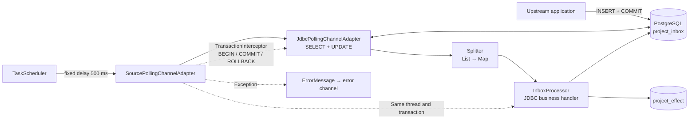
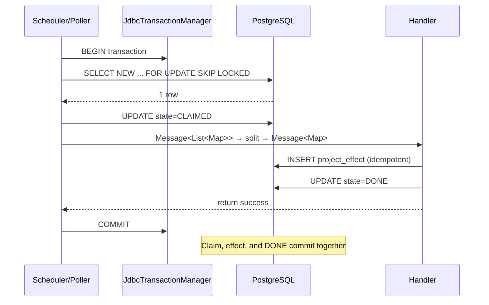
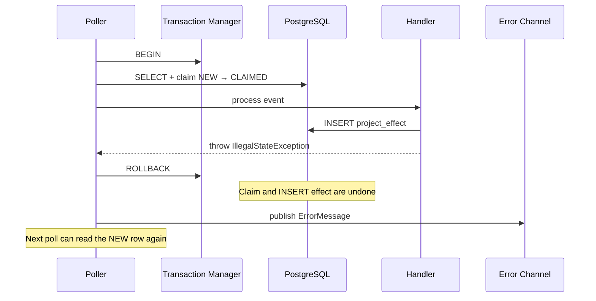
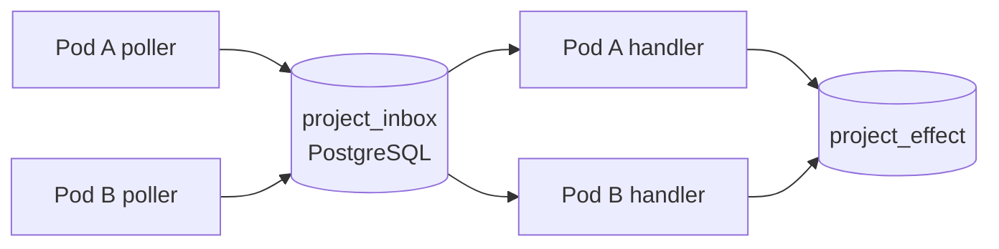
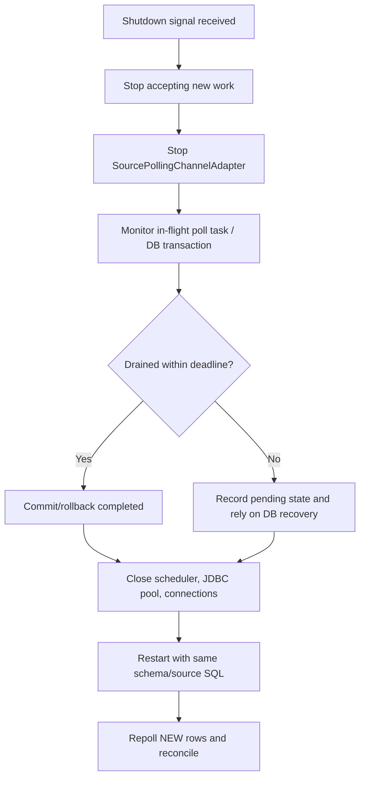

# Adding a Fixed-Delay Transactional Polling Source in Spring Integration Runtime

## 1. Synthesis Lab Goal

In the **Hands-On Project** chapter of the `SPRING_INTEGRATION_RUNTIME` module, we add a **polling source** to an existing Java/Spring Integration application: after every `fixed delay`, the endpoint looks up new rows in PostgreSQL, turns them into messages, processes them synchronously, and updates the result **inside the same transaction**.

This lab ties together runtime capabilities: `MessageSource`, `SourcePollingChannelAdapter`, `IntegrationFlow`, channels/endpoints, pollers, transactions, retries, message stores, error handling, correlation, and thread/latency observability. This is not just scheduled configuration; the focus is clarifying **commit points, rollbacks, and the conditions under which a message is safe to reprocess**.

### 1.1. Business Requirements

Suppose a service collects transaction events written by an upstream system into a `project_inbox` table. Each row is a command to process:

- `event_key` identifies a stable **business event**.
- `payload` contains the data to process.
- `state` can be `NEW`, `CLAIMED`, or `DONE`.
- A worker reads `NEW` rows, writes the outcome into `project_effect`, and marks the row `DONE`.
- If the handler throws an exception before commit, both the claim and the effect write **must roll back** so the command can be retried.
- If multiple application instances run, they must not claim the same row at the same time.

We use a **JDBC inbound channel adapter**, `fixedDelay(500 ms)`, and a JDBC transaction manager on **the same `DataSource`**. Examples target PostgreSQL; do not copy `FOR UPDATE SKIP LOCKED` SQL verbatim to MySQL/Oracle/SQL Server without checking dialect semantics.

### 1.2. Completion Criteria

| Code | Verifiable Criterion |
|---|---|
| AC-01 | Poller runs on fixed delay, not fixed rate |
| AC-02 | When no `NEW` rows exist, the source emits no message and creates no synthetic work |
| AC-03 | A single `receive()` fetches at most one row (`maxRows=1`) |
| AC-04 | A single scheduled poll calls `receive()` at most once (`maxMessagesPerPoll=1`) |
| AC-05 | Claiming, processing, and updating to `DONE` run in the same JDBC transaction |
| AC-06 | Failing after inserting the effect rolls back both the claim and the effect |
| AC-07 | A subsequent poll can reprocess a rolled-back row |
| AC-08 | `event_key` serves as the business idempotency key |
| AC-09 | An error channel/log/metric explains why a poll failed |
| AC-10 | Stopping and restarting the poller does not lose committed `NEW` rows |
| AC-11 | Tests cover happy path, single transient failure, rollback, and duplicate data |
| AC-12 | A plan exists for poison messages, backlog, graceful shutdown, and scale-out |

**Scope:** Spring Integration **6.5.x**, Spring Framework 6.x, Java 17+, Spring Boot 3.5.x or compatible platform, and PostgreSQL in the demo. No build/QA pipeline was executed while authoring this document; learners should verify the examples in an appropriate project/test environment.

## 2. Solution Diagram and Transaction Boundary

### 2.1. Target Topology



**Layer separation to keep in mind:**

- `TaskScheduler` triggers scheduled poll tasks.
- `SourcePollingChannelAdapter` is an **inbound endpoint** whose lifecycle is managed by Spring Integration.
- `JdbcPollingChannelAdapter` is the **`MessageSource`** executing the configured SELECT and UPDATE.
- `IntegrationFlow` wires message endpoints; adjacent DSL steps default to `DirectChannel`, so downstream steps run on the **same thread**.
- `PollerSpec.transactional(transactionManager)` wraps the **poll task** in transaction advice.
- `ErrorMessage` is an error-reporting path; it is not an automatic rollback mechanism unless the transaction boundary is configured properly.

### 2.2. Success Timeline



### 2.3. Failure Timeline



This diagram holds when **all JDBC operations share the same transaction manager/`DataSource`** and the handler does not hand off to another thread before the poll finishes. If the handler makes a remote HTTP call that the partner already committed, a JDBC rollback **does not undo the HTTP call**; you must add idempotency/reconciliation.

## 3. Understanding Fixed Delay and `maxMessagesPerPoll`

### 3.1. Fixed Delay Is Not Fixed Rate

`Pollers.fixedDelay(Duration.ofMillis(500))` measures the pause from **when the previous poll task actually completes**, rather than maintaining a fixed interval between start times.

Example (illustrative timings, ignoring jitter):

```text
fixedDelay = 500 ms, each poll runs for 200 ms

poll 1: START 00:00.000 → END 00:00.200
                         (wait 500 ms)
poll 2: START 00:00.700 → END 00:00.900
                         (wait 500 ms)
poll 3: START 00:01.400 → ...
```

`fixedRate(500 ms)` tries to keep **start times** spaced near every 500 ms, so behavior differs when a poll runs long. Scheduler capacity and concurrency limits still govern whether tasks can overlap; do not assume fixed rate automatically spawns parallel polls.

### 3.2. Two Frequently Confused Numbers

| Parameter | Where It Lives | Meaning |
|---|---|---|
| `setMaxRows(1)` | `JdbcPollingChannelAdapter` | Each SELECT uses at most 1 row to construct the payload |
| `maxMessagesPerPoll(1)` | `PollerSpec` | One poll cycle calls `MessageSource.receive()` at most once |
| `fixedDelay(500 ms)` | `PollerSpec` | Wait interval after a poll cycle finishes |
| SQL `LIMIT 1` | PostgreSQL query | Forces the DB to cap the result set in the query itself |
| `receiveTimeout` | Poller/`PollableChannel` | Wait time for `receive` on a pollable channel; not a JDBC query timeout |

**Notable detail:** the JDBC inbound adapter emits **one message whose payload is the entire result-set `List<?>`**, not one message per row. That is why we add `.split()` to emit a message per row. Even with `maxRows=1`, the payload is still a `List` of at most one element; never write a handler expecting a direct DTO payload without splitting.

For `SourcePollingChannelAdapter`, `maxMessagesPerPoll` defaults to **1**, though this lesson sets it explicitly so learners do not confuse it with `PollingConsumer` on `QueueChannel` (which has a different default).

### 3.3. When the Source Finds No Data

When no row has `state='NEW'`:

1. The JDBC SELECT returns an empty result set.
2. `JdbcPollingChannelAdapter` produces no message to process.
3. The endpoint ends the poll task, waits the fixed delay, and tries again.
4. The system still runs **empty SQL queries**; too many pollers with tiny delays put pressure on the database.

If near-instant latency is required for sparse events, consider a broker/event notification instead of tight polling, while still preserving durable recovery.

## 4. Project Layout and Dependencies

### 4.1. Suggested Layout for Learners

This is the **demo structure inside the lesson**, not files to generate in the Knowledge authoring step:

```text
polling-transaction-lab/
  build.gradle
  src/main/java/demo/polling/
    PollingLabApplication.java
    InboxPollingConfig.java
    InboxProcessor.java
    PollFailureObserver.java
  src/main/resources/
    application.yml
    schema.sql
  src/test/java/demo/polling/
    InboxPollingIntegrationTest.java
```

Use Spring Initializr to create a Spring Boot 3.5.x project with Java 17 and dependency management/BOM compatible with Spring Integration 6.5. In `build.gradle`, declare dependencies:

```groovy
dependencies {
    implementation 'org.springframework.boot:spring-boot-starter-integration'
    implementation 'org.springframework.boot:spring-boot-starter-jdbc'
    implementation 'org.springframework.integration:spring-integration-jdbc'

    runtimeOnly 'org.postgresql:postgresql'

    testImplementation 'org.springframework.boot:spring-boot-starter-test'
    testImplementation 'org.springframework.integration:spring-integration-test'
    testImplementation 'org.testcontainers:junit-jupiter'
    testImplementation 'org.testcontainers:postgresql'
}
```

Do not pin manual versions on each Spring Integration jar when the Spring Boot BOM manages them; avoid mixing Spring Integration 6.5 with incompatible Spring Framework/Spring Security versions. With newer Testcontainers releases, adjust artifact names as needed for your BOM.

### 4.2. Entry Point

```java
package demo.polling;

import org.springframework.boot.SpringApplication;
import org.springframework.boot.autoconfigure.SpringBootApplication;
import org.springframework.integration.config.EnableIntegration;

@SpringBootApplication
@EnableIntegration
public class PollingLabApplication {

    public static void main(String[] args) {
        SpringApplication.run(PollingLabApplication.class, args);
    }
}
```

Spring Boot provides auto-configuration for Spring Integration when the starter is present. `@EnableIntegration` is shown explicitly here to clarify responsibilities; when integrating into an existing project, do not redeclare infrastructure beans unnecessarily.

### 4.3. JDBC Configuration for the Demo

```yaml
spring:
  datasource:
    url: jdbc:postgresql://localhost:5432/integration_lab
    username: integration_lab
    password: ${DB_PASSWORD}
  sql:
    init:
      mode: always

logging:
  level:
    org.springframework.integration.endpoint: INFO
    org.springframework.transaction: INFO
```

In real environments, use a secret manager or environment variables—never commit passwords. `spring.sql.init.mode=always` fits a lab with an idempotent `schema.sql`; in production use controlled Flyway/Liquibase migrations rather than startup table creation scripts.

The configuration above **does not** open a transaction for the poller automatically; `PollerSpec.transactional(...)` is required in the next section.

## 5. Creating the PostgreSQL Schema

### 5.1. Inbox and Effect Tables

```sql
CREATE TABLE IF NOT EXISTS project_inbox (
    id            BIGSERIAL PRIMARY KEY,
    event_key     VARCHAR(120) NOT NULL UNIQUE,
    payload       TEXT NOT NULL,
    state         VARCHAR(20) NOT NULL DEFAULT 'NEW',
    created_at    TIMESTAMPTZ NOT NULL DEFAULT now(),
    processed_at  TIMESTAMPTZ,
    CONSTRAINT ck_project_inbox_state
        CHECK (state IN ('NEW', 'CLAIMED', 'DONE'))
);

CREATE INDEX IF NOT EXISTS ix_project_inbox_new
    ON project_inbox (id)
    WHERE state = 'NEW';

CREATE TABLE IF NOT EXISTS project_effect (
    event_key       VARCHAR(120) PRIMARY KEY,
    payload         TEXT NOT NULL,
    applied_at      TIMESTAMPTZ NOT NULL DEFAULT now()
);
```

`event_key` is `UNIQUE` in both inbox and effect tables to enforce business **idempotency** at the database layer. The relationship between the two tables is a simple illustration; real applications must validate status, tenant, audit fields, and external side effects per domain.

### 5.2. Seeding Sample Data

```sql
INSERT INTO project_inbox (event_key, payload)
VALUES
    ('evt-1001', 'ORDER-1001'),
    ('evt-1002', 'ORDER-1002'),
    ('evt-1003', 'ORDER-1003')
ON CONFLICT (event_key) DO NOTHING;

SELECT id, event_key, payload, state
FROM project_inbox
ORDER BY id;
```

Before polling starts, all three rows should have `state='NEW'`. `ON CONFLICT` in this SQL uses **PostgreSQL** syntax; applications targeting another database must adapt the dialect.

### 5.3. State Contract

| State | Meaning in Demo | When Persisted |
|---|---|---|
| `NEW` | Event ready to be polled | When upstream executes INSERT and COMMIT |
| `CLAIMED` | Adapter claimed the row within the current transaction | `UPDATE` by `JdbcPollingChannelAdapter`, not yet guaranteed committed |
| `DONE` | Handler wrote the result successfully | Written in the **same transaction** before COMMIT |

In the standard flow of this lesson, `CLAIMED` is strictly a **transient in-transaction state**; after a successful commit, the state is `DONE`. If the transaction rolls back, `CLAIMED` rolls back to `NEW`. A row permanently committed as `CLAIMED` due to a code/flow change requires separate recovery; never assume a SELECT filtering only `NEW` will pick it up again.

## 6. Adding the JDBC `MessageSource` and Polling `IntegrationFlow`

### 6.1. Creating `JdbcPollingChannelAdapter`

```java
package demo.polling;

import javax.sql.DataSource;

import org.springframework.context.annotation.Bean;
import org.springframework.context.annotation.Configuration;
import org.springframework.integration.jdbc.JdbcPollingChannelAdapter;

@Configuration
class InboxPollingConfig {

    static final String POLL_SQL = """
        SELECT id, event_key, payload
        FROM project_inbox
        WHERE state = 'NEW'
        ORDER BY id
        LIMIT 1
        FOR UPDATE SKIP LOCKED
        """;

    @Bean("projectJdbcSource")
    JdbcPollingChannelAdapter projectJdbcSource(DataSource dataSource) {
        JdbcPollingChannelAdapter source =
                new JdbcPollingChannelAdapter(dataSource, POLL_SQL);

        // By default returns a List<Map<String, Object>>.
        source.setMaxRows(1);

        // :id comes from the id column of the selected row(s).
        source.setUpdateSql("""
            UPDATE project_inbox
               SET state = 'CLAIMED'
             WHERE id IN (:id)
               AND state = 'NEW'
            """);

        return source;
    }
}
```

In PostgreSQL, `FOR UPDATE SKIP LOCKED` lets multiple transactions select **rows not currently locked by another transaction**, reducing the chance of two pollers claiming the same row. This does not replace idempotency or error-handling policies; all instances must query the same table with proper locking and transactions.

**The SQL intentionally specifies `LIMIT 1`** so a SELECT never locks large batches of rows unnecessarily. `setMaxRows(1)` adds an adapter-level cap; do not rely on `setMaxRows` as your only database load guard.

`JdbcPollingChannelAdapter.setUpdateSql(...)` runs the UPDATE **right after SELECT** inside the same `receive()` call. If the handler later throws while the poller transaction is open, both the claim UPDATE and the handler's JDBC operations roll back.

### 6.2. Configuring the Transaction Manager and Poller

Inside the same `InboxPollingConfig` class, add:

```java
import java.time.Duration;

import org.springframework.beans.factory.annotation.Qualifier;
import org.springframework.context.annotation.Bean;
import org.springframework.integration.dsl.IntegrationFlow;
import org.springframework.integration.dsl.Pollers;
import org.springframework.jdbc.support.JdbcTransactionManager;
import org.springframework.transaction.PlatformTransactionManager;

@Bean("projectTransactionManager")
PlatformTransactionManager projectTransactionManager(DataSource dataSource) {
    return new JdbcTransactionManager(dataSource);
}

@Bean("projectInboxFlow")
IntegrationFlow projectInboxFlow(
        @Qualifier("projectJdbcSource") JdbcPollingChannelAdapter source,
        @Qualifier("projectTransactionManager") PlatformTransactionManager txManager,
        InboxProcessor processor) {

    return IntegrationFlow
            .from(source, endpoint -> endpoint
                    .id("projectInboxPollingEndpoint")
                    .poller(Pollers.fixedDelay(Duration.ofMillis(500))
                            .maxMessagesPerPoll(1)
                            .transactional(txManager)
                            .errorChannel("project.poll.errors")))
            .split()
            .handle(processor, "process")
            .get();
}
```

Place both `@Bean` methods inside the `@Configuration` class `InboxPollingConfig` from Section 6.1 rather than creating duplicate configuration classes/beans. `JdbcTransactionManager` is Spring Framework's JDBC `PlatformTransactionManager`. If your project already defines a transaction manager for the same `DataSource`, **prefer reusing it** rather than declaring a second manager and risking wiring the wrong bean.

**Details you must not overlook:**

- `endpoint.id("projectInboxPollingEndpoint")` assigns a stable name for monitoring and start/stop control.
- `Pollers.fixedDelay(Duration.ofMillis(500))` waits after each poll completes, rather than using a cron schedule.
- `maxMessagesPerPoll(1)` limits each scheduled task to one `receive()` call.
- `.transactional(txManager)` attaches a `TransactionInterceptor` around the **entire polling task**, not just the handler.
- `.errorChannel("project.poll.errors")` routes poller errors; the channel bean and error consumer are defined in Section 8.
- `.split()` turns the JDBC source's `List<Map>` payload into individual messages, each holding one `Map`.
- `.handle(processor, "process")` invokes the Spring bean method; the method returns `void`.
- The DSL uses `DirectChannel` by default between splitter and handler, avoiding async executors/queues inside the transactional chain.

Spring Integration **does not open a transaction automatically** just because a `DataSource` exists or the handler carries `@Transactional`. Without `.transactional(txManager)`, the SELECT/UPDATE can commit independently before the handler runs.

### 6.3. Why Use a Splitter Even When Receiving One Row?

`JdbcPollingChannelAdapter` treats **one SELECT** as **one message** and returns the full result set as a `List`. Without `split()`, the handler receives `List<Map<String,Object>>` instead of a single row.

If you raise `LIMIT` to 10, the splitter emits 10 messages inside **the same polling task/transaction** as long as steps remain synchronous. If the seventh item throws, the **entire batch** can roll back, not just one row. Because this lab tests individual event outcomes cleanly, keep `LIMIT=1`, `maxRows=1`, and `maxMessagesPerPoll=1` before experimenting with batching.

### 6.4. Variants That Must Not Be Equated

- `@InboundChannelAdapter(poller=@Poller(fixedDelay="500"))` also creates a source polling endpoint, yet transactions do not appear automatically just from `fixedDelay`.
- `IntegrationFlow.fromSupplier(...)` works well for pure suppliers, but **does not** automatically provide atomic SELECT/UPDATE claiming and commit.
- `QueueChannel` + `PollingConsumer` is a different topology: the poller reads from a **message channel**, not from a JDBC inbound adapter's `MessageSource`.
- `SourcePollingChannelAdapter` and `JdbcPollingChannelAdapter` have distinct roles; never attach transactions at the wrong layer and expect the whole flow to roll back.

## 7. Processor: Writing Effect + `DONE` in the Same Transaction

### 7.1. Complete Java Handler

```java
package demo.polling;

import java.util.Map;
import java.util.Set;
import java.util.concurrent.ConcurrentHashMap;
import java.util.concurrent.atomic.AtomicInteger;

import org.springframework.jdbc.core.JdbcTemplate;
import org.springframework.stereotype.Component;
import org.springframework.transaction.support.TransactionSynchronizationManager;

@Component
public class InboxProcessor {

    private final JdbcTemplate jdbc;

    // Lab-only: throw an exception on the first processing attempt.
    private final Set<String> failOnceKeys =
            ConcurrentHashMap.newKeySet();

    private final Map<String, AtomicInteger> observedAttempts =
            new ConcurrentHashMap<>();

    public InboxProcessor(JdbcTemplate jdbc) {
        this.jdbc = jdbc;
    }

    public void failOnceFor(String eventKey) {
        failOnceKeys.add(eventKey);
    }

    public int attemptsFor(String eventKey) {
        AtomicInteger count = observedAttempts.get(eventKey);
        return count == null ? 0 : count.get();
    }

    public void process(Map<String, Object> row) {
        long rowId = ((Number) row.get("id")).longValue();
        String eventKey = (String) row.get("event_key");
        String payload = (String) row.get("payload");

        observedAttempts.computeIfAbsent(eventKey,
                unused -> new AtomicInteger())
                .incrementAndGet();

        // Lab guard to catch transaction misconfiguration early.
        if (!TransactionSynchronizationManager
                .isActualTransactionActive()) {
            throw new IllegalStateException(
                    "Polling transaction is not active");
        }

        // Database-level idempotency (PostgreSQL).
        jdbc.update("""
            INSERT INTO project_effect (event_key, payload)
            VALUES (?, ?)
            ON CONFLICT (event_key) DO NOTHING
            """, eventKey, payload);

        // Simulate failure AFTER writing the effect, BEFORE commit.
        if (failOnceKeys.remove(eventKey)) {
            throw new IllegalStateException(
                    "Simulated transient failure for " + eventKey);
        }

        int updated = jdbc.update("""
            UPDATE project_inbox
               SET state = 'DONE',
                   processed_at = now()
              WHERE id = ?
                AND state = 'CLAIMED'
            """, rowId);

        if (updated != 1) {
            throw new IllegalStateException(
                    "Unexpected inbox state for row " + rowId);
        }
    }
}
```

In this example, `row.get("id")` returns a `Number` (PostgreSQL BIGINT), while `event_key`/`payload` map from the `SELECT` columns. The default adapter uses a JDBC map keyed by column name; when adapting to other databases or a custom `RowMapper`, check **key casing** or declare an explicit `RowMapper`.

`AtomicInteger` and `failOnceKeys` exist only for test observation; they **do not participate in transactions** and do not survive restarts. That is intentional: we can prove two **attempts** executed while the database persisted only **one effect** after commit.

### 7.2. Why Insert the Effect Before Simulating the Failure?

If the row is claimed and the handler throws **before any DB write**, the rollback test is too trivial and fails to prove that a **business write** actually rolled back. With this sequence:

1. Adapter changes `NEW → CLAIMED`.
2. Handler inserts into `project_effect`.
3. Handler deliberately throws an exception.
4. Transaction rolls back; both the effect INSERT and the claim are undone.
5. Next poll reads the `NEW` row again.
6. Handler inserts the effect and updates `DONE`.
7. Commit succeeds → exactly **one effect row**.

If someone accidentally omits `.transactional(txManager)`, the handler guard throws before the INSERT; without the guard, the claim could commit before the failure, stranding the row in `CLAIMED` and causing the eventual `DONE` test to fail.

### 7.3. Why Is `ON CONFLICT` Still Needed?

Transaction rollback protects against exceptions thrown **within the same database transaction**. It does not prevent all duplicates:

- Upstream resends the same business event with a new message ID.
- The process dies after an external side effect outside the transaction.
- A command is replayed from a DLQ.
- Another broker/adapter retries delivering the same event.

`UNIQUE(event_key)` and `ON CONFLICT DO NOTHING` protect this demo's **writes into this database**. If a new arrival carries a different payload for an already committed key, never ignore it silently in production; compare canonical payloads/hashes and enforce a conflict policy.

Never use `MessageHeaders.ID` as the sole idempotency key because a logical event can be reconstructed with a different message ID.

## 8. Handling Poller Errors Without Losing Data

### 8.1. `ErrorMessage` Is Only the Error-Reporting Path

If `InboxProcessor.process()` throws `IllegalStateException`, the error propagates back through the splitter and polling endpoint. `TransactionInterceptor` rolls back the JDBC transaction; the poller's error handling can then publish an `ErrorMessage` to the configured `project.poll.errors` channel.

**Do not confuse these three actions:**

- **Rollback:** the database reverts `CLAIMED → NEW` and discards the uncommitted `project_effect` insert.
- **Error publication:** the framework emits an error report for operators to observe.
- **Retry:** the next poll reads `NEW` again; you need a policy to avoid infinite loops on permanently failing messages.

If `ErrorMessage` goes to a `QueueChannel` with no consumer and unbounded capacity, errors pile up in RAM. This lab uses a `DirectChannel` with a concise error handler.

### 8.2. Declaring the Error Channel and Handler

```java
package demo.polling;

import org.springframework.context.annotation.Bean;
import org.springframework.context.annotation.Configuration;
import org.springframework.integration.channel.DirectChannel;
import org.springframework.messaging.MessageChannel;

@Configuration
class PollingErrorChannelsConfig {

    @Bean("project.poll.errors")
    MessageChannel pollErrors() {
        return new DirectChannel();
    }
}
```

```java
package demo.polling;

import org.slf4j.Logger;
import org.slf4j.LoggerFactory;
import org.springframework.integration.annotation.ServiceActivator;
import org.springframework.messaging.MessagingException;
import org.springframework.messaging.support.ErrorMessage;
import org.springframework.stereotype.Component;

@Component
public class PollFailureObserver {

    private static final Logger log =
            LoggerFactory.getLogger(PollFailureObserver.class);

    @ServiceActivator(inputChannel = "project.poll.errors")
    public void observe(ErrorMessage error) {
        Throwable failure = error.getPayload();

        Throwable root = failure;
        for (int level = 0; root.getCause() != null && level < 20;
                level++) {
            if (root.getCause() == root) {
                break;
            }
            root = root.getCause();
        }

        log.warn("event=poll_failed errorType={} rootCauseType={} "
                        + "message={}",
                failure.getClass().getSimpleName(),
                root.getClass().getSimpleName(),
                safeRootReason(root));
    }

    private static String safeRootReason(Throwable failure) {
        // Lab example: log error type only, without exposing payload/headers/secrets.
        return failure.getClass().getSimpleName();
    }
}
```

This is an **observer**, not a retry/quarantine policy. In production systems, also log `event_key`/`businessRequestId` when safely extractable from `MessagingException.getFailedMessage()` or the original message. Do not dump the entire `ErrorMessage`, as the failed message may contain sensitive payloads and headers.

Note that the error path when a poller fails **is not the same** as an exception on a producer-called `DirectChannel`. Here we are observing a framework-managed **scheduled task**, so confirm `SourcePollingChannelAdapter` has the right error handler/error channel configured.

### 8.3. Why Not Update the Failed Row Directly Inside the Error Handler?

An `ErrorMessage` is an **observation event**, and does not automatically carry enough context to update retry counts safely. A handler can fail after the splitter, so `failedMessage` has a `Map` payload while the original poll message held a `List`. Moreover, the error handler typically runs **after the original transaction rolled back**, so you should never blindly mutate source rows using an ID scraped from logs.

A production design can add:

- `attempt_count`, `next_attempt_at`, and `last_error_code` on the inbox table.
- A quarantine state `DEAD`, retry delay/backoff, and max retry count.
- A failure-state writer running in a **new, independently committed transaction** with proper correlation and ownership checks.
- Business idempotency by `event_key`, independent of message ID.
- Poison-message handling so one permanently failing row does not starve subsequent rows.

**Common trap:** incrementing `attempt_count` inside the same transaction before throwing causes the increment to roll back too; after every poll, the retry count remains 0. To persist a failure record after rollback, run the failure-state update in a **separate** transaction and ensure failure events are tracked. See Section 14.

## 9. Running the Project and Inspecting PostgreSQL State

### 9.1. Lab Execution Steps

1. Start a test PostgreSQL instance, create the `integration_lab` database, and grant a user permission to create/read/write the demo tables.
2. Supply `DB_PASSWORD` via environment variable or secret store.
3. Start the Spring Boot application; `schema.sql` runs per lab configuration.
4. Check startup logs to verify the `projectInboxPollingEndpoint` bean started with no SQL or transaction manager errors.
5. INSERT the three sample events (Section 5.2) while the app is running, or use pre-seeded data.
6. Query the state until all rows transition to `DONE`.

Example inspection with `psql`:

```sql
SELECT event_key, state, created_at, processed_at
FROM project_inbox
ORDER BY id;

SELECT event_key, payload, applied_at
FROM project_effect
ORDER BY applied_at;
```

Once all rows succeed, expected state:

```text
project_inbox:
  evt-1001   DONE
  evt-1002   DONE
  evt-1003   DONE

project_effect:
  evt-1001   ORDER-1001
  evt-1002   ORDER-1002
  evt-1003   ORDER-1003
```

These values are **expected results**, not pre-captured output from the learner's environment.

### 9.2. Triggering a Single Failure After Inserting the Effect

`InboxProcessor.failOnceFor(eventKey)` is a test-only hook. To use it in a test, call it on the bean **before** inserting the corresponding row:

```java
String key = "evt-fail-demo";
inboxProcessor.failOnceFor(key);

jdbcTemplate.update(
        "INSERT INTO project_inbox (event_key, payload) VALUES (?, ?)",
        key, "PAYLOAD-FAIL-ONCE");
```

Expected sequence:

- First poll claims the row, inserts the effect, throws; transaction rolls back.
- `PollFailureObserver` logs the failure safely.
- Next poll picks up the row again and succeeds.
- Final state: `state='DONE'`, `project_effect` has one row, and `attemptsFor(key) >= 2`.

**Never call `failOnceFor` on a different instance than the handler bean wired into Spring Integration.** In tests, use `@Autowired InboxProcessor` so the hook affects the active bean.

### 9.3. SQL Trace to Inspect During Debugging

```text
Poll 1:
 BEGIN
 SELECT ... FOR UPDATE SKIP LOCKED  -> row id=101
 UPDATE project_inbox SET CLAIMED  -> id=101
 INSERT project_effect             -> event_key=evt-fail-demo
 THROW
 ROLLBACK
  => project_inbox: NEW, project_effect: no such row

Poll 2:
 BEGIN
 SELECT ... FOR UPDATE SKIP LOCKED  -> row id=101
 UPDATE project_inbox SET CLAIMED
 INSERT project_effect
 UPDATE project_inbox SET DONE
 COMMIT
  => project_inbox: DONE, project_effect: exactly 1 row
```

With two poller instances or concurrent load, log lines can interleave. Correlate by `event_key`, row ID, transaction ID, and timestamp rather than inferring causality from global log order.

## 10. Real Integration Testing with PostgreSQL and Testcontainers

### 10.1. Why Not Use H2 for the Primary Tests?

This demo relies on PostgreSQL `FOR UPDATE SKIP LOCKED`, `ON CONFLICT`, partial indexes, and PostgreSQL transaction/locking semantics. H2 can help with repository unit tests in narrow cases, yet **cannot substitute** for integration tests covering real PostgreSQL dialect, locking, and rollback behavior.

Use Testcontainers to spin up an isolated PostgreSQL instance for tests; **never test against a production database**. Testcontainers requires Docker/a container runtime on the learner's machine/CI. This lesson only describes and provides the code; no build/test runner executes while authoring this knowledge document.

### 10.2. JUnit: Happy Path and Rollback After One Failure

```java
package demo.polling;

import static org.junit.jupiter.api.Assertions.assertEquals;
import static org.junit.jupiter.api.Assertions.assertTrue;
import static org.awaitility.Awaitility.await;

import java.time.Duration;
import java.util.UUID;

import org.junit.jupiter.api.Test;
import org.springframework.beans.factory.annotation.Autowired;
import org.springframework.boot.test.context.SpringBootTest;
import org.springframework.jdbc.core.JdbcTemplate;
import org.springframework.test.context.DynamicPropertyRegistry;
import org.springframework.test.context.DynamicPropertySource;
import org.testcontainers.containers.PostgreSQLContainer;
import org.testcontainers.junit.jupiter.Container;
import org.testcontainers.junit.jupiter.Testcontainers;

@SpringBootTest
@Testcontainers
class InboxPollingIntegrationTest {

    @Container
    static PostgreSQLContainer<?> db =
            new PostgreSQLContainer<>("postgres:16-alpine")
                    .withDatabaseName("integration_lab")
                    .withUsername("integration_lab")
                    .withPassword("test-password");

    @DynamicPropertySource
    static void datasourceProperties(DynamicPropertyRegistry registry) {
        registry.add("spring.datasource.url", db::getJdbcUrl);
        registry.add("spring.datasource.username", db::getUsername);
        registry.add("spring.datasource.password", db::getPassword);
    }

    @Autowired
    JdbcTemplate jdbc;

    @Autowired
    InboxProcessor processor;

    @Test
    void pollsNewRowAndCommitsEffect() {
        String key = "ok-" + UUID.randomUUID();

        jdbc.update("""
            INSERT INTO project_inbox (event_key, payload)
            VALUES (?, ?)
            """, key, "ORDER-OK");

        await().atMost(Duration.ofSeconds(15))
                .pollInterval(Duration.ofMillis(100))
                .untilAsserted(() -> {
                    assertEquals("DONE", state(key));
                    assertEquals(1, effectCount(key));
                });
    }

    @Test
    void handlerFailureRollsBackClaimAndBusinessWrite() {
        String key = "retry-" + UUID.randomUUID();
        processor.failOnceFor(key);

        jdbc.update("""
            INSERT INTO project_inbox (event_key, payload)
            VALUES (?, ?)
            """, key, "ORDER-RETRY");

        await().atMost(Duration.ofSeconds(15))
                .pollInterval(Duration.ofMillis(100))
                .untilAsserted(() -> {
                    assertEquals("DONE", state(key));
                    assertEquals(1, effectCount(key));
                    assertTrue(processor.attemptsFor(key) >= 2,
                            "One attempt must have failed before commit");
                });
    }

    private String state(String key) {
        return jdbc.queryForObject("""
            SELECT state FROM project_inbox WHERE event_key = ?
            """, String.class, key);
    }

    private int effectCount(String key) {
        Integer count = jdbc.queryForObject("""
            SELECT count(*) FROM project_effect WHERE event_key = ?
            """, Integer.class, key);
        return count == null ? 0 : count;
    }
}
```

**Dependencies:** Spring Boot's test starter normally includes `Awaitility`; if your BOM/test starter does not pull it in, add `org.awaitility:awaitility` as a test dependency. Align Testcontainers artifacts with your BOM.

**Conditions for meaningful tests:**

- `PollingLabApplication` is picked up by component scanning.
- `schema.sql` is on the classpath with `spring.sql.init.mode=always`; Testcontainers JDBC properties are injected before Boot initializes the database.
- Test methods are order-independent; each uses a unique `event_key`.
- The poller runs automatically in the test context just as in the application.
- No extra consumer reads the same rows, and no `ExecutorChannel` sits between source and handler.
- When waiting for outcomes, use `await().untilAsserted(...)` rather than sleeping a fixed duration and hoping processing finished.

### 10.3. Interpreting Failure Test Results

`assertTrue(processor.attemptsFor(key) >= 2)` proves at least two handler invocations ran. `effectCount=1` and `state='DONE'` prove the database ended with one effect and the inbox row in its terminal state.

Still, **a final-state assertion alone is not absolute proof of every transaction detail**. To verify the row reverted to `NEW` immediately after the first rollback, use a latch/barrier in a controlled poller stop/start fixture or a post-rollback event listener—never insert an arbitrary `Thread.sleep` and query at a random instant. For stronger verification, add SQL transaction-state assertions and fault-injection/commit-failure tests.

### 10.4. Testing Deduplication and Idempotency

To test **resending the same `event_key`**, the unique constraint on `project_inbox.event_key` already rejects duplicate rows; tests must decide whether upstream should **ignore duplicates** or receive a business 409 conflict error.

One way to test:

```java
String key = "duplicate-" + UUID.randomUUID();

jdbc.update("""
    INSERT INTO project_inbox (event_key, payload)
    VALUES (?, ?) ON CONFLICT (event_key) DO NOTHING
    """, key, "first");

jdbc.update("""
    INSERT INTO project_inbox (event_key, payload)
    VALUES (?, ?) ON CONFLICT (event_key) DO NOTHING
    """, key, "duplicate");

Integer rows = jdbc.queryForObject("""
    SELECT count(*) FROM project_inbox WHERE event_key = ?
    """, Integer.class, key);

assertEquals(1, rows);
```

This is strictly an **inbox uniqueness test**. Proving end-to-end exactly-once business effects requires additional consumer/replay tests, external side-effect tests, and reconciliation checks for cases where an HTTP call committed while the JDBC transaction rolled back.

### 10.5. Testing Stopping and Resuming the Poller

Look up the endpoint by its ID `projectInboxPollingEndpoint` and call the `Lifecycle` API:

```java
import org.springframework.beans.factory.annotation.Qualifier;
import org.springframework.context.Lifecycle;
import org.springframework.stereotype.Component;

@Component
class PollerLifecycleControl {

    private final Lifecycle endpoint;

    PollerLifecycleControl(
            @Qualifier("projectInboxPollingEndpoint") Lifecycle endpoint) {
        this.endpoint = endpoint;
    }

    public void stop() {
        endpoint.stop();
    }

    public void start() {
        endpoint.start();
    }

    public boolean isRunning() {
        return endpoint.isRunning();
    }
}
```

In the test, stop the poller before inserting a new row; verify under an appropriate condition/window that the row stays `NEW`, then start it again and wait for `DONE`. Do not run this test in parallel with other tests expecting the poller to run; use an isolated context or separate lifecycle suite and **always restart in `finally`**.

`stop()` does not guarantee every in-flight transaction finished instantaneously. Before destroying or redeploying, check active poll tasks, DB locks, and backlog; a bare `stop()` test does not prove graceful draining.

## 11. Testing Valid and Invalid Transaction Boundaries

### 11.1. Transactions Only Hold When Sharing the Same Thread and `DataSource`

`PollerSpec.transactional(txManager)` wraps **one poll task**. SQL operations join the same transaction when:

- `JdbcPollingChannelAdapter` obtains its connection from the `DataSource` managed by `txManager`.
- `InboxProcessor` uses a `JdbcTemplate` backed by **the same `DataSource`**.
- All steps from source through splitter to processor execute on **the same thread**.
- The handler **throws exceptions** rather than swallowing them, so the advice triggers a rollback.

In the main example, these conditions are satisfied deliberately. Never infer from `@Transactional` on a method running on another thread that a JDBC transaction crossed an executor boundary.

### 11.2. Anti-Pattern: Inserting `ExecutorChannel` Between Source and Handler

```java
return IntegrationFlow.from(source, e -> e.poller(
            Pollers.fixedDelay(Duration.ofMillis(500))
                    .transactional(txManager)))
        .split()
        // Anti-pattern here if atomic receive+process is desired:
        .channel(c -> c.executor(threadPoolTaskExecutor))
        .handle(processor, "process")
        .get();
```

When handing off to `ExecutorChannel`, submitting the message to a worker can complete immediately; the poller thread's transaction commits **before the worker even processes the message**. If the worker later throws an exception, `CLAIMED` may already be committed in the database, and a SQL source filtering only `NEW` will never pick up that row again.

**Consequence:** messages can become stuck in `CLAIMED` without retries even though the error channel receives the exception. That is a correctness bug, not merely a latency shift.

If you need separate threads for throughput, you must design **acknowledgment/lease/claim states with timeouts and recovery**, or use a broker/durable channel with matching transaction/ACK semantics. Never drop an executor into a flow assuming rollback still works.

### 11.3. Anti-Pattern: Handler Swallowing Exceptions

```java
public void process(Map<String, Object> row) {
    try {
        doBusinessWrite(row);
    }
    catch (Exception failure) {
        log.warn("failed, but returning normally", failure);
    }
}
```

If the poller transaction sees the handler **return normally**, the advice commits the adapter's `CLAIMED` update even though the business write failed. Message loss becomes harder to spot because no exception triggered a rollback.

Correct approach: classify errors at an appropriate boundary, then:

- For transient failures: throw so the transaction rolls back; apply a retry/backoff policy.
- For permanently invalid input: persist `REJECTED`/quarantine in an intentional transaction and commit (if domain rules allow).
- For unknown external side effects: transition to `RECONCILING` with idempotency rather than returning false success.
- For observability/logging errors: never let a logging error break a business transaction unless explicitly intended.

### 11.4. Anti-Pattern: Transaction Manager Pointing at the Wrong Database

If the JDBC source reads from database A while the handler's `JdbcTemplate` writes to database B:

```text
Transaction manager A:
  BEGIN → SELECT/UPDATE source A

Handler:
  INSERT effect into B (separate transaction B or autocommit)

Handler throws:
  ROLLBACK A; effect in B remains
```

`Pollers.transactional(txManagerA)` **does not create a distributed transaction** across B. When atomicity across two databases is required, use outbox/inbox, sagas, idempotency, or carefully engineered XA/JTA—never assume a local JDBC transaction suffices.

### 11.5. Timeouts Are Not Transaction Rollbacks

`fixedDelay(500 ms)` does not cap the runtime of `receive()`, SQL queries, or the handler. If a DB lock blocks for 30 seconds, the poll task stalls for 30 seconds; fixed delay starts counting **after the task finishes**.

Configure separate timeouts explicitly:

- JDBC query timeout and database statement timeout.
- Connection pool acquisition timeout.
- Transaction timeout on the advice.
- External HTTP client connect/read timeouts.
- End-to-end business deadline and retry/backoff budget.
- Shutdown drain deadline.

**Never put `Thread.sleep(1000)` in a handler to simulate deadlines** in production logic; use test fixtures with latches and controllable faults.

## 12. Fixed Delay, Throughput, and Polling Schedule Design

### 12.1. Estimating Throughput Before Tuning

In the main example, each cycle calls the JDBC source once and fetches one row. While the source has a backlog, the minimum interval between poll starts is roughly:

\[T_{\text{cycle}} \approx T_{\text{select+update+handler+commit}} + T_{\text{fixed-delay}} + T_{\text{jitter}}\]

Example with **hypothetical** figures:

```text
JDBC read + claim:         20 ms
Handler + effect write:   50 ms
Commit:                   30 ms
Fixed delay:             500 ms
Scheduler jitter:         ~0 ms (hypothetical)

One cycle ≈ 600 ms
Ceiling throughput for 1 poller, 1 row/cycle ≈ 1.67 events/s
```

**This is an estimate for one sequential poller actively processing rows**, not an actual benchmark; when idle, empty queries still run without emitting messages. If you need 100 events/s, a 1 row per 500 ms configuration is plainly inadequate regardless of how fast the handler is.

### 12.2. What Happens If You Increase `maxRows`?

`JdbcPollingChannelAdapter` returns one `List` per poll. With `LIMIT 10`, `setMaxRows(10)`, and `split()`, a single poll can dispatch up to 10 row messages **within the same transaction**. If the seventh item throws, the transaction can roll back **all 10 rows** (depending on dispatch and rollback configuration).

| Configuration | SQL Rows per Receive | Receives per Scheduled Poll | Transaction Scope in Lesson |
|---|---:|---:|---|
| Lab default | 1 | 1 | One row + handler |
| Small batch | 10 | 1 | Potentially the whole 10-row batch |
| Multiple source calls | 1 | 10 | Ten receives in one poll task; check transaction/advice scope |
| High poll rate | 1 | 1 with 50 ms delay | Higher SQL query rate; potential DB load |

Increasing `maxMessagesPerPoll` or `maxRows` without understanding transaction boundaries alters atomicity, lock hold times, error recovery, and p99 latency. Always add **rollback regression tests** for the new configuration.

### 12.3. Fixed Delay vs. Fixed Rate Under Load

| Scenario | Fixed Delay | Fixed Rate |
|---|---|---|
| Poll faster than interval | Waits exact interval after task finishes | Attempts steady start intervals |
| Poll slower than interval | Next run waits until current finishes on a sequential scheduler | Runs late; does not guarantee parallel execution |
| When DB is overloaded | Naturally backs off as tasks lengthen | Can pile up scheduled work if scheduler/threads are misconfigured |
| Need "500 ms after last completion" | Exact match | Wrong semantics |
| Need wall-clock aligned ticks | Not directly | Fixed rate/cron may fit depending on requirements |

Do not assume switching to `fixedRate(500)` fixes a backlog caused by DB locks or slow handlers. It only changes scheduling; once processing capacity saturates, throughput does not rise on its own.

### 12.4. Monitoring Empty Polls

One empty query every 500 ms equals roughly two SQL queries/second per instance. Across 20 pods polling concurrently, that approaches 40 empty queries/second while idle, before counting health/metrics traffic.

When polling a database continuously for infrequent traffic, consider:

- Backing off the delay when idle and shortening it when backlog grows, per policy.
- Notification/event-driven sources (if supported by infrastructure), backed by a durable fallback.
- Using a broker for wakeups while keeping idempotency/business state in the database.
- Reducing how many pods poll the same partition concurrently.
- Keeping poller transactions short with appropriate indexes.

Never disable polling indefinitely without a reliable wakeup/recovery path when new messages arrive.

## 13. Multiple Workers/Instances and PostgreSQL `SKIP LOCKED`

### 13.1. Why Adding Another Poller Does Not Scale Throughput Linearly

When running two JVMs with the same source and query:



`FOR UPDATE SKIP LOCKED` allows each transaction to skip rows currently locked by another transaction, implementing the **competing consumers** pattern. Keep these constraints in mind:

- All instances must use the exact same database schema and query semantics.
- `SKIP LOCKED` can process rows **out of ascending ID order**; global ordering is not guaranteed across multiple workers.
- Row locks are held until the end of the transaction. Slow handlers hold locks longer.
- If a poller transaction times out or a process crashes, PostgreSQL aborts the transaction and the row becomes eligible to poll again.
- A committed message whose external side effect failed later still requires reconciliation.
- Never rely on `SKIP LOCKED` as an exactly-once guarantee when external HTTP side effects exist.

### 13.2. Competing Pollers Experiment

In staging/testing, run two instances against the same database; seed at least 100 `NEW` rows and record which instance processed each `event_key`.

Criteria:

1. Every `event_key` transitions to `DONE` per contract.
2. `project_effect` has exactly one row per event.
3. No two instances claim the same row simultaneously.
4. Rolled-back rows are picked up again rather than getting stuck in `CLAIMED`.
5. No reliance on global ordering; if per-tenant/per-order ordering is needed, partition or serialize by business key.
6. Measure throughput and p95/p99 DB lock wait before and after scaling out.

**Use a test environment**, never attach two competing test pollers to a production queue just to check for races.

### 13.3. Difference Between Row Locks and `LockRegistry`

`FOR UPDATE SKIP LOCKED` is a **SQL row lock** scoped to the current PostgreSQL transaction. Spring Integration's `LockRegistry` typically protects **message groups/correlation state** in aggregators, with local or distributed implementations depending on the backend.

Do not treat the two mechanisms as interchangeable:

| Mechanism | Protects | Scope |
|---|---|---|
| PostgreSQL row lock | Claiming/accessing an individual inbox row | Transaction/database |
| `JdbcLockRegistry`/`RedisLockRegistry` | Critical section keyed by logical lock key (e.g., group ID) | Lock backend/lease |
| Business idempotency key | Prevents duplicate business effects | Domain/resource |
| Transaction manager | Commits/rolls back a group of resource operations | Resource and transaction context |

A poller using `FOR UPDATE` can still fire duplicate external API calls after a timeout; a distributed lock alone still does not verify tenant ownership or prior completion.

### 13.4. Row Claiming When Multiple Apps Share One Table

If another service's source also reads `project_inbox`, separate rows by `event_type`/`owner`/`region` in SQL predicates and enforce DB access permissions. Never share a single table assuming `ORDER BY id LIMIT 1` knows which service owns which row.

For multi-tenant workloads, index and query by tenant/partition or event type as appropriate. Never take a tenant from an unverified client header and use it as the sole predicate authorizing data processing.

## 14. Retries, Backoff, and Durable Poison-Message Recovery

### 14.1. When a Handler Always Fails

If `process()` consistently throws for event `bad-001`:

```text
poll 1: SELECT bad-001 -> ROLLBACK -> NEW
fixed delay 500ms
poll 2: SELECT bad-001 -> ROLLBACK -> NEW
fixed delay 500ms
poll 3: SELECT bad-001 -> ROLLBACK -> NEW
...
```

Because the query uses `ORDER BY id LIMIT 1`, one poison message at a low ID **starves** all subsequent rows even though SQL and transactions work properly. An error handler that only logs is not enough.

### 14.2. A Production Schema Upgrade

Suggested columns to add to `project_inbox` (via schema migration—**do not add blindly to the running lab without updating code**):

```sql
ALTER TABLE project_inbox
    ADD COLUMN IF NOT EXISTS attempt_count INTEGER NOT NULL DEFAULT 0,
    ADD COLUMN IF NOT EXISTS next_attempt_at TIMESTAMPTZ,
    ADD COLUMN IF NOT EXISTS last_error_code VARCHAR(80);

-- Extend the state constraint to allow FAILED/DEAD via a real migration.
-- Never DROP production constraints casually.
```

After a controlled migration, the select query can fetch only eligible rows:

```sql
SELECT id, event_key, payload
FROM project_inbox
WHERE state = 'NEW'
  AND (next_attempt_at IS NULL OR next_attempt_at <= now())
ORDER BY id
LIMIT 1
FOR UPDATE SKIP LOCKED;
```

When a transaction fails and rolls back:

1. An error handler/classifier extracts `event_key` from a **trusted source**.
2. Another service updates `attempt_count` and `next_attempt_at` in a **new, committed transaction**.
3. For non-retryable errors, move the row to quarantine/`DEAD` per schema/policy.
4. For transient errors, schedule bounded backoff with jitter so the same row is not repolled immediately.
5. Audit everything and distinguish **business processed**, **error emitted**, **awaiting retry**, and **quarantined**.

**Key point:** never increment the attempt count inside the same polling transaction and throw; the increment rolls back too. Ensure the failure-state update runs in a **separate** transaction after the original transaction ends, or use a dedicated retry/lease mechanism with verified semantics.

### 14.3. Watch Out When Error Publication Fails Too

If `project.poll.errors` has a throwing handler, is stopped, or has a full buffer, error publication can fail right after the original JDBC transaction rolled back. You must have baseline scheduler logging/alerts plus a database reconciliation check to catch rows stuck retrying forever.

Never rely on **an event in an in-memory error channel** as your sole record of failed processing. For higher reliability, use durable failure/outbox records or a persistent broker DLQ.

### 14.4. Handler Retries vs. Repoll Retries

`RequestHandlerRetryAdvice` can retry a handler **multiple times within the same polling task**; repolling happens on a **later scheduled task**, usually in a fresh transaction. The two behave differently:

| Mechanism | Retry Unit | Risk |
|---|---|---|
| Handler retry advice | Handle method/endpoint within one invocation | Holds DB locks/transaction open during backoff |
| Repoll after rollback | Source re-SELECTs in a new transaction | Repeated poison messages; paced by fixed delay |
| Broker redelivery | Message redelivered per ACK/reject policy | Potential duplicate side effects |
| Dedicated retry queue | Scheduled/delayed message delivery | Requires durable state and tracing/correlation |

**Never stack multiple retry layers unchecked.** For example, 3 handler attempts × 5 broker redeliveries × 10 application repolls multiplies calls for a single event, worsening latency and hammering dependencies.

### 14.5. `UNKNOWN` Business State vs. Transaction Rollback

If a handler makes an external HTTP call that times out:

```text
BEGIN JDBC
SELECT/CLAIM inbox row
HTTP call -> remote server committed (but response timed out)
THROW
ROLLBACK JDBC
next poll -> second HTTP call
```

Adding `ON CONFLICT DO NOTHING` to `project_effect` **does not protect** the remote HTTP side effect, because HTTP is outside the JDBC transaction. Pass an **idempotency key to the remote partner**, use an outbox/saga, or reconcile transaction status before retrying. When the outcome is unknown, transition the command to `RECONCILING` instead of treating every I/O error as "nothing happened".

## 15. Observability for `SourcePollingChannelAdapter` and JDBC

### 15.1. Essential Metrics

| Metric / Event | Question Answered |
|---|---|
| `poll.task.count`/`poll.task.duration` | Are polls actually running, and how long does each take? |
| `source.receive.count`/`empty.poll.count` | What is the ratio of productive polls vs. empty polls? |
| `poll.jdbc.select.duration` | Where is SQL read/lock wait time spent? |
| `poll.jdbc.update.duration` | How expensive are claim updates/commits? |
| `handler.process.duration` | Is business processing slow? |
| `handler.error.count` | Which causes trigger transaction rollbacks? |
| `inbox.new.count` | How many events remain unclaimed? |
| `inbox.oldest.age` | How long has the oldest pending event waited? |
| `inbox.claimed.stuck.count` | Are any rows stuck in `CLAIMED` after code/flow changes? |
| `project_effect.duplicate.conflict` | Are duplicate event keys arriving? |
| `db.connection.acquire.duration` | Is the connection pool saturated? |
| `db.lock.wait.duration` | Are multiple instances contending on row/group locks? |
| `transaction.rollback.count` | Are failures rolling back cleanly? |
| `poll.error.publish.failures` | Is the error channel failing or missing consumers? |

The metric names above are **instrumentation suggestions**, not all emitted automatically by Spring Integration under those exact names. With Spring Boot Actuator/Micrometer, configure `ObservationRegistry` and `@EnableIntegrationManagement`/`observationPatterns` appropriately to capture metrics/traces on the chosen components.

### 15.2. SQL Queries for Observing Backlog

```sql
SELECT state, count(*) AS total
FROM project_inbox
GROUP BY state
ORDER BY state;

SELECT count(*) AS pending,
       min(created_at) AS oldest_created_at
FROM project_inbox
WHERE state = 'NEW';

SELECT event_key, created_at, now() - created_at AS age
FROM project_inbox
WHERE state = 'NEW'
ORDER BY created_at
LIMIT 10;
```

These are **diagnostic queries**, not meant to run continuous full-table scans at high frequency in production. Add and tune indexes matching your real workload predicates.

### 15.3. Log by Business Event, Not Generated Transport IDs

```text
event=poll_started
flow=projectInboxFlow
endpoint=projectInboxPollingEndpoint
thread=integrationScheduler-1

event=inbox_claimed
eventKey=evt-1001
rowId=101
transactionActive=true

event=processing_failed
eventKey=evt-1001
exception=IllegalStateException
outcome=rollback

event=inbox_done
eventKey=evt-1001
outcome=committed
```

This is an **illustrative log schema**, not automatic output generated by the code. To log "committed" accurately, log in a transaction **`afterCommit`** callback or verify committed state; logging inside the handler **before COMMIT** only proves execution reached that line.

Never put raw `event_key`/`orderId`/`correlationId` into Micrometer/Prometheus tag labels when values are nearly unique per message; that causes cardinality explosions. Keep them in structured logs governed by security policies.

### 15.4. Transaction Instrumentation in Code

Inside `InboxProcessor`, you can check whether a transaction is active as shown earlier. To log the actual commit event:

```java
import org.springframework.transaction.support.TransactionSynchronization;
import org.springframework.transaction.support.TransactionSynchronizationManager;

// Place inside the handler when a transaction is active.
TransactionSynchronizationManager.registerSynchronization(
        new TransactionSynchronization() {
            @Override
            public void afterCommit() {
                // Only log or emit metrics; avoid non-idempotent
                // business side effects without an outbox/recovery.
                System.out.println("transaction committed for " + eventKey);
            }

            @Override
            public void afterCompletion(int status) {
                if (status == STATUS_ROLLED_BACK) {
                    System.out.println("rolled back " + eventKey);
                }
            }
        });
```

`eventKey` is a handler variable and this snippet assumes an active transaction with synchronization enabled. `afterCommit()` does not guarantee durable publication to an external broker if the JVM crashes right after the DB commit; use a **transactional outbox** when completion events must be replayable.

### 15.5. Building an Accurate Timeline

```text
t0  upstream INSERT project_inbox (commit)
t1  poll scheduled
t2  JDBC SELECT returns row
t3  JDBC update CLAIMED
t4  splitter dispatches Map
t5  processor INSERT effect
t6  processor UPDATE DONE
t7  transaction COMMIT
t8  next scheduled poll = t7 + fixed delay (+ jitter)
```

If an event arrives right after `t1` and misses the current poll, it waits for the next cycle. End-to-end latency therefore includes **schedule wait + SQL + processing + commit**, not merely handler duration.

`JdbcPollingChannelAdapter` also exposes counters/management interfaces in Spring Integration; when instrumenting, separate receive, select, and commit times without double-counting nested timers.

## 16. Lifecycle, Dynamic Runtime, and Shutdown

### 16.1. Managing the Polling Endpoint Lifecycle

`SourcePollingChannelAdapter` is a lifecycle component; the endpoint has ID `projectInboxPollingEndpoint` configured via the DSL. To pause ingesting new rows:

```java
import org.springframework.beans.factory.annotation.Qualifier;
import org.springframework.context.Lifecycle;
import org.springframework.stereotype.Component;

@Component
public class InboxPollerControl {

    private final Lifecycle pollingEndpoint;

    public InboxPollerControl(
            @Qualifier("projectInboxPollingEndpoint") Lifecycle endpoint) {
        this.pollingEndpoint = endpoint;
    }

    public void pause() {
        pollingEndpoint.stop();
    }

    public void resume() {
        pollingEndpoint.start();
    }

    public boolean running() {
        return pollingEndpoint.isRunning();
    }
}
```

`stop()` requests stopping scheduling/the endpoint; it is **not** an absolute guarantee that all in-flight handlers have drained or transactions finished. Before changing schemas or deploying a new flow, inspect active poll tasks, DB transactions/locks, and `NEW`/`CLAIMED` row counts.

**Never expose `InboxPollerControl` over a public HTTP endpoint without dedicated authn/authz.** A control plane exposing start/stop can halt processing of thousands of messages.

### 16.2. Safer Shutdown Using a Runbook



If the JVM receives `SIGKILL` mid-transaction, the database typically drops the connection and rolls back uncommitted work; however, **never substitute that assumption for crash/restart testing**. Drivers/networks, transaction managers, database failovers, and external calls must be tested in an environment matching production settings.

### 16.3. Dynamic `IntegrationFlow` Changes

If your application uses `IntegrationFlowContext`:

- Register the v2 flow under a new ID; never destroy and re-register an active v1 flow under the same ID without a cutover plan.
- Do not let both v1 and v2 poll the same source simultaneously unless the business contract permits competing consumers.
- If scaling out intentionally, test `FOR UPDATE SKIP LOCKED` and idempotency across versions.
- Call `IntegrationGraphServer.rebuild()` after adding/removing flows to keep the graph current.
- Stop v1 once inbound traffic drains, wait for active transactions to finish, and only then destroy it.
- On rollback, never alter namespaces, state values, or schemas in ways that hide pending rows from SELECT.

These rules matter when adding a polling source to an application that already runs other inbound adapters, consumer endpoints, routing, and message stores.

### 16.4. Transactions Across Restarts and Data Durability

Because this source reads directly from `project_inbox`, committed `NEW` data lives **outside the JVM** and remains available across restarts. That comes from PostgreSQL durability and the inbox schema, not automatic persistence of an in-memory `SimpleMessageStore`.

However:

- `DONE` rows only exist if the transaction committed successfully.
- A row stuck in `CLAIMED` long-term indicates a bug or legacy flow; reconciliation is needed.
- If table names, `state='NEW'` predicates, or schemas change across deployments, new workers may miss pending rows.
- External APIs that committed despite a JDBC rollback still require idempotency/status checks.
- A retry counter written inside a rolled-back transaction is lost on rollback.

## 17. Security, Validation, and Data-Source Responsibilities

### 17.1. Pollers Have No HTTP User Security Context

A polling consumer runs on a scheduler thread with no HTTP request principal. When upstream writes events into `project_inbox`, establish **who is permitted to INSERT** and **which event types/tenants the consumer is permitted to process**.

For example, a row might hold:

```json
{
  "tenantId": "tenant-A",
  "eventKey": "evt-1001",
  "operation": "orders.approve",
  "orderId": "ORD-1001"
}
```

This is just data; it **does not prove authorization**. When ingesting from HTTP into the inbox, the ingress service must authenticate, authorize the resource, emit commands with trusted provenance, or store approved metadata. Consumers reading rows should enforce long-running command/reauthorization policies accordingly.

### 17.2. Protecting the Database Boundary

- Use a least-privilege database user restricted to the required tables.
- Never allow internet clients to INSERT directly into the inbox table.
- Bind values using `JdbcTemplate` prepared statements/parameters; never concatenate SQL strings from payloads.
- Validate payload schema, tenant ID, string lengths, timestamps, and event types.
- Never log raw access tokens, PII, or sensitive payloads.
- Bound inbox and effect table growth and retention.
- Enforce TTL/archival policies for `DONE` rows without deleting unreconciled or audited records.
- When storing correlation IDs, separate request/group identities from credentials/authorization.

### 17.3. Idempotency and Transactions Are Two Distinct Layers of Defense

JDBC transactions ensure operations on the same resource/connection **commit or roll back atomically**. Idempotency handles **re-delivery of the same logical event after commits, retries, failovers, or caller timeouts**.

In the demo, the unique index on `project_effect.event_key` prevents duplicate database effect rows for the same event. For real outbound payment/email/HTTP handlers, send a stable idempotency key downstream or use an outbox pattern. Never treat a transaction rollback as proof that an external side effect did not happen.

## 18. Troubleshooting Table

| Symptom | Likely Cause | Check or Resolution |
|---|---|---|
| Poller picks up no new rows | Endpoint stopped/`autoStartup=false` | Check `isRunning()`, bean ID, startup logs |
| SQL runs yet emits no message | Wrong SELECT predicate/schema or wrong database | Query with the same DB user; check `state` |
| Source has rows yet handler is never called | Missing `split()`, wrong handler signature/dispatch | Check if payload is `List<Map>` |
| `ClassCastException` in handler | Mismatched key/row mapper types | Safely log data types; use explicit `RowMapper` |
| Poll returns 10 rows when handler expects 1 | Confusing `maxRows` vs. `maxMessagesPerPoll` | Check SQL `LIMIT`, adapter `maxRows`, splitter |
| SQL rejects `FOR UPDATE` syntax | Running against non-PostgreSQL DB or invalid query | Verify dialect and SQL syntax |
| Update SQL fails to bind `:id` | SELECT omits `id` column or mapper lacks property | Verify ID column and update parameter mapping |
| Transaction guard reports inactive | Poller missing `.transactional(...)` or proxy/config mismatch | Check transaction manager bean and poller advice |
| Handler fails yet row stays `CLAIMED` | Claim committed before handler ran | Async boundary or wrong transaction manager |
| Handler fails and every poll logs the same event | Poison message + rollback + no durable backoff | Add retry budget, `next_attempt_at`/quarantine |
| New poll does not fire despite `fixedDelay=500ms` | Handler/SQL/lock blocking | Capture thread dump, lock waits, query/tx timeouts |
| `send/receive` fast yet end-to-end slow | Poll schedule wait and backlog | Measure ingress-to-commit latency and queue age |
| DB pool exhausts connections | Too many pollers or long transactions | Monitor Hikari active/pending and slow queries |
| Two pods process the same row | Missing locking/isolation or mismatched queries | Verify `FOR UPDATE SKIP LOCKED` and row ownership |
| Event order shifts after scale-out | `SKIP LOCKED`/concurrent processing | Partition by business key if ordering is required |
| Effect exists while inbox remains `NEW` | Effect ran outside transaction or partial rollback | Verify `DataSource`/transaction boundary |
| Row is `DONE` yet external API missed it | Handler swallowed error or async side effect | Test external outcomes; use outbox/saga |
| `ErrorMessage` never reaches custom channel | Wrong bean name or `ErrorHandler` not publishing | Check `project.poll.errors` subscriber and scheduler |
| Error channel loops infinitely | Error handler itself throws or triggers recovery loop | Keep error path non-recursive; raise alerts |
| Messages vanish after restart | Schema/source predicate changed | Keep database/schema and state policy consistent |
| Tests pass on H2, fail on Postgres | Dialect/locking differences | Run tests against Testcontainers PostgreSQL |
| High CPU/DB load with zero rows | Excessive empty polling | Tune poll interval and instance count |
| p99 spikes after increasing `maxRows` | Longer batch transactions and lock hold times | Monitor DB metrics and test batch rollbacks |
| Increasing retries balloons backlog | Retry storm against unrecovered dependency | Add backoff/jitter and retry budgets |
| Wrong tenant processed | Trusting unverified tenant from payload | Enforce provenance + resource-level authorization |

### 18.1. 10-Step Debugging Workflow

1. Confirm the **source is active**: `projectInboxPollingEndpoint` is running and the scheduler is firing.
2. Confirm the adapter's `DataSource` and transaction manager target **the same database/resource**.
3. Run the SELECT with the same predicate to inspect `NEW` rows and backlog age.
4. Check `fixedDelay`, `maxMessagesPerPoll`, `setMaxRows`, and SQL `LIMIT`.
5. Inspect the source output payload: `List<Map>` vs. `Map`? Did `split()` execute?
6. Check the thread boundary and `TransactionSynchronizationManager.isActualTransactionActive()` inside the handler.
7. On failures, inspect `ErrorMessage`/cause chain, failed message, and error subscriber.
8. Cross-check `NEW/CLAIMED/DONE` states against effect rows and transaction logs.
9. If retries are enabled, separate handler retries, repolls, and broker redeliveries; isolate poison messages.
10. Write a PostgreSQL regression test, add fault/restart tests, and re-measure throughput/p99 and correctness after fixing.

### 18.2. Sample Investigation Case

```text
09:00:00  upstream INSERT evt-55, state=NEW
09:00:00  poll SELECT row id=55
09:00:00  adapter UPDATE state=CLAIMED
09:00:00  poll sends to ExecutorChannel, returns
09:00:00  COMMIT CLAIMED
09:00:01  async handler throws IllegalArgumentException
09:00:01  ErrorMessage logged
09:00:02  poll SELECT state=NEW -> none
```

**Diagnosis:** the transaction ended on the poller thread **before** the handler executed. The row committed as `CLAIMED`, so a SELECT filtering only `NEW` will never pick it up again. Do not try fixing this by lowering `fixedDelay`; restore atomicity or design true ACK/claim-lease/recovery semantics.

## 19. Progressive Extension Exercises

### 19.1. Core Exercises

**Exercise 1 — Run the lab and prove the happy path.** Seed three events, record states before and after, and verify `DONE` plus exactly one `project_effect` per event.

**Exercise 2 — Fixed delay vs. fixed rate.** Instrument poll start/end timestamps using a test source with controlled latency; compare `fixedDelay=500 ms` and `fixedRate=500 ms`. Why does the poll cadence slow down when the handler takes 2 seconds?

**Exercise 3 — Two types of limits.** Keep `maxMessagesPerPoll=1` and try `maxRows=5`/`LIMIT 5`; count messages after the splitter. Then try `maxRows=1` with `maxMessagesPerPoll=5` and compare SQL queries per poll.

**Exercise 4 — Transaction guard.** Remove `.transactional(txManager)` in a **test-only flow**, run the failure test, and explain why state gets stuck or the test fails. Revert the configuration afterward.

**Exercise 5 — Rollback after DB effect.** Use `failOnceFor`, assert at least two attempts, one final effect row, and `DONE`. Inspect PostgreSQL state/transaction rollback events as well.

### 19.2. Advanced Exercises

**Exercise 6 — Poison message.** Trigger a permanent error on the lowest row ID and observe starvation. Design `DEAD` state and `next_attempt_at` updates committed in a **separate transaction after rollback**.

**Exercise 7 — Two instances.** Run two pollers against the same Testcontainers PostgreSQL with 100 rows. Verify each event yields one effect row even when execution order varies.

**Exercise 8 — Transactions across `ExecutorChannel`.** Insert an executor between the splitter and handler and reproduce `CLAIMED` committing before the handler throws. Propose a fix: synchronous in-transaction execution or durable claim/lease/ACK.

**Exercise 9 — DB connection pressure.** Vary poller counts (1, 2, 4, 8) against a bounded pool size. Measure SQL lock wait, connection acquisition, p95/p99, and throughput.

**Exercise 10 — Caller timeout and remote side effect.** Add a mock HTTP client that succeeds remotely and then times out. Design idempotency keys and reconciliation instead of blind retries after JDBC rollback.

**Exercise 11 — Dynamic flow cutover.** Register a v2 flow via `IntegrationFlowContext`, inspect topology with `IntegrationGraphServer.rebuild()`, and ensure two pollers do not compete unexpectedly or drop rows during stop/destroy.

**Exercise 12 — Securing inbox data.** Add `tenant_id`, enforce writer/scheduler permissions, and verify no worker processes another tenant's row solely from manipulated headers or payloads.

### 19.3. Lab Results Table for Learner Submission

| Test | Recorded Metrics / State | Expected |
|---|---|---|
| Happy path | Event key, state, effect count | `DONE`, effect=1 |
| Transient error | Attempt count, error type, terminal state | Attempts≥2, effect=1, `DONE` |
| Permanent error | Retry/backoff times, quarantine state | No infinite retries |
| Stop/resume | Poller running status, DB backlog | No lost `NEW` rows |
| 2 instances | Row claim and effect uniqueness | Never claim the same row concurrently |
| SQL/handler timeout | Thread/transaction logs | Deadlines observed, no permanent hang |
| Scale `maxRows` | SQL rows, splits, rollback scope | Accurate batch semantics |
| Crash/restart | Data committed before/after restart | No lost pending rows |
| Error observability | Error channel and root cause | Audited/alerted, no payload leaks |
| Idempotency | Duplicate business event | No duplicate effect |

## 20. Final Checklist and References

### 20.1. Checklist Before Moving a Polling Source to Production

- **Clear source:** `JdbcPollingChannelAdapter` reads the right table and state; never confuse with a `QueueChannel` poller.
- **Fixed delay understood:** interval starts after the poll task completes, with clear throughput limits.
- **Two limits distinguished:** adapter `maxRows` vs. poller `maxMessagesPerPoll`.
- **Proper transaction:** `.transactional(txManager)` wraps the poll task.
- **Shared `DataSource`:** SELECT/claim/effect/DONE execute in one JDBC transaction.
- **Unbroken thread path:** keep `DirectChannel` between source/splitter/handler when atomic receive-and-process is required.
- **Never swallow errors:** exceptions must reach the advice to roll back, or be explicitly classified and committed intentionally.
- **Duplicate defense:** business event key has a unique constraint and idempotency policy.
- **Poison-message handling:** max attempts, durable backoff, next attempt timestamp, and quarantine/DLQ.
- **Rollback verified:** test failures after inserting an effect, not only before business writes.
- **Error path:** custom `errorChannel` has a consumer and alerts; no unbounded error queues.
- **DB concurrency:** PostgreSQL `FOR UPDATE SKIP LOCKED`, indexes, connection pool, lock wait, and dialect checks.
- **Latency observability:** poll interval, empty polls, SQL/commit duration, handler duration, oldest event age, and backlog.
- **Security hardening:** minimal DB privileges, validated payloads/tenants, no JWTs stored inside messages.
- **Lifecycle runbook:** stop, drain, restart, dynamic flow cutover, and crash recovery.
- **Do not conflate ACKs:** source receive, DB commit, and external business side effects are distinct milestones.
- **Never apply demo SQL blindly to production:** use versioned migrations and verify data compatibility.
- **Real PostgreSQL tests:** Testcontainers, rollbacks, concurrent polls, failovers, and idempotency.

**Conclusion:** adding a `fixed delay` polling source is far more than setting a timer. This lesson succeeds when **`MessageSource` emits only valid data, a transaction wraps receive-process-commit end to end, failures roll back and surface cleanly, and events can be safely reprocessed**. When moving to multiple workers, batching, or async flows, re-verify transactions, concurrency, latency, and business idempotency at every step.

### 20.2. Official References

1. [Spring Integration 6.5 — Channel Adapter](https://docs.spring.io/spring-integration/reference/6.5/channel-adapter.html): `SourcePollingChannelAdapter`, fixed delay/rate, default `maxMessagesPerPoll`.
2. [Spring Integration 6.5 — JDBC Inbound Channel Adapter](https://docs.spring.io/spring-integration/reference/6.5/jdbc/inbound-channel-adapter.html): `JdbcPollingChannelAdapter`, SELECT/UPDATE, list payload, transactions, and `maxRows`.
3. [Spring Integration 6.5 — Message Endpoints](https://docs.spring.io/spring-integration/reference/6.5/endpoint.html): Pollers, transaction advice, scheduling/lifecycle.
4. [Spring Integration 6.5 — Transaction Support](https://docs.spring.io/spring-integration/reference/6.5/transactions.html): Poller transactions, synchronization, resource semantics.
5. [Spring Integration 6.5 — Java DSL Inbound Adapters](https://docs.spring.io/spring-integration/reference/6.5/dsl/java-inbound-adapters.html): `IntegrationFlow.from(MessageSource, spec)`.
6. [Pollers — Spring Integration 6.5 API](https://docs.spring.io/spring-integration/docs/6.5.0/api/org/springframework/integration/dsl/Pollers.html): `fixedDelay(Duration)`.
7. [PollerSpec — Spring Integration 6.5 API](https://docs.spring.io/spring-integration/docs/6.5.0/api/org/springframework/integration/dsl/PollerSpec.html): `transactional(TransactionManager)`, `maxMessagesPerPoll`, `errorChannel`.
8. [JdbcPollingChannelAdapter — Spring Integration 6.5 API](https://docs.spring.io/spring-integration/docs/6.5.0/api/org/springframework/integration/jdbc/JdbcPollingChannelAdapter.html): `setUpdateSql`, `setMaxRows`, and `MessageSource`.
9. [Spring Integration 6.5 — Error Handling](https://docs.spring.io/spring-integration/reference/6.5/error-handling.html): `ErrorMessage`, error channels, and scheduled tasks.
10. [Spring Integration 6.5 — Testing](https://docs.spring.io/spring-integration/reference/6.5/testing.html): `@SpringIntegrationTest`, `MockIntegrationContext`, and test utilities.
11. [Spring Integration 6.5 — Message Channels](https://docs.spring.io/spring-integration/reference/6.5/channel.html): `DirectChannel`, `ExecutorChannel`, `QueueChannel`, and threading.
12. [Spring Integration 6.5 — Dynamic Integration Flows](https://docs.spring.io/spring-integration/reference/6.5/dsl/java-runtime-flows.html): `IntegrationFlowContext`, registration lifecycle, and cleanup.
13. [Spring Framework — Transaction Management](https://docs.spring.io/spring-framework/reference/data-access/transaction.html): `JdbcTransactionManager`, rollback, thread-bound resources.
14. [Spring JDBC — JDBC Core](https://docs.spring.io/spring-framework/reference/data-access/jdbc/core.html): `JdbcTemplate`, prepared statements, and JDBC transaction participation.
15. [PostgreSQL — Explicit Locking](https://www.postgresql.org/docs/current/explicit-locking.html): row-level locks and transaction behavior.
16. [PostgreSQL — SELECT](https://www.postgresql.org/docs/current/sql-select.html): `FOR UPDATE SKIP LOCKED`, `LIMIT`, ordering.
17. [Testcontainers — PostgreSQL module](https://java.testcontainers.org/modules/databases/postgres/): PostgreSQL containers in integration tests.

**Evidence to submit after the lab:** (1) SQL state before/after, (2) JUnit rollback test results, (3) handler invocation count vs. effect row count, (4) a poll/commit timeline, and (5) an explanation of why adding `ExecutorChannel` without an ACK/lease breaks the contract. Only with this evidence can you confirm **transactional fixed-delay polling** is implemented, rather than merely configuring a scheduled SELECT.
