# Designing Error Flows, Retries, and Dead-Letter Handling

In **Spring Integration runtime**, a message crosses many boundaries: inbound adapters, channels, consumers or pollers, executors, handlers, transactions, outbound gateways, and message stores. When a stage fails, the question is not just "should we retry?" but also **who holds the original message, which attempt produced side effects, which error channel receives the failure, when the source is acknowledged, and how failed work is recovered**.

This lesson belongs to the **Hands-On Project** chapter of the `SPRING_INTEGRATION_RUNTIME` module. We will build a mini order-command processing project, design an **error flow – bounded retry – dead-letter – replay** pipeline, and then extend the single-JVM lab into a design backed by a broker, database, and transactions. The lesson brings together Java DSL, `RequestHandlerRetryAdvice`, `ErrorMessage`, `errorChannel`, `QueueChannel`, `DirectChannel`, pollers, `IntegrationFlow`, idempotency, observability, and fault testing.

> **Target outcome:** by the end of this lesson, you will be able to distinguish **transient failures** from **permanent failures**, prevent messages from "vanishing" between stages, avoid infinite retries or duplicate side effects, know where dead letters are actually stored, and prove it through integration tests and failure injection.

## 1. Project Context

A service receives `CreateOrder` commands from HTTP or a broker. The system must validate the input, verify access permissions, persist the order, and emit a post-commit notification. External dependencies can time out, the database can deadlock, producers can send malformed payloads, or messages can be redelivered.

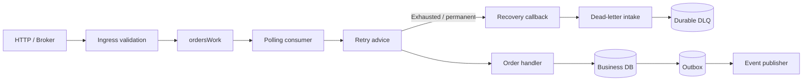

Concrete requirements:

1. Valid commands produce **one** business effect.
2. Transient failures are retried **with bounded attempts** and backoff.
3. Validation, authentication, and authorization failures are never hot-retried.
4. Failures that cannot be processed immediately go into a **durable dead-letter record** or remain with the source for redelivery.
5. The source must never treat a message as successfully processed merely because it was enqueued in RAM.
6. Dead letters can be queried, classified, root-cause fixed, and **re-driven** under strict controls.
7. Restarts, duplicate deliveries, or rollbacks must not lose events in violation of contract or record an order twice.

This is a *reference lab*, not a full production payment system. The in-memory portion teaches endpoint orchestration; durability and acknowledgments are designed and tested separately because they require real backends.

## 2. Writing Acceptance Criteria Before Writing Code

| ID | Scenario | Accepted Outcome |
| --- | --- | --- |
| AC-01 | Valid command, healthy dependency | One `COMMITTED` outcome, no DLQ entry |
| AC-02 | Dependency transiently fails twice then succeeds | At most three handler attempts, one business effect |
| AC-03 | Invalid payload/schema | No repeated retries; rejected/dead-lettered per policy |
| AC-04 | Insufficient tenant permissions | No DB update; safe error code |
| AC-05 | Dependency fails past max attempts | Durable dead letter created or source redelivery preserved |
| AC-06 | Dead-letter store loses connectivity | Never silently acknowledge a command that was not durably saved |
| AC-07 | Crash after business commit before source ack | Redelivery produces no duplicate business effect |
| AC-08 | Crash between DB commit and outbound publish | Outbox remains pending; publisher recovers |
| AC-09 | Same event replayed twice | Idempotent outcome; replay count audited |
| AC-10 | Executor/poller overloaded | Bounded capacity/rejection/backpressure and observable backlog |
| AC-11 | `ErrorMessage` contains sensitive `failedMessage` | Logs never dump tokens, payloads, or raw headers |
| AC-12 | Restart while dead letters remain pending | Records survive durably and can be replayed with authorization |
| AC-13 | Two workers try replaying the same DLQ record | Only one claims it using generation/revision at a time |
| AC-14 | Permanent rejection | No infinite retry or redelivery loop |

These criteria define **business outcomes** clearly, rather than merely checking logs for a "retry exhausted" line.

## 3. Project Message Contract

A compact payload with a stable business identifier:

```java
public record CreateOrder(
        String eventId,
        String tenantId,
        String orderId,
        long amountMinor,
        int schemaVersion) {}

public record OrderAccepted(
        String eventId,
        String orderId,
        String status) {}
```

| Field | Meaning | Rule |
| --- | --- | --- |
| `eventId` | Business event ID used for idempotency | Never regenerate on retry or redelivery |
| `tenantId` | Requested business scope | Check against verified actor; never trust raw headers |
| `orderId` | Order identifier | Validate length, format, and ownership |
| `amountMinor` | Minor currency units | Positive and within contract bounds |
| `schemaVersion` | Payload version | Accept only supported versions |

**`MessageHeaders.ID` does not replace `eventId`:** when a message is reconstructed, forwarded, or redelivered, the message object's ID can change. Idempotency requires a stable business key paired with the appropriate producer/tenant scope.

### 3.1. Headers That Can Help

```text
message.id        -> observes a single message object
traceId           -> tracing only; purely technical metadata
correlationId     -> request/batch grouping if genuinely needed
deliveryAttempt   -> trusted metadata from source/runtime
contentType       -> approved converter contract
replyChannel      -> trust only if created by internal gateway
errorChannel      -> trust only if configured/controlled
```

Never let producers inject arbitrary `role=ADMIN`, `retryCount=0`, or `replyChannel` headers and treat them as framework decisions. Security gates and header allowlists belong before the business handler.

## 4. Error Diagram: Three Layers That Must Not Be Mixed

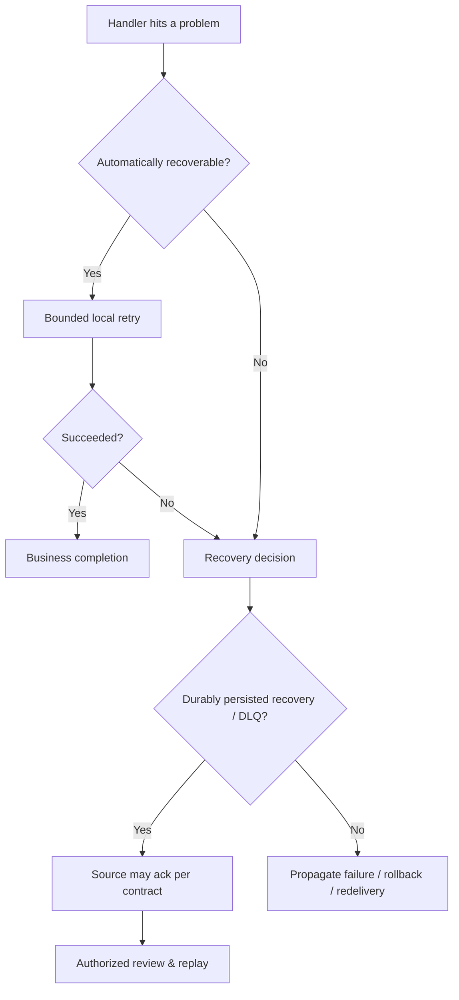

Three distinct layers:

- **In-invocation retry:** e.g., `RequestHandlerRetryAdvice` invokes the handler repeatedly while processing a single message delivery.
- **Source redelivery:** the broker re-delivers a message after a nack/rollback or lost ack. This is a **new delivery** that may run on a different instance.
- **Dead-letter/recovery:** the message is no longer retried immediately and is stored for investigation, remediation, and controlled replay.

A system may combine all three, which multiplies total attempts. Never let retry advice and broker redelivery retry infinitely together.

## 5. Classifying Failures Before Choosing Retries

| Failure Class | Example | Recommended Policy |
| --- | --- | --- |
| **Permanent validation** | Unsupported schema, missing required field | Reject/quarantine; never retry unconditionally |
| **Permanent authorization** | Tenant A actor tries modifying tenant B | Deny and audit safely; never auto-retry |
| **Permanent business conflict** | Order already canceled; invariant forbids re-creation | Dedicated rejection code; may not need DLQ if outcome recorded |
| **Transient infrastructure** | DB deadlock, HTTP 503, pool timeout | Bounded retry/backoff with timeouts |
| **Unknown outcome** | Outbound request timed out yet may have executed | Reconcile/use idempotency key before retrying |
| **Programming bug** | `NullPointerException`, broken mapping | Do not hot-retry pointlessly; alert/quarantine |
| **Poison message** | Deterministic data always breaks handler | Bounded DLQ and root-cause fix |
| **Store/DLQ outage** | Cannot persist recovery record | Propagate failure; retain processing obligation at source |

**One exception class is not always enough for classification.** `MessagingException` may wrap the root cause; HTTP 409 can signal a business conflict in one API yet an optimistic concurrency retry in another. Map failures by **dependency error codes and contracts**, not mechanically by exception class name.

### 5.1. Sample Exceptions

```java
public class TransientOrderException extends RuntimeException {
    public TransientOrderException(String message, Throwable cause) {
        super(message, cause);
    }
}

public class InvalidOrderException extends RuntimeException {
    public InvalidOrderException(String code) {
        super(code);
    }
}

public class UnknownOutcomeException extends RuntimeException {
    public UnknownOutcomeException(String code, Throwable cause) {
        super(code, cause);
    }
}
```

Never put tokens, raw SQL parameters, or personal data into `Exception.getMessage()`. Logs and recovery records should contain only **safe error codes**, classified exception types, and event references.

## 6. Retry Decision Matrix

| Characteristic | Local Retry | Delayed Source Redelivery | Dead-Letter |
| --- | --- | --- | --- |
| Brief transient failure | Good fit with backoff | Often higher overhead | Not needed immediately |
| Multi-minute dependency outage | Do not hold workers indefinitely | Fits if broker supports delay/retry topics | Can quarantine per policy |
| Permanent validation error | No | No | Quarantine/audit or rejection |
| Non-idempotent target side effect | Dangerous if outcome unknown | Also dangerous | Reconcile before replaying |
| Worker must free threads | Long backoff pins resources if blocking | Better suited to durable scheduling | Lets operators intervene |
| State must survive restarts | Insufficient | Relies on durable source | Relies on durable DLQ |
| Centralized incident detection | Needs custom metrics | Needs broker metrics | DLQ records aid auditing |

There is no "one-size-fits-all retry." During a prolonged dependency outage, many workers retrying in lockstep create a **retry storm** that slows recovery.

## 7. Choosing a Minimal Topology for Learning

The lab version uses these channels:

```text
ordersWork         QueueChannel (RAM, bounded)
ordersDone         QueueChannel (RAM, test inspection only)
deadLetterIntake   DirectChannel
    └── DeadLetterSink.record(ErrorMessage)
```

A polling consumer pulls from `ordersWork` and invokes `OrderProcessor` under `RequestHandlerRetryAdvice`. Once retries exhaust, `ErrorMessageSendingRecoverer` forwards the failure to `deadLetterIntake`. The demo `DeadLetterSink` records entries for tests; **production must replace it with a durable sink**.

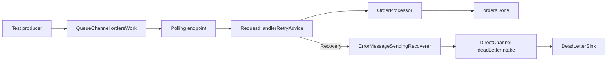

**Warning:** an in-memory `QueueChannel` does not survive JVM crashes. Never acknowledge a production HTTP request or broker message merely upon enqueuing into a RAM queue. This lab teaches error-flow control, not final durable ingress design.

## 8. Dependencies for the Hands-On Build

Assuming a compatible Spring Boot 3.x / Spring Integration 6.x stack, an illustrative `build.gradle` needs:

```groovy
dependencies {
    implementation 'org.springframework.boot:spring-boot-starter-integration'
    implementation 'org.springframework.boot:spring-boot-starter-jdbc'
    implementation 'org.springframework.retry:spring-retry'
    implementation 'org.springframework.integration:spring-integration-jdbc'

    runtimeOnly 'org.postgresql:postgresql'

    testImplementation 'org.springframework.boot:spring-boot-starter-test'
    testImplementation 'org.springframework.integration:spring-integration-test'
    testImplementation 'org.testcontainers:junit-jupiter'
    testImplementation 'org.testcontainers:postgresql'
}
```

This is a **dependency fragment**, not a complete Gradle project. Versions are managed by the matching Spring Boot dependency management/BOM. If using JMS/AMQP/Kafka, add the corresponding starter/module; these dependencies alone do not run an inbound broker.

In this lesson we **do not compile or run Gradle**. These code snippets are a hands-on skeleton to be verified and completed against your library versions when assembling an application.

## 9. Creating Bounded Channels

```java
import org.springframework.context.annotation.Bean;
import org.springframework.context.annotation.Configuration;
import org.springframework.integration.channel.DirectChannel;
import org.springframework.integration.channel.QueueChannel;
import org.springframework.messaging.MessageChannel;

@Configuration
class OrderChannels {

    @Bean
    QueueChannel ordersWork() {
        return new QueueChannel(100);
    }

    @Bean
    QueueChannel ordersDone() {
        return new QueueChannel(100);
    }

    @Bean
    MessageChannel deadLetterIntake() {
        return new DirectChannel();
    }
}
```

These channel names are **bean names** referenced in the Java DSL. `ordersWork` and `ordersDone` are RAM queues for testing; `deadLetterIntake` is synchronous so exceptions from the dead-letter sink can propagate back to the recovery callback.

Key properties:

- `QueueChannel` buffers messages until `receive`; if the poller falls behind, queue depth rises.
- Bounded channels make overload errors **visible** instead of growing heap unboundedly.
- `DirectChannel` invokes subscribers synchronously on the caller thread unless another async boundary is inserted.
- A successful `QueueChannel.send()` **does not prove the business handler committed**.
- Never treat these in-memory channels as the source of truth for production orders or payments.

## 10. Order Processing Service and Failure Injection

In this example, the handler returns `OrderAccepted` on success. Real dependencies like repositories, HTTP clients, and payment APIs sit behind an interface so tests can inject faults cleanly:

```java
public interface OrderCommandService {
    // Production implementation must validate + authorize + idempotently commit.
    OrderAccepted create(CreateOrder command);
}

public final class OrderProcessor {
    private final OrderCommandService service;

    public OrderProcessor(OrderCommandService service) {
        this.service = service;
    }

    public OrderAccepted process(CreateOrder command) {
        if (command.eventId() == null || command.eventId().isBlank()
                || command.schemaVersion() != 1
                || command.amountMinor() <= 0) {
            throw new InvalidOrderException("ORDER_INPUT_INVALID");
        }
        return service.create(command);
    }
}
```

When `OrderCommandService.create` calls an external API, pass `eventId` as the **idempotency key** if the target supports it. When a call times out with an unknown outcome, do not blindly retry as if no side effect could have happened.

## 11. `RequestHandlerRetryAdvice`: Configuring Attempts and Backoff

The example below configures **at most three attempts including the initial try** for `TransientOrderException`. `SimpleRetryPolicy` can inspect the cause chain to recognize framework-wrapped exceptions; verify exact matching against the real exceptions produced by your versions.

```java
import java.util.Map;

import org.springframework.beans.factory.annotation.Qualifier;
import org.springframework.context.annotation.Bean;
import org.springframework.integration.handler.advice.ErrorMessageSendingRecoverer;
import org.springframework.integration.handler.advice.RequestHandlerRetryAdvice;
import org.springframework.messaging.MessageChannel;
import org.springframework.retry.policy.SimpleRetryPolicy;
import org.springframework.retry.backoff.FixedBackOffPolicy;
import org.springframework.retry.support.RetryTemplate;

@Configuration
class OrderRetryConfig {

    @Bean
    RequestHandlerRetryAdvice orderRetryAdvice(
            @Qualifier("deadLetterIntake") MessageChannel deadLetterIntake) {

        Map<Class<? extends Throwable>, Boolean> retryable =
                Map.of(TransientOrderException.class, true);

        // maxAttempts = 3 (including the initial attempt); traverseCauses = true.
        SimpleRetryPolicy retryPolicy =
                new SimpleRetryPolicy(3, retryable, true);

        FixedBackOffPolicy backOff = new FixedBackOffPolicy();
        backOff.setBackOffPeriod(200);

        RetryTemplate template = new RetryTemplate();
        template.setRetryPolicy(retryPolicy);
        template.setBackOffPolicy(backOff);

        RequestHandlerRetryAdvice advice = new RequestHandlerRetryAdvice();
        advice.setRetryTemplate(template);
        advice.setRecoveryCallback(
                new ErrorMessageSendingRecoverer(deadLetterIntake));
        return advice;
    }
}
```

**Essential points:**
- `retryPolicy` decides which exceptions are retried.
- `maxAttempts=3` does not mean three retries *after* the first attempt.
- `FixedBackOffPolicy` holds the worker thread while sleeping; for long delays consider delayed broker redelivery instead.
- `traverseCauses=true` works only if the exception chain is preserved; write tests proving wrapper exceptions do not hide classification.
- Once attempts exhaust, `recoveryCallback` runs; if the callback handles the error and **returns normally**, the adapter/poller may treat the failure as recovered. This **does not mean the DLQ is durable** if the downstream sink only writes to RAM.

The lab uses fixed backoff for predictability. Production usually needs exponential backoff, jitter, and a time cap so workers do not retry in lockstep during an outage.

## 12. Attaching Retries to the Right Handler in `IntegrationFlow`

```java
import org.springframework.context.annotation.Bean;
import org.springframework.context.annotation.Configuration;
import org.springframework.integration.annotation.EnableIntegration;
import org.springframework.integration.dsl.IntegrationFlow;
import org.springframework.integration.dsl.Pollers;
import org.springframework.integration.handler.advice.RequestHandlerRetryAdvice;

@Configuration
@EnableIntegration
class OrderWorkerFlow {

    @Bean
    IntegrationFlow orderFlow(
            OrderProcessor processor,
            RequestHandlerRetryAdvice orderRetryAdvice) {

        return IntegrationFlow
                .from("ordersWork",
                        spec -> spec.poller(
                                Pollers.fixedDelay(200)
                                        .maxMessagesPerPoll(1)))
                .handle(processor, "process",
                        endpoint -> endpoint.advice(orderRetryAdvice))
                .channel("ordersDone")
                .get();
    }
}
```

Here `ordersWork` is a `PollableChannel`, so the worker uses a poller. `RequestHandlerRetryAdvice` wraps **the advised handler**, not automatically the entire inbound adapter, source acknowledgment, database transaction, and outbound gateway.

If a business flow contains multiple handlers, choose explicitly **which handler actually needs retries**. Retrying a stateless transformer/validator differs from retrying an HTTP payment call with side effects. Placing advice at the wrong spot can re-run earlier steps that already succeeded.

### 12.1. Return Value After Recovery

When the recovery callback handles an error and returns `null`, the flow emits **no success message to `ordersDone`**. Tests should therefore assert the **dead-letter outcome**, rather than expecting "retry exhausted" to produce an `OrderAccepted`.

If callers expect a "rejected" reply on a gateway, define an **explicit rejection reply contract** rather than letting `null` implicitly signal handled failure.

## 13. What Does `ErrorMessageSendingRecoverer` Actually Send?

`ErrorMessageSendingRecoverer` builds and sends an `ErrorMessage` to the configured channel once retries are exhausted or non-retryable. The `ErrorMessage` payload is a `Throwable`, which may carry a `failedMessage`.

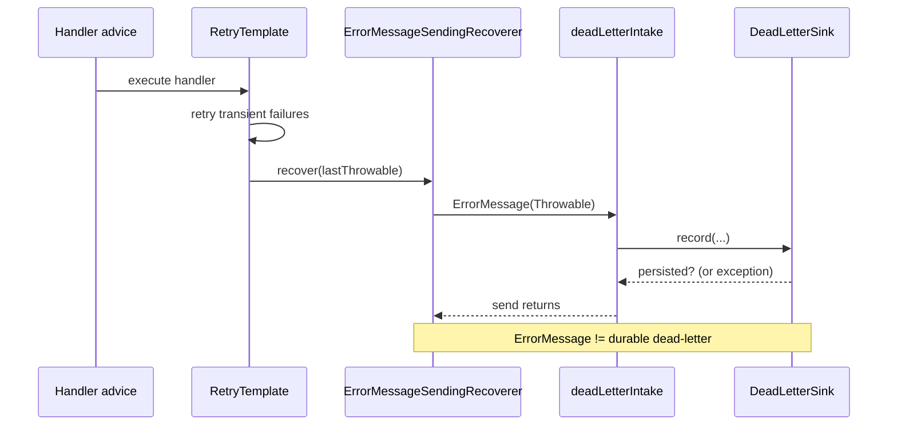

**Specifically:** if `DeadLetterSink` is a logger or an in-memory queue, a successful callback does not yield a crash-safe DLQ. If the sink throws an exception, let it propagate to **source transaction/redelivery** per contract; never swallow it and claim the record was saved.

### 13.1. Why Not Log the Raw `ErrorMessage`?

`ErrorMessage.getPayload()` can be a `MessagingException` holding the failed message. Calling `toString()` or printing stack details can leak credentials, order contents, raw headers, or tokenized URLs into logs.

Map errors to safe codes such as `ORDER_INVALID`, `DEPENDENCY_TIMEOUT`, or `RETRY_EXHAUSTED`, and store the original payload **only inside a protected recovery store** when replay is required.

## 14. Building a Dedicated Dead-Letter Sink

The lab stores records in memory to verify control flow. This is a **test double**, not production dead-letter persistence:

```java
import java.util.Queue;
import java.util.concurrent.ConcurrentLinkedQueue;

import org.springframework.messaging.MessagingException;
import org.springframework.messaging.support.ErrorMessage;

public final class InMemoryDeadLetterSink {
    private final Queue<ErrorMessage> captured =
            new ConcurrentLinkedQueue<>();

    public void record(ErrorMessage errorMessage) {
        // Lab-only with synthetic test data.
        captured.add(errorMessage);
    }

    public int size() {
        return captured.size();
    }

    public ErrorMessage poll() {
        return captured.poll();
    }
}
```

And the wiring:

```java
@Bean
InMemoryDeadLetterSink deadLetterSink() {
    return new InMemoryDeadLetterSink();
}

@Bean
IntegrationFlow deadLetterFlow(InMemoryDeadLetterSink sink) {
    return IntegrationFlow.from("deadLetterIntake")
            .handle(sink, "record")
            .get();
}
```

When assembling a real project, add imports, place `@Bean` methods inside a `@Configuration` class, and ensure bean names are unique. In production **do not retain raw `ErrorMessage` instances long-term**, since they hold full object graphs and sensitive data. Store a normalized `DeadLetterRecord` carrying business key, schema version, reason code, and protected payload if replay is needed.

## 15. Designing a Durable Dead-Letter Schema

A simple dead-letter table:

```sql
CREATE TABLE dead_letter_event (
    dlq_id           uuid PRIMARY KEY,
    source_name      text NOT NULL,
    tenant_id        text NOT NULL,
    event_id         text NOT NULL,
    schema_version   integer NOT NULL,
    failure_code     text NOT NULL,
    attempt_count    integer NOT NULL,
    payload_json     jsonb NOT NULL,
    status           text NOT NULL DEFAULT 'PENDING',
    replay_generation bigint NOT NULL DEFAULT 0,
    created_at       timestamptz NOT NULL DEFAULT now(),
    updated_at       timestamptz NOT NULL DEFAULT now(),
    CHECK (status IN (
        'PENDING', 'CLAIMED', 'RESOLVED', 'QUARANTINED'))
);

CREATE INDEX dead_letter_pending_idx
    ON dead_letter_event (status, created_at);
```

Purpose of each column:

| Column | Purpose | Notes |
| --- | --- | --- |
| `dlq_id` | Recovery record identifier | Distinct from `eventId`; does not replace idempotency |
| `source_name` | Originating source/route | Allowlisted alias, not raw URL |
| `tenant_id` | Replay scope and authorization | Must come from verified provenance |
| `event_id` | Business idempotency/reconciliation | Remains constant across replays |
| `schema_version` | Deserialize older payload versions | Plan schema migrations |
| `failure_code` | Safe failure classification | Never store full raw exception strings |
| `attempt_count` | Attempts at the defined scope | Distinguish local retries from broker deliveries |
| `payload_json` | Data needed for replay | **Sensitive**; requires ACLs, encryption, retention |
| `status` | DLQ lifecycle state | Do not use a simple `processed` boolean |
| `replay_generation` | Conditional claim/ownership | Requires clear transaction/CAS handling |

A table alone does not create DLQ semantics. You also need transactional persistence code, duplicate-DLQ controls, access controls, retention rules, and a replay workflow.

### 15.1. Do Not Copy Arbitrary Headers into the DLQ Payload

Persist only fields **required for recovery**. Never serialize access tokens, `Authorization`, `Cookie`, live `replyChannel` objects, or `SecurityContext` into JSON. Expired tokens should never be replayed either.

If sensitive payloads must be kept for reprocessing, protect them with encryption, access controls, and retention policies. Logs should keep only **DLQ ID + pseudonymized event ID + error code**, never `payload_json`.

## 16. Dead-Lettering Is a Business State, Not a Channel Named "dlq"

```text
Wrong mental model:
  send(errorMessage) -> "done"

Safer contract:
  classify failure
  -> persist recovery record durably / or source retains message
  -> confirm durable outcome
  -> acknowledge source according to protocol
  -> authorized review / replay
```

There are at least three deployment options:

1. **Broker-native DLQ/DLX:** the broker routes messages on reject/nack/TTL/max-delivery policies when dead-letter exchanges/topics are properly configured.
2. **Application-owned DLQ table:** the service persists `DeadLetterRecord` in a SQL DB with transactions and a replay worker.
3. **Quarantine topic/queue:** publish a safely wrapped message to a durable destination, then acknowledge the source per protocol.

Never assume **publishing to a DLQ** and **acknowledging the original message** share one atomic transaction if they span separate brokers or resources. Verify semantics or use at-least-once delivery + idempotency.

## 17. Failure Windows Between DLQ Write and Source Ack

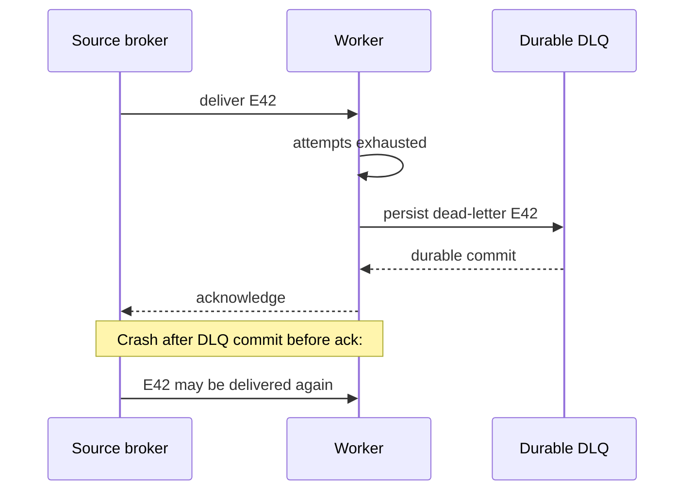

Two critical crash windows:

| Crash Point | What Can Happen | Protection |
| --- | --- | --- |
| **Before DLQ commit** | Recovery record lost if source already acked | Do not ack; roll back/nack; rely on source retention |
| **After DLQ commit, before source ack** | Message redelivered and could write a second DLQ entry | Idempotent DLQ upsert or unique logical key |
| **After source ack** | Broker no longer obligated to redeliver per mode | DLQ must already be durable/confirmed |
| **After replay commit, before DLQ marked `RESOLVED`** | Replay may execute again | Business idempotency and CAS state update |

**You cannot count `DeadLetterSink.record()` invocations to claim exactly one DLQ record.** You need a unique key, operation ID, or idempotent upsert matched to your scope and processing stage.

## 18. Distinguishing `errorChannel` from a DLQ

In Spring Integration, `errorChannel` is typically where **`ErrorMessage`** instances go for runtime error handling. It is not automatically a broker DLQ or persistent store.

| Channel / Mechanism | Role |
| --- | --- |
| Default `errorChannel` | Reports async errors and polling/message-driven flow errors per configuration |
| Custom `errorChannel` | Routes errors for a specific endpoint or flow |
| `ErrorMessageSendingRecoverer` | Recovery callback sending an `ErrorMessage` to a channel |
| Broker DLX/DLQ | Destination receiving dead-lettered messages per broker policy |
| Application DLQ table | Persistent store of failed commands/events for review and replay |
| Business rejection record | Valid business rejection outcome; may not require a DLQ |

**A synchronous failure on `DirectChannel` often propagates back to the sender**, whereas an executor/poller failure goes through the error-handling path configured on the task scheduler or adapter. Never pin all hopes on a single `@ServiceActivator(inputChannel="errorChannel")` without checking where exceptions actually originate.

### 18.1. "Handling an Error" vs. "Swallowing an Error"

If an error handler only does:

```java
// Insufficient if the work has not been durably preserved.
public void onError(ErrorMessage error) {
    log.warn("Failed: {}", "RETRY_EXHAUSTED");
    // return normally
}
```

then some execution paths may treat the failure as recovered and let the source acknowledge the message. Return normally only when **the outcome is durably persisted or your rejection/ack policy explicitly permits it**.

## 19. Two-Tier Error Routing Diagram

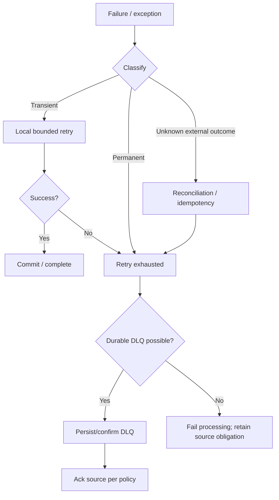

Put **classification** in one clear place: a custom `RetryPolicy`, an error router, an exception classifier, or a business rejection service. Never let a single exception flow through two independent routers producing conflicting outcomes (one acks while the other nacks).

## 20. Retry Scope and Transaction Boundaries

Consider a flow:

```text
Source poller
  -> handler A: normalize
  -> handler B: call external API (retry)
  -> handler C: update DB
  -> source ack
```

Attaching `RequestHandlerRetryAdvice` to **B** retries B, not A or C. If B created a remote side effect before timing out, the next attempt may re-invoke that side effect. If advice wraps the **entire flow**, earlier steps that succeeded may execute again.

Design questions:

| Question | Impact |
| --- | --- |
| Is the handler idempotent? | Determines whether retries are safe |
| Does the transaction start before or after the advice? | Affects rollbacks and state visibility |
| Do retries run on the same thread? | Affects thread-local transactions and context |
| Is the endpoint one-way or a request–reply gateway? | Affects how recovery callback return values behave |
| When does the source ack? | Affects lost or duplicate deliveries |
| Does retry backoff pin a thread? | Affects throughput and pool saturation |

**A JDBC transaction on a handler thread does not automatically span `ExecutorChannel`.** A `send()` returning from a queue or executor does not mean downstream work committed.

## 21. Local Retries and Transaction Rollbacks: Avoiding a "Broken" Transaction

Suppose the DB throws an exception mid-transaction. Not every error allows retrying inside the same transaction; the transaction may already be marked rollback-only or corrupted.

```text
BEGIN TX
  execute SQL -> exception
  retry SQL in same broken TX -> fail again
COMMIT -> UnexpectedRollback?
```

The right pattern is either **running each attempt in a fresh transaction**, or rolling back the entire delivery so the broker redelivers in a new transaction. The ordering of advice, transaction interceptors, and `@Transactional` determines what resets between attempts.

During testing, record:
- Thread ID.
- Transaction started/committed/rolled back.
- Retry attempt index.
- SQL outcome.
- Source delivery/ack outcome.

Never claim `@Transactional` alone guarantees safe retries.

## 22. Inbox Pattern to Prevent Duplicates After Redelivery

A business event may finish processing right before the process crashes prior to sending the source ack. The source redelivers; without idempotency, the order gets recorded twice.

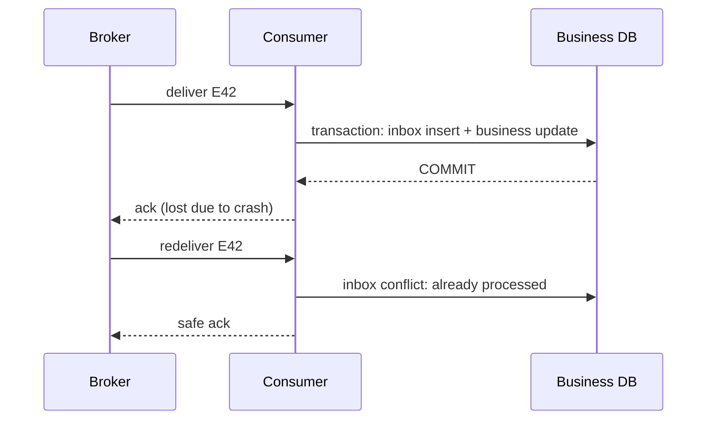

A minimal PostgreSQL schema:

```sql
CREATE TABLE processed_event (
    tenant_id text NOT NULL,
    producer_id text NOT NULL,
    event_id text NOT NULL,
    committed_at timestamptz NOT NULL DEFAULT now(),
    PRIMARY KEY (tenant_id, producer_id, event_id)
);
```

Inside the same transaction that creates the order:

```sql
BEGIN;

INSERT INTO processed_event (tenant_id, producer_id, event_id)
VALUES (:verifiedTenantId, :producerId, :eventId)
ON CONFLICT DO NOTHING
RETURNING event_id;

-- If a row is returned by RETURNING: execute the business update.
-- Otherwise: this event was already committed under the idempotency key.
-- Do not use MessageHeaders.ID as the business event ID.

COMMIT;
```

**Insert the `processed_event` marker only inside the same transaction as the business effect.** If the marker commits before the update, a crash can cause the event to be skipped even though the order was never created.

## 23. Outbox for Post-Commit Outbound Events

A handler creating an order may need to publish `OrderCreated` after commit. If the DB commits and the JVM crashes before publishing, downstream never learns the order was created. This is the **dual-write gap**.

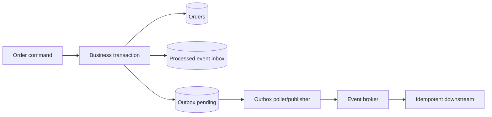

The outbox row is written in the same DB transaction as the order and inbox marker; the publisher reads and emits it afterward. If the process crashes after publishing to the broker but before marking the outbox row sent, the publisher may emit it again; downstream needs idempotency too.

**Never wrap an outbound publish in an arbitrary retry loop** if the remote side effect lacks idempotency. Do not confuse "DB transaction rollback" with the ability to undo an HTTP request that already reached the destination.

## 24. Unknown Outcome: A Timeout Does Not Prove the Call Failed

Suppose the service calls a payment API and receives a timeout:

```text
T0 -> Payment API receives request (with eventId E42)
T1 -> Payment API charges card
T2 -> Network response lost
T3 -> Handler sees timeout
T4 -> Retry advice calls again
```

If the API does not support an idempotency key, T4 can charge the card a second time. Therefore you need:
1. An idempotency key derived from a stable business event.
2. Agreement with the target API on that key's semantics.
3. Status queries/reconciliation against the target when the outcome is unknown.
4. Retries only when evidence shows re-execution is safe.
5. Dead-letter/quarantine with reason `UNKNOWN_OUTCOME` when automatic resolution is impossible.

This failure mode differs fundamentally from an HTTP 503 that cleanly rejects a request before processing. Your error classifier must preserve that distinction.

## 25. Broker DLQs, Application DLQs, and Retry Topics

| Option | Strengths | Limitations to Check |
| --- | --- | --- |
| Broker-native DLQ/DLX | Isolates error backlog; retention/ACL/consumer tooling | Routing, ack, publish semantics, and delivery limits vary by broker |
| Delayed retry topic/queue | Frees consumer workers during long waits | Per-key ordering can shift; requires idempotency |
| Application DB DLQ | Easy to query status, owner, replay audit | Requires DB transactions, cleanup, and replay worker |
| Raw `ErrorMessage` channel | Convenient for runtime error flows | Not durable or replayable by default |
| Quarantine object storage | Fits large payloads/forensics | Access control, encryption, and pointer durability |
| Permanent rejection table | Audits invalid/denied commands | Must ensure entries are never retried as transient |

Across RabbitMQ, Kafka, and JMS, DLQ mechanisms take different forms. **Never blindly apply "nack = goes to DLQ"** without configuring the corresponding dead-letter exchange/topic, delivery limits, or listener error handler.

### 25.1. When to Prefer Broker Redelivery Over Local Retries?

When outages last minutes, local retries pin worker threads/pollers and transactions while waiting. Delayed messages or broker retries scale better, provided you measure:
- Increased delivery counts.
- Delay before reprocessing.
- Ordering shifts per partition/key.
- Ack and republish atomicity.
- Retention and durability of the retry destination.
- Thundering-herd load when the dependency recovers.

## 26. Dead-Letter Record Lifecycle

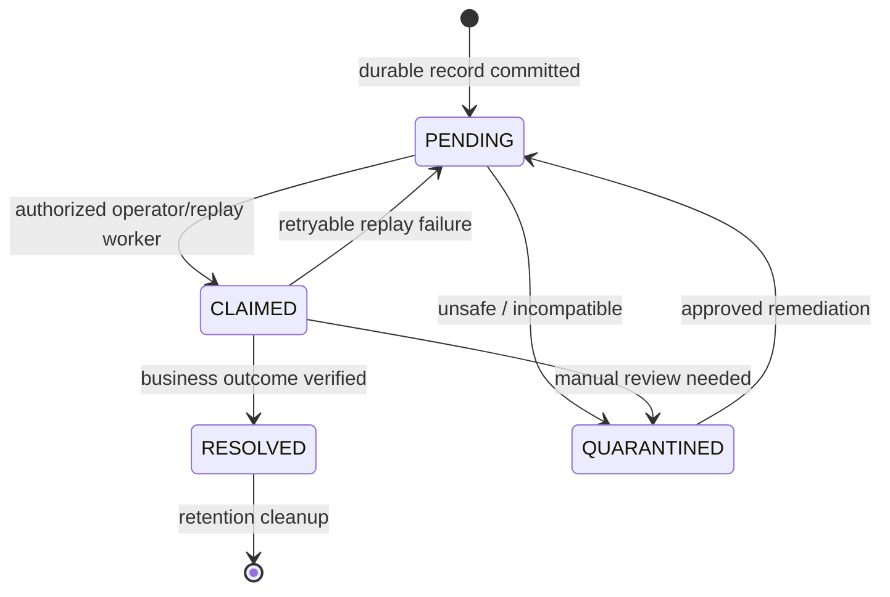

**Recommended workflow:**

1. The failure is classified and a `DeadLetterRecord` is committed.
2. The record starts in `PENDING`.
3. An authorized operator or replay worker selects an eligible record and claims it with a generation check.
4. The input is **revalidated** against current schemas and security policies.
5. The handler reprocesses it with **the same `eventId`** under idempotency protection.
6. Mark `RESOLVED` only after confirming the outcome.
7. If replay fails transiently, transition back to `PENDING` within backoff/retry budgets.
8. If the schema is obsolete or the outcome is unknown, move to `QUARANTINED` pending manual decision.

A dead-letter store holds **unresolved obligations**, not trash to purge periodically regardless of state.

## 27. Safe Replay Claiming Across Multiple Workers

Two workers may pick the same DLQ record. A conditional update ensures only one transitions its state:

```sql
-- Illustrative PostgreSQL SQL, executed in an appropriate transaction.
UPDATE dead_letter_event
SET status = 'CLAIMED',
    replay_generation = replay_generation + 1,
    updated_at = now()
WHERE dlq_id = :dlqId
  AND status = 'PENDING'
RETURNING replay_generation;
```

If no row is returned, the worker failed to claim at the current snapshot. After processing:

```sql
UPDATE dead_letter_event
SET status = 'RESOLVED',
    updated_at = now()
WHERE dlq_id = :dlqId
  AND status = 'CLAIMED'
  AND replay_generation = :myGeneration;
```

**Caveat:** a record stranded in `CLAIMED` after a worker crash needs a **lease/timeout/reclaim policy**—it will not revert to `PENDING` on its own. If reclaimed, a stale worker might still be running, so the authoritative business DB/target must enforce idempotency or fencing per its semantics.

## 28. Never Replay Straight into Privileged Handlers

A dead letter may contain payloads from unauthenticated clients or outdated schemas. Replays must pass through an appropriate security boundary:

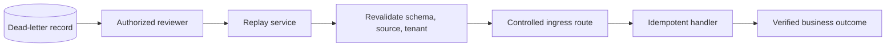

Controls:
- Separate replay permissions from DLQ read permissions.
- Audit who replayed what, when, and why.
- Never restore old raw access tokens or stale `SecurityContext` objects.
- Never mutate `eventId` just to bypass inbox deduplication.
- Version and test schema migrations.
- Rate-limit replays to avoid recreating the incident.
- Block re-driving `UNKNOWN_OUTCOME` records until target reconciliation finishes.

**Replay does not mean "republish the exact old bytes"** when schemas, authorization, or downstream contracts have evolved.

## 29. Sizing the Retry Budget by Time and Resources

A policy might specify:
- At most 3 local attempts, including the initial try.
- Backoff of 200 ms, 400 ms, 800 ms (exponential).
- Total time capped below the request deadline if request–reply.
- After exhaustion: durable delayed retry or DLQ per classifier.
- Cap on source redeliveries within a window.
- Circuit breaker/concurrency limits while a dependency is down.
- Clear metric tracking attempts per unique event.

### 29.1. Watch the Aggregate Timeout

If a remote call times out after 5 seconds per attempt, three attempts take at least 15 seconds even before backoff. A 10-second HTTP gateway timeout expires before retries finish while the backend keeps running. Align **end-to-end deadlines** rather than sizing each timeout in isolation.

### 29.2. How Does Jitter Help?

When many workers hit 503 together, exponential backoff without jitter wakes them all up together at 200/400/800 ms. Jitter dampens **thundering herds**. This solves a performance/stability problem and does not replace failure classification or idempotency.

## 30. Detecting Retry Storms Through Metrics

A useful dashboard:

| Metric / Log | Scope | Detects |
| --- | --- | --- |
| `source_delivery_total` | Broker/source | Rising redeliveries |
| `handler_attempt_total` | Retry advice | Retries within the same delivery |
| `unique_business_committed_total` | DB outcome | True goodput |
| `dead_letter_pending` | DLQ store | Growing error backlog |
| `dead_letter_write_failure_total` | Recovery persistence | Risk of lost obligations |
| `replay_claim_total` | Replay service | Abnormal replay activity |
| `replay_resolution_total` | Business outcome | Successful recoveries |
| `handler_duration` | Handler | Tail latency/timeouts |
| `poller_receive_total` | Polling endpoint | Whether the poller is still running |
| `executor_queue_depth` | Executor | Queued task buildup |
| `db_connection_wait` | Database pool | Resource contention |
| `error_code_total` | Classifier | Dominant failure categories |

These names are **instrumentation suggestions**, not guaranteed default framework metrics. Never use high-cardinality raw `eventId`, `orderId`, or `correlationId` values as metric labels.

## 31. How Errors Travel Differently Across `DirectChannel`, `ExecutorChannel`, and Pollers

| Boundary | How Errors Typically Surface | What to Observe |
| --- | --- | --- |
| `DirectChannel` | Synchronous handler exceptions often propagate back to sender | Caller exceptions, transactions, synchronous error path |
| `ExecutorChannel` | Handler runs on another thread; exceptions become async `ErrorMessage` | Error channel, task executor logs, completion metrics |
| `QueueChannel` + poller | Polling consumer receives after enqueue; errors run on poller thread | Poller error channel, rollbacks, source semantics |
| Broker listener | Container manages ack/nack/requeue per mode | Delivery count, DLQ, container error handler |
| Reactive pipeline | `onError` signal; cancel/subscribe shapes flow | Terminal signals, backpressure, error mapping |
| Outbound gateway | Timeouts/causes often wrapped in messaging exceptions | Error classification across the cause chain |

Handler retry advice attached to one endpoint **does not necessarily catch** exceptions thrown in another stage beyond an async boundary. Always map the real thread and channel topology of your flow.

### 31.1. Questions to Ask When "Nothing Arrives on `errorChannel`"

- Did retry advice recover the error into a normal return value?
- Did the error happen on a synchronous `DirectChannel` and propagate straight to the caller?
- Does the poller/listener specify a custom error channel?
- Did an earlier error handler swallow the exception?
- Was the executor task rejected before the handler ran?
- Was the message filtered/discarded before reaching the endpoint?
- Did the DLQ store handler throw without proper logging?

Never build a global catch-all logger and mistake it for recovery.

## 32. Transactions and Source Acks: Scenario Matrix

| What Happens | Store/Ack Boundary | Outcome and Required Action |
| --- | --- | --- |
| Handler fails before DB commit | Transaction rolls back, broker unacked | Safe to redeliver/retry |
| DB commit succeeds, ack lost | Broker redelivers | Inbox guarantees idempotent outcome |
| DLQ write succeeds, ack lost | Two obligations may appear | Deduplicated DLQ/upsert + source delivery |
| DLQ write fails yet handler recovers normally | Risk of message loss | **Wrong**: must propagate/fail |
| RAM `QueueChannel` accepts then JVM crashes | Queue lost | Use durable source/backlog |
| Outbox insert + business commit succeed | Publisher hasn't sent yet | Outbox poller resumes after restart |
| Outbox publishes yet mark-sent uncommitted | Event may publish again | Downstream idempotency |
| Custom recovery returns success on auth error | Source may ack | Enforce clear audit/rejection policy |

**This table is the core of the project.** Tests must inspect **business DB state + source ack/redelivery + DLQ state**, not just log lines.

## 33. Unit Testing the Classifier

Start by extracting classification into a pure function:

```java
public enum FailureKind {
    PERMANENT, TRANSIENT, UNKNOWN_OUTCOME
}

public final class FailureClassifier {

    public FailureKind classify(Throwable failure) {
        Throwable current = failure;
        while (current != null) {
            if (current instanceof InvalidOrderException) {
                return FailureKind.PERMANENT;
            }
            if (current instanceof UnknownOutcomeException) {
                return FailureKind.UNKNOWN_OUTCOME;
            }
            if (current instanceof TransientOrderException) {
                return FailureKind.TRANSIENT;
            }
            current = current.getCause();
        }
        return FailureKind.PERMANENT;
    }
}
```

Here wrappers are walked along the cause chain; defaulting to `PERMANENT` is an example policy preventing infinite retries on programming bugs. In production, distinguish **unexpected/programming failures** for alerting and quarantine rather than reporting them as invalid client input.

Unit test:

```java
import static org.junit.jupiter.api.Assertions.assertEquals;
import org.junit.jupiter.api.Test;

class FailureClassifierTest {
    private final FailureClassifier classifier =
            new FailureClassifier();

    @Test
    void doesNotRetryInvalidPayload() {
        assertEquals(FailureKind.PERMANENT,
                classifier.classify(
                        new InvalidOrderException("ORDER_INPUT_INVALID")));
    }

    @Test
    void distinguishesUnknownOutcomeFromTransientFailure() {
        var timeout = new java.net.SocketTimeoutException("timeout");
        assertEquals(FailureKind.UNKNOWN_OUTCOME,
                classifier.classify(new UnknownOutcomeException(
                        "PAYMENT_STATUS_UNKNOWN", timeout)));
    }
}
```

Testing the classifier in isolation **does not** prove `RequestHandlerRetryAdvice` uses the same policy; you still need flow/wiring tests with real exception wrapping.

## 34. Testing Retries with a Counting Fake Service

A fake service that fails twice and then succeeds:

```java
import java.util.concurrent.atomic.AtomicInteger;

final class FlakyOrderService implements OrderCommandService {
    private final AtomicInteger attempts = new AtomicInteger();

    @Override
    public OrderAccepted create(CreateOrder command) {
        int attempt = attempts.incrementAndGet();
        if (attempt <= 2) {
            throw new TransientOrderException("DB_TEMPORARY", null);
        }
        return new OrderAccepted(
                command.eventId(), command.orderId(), "COMMITTED");
    }

    int attempts() {
        return attempts.get();
    }
}
```

Under a three-attempt retry policy, expected results:
- `FlakyOrderService.attempts()==3`.
- One `OrderAccepted` arrives on `ordersDone`.
- Zero errors enter `deadLetterIntake`.
- Business outcome is created once (if the fake persists state).

Use distinct event IDs per test; never share an `AtomicInteger` across parallel tests without resetting fixtures.

## 35. Integration Test: Success and Exhausted Retries

The following skeleton illustrates assertions for a `@SpringBootTest` wiring the beans above:

```java
import static org.junit.jupiter.api.Assertions.*;

import org.junit.jupiter.api.Test;
import org.springframework.beans.factory.annotation.Autowired;
import org.springframework.beans.factory.annotation.Qualifier;
import org.springframework.boot.test.context.SpringBootTest;
import org.springframework.integration.channel.QueueChannel;
import org.springframework.messaging.support.MessageBuilder;

@SpringBootTest
class OrderFlowIntegrationTest {

    @Autowired
    @Qualifier("ordersWork")
    QueueChannel input;

    @Autowired
    @Qualifier("ordersDone")
    QueueChannel output;

    @Autowired
    InMemoryDeadLetterSink deadLetters;

    @Test
    void validOrderProducesOneCompletion() {
        var command = new CreateOrder(
                "event-test-001", "tenant-test",
                "order-test-001", 1000, 1);

        assertTrue(input.send(
                MessageBuilder.withPayload(command).build()));

        var result = output.receive(5_000);
        assertNotNull(result);
        assertEquals("COMMITTED",
                ((OrderAccepted) result.getPayload()).status());
        assertEquals(0, deadLetters.size());
    }
}
```

This is a skeleton: provide `OrderCommandService`, `OrderProcessor`, the lab beans, and isolated test fixtures. **A happy-path-only test does not prove retry/error semantics**; also add:
- `InvalidOrderException` → service not called repeatedly; DLQ/rejection recorded.
- Transient failure for exactly two attempts → attempt 3 succeeds.
- Persistent transient failure → one recovery event after max attempts.
- DLQ sink throws → processing is not reported as durably recovered.
- Partial handler side effect followed by timeout → verify idempotency.
- Clean teardown so no pending messages leak between test cases.

Because the poller runs asynchronously, use bounded deadlines/`Awaitility` or `receive(timeout)` rather than `Thread.sleep(100)` hoping the scheduler ran.

## 36. Testing Dead-Letter Write Failures

This design test matters far more than merely seeing an `ErrorMessage`:

```text
Given:
  handler raises retryable failure on every attempt
  retry policy exhausts
  dead-letter persistence throws DB unavailable

Expect:
  recovery path must not report durable success
  source remains obligated to redeliver OR a durable job exists elsewhere
  error/alert metric is emitted
  no silent source acknowledgement
```

In the in-memory `QueueChannel` mini-lab, the message was already `receive()`d and might not return to the queue automatically. This test exposes the **demo's limitation**; to prove delivery preservation, move to a real broker or durable transactional queue and configure error/ack handling accordingly.

Never "fix" this by catching the exception inside the dead-letter handler and returning normally. That hides persistence failures.

## 37. Testing Crash Windows and Redeliveries with a Real Backend

A production-like test suite can use Testcontainers for PostgreSQL and an appropriate broker. Plan:

1. Initialize business inbox, outbox, and DLQ schemas.
2. Send a valid event with a stable `eventId`.
3. Stop the consumer right after DB commit but before ack.
4. Start a fresh consumer and let the broker redeliver.
5. Assert a single business effect in the DB with no duplicate order.
6. Test crashing after DLQ commit before ack; verify DLQ deduplication.
7. Test crashing after outbox publish before mark-sent; verify downstream idempotency.
8. Test DLQ backend outage and recovery.
9. Assert pending/recovery counts return to 0 after draining (except intentionally quarantined items).

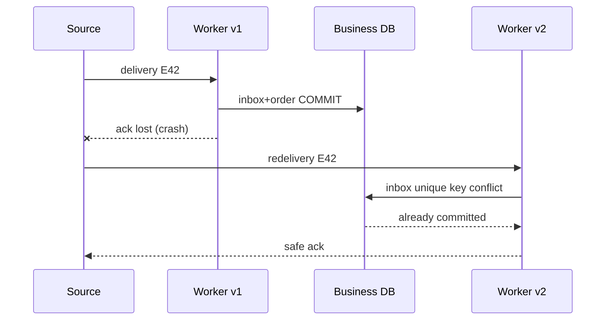

**An integration test on in-memory `SimpleMessageStore`/`QueueChannel` cannot verify these crash windows.** You need a real backend and real transaction boundaries.

## 38. Replays Can Cross Schema/Version Changes

A DLQ record from last month may use `schemaVersion=1` while current code only supports version 2. Re-driving it without migration simply loops the error flow.

Options:
- Support reading both version 1 and version 2 at the replay boundary.
- Or write a deterministic migration tested with version 1 fixtures.
- Preserve `eventId` and tenant scope across migrations.
- Never drop fields needed for authorization checks, idempotency, or reconciliation.
- Never use replay to bypass current validation rules.
- Never delete a DLQ record merely because its payload fails to parse; move it to `QUARANTINED`.

**Schema compatibility is part of recovery**, not solely a message-converter concern.

## 39. Safe Logging for Error Flows

A clean error log record looks like:

```json
{
  "event": "dead_letter_persisted",
  "flow": "orders-v1",
  "endpoint": "createOrder",
  "trace_id": "opaque-trace-123",
  "event_key_ref": "hmac:example-token",
  "failure_code": "DEPENDENCY_RETRY_EXHAUSTED",
  "local_attempts": 3,
  "source_deliveries": 1,
  "dlq_id": "d8f6ec1a-example",
  "status": "PENDING"
}
```

This is an illustrative format, not automatic Spring Integration output. Never log:
- Raw payloads or full `MessageHeaders`.
- `Authorization`, cookies, broker credentials, or tokens.
- URLs with query strings containing secrets.
- Unsanitized `Throwable.getMessage()`.
- `failedMessage` from `MessagingException`.
- Sensitive business IDs as metric labels.

A DLQ record may need the actual payload for replay, yet it belongs in a **protected data store**, not general application logs.

## 40. Observability for Workers, Pollers, and Dead Letters

A minimal alerting scheme:

| Signal | Alert When | Action |
| --- | --- | --- |
| `dead_letter_pending` | Growing steadily | Triage root cause; throttle replays |
| `retry_exhausted_total` | Spikes above baseline | Check dependency outage/bugs |
| `dlq_write_failure_total` | Greater than 0 | Investigate risk of lost obligations |
| `poller_last_success_age` | Exceeds threshold | Check stopped endpoint, scheduler/pool health |
| `ordersWork.queueDepth` | Grows under steady offered load | Slow consumer or retry blocking |
| `handler_attempts_per_event` | Unusually high | Nested retries or broker redeliveries |
| `unique_business_goodput` | Drops sharply | Measure true outcomes, not just sends |
| `outbox_pending_age` | Increasing | Publisher/broker issue |
| `dead_letter_replay_failure_total` | Spikes | Incompatible replay schema or policy |
| `recovery_time_to_resolve` | Exceeds RTO | Adjust triage/replay capacity |

None of these signals are guaranteed out of the box; instrument them via Micrometer/Actuator, broker metrics, or custom instrumentation.

## 41. Tuning Throughput Without Breaking Reliability

Retries and dead-lettering directly impact throughput. For example:
- A handler takes 200 ms per network call.
- Three retries hold a worker much longer per delivery.
- A single-threaded poller slows its dequeue rate.
- Queues grow and producers hit capacity limits.

Tuning strategy:
1. Measure **unique goodput** and queue depth first.
2. Separate brief in-handler retries from long delays handled by a broker or durable job.
3. Size concurrency to match downstream DB/API pools.
4. Use bounded queues with explicit rejection or source-retention policies.
5. Monitor hot correlation groups, locks, and `MessageGroupStore`.
6. Verify no optimization alters idempotency or ack boundaries.
7. Benchmark with realistic transient error mixes, not just happy paths.

**Offloading retries to the background does not prevent data loss** if the background queue lives only in RAM.

## 42. Extending to Aggregators and Correlation Runtime

The order project can grow: an order arrives split into `n` parts that must be aggregated before committing.

```text
parts (correlation=order-42)
  -> aggregator + MessageGroupStore
  -> create order
  -> retry advice / DLQ
```

Additional failure modes to handle:
- If one part goes to the DLQ, what is the aggregator waiting on?
- Does group timeout emit a partial result?
- Can duplicate parts falsely push `group.size()` to `sequenceSize`?
- Can the same correlation key hit two nodes or store regions?
- If the aggregator releases and downstream fails, is group state still suitable for replay?
- Does completed-marker retention block late duplicates?

**Group stores and dead-letter stores serve two different obligations.** A DLQ holding a failed part does not automatically release a group waiting for that part; define expiry, partial-release, and quarantine policies per business rules.

## 43. Dynamic Flows Can Alter Error Paths

When registering a v2 flow dynamically via `IntegrationFlowContext`, test:
- Does the new flow attach the right retry advice and classifier?
- Do `errorChannel` and dead-letter destinations exist before routing traffic?
- Can in-flight retries on the old flow finish or drain before removal?
- Do dead-letter records carry `flowVersion` so replays use the right schema/behavior?
- Are reply/error channels kept alive while callbacks remain pending?
- Does rolling back routing orphan recovery obligations created under v2?

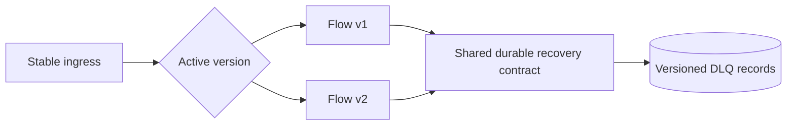

Never reuse a flow ID while v1 and v2 overlap; enforce revisions and drain/cleanup contracts. Changing topology does not automatically migrate stored state or scheduled retry attempts.

## 44. Security for Dead Letters and Replays

Dead letters hold real payloads and can be more sensitive than standard logs. Enforce:
- Distinct ACLs for reading, reviewing, replaying, quarantining, and deleting.
- Tenant scope derived from verified sources, never raw claims.
- Encryption in transit and at rest, including backups.
- Retention and deletion aligned with legal/business requirements.
- Auditing of replay actions, attempt counts, and operator identities.
- Rate limits and approvals for bulk replays.
- Never replay old credentials or expired signed tokens.
- Render error logs via an **allowlisted projection**, never full `ErrorMessage` dumps.
- Never let a replay worker dynamically choose arbitrary handlers via SpEL or class names embedded in a DLQ payload.

A user authorized to inspect DLQ metadata **is not automatically authorized to replay commands into money-moving flows**. Replay triggers business side effects and requires separate authorization.

## 45. Incident Response Runbook for DLQ Spikes

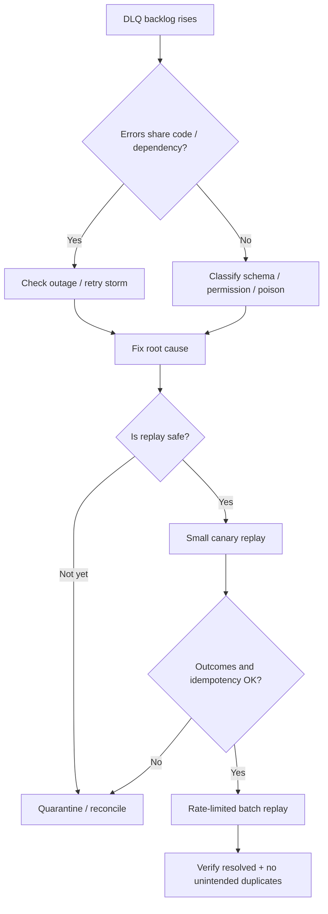

Runbook:
1. Scope the incident: source, endpoint, flow version, error code, time window.
2. Count unique business event IDs vs. deliveries/attempts.
3. Check dependency health and transaction state.
4. Confirm whether DLQ records are durable or messages remain at the source.
5. Identify any `UNKNOWN_OUTCOME` items needing reconciliation before retry.
6. Fix the root cause and deploy a tested fix.
7. Run a small canary replay.
8. Reconcile business DB, outbox, and broker/DLQ outcomes.
9. Replay in rate-limited batches with monitoring alerts.
10. Mark `RESOLVED` only after verifying outcomes, keeping audit trails intact.

**Never "drain a DLQ by deleting records"** just to make dashboards green. That destroys business obligations and forensic evidence.

## 46. Regression Test Matrix

| Test Case | Input / Fault Injection | Primary Assertion |
| --- | --- | --- |
| Happy path | Valid event | One output and business commit |
| Transient then success | Fail attempts 1–2 | Succeeds on attempt 3, no DLQ |
| Exhausted transient | Fail every attempt | One recovery outcome, exact attempt count |
| Permanent validation | Invalid schema | No hot retries, no business effect |
| Authorization denied | Tenant mismatch | DB unchanged, rejection audited |
| Wrapped exception | `MessagingException` wrapping transient error | Retry policy classifies cause properly |
| Unknown remote outcome | Timeout after side effect | Reconcile/idempotency, no blind replay |
| DLQ store outage | Throw inside persistence | Never silently ack/mark done |
| Crash before DLQ commit | Kill process | Source retains redelivery obligation |
| Crash after DLQ commit before ack | Lost ack | Idempotent DLQ; no duplicate business effect |
| Crash after business commit before ack | Redelivery | Inbox unique constraint blocks duplicate |
| Outbox publish crash | Publish without mark-sent | Downstream idempotency holds |
| Poller stopped | RAM queue has backlog | Never misattributed to handler retry |
| Executor saturated | Worker queue full | Clear rejection/backpressure and metrics |
| Error channel mismatch | Async stage error | Error routes to configured channel |
| Poison message loop | Permanent failure redelivered | Delivery limit/quarantine breaks loop |
| DLQ replay concurrency | Two operators claim | CAS/generation protects ownership |
| Replay schema v1 | Legacy version payload | Migrated or cleanly quarantined |
| Replay authorization | Unauthorized actor | Blocked from processing or reading raw payload |
| Dynamic flow v2 | Cutover with retries in flight | No dropped error/recovery path |
| Incomplete correlation | Part sent to DLQ | Group expiry/recovery matches contract |
| Soak test | High dead-letter and marker volume | Retention bounds DB growth |

When testing asynchronous paths, use deadlines/`Awaitility` or `receive(timeout)` and wait for true **business completion**. Never treat producer `send()` into a RAM queue as success.

## 47. Progressive Hands-On Exercises

### Exercise 1 — Build the Three-Channel Lab

Create `ordersWork`, `ordersDone`, and `deadLetterIntake` as in Section 9. Use `QueueChannel` so the poller processes one message at a time. Test the healthy path and measure enqueue-to-handler latency.

### Exercise 2 — Prove Retry Scope

Make `OrderCommandService` fail transiently twice. Attach `RequestHandlerRetryAdvice` specifically to the `process` handler. Assert at most three attempts and one completion; then move the advice to another handler to observe how retry scope shifts.

### Exercise 3 — Skip Retries on Validation Errors

Send `schemaVersion=999`. Assert the business service never runs, the classifier returns permanent, and the recovery/rejection outcome carries code `ORDER_INPUT_INVALID`. Ensure poison messages never trigger long retry chains.

### Exercise 4 — `ErrorMessage` Does Not Equal a DLQ

Use `InMemoryDeadLetterSink` and restart the JVM/test context: records vanish. Replace it with a PostgreSQL-backed `DeadLetterSink` using the schema defined above. Verify persistence commits before reporting recovery success.

### Exercise 5 — Simulate a DLQ DB Outage

Force the dead-letter repository to throw on save. Prove the error propagates; if using a RAM queue, document the message-loss risk and move the test to a durable source/broker. Never "fix" this by catching and ignoring.

### Exercise 6 — Inbox and Broker Redelivery

Commit the business update alongside the inbox marker and simulate a failed source ack. Resend the same `eventId` under a fresh Spring message ID. Assert the DB holds exactly one order/outcome.

### Exercise 7 — Post-Transaction Outbox

Write order and outbox rows in one transaction. Crash before publishing and restart the publisher; then crash after publishing before marking sent. Assert downstream suffers no duplicate side effects.

### Exercise 8 — Testing Unknown Outcomes

Make a fake API execute payment and then time out. Do not retry directly; use an idempotency key and query target status before deciding. Test both "already applied" and "not yet applied" outcomes.

### Exercise 9 — Default `errorChannel` vs. Custom Recovery

Trigger one error on a synchronous `DirectChannel` and another on a poller. Record thread and exception paths; inspect which handler receives `ErrorMessage` and which errors propagate straight to the sender.

### Exercise 10 — Safe Replay Claiming

Launch two workers racing to claim the same DLQ ID. Use SQL conditional updates with generation checks; assert only one claims successfully, then inject a crash to test reclaim/stale completion handling.

### Exercise 11 — DLQ Backlog and Alerts

Inject a burst of transient failures. Measure total attempts, exhausted retries, DLQ pending age, queue depth, and unique goodput. Configure alerts without putting raw `eventId` into metric tags.

### Exercise 12 — Correlation Group Missing a Part

Wire a splitter/aggregator. Send one part to the DLQ and the rest into the group store. Define explicit group timeout, quarantine, and recovery behavior without emitting invalid partial results.

### Exercise 13 — Replaying Under a New Flow Version

Dead-letter a schema v1 payload and deploy a v2 handler. Write a tested converter/migration and re-drive with the same business `eventId`. Verify security and idempotency policies are never bypassed.

### Exercise 14 — Chaos Rehearsal

In an end-to-end test using PostgreSQL and a broker, sequentially stop consumers, disconnect the DLQ DB, block the outbound API, and restart nodes. After each fault, reconcile planned, accepted, committed, rejected, pending, and duplicate outcomes by `eventId`.

## 48. Project Evaluation Rubric

| Criterion | Suggested Weight | Evidence |
| --- | ---: | --- |
| Architecture and ack/transaction boundaries | 20% | Failure-window diagrams, durable obligations |
| Error classification and retry budget | 15% | Permanent/transient/unknown tests |
| Error flow and DLQ durability | 20% | DLQ outage/crash tests, no silent loss |
| Idempotency and replay | 15% | Inbox/outbox, deduplication after redelivery |
| Testing and fault injection | 15% | Passing test cases, data reconciliation |
| Observability and operations | 10% | Metrics, alerts, DLQ runbook |
| Error/replay security | 5% | ACLs, no secret logs, authz tests |

Total **100%**. Weights are suggestions for the lab, not mandatory module grading rules. **Disqualifying defects** include losing business events after ack, double-charging via non-idempotent replays, or leaking credentials into DLQs or logs outside authorized boundaries.

## 49. Anti-Patterns to Avoid

| Anti-Pattern | Why It Is Dangerous | Fix |
| --- | --- | --- |
| Retrying every exception unconditionally | Poison messages and unauthorized commands loop forever | Classifier + bounded policy |
| Classifying retries by exception name alone | Wrapped causes or unknown outcomes get misclassified | Map by contract/cause and test |
| Raising `maxAttempts` indefinitely | Pins threads, starves pools, causes retry storms | Budgets + delayed durable retries |
| Treating `send()==true` as business commit | Queues/executors only accept tasks | Measure outcome at DB/ack boundary |
| Treating `ErrorMessage` as a durable DLQ | Channel may exist only in RAM | Durable DLQ/broker confirmation |
| Recovery callback returns normally when DLQ save fails | Source may ack and drop the event | Propagate error; retain at source |
| Logging raw exceptions in DLQ paths | Leaks `failedMessage` and credentials | Safe error codes/protected payloads |
| Acking broker before durable writes | Crash loses messages | Move ack boundary/source transaction |
| Business commit before ack without inbox | Redelivery duplicates side effects | Unique event ID + DB transaction |
| Post-commit publish without outbox | Dual-write gap | Transactional outbox |
| HTTP timeout ⇒ assuming nothing happened | Can duplicate side effects | Idempotency + reconciliation |
| Replaying with a new event ID | Bypasses deduplication, creates duplicates | Keep stable business key |
| Replaying DLQ without authorization checks | Old commands bypass security | Authorized revalidation |
| DLQ with no state machine | Cannot track pending/claimed/resolved | Explicit states, CAS/generation, audit |
| Force-requeuing poison messages forever | Endless DLQ ↔ retry loop | Delivery limits/quarantine |
| Attaching retry advice to the wrong endpoint | Retries unintended steps | Clarify handler/advice scope |
| Holding transactions open across long backoffs | DB locks and pool exhaustion | Separate transaction/attempt boundaries |
| Treating locks as idempotency | Duplicates still occur after unlock | Inbox and conditional business updates |
| Using RAM `QueueChannel` as durable ingress | Crash after source ack loses work | Durable source/queue/commit |
| Ignoring completed correlation groups | Late arrivals or stuck groups | Expiry/retention/group ownership |
| Clearing DLQs by deleting rows | Destroys recovery obligations | Replay/reconcile/quarantine |
| Testing only the happy path | Crash windows, duplicates, DLQ loss stay hidden | Failure matrix and fault injection |

## 50. Self-Check Questions

1. **How does retry advice differ from broker redelivery?** Retry advice re-invokes the handler within one execution; redelivery is a fresh message delivery from the source.
2. **How many invocations does `maxAttempts=3` typically perform?** Three total, including the initial attempt, per the configured retry policy.
3. **Why not retry invalid-payload errors forever?** Permanent errors never self-heal and create poison loops.
4. **When should an external timeout not be retried immediately?** Whenever the side effect may already have occurred without idempotency/reconciliation.
5. **Does `ErrorMessageSendingRecoverer` create a durable DLQ?** Not by itself; it only sends an `ErrorMessage` to a channel, so the downstream sink must be durable.
6. **What can happen if a `RecoveryCallback` returns normally?** The endpoint/source may treat the failure as recovered and acknowledge per contract.
7. **Why avoid logging raw `ErrorMessage` objects?** Exceptions and `failedMessage` may carry sensitive payloads, headers, and tokens.
8. **Does an in-memory `QueueChannel` protect messages across a JVM crash?** No.
9. **Do `DirectChannel` and `ExecutorChannel` propagate exceptions identically?** No; async boundaries route errors through different paths.
10. **What can happen after a business commit if the ack is lost?** The source redelivers; inbox/idempotency is required.
11. **When should the inbox marker commit?** Inside the same transaction as the business effect to avoid divergent state.
12. **Which crash window does the outbox pattern close?** DB commit succeeding while the outbound event remains unpublished.
13. **Does an outbox guarantee downstream receives events exactly once?** Not automatically; publishers may emit duplicates.
14. **When is the right point to ack after saving a DLQ record?** After obtaining durable confirmation of the DLQ write, per the chosen source protocol.
15. **What happens if the process crashes after DLQ commit before source ack?** Redelivery can occur and try writing the DLQ again; DLQ writes must be idempotent.
16. **Why does a dead-letter schema need `schemaVersion`?** Post-deployment replays must deserialize older payloads or migrate them.
17. **Should anyone permitted to view a DLQ automatically be allowed to replay it?** No; replays cause side effects and need separate authorization.
18. **What does `replay_generation` protect against?** Stale completions when claim/commit updates use conditional checks properly.
19. **What should happen if a worker crashes while holding `CLAIMED`?** A lease/reclaim/timeout policy must recover it instead of leaving it stranded forever.
20. **Why is endlessly requeuing a poison message wrong?** It creates loops, wastes resources, and degrades backlog and availability.
21. **Does an aggregator missing a part sent to the DLQ release automatically?** No; it needs group expiry, partial-release, or recovery policies.
22. **Should you measure goodput or handler attempts?** Both: goodput tracks unique business outcomes, while attempts reveal amplification.
23. **How does long retry backoff affect a poller?** It holds workers, reduces dequeue rates, and increases queue backlog.
24. **Why inspect exception wrappers?** `MessagingException` can mask transient exception types in the cause chain.
25. **What is the most critical DLQ test?** When DLQ persistence fails, the event must never be treated as safely recovered or acknowledged.
26. **Why must replays preserve the business `eventId`?** Changing it bypasses idempotency and risks duplicating side effects.
27. **Do all synchronous errors go to the default `errorChannel`?** No; many propagate directly to the caller.
28. **Does a `RESOLVED` DLQ row prove the source ack succeeded?** Not automatically; they are distinct states on separate systems.
29. **When should you pick delayed broker retries over local advice?** When long waits are needed, workers must stay free, and the source supports durable scheduling.
30. **Why does this project need failure-injection tests?** Happy-path tests miss crash windows, duplicates, DLQ loss, and transaction mismatches.

## 51. Version-Aligned References

- [Spring Integration Reference Documentation](https://docs.spring.io/spring-integration/reference/): error handling, channels, endpoints, retry advice, dead-lettering, and Java DSL.
- [Spring Integration — Error Handling](https://docs.spring.io/spring-integration/reference/error-handling.html): `ErrorMessage`, `errorChannel`, and asynchronous error handling.
- [Spring Integration — Retry Advice](https://docs.spring.io/spring-integration/reference/handler-advice/classes.html): `RequestHandlerRetryAdvice`, retries, and recovery (verify APIs/paths for your version).
- [Spring Retry Documentation](https://docs.spring.io/spring-retry/docs/current/reference/html/): `RetryTemplate`, retry policies, and backoff.
- [Spring Integration — Message Store](https://docs.spring.io/spring-integration/reference/message-store.html): persistent stores and transactional boundaries.
- [PostgreSQL Documentation](https://www.postgresql.org/docs/): unique constraints, transactions, and conditional updates.
- [Testcontainers for Java](https://java.testcontainers.org/): databases and brokers for integration/failure tests.

**Always verify against your exact Spring Integration, Spring Retry, Spring Boot, and adapter/broker versions.** Error handling, ack/nack/requeue behavior, retry advice, default channel names, and transaction boundaries can vary across channels, adapters, and versions. This lesson is a design guide and practice skeleton, **not pre-built and QA-verified production code**.

## 52. Summary

**Designing error flows, retries, and dead-lettering means designing the lifecycle of a message-processing obligation, not merely attaching advice and naming a channel `deadLetter`.** Start by classifying transient, permanent, and unknown outcomes; apply bounded retries to the right handler; clarify when errors return to callers, error channels, or sources; and consider a message recovered only when **a durable dead letter is persisted or the source retains redelivery responsibility**.

This lab uses `QueueChannel`, pollers, `RequestHandlerRetryAdvice`, `ErrorMessageSendingRecoverer`, and `DirectChannel` to expose control flow clearly. Moving to production requires **durable sources and DLQs, inbox/outbox tables, ack/transaction boundaries, replay authorization, state machines, idempotency, and failure-injection tests**. Never conclude from one passing retry test that duplicates cannot happen, and never assume logging an error preserves the work.

Always keep two timelines side by side: **message received → attempts → business commit / durable recovery → source ack** and **failure classified → retries → dead-letter persisted → replay claimed → resolved**. Checking them against crash, timeout, and redelivery windows is what proves the runtime neither loses nor duplicates business effects outside its contract.
