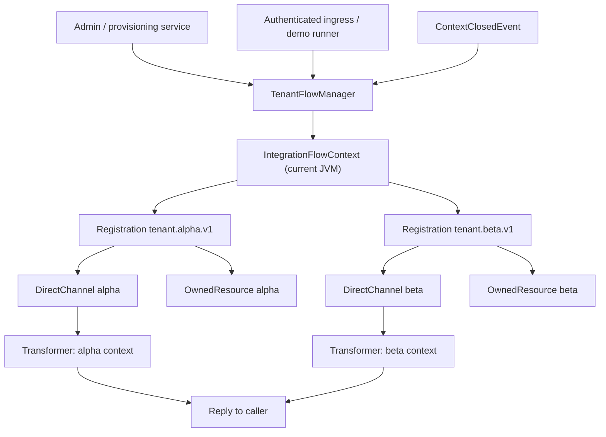
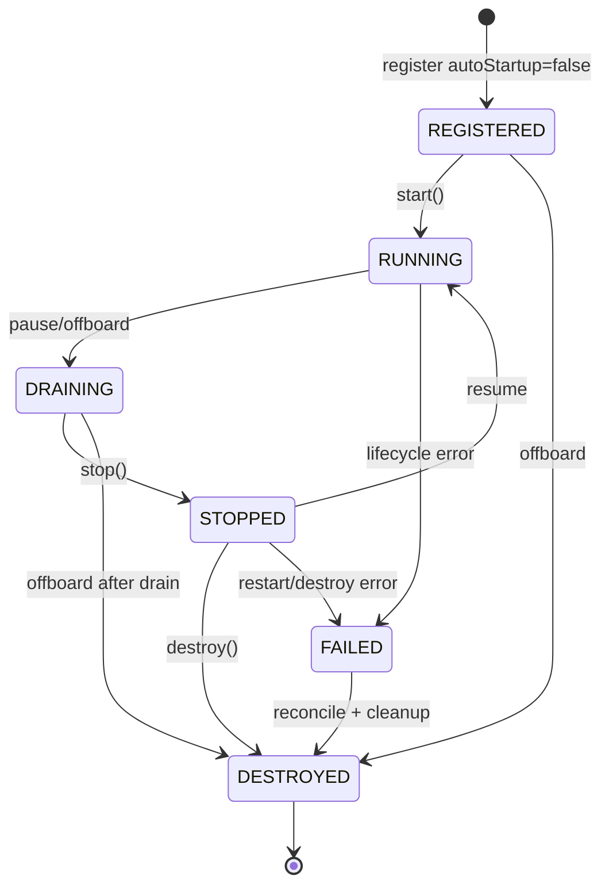
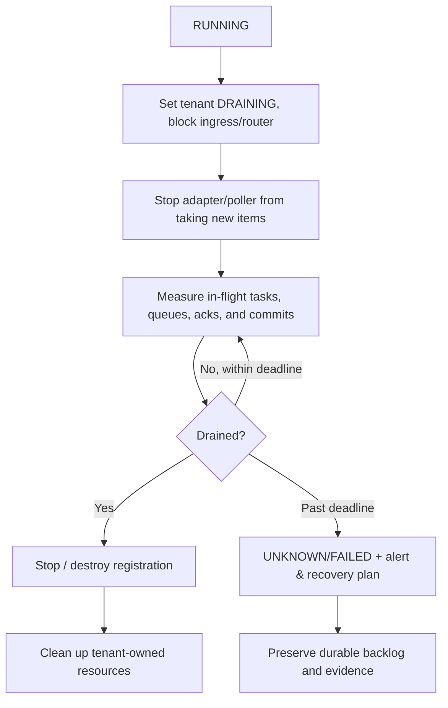

# Dynamic Per-Tenant Flow Registration and Cleanup on Stop

## 1. Problem Statement: Tenant Onboarding/Offboarding Without Restarting the JVM

A Spring Integration service receives requests from multiple tenants. Each tenant has its own pipeline: receiving messages on an input channel, invoking a processing handler, and returning a reply. New tenants can be activated while the application is running; departing tenants must **stop accepting new work, drain in-flight processing, and release their owned endpoints and resources** without disrupting other tenants.

This hands-on project belongs to the **Hands-On Project** chapter of the `SPRING_INTEGRATION_RUNTIME` module. It applies Spring Integration's orchestration of `MessageChannel`, endpoints, consumers, pollers, and executors; manages `IntegrationFlow` lifecycles; and examines the implications for transactions, retries, message stores, errors, correlation, threading, performance, and runtime state.

**Final goal:** build a Spring Boot application using `IntegrationFlowContext` to register, start, pause, resume, and offboard `IntegrationFlow` instances created **after the application context has started**. On offboarding, verify the flow disappears from the registry and the tenant's dependent beans have been destroyed.

> **Technical context:** Java 17+, Spring Boot 3.5.x, and Spring Integration 6.5.x managed by the BOM. The main example uses a **synchronous** `DirectChannel` and transformer to demonstrate lifecycle and draining cleanly. Real SFTP, JMS, brokers, pollers, or `ExecutorChannel` setups require the additional design steps in Sections 15–18.

### 1.1. Functional Requirements

| Code | Task | Completion Criterion |
|---|---|---|
| F1 | Provision tenants `alpha` and `beta` at runtime | Two unique flow IDs exist in `IntegrationFlowContext`. |
| F2 | Do not auto-start upon registration | `autoStartup(false)`; no traffic allowed before `start()`. |
| F3 | Send tenant-isolated requests | `alpha`'s reply never contains `beta`'s data or logic. |
| F4 | Pause and resume `alpha` | `beta` keeps processing; `alpha` is rejected while paused. |
| F5 | Offboard `beta` | New requests rejected, registration destroyed, tenant resources closed. |
| F6 | Re-provision `beta` | Flow ID can be reused after full destruction. |
| F7 | Concurrent provisioning of the same tenant | Does not create duplicate registrations or bean collisions. |
| F8 | Offboard while a synchronous request is running | Does not destroy endpoints mid-flight for requests accepted by the manager. |
| F9 | Application shutdown | Best-effort cleanup runs for all remaining dynamic registrations. |
| F10 | Testing and observability | JUnit tests and checks for registry and lifecycle states. |

### 1.2. Out of Scope for the Minimal Runnable Version

This project does not connect to a real broker/SFTP/JDBC backend yet; it includes no distributed locks, durable tenant catalog, multi-pod orchestration, production control-plane authorization, or exactly-once delivery. Do **not infer** those properties from a successful register/destroy demo. We clearly separate the minimal runnable baseline from production-grade upgrades.

## 2. Architecture and Resource Boundaries



**Boundaries to recognize:**

- **Flow registry:** `IntegrationFlowContext` manages dynamic flows inside one `ApplicationContext`. It is not a distributed database and does not sync across pods.
- **Tenant map:** `TenantFlowManager` holds an `IntegrationFlowRegistration` handle per tenant for lifecycle management. This is an **in-memory** registry and is lost on restart.
- **Input channel:** each flow creates its own `DirectChannel`. Synchronous calls receive replies via `MessagingTemplate.convertSendAndReceive(...)`.
- **Shared processor:** a stateless service accepts the verified tenant as an argument. Never use a mutable singleton field like `currentTenantId`.
- **Owned resource:** each flow creates a `TenantOwnedResource` and registers it as a **dependent bean** via `addBean()`. On `destroy()`, Spring Integration cleans it up with the flow's lifecycle.
- **In-flight gate:** a read/write lock lets multiple synchronous requests run concurrently while forcing admin offboarding to wait until active readers finish.

### 2.1. One Flow per Tenant vs. One Shared Flow

| One Flow per Tenant | One Shared Flow + Router |
|---|---|
| Fits when tenants have dedicated adapters, connections, pollers, schedules, or endpoint lifecycles. | Fits when tenants differ only in business data or permissions. |
| Allows starting and stopping per tenant. | Reduces bean, thread, and connection counts. |
| Requires quotas, cleanup, naming conventions, and reconciliation. | Requires tenant-aware handlers, storage, and routing. |
| Does not automatically create security or DB isolation. | Also does not create isolation; authorization remains mandatory. |

**Do not** spin up thousands of `IntegrationFlow` instances if the only difference is a `tenantId` header. The per-tenant design here is chosen specifically to practice **lifecycle and cleanup**.

## 3. Designing an Explicit State Machine



Distinguish **application state** tracked by the manager from **framework state** held by registrations/endpoints. `DRAINING` is an **application policy**, not a built-in `registration.drain()` method.

| Command | Spring Integration Operation | Observable Outcome |
|---|---|---|
| Register | `flowContext.registration(flow).id(...).autoStartup(false).register()` | Registration exists, but endpoints are not started yet. |
| Start | `registration.start()` | Endpoints are started; traffic permitted once succeeded. |
| Pause | Block new admissions → wait for in-flight → `registration.stop()` | Registration stays intact for resuming. |
| Resume | `registration.start()` | No new flow or beans created. |
| Offboard | Block new admissions → wait for in-flight → stop → `registration.destroy()` | Removes registration and destroys dependent beans. |
| JVM shutdown | Iterate tenant cleanup inside `ContextClosedEvent` | Best-effort cleanup before Spring closes the context. |

**Do not confuse `stop()` with `destroy()`:** stop preserves the registration and beans for restart; destroy tears down the flow, its dependent beans, and local handles. **Never confuse `destroy()` with deleting business data** in JDBC stores, brokers, files, metadata stores, or DLQs.

## 4. Project Setup

### 4.1. Suggested Source Layout

```text
src/main/java/com/example/tenantflow/
  TenantFlowProjectApplication.java
  TenantPayloadProcessor.java
  DefaultTenantPayloadProcessor.java
  TenantOwnedResource.java
  TenantFlowManager.java
  DemoScenario.java

src/test/java/com/example/tenantflow/
  TenantFlowManagerIT.java
  TenantFlowConcurrencyIT.java
```

Use the shared package `com.example.tenantflow` so Spring Boot component scanning works and tests can access package-private helpers.

### 4.2. Dependencies

In a Spring Boot 3.5.x Gradle project with the Boot plugin/BOM configured, add:

```groovy
dependencies {
    implementation 'org.springframework.boot:spring-boot-starter-integration'
    // Keep runtime alive via embedded server (no admin API exposed yet).
    implementation 'org.springframework.boot:spring-boot-starter-web'

    testImplementation 'org.springframework.boot:spring-boot-starter-test'
    testRuntimeOnly 'org.junit.platform:junit-platform-launcher'
}

tasks.named('test') {
    useJUnitPlatform()
}
```

No SFTP/JMS adapters, JDBC, or embedded brokers are needed for the baseline. The web starter keeps an HTTP server running so SIGTERM/shutdown can be observed, **though no admin endpoints are exposed yet**. Tests can set `webEnvironment = NONE`. Spring Integration core and Java DSL are managed by the Boot starter/BOM; avoid mixing manual incompatible versions.

### 4.3. Spring Boot Entry Point

**`TenantFlowProjectApplication.java`**

```java
package com.example.tenantflow;

import org.springframework.boot.SpringApplication;
import org.springframework.boot.autoconfigure.SpringBootApplication;
import org.springframework.integration.config.EnableIntegration;

@SpringBootApplication
@EnableIntegration
public class TenantFlowProjectApplication {

    public static void main(String[] args) {
        SpringApplication.run(TenantFlowProjectApplication.class, args);
    }
}
```

`IntegrationFlowContext` is an infrastructure bean provided by Spring Integration; inject it via constructor. **Never instantiate `new StandardIntegrationFlowContext()`** outside the Spring container to manage your own registry.

## 5. Shared Processor Without Mixing Tenant State

**`TenantPayloadProcessor.java`**

```java
package com.example.tenantflow;

@FunctionalInterface
public interface TenantPayloadProcessor {
    String process(String tenantId, String payload);
}
```

**`DefaultTenantPayloadProcessor.java`**

```java
package com.example.tenantflow;

import java.util.Locale;
import org.springframework.stereotype.Component;

@Component
public final class DefaultTenantPayloadProcessor
        implements TenantPayloadProcessor {

    @Override
    public String process(String tenantId, String payload) {
        // No mutable singleton currentTenantId!
        return "[tenant=" + tenantId + "] "
                + payload.toUpperCase(Locale.ROOT);
    }
}
```

The processor never trusts a client-supplied `tenantId` header to grant access. In the demo, the manager receives the tenant ID from a trusted caller; in production REST/broker ingress, the tenant ID must come from a **verified security principal or validated mapping**.

**Mistake to avoid:**

```java
// WRONG: mutable singleton state can be overwritten by another tenant's request.
private String currentTenant;
public String process(String tenant, String payload) {
    this.currentTenant = tenant;
    return "tenant=" + this.currentTenant + ";" + payload;
}
```

Under concurrency, `currentTenant` cannot preserve the original request's identity. Keep parameters immutable or use per-tenant objects with clear ownership.

## 6. `OwnedResource`: Proving Cleanup Is Real

**`TenantOwnedResource.java`**

```java
package com.example.tenantflow;

import java.util.concurrent.atomic.AtomicBoolean;
import org.springframework.beans.factory.DisposableBean;

public final class TenantOwnedResource implements DisposableBean {

    private final String tenantId;
    private final AtomicBoolean destroyed = new AtomicBoolean();

    public TenantOwnedResource(String tenantId) {
        this.tenantId = tenantId;
    }

    public void assertAvailable() {
        if (destroyed.get()) {
            throw new IllegalStateException(
                    "Resource is closed for " + tenantId);
        }
    }

    public boolean isDestroyed() {
        return destroyed.get();
    }

    @Override
    public void destroy() {
        // In production: close a tenant-owned connection/client/subscription.
        // AtomicBoolean makes the cleanup callback idempotent.
        destroyed.compareAndSet(false, true);
    }
}
```

This is a **simulated resource** opening no real sockets, threads, or files. It lets tests observe the `DisposableBean.destroy()` callback when a registration is destroyed. In production, a resource might be a connection factory, SSH session pool, or adapter dependency requiring proper close/release APIs, timeouts, and error handling.

**Ownership invariant:** if a resource is owned exclusively by one tenant, register it as a dependent bean of that flow; if shared across tenants (e.g., global `DataSource`, shared `TaskExecutor`, Kafka factory), **never register it as a dependent bean** lest destroying flow A breaks tenant B.

## 7. `TenantFlowManager`: Registering and Coordinating Lifecycles

### 7.1. Design Decisions Before Reading the Code

- Every tenant ID must match `[a-z0-9][a-z0-9-]{0,39}`. Never create beans or flows from unvalidated input.
- Fixed flow ID per tenant in the demo: `tenant.<tenantId>.v1`. Config schema changes can bump revisions or destroy before reusing an ID.
- `useFlowIdAsPrefix()` prevents internal component bean-name collisions. Requires an explicit flow ID.
- `autoStartup(false)` requires an explicit `start()` after registration, preventing premature traffic before provisioning finishes.
- The manager uses a `ConcurrentHashMap` yet serializes **admin operations** with simple `synchronized` blocks to prevent concurrent duplicate provision/destroy within one JVM.
- Each slot holds a `ReentrantReadWriteLock(true)`: synchronous requests hold the read lock, while pause/offboard acquire the write lock and wait for active requests to finish.
- On offboarding, **do not call both `registration.destroy()` and `flowContext.remove(id)`** on the same registration: both perform destruction.
- Shutdown hooks into `ContextClosedEvent` to block new provisioning and clean up remaining registrations.

### 7.2. Implementation — `TenantFlowManager.java`

```java
package com.example.tenantflow;

import java.util.ArrayList;
import java.util.Map;
import java.util.concurrent.ConcurrentHashMap;
import java.util.concurrent.locks.Lock;
import java.util.concurrent.locks.ReentrantReadWriteLock;

import org.slf4j.Logger;
import org.slf4j.LoggerFactory;
import org.springframework.context.event.ContextClosedEvent;
import org.springframework.context.event.EventListener;
import org.springframework.integration.channel.DirectChannel;
import org.springframework.integration.dsl.IntegrationFlow;
import org.springframework.integration.dsl.context.IntegrationFlowContext;
import org.springframework.integration.dsl.context.IntegrationFlowContext
        .IntegrationFlowRegistration;
import org.springframework.stereotype.Service;

@Service
public final class TenantFlowManager {

    private static final Logger log =
            LoggerFactory.getLogger(TenantFlowManager.class);

    public enum Phase {
        REGISTERED, RUNNING, DRAINING, STOPPED, FAILED, DESTROYED
    }

    public record View(String tenantId, String flowId,
                       Phase phase, boolean accepting) {
    }

    private static final class Slot {
        final IntegrationFlowRegistration registration;
        final TenantOwnedResource resource;
        final ReentrantReadWriteLock gate =
                new ReentrantReadWriteLock(true);

        volatile Phase phase = Phase.REGISTERED;
        volatile boolean accepting = false;

        Slot(IntegrationFlowRegistration registration,
             TenantOwnedResource resource) {
            this.registration = registration;
            this.resource = resource;
        }
    }

    private final IntegrationFlowContext flowContext;
    private final TenantPayloadProcessor processor;
    private final Map<String, Slot> slots = new ConcurrentHashMap<>();
    private volatile boolean shuttingDown;

    public TenantFlowManager(IntegrationFlowContext flowContext,
                             TenantPayloadProcessor processor) {
        this.flowContext = flowContext;
        this.processor = processor;
    }

    private static String checkedTenant(String tenantId) {
        if (tenantId == null
                || !tenantId.matches("[a-z0-9][a-z0-9-]{0,39}")) {
            throw new IllegalArgumentException("Invalid tenant ID");
        }
        return tenantId;
    }

    private static String flowId(String tenant) {
        return "tenant." + tenant + ".v1";
    }

    public synchronized String provision(String tenantId) {
        String tenant = checkedTenant(tenantId);
        if (shuttingDown) {
            throw new IllegalStateException("Application is shutting down");
        }

        Slot existing = slots.get(tenant);
        if (existing != null) {
            if (existing.phase == Phase.FAILED) {
                throw new IllegalStateException(
                        "Tenant needs reconciliation: " + tenant);
            }
            // Idempotent provisioning within the same JVM.
            return existing.registration.getId();
        }

        String id = flowId(tenant);
        if (flowContext.getRegistrationById(id) != null) {
            throw new IllegalStateException(
                    "Flow ID already owned outside manager: " + id);
        }

        TenantOwnedResource owned = new TenantOwnedResource(tenant);
        IntegrationFlow flow = IntegrationFlow.from(new DirectChannel())
                .<String, String>transform(payload -> {
                    owned.assertAvailable();
                    return processor.process(tenant, payload);
                })
                .get();

        // register() can throw on bean collision or invalid config;
        // production must audit and reconcile any partial resources.
        IntegrationFlowRegistration registration = flowContext
                .registration(flow)
                .id(id)
                .useFlowIdAsPrefix()
                .autoStartup(false)
                .addBean("ownedResource." + tenant, owned)
                .register();

        slots.put(tenant, new Slot(registration, owned));

        log.info("Tenant flow registered: {}", id);
        return id;
    }

    public synchronized void start(String tenantId) {
        String tenant = checkedTenant(tenantId);
        Slot slot = required(tenant);
        Lock write = slot.gate.writeLock();
        write.lock();
        try {
            ensureCurrent(tenant, slot);
            if (slot.phase == Phase.FAILED) {
                throw new IllegalStateException(
                        "Reconcile failed tenant before start");
            }

            slot.registration.start();
            slot.phase = Phase.RUNNING;
            slot.accepting = true;
        }
        catch (RuntimeException e) {
            slot.accepting = false;
            slot.phase = Phase.FAILED;
            throw e;
        }
        finally {
            write.unlock();
        }
    }

    public String request(String tenantId, String payload) {
        String tenant = checkedTenant(tenantId);
        if (payload == null || payload.length() > 1_024) {
            throw new IllegalArgumentException("Invalid payload");
        }

        Slot slot = slots.get(tenant);
        if (slot == null) {
            throw new IllegalStateException("Tenant not provisioned");
        }

        Lock read = slot.gate.readLock();
        read.lock();
        try {
            ensureCurrent(tenant, slot);
            if (!slot.accepting || slot.phase != Phase.RUNNING) {
                throw new IllegalStateException(
                        "Tenant not accepting new requests");
            }

            // This example uses DirectChannel + synchronous handler.
            // Read lock stays held until the reply is received.
            String reply = slot.registration.getMessagingTemplate()
                    .convertSendAndReceive(payload, String.class);

            if (reply == null) {
                throw new IllegalStateException(
                        "No reply from tenant flow");
            }
            return reply;
        }
        finally {
            read.unlock();
        }
    }

    public synchronized void pause(String tenantId) {
        String tenant = checkedTenant(tenantId);
        Slot slot = required(tenant);

        // Gate admissions before waiting on in-flight; write lock waits
        // for synchronous requests currently holding the read lock.
        slot.accepting = false;
        slot.phase = Phase.DRAINING;

        Lock write = slot.gate.writeLock();
        write.lock();
        try {
            ensureCurrent(tenant, slot);
            slot.registration.stop();
            slot.phase = Phase.STOPPED;
            log.info("Tenant flow stopped: {}",
                    slot.registration.getId());
        }
        catch (RuntimeException e) {
            slot.phase = Phase.FAILED;
            throw e;
        }
        finally {
            write.unlock();
        }
    }

    public synchronized void offboard(String tenantId) {
        String tenant = checkedTenant(tenantId);
        Slot slot = slots.get(tenant);
        if (slot == null) {
            return; // Idempotent if already offboarded.
        }

        slot.accepting = false;
        slot.phase = Phase.DRAINING;

        Lock write = slot.gate.writeLock();
        write.lock();
        try {
            ensureCurrent(tenant, slot);
            slot.registration.stop();
            slot.registration.destroy();

            slots.remove(tenant, slot);
            slot.phase = Phase.DESTROYED;

            log.info("Tenant flow destroyed: {}",
                    slot.registration.getId());
        }
        catch (RuntimeException e) {
            // Do not blindly remove slot if destroy fails partway.
            slot.phase = Phase.FAILED;
            log.error("Tenant cleanup failed: {}", tenant, e);
            throw e;
        }
        finally {
            write.unlock();
        }
    }

    public View view(String tenantId) {
        String tenant = checkedTenant(tenantId);
        Slot slot = required(tenant);
        // Snapshot, not a transaction or atomic cluster state.
        return new View(tenant,
                slot.registration.getId(),
                slot.phase, slot.accepting);
    }

    // Package-private: only for integration tests to hold a reference
    // and verify DisposableBean.destroy() was invoked.
    TenantOwnedResource ownedResourceForTest(String tenantId) {
        return required(checkedTenant(tenantId)).resource;
    }

    private Slot required(String tenant) {
        Slot slot = slots.get(tenant);
        if (slot == null) {
            throw new IllegalStateException(
                    "Tenant not provisioned: " + tenant);
        }
        return slot;
    }

    private void ensureCurrent(String tenant, Slot slot) {
        if (slots.get(tenant) != slot) {
            throw new IllegalStateException(
                    "Tenant registration changed while waiting");
        }
    }

    @EventListener(ContextClosedEvent.class)
    public synchronized void cleanupOnApplicationShutdown() {
        shuttingDown = true;
        // Take a snapshot to avoid iterating a mutating map.
        for (String tenant : new ArrayList<>(slots.keySet())) {
            try {
                offboard(tenant);
            }
            catch (RuntimeException failure) {
                // Best-effort continuation for remaining tenants;
                // Spring context shutdown does not allow infinite retries.
                log.error("Shutdown cleanup failed for {}", tenant,
                        failure);
            }
        }
    }
}
```

### 7.3. Deep Dive Into Synchronization Choices

**A. Properly Scoped Read/Write Lock**

`request()` holds the read lock throughout `convertSendAndReceive(...)`. Multiple `alpha` requests can execute concurrently, yet an admin `pause("alpha")` must wait until active readers release the lock before calling `registration.stop()`. `ReentrantReadWriteLock(true)` reduces the risk of write-lock starvation under continuous callers.

**B. Blocking New Admissions Before Draining**

Before acquiring the write lock, the manager sets `accepting=false` and `phase=DRAINING`. A concurrent request that already looked up `Slot` must still check `accepting` and `slots.get(tenant)==slot` after acquiring the read lock, so it gets rejected if the flow was paused or destroyed.

**C. This Read Lock Cannot Track Async Completion**

The current flow uses `DirectChannel` and a synchronous transformer, so the read lock remains held until the business handler completes. If you swap in `ExecutorChannel`, `FluxMessageChannel`, `QueueChannel`/poller, or an async outbound gateway callback, `request()` can return **before downstream work finishes**. That requires separate in-flight tracking, ack/transaction completion, and deadlines—never treat the write lock as proof that async tasks have drained.

**D. `synchronized` Management Is a Single-JVM Baseline**

It prevents two concurrent admin requests from provisioning the same ID or interleaving start/pause/destroy. However, offboarding `alpha` while waiting on a slow handler blocks admin operations for `beta` because both share the manager's monitor. Production should use **per-tenant management mutexes**, a command queue, or a state machine with expected revisions for isolation.

**E. When `destroy()` Throws**

`destroy()` may have partially torn down beans before throwing. The manager keeps the slot in `FAILED` requiring reconciliation rather than claiming cleanup succeeded. Never blindly call remove/destroy a second time on a partially destroyed handle or delete the tenant catalog entry before observing actual state.

**F. Timeouts Must Be Designed Per Adapter**

This example performs no network I/O, so operations are brief. If a real handler hangs on TCP/DB I/O, `offboard()` waiting on the read lock will hang too. Enforce deadlines, I/O timeouts, cooperative cancellation, and a runbook for `UNKNOWN`/`DRAINING` states; never call `Thread.stop()` or forcibly destroy shared resources.

## 8. Running the Demo Without Exposing Admin HTTP Endpoints

To make the project **runnable without exposing an administrative API**, use a `CommandLineRunner` active only under the `demo` profile. This is a clean way to learn lifecycle behavior before adding Spring Security and REST.

**`DemoScenario.java`**

```java
package com.example.tenantflow;

import org.springframework.boot.CommandLineRunner;
import org.springframework.context.annotation.Bean;
import org.springframework.context.annotation.Configuration;
import org.springframework.context.annotation.Profile;

@Configuration
@Profile("demo")
class DemoScenario {

    @Bean
    CommandLineRunner runTenantScenario(TenantFlowManager manager) {
        return args -> {
            System.out.println("REGISTER alpha: "
                    + manager.provision("alpha"));
            System.out.println("REGISTER beta: "
                    + manager.provision("beta"));

            manager.start("alpha");
            manager.start("beta");

            System.out.println(manager.request("alpha", "order-17"));
            System.out.println(manager.request("beta", "order-17"));

            manager.pause("alpha");
            System.out.println("alpha: "
                    + manager.view("alpha").phase());

            // Beta still accepts requests even while alpha is paused.
            System.out.println(manager.request("beta", "order-18"));

            manager.start("alpha"); // Resume existing registration.
            System.out.println(manager.request("alpha", "order-19"));

            manager.offboard("beta");
            System.out.println("beta offboarded");

            // Application context stays open: alpha is RUNNING.
            // When Spring closes the context, ContextClosedEvent runs cleanup.
        };
    }
}
```

### 8.1. Running and Expected Output

```bash
./gradlew bootRun --args='--spring.profiles.active=demo'
```

Illustrative output, omitting Spring timestamps and log prefixes:

```text
REGISTER alpha: tenant.alpha.v1
REGISTER beta: tenant.beta.v1
[tenant=alpha] ORDER-17
[tenant=beta] ORDER-17
alpha: STOPPED
[tenant=beta] ORDER-18
[tenant=alpha] ORDER-19
beta offboarded
```

Use `Ctrl+C`/SIGTERM to stop the application gracefully; Spring publishes `ContextClosedEvent` while closing. Inspect the cleanup log for `alpha`. **SIGKILL, OOM, or power loss do not guarantee shutdown callbacks run.** Therefore, application shutdown hooks never replace durable state and reconciliation.

### 8.2. When Not Running the `demo` Profile

The application provisions zero tenants automatically. This prevents a `CommandLineRunner` from unexpectedly creating flows or connections in tests and production before admin policies or catalogs are ready.

## 9. Integration Tests Proving Tenant Lifecycle

These tests run against the **real Spring Integration runtime**, without mocking `IntegrationFlowContext`. `webEnvironment = NONE` avoids opening an HTTP port in tests even though the web starter is present.

**`TenantFlowManagerIT.java`**

```java
package com.example.tenantflow;

import static org.junit.jupiter.api.Assertions.*;

import org.junit.jupiter.api.AfterEach;
import org.junit.jupiter.api.Test;
import org.springframework.beans.factory.annotation.Autowired;
import org.springframework.boot.test.context.SpringBootTest;
import org.springframework.integration.dsl.context.IntegrationFlowContext;

@SpringBootTest(
        classes = TenantFlowProjectApplication.class,
        webEnvironment = SpringBootTest.WebEnvironment.NONE)
class TenantFlowManagerIT {

    @Autowired TenantFlowManager manager;
    @Autowired IntegrationFlowContext context;

    @AfterEach
    void cleanup() {
        // Spring Test may cache the application context across test methods.
        manager.offboard("alpha");
        manager.offboard("beta");
        manager.offboard("gamma");
    }

    @Test
    void registerStartPauseResumeOffboard() {
        String id = manager.provision("alpha");

        assertEquals("tenant.alpha.v1", id);
        assertNotNull(context.getRegistrationById(id));
        assertEquals(TenantFlowManager.Phase.REGISTERED,
                manager.view("alpha").phase());

        // autoStartup(false) + gate: requests rejected before start.
        assertThrows(IllegalStateException.class,
                () -> manager.request("alpha", "job-1"));

        manager.start("alpha");
        assertEquals("[tenant=alpha] JOB-1",
                manager.request("alpha", "job-1"));

        manager.pause("alpha");
        assertEquals(TenantFlowManager.Phase.STOPPED,
                manager.view("alpha").phase());
        assertThrows(IllegalStateException.class,
                () -> manager.request("alpha", "job-2"));

        manager.start("alpha");
        assertEquals(id, manager.view("alpha").flowId());
        assertEquals("[tenant=alpha] JOB-3",
                manager.request("alpha", "job-3"));

        manager.offboard("alpha");
        assertNull(context.getRegistrationById(id));
        assertThrows(IllegalStateException.class,
                () -> manager.request("alpha", "job-4"));
    }

    @Test
    void pausingAlphaDoesNotPauseBeta() {
        manager.provision("alpha");
        manager.provision("beta");
        manager.start("alpha");
        manager.start("beta");

        assertEquals("[tenant=alpha] ORDER-17",
                manager.request("alpha", "order-17"));
        assertEquals("[tenant=beta] ORDER-17",
                manager.request("beta", "order-17"));

        manager.pause("alpha");

        assertThrows(IllegalStateException.class,
                () -> manager.request("alpha", "order-18"));
        assertEquals("[tenant=beta] ORDER-18",
                manager.request("beta", "order-18"));
    }

    @Test
    void repeatedProvisionIsIdempotentAndIdCanBeReused() {
        String first = manager.provision("gamma");
        String again = manager.provision("gamma");
        assertEquals(first, again);

        manager.offboard("gamma");
        assertNull(context.getRegistrationById(first));

        String recreated = manager.provision("gamma");
        assertEquals(first, recreated);
        manager.start("gamma");
        assertEquals("[tenant=gamma] NEW",
                manager.request("gamma", "new"));
    }

    @Test
    void destroyClosesDependentBeanButStopDoesNot() {
        manager.provision("beta");
        TenantOwnedResource owned =
                manager.ownedResourceForTest("beta");

        manager.start("beta");
        manager.pause("beta");
        assertFalse(owned.isDestroyed());

        manager.offboard("beta");
        assertTrue(owned.isDestroyed());
        assertNull(context.getRegistrationById(
                "tenant.beta.v1"));
    }

    @Test
    void rejectsInvalidTenantId() {
        assertThrows(IllegalArgumentException.class,
                () -> manager.provision("../../admin"));
        assertThrows(IllegalArgumentException.class,
                () -> manager.provision("alpha.bad"));
    }
}
```

### 9.1. What Do These Tests Prove?

| Assertion | Meaning |
|---|---|
| Registry contains `tenant.alpha.v1` | The flow is registered in the active Spring context. |
| Requests rejected before start | Both the lifecycle gate and `autoStartup(false)` work. |
| Replies reflect distinct tenants | The payload processor uses the captured tenant; does **not** prove security authorization yet. |
| Pause preserves registration | Can resume without re-registering. |
| Resource not destroyed after pause | `stop()` **does not** tear down dependent beans. |
| Resource destroyed after offboard | `registration.destroy()` triggers lifecycle cleanup. |
| Registry ID disappears and re-provision reuses it | Leaves no orphan registration on the happy path. |

These tests do not verify real sockets or connections because `TenantOwnedResource` is a test fixture. When swapping in SFTP/JMS/TCP, use a fake resource or an integration test against a real server/broker to measure connection cleanup.

## 10. Testing Two Admin Requests Provisioning the Same Tenant Concurrently

`ConcurrentHashMap` is not enough if two threads call `get()` and then `register()` simultaneously: both would attempt to register flows with the same ID. The demo manager uses `synchronized provision()` to serialize this **within one JVM**.

Add the test snippet below **inside the `TenantFlowManagerIT` class from Section 9**, reusing the injected `manager` and `context` fields.

```java
import java.util.concurrent.Callable;
import java.util.concurrent.CountDownLatch;
import java.util.concurrent.ExecutorService;
import java.util.concurrent.Executors;
import java.util.concurrent.Future;
import java.util.concurrent.TimeUnit;

@Test
void concurrentProvisionReturnsOneFlowId() throws Exception {
    ExecutorService pool = Executors.newFixedThreadPool(2);
    CountDownLatch ready = new CountDownLatch(2);
    CountDownLatch go = new CountDownLatch(1);

    try {
        Callable<String> create = () -> {
            ready.countDown();
            if (!go.await(5, TimeUnit.SECONDS)) {
                throw new IllegalStateException("Barrier timed out");
            }
            return manager.provision("alpha");
        };

        Future<String> first = pool.submit(create);
        Future<String> second = pool.submit(create);

        assertTrue(ready.await(5, TimeUnit.SECONDS));
        go.countDown();

        String a = first.get(10, TimeUnit.SECONDS);
        String b = second.get(10, TimeUnit.SECONDS);
        assertEquals(a, b);
        assertNotNull(context.getRegistrationById(a));
    }
    finally {
        go.countDown();
        pool.shutdownNow();
        manager.offboard("alpha");
    }
}
```

This test only proves synchronization inside a single JVM. Two pods have two separate `IntegrationFlowContext` instances and two maps: ensuring only one pod polls an exclusive source requires distributed coordination and source ownership.

## 11. Testing That Offboarding Waits for In-Flight Synchronous Requests

We use `CountDownLatch` to hold the business handler on the call stack and verify the owned resource **is not destroyed** while an accepted request is actively executing.

**`TenantFlowConcurrencyIT.java`**

```java
package com.example.tenantflow;

import static org.junit.jupiter.api.Assertions.*;

import java.util.concurrent.CountDownLatch;
import java.util.concurrent.ExecutorService;
import java.util.concurrent.Executors;
import java.util.concurrent.Future;
import java.util.concurrent.TimeUnit;
import java.util.concurrent.TimeoutException;
import org.junit.jupiter.api.Test;
import org.springframework.beans.factory.annotation.Autowired;
import org.springframework.boot.test.context.SpringBootTest;
import org.springframework.boot.test.context.TestConfiguration;
import org.springframework.context.annotation.Bean;
import org.springframework.context.annotation.Import;
import org.springframework.context.annotation.Primary;
import org.springframework.integration.dsl.context.IntegrationFlowContext;

@SpringBootTest(
        classes = TenantFlowProjectApplication.class,
        webEnvironment = SpringBootTest.WebEnvironment.NONE)
@Import(TenantFlowConcurrencyIT.BlockingConfig.class)
class TenantFlowConcurrencyIT {

    @TestConfiguration
    static class BlockingConfig {
        @Bean
        @Primary
        BlockingProcessor blockingProcessor() {
            return new BlockingProcessor();
        }
    }

    static final class BlockingProcessor
            implements TenantPayloadProcessor {

        final CountDownLatch entered = new CountDownLatch(1);
        final CountDownLatch release = new CountDownLatch(1);

        @Override
        public String process(String tenant, String payload) {
            entered.countDown();
            try {
                if (!release.await(20, TimeUnit.SECONDS)) {
                    throw new IllegalStateException(
                            "Test handler release timeout");
                }
            }
            catch (InterruptedException e) {
                Thread.currentThread().interrupt();
                throw new IllegalStateException(
                        "Test handler interrupted", e);
            }
            return "[tenant=" + tenant + "] "
                    + payload.toUpperCase(java.util.Locale.ROOT);
        }
    }

    @Autowired TenantFlowManager manager;
    @Autowired BlockingProcessor blocking;
    @Autowired IntegrationFlowContext context;

    @Test
    void offboardWaitsForSynchronousRequest() throws Exception {
        manager.provision("alpha");
        manager.start("alpha");

        TenantOwnedResource owned =
                manager.ownedResourceForTest("alpha");
        ExecutorService pool = Executors.newFixedThreadPool(2);

        try {
            Future<String> request = pool.submit(() ->
                    manager.request("alpha", "hold"));

            assertTrue(blocking.entered.await(
                    5, TimeUnit.SECONDS));

            Future<?> removal = pool.submit(() ->
                    manager.offboard("alpha"));

            // Offboard write lock cannot acquire past the held read lock.
            assertThrows(TimeoutException.class,
                    () -> removal.get(
                            100, TimeUnit.MILLISECONDS));
            assertFalse(owned.isDestroyed());

            blocking.release.countDown();

            assertEquals("[tenant=alpha] HOLD",
                    request.get(10, TimeUnit.SECONDS));
            removal.get(10, TimeUnit.SECONDS);

            assertTrue(owned.isDestroyed());
            assertNull(context.getRegistrationById(
                    "tenant.alpha.v1"));
        }
        finally {
            blocking.release.countDown();
            pool.shutdownNow();
            manager.offboard("alpha");
        }
    }
}
```

**Explanation:** the handler entered `BlockingProcessor` while holding the read lock inside `manager.request()`. Offboarding waits for the write lock, calling `registration.destroy()` only after processing finishes and the read lock is released.

**Critical limitation:** this **is not** proof that `registration.stop()` automatically waits for every kind of task. Waiting comes from the **application's read/write gate** wrapping a synchronous `DirectChannel` request. With `ExecutorChannel`, `QueueChannel`, pollers, network adapters, or async `Mono` flows, dedicated tracking and draining are required.

### 11.1. Handling Drain Timeouts

If an I/O handler hangs, the read lock can stay held indefinitely. Production requires deadlines, I/O timeouts, and policy-driven `tryLock(...)`. Once the deadline expires, keep the state `DRAINING`/`UNKNOWN` and alert—never mark the flow `DESTROYED` or discard the backlog. Forcibly destroying while tasks still run can cause duplicates, timeouts, lost replies, or corrupted resources.

## 12. Testing Dynamic Flow Cleanup on Shutdown

Use an isolated Spring application context so it actually closes. **Never close a shared cached `@SpringBootTest` context.**

**`TenantFlowShutdownIT.java`**

```java
package com.example.tenantflow;

import static org.junit.jupiter.api.Assertions.*;

import java.util.concurrent.atomic.AtomicReference;
import org.junit.jupiter.api.Test;
import org.springframework.boot.WebApplicationType;
import org.springframework.boot.builder.SpringApplicationBuilder;
import org.springframework.context.ConfigurableApplicationContext;

class TenantFlowShutdownIT {

    @Test
    void contextCloseDestroysTenantResource() {
        AtomicReference<TenantOwnedResource> ref =
                new AtomicReference<>();

        try (ConfigurableApplicationContext app =
                new SpringApplicationBuilder(
                        TenantFlowProjectApplication.class)
                    .web(WebApplicationType.NONE)
                    .run()) {

            TenantFlowManager manager =
                    app.getBean(TenantFlowManager.class);

            manager.provision("alpha");
            manager.start("alpha");
            ref.set(manager.ownedResourceForTest("alpha"));
            assertFalse(ref.get().isDestroyed());
        }

        // try-with-resources calls close; ContextClosedEvent runs cleanup.
        assertNotNull(ref.get());
        assertTrue(ref.get().isDestroyed());
    }
}
```

On SIGTERM, Spring Boot usually gets a chance to close the context. **SIGKILL, OOM, power loss, or kernel crashes do not guarantee Java callbacks execute.** Hence shutdown cleanup is best-effort; off-JVM data and desired tenant state need independent recovery policies.

### 12.1. Restart Is Not Resume

- After a restart, `slots` is a fresh map and `IntegrationFlowContext` holds none of the prior runtime registrations.
- A new JVM cannot directly call `start()` on a registration object lost with the old process.
- Broker/JDBC store data may still exist, yet the new flow must reconnect to the right destination, region, and group ID.
- Rehydrate from a **durable tenant catalog**: active/paused status, config revision, adapter resource references, and last applied state.

## 13. Cleanup Matrix: Beans vs. Durable Data

When stopping a tenant, list explicitly **which resources must be released** and **which data must be retained**:

| Component | `registration.stop()` | `registration.destroy()` | JVM Crash |
|---|---|---|---|
| Registration in `IntegrationFlowContext` | Preserved | Removed from local registry | RAM registry lost |
| Consumer/endpoint | Stops accepting work per lifecycle | Destroyed per contract | Cleanup callbacks not guaranteed |
| Flow-owned `DirectChannel` | Bean remains | Dependent bean cleaned up | Lost with JVM |
| Demo `TenantOwnedResource` | Not yet destroyed | `DisposableBean.destroy()` invoked | Callback not guaranteed |
| Manager `slots` | Preserved for resume | Removed after successful destroy | RAM map lost |
| In-memory `QueueChannel` (if used) | Backlog remains in RAM | Messages may vanish when bean closes | Backlog lost |
| JDBC `MessageStore`, Redis, broker | Durable backlog retained per policy | **Does not auto-delete data** | Survives restarts |
| Committed business DB rows | Not rolled back | Not rolled back | Commits persist |
| Running async workers | Not guaranteed drained | Not guaranteed finished | May be interrupted |
| Shared `DataSource`/`TaskExecutor` | Must not be closed | Never destroy with a single tenant | Application-scoped lifecycle |

**Core rule:** `destroy()` manages flow beans and endpoints inside the Spring context—it is not a command to "wipe all tenant data system-wide."

### 13.1. `addBean()` Is Strictly for Truly Tenant-Owned Resources

```java
// Inside a method that already built flow and tenantOnlyFactory:
var handle = flowContext.registration(flow)
        .id("tenant.alpha.v1")
        .useFlowIdAsPrefix()
        .autoStartup(false)
        .addBean("alphaConnectionFactory", tenantOnlyFactory)
        .register();
```

`addBean(...)` registers a dependent bean. Use it for `tenantOnlyFactory` only if `alpha` is its **sole owner**. For shared connection pools, HTTP clients, `DataSource`s, or `TaskExecutor`s, define application-scoped beans and inject them into the flow; never register them as dependent beans lest offboarding `alpha` breaks `beta`.

### 13.2. Do Not Clean Up via Manual `BeanFactory` Calls

Never call `destroySingleton()` or `removeBeanDefinition()` directly on components managed by `IntegrationFlowContext`. Doing so desynchronizes the registry, consumer subscriptions, and lifecycle state. Use one of the two official paths: `registration.destroy()` **or** `flowContext.remove(flowId)`.

## 14. Partial Failures During `register()` or `destroy()`

**Registration failures:** bean name collisions, duplicate flow IDs, missing secrets, failed resource/connection-factory initialization, or invalid configs. `register()` may create several beans before throwing an exception.

**Runbook:**

1. Audit `PROVISION_REQUESTED` with tenant, flow ID, revision, and request/actor.
2. Validate tenant ID, quotas, endpoint IDs, and connection settings before creating resources.
3. Serialize registrations for the same flow ID and check `getRegistrationById(id)`.
4. If `register()` throws, clean up only resources guaranteed to belong to that attempt. Never blindly call `remove(id)` if another caller could own it.
5. Keep desired state in `FAILED`/`RECONCILING`; never report `READY`.
6. Test repeated register-fail-retry cycles to detect leaked beans, threads, or sockets.

**Destruction failures:** stopping an endpoint or calling `DisposableBean.destroy()` can throw after partial cleanup. The manager marks `phase=FAILED` and retains the slot instead of reporting offboard success. Inspect whether the registry still holds the flow and whether dependent beans closed; external resources may require compensation. Avoid infinite `destroy()` retries or reusing the old flow ID while the bean registry is dirty.

**Important:** the `TenantOwnedResource` test fixture opens no sockets so it exposes few failure modes; when replacing it with SFTP/JMS/TCP, test real connection closes, pending tasks, and timeouts.

## 15. Scaling to Executors, Pollers, and Real Adapters

The main example uses `DirectChannel` with a synchronous handler. Switching to other adapters **changes what "drained" means**:

| Processing Path | Condition for Safe Cleanup |
|---|---|
| `DirectChannel` → synchronous handler | Block new requests, wait for handler/reply completion like the demo manager. |
| `ExecutorChannel` | Track queued/active executor tasks; `send` can return before business work finishes. |
| RAM `QueueChannel` + `PollingConsumer` | Stop poller; decide whether to preserve, drain, or move remaining RAM backlog. |
| `QueueChannel` with `JdbcChannelMessageStore` | Transactional receives, matching store region/group; data survives destroy. |
| `SourcePollingChannelAdapter` | Stop polling new messages; inspect polling source checkpoints and accepted work. |
| SFTP inbound | Inspect local temp files, remote file filters, marker/metadata stores, and partial downloads. |
| JMS/AMQP listener | Handle ack/nack, prefetch, and requeue semantics when stopping consumers. |
| Kafka inbound | Handle consumer-group/partition ownership, offsets, uncommitted records, and replays. |
| TCP/HTTP gateway | Manage outstanding replies, timeouts, and connection closes; business commits may succeed despite caller timeouts. |
| Reactive `FluxMessageChannel` | Handle subscriptions/cancellations, active inner tasks, and replay semantics. |

### 15.1. Draining Procedure for Asynchronous Sources



The exact sequence for stopping sources, awaiting workers, and acking **depends on the driver/protocol**. With one source, `stop()` halts new polls while already-dispatched callbacks finish; with another, closing connections triggers broker redelivery of unacked messages. Verify against real contracts with integration tests and timeouts.

### 15.2. Transactions and Retries Ignore Flow Boundaries

```text
Thread A: HTTP -> DirectChannel -> handler  (can share thread/TX)
Thread B: ExecutorChannel -> worker         (separate TX if configured)
Thread C: poller.receive() -> handler       (poller TX if configured)
```

`@Transactional` on a handler or `RequestHandlerRetryAdvice` alters failure boundaries, yet `registration.stop()/destroy()` **never rolls back** already-committed transactions. If a poller commits before an async handler completes, downstream failures can happen after the source already acked.

For retries:
- A handler mid-retry may still be in flight when an admin requests a stop.
- Bounded retries/backoff, DLQs, and business idempotency are mandatory for side-effecting operations.
- Key idempotency on `tenantId + businessEventId`; `MessageHeaders.ID` is not guaranteed stable across redeliveries.
- An `ErrorMessage` on `errorChannel` does not automatically roll back transactions if the error handler swallows the error.

## 16. Multi-Replica Deployments and Restarts

`IntegrationFlowContext` and `TenantFlowManager.slots` are **local per JVM**. Two pods each holding `tenant.alpha.v1` maintain two independent registrations. Destroying on pod A **does not** stop `beta` or `alpha` on pod B.

### 16.1. Durable Tenant Catalog

| Field | Example | Purpose |
|---|---|---|
| `tenantId` | `alpha` | Verified tenant identity. |
| `desiredState` | `ACTIVE`/`PAUSED`/`INACTIVE` | Control-plane target state for the flow. |
| `desiredRevision` | `42` | Configuration/policy version. |
| `flowId` | `tenant.alpha.v42` | Revision-scoped ID for reconciliation. |
| `sourceId` | `sftp-alpha` | Destination or connection source. |
| `ownerInstance`/lease | `worker-3` | Which worker is permitted to poll an exclusive source. |
| `lastAppliedRevision` | `41` | Detects state drift. |
| `commandId`/`updatedAt` | `...` | Auditing and retry handling. |

At startup, a reconciler loads the catalog, validates configs, acquires source ownership/leases, **provisions with `autoStartup(false)`**, starts only healthy `ACTIVE` tenants, leaves `PAUSED` tenants stopped, and cleans up `INACTIVE` ones. After restarts, never try to deserialize `IntegrationFlowRegistration` objects from storage—**build fresh flows** from configuration.

### 16.2. Two Scaling Models

- **Active-active:** run the same tenant flow across multiple instances, relying on broker consumer-group/partition assignment and business idempotency.
- **Single active source per tenant:** use distributed leases, leader election, and fencing so only one node polls an exclusive source. Handle lease expiration and network partitions so two nodes never poll concurrently.

`synchronized`, `ConcurrentHashMap`, and `ReentrantReadWriteLock` in the demo **are not** distributed locks. Enforcing cluster-wide uniqueness requires a cluster-level coordinator when the use case demands it.

### 16.3. Crash Windows

```text
t0: catalog desired=ACTIVE, revision=42
t1: pod A registers flow tenant.alpha.v42
t2: pod A crashes before recording APPLIED
t3: pod B observes desired=ACTIVE
t4: reconciler verifies lease/source owner and actual runtime,
    then registers/starts without creating two active pollers on the same source
```

Never treat an `APPLIED` flag in the DB as an exactly-once delivery guarantee. Transactions, broker acks, and business idempotency still require independent design.

## 17. Securing the Flow Control Plane

**Never expose `IntegrationFlowContext`, the Control Bus, or JMX to untrusted callers.** If you add an administrative REST endpoint, enforce:

1. Principal authentication via OIDC/OAuth2/mTLS or equivalent.
2. Checks on both role **and** permissions scoped to tenant, environment, target, and operation.
3. Allowlist/regex validation of tenant IDs against verified mappings; never accept arbitrary bean names.
4. Audit logs recording `actor, commandId, action, targetFlow, before/after, outcome, timestamp, instanceId`.
5. Rate-limited provisioning to prevent attackers from spawning unbounded beans, pollers, or connections.
6. Protection on all bypass paths (JMX, Control Bus, ops scripts, and internal service calls).

Example REST façade using Spring Security method authorization, **strictly as an extension after configuring real authentication**:

```java
@RestController
@RequestMapping("/admin/tenant-flows")
@PreAuthorize("hasAuthority('INTEGRATION_ADMIN')")
class TenantFlowAdminApi {

    private final TenantFlowManager manager;

    TenantFlowAdminApi(TenantFlowManager manager) {
        this.manager = manager;
    }

    @PostMapping("/{tenant}/provision")
    public String provision(@PathVariable String tenant) {
        return manager.provision(tenant);
    }

    @PostMapping("/{tenant}/start")
    public void start(@PathVariable String tenant) {
        manager.start(tenant);
    }

    @PostMapping("/{tenant}/pause")
    public void pause(@PathVariable String tenant) {
        manager.pause(tenant);
    }

    @DeleteMapping("/{tenant}")
    public void offboard(@PathVariable String tenant) {
        manager.offboard(tenant);
    }

    @GetMapping("/{tenant}")
    public TenantFlowManager.View status(@PathVariable String tenant) {
        return manager.view(tenant);
    }
}
```

Required imports come from `org.springframework.web.bind.annotation.*` and `org.springframework.security.access.prepost.PreAuthorize`. To use this controller, add `spring-boot-starter-security`, enable `@EnableMethodSecurity`, and configure a `SecurityFilterChain`/identity provider, TLS, and per-tenant authorization. **Adding `@PreAuthorize` without enabling method security and real authentication is insecure.** The minimal runnable baseline intentionally omits these endpoints.

## 18. Monitoring, Leak Testing, and Resource Limits

Every dynamic tenant flow adds beans, scheduled pollers, threads, sockets, and metrics. After `offboard()`, tenant-owned resources must drop back to baseline.

| Metric / Snapshot to Record | Meaning |
|---|---|
| Registration count from `flowContext.getRegistry()` | How many dynamic flows exist in the **current JVM**. |
| Flow states `RUNNING`/`STOPPED`/`FAILED` | Detects flows stuck in `DRAINING` or `FAILED`. |
| Tenant-owned connection/thread counts | Detects resource leaks after destruction. |
| In-flight request count + oldest age | Shows drain duration and hung requests. |
| Executor queue depth / active pollers | Reveals whether a slow tenant is starving resources. |
| JDBC store/broker backlog, DLQ | Confirms runtime cleanup did not orphan messages. |
| Registration/start/stop/destroy latency | Measures management-plane responsiveness. |
| Failed registrations/cleanup retries | Surfaces provisioning or close errors. |

Leak test pattern:

```text
Repeat 100 times:
  provision("alpha")
  start("alpha")
  request("alpha", "work")
  offboard("alpha")

Assert after each:
  flowContext.getRegistrationById("tenant.alpha.v1") == null
  oldOwnedResource.isDestroyed() == true

Track before/after:
  bean count, active threads, open connections, heap after GC,
  executor queues, scheduled tasks, transport sessions.
```

This is a **performance/integration test** checklist, not self-running JUnit code. With network adapters, allow warmup cycles and async shutdown windows. Never rely on a single point-in-time heap reading as absolute proof against leaks.

### 18.1. Flow and Component Naming

Use stable, tenant-namespaced flow and endpoint IDs such as `tenant.alpha.v42`. `useFlowIdAsPrefix()` prevents collisions between identically named internal components. With `IntegrationGraphServer`, call `rebuild()` after dynamic register/destroy if the cached topology snapshot is stale.

In logs, include `tenantId, flowId, revision, instanceId, commandId, correlationId`. Never log tokens, secrets, or raw payloads containing PII.

## 19. Troubleshooting: Flow Exists Yet Does Not Run, or Cleanup Is Incomplete

| Symptom | Possible Cause | Check / Resolution |
|---|---|---|
| `provision()` succeeds yet requests fail | `autoStartup(false)`, state `REGISTERED` | Call `start()` after provisioning and health checks. |
| `Dispatcher has no subscribers` | Endpoint not started, wrong input channel, or stopped | Inspect registry, endpoint lifecycle, and channel subscribers. |
| `getMessagingTemplate()` throws `IllegalStateException` | Flow does not start with an input `MessageChannel` | For polling/network inbound sources use source adapters; demo uses `DirectChannel`. |
| Bean name collision registering `beta` | Duplicate flow ID or component ID; forgot prefix | Use unique IDs, `useFlowIdAsPrefix()`, and check existing registrations. |
| Same tenant created twice | Two racing admin requests | Serialize/lock provisioning; multi-pod needs coordinator if source is shared. |
| Pausing `alpha` stalls `beta` | Shared resource closed, or handler mutates shared tenant state | Separate ownership, never destroy shared pools, test isolation. |
| Processing logs appear after pause | Async in-flight work, retry tasks, or broker prefetched records | Add `DRAINING`, track pending/ack/completion instead of checking only `isRunning()`. |
| Offboard hangs | Handler holds read lock on non-timeout I/O | Enforce I/O deadlines, separate async draining, alert/`UNKNOWN` policy. |
| Offboard returns yet sockets/threads linger | Resource not attached to registration or `destroy()` failed | Check ownership map, dependent bean closes, and pending worker tasks. |
| Messages remain in broker/JDBC after `destroy()` | Durable storage is independent of beans | Define retention/replay/DLQ policy for tenant offboarding. |
| All registrations vanish after restart | Registry exists only in JVM RAM | Rehydrate from persistent tenant catalog and reconcile desired state. |
| Two pods poll the same SFTP directory | No distributed source ownership | Use leader/lease/fencing and idempotency to avoid duplicates. |
| Gateway times out during stop | In-flight request/reply unfinished | Drain with deadlines; retry using business IDs and status queries. |
| Cannot reuse flow ID after offboard | Partial bean/registration cleanup left behind | Inspect `getRegistrationById(id)` and bean ownership; avoid ad-hoc deletes. |
| Thread count climbs after repeated cycles | `TaskScheduler`/connection-factory leak | Stress create–destroy cycles and snapshot threads/resources before and after. |
| Admin commands invoked by another tenant | Missing authentication/authorization | Lock down control plane and map principals to allowed tenants. |

### 19.1. Checklist for Debugging a Specific Request

```text
time=2026-11-22T10:00:00Z
tenant=alpha
flowId=tenant.alpha.v1
instance=worker-1
commandId=...
requestId=...
phase=RUNNING
event=REQUEST_RECEIVED|REQUEST_DONE|DRAINING|STOPPED|DESTROYED
thread=...
durationMs=...
errorCode=...
```

This is a **suggested application log format**, not a default framework format. Never log raw PII, credentials, or entire Spring `Message<?>` objects in production. To trace async failures, correlate by `businessId`/trace ID and instance; `MessageHeaders.ID` can change when messages are rebuilt.

## 20. Guided Upgrade Exercises

### Exercise A — Testing Idempotent Offboarding

**Prompt:** call `offboard("alpha")` twice without throwing an exception after the first successful cleanup. Then provision a fresh `alpha`, start it, and send requests again.

**Hint:** the current `offboard` method returns early when `slots.get(tenant) == null`. Assert the registry no longer holds the ID after each call and that the old flow's resource remains destroyed.

### Exercise B — Adding an In-Flight Counter and Deadline

**Prompt:** alongside the read/write lock, maintain an `inFlightCount` via `AtomicInteger`. Measure drain duration and avoid waiting forever.

**Hint:** increment right when accepting a request and decrement in `finally`. For async handlers, decrement **after the publisher/callback/ack finishes**, not when `send` returns. On timeout, record `UNKNOWN`/`DRAINING` and keep the registration for policy-driven reconciliation.

### Exercise C — Switching to `QueueChannel` + `PollingConsumer`

**Prompt:** insert a small-capacity queue and polling consumer; build up a backlog and then pause the tenant.

**Hint:** distinguish messages accepted by the queue from completions in the business handler. Monitor queue depth and poller threads. To survive restarts, swap in a persistent store and run a real process-restart test.

### Exercise D — Revisioned Flows

**Prompt:** migrate tenant `alpha` from `v41` to `v42` with a different transformer. Keep routing inputs to `v41` until `v42` passes checks.

**Hint:** use distinct IDs `tenant.alpha.v41`/`tenant.alpha.v42` and ensure two inbound adapters never poll an exclusive source simultaneously. Switch routing, drain `v41`, then destroy it. If registering `v42` fails, keep `v41` active or roll back routing.

### Exercise E — Fault Injection During Resource Destruction

**Prompt:** replace `TenantOwnedResource` with one that can throw inside `destroy()`.

**Hint:** never report offboarding succeeded; record `FAILED`, inspect external resources, and implement compensation. Inspect registration state after the exception before retrying.

### Exercise F — Tenant Catalog and Restarts

**Prompt:** persist `desiredState`/`configRevision` in JDBC. On startup, read the catalog and re-register desired flows.

**Hint:** never persist `IntegrationFlowRegistration` objects; persist only config and desired state, apply revisioned IDs, and run idempotent reconciliation.

### Exercise G — Multi-Pod Ownership

**Prompt:** two workers both want to poll an exclusive SFTP source for `alpha`.

**Hint:** add distributed leases/leader election with fencing tokens and verify a pod losing its lease actually stops its poller. Test network partitions and crashes.

### Exercise H — Administrative Auditing

**Prompt:** record `actor, commandId, target, beforeState, afterState, outcome` for `provision/start/pause/offboard`.

**Hint:** distinguish `REQUESTED`, `SUCCEEDED`, `FAILED`, and `UNKNOWN`. If an operation succeeded yet writing the completion audit failed, do not overwrite reality with a false `FAILED` status; reconcile instead.

## 21. Project Acceptance Checklist

Use this checklist for self-evaluation:

- [ ] Provisioned `alpha` and `beta` **after** Spring context startup with unique IDs.
- [ ] `autoStartup(false)`: requests before `start()` are rejected by the manager.
- [ ] `alpha` returns `[tenant=alpha] ...` and `beta` returns `[tenant=beta] ...` for the same payload.
- [ ] Pausing `alpha` does not affect requests for `beta`.
- [ ] Resuming `alpha` **does not** increase registration counts in the context.
- [ ] Offboarding `alpha`/`beta` removes the exact registration by flow ID.
- [ ] `TenantOwnedResource.isDestroyed()` becomes true only after destroy, not merely on pause.
- [ ] Re-provisioning the same ID after destroy succeeds.
- [ ] Two concurrent provision calls for one tenant return the same ID with zero collisions.
- [ ] In-flight request test proves offboarding waits on the read lock.
- [ ] Closing the Spring context triggers best-effort cleanup for remaining flows.
- [ ] Demo destroy logic never reads or wipes shared DB/broker business data.
- [ ] Clear policies exist for async tasks, retries/acks, timeouts, and durable backlogs when upgrading adapters.
- [ ] Authentication/authorization and auditing are planned for all admin APIs.
- [ ] Quotas and monitoring prevent unbounded provisioning and bean/thread/socket leaks.
- [ ] Tenant catalog and reconciliation are planned for restart survival and multi-pod scale-out.

### 21.1. Running Tests and Runtime Verification

When practicing in a standalone learning repo with the classes above set up:

```bash
./gradlew test
./gradlew bootRun --args='--spring.profiles.active=demo'
```

**Note:** these commands are instructions for learners, not evidence that tests were executed while authoring this lesson. Running tests requires compatible Spring Boot/Spring Integration classpaths and a complete build configuration.

In production deployments, also align orchestrator termination grace periods with Spring Boot; for example, `spring.lifecycle.timeout-per-shutdown-phase=20s` governs graceful shutdown phases for `SmartLifecycle` beans. It **does not** replace adapter drain deadlines/policies and cannot guarantee JVM cleanup on `SIGKILL`.

## 22. Self-Check Questions

**1.** When should you use `IntegrationFlowContext.registration(flow)` instead of a `@Bean IntegrationFlow`?  
**Answer:** When flows must be created or destroyed at runtime per tenant/config without restarting the entire context.

**2.** Why choose `autoStartup(false)` in this lesson?  
**Answer:** So beans and flows register first, readiness checks pass, and traffic starts only on explicit `start()`, avoiding adapters pulling messages too early.

**3.** How do `stop()` and `destroy()` differ?  
**Answer:** `stop()` keeps registrations and beans for resuming; `destroy()` tears down the flow and dependent beans and cleans up the registry per lifecycle.

**4.** Does `useFlowIdAsPrefix()` require setting `id(...)`?  
**Answer:** Yes; an explicit flow ID provides the prefix for inner bean/component names to avoid collisions across instances of the flow.

**5.** Why does `TenantOwnedResource` implement `DisposableBean`?  
**Answer:** So tests observe the dependent bean's `destroy()` callback during offboarding, clearly separating `stop()` from cleanup.

**6.** In the demo manager, what operations does the read/write lock protect?  
**Answer:** Synchronous `request()` calls over `DirectChannel`, where the read lock stays held until the reply returns.

**7.** If switching to `ExecutorChannel`, can you keep claiming "offboard waits for every task to finish"?  
**Answer:** No. Sends can return before workers run; you must track async completion/acks and enforce dedicated drain deadlines.

**8.** Does offboarding a tenant automatically delete JDBC `MessageStore` or Kafka messages?  
**Answer:** No. Durable data has its own lifecycle, retention, and disposition policies.

**9.** Do two pods both running `tenant.alpha.v1` share one registration?  
**Answer:** No. Each JVM maintains its own `IntegrationFlowContext` and registry.

**10.** Why is `synchronized provision()` insufficient for a single-active SFTP poller across two pods?  
**Answer:** Synchronization only guards one JVM; you need distributed leases, leader election, fencing, or infrastructure-level source ownership.

**11.** Will Spring automatically restore dynamic flows from the old registry after a restart?  
**Answer:** No. The registry lives in memory; you need a persistent catalog and startup reconciliation.

**12.** If a gateway times out during offboarding, did the business transaction automatically roll back?  
**Answer:** Not necessarily. Side effects may have committed; verify outcomes and idempotency before retrying.

**13.** What is the risk of registering a global shared `DataSource` via each tenant's `addBean()`?  
**Answer:** Destroying one tenant's flow can close a resource still used by other tenants; shared resources belong at application scope.

**14.** Why is `getRegistrationById(id)==null` insufficient to prove all external resources were freed?  
**Answer:** The registry tracks only JVM flow beans; sockets, threads, files, remote subscriptions, or data stores might still remain open.

## 23. Official References

1. [Spring Integration 6.5 — Dynamic and Runtime Integration Flows](https://docs.spring.io/spring-integration/reference/6.5/dsl/java-runtime-flows.html): dynamic registration, `useFlowIdAsPrefix()`, and destroying dependent beans.
2. [Spring Integration 6.5 API — IntegrationFlowContext](https://docs.spring.io/spring-integration/docs/6.5.0/api/org/springframework/integration/dsl/context/IntegrationFlowContext.html): `registration()`, `getRegistrationById()`, `remove()`, and `getRegistry()`.
3. [Spring Integration 6.5 API — IntegrationFlowRegistrationBuilder](https://docs.spring.io/spring-integration/docs/6.5.0/api/org/springframework/integration/dsl/context/IntegrationFlowContext.IntegrationFlowRegistrationBuilder.html): `id()`, `autoStartup()`, `addBean()`, and `register()`.
4. [Spring Integration 6.5 API — IntegrationFlowRegistration](https://docs.spring.io/spring-integration/docs/6.5.0/api/org/springframework/integration/dsl/context/IntegrationFlowContext.IntegrationFlowRegistration.html): `getMessagingTemplate()`, `start()`, `stop()`, and `destroy()`.
5. [Spring Integration 6.5 — Message Channels](https://docs.spring.io/spring-integration/reference/6.5/channel.html): `DirectChannel`, `ExecutorChannel`, `QueueChannel`.
6. [Spring Integration 6.5 — Polling Consumer](https://docs.spring.io/spring-integration/reference/6.5/polling-consumer.html): `PollingConsumer`, `SourcePollingChannelAdapter`, poller semantics.
7. [Spring Integration 6.5 — Transaction Support](https://docs.spring.io/spring-integration/reference/6.5/transactions.html): poller transactions, async boundaries, and rollbacks.
8. [Spring Integration 6.5 — Error Handling](https://docs.spring.io/spring-integration/reference/6.5/error-handling.html): sync/async exceptions and error channels.
9. [Spring Integration 6.5 — Testing Support](https://docs.spring.io/spring-integration/reference/6.5/testing.html): `@SpringIntegrationTest`, `MockIntegrationContext`, and endpoint testing.
10. [Spring Boot 3.5 — Graceful Shutdown](https://docs.spring.io/spring-boot/3.5/reference/web/graceful-shutdown.html): shutdown lifecycle phases and `spring.lifecycle.timeout-per-shutdown-phase`.
11. [Spring Boot 3.5 — Embedded Web Servers](https://docs.spring.io/spring-boot/3.5/how-to/webserver.html): embedded server lifecycle for the demo profile.
12. [Spring Security — Method Security](https://docs.spring.io/spring-security/reference/servlet/authorization/method-security.html): `@PreAuthorize`, method interception, and policies.
