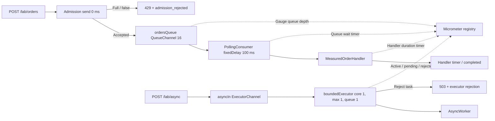
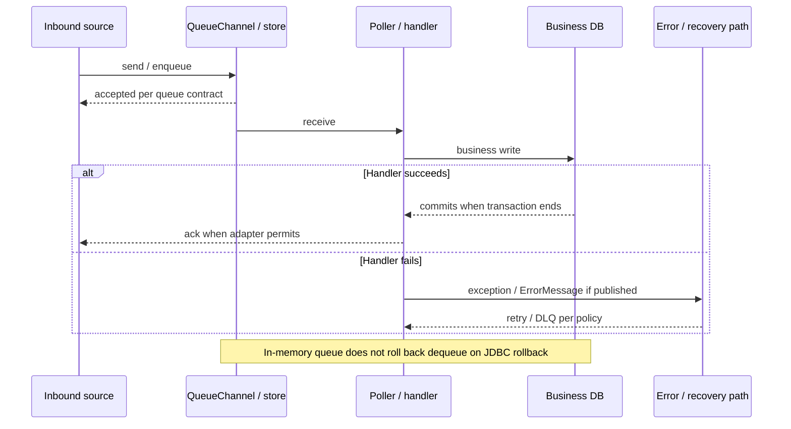
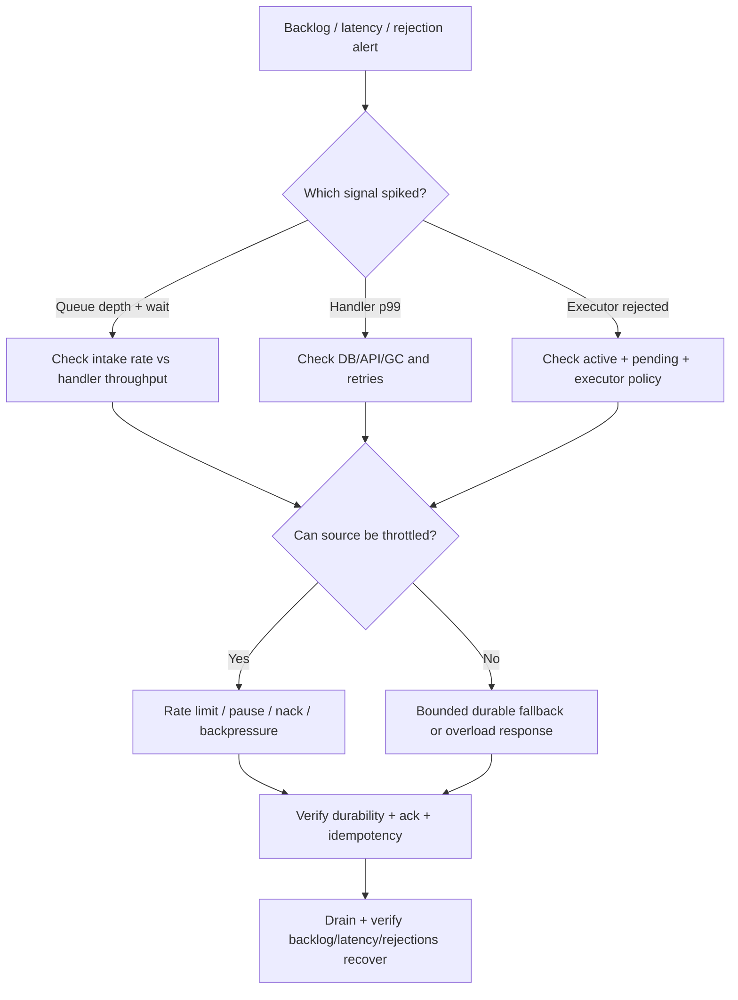

# Measuring Queue Depth, Handler Latency, and Executor Rejections in Spring Integration

## 1. Synthesis Lab: Spotting Bottlenecks Before the System Overloads

In the **Hands-On Project** chapter of the `SPRING_INTEGRATION_RUNTIME` module, we have worked with `IntegrationFlow` lifecycles, channels, endpoints, consumers, pollers, and executors, as well as transactions, retries, message stores, errors, and correlation. This lesson combines those concepts into **one reproducible measurement lab**: an HTTP endpoint pushes messages into a `QueueChannel`, a polling consumer calls a handler with simulated latency, and a separate branch uses an `ExecutorChannel` backed by a bounded thread pool to induce task rejections.

Three signals to measure:

1. **Queue depth** — how many messages are **waiting inside a specific queue** at sampling time?
2. **Handler latency** — how long does **the handler actually spend working**, and is it being confused with queue wait time?
3. **Executor rejections** — how many times did the executor **refuse a task at submission time** due to zero remaining capacity?

The goal goes beyond drawing a dashboard. After every measurement, you should be able to explain **which items were accepted**, **which items were rejected**, **which stage is bottlenecked**, and **what happens if the application dies before commit/ack**.

### Expected Outcomes

- A small Spring Boot/Spring Integration app featuring a bounded `QueueChannel`, a polling handler, and an `ExecutorChannel` backed by a bounded `ThreadPoolTaskExecutor`.
- Micrometer `Gauge`s for queue depth/capacity and executor pending/active counts.
- Micrometer `Timer`s separating **queue wait** from **handler execution time**, with histograms for p95/p99.
- Micrometer `Counter`s for admission accepted/rejected and executor rejections.
- HTTP/Actuator endpoints to inject synthetic workloads and read metrics.
- JUnit 5 tests verifying full queues, timer recording, and deterministic executor rejections using latches **without relying on `Thread.sleep()` for test synchronization**.
- Load/stress scenarios, PromQL queries, alerts, a runbook, and a failure/restart matrix.

**Scope:** the code below is an **in-memory lab**, not a production order-queue system. Payloads and delays are simulated; never put real credentials or PII into logs or metrics. Production deployments must add durable sources/message stores, transactions/acks, retries, DLQs, and idempotency.

## 2. Topology and Measurement Boundaries

The application has **two independent branches**, because queue depth and executor rejections occur at two distinct points.



**Measurement placement matters:**

| Signal | Start and End | What It Measures | What It Does Not Measure |
|---|---|---|---|
| `queue.depth` | Snapshot of items sitting in `ordersQueue` | Backlog **inside this channel** | Items already dequeued yet unfinished, broker lag, executor queue |
| `queue.remaining` | Snapshot of free slots | Remaining capacity by count at sample time | Free heap bytes or durable acceptance |
| `queue.wait` | Send into queue until handler invocation | Wait latency inside the **current JVM** | Pre-ingress broker time or post-handler time |
| `handler.duration` | Handler starts work → finishes/throws | Synchronous work duration of the demo handler | Time spent waiting in the queue |
| `executor.pending` | Snapshot of executor task queue | Tasks submitted yet not picked up by a worker | Running work, JDBC pool pending, source backlog |
| `executor.active` | Snapshot of active threads | Workers currently executing tasks | Messages waiting in other stages |
| `executor.rejected` | Incremented when `RejectedExecutionHandler` runs | Tasks refused by the executor at submit time | Handler failures thrown **after submission succeeded** |

A message can cross multiple queues; **never infer total backlog from a single `QueueChannel.getQueueSize()`**. Likewise, `ExecutorChannel.send()` returning true only proves the task was accepted—not that the handler finished or the database committed.

## 3. Project Setup and How to Run

Examples target **Java 17+**, Spring Boot 3.x compatible with Spring Integration 6.x, and Micrometer/Actuator managed via the BOM. On Spring Boot 4.x or Spring Integration 7.x, keep the same measurement principles while verifying exact APIs, starters, and configuration for your version.

### 3.1. Illustrative Gradle Dependencies

```groovy
plugins {
    id "java"
    id "org.springframework.boot" version "3.5.16"
    id "io.spring.dependency-management" version "1.1.7"
}

java {
    toolchain {
        languageVersion = JavaLanguageVersion.of(17)
    }
}

repositories {
    mavenCentral()
}

dependencies {
    implementation "org.springframework.boot:spring-boot-starter-web"
    implementation "org.springframework.boot:spring-boot-starter-integration"
    implementation "org.springframework.boot:spring-boot-starter-actuator"

    runtimeOnly "io.micrometer:micrometer-registry-prometheus"

    testImplementation "org.springframework.boot:spring-boot-starter-test"
}

tasks.named("test") {
    useJUnitPlatform()
}
```

The example pins Spring Boot **3.5.16** and the dependency-management plugin **1.1.7** so learners have a reproducible Java 17/Gradle setup. The Boot 3.5.x line has reached the end of its OSS release lifecycle; **do not use this version as a production security recommendation in November 2026**. For new or active production services, choose a supported Boot release with a BOM-compatible Spring Integration version and re-test APIs. Never mix incompatible Spring Framework, Spring Integration, and Boot major/minor lines manually.

### 3.2. Actuator Configuration

File `src/main/resources/application.yml`:

```yaml
server:
  port: 8080

management:
  endpoints:
    web:
      exposure:
        include: health,info,metrics,prometheus
  endpoint:
    health:
      show-details: never

logging:
  level:
    root: INFO
```

Once running, key endpoints:

- `GET /actuator/metrics`: lists meter names registered in the current registry.
- `GET /actuator/metrics/lab.si.queue.depth`: reads the lab's custom gauge.
- `GET /actuator/metrics/lab.si.handler.duration`: shows recorded handler `count` and timings.
- `GET /actuator/prometheus`: exposes Prometheus scrape format when `micrometer-registry-prometheus` is present.

Actuator endpoints require **proper network policies and authentication/authorization** when deployed; a local development setup is not a production access posture. Never expose sensitive management endpoints unconditionally.

## 4. Distinguishing Built-In Meters from Custom Meters

Spring Integration supports Micrometer metrics on components such as `AbstractMessageChannel`, `AbstractMessageHandler`, and `AbstractMessageSource`. The reference guide also documents `QueueChannel` gauges:

| Framework Meter (When Instrumented) | Meaning |
|---|---|
| `spring.integration.channel.queue.size` | Message count in `QueueChannel`, typically tagged with type/channel name |
| `spring.integration.channel.queue.remaining.capacity` | Remaining slots in the queue |
| `spring.integration.send` | Channel/handler send duration under classic Micrometer instrumentation |
| `spring.integration.receive` | Receive count on applicable channels/sources |
| `spring.integration.handler` | Timer via **Micrometer Observation** when Observation is enabled and instrumenting handlers |
| `spring.integration.handler.active` | Long-task timer for handlers via Observation |
| `spring.integration.producer` | Producer/channel timer via Observation |

**Classic metrics and Observation do not share identical meter names or activation switches.** Per modern Spring Integration docs, `@EnableIntegrationManagement` and `ObservationRegistry` exist, yet default `observationPatterns` do not instrument every component automatically. To instrument selectively, verify the registry, annotations/patterns, and live runtime output. Never assume `spring.integration.handler` is emitted merely because Actuator is on the classpath.

To keep this lab **independent of framework version and meter naming**, we also register a dedicated `lab.si.*` namespace. If the registry also emits Spring Integration's default meters, **do not sum them with the lab meters** when computing throughput, or you will double-count.

### Contract for the Lab's Custom Meters

| Custom Meter | Type | Low-Cardinality Tags | Unit |
|---|---|---|---|
| `lab.si.queue.depth` | Gauge | `channel=ordersQueue` | messages |
| `lab.si.queue.remaining` | Gauge | `channel=ordersQueue` | slots |
| `lab.si.queue.capacity` | Gauge | `channel=ordersQueue` | slots |
| `lab.si.queue.wait` | Timer | `handler=orders` | time |
| `lab.si.handler.duration` | Timer | `handler=orders` or `handler=async` | time |
| `lab.si.handler.completed` | Counter | `handler=orders` | events |
| `lab.si.handler.failed` | Counter | `handler=orders` | events |
| `lab.si.admission.accepted` | Counter | `route=orders` | messages |
| `lab.si.admission.rejected` | Counter | `route=orders` | messages |
| `lab.si.executor.active` | Gauge | `executor=boundedExecutor` | threads |
| `lab.si.executor.pending` | Gauge | `executor=boundedExecutor` | tasks |
| `lab.si.executor.rejected` | Counter | `executor=boundedExecutor` | tasks |

Never put `eventId`, message UUIDs, emails, tokens, raw exception text, or unbounded tenant IDs into metric labels. Those create **extreme cardinality** and risk leaking sensitive data. Keep correlation IDs in controlled traces and structured logs, not metric tags.

## 5. Application Code: Messages, Channels, and Bounded Executor

Place the `public` classes under package `lab.runtime`, **each in its own `.java` file**. The snippets below form one cohesive project.

### 5.1. Entry Point

File `RuntimeMetricsLabApplication.java`:

```java
package lab.runtime;

import org.springframework.boot.SpringApplication;
import org.springframework.boot.autoconfigure.SpringBootApplication;
import org.springframework.integration.config.EnableIntegration;

@SpringBootApplication
@EnableIntegration
public class RuntimeMetricsLabApplication {

    public static void main(String[] args) {
        SpringApplication.run(RuntimeMetricsLabApplication.class, args);
    }
}
```

### 5.2. Simulated Work Payload

File `WorkItem.java`:

```java
package lab.runtime;

public record WorkItem(String eventId, int workMillis) {
}
```

`workMillis` is an artificial delay introduced in the lab to make saturation visible. The app must validate `0 <= workMillis <= 1500` at ingress; **never** let untrusted inputs sleep threads unboundedly. In production, replace simulated work with real services/adapters, explicit timeouts, and proper transactions.

### 5.3. Channels, Executor, and Gauges

File `RuntimeFlowConfig.java`:

```java
package lab.runtime;

import java.util.concurrent.RejectedExecutionException;

import io.micrometer.core.instrument.Counter;
import io.micrometer.core.instrument.Gauge;
import io.micrometer.core.instrument.MeterRegistry;

import org.springframework.beans.factory.annotation.Qualifier;
import org.springframework.boot.ApplicationRunner;
import org.springframework.context.annotation.Bean;
import org.springframework.context.annotation.Configuration;
import org.springframework.integration.channel.ExecutorChannel;
import org.springframework.integration.channel.QueueChannel;
import org.springframework.messaging.MessageChannel;
import org.springframework.scheduling.concurrent.ThreadPoolTaskExecutor;

@Configuration
public class RuntimeFlowConfig {

    public static final int ORDER_QUEUE_CAPACITY = 16;

    @Bean("ordersQueue")
    public QueueChannel ordersQueue() {
        return new QueueChannel(ORDER_QUEUE_CAPACITY);
    }

    @Bean("boundedExecutor")
    public ThreadPoolTaskExecutor boundedExecutor(
            MeterRegistry meterRegistry) {

        Counter rejects = Counter
                .builder("lab.si.executor.rejected")
                .description("Tasks rejected at executor submission")
                .tag("executor", "boundedExecutor")
                .register(meterRegistry);

        ThreadPoolTaskExecutor executor = new ThreadPoolTaskExecutor();
        executor.setThreadNamePrefix("lab-async-");
        executor.setCorePoolSize(1);
        executor.setMaxPoolSize(1);
        executor.setQueueCapacity(1);

        executor.setRejectedExecutionHandler(
                (task, threadPool) -> {
                    rejects.increment();
                    throw new RejectedExecutionException(
                            "boundedExecutor saturated");
                });

        return executor;
    }

    @Bean("asyncIn")
    public MessageChannel asyncIn(
            @Qualifier("boundedExecutor")
            ThreadPoolTaskExecutor boundedExecutor) {
        return new ExecutorChannel(boundedExecutor);
    }

    @Bean
    public ApplicationRunner registerLiveGauges(
            MeterRegistry registry,
            @Qualifier("ordersQueue") QueueChannel queue,
            @Qualifier("boundedExecutor") ThreadPoolTaskExecutor executor) {

        return args -> {
            Gauge.builder("lab.si.queue.depth",
                    queue, QueueChannel::getQueueSize)
                    .description("Messages waiting in ordersQueue")
                    .tag("channel", "ordersQueue")
                    .register(registry);

            Gauge.builder("lab.si.queue.remaining",
                    queue, QueueChannel::getRemainingCapacity)
                    .tag("channel", "ordersQueue")
                    .register(registry);

            Gauge.builder("lab.si.queue.capacity",
                    queue, q -> ORDER_QUEUE_CAPACITY)
                    .tag("channel", "ordersQueue")
                    .register(registry);

            Gauge.builder("lab.si.executor.active",
                    executor, ThreadPoolTaskExecutor::getActiveCount)
                    .tag("executor", "boundedExecutor")
                    .register(registry);

            Gauge.builder("lab.si.executor.pending",
                    executor,
                    e -> e.getThreadPoolExecutor().getQueue().size())
                    .tag("executor", "boundedExecutor")
                    .register(registry);
        };
    }
}
```

**Technical notes:**

1. `QueueChannel(16)` caps **message count**, not 16 bytes/KiB.
2. `setCorePoolSize(1)`, `setMaxPoolSize(1)`, and `setQueueCapacity(1)` create an easily saturated executor: one task runs, one waits, and the next gets rejected.
3. `RejectedExecutionHandler` increments the `Counter` **when the executor refuses submission**. If a handler fails later while executing, this counter **does not** increment.
4. When managed as a Spring bean, `ThreadPoolTaskExecutor` is initialized and shut down by lifecycle; do not manually call `initialize()` twice on that bean.
5. `ApplicationRunner` registers gauges after Spring Boot finishes startup and beans exist. A gauge is a **point-in-time state reading**, not an event counter.
6. Binding gauges directly to the `queue` and `executor` bean references ensures measurements reflect the **exact live instances**. Creating a separate queue instance inside instrumentation would report bogus metrics.
7. Never call `QueueChannel.clear()` to "shrink queue depth" under overload in production: that discards unprocessed work.

`active` plus `pending` is not the total backlog sitting in an upstream broker. An executor-accepted task may not have entered the handler yet, and once the async handler starts running, the task leaves the pending queue.

## 6. Handler Latency and Queue Wait Are Two Different Measurements

### 6.1. Using a Monotonic Clock for In-JVM Queues

At ingress, we set the header `enqueuedAtNanos=System.nanoTime()` right before sending to `ordersQueue`. When the polling consumer pulls the message and invokes the handler, it computes:

\[
\text{queueWaitNanos} =
  \max(0,\ \text{System.nanoTime()} -
               \text{enqueuedAtNanos})
\]

`System.nanoTime()` is suited for **elapsed durations within one JVM**, even across threads; it is **not a wall-clock timestamp** and must **never be persisted across restarts or compared across hosts**. When measuring broker lag or persistent store age across JVMs, use source creation/append timestamps and account for clock skew per contract.

`queue.wait` records a sample only when a message **reaches the handler**. If messages sit stuck in the backlog or are dropped/failed before reaching the handler, no sample is emitted. Consequently, the queue wait histogram can look healthy while the oldest messages remain stranded—also measure **oldest pending age** at the source or store when required.

### 6.2. Handler with Independent Timers

File `MeasuredOrderHandler.java`:

```java
package lab.runtime;

import java.util.concurrent.TimeUnit;

import io.micrometer.core.instrument.Counter;
import io.micrometer.core.instrument.MeterRegistry;
import io.micrometer.core.instrument.Timer;

import org.springframework.integration.annotation.MessageEndpoint;
import org.springframework.integration.annotation.Poller;
import org.springframework.integration.annotation.ServiceActivator;
import org.springframework.messaging.Message;

@MessageEndpoint
public class MeasuredOrderHandler {

    private final MeterRegistry registry;
    private final Timer handlerTimer;
    private final Timer queueWaitTimer;
    private final Counter completed;
    private final Counter failed;

    public MeasuredOrderHandler(MeterRegistry registry) {
        this.registry = registry;

        this.handlerTimer = Timer
                .builder("lab.si.handler.duration")
                .description("Synchronous work inside order handler")
                .tag("handler", "orders")
                .publishPercentileHistogram()
                .register(registry);

        this.queueWaitTimer = Timer
                .builder("lab.si.queue.wait")
                .description("Time from local enqueue to handler invocation")
                .tag("handler", "orders")
                .publishPercentileHistogram()
                .register(registry);

        this.completed = registry.counter(
                "lab.si.handler.completed", "handler", "orders");
        this.failed = registry.counter(
                "lab.si.handler.failed", "handler", "orders");
    }

    @ServiceActivator(
            inputChannel = "ordersQueue",
            poller = @Poller(
                    fixedDelay = "100",
                    maxMessagesPerPoll = "1",
                    receiveTimeout = "0"))
    public void handle(Message<WorkItem> message) {
        Object stamp = message.getHeaders().get("enqueuedAtNanos");

        if (stamp instanceof Long enqueueNanoTime) {
            long queueWait = Math.max(
                    0L, System.nanoTime() - enqueueNanoTime);
            queueWaitTimer.record(queueWait, TimeUnit.NANOSECONDS);
        }

        Timer.Sample sample = Timer.start(registry);

        try {
            simulateBlockingWork(message.getPayload().workMillis());
            completed.increment();
        } catch (RuntimeException failure) {
            failed.increment();
            throw failure;
        } finally {
            sample.stop(handlerTimer);
        }
    }

    static void simulateBlockingWork(int millis) {
        try {
            // Lab-only latency simulation; never use in production.
            Thread.sleep(millis);
        } catch (InterruptedException interrupted) {
            Thread.currentThread().interrupt();
            throw new IllegalStateException(
                    "Handler interrupted", interrupted);
        }
    }
}
```

In this code:

- `queueWaitTimer` is recorded **before** starting `handlerTimer`; never merge them into "handler latency".
- `Timer.Sample` stops inside `finally`, so failed handler invocations still record a **duration sample**.
- `completed` increments only after simulated work succeeds. In real systems with DB transactions, **do not assume counter increments prove DB commit** if commits happen outside the method or side effects are async.
- `failed` captures exceptions thrown inside this method, **not** executor rejections before the method runs.
- `fixedDelay=100` with `maxMessagesPerPoll=1` allows the queue to build backlog easily in load tests. It does not mean "strictly 10 messages/second": handler duration and scheduler jitter also affect cadence.

**On test stability:** `Thread.sleep` is **intentionally** used inside the demo handler to create observable latency; **never use sleep to synchronize assertions**. Subsequent tests use latches, timer counts, and bounded timeouts.

### 6.3. Async Handler on `ExecutorChannel`

File `AsyncWorker.java`:

```java
package lab.runtime;

import io.micrometer.core.instrument.MeterRegistry;
import io.micrometer.core.instrument.Timer;

import org.springframework.integration.annotation.MessageEndpoint;
import org.springframework.integration.annotation.ServiceActivator;

@MessageEndpoint
public class AsyncWorker {

    private final Timer handlerTimer;

    public AsyncWorker(MeterRegistry registry) {
        this.handlerTimer = Timer
                .builder("lab.si.handler.duration")
                .description("Synchronous work inside async worker")
                .tag("handler", "async")
                .publishPercentileHistogram()
                .register(registry);
    }

    @ServiceActivator(inputChannel = "asyncIn")
    public void handle(WorkItem item) {
        handlerTimer.record(
                () -> MeasuredOrderHandler.simulateBlockingWork(
                        item.workMillis()));
    }
}
```

In this lab, `AsyncWorker` executes synchronously **on the worker thread**, so the timer records once the work completes. If a future handler returns `Mono<?>`, `CompletableFuture<?>`, or starts an async task and returns immediately, timing only the submission call **does not reflect actual completion duration**. Place timers in completion callbacks or reactive `doFinally`/`doOnEach` hooks instead, verifying cancellation and error semantics.

## 7. Injecting Workloads and Classifying Overload at Ingress

File `LabIngressController.java`:

```java
package lab.runtime;

import java.util.Map;

import io.micrometer.core.instrument.Counter;
import io.micrometer.core.instrument.MeterRegistry;

import org.springframework.beans.factory.annotation.Qualifier;
import org.springframework.core.task.TaskRejectedException;
import org.springframework.http.HttpStatus;
import org.springframework.http.ResponseEntity;
import org.springframework.integration.channel.QueueChannel;
import org.springframework.messaging.MessageChannel;
import org.springframework.messaging.MessageDeliveryException;
import org.springframework.messaging.support.MessageBuilder;
import org.springframework.web.bind.annotation.PostMapping;
import org.springframework.web.bind.annotation.RequestBody;
import org.springframework.web.bind.annotation.RequestMapping;
import org.springframework.web.bind.annotation.RestController;

@RestController
@RequestMapping("/lab")
public class LabIngressController {

    private final QueueChannel queue;
    private final MessageChannel asyncIn;

    private final Counter ordersAccepted;
    private final Counter ordersRejected;

    public LabIngressController(
            @Qualifier("ordersQueue") QueueChannel queue,
            @Qualifier("asyncIn") MessageChannel asyncIn,
            MeterRegistry registry) {

        this.queue = queue;
        this.asyncIn = asyncIn;

        this.ordersAccepted = registry.counter(
                "lab.si.admission.accepted", "route", "orders");
        this.ordersRejected = registry.counter(
                "lab.si.admission.rejected", "route", "orders");
    }

    private static boolean valid(WorkItem item) {
        return item != null
                && item.eventId() != null
                && item.eventId().matches("[A-Za-z0-9_-]{1,80}")
                && item.workMillis() >= 0
                && item.workMillis() <= 1500;
    }

    @PostMapping("/orders")
    public ResponseEntity<Map<String, String>> orders(
            @RequestBody WorkItem item) {

        if (!valid(item)) {
            return ResponseEntity.badRequest()
                    .body(Map.of("status", "invalid"));
        }

        boolean accepted = queue.send(
                MessageBuilder.withPayload(item)
                        .setHeader("enqueuedAtNanos", System.nanoTime())
                        .setHeader("businessEventId", item.eventId())
                        .build(),
                0); // Do not block the request thread waiting for a slot.

        if (!accepted) {
            ordersRejected.increment();
            return ResponseEntity.status(HttpStatus.TOO_MANY_REQUESTS)
                    .body(Map.of("status", "queue_full"));
        }

        ordersAccepted.increment();
        return ResponseEntity.accepted()
                .body(Map.of("status", "queued_in_memory"));
    }

    @PostMapping("/async")
    public ResponseEntity<Map<String, String>> async(
            @RequestBody WorkItem item) {

        if (!valid(item)) {
            return ResponseEntity.badRequest()
                    .body(Map.of("status", "invalid"));
        }

        try {
            boolean submitted = asyncIn.send(
                    MessageBuilder.withPayload(item).build(), 0);

            if (!submitted) {
                return ResponseEntity.status(
                        HttpStatus.SERVICE_UNAVAILABLE)
                        .body(Map.of("status", "not_submitted"));
            }

            return ResponseEntity.accepted()
                    .body(Map.of("status", "submitted_to_executor"));
        } catch (MessageDeliveryException | TaskRejectedException problem) {
            // Lab: treat expected handoff errors uniformly.
            // Production: classify exact causes, alert on
            // misconfiguration, never treat EVERY exception as overload.
            return ResponseEntity.status(HttpStatus.SERVICE_UNAVAILABLE)
                    .body(Map.of("status", "async_handoff_failed"));
        }
    }
}
```

**Contract to read carefully:**

- `202 queued_in_memory` only states that `QueueChannel` accepted the message **in JVM RAM**. If the process crashes, unprocessed work can be lost.
- `202 submitted_to_executor` only states that `ExecutorChannel`/executor accepted the task; it does **not** confirm handler completion.
- `429 queue_full` states the current admission failed; HTTP callers need clear retry and idempotency-key contracts.
- `503 async_handoff_failed` in production must distinguish causes: an executor rejecting due to overload differs from having no subscribers, misconfiguration, or other dispatch failures. `lab.si.executor.rejected` increments strictly on **executor rejections**.
- Header `enqueuedAtNanos` is for **local** measurement only; never persist or replay it across JVMs and compare against a new `System.nanoTime()`.
- Never promote `eventId`, payload fields, tokens, emails, or raw exception messages into metric tags or default logs.

In real HTTP systems with client retries, 429/503 responses must pair with **at-least-once + idempotency** contracts if a command could have been accepted at any hop. Never return `202` from an upstream adapter before confirming durable persistence matching your business SLO.

## 8. Running the Lab and Reading Metrics

### 8.1. Starting the Application

Once compatible dependency versions are selected:

```bash
./gradlew bootRun
```

On Windows, run `gradlew.bat bootRun` in the project terminal. Per STEP 4 Worker constraints, these are **instructions for learners**—not a claim that builds or tests ran automatically during authoring.

Send one test message:

```bash
curl -i -X POST http://localhost:8080/lab/orders \
  -H "Content-Type: application/json" \
  -d '{"eventId":"evt-001","workMillis":500}'
```

Inspect meter metadata:

```bash
curl -s http://localhost:8080/actuator/metrics
curl -s http://localhost:8080/actuator/metrics/lab.si.queue.depth
curl -s http://localhost:8080/actuator/metrics/lab.si.queue.remaining
curl -s http://localhost:8080/actuator/metrics/lab.si.handler.duration
curl -s http://localhost:8080/actuator/metrics/lab.si.executor.rejected
```

Some timer/counter meters appear only after the flow executes at least once; exact names/tags can depend on registry configuration. Always check `/actuator/metrics` first rather than assuming meters exist before any events run.

### 8.2. Burst Test to Fill the Queue

In a terminal for local testing:

```bash
for i in $(seq 1 80); do
  curl -s -o /dev/null -w '%{http_code}\n' \
    -X POST http://localhost:8080/lab/orders \
    -H 'Content-Type: application/json' \
    -d "{\"eventId\":\"burst-$i\",\"workMillis\":700}" &
done
wait
```

This is bash with `curl`; on PowerShell, issue equivalent concurrent requests. With a single-poller consumer simulating 700 ms work, queue capacity 16 fills rapidly. **Never claim every run yields exactly 16 HTTP 202s**: the poller may drain items mid-burst, HTTP concurrency varies, and scrape timing shifts.

Observations:

- `lab.si.queue.depth` rises as backlog accumulates and drops as the poller drains it.
- `lab.si.queue.remaining` drops toward 0 when the queue fills.
- `lab.si.admission.accepted` / `rejected` report **ingress admission outcomes**.
- `lab.si.queue.wait` grows with backlog depth for the later items that reach the handler.
- `lab.si.handler.duration` hovers around the simulated work delay; it does not grow linearly with backlog if handler speed stays constant.
- `lab.si.executor.rejected` **does not need to rise** in this test because the executor branch is separate.

**Key lesson:** queue wait p95 can degrade badly as queue depth grows even while handler latency stays flat. Watching only the handler timer misses most of the user-perceived delay.

### 8.3. Triggering Executor Rejections

```bash
for i in $(seq 1 30); do
  curl -s -o /dev/null -w '%{http_code}\n' \
    -X POST http://localhost:8080/lab/async \
    -H 'Content-Type: application/json' \
    -d "{\"eventId\":\"async-$i\",\"workMillis\":1000}" &
done
wait
```

With `core=1, max=1, queueCapacity=1`, once one task is running and one is queued, subsequent submissions get rejected under the lab's `AbortPolicy`. Expected signs:

- Some requests return `503` instead of `202`.
- `lab.si.executor.rejected` increments inside **`RejectedExecutionHandler`**, not inside the handler.
- `lab.si.executor.active` peaks at 1 per configuration.
- `lab.si.executor.pending` peaks at 1 per configuration.
- `lab.si.handler.duration{handler="async"}` records samples only for tasks that actually ran; rejected tasks produce no handler sample.

Gauge snapshots are scraped asynchronously, so they **can miss brief peaks** of 1 active/pending task during short bursts. The rejection counter retains the cumulative total over the process lifetime; use `rate()` for windowed rejection rates.

## 9. JUnit 5: Testing Queue Depth Independently of the Poller

A deterministic test should isolate `QueueChannel` so no poller drains messages between assertions.

File `QueueDepthTest.java`:

```java
package lab.runtime;

import io.micrometer.core.instrument.Gauge;
import io.micrometer.core.instrument.simple.SimpleMeterRegistry;
import org.junit.jupiter.api.Test;
import org.springframework.integration.channel.QueueChannel;
import org.springframework.messaging.support.MessageBuilder;

import static org.junit.jupiter.api.Assertions.*;

class QueueDepthTest {

    @Test
    void gaugeTracksMessagesWaitingInQueue() {
        try (var registry = new SimpleMeterRegistry()) {
            QueueChannel queue = new QueueChannel(2);

            Gauge depth = Gauge.builder(
                    "lab.si.queue.depth",
                    queue, QueueChannel::getQueueSize)
                    .register(registry);

            Gauge remaining = Gauge.builder(
                    "lab.si.queue.remaining",
                    queue, QueueChannel::getRemainingCapacity)
                    .register(registry);

            assertEquals(0.0, depth.value());
            assertEquals(2.0, remaining.value());

            assertTrue(queue.send(
                    MessageBuilder.withPayload("A").build(), 0));
            assertTrue(queue.send(
                    MessageBuilder.withPayload("B").build(), 0));

            assertEquals(2.0, depth.value());
            assertEquals(0.0, remaining.value());

            // Cannot accept more; queue still holds 2 items.
            assertFalse(queue.send(
                    MessageBuilder.withPayload("C").build(), 0));
            assertEquals(2.0, depth.value());

            assertEquals("A", queue.receive(0).getPayload());
            assertEquals(1.0, depth.value());
            assertEquals(1.0, remaining.value());
        }
    }
}
```

**What is proven:** the gauge tracks this queue instance, `send(...,0)` returns `false` when full, and `receive(0)` frees a slot.

**What is not proven:** whether the queue survives restarts, whether the handler succeeded, or whether the controller returned HTTP 429. Those require dedicated integration tests. Using a standalone `QueueChannel` **with no polling consumer** eliminates races changing depth between assertions.

### 9.1. Why Not Assert Exact Queue Depth in Production?

The instant a gauge reads `depth=10`, the polling consumer may have already dequeued another message. The reading is a **point-in-time approximation**, not a system-wide transactional snapshot. Never write an alert saying "`depth == capacity` on a single scrape proves all ingress is currently rejected."

Also, if a poller hands off to a separate executor, `QueueChannel` may sit near 0 while executor pending tasks pile up. A proper dashboard monitors **every buffer and in-flight stage**.

## 10. JUnit 5: Are Handler Timers and Queue Wait Recorded Properly?

File `HandlerMetricsTest.java` tests the handler class using `SimpleMeterRegistry` without starting an HTTP server or poller:

```java
package lab.runtime;

import java.util.concurrent.TimeUnit;

import io.micrometer.core.instrument.Timer;
import io.micrometer.core.instrument.simple.SimpleMeterRegistry;

import org.junit.jupiter.api.Test;
import org.springframework.messaging.support.MessageBuilder;

import static org.junit.jupiter.api.Assertions.*;

class HandlerMetricsTest {

    @Test
    void recordsWorkDurationSeparatelyFromQueueWait() {
        try (var registry = new SimpleMeterRegistry()) {
            var handler = new MeasuredOrderHandler(registry);

            var message = MessageBuilder
                    .withPayload(new WorkItem("evt-test", 0))
                    .setHeader("enqueuedAtNanos", System.nanoTime())
                    .build();

            handler.handle(message);

            Timer work = registry.find("lab.si.handler.duration")
                    .tag("handler", "orders").timer();
            Timer queueWait = registry.find("lab.si.queue.wait")
                    .tag("handler", "orders").timer();

            assertNotNull(work);
            assertNotNull(queueWait);
            assertEquals(1L, work.count());
            assertEquals(1L, queueWait.count());
            assertEquals(1.0, registry.find(
                    "lab.si.handler.completed")
                    .tag("handler", "orders")
                    .counter().count());

            assertTrue(work.totalTime(TimeUnit.NANOSECONDS) >= 0);
            assertTrue(queueWait.totalTime(TimeUnit.NANOSECONDS) >= 0);
        }
    }
}
```

Never write `assertEquals(700ms, timer.totalTime())` in tests: execution times depend on schedulers, CPUs, and CI load, and this test uses 0 delay to focus on the **metric-recording contract**. In an integration test, send through `ordersQueue` and await `timer.count()` rising within a timeout; the unit test above proves the class's meter logic, **not** that Spring wired the endpoint to the right channel.

### 10.1. Testing When the Handler Throws

Add controllable fault injection, such as a mock `WorkService` throwing after starting. Suitable assertions:

- `handler.duration.count` increments **even on failure**, because `sample.stop(...)` sits in `finally`.
- `handler.failed` increments; `handler.completed` does not increment for that attempt.
- The poller/error handler processes the exception per actual configuration—**never assume** errors automatically land on the global `errorChannel`.
- If retry advice re-invokes the handler, one **logical message** can generate multiple handler attempts and timer samples.

Measuring **attempt latency** differs from measuring **end-to-end successful completion latency**. With retries and backoff, end-to-end time can exceed the sum of individual handler work durations.

## 11. JUnit 5: Deterministic Executor Rejections Using Latches

Trying to trigger rejections merely with `sleep(1000)` and firing three tasks quickly can flake on CI: workers may finish early or schedule unexpectedly.

Use `CountDownLatch` to hold **the first task running**, let the second task occupy **the single queue slot**, and then submit the third task. That deterministically produces saturation without depending on random timing.

File `ExecutorRejectionTest.java`:

```java
package lab.runtime;

import java.util.concurrent.CountDownLatch;
import java.util.concurrent.RejectedExecutionException;
import java.util.concurrent.TimeUnit;

import io.micrometer.core.instrument.Counter;
import io.micrometer.core.instrument.simple.SimpleMeterRegistry;

import org.junit.jupiter.api.Test;
import org.springframework.integration.channel.ExecutorChannel;
import org.springframework.messaging.support.MessageBuilder;
import org.springframework.scheduling.concurrent.ThreadPoolTaskExecutor;

import static org.junit.jupiter.api.Assertions.*;

class ExecutorRejectionTest {

    @Test
    void recordsRejectionAtSubmissionBeforeHandlerRuns()
            throws Exception {

        try (var registry = new SimpleMeterRegistry()) {
            Counter rejection = Counter.builder(
                    "lab.si.executor.rejected")
                    .tag("executor", "testExecutor")
                    .register(registry);

            var executor = new ThreadPoolTaskExecutor();
            executor.setCorePoolSize(1);
            executor.setMaxPoolSize(1);
            executor.setQueueCapacity(1);
            executor.setRejectedExecutionHandler((task, pool) -> {
                rejection.increment();
                throw new RejectedExecutionException("full");
            });
            executor.initialize();

            CountDownLatch started = new CountDownLatch(1);
            CountDownLatch release = new CountDownLatch(1);

            ExecutorChannel channel = new ExecutorChannel(executor);
            channel.subscribe(message -> {
                if ("first".equals(message.getPayload())) {
                    started.countDown();
                    try {
                        if (!release.await(5, TimeUnit.SECONDS)) {
                            throw new IllegalStateException("test timeout");
                        }
                    } catch (InterruptedException interrupted) {
                        Thread.currentThread().interrupt();
                    }
                }
            });

            try {
                assertTrue(channel.send(MessageBuilder
                        .withPayload("first").build(), 0));

                assertTrue(started.await(2, TimeUnit.SECONDS));

                assertTrue(channel.send(MessageBuilder
                        .withPayload("second").build(), 0));

                // First task is running; second is waiting in the queue.
                assertThrows(RuntimeException.class,
                        () -> channel.send(MessageBuilder
                                .withPayload("third").build(), 0));

                assertEquals(1.0, rejection.count());
            } finally {
                release.countDown();
                executor.shutdown();
            }
        }
    }
}
```

**Explaining the assertions:**

1. `started.await(...)` proves the first task **entered the handler** and is waiting on `release`.
2. The pool has 1 worker, so the second task enters the queue while the first holds the worker.
3. Queue capacity 1 is full; submitting the third task triggers the rejection handler to increment the counter and throw. Because `ExecutorChannel`/dispatcher layers may wrap exceptions in `MessagingException`/`MessageDeliveryException`, the test asserts `RuntimeException` and separately asserts **the counter equals exactly 1**.
4. `finally` always releases the latch and shuts down the executor so CI never hangs.
5. This tests **submission/rejection behavior**. Do not infer that a business transaction, broker ack, or DLQ handled the third message—it was refused at the tested boundary and requires a recovery policy with real sources.

With multiple subscribers or failover dispatchers, the dispatcher might try another handler; production tests must check exact submission counts and version-specific exception mapping. A single subscriber in this fixture keeps assertions clear.

### 11.1. Why Is a Handler Failure Not an Executor Rejection?

Once the executor accepts the second task, its handler may throw `IllegalStateException` on the worker thread. That is a **processing failure**, not a `RejectedExecutionHandler` event. Record it via the appropriate error channel, async `ErrorHandler`, or retry policy—**never** increment `lab.si.executor.rejected`.

Track at least three distinct counters:

- **Admission rejection:** channel/ingress refused the incoming message.
- **Executor submission rejection:** executor refused the runnable.
- **Handler processing failure:** runnable executed yet business logic failed.

Mixing them prevents dashboards from telling you whether to **throttle intake**, **scale executors**, or **fix business bugs**.

## 12. Querying with Prometheus and PromQL

Micrometer typically converts dots in meter names to underscores in Prometheus, and timers export `_seconds_count`, `_seconds_sum`, and `_seconds_bucket` (when histograms are enabled). Verify exact names via `/actuator/prometheus`, as registries, versions, and configs can change naming conventions.

### 12.1. Queue Utilization

```promql
lab_si_queue_depth{channel="ordersQueue"}
/
clamp_min(lab_si_queue_capacity{channel="ordersQueue"}, 1)
```

For example, gauge `depth=12` and `capacity=16` yields 75% utilization. This shows only **slot occupancy**, not heap percentage or latency percentiles.

Rate of ingress rejections:

```promql
sum by (route) (
  rate(lab_si_admission_rejected_total[5m])
)
```

Rate of executor submission rejections:

```promql
sum by (executor) (
  rate(lab_si_executor_rejected_total[5m])
)
```

If `executor.pending` always looks tiny while the rejection rate climbs, the queue may have only 1 slot filling in sub-scrape bursts. Never conclude "zero rejections" from a gauge snapshot reading 0.

### 12.2. Throughput and Mean Handler Latency

```promql
sum by (handler) (
  rate(lab_si_handler_duration_seconds_count[5m])
)
```

Units are **handler executions/second**, which may exceed logical events/second under retries or duplicates.

Mean handler duration:

```promql
sum by (handler) (
  rate(lab_si_handler_duration_seconds_sum[5m])
)
/
clamp_min(
  sum by (handler) (
    rate(lab_si_handler_duration_seconds_count[5m])
  ),
  0.000001
)
```

Means cannot replace p95/p99. Sparse samples or freshly created histograms can distort results; wait for sufficient sample volume.

### 12.3. p95 Handler Duration

Because `publishPercentileHistogram()` is enabled on the lab timers, you can query:

```promql
histogram_quantile(
  0.95,
  sum by (le, handler) (
    rate(lab_si_handler_duration_seconds_bucket[5m])
  )
)
```

Similarly, p95 **queue wait** duration:

```promql
histogram_quantile(
  0.95,
  sum by (le, handler) (
    rate(lab_si_queue_wait_seconds_bucket[5m])
  )
)
```

**Never sum two p95 values directly** to claim an end-to-end p95: percentiles are not additive like means. If you need end-to-end p95 from ingress to business completion, add an end-to-end timer tracking **the same logical event** and stop it at completion. Across multiple JVMs or restarts, use start/end events or distributed tracing accounting for clock skew.

### 12.4. Suggested 4-Row Dashboard

| Area | Panels | Question Answered |
|---|---|---|
| Admission | Accepted/s and rejected/s per route | Is upstream safely throttled under overload? |
| Backlog | Queue depth, remaining, capacity ratio, oldest age if tracked | Where is work buffered and is space left? |
| Processing | Handler count/s, mean, p95/p99, completed/failed | Is the bottleneck inside or outside the handler? |
| Async saturation | Executor active, pending, rejected/s | Are tasks rejected at submit or failing inside handlers? |

Add broker lag, DB pool pending counts, and CPU/GC in production. With only the lab's four panels, broker queues and transaction replays remain blind spots.

## 13. Quantitative Expectations Under Changing Load

Suppose producers send `λ=100 messages/second` while a single polling consumer finishes only `μ=2 messages/second` because each message takes roughly 500 ms:

\[
\frac{dQ}{dt} \approx \lambda-\mu=98\ \text{messages/second}
\]

Starting from an empty queue of capacity 16, the initial fluid-model time to fill is roughly:

\[
T_{\mathrm{full}} \approx \frac{16}{98}
                     \approx 0.16\ \text{seconds}
\]

This is a steady-rate **fluid-model** approximation; bursts, poller scheduling, HTTP thread pools, and jitter alter exact accepted counts. Yet it makes one truth obvious: **raising queue capacity from 16 to 160 does not fix sustained λ > μ** — it merely delays rejection by about 1.5 seconds.

If the source stops and the consumer drains steadily at `2 messages/second`, 16 queued messages still need roughly **8 seconds** of handler work alone, before adding fixed delays, retries, and overhead.

### Handler Latency vs. Queue Latency

| Scenario | Queue Depth | Queue Wait | Handler Duration | Executor Rejections |
|---|---|---|---|---|
| Low load, fast consumer | Near 0 | Low | Low | 0 |
| Slow handler, fast ingress | Climbs to capacity | Rises for processed items | Rises if delay is in handler | Not necessarily affected |
| Producer rate spike only | Rises | Rises | Often stays flat | Not necessarily affected |
| Tiny executor, async burst | `ordersQueue` unaffected | Unrelated | Accepted async tasks may stay normal | Rises |
| Downstream JDBC pool exhausted | May climb across buffers | Rises | Rises while waiting on connections | May stay flat |
| Poller stopped | Climbs until full | No new samples after stop | No new samples | 0 if separate executor |
| Handler throws/retries | May climb | May climb | Multiple attempt samples | Only rises if executor rejects submits |

**Lesson:** a useful dashboard monitors **stock** (queue depth) alongside **flow** (accepted/completed/rejected rates). Low queue depth might mean the consumer simply pushed work into an unbounded executor queue—not that downstream is healthy.

## 14. Runtime Failures: Retries, Transactions, Error Channels, and Recovery

An event accepted by an in-memory `QueueChannel` has zero durability guarantees. When a handler throws or the JVM crashes, consequences depend on your source and transaction boundaries:



### 14.1. Retries Can Skew Measurements

With `RequestHandlerRetryAdvice` and `maxAttempts=3`:

- One logical event can add **3 samples** to the handler timer.
- `handler.completed` increments only if the final attempt succeeds in the sample code.
- Queue wait may be recorded **once when the endpoint starts processing**, or multiple times if source redelivery re-enqueues the message.
- Executor rejections do not increment simply because a handler attempt threw an exception.

To distinguish **attempts**, **successful events**, and **redeliveries**, instrument each stage using business event IDs in tracing/ledgers—**never put event IDs into metric tags**.

### 14.2. Transactions and Acknowledgments

- With an in-memory `QueueChannel`, the poller already `receive()`d the item before the handler failed; a JDBC rollback **does not put the item back into the RAM queue**.
- With `JdbcChannelMessageStore` and a properly wired transactional poller/transaction manager, `receive()` can roll back per the store's contract.
- When crossing `ExecutorChannel`, a JDBC transaction on the sender/poller thread **does not automatically propagate** to the worker thread.
- With Kafka/JMS/AMQP, ack/nack/offset/requeue behavior belongs to the adapter and broker; test each source contract.
- A crash **after DB commit before source ack** triggers redelivery; business handlers must be idempotent by business ID.

Lab metrics **do not prove durability or exactly-once semantics**. When moving to production, add crash/restart tests and inspect final DB rows and broker offsets.

### 14.3. Error Channels and Diagnostic Side Effects

A synchronous exception on `DirectChannel` often throws back to `send()`. An asynchronous exception on `ExecutorChannel` occurs on a worker thread and routes via `ErrorHandler`/`ErrorMessage`. **Never assume** every error goes to the global `errorChannel`.

When adding `WireTap` or logging to diagnose rejections, avoid dumping full `MessageHeaders` or payloads. Keep only operation, channel/executor name, error **category**, timestamp, thread, and a validated opaque trace ID; never log tokens or PII.

## 15. Load-Testing Scenarios and Safe Responses

### 15.1. Fault-Injection Matrix

| Scenario | Setup | Expected Oracle / Action |
|---|---|---|
| Empty queue | No sends, polling consumer active | `depth≈0`, receive returns null; idle is not an error |
| Full queue | Stop consumer in test or send large burst | `depth=capacity` deterministically, `send(...,0)==false` |
| Slow handler | Raise `workMillis` on orders branch | `handler.duration` climbs; queue wait/backlog may climb |
| Producer burst, steady handler | Concurrent requests | `admission.rejected` increments once capacity fills |
| Executor reject | Latch holds one worker and queue fills | `executor.rejected` increments; third task never runs |
| Handler throws on worker | Inject exception after submit | `handler.failed`/error path increments; **does not** increment executor rejections |
| Source timeout | Delay broker/DB connections | Watch intake lag, acks/retries—not just local queues |
| Retry storm | Handler always throws + bounded retry budget | Attempts, error/DLQ, and p95 climb; no infinite retries |
| JVM crash | Kill after in-memory accept | Expected loss of RAM-pending messages; never promise durable 202 |
| JDBC store crash | Kill after receive before commit | With proper transactions, pending work replays |
| Crash after business commit before ack | Kill at failpoint | Idempotency prevents duplicate side effects |
| Multi-instance | Two pods sharing broker/store | Never sum local queue gauges as broker backlog; inspect per pod |
| Missing metrics | Remove registry dependency or disable instrumentation | Dashboard alerts on missing series rather than reading 0 |
| Logging failure | Slow/full log collector | Diagnostics must not starve business resources |

### 15.2. Using Latches Instead of `sleep` in Tests

When holding a handler in progress, use `CountDownLatch`, `Future.get(timeout)`, or a barrier-controlled fake downstream. `Thread.sleep` makes sense strictly as **simulated workload**, never as synchronization before asserting async state.

A reliable test needs:

1. Explicit preconditions (1 worker executor, 1 queue slot, latch holding work).
2. Deterministic trigger (third submission).
3. Assertions right at the boundary (rejection handler increment and submit failure).
4. Bounded timeouts.
5. `finally` releasing workers and shutting down executors.
6. Zero dependence on log ordering or fixed thread names.

## 16. Prometheus Scraping, Dashboard Cardinality, and Measurement Overhead

**Gauges do not accumulate.** If a queue fills for 100 ms and drains before the 15-second scrape, the queue depth panel can miss the spike entirely. In those cases, `admission.rejected`/`executor.rejected` counters and latency histograms catch short bursts reliably.

**Timers do not compute p95 automatically** without histograms or percentiles enabled. The lab turns on `publishPercentileHistogram()`, which increases backend memory and time-series counts. In production, enable histograms selectively on critical timers and monitor bucket cardinality.

**Counters never reset to 0 when an incident clears.** Counters climb monotonically over a process lifetime and reset on JVM restarts; always use `rate()`/`increase()` over windows rather than comparing raw totals across restarts.

**Tag cardinality must stay bounded.** Tags like `channel=ordersQueue`, `handler=orders`, and `executor=boundedExecutor` are safe. Tags like `eventId`, `userEmail`, `token`, or `rawExceptionMessage` are anti-patterns that exhaust series limits and leak data.

### 16.1. Distinguishing Built-In vs. Custom Metrics on Dashboards

Under classic Spring Integration metrics, queue gauges like `spring.integration.channel.queue.size` and `spring.integration.send` timers may appear automatically when `MeterRegistry` is active. Under Observation, names like `spring.integration.handler` follow Observation conventions and require explicit instrumentation setup.

Never equate:

- `spring.integration.send` on `QueueChannel` with **handler completion time** — it mainly times the enqueue step.
- `spring.integration.receive` with **business success counts** — a polled message can still fail later.
- `spring.integration.handler` with **queue wait** — pre-handler queuing sits outside the handler timer.
- `lab.si.executor.rejected` with **async handler failures** — it tracks submit rejections, not post-dispatch exceptions.

Across framework upgrades, maintain a verification dashboard checking **meter names, tags, cardinality, and units** before aggregating series across instances.

## 17. Alerts/SLOs: Setting Thresholds from Processing Capacity

A practical alert set for labs and production:

| Signal | Threshold to Design | Action |
|---|---|---|
| Sustained high queue utilization | e.g., > 80% across multiple windows with hysteresis | Throttle intake; inspect handlers/downstream |
| Queue wait p95 breaches SLA | Tied to business deadline | Review concurrency, retries, and burst sources |
| Handler p99 spikes | Compared to baseline and downstream pool saturation | Inspect DB/API/GC—do not just grow queue capacity |
| Executor rejections > 0 | For non-droppable commands, every rejection must be handled | Verify 503/nack, retries, durable fallback |
| Accepted climbs while completed ≈ 0 | Indicates stuck poller/handler/transaction | Check endpoint lifecycle, schedulers, error channels |
| Backlog age grows steadily | Early warning before the queue fills | Measure throughput/lag and estimate time-to-full |
| Metrics disappear | Missing time series or process down | Alert on scrape/registry/process health; never default to 0 |

**Hysteresis:** if intake throttling triggers at 85% queue occupancy, re-open full intake only after dropping below 60% with healthy handler error rates. Otherwise readiness probes and traffic routers flap around the threshold.

When commands require durable acceptance, **a full queue must either return an explicit error or persist via another path**; never use `nullChannel`, `DiscardPolicy`, or silent drops as an "operational workaround."

## 18. Runbook When Queue Depth and Rejections Climb



Investigation steps:

1. **Scope to the right instance/flow.** Confirm `channel`, `executor`, `handler`, pod/JVM, and time window.
2. **Compare stock vs. flow.** Is queue depth climbing? How do accepted/s vs. completed/s compare? What are time-to-full and oldest item age?
3. **Hunt hidden queues.** Check executor pending queues, JDBC connection pools, HTTP client pools, broker lag, Reactor buffers, and wire-tap/logging queues.
4. **Separate errors from retries.** Inspect handler failures, source redeliveries, retry storms, DLQs, and rollbacks; distinguish submit rejections from business failures.
5. **Throttle intake safely.** Return HTTP 429/503, pause Kafka/adjust offsets, nack/throttle JMS/AMQP credits, or slow pollers; **never ack and drop**.
6. **Restore throughput.** Fix downstream dependencies and tune concurrency within DB/API pool limits while watching p99—never scale executors unboundedly.
7. **Drain and verify durable sources.** For RAM queues, check whether work is still protected at a durable source; for persistent stores, check disk quotas, transactions, and replays.
8. **Restore readiness/traffic.** Re-open only after capacity stabilizes, using hysteresis and deadlines.
9. **Reconcile business counts.** Verify accepted, acked, completed, retried, DLQ, and idempotent totals; queue depth returning to 0 **does not prove** zero message loss.
10. **Update alerts and tests.** Add the observed failure mode to tests and confirm metrics catch future overloads.

## 19. Mandatory Exercises and Grading Criteria

1. **Baseline.** Start the app, send 5 `WorkItem`s with `workMillis=0`, and record queue depth, accepted count, handler count, and latency.
2. **Slow handler.** Increase `workMillis=700` across 50 requests; plot depth and queue wait. Explain why handler duration stays steadier than queue wait.
3. **Overload.** Send more than 16 requests before the poller drains; observe at least one `429` if saturation occurs and inspect `admission.rejected`.
4. **Executor rejections.** Run `ExecutorRejectionTest` and observe one running task, one queued task, and the third task rejected. Explain why `Thread.sleep` is unnecessary in the test.
5. **Vary capacity.** Raise queue capacity from 16 to 64 while keeping the handler slow; measure time-to-full. Prove larger capacity does not raise service rate.
6. **Vary concurrency.** Test larger executor core/max sizes; compare pending, rejections, and p99. Verify downstream simulated capacity before applying in production.
7. **Prometheus p95.** Query `histogram_quantile` for both handler duration and queue wait on the same workload; explain why you cannot add two p95s to compute end-to-end p95.
8. **Handler failures.** Replace the fake service with an implementation throwing on specific attempts. Verify handler timer, failed counter, and error channel/recovery behave distinctly from executor rejections.
9. **Persistence.** Swap the RAM queue for a test broker/JDBC store; identify where queue depth should be measured and test post-restart recovery and source acks.
10. **Security.** Ensure zero tokens, emails, or real payloads appear in metric tags, tracing baggage, or error logs.
11. **Multiple replicas.** Run two processes and compare per-JVM queue depth against total broker lag. Explain why one local queue gauge never represents total backlog.
12. **Runbook drill.** Simulate a downstream outage, apply an admission policy, track rejections/retries, recover, and reconcile final logical message counts.

### Sample Experiment Report Table

| Measurement | Baseline | Slow Handler | Executor Overloaded | Meaning |
|---|---:|---:|---:|---|
| Accepted/s | Record actual | Record actual | Record actual | Where ingress accepts work |
| Rejected/s | Record actual | Record actual | Record actual | Admission vs. executor |
| Queue depth / capacity | Record actual | Record actual | Record actual | Backlog in queue |
| Queue wait p95 | Record actual | Record actual | Record actual | Pre-handler wait |
| Handler duration p95 | Record actual | Record actual | Record actual | Actual work inside handler |
| Executor active / pending | Record actual | Record actual | Record actual | Running/waiting tasks |
| Executor rejection rate | Record actual | Record actual | Record actual | Submit failures |
| Error/DLQ/retry | Record actual | Record actual | Record actual | Failures and recovery |
| End-to-end/SLO | Record actual | Record actual | Record actual | Business outcomes |

**Never fabricate metrics** in reports: actual numbers depend on CPU, scheduling, versions, and real send rates. A passing report includes screenshots/query outputs or test assertions from a real test run along with an explanation of each meter's limits.

## 20. Common Mistakes When Instrumenting Metrics

| Symptom | Likely Cause | How to Check |
|---|---|---|
| `/actuator/metrics` returns 404/403 | Missing Actuator, unexposed endpoint, security, or wrong port | Check dependencies, `application.yml`, and HTTP status |
| `/actuator/prometheus` missing | Missing `micrometer-registry-prometheus` | Check runtime dependencies and endpoint exposure |
| `QueueChannel` gauge stays 0 | Poller drains fast, wrong bean bound, or scrape missed burst | Verify queue bean reference, pause poller in test, check accepted/rejected counters |
| Handler timer count stays 0 | No messages reached handler, missing component scan, stopped poller, or wrong timer/tag | Check `@MessageEndpoint`, `@ServiceActivator`, flow graph, and meter list |
| Queue wait stays empty | Missing `enqueuedAtNanos`, different source, or crossed restart | Check header provenance and keep local-only |
| Executor pending stays 0 | Tasks finish faster than scrape or queue sits elsewhere | Use latch saturation test; inspect rejected counter |
| `executor.rejected` stays 0 despite 503s | Failure came from another channel/subscriber, not executor rejection | Classify the exception; test `RejectedExecutionHandler` directly |
| Handler latency climbs while queue depth stays low | Bottleneck in handler/DB pool; queue already handed work off | Check downstream pool pending counts and in-flight work |
| p95 returns no data | Missing histogram, too few samples, or wrong metric/label query | Inspect `_bucket`/`_count` in Prometheus and `publishPercentileHistogram()` |
| Timer "reads 0 ms" | Work too brief or nanos/ms unit confusion | Inspect exact `count`/`totalTime` units without premature rounding |
| Counters reset after deploy | Process restart/registry lifecycle | Use `rate()`, pod identity, and uptime |
| One event counted multiple times | Handler retries/redeliveries, multiple flows, or meter at wrong boundary | Separate attempt counts from logical event counts |
| Request returns 202 yet message vanishes on crash | In-memory queue/executor accepted without persistence | Use durable sources/acks and document acceptance contract |

### Debugging Layers in Order

```text
HTTP/broker accepted?
  -> input channel send result?
    -> queue depth climbing?
      -> poller running/receiving?
        -> queue wait timer recording samples?
          -> handler duration + outcome?
            -> executor pending/rejected if an async hop exists?
              -> database commit / broker ack / recovery?
```

Each question targets a single **boundary**; you never need full-message payload logging with credentials to answer them.

## 21. Checklist Before Applying to a Real Service

- [ ] Clear `channel`, `endpoint`, and `executor` names with bounded tag cardinality.
- [ ] `QueueChannel` capacity sized for heap and byte budgets, not just message count.
- [ ] `queue.wait` and `handler.duration` tracked separately, plus an end-to-end timer if SLA requires.
- [ ] Handler timer wraps **actual work execution**; for reactive/future handlers, measures true completion.
- [ ] Executor threads and queue bounded; `RejectedExecutionHandler` instrumented cleanly at submission.
- [ ] Admission rejections and executor rejections are **never merged** with business errors.
- [ ] Actuator/Prometheus endpoints secured; health and metrics never expose secrets or PII.
- [ ] Metrics cover broker lag, persistent store quotas, and oldest pending age for durable work.
- [ ] Retry budgets, error channels/DLQs, and idempotency keys keyed by business event ID.
- [ ] Clear 429/503/nack/pause policies for overload; never ack rejected work.
- [ ] Integration and fault tests cover slow handlers, full executors, DB outages, restarts, and two instances.
- [ ] Dashboards and alerts track queue depth, latency, and rejections **together**.
- [ ] Runbooks cover drain, shutdown, rollback, and replay; queue depth 0 is never equated with business success.
- [ ] Verified exact metric names and tags against the project's Spring Integration and Micrometer versions.

## 22. Key Takeaways

- **Queue depth is a stock metric**, not throughput or completed work. It reflects **one queue at one instant**.
- **Handler latency excludes queue wait** when the timer starts inside the handler. As backlog builds, user-facing latency can climb steeply while handler duration stays constant.
- **Executor rejection is a submission failure**, distinct from a processing failure on a worker thread. Measure rejections inside `RejectedExecutionHandler` and signal upstream per contract.
- `Gauge`s can miss brief spikes; `Counter`s record events and `Timer`s record duration distributions—use all three.
- `QueueChannel.send(...,0)` returns `false` when full; if the upstream source already acked earlier, admission failure can drop messages.
- `ExecutorChannel` crosses threads and does not automatically propagate caller JDBC transactions. `CallerRunsPolicy` may execute on the caller thread under load, which is not a transaction guarantee.
- Built-in Micrometer meters and Observation meters can use **different names**; keep them distinct from custom `lab.si.*` meters.
- Production systems need **durable storage, proper transactions/acks, retries/DLQs, idempotency, and crash tests**—not just a pretty dashboard.
- Instrumentation matters only when it drives concrete action: throttling intake, optimizing handlers, scaling capacity with evidence, or recovering messages without loss.

### Official References

- [Spring Integration Reference — Metrics and Management](https://docs.spring.io/spring-integration/reference/metrics.html): queue-size/remaining-capacity gauges, `spring.integration.send`/`receive`, and Observation `spring.integration.handler`.
- [Spring Integration Reference — Message Channel Implementations](https://docs.spring.io/spring-integration/reference/channel/implementations.html): `QueueChannel`, `ExecutorChannel`, send/receive semantics, and thread boundaries.
- [Spring Integration API — QueueChannel](https://docs.spring.io/spring-integration/api/org/springframework/integration/channel/QueueChannel.html): `getQueueSize()`, `getRemainingCapacity()`, and `send(...)`.
- [Spring Integration Reference — Message Endpoints](https://docs.spring.io/spring-integration/reference/endpoint.html): polling consumers, `maxMessagesPerPoll`, and `receiveTimeout`.
- [Spring Framework Reference — Task Execution and Scheduling](https://docs.spring.io/spring-framework/reference/integration/scheduling.html): `ThreadPoolTaskExecutor`, core/max pool sizes, queue capacity, and rejection policies.
- [Spring Boot Reference — Actuator Metrics](https://docs.spring.io/spring-boot/reference/actuator/metrics.html): `MeterRegistry`, Prometheus, and HTTP metrics endpoints.
- [Spring Boot Reference — Monitoring and Management Over HTTP](https://docs.spring.io/spring-boot/reference/actuator/monitoring.html): Actuator endpoint exposure and management paths/ports.
- [Micrometer Reference — Gauges](https://docs.micrometer.io/micrometer/reference/concepts/gauges.html): gauge sampling semantics, object references, and limitations.
- [Micrometer Reference — Timers](https://docs.micrometer.io/micrometer/reference/concepts/timers.html): `Timer`, histograms, percentiles, and duration units.
- [Micrometer Reference — Counters](https://docs.micrometer.io/micrometer/reference/concepts/counters.html): events and rates instead of absolute counter comparisons.
- [Prometheus Documentation — Histogram Quantiles](https://prometheus.io/docs/practices/histograms/): `histogram_quantile`, buckets, p95, and aggregation.
- [Spring Integration Reference — Transactions and Error Handling](https://docs.spring.io/spring-integration/reference/transactions.html): transaction boundaries and recovery across message flows.
