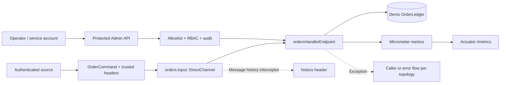
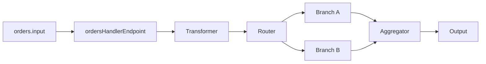
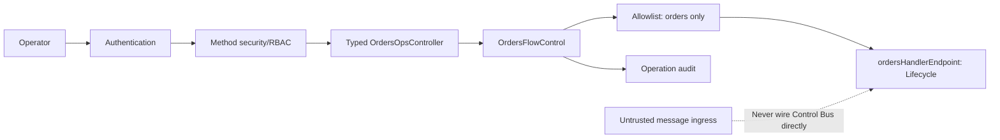
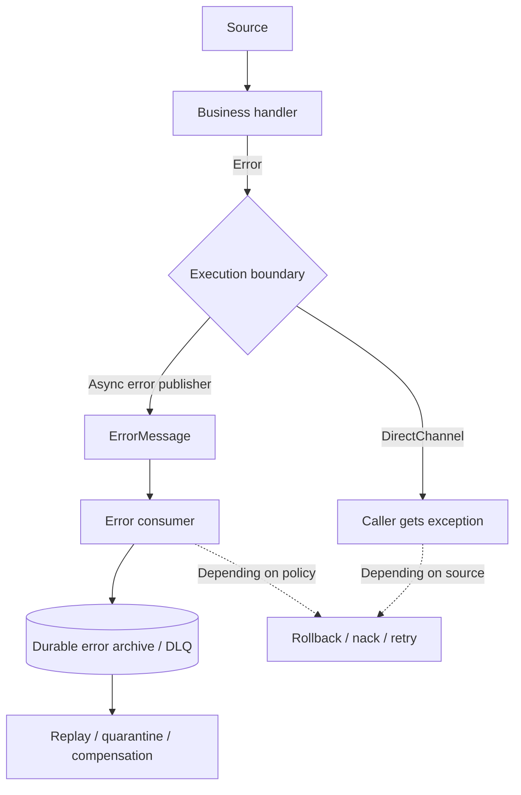

# Adding Metrics, Message History, and Control Operations to Spring Integration Runtime

## Objectives and Practical Outcomes

An `IntegrationFlow` can be `RUNNING` while producing zero new business outcomes; a `DirectChannel` returns after the handler finishes, whereas an `ExecutorChannel` accepts a message and returns before the worker runs. If a message fails in a transformer, enters an error flow, and is retried, how do you prove which endpoints it traversed? And when pausing a consumer for maintenance, how does an operator stop **only the authorized endpoint** without opening an arbitrary execution backdoor into the Spring context?

This lesson, **Adding Metrics, Message History, and Control Operations**, belongs to the **Hands-On Project** chapter of the **SPRING_INTEGRATION_RUNTIME** module. It is an operations-focused mini-project: instrumenting observability signals on a flow, enabling message-history tracking, and building an endpoint-lifecycle control surface with authentication, authorization, auditing, and recovery procedures. The exercises also connect to channels, endpoints, consumers, pollers, executors, `IntegrationFlow` lifecycles, transactions, retries, message stores, errors, correlation, threading, and performance.

After completing this lesson, you will be able to:

- Design **three distinct observability/control layers**: aggregated metrics, message traversal history, and lifecycle status/control operations.
- Write a compact Spring Integration Java DSL flow with `DirectChannel`, an endpoint with a stable ID, and test messages carrying `businessKey`/`correlationId`.
- Attach Micrometer `Counter`, `Timer`, and `Gauge` meters for success, duplicate, error, duration, and in-flight counts; distinguish `send()` results from business outcomes.
- Enable `@EnableMessageHistory`, inspect history headers, and explain history limitations across transforms, serialization, brokers, errors, and multiple instances.
- Expose metrics through Spring Boot Actuator within a protected administrative boundary.
- Build a typed control service with an allowlist and `@PreAuthorize` to inspect status, stop, and start the right endpoint; understand the risks of exposing open Control Bus/SpEL endpoints.
- Write JUnit/Spring Test/Micrometer tests verifying instrumentation, history, authorization, stop/start, asynchronous completion, and failures.
- Maintain deployment, rollback, observability, and completion checklists for the mini-project.

> **Expected outcome:** After sending a valid message, you can prove **which handler ran**, **how many executions fell into each outcome**, **what history trails the message left**, and **which operator is permitted to start/stop the endpoint**. Never conclude "processed successfully" from `send(true)`, `isRunning() == true`, or a `"received"` log line alone.

## 1. Simulated Problem and Acceptance Criteria

Suppose a service receives `OrderCommand` items from an authenticated source. Each order carries a tenant, order ID, and amount. In the demo project, the handler records the order key into an in-memory ledger to observe initial processing vs. duplicate deliveries. Later, you can replace the source with HTTP/a broker, the ledger with a DB table having a unique constraint, and the channel with an executor or durable queue.

### 1.1. Overall Diagram



Initially, everything runs inside **one Spring Boot process** with `DirectChannel` delivering synchronously to the handler. This keeps verification simple before introducing queues, brokers, retries, and multiple pods.

### 1.2. Definition of Done

| Area | Required Evidence | Must Not Be Confused With |
| --- | --- | --- |
| Metrics | Success/duplicate/error counters move accurately; timer records samples; in-flight returns to 0 | Handler counters are not source acks or external system commits |
| Message history | Messages through the flow carry history when enabled; tracked components appear | History is not a durable business audit or distributed trace |
| Control | Status/start/stop affect only allowlisted endpoints; unauthorized calls are denied | `start()` does not recover already-lost messages |
| Correlation | `businessKey` and `correlationId` stay intact across demo steps | Message UUID is not a business key |
| Tests | Sync tests avoid `sleep`; async tests enforce deadlines; negative auth tests cause zero side effects | HTTP 403 alone does not prove the bean was not stopped |
| Operations | Runbook, rollback, and dashboards/alerts exist | Actuator `UP` does not replace business SLOs |

## 2. Mini-Project Setup and Dependencies

The demo assumes **Java 17+**, Spring Boot 3.x, Spring Integration 6.x, Spring Security 6.x, Micrometer, and JUnit Jupiter. Exact project versions must come from a compatible BOM/parent rather than mixing jars across release lines.

Core dependencies for a Maven project:

```xml
<dependencies>
  <dependency>
    <groupId>org.springframework.boot</groupId>
    <artifactId>spring-boot-starter-integration</artifactId>
  </dependency>
  <dependency>
    <groupId>org.springframework.boot</groupId>
    <artifactId>spring-boot-starter-actuator</artifactId>
  </dependency>
  <dependency>
    <groupId>org.springframework.boot</groupId>
    <artifactId>spring-boot-starter-security</artifactId>
  </dependency>
  <dependency>
    <groupId>org.springframework.boot</groupId>
    <artifactId>spring-boot-starter-web</artifactId>
  </dependency>
  <dependency>
    <groupId>org.springframework.boot</groupId>
    <artifactId>spring-boot-starter-test</artifactId>
    <scope>test</scope>
  </dependency>
  <dependency>
    <groupId>org.springframework.integration</groupId>
    <artifactId>spring-integration-test</artifactId>
    <scope>test</scope>
  </dependency>
  <dependency>
    <groupId>org.springframework.security</groupId>
    <artifactId>spring-security-test</artifactId>
    <scope>test</scope>
  </dependency>
</dependencies>
```

`spring-boot-starter-integration` provides Integration infrastructure, `actuator` exposes health/metrics endpoints and the corresponding registry when configured, `security` protects the control API, and `web` powers the demo REST surface. In the examples below, Spring Boot provides `MeterRegistry`; standalone unit tests can use `SimpleMeterRegistry`. For Prometheus, add the Prometheus registry dependency and expose it per policy.

### 2.1. Suggested Source Layout

```text
src/main/java/.../training/
  RuntimeTrainingApplication.java
  OrdersIntegrationConfig.java
  OrderCommand.java
  InMemoryOrderLedger.java
  OrderProcessingHandler.java
  OrdersFlowControl.java
  OrdersOpsController.java
  ManagementSecurityConfig.java

src/test/java/.../training/
  OrdersMetricsTest.java
  OrdersHistoryTest.java
  OrdersFlowControlTest.java
  OrdersAsyncTest.java

src/main/resources/
  application.yml
```

This list is a **suggested layout** for learners, not pre-generated files in this workspace. Place snippets into proper packages with imports in your demo project. If combining into a single file, adjust visibility and `public` class declarations per Java rules.

### 2.2. Application Entry Point

```java
import org.springframework.boot.SpringApplication;
import org.springframework.boot.autoconfigure.SpringBootApplication;
import org.springframework.security.config.annotation.method.configuration.EnableMethodSecurity;

@SpringBootApplication
@EnableMethodSecurity
public class RuntimeTrainingApplication {
    public static void main(String[] args) {
        SpringApplication.run(
                RuntimeTrainingApplication.class, args);
    }
}
```

`@EnableMethodSecurity` is required so `@PreAuthorize` on the control service is enforced; HTTP authentication/authorization and an identity provider still need configuration. The demo project does not pre-create privileged operator accounts.

## 3. Designing Messages and Correlation Keys Upfront

The mini-project accepts a clear DTO:

```java
record OrderCommand(
        String tenantId,
        String orderId,
        long amount) {
}
```

At a trusted ingress, the system verifies tenant/order permissions and attaches trusted headers. In tests, we act as that validated ingress:

```java
import org.springframework.integration.IntegrationMessageHeaderAccessor;
import org.springframework.messaging.Message;
import org.springframework.messaging.support.MessageBuilder;

Message<OrderCommand> command = MessageBuilder
        .withPayload(new OrderCommand("tenant-a", "ORD-42", 250_000))
        .setHeader("verifiedTenant", "tenant-a")
        .setHeader("businessKey", "tenant-a:ORD-42")
        .setHeader(
                IntegrationMessageHeaderAccessor.CORRELATION_ID,
                "tenant-a:ORD-42:run-1")
        .build();
```

Distinguish clearly:

- `MessageHeaders.ID`: message instance UUID, which can change across transforms or redeliveries.
- `businessKey`: identifies the side effect or idempotency record.
- `correlationId`: groups messages belonging to one workflow run.
- `verifiedTenant`: set by the authentication/authorization boundary, **never** copied blindly from client-sent headers.
- `traceId` (if present): used for distributed tracing, not automatically a business idempotency key.

In the demo, we use `tenantId + ":" + orderId` as the ledger key. In production, the key may also need an operation/event type or workflow run ID if one order undergoes multiple independent operations. Encode keys cleanly so delimiter characters inside IDs never collide.

### 3.1. Why Not Use Message History for Correlation?

Message history describes **the Spring Integration components a message traversed**; it does not establish business identity. Two messages in the same workflow can have different histories (taking different router branches) while sharing a correlation ID. Conversely, two different tenants can traverse the exact same endpoints yet must never merge into one aggregator group.

## 4. Creating `DirectChannel` and an Endpoint with a Stable ID

```java
import org.springframework.context.annotation.Bean;
import org.springframework.context.annotation.Configuration;
import org.springframework.integration.channel.DirectChannel;
import org.springframework.integration.config.EnableIntegration;
import org.springframework.integration.config.EnableMessageHistory;
import org.springframework.integration.dsl.IntegrationFlow;

@Configuration
@EnableIntegration
@EnableMessageHistory
class OrdersIntegrationConfig {

    @Bean("orders.input")
    DirectChannel ordersInput() {
        return new DirectChannel();
    }

    @Bean
    IntegrationFlow ordersFlow(
            OrderProcessingHandler handler) {

        return IntegrationFlow.from("orders.input")
                .handle(handler, endpoint ->
                        endpoint.id("ordersHandlerEndpoint"))
                .get();
    }
}
```

`@EnableIntegration` enables Integration infrastructure in the context. `@EnableMessageHistory` turns on message-history collection for framework-tracked components per configuration and version. `ordersHandlerEndpoint` is the **consumer endpoint ID**, not the payload ID or the `handler` bean name.

With `DirectChannel` in this fixture, `input.send(message)` executes the handler synchronously on the same thread and propagates exceptions back to the sender. No poller is needed. In production, switching to `ExecutorChannel` means `send(true)` may reflect only that the executor accepted the task.

### 4.1. Why Assign Explicit IDs?

Auto-generated names make dashboards, tests, and control operations struggle to identify which endpoint is being stopped—especially with multiple flow versions. Stable IDs tie metrics, history, integration graphs, and incident tickets to the exact same component. However, **never** treat an ID as a secret token: knowing an ID must never grant permission to call `stop()`.

### 4.2. Lifecycle Is Local State

An `EventDrivenConsumer` implements `Lifecycle` and is managed by the context. `isRunning()` reports component lifecycle, not downstream commit status or source backlog. Across multiple pods, calling a method on pod B does not automatically control beans on pod A.

## 5. Instrumenting the Business Handler with Micrometer

To keep the exercise self-contained and easy to test, we use an in-memory ledger. This is a **single-process idempotency simulation**, not real persistence.

### 5.1. Demo Ledger

```java
import java.util.Set;
import java.util.concurrent.ConcurrentHashMap;

import org.springframework.stereotype.Component;

@Component
final class InMemoryOrderLedger {
    private final Set<String> acceptedKeys =
            ConcurrentHashMap.newKeySet();

    boolean recordIfAbsent(OrderCommand command) {
        if (command == null
                || command.tenantId() == null
                || command.tenantId().isBlank()
                || command.orderId() == null
                || command.orderId().isBlank()
                || command.amount() <= 0) {
            throw new IllegalArgumentException(
                    "Order identity or amount is invalid");
        }

        String key =
                command.tenantId() + ":" + command.orderId();
        return acceptedKeys.add(key);
    }

    boolean contains(String key) {
        return acceptedKeys.contains(key);
    }

    int size() {
        return acceptedKeys.size();
    }
}
```

`ConcurrentHashMap.newKeySet()` lets each key be added once per JVM. On process restart, all keys vanish. If an operation calls a partner API, adding a key in RAM **does not atomically commit the external API**. Production requires database unique constraints, an idempotency ledger/outbox, or target APIs supporting idempotency keys by contract.

### 5.2. Handler with `Counter`, `Timer`, and `Gauge`

```java
import java.util.concurrent.atomic.AtomicInteger;

import io.micrometer.core.instrument.Gauge;
import io.micrometer.core.instrument.MeterRegistry;
import io.micrometer.core.instrument.Timer;
import org.slf4j.Logger;
import org.slf4j.LoggerFactory;
import org.springframework.integration.IntegrationMessageHeaderAccessor;
import org.springframework.messaging.Message;
import org.springframework.messaging.MessageHandler;
import org.springframework.stereotype.Component;

@Component
final class OrderProcessingHandler implements MessageHandler {

    private static final Logger log =
            LoggerFactory.getLogger(OrderProcessingHandler.class);

    private final MeterRegistry meters;
    private final InMemoryOrderLedger ledger;
    private final AtomicInteger inFlight = new AtomicInteger();

    OrderProcessingHandler(
            MeterRegistry meters,
            InMemoryOrderLedger ledger) {
        this.meters = meters;
        this.ledger = ledger;

        Gauge.builder(
                "app.integration.orders.inflight",
                inFlight,
                AtomicInteger::get)
                .register(meters);
    }

    @Override
    public void handleMessage(Message<?> message) {
        Timer.Sample sample = Timer.start(meters);
        inFlight.incrementAndGet();
        String outcome = "error";

        try {
            if (!(message.getPayload() instanceof OrderCommand order)) {
                throw new IllegalArgumentException(
                        "Expected OrderCommand payload");
            }

            Object trustedTenant =
                    message.getHeaders().get("verifiedTenant");
            if (!order.tenantId().equals(trustedTenant)) {
                throw new IllegalArgumentException(
                        "Missing or mismatched trusted tenant");
            }

            boolean first = ledger.recordIfAbsent(order);
            outcome = first ? "success" : "duplicate";

            // Never log payload or full headers.
            if (log.isDebugEnabled()) {
                Object history =
                        message.getHeaders().get("history");
                Object correlation = message.getHeaders().get(
                        IntegrationMessageHeaderAccessor.CORRELATION_ID);

                log.debug(
                        "order handled: messageId={}, correlation={}, "
                        + "historyPresent={}, outcome={}",
                        message.getHeaders().getId(),
                        correlation,
                        history != null,
                        outcome);
            }
        }
        finally {
            meters.counter(
                    "app.integration.orders.handler.events",
                    "outcome", outcome).increment();

            sample.stop(meters.timer(
                    "app.integration.orders.handler.duration",
                    "outcome", outcome));

            inFlight.decrementAndGet();
        }
    }
}
```

**Three metric types answer three different questions:**

| Application-Defined Metric | Type | Answers | Limitation |
| --- | --- | --- | --- |
| `app.integration.orders.handler.events` with `outcome=success\|duplicate\|error` | Counter | How many handler executions ended with each outcome? | Not cluster-wide unique business events |
| `app.integration.orders.handler.duration` with `outcome` | Timer | How long did each invocation spend in the handler? | Excludes pre-handler executor queue wait |
| `app.integration.orders.inflight` | Gauge | How many invocations are currently executing? | Excludes pre-handler backlog |

`Timer.Sample` starts before business logic and calls `stop(...)` inside `finally`, so exceptions also record duration. `outcome` has three fixed values to bound cardinality. Counters increment even on exceptions because `finally` runs. If classifying errors further, use a small fixed set of error categories—**never** put raw exception messages into tags.

### 5.3. Defining Success, Duplicate, and Error Precisely

In the demo:

- **success**: first time the key enters the in-memory ledger.
- **duplicate**: the key already existed when the handler received the message; this is a duplicate delivery, not a handler crash.
- **error**: validation or handler logic threw before setting outcome to `success` or `duplicate`.

Note that `success` here means **the demo ledger recorded it in RAM**, without a real DB commit or broker ack. In production, increment `business.commit` **after the transaction confirms**, never when merely dispatching a downstream request or enqueuing an async task.

### 5.4. Never Use `correlationId` as a Metric Label

Wrong:

```java
// Anti-pattern: creates a separate time series per order.
meters.counter("orders.handled",
        "correlationId", correlationId).increment();
```

This creates unbounded tag cardinality, driving up Prometheus/Micrometer registry memory and storage costs. Put `correlationId` into **structured logs and distributed traces** governed by retention and access controls; keep metric tags low-cardinality such as `outcome`, `flowType`, `environment`, or bounded flow versions.

## 6. Exposing Actuator Metrics Properly

Example configuration in `application.yml`:

```yaml
management:
  server:
    port: 8081
  endpoints:
    web:
      exposure:
        include: health,info,metrics
  endpoint:
    health:
      show-details: when_authorized

logging:
  level:
    root: INFO
    org.springframework.integration: INFO
```

`8081` is just a demo management port; **a separate port is not security by itself**. When deploying, enforce network policies, authentication/authorization, TLS, or private ingress, and never expose `/actuator/metrics` publicly.

Inspection commands in an authorized environment:

```bash
# Only run when the management listener is protected/accessible.
curl -fsS http://localhost:8081/actuator/health
curl -fsS http://localhost:8081/actuator/metrics
curl -fsS http://localhost:8081/actuator/metrics/app.integration.orders.handler.events
curl -fsS http://localhost:8081/actuator/metrics/app.integration.orders.handler.duration
curl -fsS http://localhost:8081/actuator/metrics/app.integration.orders.inflight
```

These URLs are **not previously executed commands**. Meters appear only after registration and matching export/registry configuration. When HTTP security requires tokens or sessions, supply credentials properly per environment—**never** hardcode real passwords or tokens into docs or logs. `/actuator/metrics` returns Actuator JSON, not Prometheus scrape format.

If Prometheus is needed, add the Prometheus registry dependency and expose `prometheus` per policy; Prometheus time-series names convert dots to underscores and add suffixes, so never assume raw Actuator names match PromQL names verbatim.

### 6.1. Built-In Spring Integration Metrics vs. Application Metrics

Spring Integration provides Micrometer/observability support and channel/handler meters when properly configured for your version and management infrastructure. **Never hardcode** an expectation that a fixed framework meter name always exists on every endpoint.

The mini-project's `app.integration.orders.*` meters are **custom** with an explicit contract. You can supplement them with built-in `send`/handler meters, provided you inspect actual `MeterRegistry` output, tag names, behavior when management/Observation is disabled, and version compatibility. Never sum two meters measuring the same event.

### 6.2. Controlled Flow-Version Tags

In multi-version systems, a `flowVersion=orders-v2` tag helps compare rollouts. Use it only when version counts stay bounded; if every deploy spawns thousands of dynamic registration IDs, tagging by registration ID explodes cardinality.

In logs, by contrast, include `registrationId` or `endpointId` to pinpoint the exact flow. **Metric tags and log fields have different constraints.**

## 7. What Message History Is—and Is Not

`@EnableMessageHistory` instructs Spring Integration to track message traversal across supported components, typically recording entries in the `history` header. This helps trace which path a message took across multi-endpoint or routed flows. However, **history is in-message metadata**, not a durable audit table automatically persisted to a database.

### 7.1. Differences Between History, Logs, Traces, and Metrics

| Tool | Unit Observed | Answers | Does Not Automatically Guarantee |
| --- | --- | --- | --- |
| **Metrics** | Aggregated numbers across many messages | Throughput, duration, errors, backlog | Path of one specific message |
| **Message history** | Components traversed by one message | Which endpoints did this message touch? | Cross-service distributed tracing or durability |
| **Structured logs** | Stage-level events with correlation | When did an error occur and in what context? | Guaranteed delivery/no sampling |
| **Distributed tracing** | Spans across processes/services | Critical path and per-hop latency | Business idempotency or legal audit |
| **Business audit** | Records with clear ownership and retention | Who did what and did the outcome commit? | Created automatically by enabling message history |
| **Control operation audit** | Actor, target, action, timestamp, and outcome | Who started or stopped which component? | Created automatically on every `Lifecycle.start()` |

### 7.2. Reading History in a Handler or Diagnostic Tap

In `OrderProcessingHandler`, we checked:

```java
Object rawHistory = message.getHeaders().get("history");
boolean historyAvailable = rawHistory != null;
```

The `history` value holds Spring Integration history metadata readable via your version's history API. Do not assume it is a `String` or dump it into business payloads. Some components or header mappers strip headers, and tracking patterns might include only a subset of components.

**Never** log full messages or all headers in production just to see history: they may contain tokens, principals, internal addresses, or tenant data. Log at internal `DEBUG`, mask sensitive fields, enforce retention, and strip secrets.

### 7.3. How History Changes Across Boundaries



In a complex flow, history records the actual path traversed across tracked components. When a splitter emits child messages, children can inherit parent history plus diverging entries. When an aggregator merges messages, the output history **does not automatically union every input branch** under every strategy.

Across brokers or HTTP, preserving history depends on serialization and header mapping; often it is better to forward `correlationId`/trace context and rebuild observability on the consumer side. Never use history as an aggregator group key or authorization condition.

### 7.4. Diagnosing Missing History

| Symptom | Check |
| --- | --- |
| `history` header always null | Is `@EnableMessageHistory` actually active in the context? |
| One message has history, another does not | Did both traverse tracked components? |
| History vanishes after an adapter | Did a header mapper or serializer drop the header? |
| Expected component name missing | Is the component tracked, given a stable ID, and actually invoked? |
| Only parent history seen after splitter | Do child/aggregator steps copy headers and sequence as expected? |
| Memory/message size climbs | Is history tracking too many hops or serializing onto a broker? |
| No logs even though history exists | History does not log automatically; add a safe inspector/logger |

Enabling message history globally adds CPU, object-allocation, and header-size overhead. At high throughput, scope tracked component patterns, sample logs/traces, and benchmark before and after. Avoid pushing large history headers over size-limited broker messages.

## 8. When to Add a Wire Tap Instead of Relying Only on Message History

`WireTap` copies messages onto a secondary channel for observation, yet it is an **extra execution branch**, not "free logging." If the wire tap runs on the same thread and its diagnostic handler is slow, it slows the critical path. If it dispatches to an executor, it introduces another queue/buffer and error boundary.

Example routing structure:

```text
orders.input
   |
   +--> business processing handler
   |
   +--> audit/diagnostic channel  (WireTap)
          -> mask/sanitize
          -> bounded async export / logs
```

Never forward unredacted messages containing PII or secrets to an unprivileged audit destination. Start by inspecting available history metadata inside tests, and add a wire tap only when observation truly needs a separate branch. When business auditing is mandatory, use a **durable outbox/audit record**, not a best-effort tap.

### 8.1. Message History Does Not Replace Retries or Error Flows

A handler throwing on `DirectChannel` can propagate back to the caller without emitting an `ErrorMessage` onto the global `errorChannel` when no error publisher is involved. History shows which endpoint was reached, whereas root-cause and source-outcome diagnostics require:

- The exception cause chain or `ErrorMessage.getPayload()`.
- `originalMessage`/`failedMessage` when supplied by the error publisher.
- Retry attempt and broker redelivery counts.
- Committed error archives or DLQ records.
- Business keys and transaction/ack status.

Never conclude from "history contains endpoint X" that endpoint X succeeded or committed side effects.

## 9. Control Operations: Separating Status Reads from Runtime Mutations

The mini-project adds three operations:

1. `STATUS`: reads `isRunning()` for the exact endpoint.
2. `START`: starts the endpoint if stopped.
3. `STOP`: stops the endpoint if running.

All apply strictly to the fixed alias `orders` → bean `ordersHandlerEndpoint`. **Never** accept `targetBean` or an arbitrary SpEL string from HTTP requests to invoke arbitrary Spring beans.



### 9.1. What Is the Control Bus and Why Avoid Exposing Raw Expressions?

Spring Integration's Control Bus can evaluate expressions against beans, for instance:

```text
@ordersHandlerEndpoint.isRunning()
@ordersHandlerEndpoint.stop()
@ordersHandlerEndpoint.start()
```

Those expressions execute whenever the Control Bus is wired and its evaluation context can resolve beans—making them **powerful commands**. Feeding untrusted HTTP bodies or headers into a Control Bus risks unauthorized method and bean invocation. In this mini-project, we use a **typed Java service** with zero raw SpEL input endpoints.

### 9.2. Control Service with a Fixed Allowlist

```java
import org.springframework.context.ApplicationContext;
import org.springframework.context.Lifecycle;
import org.springframework.security.access.prepost.PreAuthorize;
import org.springframework.stereotype.Service;

@Service
final class OrdersFlowControl {

    private final Lifecycle endpoint;

    OrdersFlowControl(ApplicationContext context) {
        this.endpoint = context.getBean(
                "ordersHandlerEndpoint", Lifecycle.class);
    }

    @PreAuthorize("hasAuthority('integration:read')")
    public FlowState readStatus() {
        return snapshot();
    }

    @PreAuthorize("hasAuthority('integration:operate')")
    public FlowState start() {
        if (!endpoint.isRunning()) {
            endpoint.start();
        }
        return snapshot();
    }

    @PreAuthorize("hasAuthority('integration:operate')")
    public FlowState stop() {
        if (endpoint.isRunning()) {
            endpoint.stop();
        }
        return snapshot();
    }

    private FlowState snapshot() {
        return new FlowState("orders", endpoint.isRunning());
    }

    record FlowState(String flowAlias, boolean running) {
    }
}
```

`@PreAuthorize` takes effect only when Spring Security method security is enabled and calls pass through the Spring proxy. Section 2's entry point enabled `@EnableMethodSecurity`. Calling an annotated method **from another method on `this` inside the same object** bypasses the proxy. Never rely on self-invocation for authorization.

`snapshot()` is private and invoked only from authorized methods; it is **not a public API**. Production should also separate read/write permissions, tenant scopes, desired state, approvals, auditing, and pre-stop drain checks when active work exists.

### 9.3. Controller with Fixed Paths

```java
import org.springframework.web.bind.annotation.GetMapping;
import org.springframework.web.bind.annotation.PostMapping;
import org.springframework.web.bind.annotation.RequestMapping;
import org.springframework.web.bind.annotation.RestController;

@RestController
@RequestMapping("/internal/ops/flows/orders")
final class OrdersOpsController {

    private final OrdersFlowControl control;

    OrdersOpsController(OrdersFlowControl control) {
        this.control = control;
    }

    @GetMapping
    OrdersFlowControl.FlowState status() {
        return control.readStatus();
    }

    @PostMapping("/start")
    OrdersFlowControl.FlowState start() {
        return control.start();
    }

    @PostMapping("/stop")
    OrdersFlowControl.FlowState stop() {
        return control.stop();
    }
}
```

Fixed paths eliminate "client picks the bean name" vulnerabilities. The controller creates no users or roles itself. Every request still requires **web authentication**, HTTP authorization, CSRF protection when using sessions/cookies, network isolation, rate limits, and auditing.

### 9.4. Internal Demo HTTP Security Skeleton

```java
import org.springframework.context.annotation.Bean;
import org.springframework.context.annotation.Configuration;
import org.springframework.security.config.Customizer;
import org.springframework.security.config.annotation.web.builders.HttpSecurity;
import org.springframework.security.web.SecurityFilterChain;

@Configuration
class ManagementSecurityConfig {

    @Bean
    SecurityFilterChain appSecurity(HttpSecurity http)
            throws Exception {

        return http
                .authorizeHttpRequests(auth -> auth
                        .requestMatchers(
                                "/internal/ops/**", "/actuator/**")
                        .authenticated()
                        .anyRequest().denyAll())
                .httpBasic(Customizer.withDefaults())
                .build();
    }
}
```

This illustrative config **grants `integration:operate` to no account**; identities and roles must be configured separately. HTTP Basic suits only TLS-protected, network-scoped demos; production typically uses OIDC/OAuth2/mTLS and hardened security chains. Never disable CSRF globally just to make `POST` commands easy. If Actuator runs on a separate management port, verify the security filter chain protecting **that management context** rather than assuming the application-port filter covers it.

### 9.5. Control Operations Must Never Skip Auditing

At minimum, record:

```text
event=FLOW_CONTROL
  actor=oncall-operator
  target=ordersHandlerEndpoint
  flowAlias=orders
  action=STOP
  requestId=chg-42
  approval=approved
  beforeRunning=true
  afterRunning=false
  timestamp=...
  outcome=SUCCESS
```

This is a **suggested audit schema**, not built-in Spring Integration output. The demo `OrdersFlowControl` above omits auditing, approvals, and tenant ownership, so it is **not production-complete**. Production auditing must also record **DENIED/FAILED** commands, and critical operations need a clear policy if the audit backend is unavailable.

### 9.6. Start/Stop Is Neither Draining Nor a Full-System Restart

For an event-driven consumer on `DirectChannel`, `stop()` unsubscribes it from the channel. If the channel had only one subscriber, sending while stopped can throw `MessageDeliveryException`. With `QueueChannel` or a broker, stopping the consumer does not automatically clear or retain in-flight messages cleanly; behavior depends on acks and persistence.

Never use `stop()` expecting to cancel in-flight HTTP calls or roll back committed DB work. A production maintenance procedure runs **pause ingress → drain/persist durable recovery → stop the right endpoint → verify**; on resume, verify sources, checkpoints, backlog, and duplicates.

## 10. Testing Metrics with JUnit and `MeterRegistry`

Handler unit tests can skip the Spring context using `SimpleMeterRegistry`, a fresh ledger, and messages with a trusted tenant header:

```java
import io.micrometer.core.instrument.simple.SimpleMeterRegistry;
import org.junit.jupiter.api.Test;
import org.springframework.messaging.Message;
import org.springframework.messaging.support.MessageBuilder;

import static org.junit.jupiter.api.Assertions.*;

class OrdersMetricsTest {

    @Test
    void countsSuccessDuplicateAndError() {
        try (SimpleMeterRegistry meters =
                new SimpleMeterRegistry()) {

            InMemoryOrderLedger ledger =
                    new InMemoryOrderLedger();
            OrderProcessingHandler handler =
                    new OrderProcessingHandler(meters, ledger);

            Message<OrderCommand> valid = MessageBuilder
                    .withPayload(new OrderCommand(
                            "tenant-a", "ORD-42", 250_000))
                    .setHeader("verifiedTenant", "tenant-a")
                    .setHeader("businessKey", "tenant-a:ORD-42")
                    .build();

            handler.handleMessage(valid);
            handler.handleMessage(valid); // duplicate

            assertEquals(1.0, meters.counter(
                    "app.integration.orders.handler.events",
                    "outcome", "success").count());

            assertEquals(1.0, meters.counter(
                    "app.integration.orders.handler.events",
                    "outcome", "duplicate").count());

            Message<OrderCommand> invalid = MessageBuilder
                    .withPayload(new OrderCommand(
                            "tenant-a", "ORD-43", -1))
                    .setHeader("verifiedTenant", "tenant-a")
                    .build();

            assertThrows(IllegalArgumentException.class,
                    () -> handler.handleMessage(invalid));

            assertEquals(1.0, meters.counter(
                    "app.integration.orders.handler.events",
                    "outcome", "error").count());

            assertEquals(0.0, meters.get(
                    "app.integration.orders.inflight")
                    .gauge().value());

            assertEquals(1L, ledger.size());
        }
    }
}
```

This tests the exact **demo handler** contract: two valid calls with the same key → one `success`, one `duplicate`; invalid amount → `error`; `inFlight` returns to 0. It is not yet an integration test of channels, message history, or lifecycle, and the ledger is non-durable.

### 10.1. Testing Duration Without Fragile Thresholds

A recorded `Timer` duration varies with JIT and CI scheduling. Assert sample counts and non-negativity rather than `duration == 1ms`:

```java
long samples = meters.get(
        "app.integration.orders.handler.duration")
        .tag("outcome", "success")
        .timer()
        .count();

assertEquals(1L, samples);
```

To test timeouts or backoff deterministically, inject a `Clock` or time abstraction into business logic; Micrometer's `Timer` still measures **wall-clock** invocation duration rather than automatically following a fake clock.

## 11. Testing Java DSL, Message History, and Lifecycle in a Spring Context

Testing `orders.input`, `ordersHandlerEndpoint`, and history wiring requires a Spring Test context or `@SpringBootTest`. Use unique/random order IDs per test so tests do not collide on the singleton ledger.

### 11.1. Integration Test Sending Through `DirectChannel`

```java
import java.util.UUID;

import org.junit.jupiter.api.Test;
import org.springframework.beans.factory.annotation.Autowired;
import org.springframework.beans.factory.annotation.Qualifier;
import org.springframework.boot.test.context.SpringBootTest;
import org.springframework.messaging.MessageChannel;
import org.springframework.messaging.support.MessageBuilder;

import static org.junit.jupiter.api.Assertions.*;

@SpringBootTest
class OrdersFlowIntegrationTest {

    @Autowired
    @Qualifier("orders.input")
    MessageChannel input;

    @Autowired
    InMemoryOrderLedger ledger;

    @Test
    void directChannelInvokesHandler() {
        String orderId = UUID.randomUUID().toString();
        String businessKey = "tenant-a:" + orderId;

        boolean accepted = input.send(MessageBuilder
                .withPayload(new OrderCommand(
                        "tenant-a", orderId, 10_000))
                .setHeader("verifiedTenant", "tenant-a")
                .setHeader("businessKey", businessKey)
                .setHeader("correlationId", businessKey + ":run-1")
                .build());

        assertTrue(accepted);
        assertTrue(ledger.contains(businessKey));
    }
}
```

In the synchronous fixture, once `send()` returns true, the handler has run and the demo ledger contains the key. If you switch the channel to `ExecutorChannel`, wait for completion with a latch/await and bounded timeout rather than asserting on the ledger immediately after `send()`.

### 11.2. Testing Message History at the Handler

A test can attach a fake recorder or test `MessageHandler` to capture a snapshot of the `history` header. Never retain `lastMessage` indefinitely in a production handler due to payload/PII retention risks.

Example test-only handler probe:

```java
import java.util.concurrent.atomic.AtomicReference;
import org.springframework.messaging.Message;

final class HistoryProbe {
    private final AtomicReference<Object> history =
            new AtomicReference<>();

    void record(Message<?> message) {
        history.set(message.getHeaders().get("history"));
    }

    Object snapshot() {
        return history.get();
    }
}
```

Wire `HistoryProbe::record` into a test flow or wire-tap test with `@EnableMessageHistory` and explicit endpoint IDs. Send a message through the input and assert `snapshot() != null` **once component tracking and header mappers are configured properly**. Do not assert positional list entries if topology or framework versions can insert extra history entries.

**Important:** this probe is strictly a test helper; **never** leave it out of the test context assuming it receives messages automatically—wire it into a real channel/endpoint in the Spring Test context. If history is null, check tracking configuration and message routing before blaming the framework.

### 11.3. Testing Endpoint Stop/Start with Cleanup

```java
import org.junit.jupiter.api.Test;
import org.springframework.beans.factory.annotation.Autowired;
import org.springframework.boot.test.context.SpringBootTest;
import org.springframework.context.ApplicationContext;
import org.springframework.context.Lifecycle;

import static org.junit.jupiter.api.Assertions.*;

@SpringBootTest
class OrdersLifecycleTest {

    @Autowired
    ApplicationContext context;

    @Test
    void endpointHasLifecycleAndCanBeRestored() {
        Lifecycle endpoint = context.getBean(
                "ordersHandlerEndpoint", Lifecycle.class);
        boolean wasRunning = endpoint.isRunning();

        try {
            endpoint.stop();
            assertFalse(endpoint.isRunning());

            endpoint.start();
            assertTrue(endpoint.isRunning());
        }
        finally {
            if (wasRunning && !endpoint.isRunning()) {
                endpoint.start();
            }
            else if (!wasRunning && endpoint.isRunning()) {
                endpoint.stop();
            }
        }
    }
}
```

Never run this lifecycle test against production, and never share a Spring Test context across parallel tests without isolation. Testing `isRunning` verifies lifecycle only—it **does not** prove broker acks, downstream health, or business commits.

## 12. Testing Control API Authorization and Side Effects

Security tests must assert **denied operations leave the endpoint unchanged**, not merely HTTP status codes. Example with Spring Boot `MockMvc` and Spring Security Test:

```java
import org.junit.jupiter.api.Test;
import org.springframework.beans.factory.annotation.Autowired;
import org.springframework.boot.test.autoconfigure.web.servlet.AutoConfigureMockMvc;
import org.springframework.boot.test.context.SpringBootTest;
import org.springframework.context.ApplicationContext;
import org.springframework.context.Lifecycle;
import org.springframework.test.web.servlet.MockMvc;
import org.springframework.security.test.context.support.WithMockUser;

import static org.junit.jupiter.api.Assertions.*;
import static org.springframework.security.test.web.servlet.request.SecurityMockMvcRequestPostProcessors.csrf;
import static org.springframework.test.web.servlet.request.MockMvcRequestBuilders.post;
import static org.springframework.test.web.servlet.result.MockMvcResultMatchers.status;

@SpringBootTest
@AutoConfigureMockMvc
class OrdersControlSecurityTest {

    @Autowired
    MockMvc mvc;

    @Autowired
    ApplicationContext context;

    @Test
    @WithMockUser(authorities = "integration:read")
    void readOnlyActorCannotStopEndpoint() throws Exception {
        Lifecycle endpoint = context.getBean(
                "ordersHandlerEndpoint", Lifecycle.class);

        boolean before = endpoint.isRunning();

        mvc.perform(post(
                "/internal/ops/flows/orders/stop").with(csrf()))
                .andExpect(status().isForbidden());

        assertEquals(before, endpoint.isRunning());
    }

    @Test
    @WithMockUser(authorities = "integration:operate")
    void allowedActorCanStopAndStart() throws Exception {
        Lifecycle endpoint = context.getBean(
                "ordersHandlerEndpoint", Lifecycle.class);
        boolean before = endpoint.isRunning();

        try {
            mvc.perform(post(
                    "/internal/ops/flows/orders/stop").with(csrf()))
                    .andExpect(status().isOk());

            assertFalse(endpoint.isRunning());

            mvc.perform(post(
                    "/internal/ops/flows/orders/start").with(csrf()))
                    .andExpect(status().isOk());

            assertTrue(endpoint.isRunning());
        }
        finally {
            if (before && !endpoint.isRunning()) {
                endpoint.start();
            }
            else if (!before && endpoint.isRunning()) {
                endpoint.stop();
            }
        }
    }
}
```

Because this test uses `@WithMockUser`, it does not exercise a real external identity provider. Also test URL/role mappings, CSRF rejection, real authentication, non-allowlisted aliases, unauthorized tenants, auditing, and rate limits. In production, `stop` also requires flow ownership and drain/approval checks; the demo tests above **do not** verify those guardrails yet.

## 13. Extending to `ExecutorChannel`: Metrics No Longer Cover End-to-End Time

Once the three baseline layers work, replace `DirectChannel` with an `ExecutorChannel` backed by a bounded worker pool:

```java
import java.util.concurrent.ExecutorService;
import java.util.concurrent.Executors;

import org.springframework.beans.factory.annotation.Qualifier;
import org.springframework.context.annotation.Bean;
import org.springframework.integration.channel.ExecutorChannel;
import org.springframework.messaging.MessageChannel;

@Bean(destroyMethod = "shutdown")
ExecutorService orderWorkers() {
    return Executors.newFixedThreadPool(4);
}

@Bean("orders.input")
MessageChannel ordersInput(
        @Qualifier("orderWorkers") ExecutorService workers) {
    return new ExecutorChannel(workers);
}
```

This is a **replacement variant for the `orders.input` bean** in Section 4—never declare two identically named beans in the same context. In a real Spring config, keep both variants under profiles or choose one when testing. Use `@Qualifier` if multiple executors exist in the context.

### 13.1. Reading Metrics After Going Async

```text
T0: producer sends message to ExecutorChannel
T1: send() returns because task was accepted
T2: message waits in executor queue
T3: worker enters OrderProcessingHandler
T4: handler updates demo ledger
T5: MeterRegistry records success + duration
```

The handler `Timer` measures `T3 → T5`, **not** `T0 → T3`. The `inFlight` gauge rises only starting at `T3`. When workers are busy, backlog can pile up with zero `inFlight` visible inside the handler; a dashboard might show "low duration, low success" without revealing the full queue.

Add:

- Executor active/queued/rejected task metrics.
- Queue wait from ingress to handler start.
- Source backlog/consumer lag when using a broker.
- Oldest pending message age.
- Input rate vs. business completion rate.

Never grow the thread pool unboundedly when downstream stalls. Bound both worker pools and queues with explicit rejection policies and durable source retention.

### 13.2. Async Tests Without `Thread.sleep`

Use a test handler with `CountDownLatch` or a queue probe and wait within a finite deadline:

```java
import java.util.concurrent.CountDownLatch;
import java.util.concurrent.TimeUnit;

final class AsyncCompletionProbe {
    private final CountDownLatch completed =
            new CountDownLatch(1);

    void markCompleted() {
        completed.countDown();
    }

    void awaitCompletion() throws InterruptedException {
        if (!completed.await(5, TimeUnit.SECONDS)) {
            throw new AssertionError(
                    "Handler did not complete within 5 seconds");
        }
    }
}
```

Call `markCompleted()` **after the exact step you want to prove has finished**. Counting down at handler entry while asserting a DB commit still races and flakes. Never use in-JVM latches as an operational coordination mechanism across instances in production.

## 14. Pollers, Brokers, and Blind Spots in Metrics/History

A consumer reading `QueueChannel` via a poller introduces triggers, schedulers, `receiveTimeout`, `maxMessagesPerPoll`, and often transaction advice. A source adapter reading a broker, file system, or JDBC adds cursors, acks, redeliveries, retention, and checkpoints.

| Runtime Point | Additional Metrics to Measure | How History Helps | What Cannot Be Inferred |
| --- | --- | --- | --- |
| Source adapter | Received count, last poll, source lag | Shows message entered tracked adapter | Whether source ack is safe |
| `QueueChannel` | Queue depth, oldest age | Tracked points before/after queue dispatch | Whether the queue is persistent |
| Poller | Last poll started/completed, duration | Identifies endpoint invoked after poll | Whether poll interval meets business SLA |
| Executor | Active/queued/rejected, queue age | Traversal across tracked components | Whether `ThreadLocal` `SecurityContext` propagated |
| Router | Route counts, unknown-route count | Which branch the message took | Whether tenant authorization passed |
| Splitter/aggregator | Pending group age, release count | History of each split part | Output history = union of all branches |
| Outbound broker | Publish confirms, error counts | Reached the outbound step | Whether remote consumer committed |
| Error flow | Errors received, archive commits | Path taken into recovery | That a logger is a durable archive |
| Dynamic flow | Active registration version, in-flight | Component path of that version | Synchronization of registrations across pods |

### 14.1. Polling vs. Event-Driven Semantics

`DirectChannel` is a `SubscribableChannel`: sending triggers handlers immediately in event-driven style. `QueueChannel` normally needs a `PollingConsumer` to pull messages; swapping the channel without adding a poller prevents the flow from executing as expected. Document the exact **topology** whenever comparing throughput or metrics.

### 14.2. Transactions and Acks Do Not Automatically Cross Executors

A message entering `ExecutorChannel` can let the caller return and ack the source before the worker finishes, depending on the adapter/container. JDBC transactions are bound to the current thread and **do not automatically transfer to worker threads**. Consequently, a handler success counter does not prove source acks are safe; critical flows need durable handoffs, idempotency, and crash-window tests.

## 15. Adding an Error Flow and Distinguishing Observed Errors from Durable Recovery

In the synchronous demo flow, an invalid order throws `IllegalArgumentException` back to the `send()` caller. That is a **synchronous error**, which does not automatically emit an `ErrorMessage` onto the global `errorChannel`. Asynchronous failure handling requires an **error publisher and error channel matching your topology and adapters**.



An `ErrorMessage` holds a `Throwable` payload and may include the original/failed message. To look up orders or correlation IDs, inspect `getOriginalMessage()` or `MessagingException.getFailedMessage()` when available; never cast `ErrorMessage.getPayload()` to `OrderCommand`.

### 15.1. Measure Recovery Separately

| Suggested Metric | Increments When | Meaning |
| --- | --- | --- |
| `app.integration.orders.handler.events{outcome=error}` | Handler throws | One failed invocation |
| `app.integration.orders.error.published` | Error publisher emits `ErrorMessage` | Error was dispatched |
| `app.integration.orders.error.archive_committed` | DB/DLQ confirms durable persistence | Recoverable per policy |
| `app.integration.orders.retry.attempts` | Retry advice re-invokes handler | Attempt count, not business event count |
| `app.integration.orders.source.redelivery` | Broker redelivers | Source may have nacked or missed ack |
| `app.integration.orders.recovery.pending` | Error records awaiting action | Recovery backlog |

These are application-defined names—**they are not all auto-generated when enabling Actuator**. Never sum `ErrorMessage` counts and retry attempts and call it failed orders: a single business event can generate multiple attempts and error publications.

### 15.2. Crash Windows You Must Test

```text
1. External side effect committed, before recording DONE:
   -> Retries/redeliveries can create duplicates.

2. ErrorMessage published, yet error archive uncommitted:
   -> If source acks, the recovery record can be lost.

3. Durable enqueue committed, yet source ack unfinished:
   -> Source redelivers; idempotency required.

4. Consumer STOPPED while requests are in flight:
   -> stop() does not automatically roll back external APIs.
```

For production, replace `InMemoryOrderLedger` with a table enforcing a unique constraint on the business key and proper transactions; add an outbox/broker when decoupling intake from async execution. Track `PENDING`/`DONE`/`FAILED` states with controlled replay rather than treating the `history` header as business state.

## 16. Dashboards and Alerts: Design Around Operational Questions

A useful dashboard does not just plot "messages sent"—it links intake, processing, backlog, failures, and recovery.

### 16.1. Recommended Panels

| Panel | Metrics | Question Answered |
| --- | --- | --- |
| Input vs. handled | Ingress rate, handled success/duplicate/error | Is the source sending and is the handler keeping up? |
| Handler duration | p50/p95/p99 by outcome | Is tail latency degrading abnormally? |
| In-flight | Gauge | Are invocations hung? |
| Executor queue | Queue depth, oldest age, rejections | Is backpressure building before the handler? |
| Endpoint desired vs. running | `isRunning()`, maintenance state | Is a stop intentional or a fault? |
| Retry/error archive | Attempts, archive commits, pending age | Do failures have durable recovery paths? |
| Correlation/groups | Pending group age, releases/timeouts | Is an aggregator missing parts? |
| Version/instance | Active route, registrations, pod | Is state skewed across nodes during rollout? |
| Control audit | `START`/`STOP`/`STATUS` outcomes | Who changed runtime state, and was it approved? |

**Note on percentiles:** the `Timer` in the example always records counts and total duration in the registry, yet p95/p99 or histogram buckets **do not appear automatically in every monitoring backend**. Configure distribution statistics or histograms on target meters per your Micrometer and exporter setup, verify time-series cardinality costs, and only then plot percentiles. Never infer p99 from an average.

### 16.2. Do Not Alert on `output == 0` Alone

```text
ExpectedWork =
     (incomingMessages > 0)
  OR (queueDepth > 0)
  OR (inFlight > 0)
  OR (pendingGroupCount > 0)

PotentialStall =
    ExpectedWork
    AND noBusinessProgressBeyondSLO
    AND notPlannedMaintenance
```

If a flow receives data only at end of day, zero morning throughput is completely normal. When queues climb while completions stall, that warrants investigation. Thresholds must factor in poll intervals, retry backoffs, business deadlines, and baselines.

### 16.3. Message History Supports Per-ID Investigation, Not Dashboards

When one business key fails, use structured logs keyed by correlation to locate the endpoint, inspect message history if present, and check cause chains, error archives, and transactions. History is not a metric time series; never create metric tags per history entry or correlation ID.

## 17. Runbook: Endpoint Shows History Yet Throughput Stalls

### Step 1 — Identify the Exact Flow, Version, and Instance

Collect endpoint ID, pod, logical flow, version, `businessKey`, and `correlationId`. Compare `isRunning()` against desired state. Never blindly start a flow that was intentionally stopped.

### Step 2 — Inspect End-to-End Metrics

Check ingress, queue depth/oldest age, handler events/duration/in-flight, and business commits. If `send()` climbs while handled counts stay flat, look at the channel → executor/consumer boundary.

### Step 3 — Inspect Message History and Routing

Pull a sample message/correlation from authorized logs and check which components appear in history; verify transformers, routers, and subscribers in the deployed topology. If history disappears after a broker hop, inspect header mappers and consumer-side traces.

### Step 4 — Distinguish Errors from Absence of Work

With zero source input, the flow may simply be IDLE. If handlers throw continuously, inspect exceptions, retries, and `errorChannel`—do not misdiagnose the endpoint as `STOPPED`. If workers are blocked, take thread dumps and check downstream metrics per operational policy.

### Step 5 — Verify Persistence and In-Flight State

Before stopping or restarting, know whether messages sit in RAM queues, persistent `MessageStore`s, brokers, or unacked sources. For aggregators, inspect `MessageGroupStore` and correlation strategies. For pollers, inspect `MetadataStore` checkpoints—never delete keys just to "clean up."

### Step 6 — Verify Operator Permissions

Only operators holding `integration:operate` for the right flow/tenant with approval may stop or start endpoints. Record pre/post audit entries. Never feed raw expressions to the Control Bus or expose Actuator control surfaces publicly.

### Step 7 — Apply the Smallest Safe Intervention

Prefer fixing downstream dependencies, throttling intake/prefetch, tuning timeouts/retries, or restoring error consumers. Stop/start endpoints only once sources are protected with a drain/rollback plan; never restart JVMs blindly.

### Step 8 — Confirm Business Outcomes

After starting, verify business commits, error rates, backlog/age, duplicates, transactions/acks, and recovery pending counts. `isRunning=true` or HTTP 200 are secondary checks, not primary proof.

### Step 9 — Verify Audit Trail and Ownership

Cross-check control commands against actor, timestamp, target, and change ticket; verify no unauthorized stops/starts or split-brain state across pods.

### Step 10 — Close the Incident and Add Regression Tests

Add a regression test reproducing the root cause, fill any missing metrics/alerts, and document error/persistence contracts. Close the incident only once affected messages have clear outcomes or recovery owners.

## 18. Mini-Project Test Matrix

| Scenario | Setup | Expected |
| --- | --- | --- |
| Valid message first time | `DirectChannel`, valid DTO | Handler `success` +1, ledger records key |
| Duplicate message | Resend same business key | `duplicate` +1, no new business key added |
| Invalid payload/amount | Handler throws | `error` +1, in-flight returns to 0 |
| Missing tenant header | No `verifiedTenant` | Rejected with zero side effects |
| Correlation across channel | Message carries correlation ID | Handler/logs preserve exact correlation |
| Message history enabled | `@EnableMessageHistory`, tracked component | History contains expected metadata |
| History across transform | Payload transformed | Business/correlation preserved per contract |
| History across broker | Header mapper present/absent | Assert only configured retention behavior |
| Actuator metrics | Authorized HTTP management request | Expected meter names/tags appear after traffic |
| Metrics security | Unauthenticated client | Denied access to sensitive management data |
| `GET` status | Actor has `integration:read` | Returns accurate endpoint running state |
| `POST` stop denied | Read-only actor | 403 Forbidden; endpoint state unchanged |
| `POST` stop allowed | Actor with operate authority | Endpoint stops; audit recorded in production version |
| `POST` start allowed | Actor with operate authority | Endpoint restarts; verify business progress |
| Stop during `DirectChannel` send | Single subscriber | Send behavior matches topology |
| `ExecutorChannel` | Task runs on worker thread | Await completion; never assert prematurely |
| Executor saturation | Slow worker, full queue | Rejections/backlog measured; no policy-violating data loss |
| Poller stopped | Source has backlog | Never confuse poll schedule with flow success |
| Broken error consumer | Fake archive throws | Secondary error and ack policy tested |
| Retry exhausted | Handler fails across attempts | Attempts differ from unique message count |
| Crash after business commit | Restart before ack | Idempotency prevents duplicate effects |
| Dynamic flow v1/v2 | Two registrations/versions | Control targets right version; drain before removal |
| Multi-pod | Only pod A receives `STOP` | Pod B does not change state automatically |
| Audit unavailable | Sensitive control operation | Never silently drop audit trail per policy |
| Metrics cardinality | Many distinct correlation IDs | Tag series do not grow per ID |
| Low traffic | Zero new messages | Never alert stalled solely on throughput 0 |

## 19. Extension Exercises

### Exercise A — Instrumenting Two Handlers

Add a transformer/validator before `OrderProcessingHandler` with a dedicated counter for validation failures. Send 3 valid messages, 1 duplicate, and 2 invalid messages; reconcile counters at each layer so the same exception is never counted twice.

**Outcome:** know which counters represent attempts, successes, or business outcomes, and build dashboards without double-counting events.

### Exercise B — Controlled Toggling of Message History

Run a test context with `@EnableMessageHistory` and the test-only `HistoryProbe` to inspect metadata. Measure message/header sizes and throughput under increasing test load. When simulating broker header mapping, drop the `history` header and verify correlation survives.

**Outcome:** use history effectively for debugging without abusing it as durable auditing or distributed tracing.

### Exercise C — Control Operations with Read/Operate Permissions

Enable method security and create two test identities: `monitoring-reader` and `flow-operator`. Test status checks, stop/start, missing CSRF tokens, and valid role with wrong flow/tenant (after adding ownership checks).

**Outcome:** denied operations cause zero side effects, and audits reflect actor and action.

### Exercise D — Replacing `DirectChannel` with `ExecutorChannel`

Use one worker thread and a latch-blocked handler; burst multiple messages quickly. Compare `send` accepted, handler in-flight, and completion duration. Add queue-age metrics and bounded executors.

**Outcome:** understand why handler timers miss queue wait and how thread boundaries change transactions and error flows.

### Exercise E — Adding a Poller and Durable Queue

Wire a rate-limited polled `QueueChannel`, then switch the source to a test broker/container supporting redelivery. Measure last poll, queue depth, handler attempts, and source acks; kill a worker at a controlled checkpoint.

**Outcome:** identify where durability belongs and why message history cannot recover lost messages.

### Exercise F — Error Flow and Recovery Archive

Simulate downstream failures with bounded retry advice, an error publisher, and a consumer persisting error records to a test DB. Measure `error.published`, `error.archive_committed`, retry attempts, and source acks.

**Outcome:** never mistake a logged or received `ErrorMessage` for durable recovery, and never ack before satisfying business policy.

### Exercise G — Dashboards and SLOs

Generate 100 test messages with duplicates and failures. Plot input/handled rates, p95 latency, in-flight, error rate, and queue age. Alert when backlog > 0 while business progress = 0 past a threshold.

**Outcome:** distinguish idle, slow, blocked, and failing systems rapidly.

### Exercise H — Full Operational Runbook Drill

Intentionally stop an endpoint on one pod, then have an unauthorized operator attempt to start it. Cross-check message history, pre/post metrics, denied audit logs, and approved operations. Re-enable with a canary and verify zero duplicate side effects.

**Outcome:** a system that is observable, controllable **strictly under authorization**, and provably recoverable.

## 20. Self-Check Questions

1. What three distinct categories of questions do metrics, message history, and control operations answer?
2. Why is `DirectChannel.send(true)` not a universal business-success criterion?
3. In the demo, what does ledger `success` mean, and why is it not a production DB commit?
4. Which signals fit `Counter`, `Timer`, and `Gauge` respectively?
5. Why does incrementing counters inside `finally` help capture exceptions?
6. How does fixing `outcome` to three values bound metric cardinality?
7. Why should raw `correlationId` or `orderId` never be Prometheus labels?
8. What happens to queue wait measurements when switching from `DirectChannel` to `ExecutorChannel`?
9. Can a handler timer measure source lag or broker consumer lag?
10. What does `@EnableMessageHistory` track, and does it create a database audit table?
11. Does a `history` header automatically equal cross-service distributed tracing?
12. Why can message history disappear after crossing a broker?
13. Does message history prove a handler committed business side effects?
14. What resource overheads can global message history increase?
15. Why can a synchronous wire tap slow down the critical path?
16. What risk arises from exposing raw Control Bus expressions to public inbound APIs?
17. How do you map an administrative alias safely to an endpoint ID?
18. Does `@PreAuthorize` enforce anything if method security is not enabled?
19. Why can self-invocation bypass Spring proxy authorization?
20. Which scenarios does CSRF protect when admin APIs use sessions/cookies?
21. Should an operator with read-status permission automatically be allowed to stop endpoints?
22. When calling `Lifecycle.stop()`, do in-flight HTTP/DB side effects automatically roll back?
23. Can `Lifecycle.start()` recover messages lost from an in-memory queue?
24. Why does an endpoint's state on pod A not represent the whole cluster?
25. Does receiving an `ErrorMessage` prove the error archive committed?
26. How do retry attempts, broker redeliveries, and manual replays differ?
27. Why must async tests await completion signals instead of calling `Thread.sleep()`?
28. What recovery-related data do `MessageStore`, `MessageGroupStore`, and `MetadataStore` hold?
29. When the source emits no messages, does `output=0` mean health is `DOWN`?
30. Why must a 403 test verify the endpoint did not change state?
31. During a maintenance stop, how do draining and durable handoff differ?
32. Which metrics prove real recovery after calling `start()`?
33. An audit entry logged `SUCCESS`, yet the flow still emits zero output: is the incident over?
34. Why should error metrics and business failure metrics not simply be summed equal?
35. Under higher load with history enabled, how should you benchmark and restrict sensitive data?
36. What four minimum pieces of evidence prove the mini-project completed all three observability/control layers?

**Key takeaway:** **Metrics** reveal system health and performance across many messages; **message history** traces one message's traversal across tracked components; and **control operations** let authorized operators change the lifecycle of specific endpoints. All three must be engineered alongside **correlation, thread boundaries, transactions, retries/errors, persistence, and auditing**—none replaces the others. The project succeeds when you measure true outcomes, trace flows safely, reject unauthorized commands, and verify messages stay safe across stops and starts.
