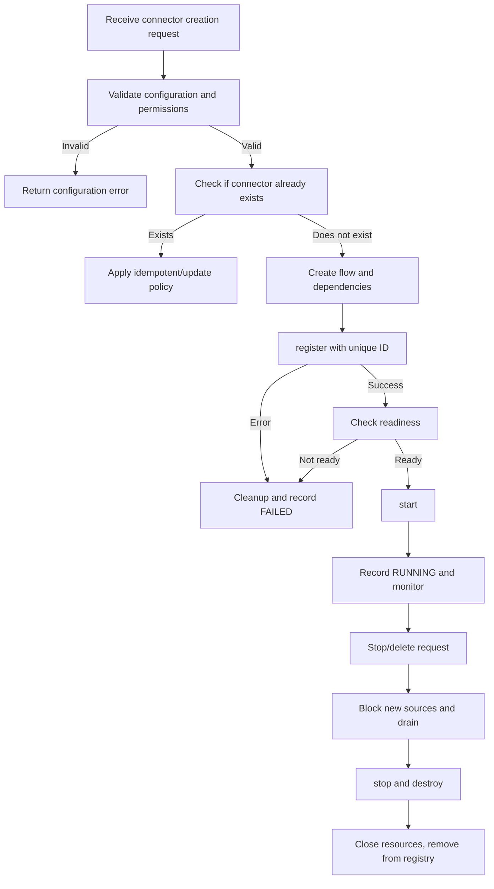

# Dynamic Flow Registration with IntegrationFlowContext

In many applications, integration routes are known before the application starts. We declare them with `@Bean`, Spring creates the required components in the `ApplicationContext`, and then manages endpoint lifecycles along with the context. However, some systems only know which flows need to be created while the application is running: each tenant has its own data source, an administrator enables a new connection, or integration configurations are loaded from a database after deployment.

Spring Integration provides `IntegrationFlowContext` to dynamically register and manage `IntegrationFlow` instances at runtime. This component allows creating flows, registering flow components into the Spring context, controlling start/stop operations, and releasing registrations when they are no longer needed. To use it safely, you need to clearly understand registrations, IDs, input channels, lifecycles, supporting resources, and the limits of registering flows within a single JVM.

## 1. When is IntegrationFlowContext needed?

`IntegrationFlowContext` solves situations where flow configuration cannot be fully determined at application startup time. For example:

- A SaaS platform lets tenants enable/disable connections to their own ERP systems.
- An admin application allows creating a new inbound connection without restarting the service.
- Each partner has its own endpoint, credentials, or mapping, and these configurations are loaded at runtime.
- A flow only exists for the duration of an active long-running task.
- An adapter or consumer is created based on a configuration updated after the application is already running.

If the number of flows, channels, and endpoints is fixed and known, declaring them with `@Bean` is usually easier to manage. Dynamic flows are suitable when the lifecycle of an integration route depends on data or administrative actions that occur after the context has started.

You should not create a new flow for every request or every message. A flow carries endpoints, handlers, channels, and possibly its own scheduler, executor, or resources. Creating flows too frequently increases the number of runtime beans, threads, subscriptions, and state to manage. When differences lie mainly in tenant data, a shared flow combined with a router or header-based routing may be more appropriate.

## 2. Where does IntegrationFlowContext sit in the architecture?

`IntegrationFlowContext` is Spring Integration's registry/runtime API for registering flows once the `ApplicationContext` is already active. It coordinates with the bean factory to register components belonging to a flow, such as channels, endpoints, and handlers.

```mermaid
flowchart TD
    A[ApplicationContext started] --> B[IntegrationFlowContext]
    B --> C[registration(flow)]
    C --> D[IntegrationFlowRegistrationBuilder]
    D --> E[register]
    E --> F[Flow and runtime beans registered]
    F --> G[IntegrationFlowRegistration]
    G --> H[start / stop]
    G --> I[getInputChannel]
    G --> J[destroy]
```

Key objects:

| Component | Role |
|---|---|
| `IntegrationFlow` | Describes the processing route and steps within the flow |
| `IntegrationFlowContext` | Entry point for registering, looking up, and managing dynamic flows in the context |
| `IntegrationFlowRegistrationBuilder` | Configures the registration before registering, such as ID and startup behavior |
| `IntegrationFlowRegistration` | Handle representing a registered flow; provides lifecycle operations and input channel access |
| `MessageChannel` | Channel used to send messages into the flow after the registration is ready |

Calling `register()` creates the registration and places the flow's components into the runtime. The return value is an `IntegrationFlowRegistration`; you should keep this handle to manage the flow later. Simply keeping the initial `IntegrationFlow` variable is not enough to stop and release the registration in a controlled manner.

## 3. Registering a first dynamic flow

First, inject `IntegrationFlowContext` into a flow management service:

```java
@Component
public class DynamicFlowManager {

    private final IntegrationFlowContext flowContext;

    public DynamicFlowManager(IntegrationFlowContext flowContext) {
        this.flowContext = flowContext;
    }
}
```

Suppose the application needs to create an order-processing flow for a tenant. The flow receives messages from a dedicated input channel and invokes a business service:

```java
public IntegrationFlowRegistration registerTenant(String tenantId,
                                                    TenantOrderService service) {
    String flowId = "tenant-" + tenantId + "-orders";
    String inputChannelName = "tenant.orders.input." + tenantId;

    IntegrationFlow flow = IntegrationFlow.from(inputChannelName)
            .handle(service, "process")
            .get();

    IntegrationFlowRegistration registration = flowContext
            .registration(flow)
            .id(flowId)
            .autoStartup(false)
            .useFlowIdAsPrefix()
            .register();

    registration.start();
    return registration;
}
```

The operational flow here is:

1. Generate a stable ID for the registration and the tenant's input channel name.
2. Build the `IntegrationFlow` with the appropriate input channel and handler.
3. Ask `IntegrationFlowContext` to create a registration.
4. Set `autoStartup(false)` to explicitly decide when to start.
5. Use `useFlowIdAsPrefix()` to prepend the flow ID to internal bean names generated by the flow, helping avoid name collisions between dynamic flows.
6. Call `register()` to register the flow, then call `start()` once the configuration is ready.

This example illustrates the common Spring Integration Java DSL API. Specific overloads and handler configuration styles may vary by version; use the API corresponding to your project's dependency version.

### 3.1. Sending messages to a registered flow

The registration provides the flow's input channel. You can use this channel to send messages:

```java
MessageChannel input = registration.getInputChannel();

Message<Order> message = MessageBuilder
        .withPayload(order)
        .setHeader("tenantId", tenantId)
        .setHeader("correlationId", requestId)
        .build();

input.send(message);
```

Retrieving the channel from the registration ensures the caller uses the exact input channel of the newly created flow. There is no need to look up a bean name generated internally by the flow. If the system needs to send messages from multiple places, provide a tenant-aware message-sending abstraction instead of letting every caller construct channel names manually.

`getInputChannel()` is only meaningful when the flow has a corresponding input and the registration has been created successfully. If the flow starts from a self-polling source adapter, callers typically do not need to send messages to that input channel; the adapter fetches data itself and emits it into the flow.

### 3.2. Retrieving an existing registration

When you need to manage a flow after registration, store the `IntegrationFlowRegistration` in an application registry. `IntegrationFlowContext` also supports looking up a registration by ID via the corresponding API in your version. Avoid re-registering a flow just to retrieve a channel or check status.

## 4. IDs and bean names in dynamic flows

A registration ID is the identifier used to manage a flow in the context. It must be stable and unique within the scope of the application's registry.

Examples:

```text
tenant-acme-orders
tenant-contoso-orders
partner-17-inventory
file-import-customer-2026
```

When generating IDs, you should:

- Combine the flow type with a business identifier, such as a tenant ID or connector ID.
- Normalize characters so the ID complies with bean naming rules.
- Avoid using a random value on every restart if the flow needs to be matched back to stored configuration.
- Never include sensitive data such as passwords, access tokens, or connection strings in the ID.
- Check for duplicate IDs before registering and handle concurrent registration requests.

A single flow can create many internal beans. When registering multiple flows of the same kind, default component names can collide without a naming convention. `useFlowIdAsPrefix()` prefixes bean names generated by the flow with the flow ID. This is especially useful when multiple flows share the same structure of transformers, channels, or endpoints.

Prefixing does not replace naming design for channels that the application intentionally shares. If multiple flows need to send to the same public channel, clearly define which channels are shared and which belong to an individual flow. Do not let a channel be accidentally shared just because two flows happen to use the same name.

## 5. Managing start, stop, and destroy

Registering a flow and starting a flow are two actions that can be controlled separately. `IntegrationFlowRegistration` is the handle for executing this lifecycle.

| Operation | Meaning |
|---|---|
| `register()` | Registers the flow and its runtime components into the context |
| `start()` | Starts the flow's lifecycle components so it begins operating |
| `stop()` | Stops the flow's lifecycle components |
| `destroy()` | Cancels the registration and releases the components belonging to the flow |

Example:

```java
// Existing registration
registration.stop();

// When the integration configuration is deleted or the tenant stops using it:
registration.destroy();
```

### 5.1. `autoStartup`

`autoStartup` determines whether the flow automatically starts upon registration according to the builder configuration. Use `autoStartup(false)` when you need to complete preparation steps before the flow receives messages, for example:

- Validating tenant configuration.
- Creating a credential provider or connection client.
- Registering supporting beans.
- Verifying that the target endpoint is reachable.
- Recording the registration in the application's registry.

After all preparation steps succeed, call `start()`. If no separate preparation phase is needed, you can use the framework version's default startup behavior.

### 5.2. Stop is not the same as destroy

`stop()` halts the running components, but the registration remains so it can be started again if the design permits. `destroy()` is used when the flow no longer needs to exist and the registered beans/components must be released.

Do not call `destroy()` merely to pause a connector if you will later need to re-enable the same registration. Conversely, calling only `stop()` when deleting a tenant leaves the registration behind and can leak beans or resources if there is no subsequent cleanup step.

### 5.3. Stopping a flow that is currently processing messages

Stopping an endpoint does not automatically create a unified drain procedure for every type of channel and adapter. Before calling destroy, determine which messages are currently in flight, which messages remain in queues, and what state is persisted durably.

A connector shutdown procedure might include:

1. Marking the connector in a `STOPPING` state to block new send requests from the application.
2. Stopping the inbound source or ceasing to accept new messages.
3. Waiting for in-flight tasks to complete within an allowed timeout.
4. Checking queues or message stores to ensure unprocessed messages can still be recovered.
5. Calling `stop()` and then `destroy()` when ready to remove the flow.
6. Closing any custom clients, connections, or resources created by the application for the connector.

If an in-memory `QueueChannel` is used, messages remaining in the queue do not automatically become durable data. If zero message loss across process restarts is required, use a message store or a broker with persistence and a corresponding recovery procedure.

## 6. Managing multiple dynamic flows with an application registry

In practice, `IntegrationFlowContext` is a framework-level registry; applications usually need an additional business registry to know which flow belongs to which tenant, what the desired state is, and which resources need to be released.

Example data structure:

```java
public record ConnectorRuntime(
        String connectorId,
        String tenantId,
        String flowId,
        IntegrationFlowRegistration registration,
        ConnectorState state) {
}
```

The application registry can store entries by `connectorId`:

```java
private final ConcurrentMap<String, ConnectorRuntime> connectors =
        new ConcurrentHashMap<>();
```

During registration, the workflow should be guarded so two concurrent requests do not create two flows for the same connector. You can use a lock per connector ID, atomic map operations, or a single management service. Do not merely check `containsKey()` and then register, because two threads can pass the check at the same time.

A common management sequence:

```text
ABSENT
  |
  | validate config
  v
REGISTERING
  |
  | register components
  v
REGISTERED
  |
  | start
  v
RUNNING
  |
  | stop requested
  v
STOPPING
  |
  | stop + destroy + close resources
  v
REMOVED
```

If `register()` or `start()` fails, the registry must clear the temporary state and destroy any partially created registration if present. If destroy fails, record a cleanup-failed state so the cleanup operation can be retried. Do not erase all traces from the registry before confirming that resources have been released; otherwise, the application loses the information needed to handle unfinished cleanup.

### 6.1. Avoiding duplicate registration and race conditions

A management pattern should ensure:

- Only one registration or destruction operation is in progress for a given connector ID at any time.
- Flow IDs are generated from normalized data and checked for uniqueness.
- If a flow already exists, the management API clearly defines whether it is an idempotent operation, a configuration update, or a conflict error.
- When updating configuration, never arbitrarily overwrite a running flow; have a replacement and traffic cutover strategy.
- Register/start/destroy steps have corresponding cleanup if an intermediate step fails.

For management operations that may be retried due to timeouts, design the API to be idempotent. For example, an `ensureConnectorRunning(connectorId, version)` request can check the current state and configuration version before creating a new flow.

### 6.2. Shared flow or one flow per tenant?

Not every multi-tenant application needs a separate flow for each tenant.

| Model | Advantages | Costs and limits |
|---|---|---|
| One shared flow, routed by header | Fewer endpoints and beans, easy to upgrade shared logic | Requires tenant isolation in routing, credentials, and business state |
| One flow per tenant | Can configure adapters, channels, and lifecycles independently | Increases bean count, endpoints, subscriptions, and management overhead |
| Group flows by connector type | Balances reuse and isolation | Requires appropriate group configuration and routing design |

Choose the model based on the actual differences between tenants. If only the tenant ID or a few processing parameters differ, a shared router and service are usually simpler. If each tenant has a different source adapter, credentials, polling schedule, or protocol, separate flows may make sense.

## 7. Supporting beans and dependencies of dynamic flows

A flow may need supporting beans such as handlers, converters, clients, or services. There are two cases:

- The dependency is already a shared bean in the `ApplicationContext`, injected into the flow-management component.
- The dependency is created specifically for a single registration, such as a client with connector-specific credentials.

For flow-specific dependencies, the `IntegrationFlowContext` builder supports registering additional beans via the `addBean(...)` API in versions that support it. Give the bean a distinct name, manage its lifecycle, and release resources when the registration is destroyed.

Conceptual example:

```java
IntegrationFlowRegistration registration = flowContext
        .registration(flow)
        .id(flowId)
        .useFlowIdAsPrefix()
        .addBean("connectorClient", connectorClient)
        .register();
```

Check the `addBean` overloads in the Spring Integration version you are using. If a client is created outside the flow context, the application remains responsible for closing that client when the connector is deleted; do not assume every object passed into a handler will be closed properly by the framework automatically.

Do not put credentials in flow IDs, bean names, logs, or unnecessary message headers. Use a secret manager or the application's secure configuration mechanism to provide credentials to adapters/clients.

## 8. Changing the configuration of a running flow

A dynamic flow is often created from configuration stored in a database or control plane. When configuration changes, there are three common approaches:

1. **Change only runtime data:** if the flow is shared and handlers safely read the new configuration, business configuration can be updated without creating a new flow.
2. **Stop and re-register:** suitable when topology, endpoints, or adapters change and continuity of the old flow is not required.
3. **Create a new flow and switch traffic:** suitable when downtime must be minimized, though it requires version management, preventing two flows from processing the same source simultaneously, and a plan to destroy the old flow.

With a zero-downtime replacement strategy, you can attach a version to the flow ID, such as `tenant-acme-orders-v12`. Once the new flow is registered and verified, switch the source or routing to the new version; only destroy the old version once in-flight messages have completed and old state has been preserved.

Do not directly mutate a configuration object that handlers are reading from multiple threads if that object is mutable and lacks synchronization. Use an immutable configuration snapshot or an atomic update mechanism.

## 9. Dynamic flows and single-JVM boundaries

`IntegrationFlowContext` manages flows within the `ApplicationContext` of the current process. It is not a distributed registry and does not automatically synchronize registrations across multiple application instances.

For example, when running three replicas:

```text
              Configuration database
                       |
                Control / deployment
                 /      |      \
                v       v       v
             App A    App B    App C
             Context  Context  Context
             Flow A   Flow B   Flow C
```

Each instance can register a flow with the same local ID. That does not mean only one instance will receive messages. If all three flows connect to the same source, three consumers may read the same data or process the same event simultaneously.

For multi-replica applications, clearly decide:

- Should the flow run on every instance or only on a single elected instance?
- Does the data source support consumer groups, competing consumers, or distributed leases/locks?
- Through what mechanism is connector configuration broadcast to all instances?
- When an instance restarts, how are flows restored and re-registered?
- How do you prevent two instances from owning the same connector if business rules require a single owner?

These concerns require system-level mechanisms such as broker consumer groups, distributed locks/leases, partition assignment, or a control plane. They cannot be solved with `IntegrationFlowContext` alone.

## 10. Error handling when registering and operating flows

Errors can occur at several points:

| Stage | Example causes | Handling approach |
|---|---|---|
| Pre-registration validation | Missing URL, wrong protocol, expired credentials | Reject configuration and store a readable error |
| `register()` | Duplicate ID or bean name, invalid flow configuration | Check naming, clean up any partially created registration |
| `start()` | Adapter cannot connect, resource not ready | Record failed start state, clean up or retry with a limit |
| During processing | Downstream timeout, malformed payload, handler throws exception | Use retry/error flows and business policies |
| `stop()` | Consumer does not stop in time or tasks are running | Apply timeout, log status, and follow a proper drain procedure |
| `destroy()` | Resource fails to close or supporting bean is still active | Record cleanup failure and allow cleanup retries |

Distinguish flow registration errors from message-processing errors. A flow may register and start successfully while every subsequent message fails due to a downstream issue. Conversely, a connector may fail to start so no message ever reaches the handler.

Management state should reflect at least `REGISTERING`, `REGISTERED`, `RUNNING`, `STOPPING`, `STOPPED`, `FAILED`, and `REMOVED`, or an equivalent state set. Also store the timestamp of state changes, configuration version, and error cause so operators know which step the flow is stuck on.

## 11. Observing and testing dynamic flows

Dynamic flows should be observed as runtime resources that can appear and disappear while the application is running.

Metrics and information to track:

- Number of registered, running, stopped, and failed flows.
- Flow ID, connector ID, masked/normalized tenant ID, and configuration version.
- Registration, start, stop, and destroy durations.
- Inbound/outbound message counts, error counts, retries, and latency per flow.
- Queue depth, executor activity, and thread count if the flow uses polling or async processing.
- Number of removed registrations and failed resource cleanups.

Avoid using very high-cardinality tenant IDs directly as metric labels if doing so causes metrics cardinality explosion. Use structured logs or traces for per-connector detail, and aggregate metrics by connector type or state.

### 11.1. Key test cases

| Scenario | What to verify |
|---|---|
| Valid flow registration | Registration appears, endpoints start, and input channel receives messages |
| Duplicate ID registration | No second flow created; error or idempotent result according to contract |
| Two concurrent registration requests | Only one registration for the same connector ID |
| `autoStartup(false)` | Flow does not process messages until `start()` is called |
| Stop and restart | Flow can be restarted if design allows and resources remain valid |
| Destroy | Registration components/beans are released and no longer process new messages |
| Handler throws exception | Error/retry policy operates according to flow configuration |
| Invalid configuration | No partial registration or resource left behind |
| Application restart | Control plane can recreate required flows from stored configuration |
| Multiple replicas | No duplicate consumers spawned when single owner is required |

Tests should use an `ApplicationContext` test and message channels to verify real behavior. For flows using a scheduler or executor, wait for asynchronous completion conditions using latches/Awaitility or an appropriate synchronization mechanism rather than relying on a fixed `sleep` duration.

## 12. Safe rollout workflow for a dynamic flow

A general workflow can be organized as follows:



The order may vary depending on the adapter. For a source polling adapter, readiness might be a connectivity check to the source system. For a flow that only receives messages via an input channel, readiness might be that the endpoint is started and the channel is ready. The key is to define readiness according to the flow type rather than treating a successful `register()` call as proof that the connector is working properly.

## 13. Checklist before using IntegrationFlowContext in production

- [ ] There is a clear reason to create flows at runtime; static flows cannot satisfy the requirement.
- [ ] IDs are stable, unique, and do not contain sensitive data.
- [ ] Internal bean names are isolated with prefixes when needed.
- [ ] Input channels are obtained from the registration or managed under a clear naming contract.
- [ ] A business registry holds `IntegrationFlowRegistration` instances and connector states.
- [ ] Registration/start/destroy operations are protected against concurrent requests.
- [ ] `autoStartup` and start timing align with dependency readiness.
- [ ] Stop and destroy are distinguished; message draining and resource closing procedures exist.
- [ ] Failures at every stage have corresponding status, logs, and cleanup.
- [ ] Per-tenant flows are properly isolated in channels, credentials, and data.
- [ ] Behavior across multiple application replicas is clearly defined.
- [ ] Metrics/logs exist to track flow counts, lifecycles, messages, and errors.
- [ ] Tests cover duplicate IDs, race conditions, restarts, cleanup, and downstream failures.

`IntegrationFlowContext` enables Spring Integration to create and manage processing routes while the application is running. To use it properly, treat each registration as a resource with its own ID, dependencies, state, and lifecycle: create when configuration is valid, start when ready, stop when ceasing to accept work, and destroy when it needs to be released. When combined with a business registry, clear naming, concurrency handling, and runtime observability, dynamic flows can be operated in a controlled manner in production applications.
