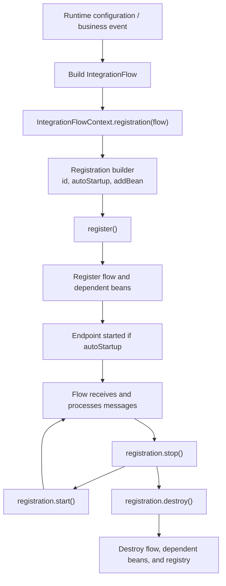
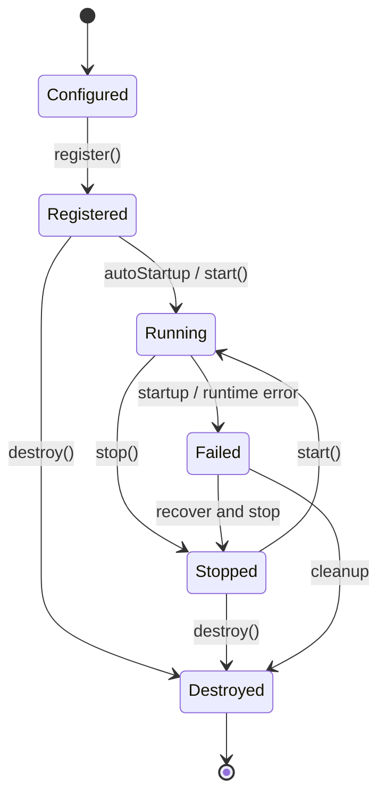

# Registration and Lifecycle of Runtime Flows

`IntegrationFlowContext` allows an application to create and register an `IntegrationFlow` at runtime. This mechanism is suitable when the number of flows or flow configurations depends on data only known at runtime, such as a new tenant, a new partner, a newly provisioned TCP connection, or a data source enabled by operational configuration.

A dynamically registered flow is still managed by Spring Integration like integration beans in the `ApplicationContext`. The framework creates dependent components, wires channels to endpoints, and manages their lifecycle. The application receives an `IntegrationFlowRegistration` to access the flow, retrieve the input channel, send messages, stop, restart, or destroy the entire registration.

This article focuses on the lifecycle of a dynamic flow: building, registering, using, pausing, restarting, and removing it. The emphasis is on resource ownership, flow identification, dependent beans, and avoiding endpoint leaks when runtime configuration changes.

## 1. When is dynamic flow registration needed?

Flows declared with `@Bean` are suitable when the integration structure is known at development time and does not change with runtime data. For example, an application always has a single flow receiving orders from a fixed queue.

Dynamic registration is appropriate when the application needs to create or remove flows in response to operational events:

- Each tenant has its own endpoint, credentials, or processing rules.
- A partner is added to the system and requires opening a dedicated inbound/outbound connection.
- A device or gateway is registered, bringing its own TCP or MQTT flow.
- A data source only appears after the application has started.
- An administrator enables/disables an integration without restarting the entire application.
- A configuration set is loaded from a database or control plane and used to construct multiple flows from the same template.

Do not use dynamic flows just because it is possible. If a flow is always static, declaring it with `@Bean` is usually easier to read, test, and maintain. Dynamic flows carry operational overhead: you must manage IDs, handle duplicate registrations, clean up dependent beans, handle failures between registration and removal, and monitor the number of running flows.

## 2. IntegrationFlowContext and related objects

Spring Integration provides the `IntegrationFlowContext` bean to manually register flows outside the standard bean-registration phase. The framework provides this bean automatically; the application can inject it into the service responsible for managing flows.

Basic process:

1. Build an `IntegrationFlow` object from business data or runtime configuration.
2. Call `IntegrationFlowContext.registration(flow)` to obtain a builder.
3. Configure the ID, `autoStartup`, dependent beans, and registration options.
4. Call `register()` to place the flow and its dependent components into the application context.
5. Use `IntegrationFlowRegistration` to send messages, access the flow, or control its lifecycle.
6. Call `destroy()` or `IntegrationFlowContext.remove(id)` when the flow is no longer needed.



The main APIs have distinct responsibilities:

| API | Responsibility |
|---|---|
| `IntegrationFlowContext` | Entry point for registering, looking up, and removing dynamic flows in the context |
| `IntegrationFlowRegistrationBuilder` | Configures how registration behaves before calling `register()` |
| `IntegrationFlowRegistration` | Represents a created registration; provides access to the flow and lifecycle control |
| `getRegistrationById(id)` | Looks up a registration by ID; may return `null` if it does not exist |
| `getRegistry()` | Returns a map of flow IDs and their corresponding registrations |
| `messagingTemplateFor(id)` | Obtains a `MessagingTemplate` whose default destination is the flow's input channel |
| `remove(id)` | Destroys the flow and its dependent beans while clearing the cache/registry |

`IntegrationFlowRegistration` provides key methods:

- `getId()`: retrieves the flow's ID.
- `getIntegrationFlow()`: retrieves the registered flow object.
- `getInputChannel()`: retrieves the flow's input channel.
- `getMessagingTemplate()`: retrieves a template for sending messages to the input channel.
- `start()`: starts the registration.
- `stop()`: stops the registration.
- `destroy()`: destroys the flow, dependent beans, and registration state.

`getMessagingTemplate()` can only be used when the flow starts with a `MessageChannel`. If the flow starts from a `MessageSource` or another source that does not provide an input channel, this method may throw `IllegalStateException`. In that case, interact with the source through its proper mechanism.

## 3. Registering a flow from runtime data

The following example creates a dedicated flow per tenant. The flow receives an input string, normalizes the data, and invokes a processing service. The input channel is created alongside the flow; after registration, the application can retrieve the channel or messaging template from the registration.

```java
@Component
public class TenantFlowManager {

    private final IntegrationFlowContext flowContext;

    public TenantFlowManager(IntegrationFlowContext flowContext) {
        this.flowContext = flowContext;
    }

    public IntegrationFlowRegistration register(
            String tenantId,
            TenantOrderService orderService) {

        String flowId = "tenant-" + tenantId;

        MessageChannel inputChannel = new DirectChannel();

        IntegrationFlow flow = IntegrationFlow.from(inputChannel)
                .<String, String>transform(String::trim)
                .handle(String.class,
                        (payload, headers) ->
                                orderService.process(tenantId, payload))
                .get();

        return this.flowContext.registration(flow)
                .id(flowId)
                .useFlowIdAsPrefix()
                .autoStartup(true)
                .register();
    }
}
```

Here, `tenantId` is business data used to identify the flow. In a real application, normalize and validate this value before using it as a bean ID. The ID must be unique within the scope of the application context. The same tenant should not create multiple flows with the same ID while an old registration still exists.

After registration, you can use the registration:

```java
IntegrationFlowRegistration registration =
        tenantFlowManager.register("acme", tenantOrderService);

registration.getMessagingTemplate()
        .send(new GenericMessage<>("order-100"));
```

If you want to send directly via the input channel:

```java
MessageChannel input = registration.getInputChannel();

input.send(new GenericMessage<>("order-101"));
```

`MessagingTemplate` is useful when you need standard Spring Integration send operations, such as request-reply or timeout configuration. The input channel is useful when the application needs to integrate directly with an existing producer.

### 3.1. Registering additional dependent beans

A flow may need a connection factory, serializer, deserializer, or a helper bean specific to a connection. The registration builder allows adding these beans so they are registered alongside the flow.

```java
IntegrationFlowRegistration registration =
        flowContext.registration(flow)
                .id("partner-" + partnerId)
                .addBean("partnerConnectionFactory", connectionFactory)
                .addBean("partnerSerializer", serializer)
                .register();
```

There are two common forms:

- `addBean(Object bean)`: lets the framework register the dependent bean with a suitable name.
- `addBean(String name, Object bean)`: provides an explicit bean name.

Only add beans that are genuinely owned by the flow. If multiple flows share a single connection factory, clearly determine whether that bean belongs to the application context or to each individual registration. Never let one flow destroy a resource that is still in use by another flow.

## 4. Flow IDs and bean names generated by a flow

The ID is the registration's identifier. It is used to look up, stop, destroy, and manage the flow. The builder provides `id(String)`; the ID must be unique in the context, and an old registration must be destroyed before reusing that ID for a new flow.

```java
IntegrationFlowRegistration registration =
        flowContext.registration(flow)
                .id("partner-42")
                .register();
```

Prefer setting an explicit ID rather than relying on an auto-generated name. A clear ID helps logs, registries, and cleanup operations correlate back to the corresponding tenant or partner.

### 4.1. Avoiding component name collisions across flows

When creating multiple instances of the same flow template, internal components may share IDs—for example, every handler has the ID `client`. If bean names are not disambiguated, registering multiple flows can cause conflicts.

Use `useFlowIdAsPrefix()` to prepend the flow ID to bean names inside the flow:

```java
IntegrationFlowRegistration flowA =
        flowContext.registration(buildClientFlow(portA))
                .id("client-a")
                .useFlowIdAsPrefix()
                .register();

IntegrationFlowRegistration flowB =
        flowContext.registration(buildClientFlow(portB))
                .id("client-b")
                .useFlowIdAsPrefix()
                .register();
```

If the flow has an internal handler with ID `client`, the handler's bean name can be disambiguated per flow, such as `client-a.client.handler` and `client-b.client.handler`.

`useFlowIdAsPrefix()` requires the flow to have an ID. This feature has been available since Spring Integration 5.0.6. Bean name generation conventions have evolved across versions; when code depends on internal bean names, consult the documentation for the exact Spring Integration version used by your application. Avoid hardcoding auto-generated bean names when you can operate through the registration API.

## 5. Lifecycle: register, start, stop, destroy

Registering and running are related concepts that must be distinguished. The builder determines whether the flow starts automatically after registration; the registration allows controlling the lifecycle afterward.

| Operation | Meaning | Registration still exists? |
|---|---|---|
| `register()` | Creates and registers the flow and dependent beans | Yes |
| `start()` | Starts the flow's lifecycle components | Yes |
| `stop()` | Stops the currently running components | Yes |
| `destroy()` | Destroys the flow, dependent beans, and registration state | No |
| `IntegrationFlowContext.remove(id)` | Destroys the registration by ID | No |

### 5.1. autoStartup

`autoStartup` controls whether the flow starts automatically after being registered. The default is `true`.

```java
IntegrationFlowRegistration registration =
        flowContext.registration(flow)
                .id("partner-import")
                .autoStartup(false)
                .register();

// Start once the partner has completed the handshake step.
registration.start();
```

This is useful when a flow must wait for an external condition before receiving messages, for example:

- The connection to a partner system must be verified first.
- Credentials need to be loaded and validated.
- A device registration step must complete before opening a consumer.
- An administrator needs to enable the flow after reviewing the configuration.

When `autoStartup=false`, the required beans are still registered and initialized during registration, but lifecycle components are not started automatically. The application is responsible for calling `start()` once conditions are ready.

### 5.2. Pausing and restarting

`stop()` halts the registration's lifecycle components. It does not mean the flow has been removed from the application context. The registration still exists so it can be looked up and restarted.

```java
IntegrationFlowRegistration registration =
        flowContext.getRegistrationById("partner-import");

if (registration != null) {
    registration.stop();

    // Perform maintenance or wait for the data source to become ready.

    registration.start();
}
```

When a flow is stopped, producers may still attempt to send messages. The outcome depends on the input channel and how the producer sends. With `DirectChannel`, having no active consumer means messages cannot be processed and send operations may fail. With buffered channels, messages may be held in the buffer if capacity remains, though that does not mean the messages are durably persisted.

If the goal is to completely terminate an integration and release beans along with connections, destroy the registration rather than only stopping it.

### 5.3. Destroying a registration

When a flow is no longer needed, call `destroy()` on the registration or `remove(id)` on the context:

```java
IntegrationFlowRegistration registration =
        flowContext.getRegistrationById("partner-import");

if (registration != null) {
    registration.destroy();
}
```

Or:

```java
flowContext.remove("partner-import");
```

Destruction removes the `IntegrationFlow` bean, dependent beans managed by the registration, and the corresponding registry/cache state. Lifecycle endpoints are stopped during destruction. After destruction, do not continue using the registration or references to channels/handlers owned by the flow.

If you need to re-register with the same ID, completely destroy the old registration first. An ID must not be reused while the old registration still exists.

## 6. Managing multiple flows and safe cleanup

In multi-tenant or multi-partner applications, a flow manager typically needs a business registry to map tenants to flow IDs. This registry helps the application decide when to create, pause, restart, or destroy a flow.

```java
@Component
public class PartnerFlowRegistry {

    private final IntegrationFlowContext flowContext;
    private final Map<String, IntegrationFlowRegistration> registrations =
            new ConcurrentHashMap<>();

    public PartnerFlowRegistry(IntegrationFlowContext flowContext) {
        this.flowContext = flowContext;
    }

    public synchronized IntegrationFlowRegistration register(
            String partnerId,
            IntegrationFlow flow) {

        String flowId = "partner-" + partnerId;

        if (registrations.containsKey(flowId)) {
            throw new IllegalStateException(
                    "Flow already registered: " + flowId);
        }

        IntegrationFlowRegistration registration =
                flowContext.registration(flow)
                        .id(flowId)
                        .useFlowIdAsPrefix()
                        .register();

        registrations.put(flowId, registration);
        return registration;
    }

    public synchronized void unregister(String flowId) {
        IntegrationFlowRegistration registration =
                registrations.get(flowId);

        if (registration != null) {
            registration.destroy();
            registrations.remove(flowId, registration);
        }
    }
}
```

This is a minimal example of registration ownership. In real systems:

- Normalize `partnerId` before constructing the ID; never use arbitrary input data directly as a bean name.
- Ensure a partner cannot have two concurrent register operations creating the same ID.
- Only remove the entry from the business registry after `destroy()` succeeds. If cleanup fails, keep the record so it can be observed and handled further.
- If the flow manager has multiple instances in one JVM or multiple nodes, determine which node owns each flow. `IntegrationFlowContext` only manages the registry in the current process's application context.
- When multiple flows share a connection or executor, manage the lifecycle of the shared resource at the application level rather than letting a single flow destroy it.
- On application shutdown, the context closes the beans it manages; the flow manager should still provide an early unregister operation when a tenant or partner is removed while the application is running.

Do not treat `getRegistry()` as a durable source of business truth. The `IntegrationFlowContext` registry describes flows registered in the current context. If flows need to be restored after a restart, persist the required configuration in a database or configuration store and rebuild the flows during startup.

## 7. Error handling during flow creation and destruction

Dynamic registration can fail before a flow is ready to receive messages. For example:

- The ID is already in use.
- A flow dependency does not exist yet or is incompatible.
- A connection factory fails to open a connection.
- A dependent bean is misconfigured.
- An endpoint fails to start.
- An external source disconnects while the flow is being registered.

Distinguish configuration/registration errors from message-processing errors after the flow is running. Registration errors typically surface during the `register()` call or while starting components. Message errors occur when an endpoint receives and processes a message; they follow the flow's error-handling mechanism, such as a configured error channel or retry advice.

A registration management pattern should log the flow ID at all three points: registration start, registration success, and destruction start. When an error occurs, log the current state and root cause so you can tell whether the flow was never created, was created but not running, or was running before hitting an error.

When destroying a flow, if a dependent bean fails to release a resource, retain sufficient logs to identify the bean owning that resource. Do not simply delete the business registry entry and ignore a failed destruction state.

## 8. Transactions, retries, message stores, and flow-associated resources

`IntegrationFlowContext` manages registering the flow and its dependent beans. It does not automatically create transaction boundaries, retry policies, or business message persistence. Those mechanisms must still be configured in the flow or in the beans the flow uses.

For example:

- If a handler requires a transaction, configure transaction advice or appropriate transaction support at the endpoint.
- If an operation needs retries, add retry advice and specify which exceptions should be retried.
- If an aggregator or resequencer needs to persist state, configure an appropriate message store.
- If the flow uses correlation, ensure the correlation key and release strategy match the data lifecycle.
- If the flow uses a dedicated connection factory, register it as a dependent bean when the registration owns that resource; if the connection factory is shared, let an application-scoped bean manage it.

When destroying a flow, clearly determine which data must be retained. Removing an endpoint does not automatically mean message data has been processed, committed, or durably stored. For shared message stores or data requiring recovery, establish separate retention and cleanup policies.

## 9. Inspecting runtime flow state

You can look up a registration by ID:

```java
IntegrationFlowRegistration registration =
        flowContext.getRegistrationById("partner-42");

if (registration == null) {
    log.info("Flow partner-42 is not registered");
}
else {
    log.info("Flow id={}", registration.getId());
    log.info("Input channel={}", registration.getInputChannel());
}
```

You can inspect the current registry:

```java
flowContext.getRegistry().forEach((id, registration) ->
        log.info("registered flow: {}", id));
```

Note: the registry confirms that a registration exists, but it does not replace checking the running state of individual endpoints. A registration can still exist after `stop()` has been called.

When detailed inspection is needed, you can look up endpoints and beans by name or type from the application context and observe startup/shutdown logs. If the application has many dynamic flows, explicit IDs and easily recognizable component names make log correlation much easier.

| Symptom | Check | Remediation |
|---|---|---|
| `register()` reports duplicate ID | Registry and existing IDs | Use a unique ID or destroy the old registration first |
| Flow registers successfully but processes no messages | `autoStartup`, endpoint state, input channel | Call `start()` or fix input configuration |
| Cannot obtain messaging template | Does the flow start with a `MessageChannel`? | Use an appropriate input channel or send via the source mechanism |
| Multiple flows collide on bean names | Internal component IDs and `useFlowIdAsPrefix()` | Set an explicit flow ID and enable prefixing |
| Old flow still holds resources | Registration ID, dependent beans, destroy | Call `destroy()` or `remove(id)` |
| Dynamic flows disappear after app restart | Runtime configuration source | Persist configuration outside the registry and re-register on startup |
| Flow stopped but producer keeps sending | Channel type and producer | Coordinate the producer, handle send errors, or use appropriate buffering |

## 10. Recommended operational workflow

A dynamic flow should have a lifecycle tied to a clear business entity, such as a tenant or partner:

1. Receive configuration and validate input data.
2. Create the flow and dependent beans from the validated configuration.
3. Generate a stable ID that is unique within the application context.
4. Register the flow using `IntegrationFlowContext`.
5. Verify connection and endpoint status; enable producers only when the flow is ready.
6. Monitor message errors, retries, transactions, and resource state.
7. When the integration is paused, call `stop()`; when recovered, call `start()`.
8. When the integration is removed, call `destroy()` or `remove(id)`, then update the business registry after cleanup succeeds.

This workflow can be represented as follows:



This diagram is an application-level operational model. An error inside a handler does not necessarily transition the registration into a `Failed` state; the endpoint may remain running and continue receiving messages. Observe registration state, endpoint lifecycle, and message-processing outcomes separately.

## 11. Remember

- `IntegrationFlowContext` registers and manages dynamic flows within the current application context.
- `registration(flow)` creates a builder; `register()` registers the flow and dependent beans.
- IDs must be unique within the context; setting explicit IDs aids lookup and cleanup.
- `useFlowIdAsPrefix()` disambiguates component names when registering multiple instances of the same flow template.
- `autoStartup` defaults to `true`; set `false` if you need to control when the flow starts.
- `stop()` pauses the flow while keeping the registration; `start()` restarts it; `destroy()` or `remove(id)` destroys the flow and dependent beans.
- `getRegistry()` is runtime state within a single context, not durable configuration storage for recovery after restarts.
- Transactions, retries, message stores, correlation, and error handling still need to be configured according to the flow's business requirements.
- Every registration needs a clear owner and cleanup procedure to avoid leaking endpoints, connections, or executors.

## References

- [Spring Integration — Dynamic and Runtime Integration Flows](https://docs.spring.io/spring-integration/reference/dsl/java-runtime-flows.html)
- [Javadoc — IntegrationFlowContext (Spring Integration 6.2.6)](https://docs.spring.io/spring-integration/docs/6.2.6/api/org/springframework/integration/dsl/context/IntegrationFlowContext.html)
- [Javadoc — IntegrationFlowRegistration (Spring Integration 6.2.6)](https://docs.spring.io/spring-integration/docs/6.2.6/api/org/springframework/integration/dsl/context/IntegrationFlowContext.IntegrationFlowRegistration.html)
- [Javadoc — IntegrationFlowRegistrationBuilder (Spring Integration 6.5.0)](https://docs.spring.io/spring-integration/docs/6.5.0/api/org/springframework/integration/dsl/context/IntegrationFlowContext.IntegrationFlowRegistrationBuilder.html)
