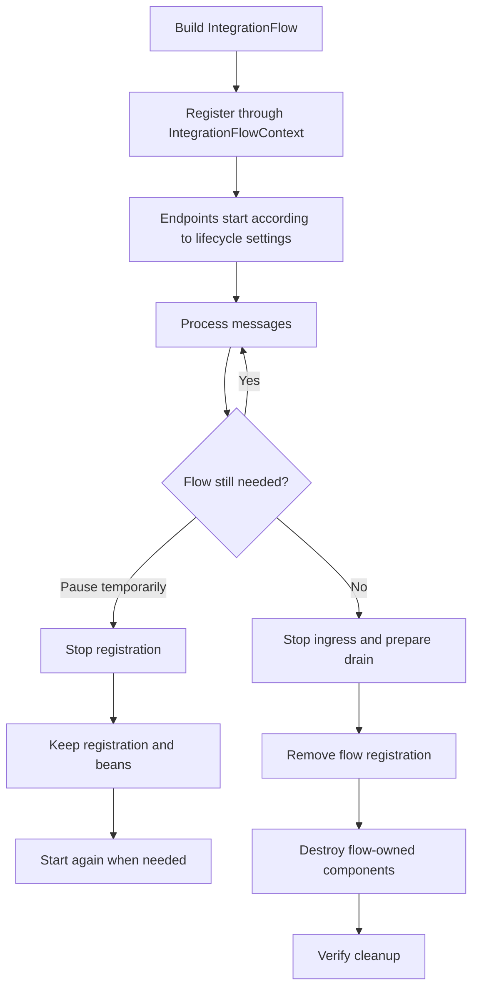
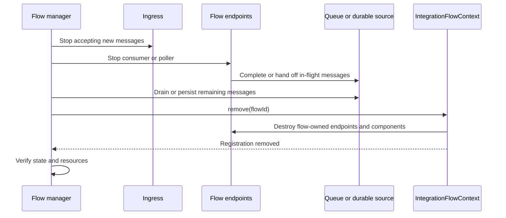

# Unregistering Flows and Cleaning Up Associated Beans

Spring Integration allows registering an `IntegrationFlow` while the application is running via `IntegrationFlowContext`. This approach fits systems where flows are created per tenant, customer, integration configuration, or session. However, registration is only the first half of the lifecycle. When a configuration is no longer valid, the application must remove the flow from the runtime and release the components created by that flow.

An important distinction is between **stopping a flow** and **unregistering a flow**. Stopping a flow prevents endpoints from continuing to process according to their lifecycle, while the beans and registration remain in the context so they can be started again. Unregistering removes the flow from `IntegrationFlowContext`, unregisters the components belonging to the flow, and releases resources owned by those components. If you only stop without unregistering, the application can accumulate unused endpoints, beans, schedulers, or state.

## 1. What does IntegrationFlowContext manage?

With statically declared flows, Spring creates the beans when the ApplicationContext initializes. Those beans exist for the lifetime of the context. With dynamic flows, `IntegrationFlowContext` provides a registry to register and manage flows while the application is running.

A dynamic registration typically involves the following objects:

- **IntegrationFlow**: describes the message-processing route.
- **IntegrationFlowRegistration**: represents a single flow registration, providing the ID and lifecycle management operations.
- **Channels and endpoints**: components created from the flow and added to the Spring bean factory.
- **Flow-specific supporting beans**: additional components registered alongside the flow if the application uses that mechanism.
- **External dependencies**: services, repositories, executors, or channels already present in the ApplicationContext that the flow references.

The distinction between registration-owned components and external dependencies is critical during cleanup. When removing a flow, the framework can destroy components registered with the flow. However, a singleton service injected from the ApplicationContext remains under the management of the main context; the flow only uses it. You must not close or delete a shared service simply because one flow stops using it.

## 2. Lifecycle of a dynamic flow

A dynamic flow typically goes through the following stages:



This sequence separates two scenarios:

- **Temporary pause**: stop endpoints while keeping the registration. The flow can be started again when needed.
- **End of lifecycle**: remove the registration. The flow and components belonging to the registration are destroyed from the runtime.

When `register()` is called, endpoints are started according to lifecycle settings such as `autoStartup`. Therefore, "registered" and "running" are two states that must be observed separately. A flow may already be registered while its endpoints are configured not to start automatically.

## 3. Registering a flow with a stable ID

The following example registers a flow dedicated to a single tenant:

```java
String flowId = "tenant-" + tenantId + "-orders";

IntegrationFlow flow = buildTenantOrderFlow(tenantId);

IntegrationFlowRegistration registration =
        integrationFlowContext
                .registration(flow)
                .id(flowId)
                .useFlowIdAsPrefix()
                .register();
```

Key points to note:

- `id(flowId)` sets the ID for the registration. The ID must be unique within the ApplicationContext registry.
- `useFlowIdAsPrefix()` uses the flow ID as a prefix for names of components generated from the flow, helping reduce name collisions and making it easy to identify which flow a component belongs to.
- `register()` registers the flow and returns an `IntegrationFlowRegistration`.
- `registration.getId()` provides the actual ID to store and use when managing or unregistering.
- `buildTenantOrderFlow(...)` must build a flow configuration dedicated to that tenant. Do not reuse a flow instance with its own state or endpoints across multiple independent registrations.

Flow names should be normalized before being used as IDs. Do not put sensitive data such as emails, tokens, or personal information directly into bean names; names may appear in logs, metrics, or management tools. If a tenant ID contains characters unsuitable for the application's naming conventions, convert it into a safe and stable identifier.

If the flow requires a dedicated input channel, ensure that channel is created and managed with the registration or registered under a flow-specific name. If the flow references a shared channel, that channel continues to exist after the flow is unregistered.

## 4. How do stop and unregister differ?

This is the most common source of component leaks when managing dynamic flows.

| Operation | Result | Can be started again? |
|---|---|---|
| `registration.stop()` | Stops the lifecycle components belonging to the registration | Yes, if the registration still exists |
| `registration.start()` | Restarts a stopped registration | Yes |
| `integrationFlowContext.remove(flowId)` | Removes the registration and destroys the flow's components | No; must re-register |
| Closing the ApplicationContext | Stops and destroys beans managed by the context | No, not in a closed context |

Stopping a flow is suitable when pausing processing temporarily, performing maintenance, or waiting for an operational condition. Unregistering is appropriate when an integration configuration expires, a tenant is deleted, a dynamic connection is revoked, or the flow is replaced with a new registration.

Unregister example:

```java
public void unregisterFlow(String flowId) {
    integrationFlowContext.remove(flowId);
}
```

`remove(flowId)` is the `IntegrationFlowContext` operation to remove the flow from the registry and destroy the corresponding registration. This is the API to use for ending a dynamic flow's lifecycle. Do not manually look up internal bean names and delete bean definitions by hand; doing so bypasses the relationships between flows, endpoints, and framework-registered components.

If you only want to pause temporarily, keep the registration object:

```java
registration.stop();

// When needing to restart:
registration.start();
```

After calling `integrationFlowContext.remove(flowId)`, do not continue using the old registration. If it needs to run again, create or build an appropriate flow and register it anew.

## 5. Managing IDs so registrations are not lost track of

The application must store the IDs of registered flows. Without storing the IDs, when a tenant is deleted or configuration is revoked, the application may not know which registration needs to be removed.

Example of a simple registry:

```java
@Component
public class DynamicOrderFlows {

    private final IntegrationFlowContext flowContext;
    private final TenantOrderFlowFactory flowFactory;

    private final ConcurrentMap<String, String> flowIds =
            new ConcurrentHashMap<>();

    public DynamicOrderFlows(
            IntegrationFlowContext flowContext,
            TenantOrderFlowFactory flowFactory) {
        this.flowContext = flowContext;
        this.flowFactory = flowFactory;
    }

    public void register(String tenantId) {
        String flowId = "tenant-" + tenantId + "-orders";

        flowIds.computeIfAbsent(tenantId, key -> {
            IntegrationFlow flow = this.flowFactory.createForTenant(key);

            IntegrationFlowRegistration registration =
                    this.flowContext.registration(flow)
                            .id(flowId)
                            .useFlowIdAsPrefix()
                            .register();

            return registration.getId();
        });
    }

    public void unregister(String tenantId) {
        flowIds.computeIfPresent(tenantId, (key, flowId) -> {
            this.flowContext.remove(flowId);
            return null;
        });
    }

}
```

`TenantOrderFlowFactory` is an application-defined abstraction for creating a new flow for a tenant; it can be implemented by another `@Component`. Using `computeIfAbsent` prevents duplicate registrations for the same tenant key within the same registry instance. If the system receives multiple concurrent registration requests, standardize ID normalization and handle cases where the same flow ID has already been registered by another component.

Example factory contract:

```java
public interface TenantOrderFlowFactory {
    IntegrationFlow createForTenant(String tenantId);
}
```

When unregistering, the example uses `computeIfPresent` and removes the mapping only after `remove(flowId)` completes. If the remove operation throws an error, the mapping remains so the system can log it and retry handling according to operational policy.

For larger systems, this registry may need to store configuration state in a database or a durable coordination store. An in-memory map only describes the registrations of a single JVM and is lost on process restart.

## 6. Which beans are cleaned up on unregister?

Not every bean used by a flow is deleted. Distinguish ownership carefully:

| Object type | When unregistering the flow |
|---|---|
| Endpoint created from the flow registration | Removed from runtime and destroyed according to the registration lifecycle |
| Internal channel created with the flow | Destroyed along with the registration's components |
| Supporting bean registered specifically for the flow | Cleaned up via the flow's registration and lifecycle mechanism |
| Existing singleton service in the ApplicationContext | Remains intact; only the flow stops referencing it |
| Shared Repository, DataSource, or HTTP client | Remains managed by the main ApplicationContext |
| Shared executor or scheduler | Not closed automatically just because one flow unregisters |
| Messages or state stored in external systems | Not automatically deleted; requires a separate policy |

A flow may reference shared beans via constructor injection or by name. Those dependencies are not exclusively owned by the flow. If you unregister a flow and then call `close()` on a shared executor or client, other flows may fail.

Conversely, if a component or resource is created specifically for a flow and managed by Spring within the registration scope, let the bean lifecycle perform cleanup. Custom beans can use Spring callbacks such as `DisposableBean`, `@PreDestroy`, or `AutoCloseable` as appropriate for the bean configuration. Cleanup must be safe when invoked during shutdown and should not depend on sending a new message into the flow.

### Avoiding creating resources outside the Spring lifecycle

A bad example is creating an executor inside a handler with nowhere to shut down that executor:

```java
public class BadHandler {

    private final ExecutorService executor =
            Executors.newFixedThreadPool(8);

}
```

This executor is not automatically managed by Spring just because the handler was created inside a flow. If the handler is unregistered without shutting down the executor, worker threads can continue to linger.

There are two clear approaches:

- Use an executor bean managed by the ApplicationContext if multiple flows share it.
- If the executor serves only one flow, register it as a resource with an explicit lifecycle and ensure cleanup when the registration is destroyed.

Do not close a shared executor inside a single flow's destroy callback. The owner of the resource must be the one deciding when to shut down.

## 7. Safe flow-removal sequence while messages are in flight

Calling remove immediately while a flow is still under load can lose queued work or interrupt in-flight messages. Unregistering must align with the source's delivery semantics and the application's message-handling policy.

A common operational sequence:

1. **Stop accepting new work**: pause the inbound adapter, ingress route, or upstream component feeding messages into the flow.
2. **Stop consumers appropriately**: prevent pollers or endpoints from pulling additional messages while preparing to remove the flow.
3. **Track in-flight work**: use metrics, logs, or an application mechanism to verify that messages currently being processed have finished.
4. **Drain or persist remaining work**: finish draining queues, move messages to durable storage, or dead-letter them according to policy.
5. **Unregister**: call `integrationFlowContext.remove(flowId)`.
6. **Verify cleanup**: check that the registration is no longer in the registry, endpoints are no longer active, and dedicated resources have been released.

Sequence diagram:



Not every system can drain queues instantaneously. With brokers, you must consider acknowledgments, offsets, or visibility timeouts. With an in-memory `QueueChannel`, unconsumed messages may become inaccessible when the channel is destroyed. With persistent queues or durable sources, messages can continue to be processed by another consumer if ownership and ack semantics are properly designed.

Note that endpoint `stop()` is not inherently a complete drain protocol for every source. It manages endpoint lifecycle; guaranteeing zero message loss also depends on the adapter, channel, transactions, and source system semantics. If graceful shutdown is required, the application must define explicit completion conditions and timeouts before removing the flow.

## 8. Queues, MessageStore, and data outside the flow

Unregistering a flow cleans up runtime components. It does not automatically delete all data the flow has processed.

For example:

- A `QueueChannel` stores messages in the channel's memory. If the channel belongs to the flow and is destroyed, unprocessed messages may no longer be accessible.
- A broker may retain unacknowledged messages according to broker policy.
- A `MessageStore` may hold aggregator message groups. If the store is a shared bean or backed by a database, unregistering the flow does not necessarily delete those groups.
- A database or object storage may hold payloads written by the flow. That data needs its own retention policy.
- An error channel may be a shared channel; unregistering one flow must not delete the error channel if other flows still use it.

For aggregators, examine any open message groups. If the flow is removed while a message group remains in a persistent `MessageStore`, that group may survive restarts or be picked up by a new flow configured with the same store and correlation strategy. If that data is no longer valid, define explicit timeout, expiry, or cleanup policies. Do not wipe an entire shared store just to clean up a single flow.

Before unregistering, identify where messages reside: inside an active endpoint, an in-memory queue, a broker, a database, or a message group store. Only when you know the storage location and delivery semantics can you assess the impact of destroying a channel or endpoint.

## 9. Replacing a flow: unregister old version, then register new version

A common case is updating integration configuration when a tenant changes endpoints, credentials, or processing rules. A safe approach is to manage flow versions or states so two registrations never unintentionally process the same source.

A simple sequence:

```java
public void replaceFlow(String tenantId, IntegrationFlow newFlow) {
    String flowId = flowIdFor(tenantId);

    stopIngressFor(tenantId);
    drainOrPersistPendingMessages(tenantId);

    this.flowContext.remove(flowId);

    IntegrationFlowRegistration newRegistration =
            this.flowContext.registration(newFlow)
                    .id(flowId)
                    .useFlowIdAsPrefix()
                    .register();

    recordRegistration(tenantId, newRegistration.getId());
    startIngressFor(tenantId);
}
```

The methods `stopIngressFor`, `drainOrPersistPendingMessages`, `recordRegistration`, and `startIngressFor` are application responsibilities, not built-in APIs of `IntegrationFlowContext`.

If processing cannot be interrupted, you can implement a blue/green strategy: register the new flow with a distinct ID, verify the new endpoints are ready, switch ingress or routing to the new flow, drain the old flow, and then unregister the old flow. When doing so, avoid having two flows consume from an exclusive source or execute non-idempotent side effects simultaneously.

If registering the new flow fails after the old flow has been removed, the application needs a recovery policy: keep ingress stopped, retry registration, or restore the previous configuration. Do not reopen ingress without a valid consumer in place.

## 10. Common errors when cleaning up flows

| Symptom | Possible cause | What to check |
|---|---|---|
| Recreating flow reports duplicate name | Old registration was not removed or ID/component name collided | Check flow ID and registry before registering |
| Messages stop being processed after pause | Registration was removed instead of only stopped, or endpoints were not restarted | Verify registration still exists and check running state |
| Threads remain after unregister | Executor or scheduler was created outside managed lifecycle | Identify resource owner and shutdown callback |
| Other flows fail after removing one flow | A shared bean was closed or a shared channel was deleted | Distinguish external dependencies from registration-owned components |
| Messages vanish on unregister | In-memory queue was destroyed while holding messages | Drain or persist messages before removing |
| Aggregator retains old groups | MessageStore lives outside the registration or lacks expiry | Inspect store, correlation, and retention policy |
| Old and new flows both process messages | Ingress was not switched or old consumer was not stopped | Inspect topology, subscriptions, and routing |
| Flow does not appear in graph after register | Registration failed, endpoints not started, or graph not refreshed | Check registry, lifecycle, and observability tools |

A stable flow ID makes management easier, but it also means a new flow cannot be registered with the same ID while the old registration still exists. If two versions need to run side by side, use two distinct IDs and clearly define when ingress switches over.

## 11. Unregistering in multi-instance applications

`IntegrationFlowContext` manages flows within a specific Spring ApplicationContext, which typically corresponds to one application instance. If a service runs across multiple pods or JVMs, calling `remove(flowId)` on one instance does not automatically remove the flow on the remaining instances.

Therefore, distributed systems need a lifecycle coordination mechanism:

- Store desired flow configurations in a shared state source.
- Publish registration or revocation events so each instance updates its local registry.
- Use the same flow ID generation rules across all instances.
- Track per-instance apply success or failure states.
- Support reconciliation when an instance restarts or misses an event.
- Ensure only the assigned instance consumes an exclusive source if the source does not support competing consumers.

Do not treat an in-memory registry as the source of truth for the entire cluster. It only reflects the flows managed by the current instance. If a tenant is deleted, the coordination system must ensure all running instances receive the unregister request or detect that the desired state has changed.

## 12. Pre- and post-unregister checklist

Before removing a flow:

- Have you identified the exact flow ID and the ApplicationContext instance owning the registration?
- Is the flow currently receiving new messages?
- Are there endpoints, pollers, or inbound adapters that must be stopped first?
- Are messages currently being processed or waiting in queues?
- Is the queue in-memory or persistent?
- Are there aggregator groups or external flow data requiring retention/cleanup?
- Are there shared dependencies that the flow only references?
- Are there dedicated executors, schedulers, or clients that must be closed according to lifecycle?

After removing a flow:

- `IntegrationFlowContext` no longer contains a registration for that flow ID.
- Endpoints belonging to the flow are no longer running or subscribed.
- Dedicated beans and channels created by the registration have been destroyed.
- Shared dependencies continue working for other flows.
- Dedicated threads or resources have been released.
- Remaining messages have been processed, handed off, or persisted according to policy.
- The application registry has removed the corresponding mapping.
- For multiple instances, the unregistered state has been confirmed on every instance.

Unregistering a flow is part of lifecycle management, not merely deleting a name from a registry. By clearly separating registration-owned components, shared dependencies, pending messages, and external resources, an application can change integration configurations at runtime without leaving orphaned endpoints or disrupting other flows.
