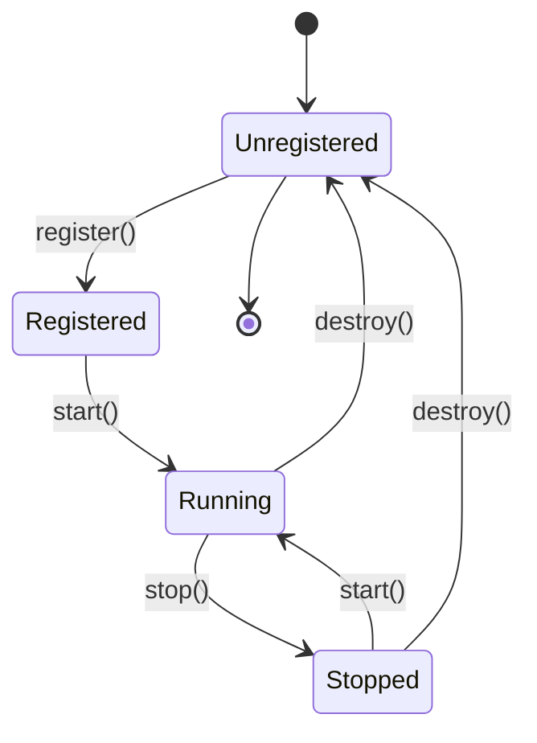

# Testing register, start, stop, and unregister

`IntegrationFlowContext` allows Spring Integration to register an `IntegrationFlow` once the `ApplicationContext` is already running. Because flows are created at runtime, tests must verify not only that the handler processes messages properly, but also the registration's lifecycle: the flow is added to the context, endpoints start receiving messages, stop properly, can restart while the registration remains, and are completely removed on unregister.

A thorough test verifies both sides: the flow's **management state** and the **message behavior** observed at the input channel. Simply checking that `register()` throws no exception is insufficient; merely sending a message and seeing the handler execute does not prove the registration was cleaned up after the test either.

## 1. Scope to test

A dynamic flow typically transitions through the following states:



Operations that require test evidence:

| Operation | What to verify |
|---|---|
| `register()` | Registration appears in `IntegrationFlowContext`, ID is correct, and input channel is accessible |
| `start()` | Endpoints are activated and messages sent to the channel reach the handler |
| `stop()` | Endpoints stop receiving messages according to channel/adapter semantics |
| `start()` after `stop()` | Registration still exists and endpoints can run again if the flow is designed to be restartable |
| `destroy()` | Registration is removed from context and flow-owned components are released |
| Duplicate ID registration | System rejects it or applies the defined idempotent policy; no unintended second flow is created |
| Lifecycle error | Created resources are cleaned up or recorded for cleanup retry |

`stop()` and `destroy()` are not two names for the same action. `stop()` pauses lifecycle components; `destroy()` ends the registration. Tests must distinguish between these two outcomes.

## 2. Setting up the test context

You can use JUnit 5, Spring TestContext, and Mockito to test flows in a real `ApplicationContext`. `@EnableIntegration` registers the required Spring Integration infrastructure, including `IntegrationFlowContext`.

Example test configuration:

```java
import static org.mockito.Mockito.mock;

import org.springframework.context.annotation.Bean;
import org.springframework.context.annotation.Configuration;
import org.springframework.integration.config.EnableIntegration;

@Configuration
@EnableIntegration
class IntegrationFlowTestConfig {

    @Bean
    OrderHandler orderHandler() {
        return mock(OrderHandler.class);
    }
}
```

The handler can be a small interface to verify dispatch:

```java
public interface OrderHandler {
    void handle(String orderId);
}
```

In the test, inject `IntegrationFlowContext` and the mock handler. Each test creates its own channel and flow with a unique ID, or reuses a fixed ID while destroying the registration after every test.

```java
import static org.junit.jupiter.api.Assertions.*;
import static org.mockito.Mockito.*;

import org.junit.jupiter.api.AfterEach;
import org.junit.jupiter.api.Test;
import org.springframework.beans.factory.annotation.Autowired;
import org.springframework.integration.channel.DirectChannel;
import org.springframework.integration.dsl.IntegrationFlow;
import org.springframework.integration.dsl.context.IntegrationFlowContext;
import org.springframework.integration.dsl.context.IntegrationFlowRegistration;
import org.springframework.messaging.MessagingException;
import org.springframework.messaging.MessageChannel;
import org.springframework.messaging.support.MessageBuilder;
import org.springframework.test.context.junit.jupiter.SpringJUnitConfig;

@SpringJUnitConfig(IntegrationFlowTestConfig.class)
class IntegrationFlowContextLifecycleTest {

    private static final String FLOW_ID = "orders-lifecycle-test";

    @Autowired
    IntegrationFlowContext flowContext;

    @Autowired
    OrderHandler orderHandler;

    private IntegrationFlowRegistration registration;
    private DirectChannel inputChannel;

    @AfterEach
    void cleanup() {
        if (registration != null) {
            registration.destroy();
            registration = null;
        }
        reset(orderHandler);
    }

    private IntegrationFlowRegistration registerFlow() {
        inputChannel = new DirectChannel();
        IntegrationFlow flow = IntegrationFlow
                .from(inputChannel)
                .handle(orderHandler, "handle")
                .get();

        registration = flowContext.registration(flow)
                .id(FLOW_ID)
                .autoStartup(false)
                .useFlowIdAsPrefix()
                .register();

        return registration;
    }
}
```

The imports and business classes are minimal examples; adjust packages and APIs to match your project's Spring Integration and JUnit versions. The key point is that the test uses a real `ApplicationContext` and a mock handler to observe endpoint invocation.

## 3. Testing register

After calling `register()`, verify the registration is created with the expected ID and has an input channel. For flows with a pre-supplied input channel, you can assert the registration returns that exact channel.

```java
@Test
void registerCreatesRegistrationAndInputChannel() {
    IntegrationFlowRegistration result = registerFlow();

    assertNotNull(result);
    assertEquals(FLOW_ID, result.getId());
    assertSame(inputChannel, result.getInputChannel());
    assertNotNull(flowContext.getRegistrationById(FLOW_ID));
}
```

This test verifies the registration has been registered and the caller can obtain the input channel. It does not yet prove endpoints are running; because the builder sets `autoStartup(false)`, endpoints are explicitly started in the next step.

Avoid asserting auto-generated internal bean names against hardcoded strings when the test goal is simply flow lifecycle. Internal bean names can vary across DSL constructs or versions. Verifying through `IntegrationFlowRegistration` and message behavior is usually more durable.

## 4. Testing start and message dispatch

With `DirectChannel`, the handler is invoked synchronously on the sender thread. This is a good choice for basic lifecycle tests because there is no need to wait for an executor or poller.

```java
@Test
void startEnablesMessageDispatch() {
    IntegrationFlowRegistration result = registerFlow();
    MessageChannel input = result.getInputChannel();

    result.start();

    boolean sent = input.send(MessageBuilder
            .withPayload("order-42")
            .build());

    assertTrue(sent);
    verify(orderHandler).handle("order-42");
}
```

The expected outcome is that the handler receives the exact payload. If the handler is not invoked, check whether endpoints started, whether the flow is wired to the right channel, whether the handler method signature matches, and whether the test is sending to that registration's input channel.

### 4.1. Verifying `autoStartup(false)`

When a registration is configured with `autoStartup(false)`, endpoints do not run automatically. With a `DirectChannel` that has no active subscriber, sending may throw a `MessagingException` because no handler is subscribed to receive the message. The test can verify the handler is not invoked before `start()`:

```java
@Test
void flowDoesNotDispatchBeforeExplicitStart() {
    IntegrationFlowRegistration result = registerFlow();

    assertThrows(MessagingException.class, () -> result.getInputChannel().send(
            MessageBuilder.withPayload("order-42").build()));

    verifyNoInteractions(orderHandler);

    result.start();
    result.getInputChannel().send(
            MessageBuilder.withPayload("order-42").build());

    verify(orderHandler).handle("order-42");
}
```

The exact exception type depends on the channel and dispatcher. The example above uses `DirectChannel`, where having no subscribers typically causes a dispatch failure. For other channel types, verify that channel's send/receive semantics rather than copying this assertion verbatim.

## 5. Testing stop and restart

`stop()` must cause endpoints to stop receiving messages. With `DirectChannel`, the endpoint unsubscribes, so sending typically fails due to no subscribers. Afterward, you can call `start()` on the same registration to verify restart capability.

```java
@Test
void stopDisablesDispatchAndStartEnablesItAgain() {
    IntegrationFlowRegistration result = registerFlow();
    MessageChannel input = result.getInputChannel();

    result.start();
    input.send(MessageBuilder.withPayload("order-1").build());
    verify(orderHandler).handle("order-1");

    reset(orderHandler);
    result.stop();

    assertThrows(MessagingException.class, () -> input.send(
            MessageBuilder.withPayload("order-2").build()));
    verifyNoInteractions(orderHandler);

    result.start();
    input.send(MessageBuilder.withPayload("order-3").build());
    verify(orderHandler).handle("order-3");
}
```

This test verifies three points: the first message is processed while running, the second message does not reach the handler after stop, and the third message is processed after restarting. If the flow uses an adapter or channel with different semantics, adapt the stop verification to match that component's actual behavior.

## 6. Testing unregister with destroy

When a flow is no longer used, call `destroy()` to remove the registration. Then look up by ID to confirm the registration is no longer in `IntegrationFlowContext`.

```java
@Test
void destroyUnregistersFlow() {
    IntegrationFlowRegistration result = registerFlow();
    assertNotNull(flowContext.getRegistrationById(FLOW_ID));

    result.destroy();
    registration = null; // cleanup() does not destroy a second time

    assertNull(flowContext.getRegistrationById(FLOW_ID));
}
```

If the application manages registrations via `IntegrationFlowContext.remove(flowId)` in your version, test the remove API according to that version's contract. Do not mechanically call both `destroy()` and `remove()` if one operation already removes the registration.

An additional test can verify the old channel no longer dispatches to the handler after destroy. With `DirectChannel`, once the endpoint is removed, sending a message to a channel with no remaining subscribers typically throws a dispatch error. However, the primary assertion for unregistering is that the registration has disappeared from the context and dedicated resources are cleaned up according to ownership.

## 7. Testing duplicate IDs

IDs must be unique within the registry. When a flow is already registered, attempt to register another flow with the same ID to verify the framework rejects the collision and the original registration remains intact.

```java
@Test
void duplicateFlowIdIsRejected() {
    IntegrationFlowRegistration first = registerFlow();

    DirectChannel anotherInput = new DirectChannel();
    IntegrationFlow anotherFlow = IntegrationFlow
            .from(anotherInput)
            .handle(orderHandler, "handle")
            .get();

    assertThrows(RuntimeException.class, () -> flowContext
            .registration(anotherFlow)
            .id(FLOW_ID)
            .autoStartup(false)
            .useFlowIdAsPrefix()
            .register());

    assertSame(first, flowContext.getRegistrationById(FLOW_ID));
}
```

The specific exception may be a bean registration error or an ID error depending on the version and bean factory configuration. In application tests, you can catch a more specific exception after confirming the exact exception type thrown by your dependency. Avoid asserting overly detailed exception messages, as wording may change across versions.

## 8. Cleaning up registrations between tests

Dynamic registrations are added to the test's shared `ApplicationContext`. If not destroyed, a registration can remain behind and cause subsequent tests to fail due to duplicate IDs or cause handlers to receive unexpected messages.

Cleanup principles:

- Use `@AfterEach` to destroy the registration if the test successfully created it.
- Set the handle to `null` after explicit destruction to avoid double cleanup.
- If a test registers multiple flows, hold all handles in a collection and destroy every registration.
- If a test fails between `register()` and `start()`, still clean up the created registration.
- If `destroy()` fails, fail the test and preserve the original exception; do not mask a cleanup error with another assertion.

With multiple flows, you can use a helper:

```java
private final List<IntegrationFlowRegistration> registrations =
        new ArrayList<>();

private IntegrationFlowRegistration register(IntegrationFlow flow, String id) {
    IntegrationFlowRegistration result = flowContext.registration(flow)
            .id(id)
            .autoStartup(false)
            .useFlowIdAsPrefix()
            .register();
    registrations.add(result);
    return result;
}

@AfterEach
void destroyRegistrations() {
    for (IntegrationFlowRegistration item : registrations) {
        item.destroy();
    }
    registrations.clear();
}
```

This helper fits tests managing multiple flows. If you want cleanup to continue running even when one `destroy()` throws an exception, collect the errors, continue destroying remaining registrations, and throw an aggregated error at the end.

## 9. Testing flow-management services

In real applications, controllers should not call `IntegrationFlowContext` directly. A connector-management service typically exposes methods such as `register`, `start`, `stop`, `restart`, and `remove`. Beyond testing the framework, test this service's contract.

| Case | Expected outcome |
|---|---|
| Connector does not exist yet | Creates registration, starts per config, and stores handle |
| Second start call | Returns existing registration or reports conflict per idempotent contract |
| Stop running connector | Calls stop and updates state to `STOPPED` |
| Start stopped connector | Uses existing registration and starts it again |
| Remove connector | Stops, destroys, closes dedicated resources, and deletes registry entry after cleanup |
| Invalid connector ID | Rejects before creating flow |
| Register error | Does not store `RUNNING` state; cleans up created dependencies |
| Start error | Records error state and destroys registration or keeps handle in cleanup-needed state |
| Destroy error | Does not lose the handle; records it so cleanup can be retried |

When mocking `IntegrationFlowContext`, verify the service calls `registration(flow)` properly, configures the ID and startup behavior, and handles the returned handle. In integration tests, use a real `ApplicationContext` to verify endpoints/channels are actually created and removed.

Do not test only a `ConcurrentHashMap` or mock all of Spring Integration and conclude the lifecycle works. Include at least one small integration test exercising a real registration.

## 10. Testing concurrent registration

A common race condition is two requests concurrently registering the same connector:

```text
Thread A: check no registration exists ---- register ---- start
Thread B: check no registration exists ---- register ---- start
```

`ConcurrentHashMap` only protects individual map operations. It does not automatically make the sequence of checking, registering, starting, and storing the handle atomic.

Concurrency tests should verify:

1. Submit two concurrent start requests for the same connector ID.
2. Only one registration is created.
3. The other request receives the existing registration or a conflict error per contract.
4. Once complete, only one endpoint processes a message sent to the connector.
5. When remove runs concurrently with start, the final state is consistent and leaves no orphaned registration.

Use a `CountDownLatch` to align when the two threads begin, an `ExecutorService` to run in parallel, and `Future` instances to collect results. Do not use `Thread.sleep()` to try to provoke race conditions, as results will depend on thread scheduling and the test machine.

If the system runs multiple replicas, testing an in-JVM lock does not prove distributed ownership. Separately test the distributed lease, broker consumer group, or control plane mechanism used by the application.

## 11. Testing flows using pollers or executors

Tests with `DirectChannel` are the foundation for basic lifecycle behavior. If a flow uses a polling consumer, source polling adapter, or `ExecutorChannel`, test asynchronously according to the exact execution model.

### 11.1. Polling flows

For polling flows, verify:

- The poller begins fetching data only after the endpoint is started.
- `maxMessagesPerPoll`, triggers, and receive timeouts take effect.
- On stop, new polls cease according to the endpoint lifecycle.
- Messages received before stop are processed or recovered according to the chosen policy.
- After destroy, the registration no longer exists and the scheduler does not keep firing the endpoint.

Use `CountDownLatch` or Awaitility to wait until the handler receives the message. Once the condition is met, stop the flow and check that no unexpected extra executions occur. Do not assert that every running task is canceled immediately upon calling stop; behavior depends on the adapter, scheduler, and in-flight work.

### 11.2. ExecutorChannel

With `ExecutorChannel`, `send()` may only dispatch a task to the executor. Tests must wait for the handler to finish before asserting:

```java
CountDownLatch handled = new CountDownLatch(1);
doAnswer(invocation -> {
    handled.countDown();
    return null;
}).when(orderHandler).handle("order-async");

inputChannel.send(MessageBuilder.withPayload("order-async").build());

assertTrue(handled.await(2, TimeUnit.SECONDS));
verify(orderHandler).handle("order-async");
```

This example only illustrates the waiting mechanism; configure the corresponding input channel/executor and avoid overly tight timeouts that make tests flaky in CI. If a flow uses a dedicated executor, define who owns the executor and who closes it on destroy.

## 12. Testing errors and compensating cleanup

Errors can occur during `register()`, `start()`, while the handler processes a message, during `stop()`, or during `destroy()`. Each failure mode requires its own assertion.

| Failure point | Key assertion |
|---|---|
| Duplicate flow ID | No second registration created; existing registration continues operating |
| Invalid flow configuration | Registration fails and leaves no partial beans/registrations behind |
| Dependency not ready on start | State is not recorded as `RUNNING`; cleanup is attempted |
| Handler throws exception | Exception/error channel/retry follows flow configuration |
| Stop fails | Management state reflects the error rather than falsely reporting `STOPPED` |
| Destroy fails | Handle is retained in the pending-cleanup list |

To test a service's compensating cleanup, mock the registration handle and stub `start()` to throw an exception, then verify the service calls `destroy()`. If `destroy()` also throws an exception, verify the handle is saved in a cleanup-retry-needed state. This test verifies service orchestration; it complements integration tests using real registrations.

Do not assume a database transaction will roll back bean registration or close Java clients. Registrations and resources outside transactions require explicit cleanup.

## 13. Common testing pitfalls

| Symptom | Possible cause | Remediation |
|---|---|---|
| Subsequent test reports duplicate flow ID | Previous test failed to destroy registration | Clean up properly in `@AfterEach` or `@AfterAll` |
| Handler is not called | Endpoint not started, sent to wrong input channel, or wrong handler mapping | Verify registration, start, and channel from the same handle |
| Messages sent after stop still reach handler | Another flow subscribes to the same channel or channel is shared | Isolate channels per test and inspect subscribers |
| Async test is flaky | Asserting before executor/poller finishes | Use latch/Awaitility with a reasonable timeout |
| Resources remain after destroy | Application-created client/executor was not closed | Clarify ownership and dedicated cleanup hooks |
| Test passes alone but fails in suite | Shared context and registration leaked across tests | Use unique IDs, guaranteed cleanup, or intentional context isolation |
| Flaky exception assertions | Relying on dispatcher- or version-specific exception messages | Assert more stable exception types and observable behavior |

## 14. Minimum recommended test suite

Before taking a dynamic flow manager to production, include at least the following tests:

- [ ] Register creates a registration with the right ID and an accessible input channel.
- [ ] `autoStartup(false)` keeps endpoints inactive until start is called.
- [ ] Start allows messages to reach the handler.
- [ ] Stop prevents new messages from reaching the handler per channel/adapter semantics.
- [ ] Restart works if the registration has not been destroyed.
- [ ] Destroy removes the registration from `IntegrationFlowContext`.
- [ ] Duplicate IDs are handled per contract without creating unintended flows.
- [ ] Cleanup runs after every test, even when assertions fail.
- [ ] Management service handles register/start/stop/destroy failures properly.
- [ ] Concurrent management requests do not create duplicate registrations.
- [ ] Pollers/executors are tested using asynchronous waiting mechanisms.
- [ ] Connector-specific resources are closed upon unregistration.

## 15. Troubleshooting workflow when a lifecycle test fails

When a test fails, check in this order:

1. Confirm `IntegrationFlowContext` is registered in the test `ApplicationContext`.
2. Check whether the flow ID collides with a leftover registration from a previous test.
3. Check whether the builder set `autoStartup(false)` and whether the test called `start()`.
4. Confirm the test sends messages to the exact `registration.getInputChannel()`.
5. Check whether the channel is direct, queue, or executor to understand the `send()` outcome.
6. Check handler mapping and payload types.
7. For stop, confirm the endpoint stopped and no other subscriber listens on a shared channel.
8. For destroy, inspect `getRegistrationById(flowId)` and application-managed resources.
9. For async flows, wait for completion conditions before asserting.
10. For cleanup failures, preserve the registration handle and original exception for investigation.

Testing register/start/stop/unregister confirms that dynamic flows have a predictable lifecycle inside the Spring context. When tests cover registration state, message dispatch, ID conflicts, cleanup, and concurrency, the application has clear evidence that connectors are created properly, stopped cleanly, and leave no runtime resources behind after removal.
