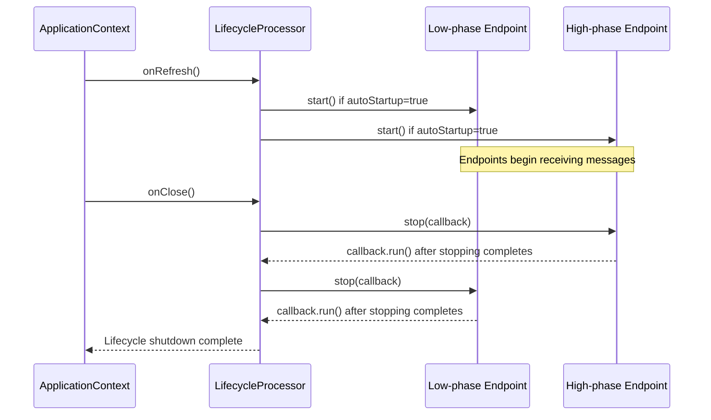
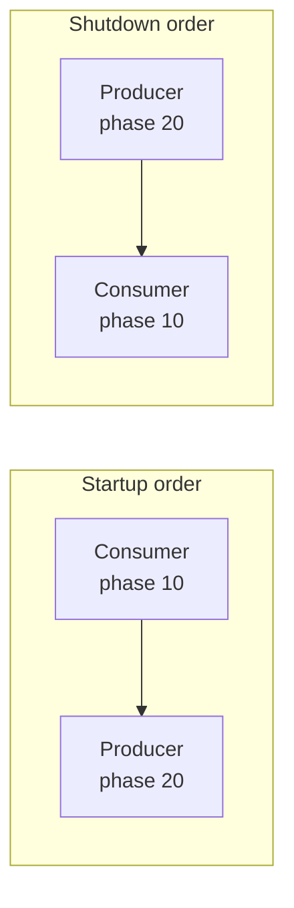

# SmartLifecycle, phase, and autoStartup

Spring Integration uses Spring's lifecycle mechanism to control when a message endpoint starts receiving messages and when it stops receiving messages. Three concepts to grasp are `SmartLifecycle`, `phase`, and `autoStartup`.

- `SmartLifecycle` is Spring's extended lifecycle contract, supporting auto-startup on context refresh, start/stop ordering, and a callback for asynchronous shutdown.
- `phase` determines the relative order among lifecycle components: lower phase starts earlier and stops later.
- `autoStartup` determines whether an endpoint is automatically started by Spring when the application context refreshes or must be proactively started by the application.

In Spring Integration, message endpoints extend `AbstractEndpoint`, a base class that implements `ManageableSmartLifecycle`. Therefore, an endpoint can already be created as a bean in the `ApplicationContext` while not running yet. Understanding the boundary between bean state and lifecycle state helps deliberately control consumers, inbound adapters, pollers, and external connections.

## 1. Spring Lifecycle and the role of SmartLifecycle

Spring has two commonly encountered contracts:

| Contract | Key Methods | How It Is Controlled |
|---|---|---|
| `Lifecycle` | `start()`, `stop()`, `isRunning()` | The application or lifecycle processor can control start/stop; has no auto-startup flag or dedicated phase |
| `SmartLifecycle` | `Lifecycle` methods, plus `isAutoStartup()`, `getPhase()`, `stop(Runnable)` | Supports auto-start on context refresh, start/stop ordering, and asynchronous shutdown |

`SmartLifecycle` extends `Lifecycle` and `Phased`. It is suitable for components that need to auto-start when the application refreshes and stop in a controlled order when the context closes.

### 1.1. Spring Integration's AbstractEndpoint

`AbstractEndpoint` is the base class for message endpoints. Common endpoint types such as `EventDrivenConsumer`, `AbstractPollingEndpoint`, inbound adapters, and messaging gateways all belong to this lifecycle system.

This class provides important methods and properties:

- `start()`: invokes endpoint startup logic.
- `stop()`: stops the endpoint.
- `stop(Runnable callback)`: stops the endpoint and notifies when the stop process completes.
- `isRunning()`: checks whether the endpoint is currently running.
- `isAutoStartup()`: indicates whether the endpoint starts automatically on context refresh.
- `getPhase()`: retrieves the current phase.
- `setAutoStartup(boolean)`: configures auto-startup.
- `setPhase(int)`: configures the phase.
- `destroy()`: releases resources when the bean is destroyed.

According to the Spring Integration Javadoc, `AbstractEndpoint` defaults to `autoStartup=true`. The endpoint will be started automatically if the context's lifecycle processor executes the corresponding refresh phase. If `autoStartup=false` is set, the application must call `start()` or use a group-based lifecycle control mechanism.

We need to distinguish:

- Bean exists: Spring has created the endpoint and injected dependencies.
- Endpoint is running: the endpoint's `doStart()` logic has executed and the endpoint has begun operating.
- Endpoint is processing messages: the endpoint is receiving messages via a channel or poller and invoking the handler.

These three states are related but not identical.

## 2. How does Spring start and stop SmartLifecycle?

After completing bean creation and context refresh, `LifecycleProcessor` coordinates the lifecycle components. When the context closes, the lifecycle processor coordinates stopping them.



Within the same application context, `SmartLifecycle` components are ordered by phase. Components with the same phase may be processed in an unspecified order; you should not rely on bean declaration order or registration order to establish dependencies.

### 2.1. Lifecycle is not the same as bean initialization

`@PostConstruct`, `InitializingBean.afterPropertiesSet()`, and initialization callbacks run during bean creation. `SmartLifecycle` is coordinated during the context's lifecycle stage.

Therefore, the fact that an endpoint has been created does not mean the endpoint has started. If a producer sends a message too early to a `DirectChannel` before the consumer endpoint registers its subscriber, the message may not be processed and the send operation may fail.

If you need to emit messages after endpoints are ready, choose a milestone after context refresh or an explicit lifecycle coordination mechanism. With Spring Boot, `ApplicationRunner` or `ApplicationReadyEvent` is often suitable for post-refresh initialization tasks; with plain Spring Framework, you can use context events or a dedicated lifecycle coordinator bean.

## 3. Phase determines start and stop order

`phase` is an integer representing lifecycle order. Spring starts lower phases first and stops higher phases first.

| Phase | Startup | Shutdown |
|---:|---|---|
| 10 — low | Starts early | Stops late |
| 20 — high | Starts late | Stops early |

For example, given two endpoints:

| Component | Phase | On Start | On Stop |
|---|---:|---|---|
| Order-processing consumer | 10 | Starts first | Stops last |
| Order-receiving inbound adapter | 20 | Starts last | Stops first |

This ordering is useful because the consumer should be ready before the producer starts pushing messages. On shutdown, the producer stops emitting messages first, and then the consumer stops afterward.

### 3.1. Special phase values

- `Integer.MIN_VALUE`: lowest value; started earliest and stopped latest.
- `Integer.MAX_VALUE`: highest value; started latest and stopped earliest.
- Beans implementing only `Lifecycle` without `SmartLifecycle` are treated as phase `0` when Spring orders them.
- `SmartLifecycle` has a default phase of `Integer.MAX_VALUE` in Spring Framework.

One detail to note: Spring Integration endpoints can configure their own phase. Some endpoints or annotations have default phases depending on the consumer type and framework version. For example, the `@ServiceActivator` API documentation describes different default phases for `PollingConsumer` and `EventDrivenConsumer`. Therefore, when startup order has operational significance, set the phase explicitly rather than relying on defaults.

### 3.2. Phase does not replace dependency relationships

If bean B has a `depends-on` relationship with bean A, Spring guarantees A is started before B and B is stopped before A. This explicit dependency relationship takes precedence over phase ordering.

Use phase when ordering a group of lifecycle components by role. Use `depends-on` when there is a direct, explicit bean dependency relationship. Do not use phase as a substitute for dependency injection or bean creation order.

### 3.3. Phase does not control message ordering

`phase` only controls lifecycle start/stop. It does not:

- Create new threads.
- Make messages run in parallel.
- Change message ordering in a channel.
- Adjust poller speed.
- Change retries or transactions.
- Guarantee that one message has finished processing before another endpoint starts.

Threading and message processing order still depend on the channel, poller, executor, and endpoint configuration.

## 4. AutoStartup determines whether an endpoint runs automatically

`autoStartup` controls whether Spring automatically calls `start()` on the endpoint during context refresh.

| Value | Behavior |
|---|---|
| `true` | The endpoint is automatically started by the lifecycle processor on context refresh |
| `false` | The endpoint remains a bean in the context but does not auto-start; the application must start it proactively |

For `AbstractEndpoint`, the default value of `autoStartup` is `true`. When set to `false`, the endpoint does not automatically receive messages until it is started.

### 4.1. When should autoStartup=false be set?

Some common cases:

- An inbound adapter is only allowed to receive data once the application has acquired leadership.
- A connection to a partner must be authenticated before opening the consumer.
- A data source is only enabled after an administrator confirms the configuration.
- A flow needs to wait for external resources to be ready.
- The application wants to start groups of endpoints per tenant or per region.

Example with annotations:

```java
@Component
public class OrderHandler {

    @ServiceActivator(
            inputChannel = "orders.in",
            autoStartup = "false",
            phase = "10")
    public void handle(Order order) {
        // Process the order.
    }
}
```

The endpoint is created and bound to the `orders.in` channel, but does not auto-start on context refresh. The application can retrieve the endpoint bean and call `start()` once operational conditions are satisfied.

### 4.2. Configuration with Java DSL

Java DSL allows configuring lifecycle directly on the endpoint spec:

```java
@Configuration
@EnableIntegration
public class OrderFlowConfiguration {

    @Bean
    public IntegrationFlow orderFlow(OrderHandler handler) {
        return IntegrationFlow.from("orders.in")
                .handle(handler, "handle", endpoint -> endpoint
                        .id("orders-handler")
                        .autoStartup(false)
                        .phase(10))
                .get();
    }
}
```

The `autoStartup(boolean)` and `phase(int)` methods belong to the endpoint spec. They can be combined with `id()` to give the endpoint a clear name, convenient for lookup and control.

### 4.3. Starting the endpoint manually

After the context has refreshed and external conditions are ready, the application can retrieve the endpoint bean by ID and call `start()`.

```java
@Component
public class OrderEndpointStarter {

    private final ApplicationContext applicationContext;

    public OrderEndpointStarter(ApplicationContext applicationContext) {
        this.applicationContext = applicationContext;
    }

    public void startOrderEndpoint() {
        SmartLifecycle endpoint =
                applicationContext.getBean(
                        "orders-handler",
                        SmartLifecycle.class);

        if (!endpoint.isRunning()) {
            endpoint.start();
        }
    }

    public void stopOrderEndpoint() {
        SmartLifecycle endpoint =
                applicationContext.getBean(
                        "orders-handler",
                        SmartLifecycle.class);

        if (endpoint.isRunning()) {
            endpoint.stop();
        }
    }
}
```

The bean name must match the actual endpoint ID in the configuration. If the framework or DSL generates a different name, verify the bean name in the application context before calling `getBean()`.

### 4.4. Disabling auto-startup by name pattern

Spring Integration has a global property:

```properties
spring.integration.endpoints.noAutoStartup=orders*,inventoryInbound
```

This property accepts a list of endpoint bean name patterns that must not be started automatically during application startup. The application can proactively start them later via bean lifecycle, Control Bus, or `SmartLifecycleRoleController`.

The global behavior can be overridden by explicit `autoStartup` configuration on an endpoint according to the mechanism supported in the corresponding version's documentation. When debugging, check both global properties and local endpoint configuration.

## 5. Coordinating phase between producer and consumer

In a message flow, the producer creates messages and sends them to a channel; the consumer endpoint subscribes to receive messages and invokes the handler. At startup, it is usually best to have the consumer ready before the producer.

Example:



Suppose the application has:

- A `@ServiceActivator` receiving messages from `orders.in`.
- An inbound channel adapter reading data from files or an external system and sending it to `orders.in`.

You can place the consumer at phase 10 and the inbound adapter at phase 20. The consumer starts first to subscribe for messages; the inbound adapter starts later to begin emitting messages. On shutdown, the inbound adapter stops first to stop emitting new messages; the consumer keeps running briefly to process messages still arriving.

Annotation example with explicitly configured phase:

```java
@Component
public class OrderHandler {

    @ServiceActivator(
            inputChannel = "orders.in",
            autoStartup = "true",
            phase = "10")
    public void handle(Order order) {
        // Process the order.
    }
}
```

An inbound adapter or polling endpoint can be configured with a higher phase via the adapter's API:

```java
@Bean
@InboundChannelAdapter(
        channel = "orders.in",
        autoStartup = "true",
        phase = "20",
        poller = @Poller(fixedDelay = "1000"))
public MessageSource<Order> orderSource() {
    return new OrderMessageSource();
}
```

This is a lifecycle ordering model. It does not guarantee that the consumer has finished processing every message before shutdown. If graceful draining is required, the application must have a mechanism to stop the producer, wait for the backlog to process, acknowledge messages, or configure an appropriate shutdown timeout.

## 6. Asynchronous shutdown and callbacks

`SmartLifecycle` adds the method:

```java
void stop(Runnable callback);
```

This method is useful when a component needs time to complete shutdown asynchronously, for example:

- Waiting for a network connection to close.
- Stopping a poller and waiting for an in-progress task.
- Waiting for a consumer to finish the processing segment currently running.
- Stopping acceptance of new requests and waiting for in-flight requests to finish.

If implementing `SmartLifecycle` yourself, you must call `callback.run()` after shutdown has actually completed. The lifecycle processor uses this callback to know when it can proceed with the shutdown process.

Simple example:

```java
@Component
public class RemoteConsumerLifecycle implements SmartLifecycle {

    private volatile boolean running;

    @Override
    public void start() {
        // Open connection or start consumer.
        this.running = true;
    }

    @Override
    public void stop() {
        this.running = false;
    }

    @Override
    public void stop(Runnable callback) {
        try {
            // Stop accepting new work and complete cleanup.
            stop();
        }
        finally {
            callback.run();
        }
    }

    @Override
    public boolean isRunning() {
        return this.running;
    }

    @Override
    public boolean isAutoStartup() {
        return true;
    }

    @Override
    public int getPhase() {
        return 20;
    }
}
```

This is only an example illustrating the lifecycle contract. For a real consumer, the `stop()` part needs to properly wait for or coordinate running tasks before calling the callback.

If the callback is not called, context shutdown may have to wait until that phase's timeout expires. Spring Framework allows configuring per-phase timeouts via `DefaultLifecycleProcessor`; Spring Boot also provides corresponding lifecycle shutdown configuration. Choose a timeout appropriate for the maximum processing time and the application's stop policy.

## 7. Controlling multiple endpoints by role

When multiple endpoints need to start/stop together, Spring Integration supports endpoint roles. Each endpoint can be assigned a role, such as `cluster`, `leader-only`, or `partner-import`.

`SmartLifecycleRoleController` can start or stop all `SmartLifecycle` beans belonging to a role. This is useful for systems using leader election: only the node currently holding leadership is allowed to run the group of endpoints reading shared resources.

Example with Java DSL:

```java
@Bean
public IntegrationFlow sharedFileFlow() {
    return IntegrationFlow.from(
                    Files.inboundAdapter(new File("/data/shared")),
                    endpoint -> endpoint
                            .id("shared-file-source")
                            .role("leader-only")
                            .autoStartup(false)
                            .poller(Pollers.fixedDelay(1000)))
            .handle("fileHandler", "process")
            .get();
}
```

Controlling by role:

```java
@Component
public class LeaderEndpointController {

    private final SmartLifecycleRoleController roleController;

    public LeaderEndpointController(
            SmartLifecycleRoleController roleController) {
        this.roleController = roleController;
    }

    public void onLeadershipGranted() {
        roleController.startLifecyclesInRole("leader-only");
    }

    public void onLeadershipRevoked() {
        roleController.stopLifecyclesInRole("leader-only");
    }
}
```

When using leader election, set `autoStartup=false` for endpoints that must run only on the leader. If allowed to auto-start, every node could start polling or consuming shared resources before the leader election mechanism controls them.

The role controller also provides methods to inspect group status, for example:

- `getRoles()`: list of roles currently managed.
- `allEndpointsRunning(role)`: whether all endpoints in the role are running.
- `noEndpointsRunning(role)`: whether no endpoints in the role are running.
- `getEndpointsRunningStatus(role)`: status of each endpoint in the role.

## 8. Observing endpoint state

When debugging, do not only check whether the bean exists. Check `isRunning()`, `isAutoStartup()`, and `getPhase()` as well.

Example:

```java
Map<String, AbstractEndpoint> endpoints =
        applicationContext.getBeansOfType(AbstractEndpoint.class);

endpoints.forEach((name, endpoint) ->
        log.info(
                "endpoint={}, running={}, autoStartup={}, phase={}",
                name,
                endpoint.isRunning(),
                endpoint.isAutoStartup(),
                endpoint.getPhase()));
```

You can combine this with Spring Integration startup logs to see which endpoints were started or stopped. If observation via JMX is needed, `AbstractEndpoint` is also a component marked for management through integration management resources.

### 8.1. Diagnostic table

| Symptom | Check | Possible Cause |
|---|---|---|
| Endpoint bean exists but does not receive messages | `isRunning()`, `autoStartup` | Endpoint has not been started or auto-startup is disabled |
| Endpoints start in the wrong order | `getPhase()`, `depends-on` | Phase is not explicitly set or a dependency overrides it |
| Producer sends messages before consumer | Phase of producer and consumer | Producer starts before the message-receiving endpoint |
| Endpoint does not auto-start even though autoStartup=true | Global `noAutoStartup`, lifecycle processor | Global pattern excludes the endpoint from auto-startup |
| Shutdown is slow | `stop(Runnable)`, callback, timeout | Component has not invoked the callback or cleanup task takes too long |
| Multiple nodes read the same source simultaneously | Role, autoStartup, leader election | Endpoint is not controlled by role or still auto-starts |
| Endpoints in the same phase run in unpredictable order | Phase and dependencies | Beans in the same phase have no guaranteed order |

A diagnostic workflow:

1. Confirm the exact application context containing the endpoint.
2. Confirm the endpoint bean has been created.
3. Read `isAutoStartup()` and `getPhase()`.
4. Check the global property `spring.integration.endpoints.noAutoStartup`.
5. Check whether the endpoint is running with `isRunning()`.
6. Compare the phases of the producer and consumer.
7. During shutdown, track callbacks and stop duration for each phase.

## 9. Lifecycle design principles

- Set explicit phases for endpoints that have operational ordering relationships.
- Start consumers before producers to reduce the risk of messages being sent when no consumer exists yet.
- Stop producers before consumers to stop emitting new messages before consumers stop.
- Use `autoStartup=false` when an endpoint requires external conditions or leadership before running.
- Use a role controller when needing to control a group of endpoints together.
- Do not use phase to control threading or message ordering.
- Do not treat `isRunning()` of a single endpoint as proof that the entire flow has processed successfully.
- When implementing `SmartLifecycle` yourself, make sure to complete the shutdown callback.
- Set appropriate shutdown timeouts and observe endpoints that take a long time to stop.
- Verify the default phase according to the exact endpoint type and Spring Integration version in use.

## 10. Takeaways

`SmartLifecycle` is the mechanism Spring uses to automatically start and stop components according to the application context lifecycle. Spring Integration applies this mechanism to message endpoints through `AbstractEndpoint`.

`autoStartup` determines whether an endpoint auto-starts on context refresh. `phase` determines the start/stop order among lifecycle components. Lower phase starts earlier, higher phase stops earlier. If you need to control a group of endpoints, assign a role and use `SmartLifecycleRoleController`.

When diagnosing a flow that is not running, check in order whether the bean exists, whether the endpoint has started, and whether phase and autoStartup are correct, before inspecting channels, pollers, executors, and message handlers.

## References

- [Spring Framework — Customizing the Nature of a Bean: Lifecycle and SmartLifecycle](https://docs.spring.io/spring-framework/reference/core/beans/factory-nature.html)
- [Javadoc — SmartLifecycle (Spring Framework 6.2)](https://docs.spring.io/spring-framework/docs/6.2.9/javadoc-api/org/springframework/context/SmartLifecycle.html)
- [Spring Integration — DSL and Endpoint Configuration](https://docs.spring.io/spring-integration/reference/dsl/java-endpoints.html)
- [Spring Integration — Endpoint Roles](https://docs.spring.io/spring-integration/reference/endpoint-roles.html)
- [Javadoc — AbstractEndpoint (Spring Integration 6.5)](https://www.springframework.org/spring-integration/docs/6.5.x/api/org/springframework/integration/endpoint/AbstractEndpoint.html)
- [Javadoc — SmartLifecycleRoleController (Spring Integration 6.5)](https://www.springframework.org/spring-integration/docs/6.5.0/api/org/springframework/integration/support/SmartLifecycleRoleController.html)
- [Spring Integration — Global Properties](https://docs.spring.io/spring-integration/reference/7.2/configuration/global-properties.html)
