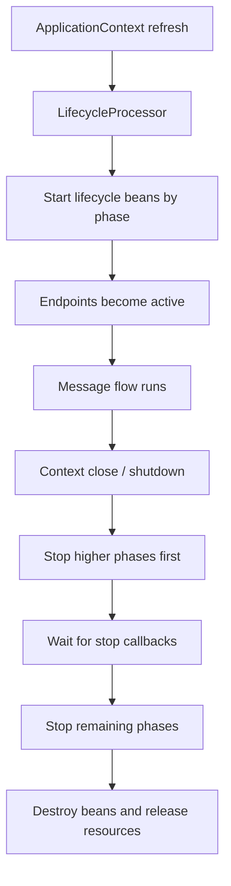
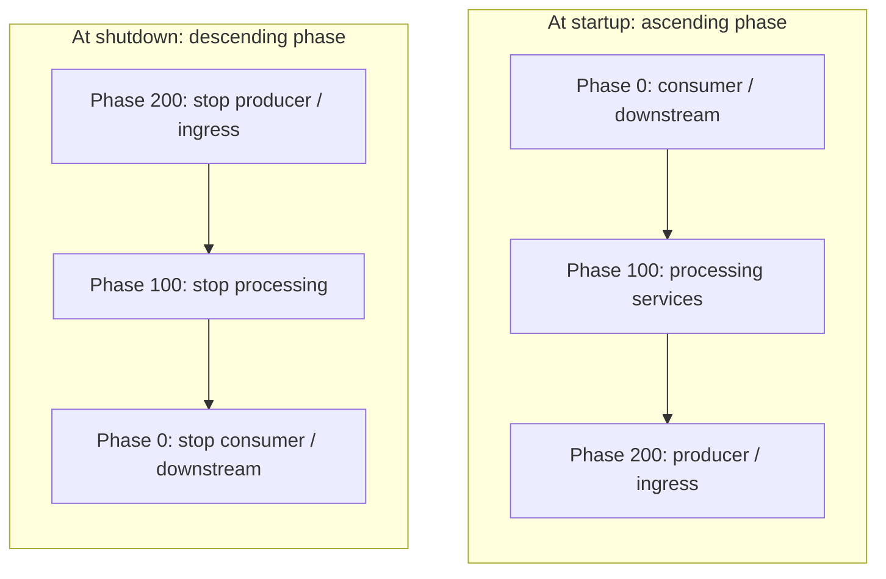
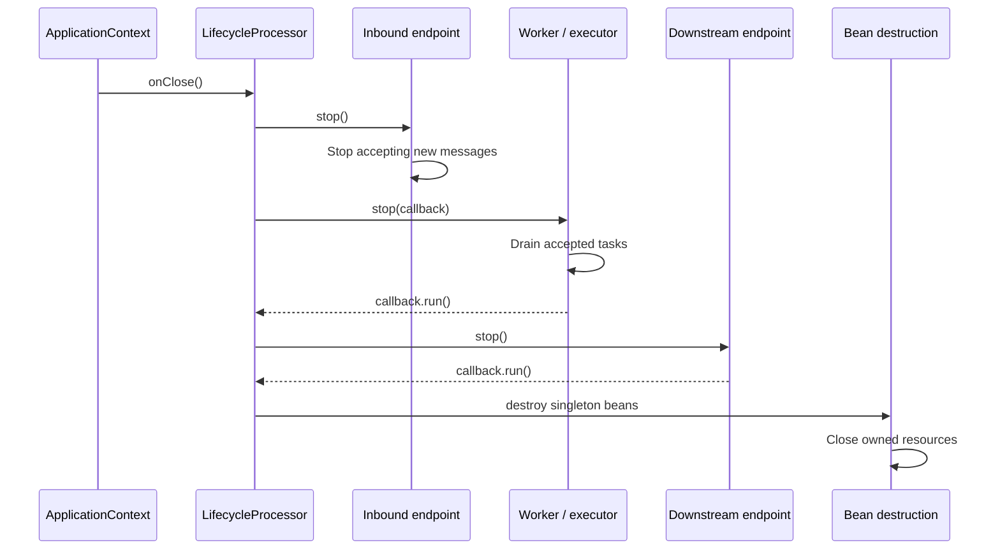

# start, stop, stop callbacks, and shutdown

In Spring Integration, endpoints are runtime components with their own lifecycle. They may subscribe to receive messages, schedule polling, open connections to external systems, or hand off work to an executor. Therefore, when an application starts or stops, Spring needs to coordinate when an endpoint begins accepting work, stops accepting work, finishes running work, and releases resources.

Spring manages this lifecycle through `Lifecycle` and `SmartLifecycle`. Spring Integration endpoints are typically registered as lifecycle beans in the application context. `start()` activates a component; `stop()` instructs a component to stop; `stop(Runnable callback)` allows a component to report back once stopping has completed. When the application context closes, the lifecycle processor coordinates components by phase, and only afterward does Spring destroy beans and release resources.

Understanding the three milestones—**stopping acceptance of new messages**, **completing in-flight messages**, and **destroying resources**—helps prevent message loss, shutting down executors too early, or keeping the application stuck in shutdown for too long.

## 1. Endpoints have a lifecycle independent of the message flow

`IntegrationFlow` describes how channels, endpoints, and handlers are wired together. When the application context initializes, Spring Integration creates and registers the corresponding runtime components. It is the endpoints that directly participate in the runtime lifecycle.

Some common endpoints and resources:

| Component | Work to perform on start | Work to perform on stop |
|---|---|---|
| Event-driven consumer | Register handler as a subscriber on the input channel | Stop receiving new dispatches or unsubscribe the subscriber |
| Polling consumer | Schedule polling and start retrieving messages | Cancel the poll schedule and prevent new poll cycles |
| Source polling channel adapter | Schedule calls to `MessageSource` and send results to the channel | Stop invoking the source and cancel the schedule |
| Inbound channel adapter | Start receiving data from the external system | Stop consuming data or close the listener depending on implementation |
| Outbound adapter | Become ready to send data to the target system | Stop sending and release resources owned by the adapter |
| Executor or scheduler | Accept tasks according to configuration | Reject new tasks, complete or cancel remaining tasks, then release the pool |

Not every component owns its own resources. An endpoint may share a `TaskExecutor` or `TaskScheduler` with many other endpoints. In that case, you must determine which bean owns the pool and is responsible for shutting it down. One endpoint stopping does not mean a shared executor must stop along with it.

### Flow definition and runtime endpoints

For flows declared with `@Bean`, Spring creates the endpoints and channels in the application context. Their lifecycle is managed by the context and the lifecycle processor.

You should not treat an `IntegrationFlow` object as a single execution call that can be stopped mid-flight. You must identify which endpoints are running, which input channels are receiving messages, and which schedulers or executors are executing tasks.

High-level diagram:

## 2. `Lifecycle`: start, stop, and running state

Spring Core defines `Lifecycle` with three primary operations:

~~~java
public interface Lifecycle {

    void start();

    void stop();

    boolean isRunning();
}
~~~

Meaning:

- `start()` instructs the component to begin operating.
- `stop()` instructs the component to stop operating.
- `isRunning()` returns the lifecycle state published by the component.

Spring Integration endpoints are managed by the lifecycle processor so they can be started and stopped together with the application context. In an application, you can also obtain a reference to a lifecycle bean and control it via the corresponding API when operationally needed.

`isRunning()` is not proof that every message has been processed, that downstream is healthy, or that an external system is ready. It reflects the operational state reported by the lifecycle component. Readiness and health should be observed using an appropriate health check mechanism.

### Start and stop can be called multiple times

A typical lifecycle allows a component to be started after having been stopped, provided the implementation supports restarting. With standard Spring Integration endpoints, start/stop is integrated with the framework's lifecycle.

If writing a custom lifecycle component, clearly determine:

- Does `start()` recreate a scheduler, executor, or connection that was closed?
- Can `stop()` be called when the component is not running yet?
- Does calling `start()` twice create two listeners or two poll schedules?
- After a stop timeout, what state is the component in?
- At what point does `isRunning()` transition its state?

Do not merely set a `running` boolean while ignoring the actual state of underlying resources. For example, if an executor has permanently shut down while `isRunning()` still returns `true`, the component is publishing a false state.

## 3. `SmartLifecycle`: auto-start, phase, and callback

`SmartLifecycle` extends `Lifecycle` with the ability to control auto-startup timing, startup ordering, and stop callbacks:

~~~java
int getPhase();

boolean isAutoStartup();

void stop(Runnable callback);
~~~

The three additions play distinct roles:

| API | Role |
|---|---|
| `isAutoStartup()` | Indicates whether the component automatically starts when the lifecycle processor handles application context refresh |
| `getPhase()` | Determines relative start and stop order among lifecycle components |
| `stop(Runnable callback)` | Notifies the lifecycle processor when the component has completely stopped |

By Spring's contract, `isAutoStartup()` returns `true` by default, `getPhase()` defaults to `Integer.MAX_VALUE`, and `stop(Runnable)` by default calls `stop()` and then immediately runs the callback. This default phase causes a component to start late and stop early relative to components with smaller phases. A specific endpoint may override these values. For an endpoint, the `autoStartup` property can be configured to defer activation; check the runtime configuration rather than assuming every flow has the same state.

### autoStartup

`autoStartup=true` means the component is automatically started by the lifecycle processor during context refresh. If set to `false`, the component is not auto-started by this mechanism; the application can proactively start it once required conditions are ready.

Some scenarios well suited for `autoStartup=false`:

- Only receiving messages after tenant configuration has been loaded.
- Waiting for a connectivity check to an external system.
- Deploying a consumer that requires operator activation.
- Running migrations or bootstrap steps before beginning polling.
- Creating dynamic flows and enabling them only after routing has been registered.

Do not use `autoStartup=false` to hide an unready dependency without a clear readiness or monitoring mechanism.

## 4. Phase determines start and stop order

The lifecycle processor groups components by phase. Smaller phases start earlier; larger phases start later. On shutdown, the order is reversed: larger phases stop earlier, smaller phases stop later.

For example, if a producer sends messages to a consumer, we usually want:

1. The consumer starts first to be ready to receive messages.
2. The producer starts later to begin emitting messages.
3. On shutdown, the producer stops emitting first.
4. The consumer continues processing already-received messages.
5. The consumer only stops after the work requiring draining has completed.

This can be modeled with phases: consumer at a low phase, producer at a high phase. This is a useful coordination rule, but actual dependencies and shared resources must be taken into account.

### Dependencies and phase

Bean dependency relationships, such as `depends-on`, also affect bean initialization and destruction order. Do not use phase to replace a mandatory dependency between two beans.

If components share the same phase, do not rely on any specific start/stop order between them. When order is a business requirement, model explicit dependencies or distinct phases and verify in the application.

### Example of phases

Suppose a flow receives events from a broker, processes them, and sends them to another system:

| Component | Illustrative Phase | Start | Stop |
|---|---:|---|---|
| Internal consumer | 0 | First | Last |
| Background processing service | 100 | After consumer | Before consumer |
| Inbound adapter | 200 | Last | First |

These numbers only illustrate relative ordering, not mandatory Spring Integration defaults. Choose phases appropriate to the actual components in your application context.

## 5. What does stopping an endpoint do to messages?

Stopping an endpoint requests that consumer or adapter to cease operating. Specific behavior depends on the endpoint type.

### Event-driven consumer

An event-driven consumer typically registers its handler as a subscriber on a `SubscribableChannel`. On stop, the endpoint stops receiving new dispatches according to its subscriber management mechanism.

If a message handler is running synchronously on the sending thread, calling stop does not automatically interrupt a piece of executing Java code mid-flight. If the endpoint uses an executor, tasks already handed off may continue running depending on the executor and how the endpoint manages tasks.

### Polling consumer

A polling consumer uses a poller to call `receive()` on a `PollableChannel`. On stop, the polling schedule is stopped so no new poll cycles are created.

A currently running poll cycle may have already received a message or be inside the handler. You must determine whether the endpoint and task executor wait for that work to complete. Do not infer that stopping a poller means every message in the backlog has been processed.

### Inbound adapter

An inbound adapter may own a listener, connection, or consumer from an external system. Stopping usually instructs the adapter to stop ingesting new data and release or pause resources depending on the implementation.

With brokers, actual semantics also depend on the adapter's acknowledgment, prefetch, redelivery, and transaction handling. When stopping, determine whether messages mid-delivery will be acknowledged, rejected, requeued, or handled on timeout.

### QueueChannel is not cleared automatically when an endpoint stops

A `QueueChannel` can continue holding messages while its polling consumer has stopped. Stopping a consumer does not purge the queue.

If the queue is in memory, messages remain as long as the application context is alive and the queue bean has not been destroyed. When the process terminates, an in-memory queue does not automatically become durable. If backlogs must survive restarts, use a broker or a persistent message store with appropriate configuration.

## 6. How do a normal stop and a graceful stop differ?

A stop command might merely stop accepting new work. A graceful stop must also handle work already accepted according to a defined policy.

| Stage | Goal | Operational Question |
|---|---|---|
| Quiesce | Stop accepting new messages | Have producers, listeners, or pollers stopped receiving? |
| Drain | Complete in-flight messages and backlog selected to drain | Are there still tasks, transactions, or replies waiting? |
| Stop | Mark the component as stopped | Has the callback been invoked? |
| Destroy | Final resource destruction | Have executors, schedulers, connections, and stores been closed by the proper owner? |

Graceful stop requires a clear boundary between messages already received and messages not yet received. For example, when stopping an inbound adapter, the system can stop polling the broker while letting the consumer finish in-flight deliveries. Only then does the adapter report stopped.

There is no single drain policy suitable for every channel type. For internal queues, you may choose to drain the backlog before stopping or keep messages in a persistent store. For brokers, you may stop accepting new deliveries, finish and acknowledge in-flight messages, and let the broker redeliver unacknowledged messages. The policy must be grounded in the actual adapter and broker.

### Three questions to keep separate

- **Stop accepting:** is the endpoint still receiving or polling new messages?
- **Completion:** have running handlers, transactions, and tasks finished?
- **Durability:** do unprocessed messages survive after the process exits?

These three questions do not have the same answer. A `QueueChannel` may have a stopped consumer while still holding an in-memory backlog; an executor may have stopped accepting new tasks while still running existing ones; a broker may retain unacknowledged messages for redelivery after restart.

## 7. `stop(Runnable callback)` and the meaning of the callback

`SmartLifecycle` provides the overload:

~~~java
void stop(Runnable callback);
~~~

The callback is the signal telling the lifecycle processor that the component has finished its stop process. A component can stop immediately and invoke the callback right away, or perform asynchronous shutdown and invoke the callback afterward.

Conceptual example of a component that needs to drain tasks:

~~~java
@Override
public void stop(Runnable callback) {
    acceptingNewWork.set(false);
    drainService.stopAcceptingNewWork();

    drainService.whenDrained().whenComplete((ignored, error) -> {
        running = false;
        callback.run();
    });
}
~~~

This illustrates a component with an application-provided `drainService`; `whenDrained()` returns a completion stage that completes only once all accepted work has finished. In a real application, you must specify how to handle cases where the stage completes exceptionally or does not finish before a timeout. The callback must reflect the stop policy actually executed. If the worker pool is injected from a shared bean, the component must not arbitrarily shut it down; the bean owning the pool is responsible for stopping that resource.

### Rules when invoking the callback

1. Only invoke the callback after the component has completed the work it promised to finish during stop.
2. Invoke the callback exactly once per stop call.
3. Ensure the callback is invoked even if shutdown errors or is interrupted, once the component has ended its stop process according to policy.
4. Do not invoke the callback immediately after calling `executor.shutdown()` if tasks are still running and the component promised to wait for draining.
5. Do not block the callback indefinitely; there must be a timeout or force-stop policy.
6. Do not execute heavy shutdown work inside the callback itself. The callback is a completion signal so the lifecycle processor can continue coordinating.

`SmartLifecycle` provides default behavior for components that do not need asynchronous stopping: calling `stop()` and then executing the callback. If draining or waiting on tasks is needed, the component must provide appropriate semantics.

### How does the lifecycle processor wait for callbacks?

`DefaultLifecycleProcessor` manages starting and stopping lifecycle beans in the context. When stopping a phase, it can wait for callbacks from components in that phase before moving on to the next phase.

This allows upstream phases to stop first, and then downstream phases to stop afterward. If a callback is never invoked, the lifecycle processor can only wait up to the configured timeout; timing out does not automatically make unfinished work safe.

In Spring Boot, you can configure the wait time per shutdown phase with the property:

~~~properties
spring.lifecycle.timeout-per-shutdown-phase=30s
~~~

The value should be based on the reasonable maximum processing time, backlog to drain, and shutdown SLA. Too short a timeout may end shutdown while tasks are still running; too long a timeout may cause deployments or restarts to hang for a long time when a component becomes unresponsive.

## 8. In what order does application context shutdown happen?

When an application context is closed, the Spring lifecycle processor stops lifecycle components before beans are destroyed. Conceptually:

1. The context begins the close process and emits the close signal.
2. The lifecycle processor instructs lifecycle beans to stop in descending phase order.
3. For `SmartLifecycle`, the processor waits for callbacks from stopping components, within the timeout limit.
4. Once lifecycle stop completes or times out, Spring proceeds to destroy singleton beans.
5. Destruction callbacks such as `DisposableBean.destroy()`, `@PreDestroy`, or destroy methods are invoked to release resources.

Shutdown diagram:

The diagram shows an illustrative sequence. Actual order is determined by phases, dependencies, and component implementations; components within the same phase may stop concurrently.

### Shutdown hooks and OS signals

In a standard Spring Boot application, `SpringApplication` registers a shutdown hook to close the application context during normal JVM shutdown. When running inside a container or orchestrator, ensure the process receives the termination signal and has enough time before being forcibly terminated.

Web server graceful shutdown is a separate part of application shutdown. It helps the server stop accepting new requests and finish in-flight requests per configuration. That does not automatically guarantee that every Spring Integration message flow, broker consumer, or executor has drained properly; endpoints still need appropriate lifecycle policies.

## 9. Coordinating phases to stop producers before consumers

A common mistake is stopping consumers before producers stop emitting messages. Depending on the channel, this can cause send errors, backlogs, or message loss.

Suppose we have a flow:

`Broker inbound adapter → QueueChannel → PollingConsumer → Service → Outbound adapter`

A sensible shutdown order can be:

1. Stop the inbound adapter so no new deliveries are accepted.
2. Let the consumer keep pulling messages already in the `QueueChannel` and complete processing according to the drain policy.
3. Stop the outbound adapter once handlers no longer need to send results.
4. Stop executors/schedulers after the endpoints using them have finished.

At startup, the order should be reversed: downstream and workers are ready first, and ingress starts last.

Phase helps express overall ordering. However, if an endpoint uses a shared executor, ensure the executor is not stopped before the endpoint. Setting an executor's phase too low or too high arbitrarily can cause dependent components to stop prematurely. Determine the relationship: the endpoint needs the executor until its stop callback completes, so the executor must stay alive throughout the entire time the endpoint is stopping.

### An illustrative ordering table

| Component | Illustrative Phase | Reason |
|---|---:|---|
| Shared worker executor | 0 | Starts early, stops late so endpoints can still use it |
| Service consumer | 100 | Stops only after ingress stops receiving |
| Inbound adapter | 200 | Stops early to cut off the source of new messages |
| Outbound adapter | 50 | Maintains reply-sending capability while the consumer drains |

In this example, the outbound adapter has a lower phase than the consumer, so it starts before the consumer and stops after the consumer. This arrangement keeps the reply path active while the consumer drains. Phases must be designed from actual resource usage relationships rather than copying a sample table without analyzing the flow.

## 10. Dynamic IntegrationFlow: register, start, stop, and destroy

Spring Integration supports dynamic flow registration through `IntegrationFlowContext`. This is useful when an application creates flows per tenant, runtime configuration, or connections that only exist for a certain period.

Example of dynamic flow registration:

~~~java
IntegrationFlowRegistration registration =
        flowContext.registration(
                IntegrationFlow.from("tenant.orders.input")
                        .handle(orderHandler, "handle")
                        .get()
        )
        .id("tenantOrdersFlow")
        .register();
~~~

After registration, `registration` provides lifecycle operations for the dynamic flow:

~~~java
registration.start();

boolean running = registration.isRunning();

registration.stop();

// When the flow is no longer used:
registration.destroy();
~~~

Meaning of each operation:

- `register()` registers the flow and related runtime beans in the application context.
- `start()` activates the flow when needed.
- `stop()` halts the flow while keeping the registration intact for continued management.
- `destroy()` removes the registration and destroys the runtime beans managed by that registration.

Do not call `destroy()` merely to pause a flow if you intend to start it again. Also check whether the input channel is shared with another flow before removing a registration; only resources owned by the registration fall under its cleanup scope.

When creating multiple dynamic flows, manage unique IDs, avoid duplicate registrations, and keep the registration handles to stop and destroy them at the right time. If a flow depends on a shared executor or shared channel, do not destroy shared resources along with the flow.

## 11. Stopping an endpoint does not replace resource cleanup

`stop()` and `destroy()` serve different purposes:

| Operation | Goal | Can it be started again? |
|---|---|---|
| `stop()` | Temporarily pause lifecycle operation | Usually yes, if the implementation supports restart |
| `destroy()` | Release resources and end the bean/registration lifecycle | Usually no |
| `ApplicationContext.close()` | Stop lifecycle components and then destroy context beans | A closed context is not reused as before |

For example, a polling endpoint can stop its poll schedule while a shared scheduler stays active for other endpoints. An inbound adapter can stop its listener while a connection factory managed by another bean stays alive. Conversely, if an endpoint owns its own socket or client, `destroy` must release that resource.

Clearly define the owner of each resource:

- Endpoint owns its own listener: the endpoint or adapter is responsible for closing the listener.
- Multiple endpoints share a scheduler: the scheduler bean is responsible for shutdown.
- Executor injected from configuration: the executor bean is responsible for shutdown.
- Dynamic flow owns its own endpoints: registration `destroy` removes the beans belonging to the registration.
- Shared channel: only destroy once the channel owner and all related consumers have stopped.

Avoid closing the same resource in both an endpoint and a bean factory without a clear convention; double closing can cause hard-to-diagnose errors.

## 12. What happens to in-flight messages during shutdown?

This is the most important question when designing shutdown for a message-driven application. A message can be in one of several states:

| State | Example | Decision Required |
|---|---|---|
| Not yet received by consumer | Sitting in a `QueueChannel` or broker queue | Persist durably, drain, or leave for redelivery |
| Received but handler has not started | Task sitting in executor queue | Wait to run, return to broker, or cancel per policy |
| Handler is running | Calling a database or external API | Wait for completion, timeout, or interrupt if safe |
| Side effect performed but not yet acknowledged | Database commit succeeded but broker has not received ack | Must be idempotent to handle redelivery |
| Completed and acknowledged | Consumer confirmed success | No reprocessing needed under normal delivery semantics |

No single stop call solves all of these states. The policy must match the message source, channel, executor, and transaction boundaries.

### In-flight transactions

If a handler is inside a transaction, forcing a stop mid-flight can cause the transaction to roll back, commit, or end up in a state depending on the resource manager and interruption point. Do not arbitrarily interrupt threads processing transactions without understanding the impact.

Graceful shutdown typically gives running handlers a window of time to finish. If time runs out, a recovery policy is needed: let the broker redeliver, retry using a message store, or move the task into a reconcilable state.

### Side effects and acknowledgment

A tricky case is when a handler has already written to the database successfully but has not yet acknowledged the message to the broker. When the process stops, the broker may redeliver the message. The consumer must be idempotent so redelivery does not produce a duplicate side effect.

Similarly, if a handler calls an external API and the process dies before saving completion state, the system may not know whether the external request succeeded. Idempotency keys, outbox/inbox patterns, or business-appropriate reconciliation mechanisms are required.

## 13. Configuring timeouts and force shutdown

A graceful shutdown needs a time limit. Without a timeout, a stuck endpoint can prevent the process from exiting.

In Spring Boot, the property `spring.lifecycle.timeout-per-shutdown-phase` sets the wait time for lifecycle components in each phase. When time expires, the lifecycle processor proceeds according to framework policy and logs the timeout. A timeout must not be interpreted as confirmation that tasks completed.

When designing timeouts, consider:

- The maximum time a handler normally needs to finish.
- The number of in-flight tasks.
- Connection or transaction wait times.
- Queue drain time if required by policy.
- The deployment window the orchestrator allows before killing the process.
- Buffer time for bean cleanup and final logs.

A timeout hierarchy should leave a buffer between internal drain time and the runtime environment's grace period. If the orchestrator kills the process before the Spring lifecycle processor times out, callbacks have no chance to finish.

### Do not turn timeout into an arbitrary number

If a handler can call an external API with a 60-second timeout while the lifecycle phase only waits 10 seconds, shutdown will frequently cut off valid requests. Conversely, setting a 20-minute timeout when the orchestrator only grants 30 seconds does not protect messages either.

Set consistent timeouts across:
- HTTP/RPC client timeouts.
- Database query/transaction timeouts.
- Retry backoff and retry count.
- Executor task timeouts, if any.
- Lifecycle phase timeout.
- Container/orchestrator termination grace period.

## 14. Observing lifecycle and diagnosing endpoints that do not stop

When an endpoint does not start or stop as expected, identify which component is holding the lifecycle and at which step it is blocked.

### Endpoint does not start

Check:

1. Has the endpoint bean been created and registered in the application context?
2. Is `autoStartup` set to `false`?
3. Has the lifecycle processor received the context refresh?
4. Do phase and dependencies cause the component to wait on another component?
5. Did the adapter fail while opening a connection or registering a listener?
6. Is the poller configured with the right scheduler and trigger?
7. Was the dynamic flow registered and started?

### Endpoint does not stop

Check:

1. Was `stop()` or `stop(Runnable)` called?
2. Did the component stop accepting new work?
3. Was the callback invoked exactly once?
4. Are there tasks running or queued in an executor?
5. What I/O, lock, or transaction are threads waiting on?
6. Is the current phase waiting on another component in the same phase?
7. Is the shutdown timeout long enough and configured in the right place?
8. Is a bean destroy method blocking after lifecycle stop has completed?

### Common symptoms

| Symptom | Cause to Check |
|---|---|
| Context refresh finished but endpoint is not running | `autoStartup=false`, endpoint not registered, or start failed |
| Polling continues after calling stop on another bean | Stopping the wrong component; poller belongs to a different endpoint or adapter |
| Context shutdown is slow | Stop callback not invoked, tasks draining, blocked I/O, or large phase timeout |
| Context shutdown is fast but tasks have not finished | Component fired callback too early or task executor is not managed by the awaited lifecycle |
| Queue still has messages after stopping consumer | Consumer stopped while queue still holds backlog |
| Dynamic flow cannot be re-registered | Previous registration was not destroyed or bean ID still exists |
| Executor does not accept tasks after restart | Executor was shut down and not recreated |
| Message processed twice after restart | Broker redelivery after side effect completed but before acknowledgment |

### Data to capture

When debugging shutdown, emit structured logs including:

- Bean name or endpoint ID.
- Phase and `isRunning()` state.
- Timestamp when the stop signal was received and timestamp when the callback completed.
- Number of running tasks, queued tasks, and queue depth.
- Correlation ID or event ID of the message being processed (do not log sensitive payloads).
- Thread names and stack traces when a timeout occurs.
- Results of closing connections, schedulers, executors, and message stores.

With Spring Boot Actuator and Spring Integration Management configured, you can use management endpoints or the Integration Graph to observe registered components. Endpoint names, level of detail, and control operations depend on version, exposure configuration, and access permissions. Do not expose lifecycle control endpoints publicly without proper protection.

## 15. Practical shutdown workflow for a message flow

Suppose an application has an inbound adapter, a polling consumer, a service handler, and an outbound adapter. A shutdown workflow can be designed as follows:

1. Receive the shutdown signal from the application context.
2. Stop the inbound adapter first so no new messages are accepted.
3. Wait for already-received messages to finish processing per acknowledgment and transaction policies.
4. If there is a `QueueChannel`, drain the backlog within limits or retain it in persistent storage.
5. Wait for executor tasks to finish; do not shut down a shared executor while endpoints are still using it.
6. Stop the consumer once no tasks remain to be processed.
7. Stop the outbound adapter once no replies or side effects remain to be sent.
8. Shut down schedulers and executors owned by the application.
9. Destroy dynamic flows, connection factories, and resource beans according to ownership.
10. Allow the application context to finish closing.

The exact order must be adjusted based on dependencies. For example, if a handler needs the outbound adapter to emit a completion event, the outbound adapter must remain active throughout the handler's drain phase. If a handler uses a shared executor, the executor must stay alive until the endpoint's callback completes.

## 16. Checklist for designing start, stop, and shutdown

Before deploying or operating lifecycle for a flow, check:

- [ ] Have you identified which endpoints and adapters are lifecycle beans?
- [ ] Does `autoStartup` match dependency readiness?
- [ ] Does phase ensure downstream starts before upstream and upstream stops before downstream?
- [ ] Are bean dependencies expressed properly?
- [ ] Does stop prevent accepting new messages?
- [ ] Is the policy for handling in-flight messages and executor queues clear?
- [ ] Will the queue backlog be drained, persisted durably, or accepted as lost on process exit?
- [ ] Does acknowledgment happen only after business state reaches the required point?
- [ ] Does `stop(Runnable)` invoke the callback after actually stopping and exactly once?
- [ ] Are there timeout and force-stop policies for stuck components?
- [ ] Do shared executors/schedulers have clear owners and avoid being closed prematurely?
- [ ] Does `destroy()` release the right resources belonging to the component?
- [ ] Are dynamic flows stopped before destroy, with managed registration IDs?
- [ ] Does Spring Boot's shutdown timeout align with the environment's termination grace period?
- [ ] Are there logs/metrics showing which endpoints have not stopped and which callbacks have not completed?

The endpoint lifecycle is part of a message flow's correctness. `start()` brings the component into processing; `stop()` prevents it from continuing to operate; the stop callback tells the lifecycle processor when the component has truly finished; `destroy()` releases final resources. Combining phases, timeouts, drain policies, and ownership properly lets an application start in order and shut down while keeping in-flight messages under control.

## References

- [Spring Framework — Lifecycle](https://docs.spring.io/spring-framework/reference/core/beans/factory-nature.html) — bean lifecycle and lifecycle callbacks.
- [Spring Framework — `Lifecycle` and `SmartLifecycle`](https://docs.spring.io/spring-framework/reference/core/beans/factory-nature.html#beans-factory-lifecycle) — auto-startup, phases, and stop callbacks.
- [Spring Integration — Endpoints](https://docs.spring.io/spring-integration/reference/endpoint.html) — endpoints and how Spring Integration connects channels with handlers.
- [Spring Integration — Java DSL](https://docs.spring.io/spring-integration/reference/dsl/java-basics.html) — declaring `IntegrationFlow` and runtime components.
- [Spring Integration — Dynamic and Runtime Integration Flows](https://docs.spring.io/spring-integration/reference/dsl/java-runtime-flows.html) — registering, managing, and destroying dynamic flows.
- [Spring Boot — Graceful Shutdown](https://docs.spring.io/spring-boot/reference/web/graceful-shutdown.html) — application and web server shutdown.
- [Spring Boot — Application Properties](https://docs.spring.io/spring-boot/appendix/application-properties/index.html) — configuring lifecycle shutdown wait times.

Details regarding phases, timeouts, and how endpoints stop tasks may vary depending on the Spring Framework, Spring Integration, Spring Boot, and adapter versions in use. Cross-check with the documentation matching your application's dependency versions.
