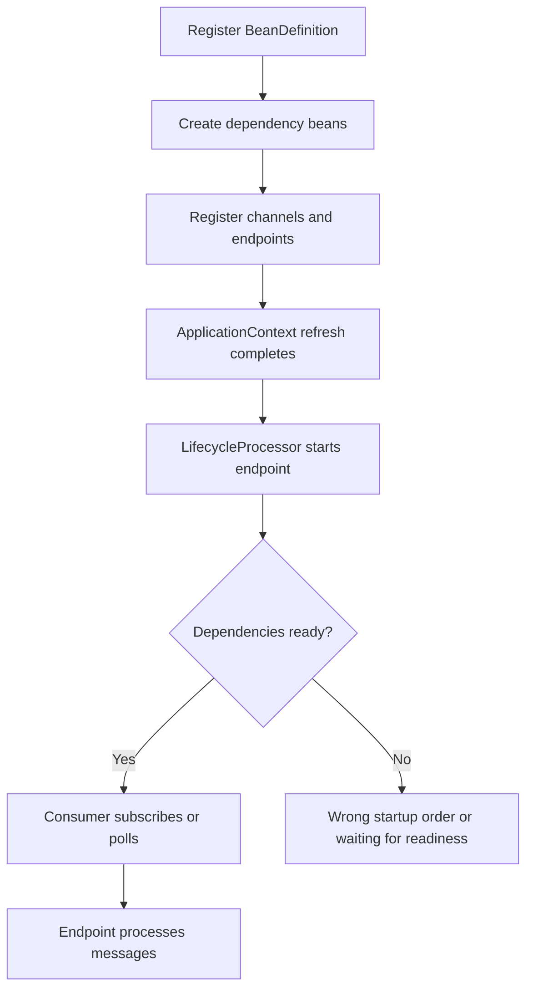
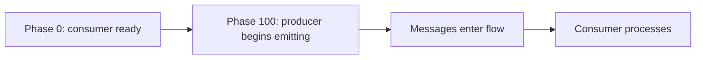

# Endpoints Running Before or After Dependencies

In Spring Integration, an endpoint should only receive or emit messages once the components it depends on are ready. An endpoint may require channels, handler beans, connection factories, transaction managers, database schemas, or other endpoints to be active first. If the startup order is inappropriate, the application may create beans successfully while messages still get lost, rejected, or processed when infrastructure is not ready.

This lesson belongs to the **Endpoint lifecycle** section of the `SPRING_INTEGRATION_RUNTIME` module. The module focuses on how Spring Integration coordinates message flows through channels, endpoints, consumers, pollers, and executors; it also covers managing IntegrationFlow lifecycles, transactions, retries, message stores, errors, correlation, and runtime diagnostics.

## 1. What types of endpoint dependencies exist?

From a runtime perspective, the word "dependency" can refer to several different relationships. Naming them accurately is essential to choosing the right control mechanism.

| Dependency Type | Example | What Must Be Guaranteed |
|---|---|---|
| **Bean dependency** | Handler service, channel, converter, transaction manager | The bean is created and dependencies are injected before the endpoint uses it |
| **Lifecycle dependency** | Connection container, listener container, another endpoint | The dependent-upon component is started before and stopped after the endpoint |
| **Message-flow dependency** | Consumer behind a DirectChannel, router and target branches | The consumer is ready before the producer begins emitting messages |
| **Resource readiness** | Database migrated, broker connected, remote API authenticated | The resource is genuinely ready, not merely represented by a bean in the context |

For example, a service injected into a handler is a bean dependency. However, if that service only opens a connection to an external system after a separate start operation, it also has a lifecycle dependency. If the service connects successfully but the database has not run migrations yet, the endpoint still has a resource-readiness dependency.

**Bean existence does not mean the resource is ready.** Constructor completion only proves the object has been created. It does not prove the broker has accepted the connection, the database has finished migrating, or another endpoint has registered its consumer.

## 2. At what stages are endpoints created and started?

To control dependencies, distinguish three stages in the ApplicationContext:

1. **Bean creation:** Spring creates channels, services, connection factories, flows, and required beans following the dependency graph.
2. **Endpoint registration:** Spring Integration processes IntegrationFlow/annotation configurations, registers endpoints, and wires references among endpoints, channels, and handlers.
3. **Endpoint startup:** LifecycleProcessor starts endpoints implementing Lifecycle/SmartLifecycle when the ApplicationContext finishes refreshing, according to `autoStartup` and `phase`.

An endpoint may already be registered in the context without running yet. Conversely, a dependency bean may already be created without having completed asynchronous readiness work.



If an endpoint auto-starts immediately after refresh while migrations only run inside an `ApplicationRunner`, the endpoint may begin receiving messages before migrations complete. This is a classic example of the difference between bean creation and resource readiness.

## 3. SmartLifecycle controls start and stop order

Integration endpoints are usually managed via Spring's lifecycle. `SmartLifecycle` extends `Lifecycle` and adds two important pieces of information:

- `isAutoStartup()` / configuration property `autoStartup` determines whether the component automatically starts when context refresh completes.
- `getPhase()` / configuration property `phase` determines start and stop order among lifecycle components.

Phase rules:

- Components with a **lower phase value start earlier**.
- Components with a **higher phase value start later**.
- When stopping the context, the order is reversed: higher phase stops earlier, lower phase stops later.

This rule gives a dependency time to start before the endpoint using it, while keeping the dependency active while the dependent endpoint is stopping.



If two components have a dependency relationship but are configured with the same phase, do not rely on bean declaration order or bean names to guess execution order. Express dependencies explicitly or choose appropriate phases. For independent lifecycle dependencies, phase is an easily observable coordination tool.

## 4. Using phase so consumers are ready before producers

A common case is a producer sending messages into a `DirectChannel`. DirectChannel does not store messages waiting for a consumer to appear; it dispatches to subscribers immediately during the send call. If a producer emits a message before the consuming endpoint has registered its subscriber, the send may fail or not reach the intended consumer.

Suppose a flow has an order validation step and a persistence step:

```java
@Bean
IntegrationFlow orderProcessing(OrderService service) {
    return IntegrationFlow.from("orders.in")
        .handle(service, "validate",
            endpoint -> endpoint.id("validateOrders").phase(100))
        .channel("orders.validated")
        .handle(service, "persist",
            endpoint -> endpoint.id("persistOrders").phase(0))
        .get();
}
```

The `persistOrders` endpoint has a lower phase, so it is started before the `validateOrders` endpoint. When the validation step begins emitting messages into `orders.validated`, the persistence endpoint has already had the opportunity to register its subscriber.

In a flow with multiple endpoints, apply the same rule along the direction messages travel:

- Downstream consumers may need to start before upstream producers.
- Inbound adapters or pollers that actively generate messages should only start emitting after downstream consumers are ready.
- When shutting down the application, producers should stop first so they do not keep emitting messages into a closing consumer.

If the message source is a separate inbound adapter, set the source endpoint's phase higher than the downstream endpoints' phases, or control when the source starts after the target flow is ready.

### 4.1. DirectChannel and QueueChannel have different requirements

| Channel | Behavior | Implication for Startup Order |
|---|---|---|
| `DirectChannel` | Dispatches synchronously to subscribers | Consumer should be started before producer; messages are not buffered waiting for a consumer to appear |
| `ExecutorChannel` | Dispatches via an executor to subscribers | Consumer still needs to be subscribed first; the executor only changes dispatch mechanics and execution thread |
| `QueueChannel` | Holds messages in a queue until a consumer polls | Can absorb messages up to queue capacity, but capacity, wait times, and consumer start timing must still be controlled |

QueueChannel helps decouple send and receive timing, but does not automatically solve every readiness issue. A queue has finite capacity; when full, the producer may block or the send operation may fail depending on configuration. An in-memory queue also does not automatically become durable if the application stops abruptly.

## 5. Using depends-on for bean dependency relationships

`@DependsOn` and the `depends-on` attribute express that one bean requires another bean to be initialized first. For example, a flow needs a bean that runs synchronous migrations during initialization:

```java
@Bean
SchemaInitializer schemaInitializer(DataSource dataSource) {
    return new SchemaInitializer(dataSource);
}

@Bean
@DependsOn("schemaInitializer")
IntegrationFlow customerFlow(CustomerService service) {
    return IntegrationFlow.from("customers.in")
        .handle(service, "process")
        .get();
}
```

This example assumes `SchemaInitializer` completes the required work during bean initialization, such as in its constructor, `@PostConstruct`, or `afterPropertiesSet()`. When the flow bean is created, the initializer has already been initialized beforehand.

For beans with lifecycles, Spring also takes `depends-on` relationships into account when coordinating start/stop: the dependency is started before the dependent bean and kept alive until the dependent bean stops. However, `@DependsOn` does not automatically wait for asynchronous work launched by the dependency bean to finish. If the initializer merely submits a background task and returns immediately, the bean dependency relationship does not prove migration is done.

### 5.1. How do constructor injection, depends-on, and phase differ?

| Mechanism | Meaning | Suitable When |
|---|---|---|
| Constructor injection | A bean requires the dependency to be created; Spring resolves the dependency before calling the constructor | A handler needs a service, channel, or transaction manager |
| `@DependsOn` | Enforces bean initialization order, even without a direct constructor dependency | An initializer must run before another bean is created |
| `SmartLifecycle.phase` | Controls start/stop order of lifecycle components | A producer endpoint must start after a consumer or after a lifecycle dependency |
| `autoStartup=false` | Does not automatically start the endpoint on context refresh | The application needs to wait for readiness or decide startup based on business logic |

Do not use `@DependsOn` merely to arrange `@Bean` methods in source code. If Spring already sees the dependency through constructor or method parameters, the bean creation relationship is expressed naturally. Use `depends-on` for genuine prerequisites that cannot be expressed through dependency injection.

## 6. Bean exists, but resource is not ready

An endpoint may depend on an external system: database, broker, file server, or remote API. The presence of a bean representing that system in the ApplicationContext does not necessarily mean the connection is ready.

Distinguish three states:

- **Configured:** connection details and client objects have been created.
- **Started:** the container or adapter has received the start command.
- **Ready:** the connection is established, authentication has completed, and the resource satisfies business requirements.

Some adapters may connect asynchronously. The start call returning does not necessarily mean the broker has finished handshaking. If a downstream endpoint receives messages immediately after that point, rely on the actual readiness signal of the adapter or application.

### 6.1. Deferring an endpoint until readiness checks complete

When a check only runs after context refresh, you can configure the endpoint not to auto-start and then start it once the check succeeds.

```java
@Bean
IntegrationFlow remoteRequests(RemoteService remoteService) {
    return IntegrationFlow.from("remote.requests")
        .handle(remoteService, "process",
            endpoint -> endpoint.id("remoteRequestEndpoint")
                .autoStartup(false))
        .get();
}
```

The application can start the endpoint after performing the readiness check:

```java
@Bean
ApplicationRunner startRemoteEndpoint(
        ConfigurableApplicationContext context,
        StartupReadiness readiness) {

    return args -> {
        readiness.verify();

        Lifecycle endpoint =
            context.getBean("remoteRequestEndpoint", Lifecycle.class);

        endpoint.start();
    };
}
```

In this example, `StartupReadiness.verify()` must perform the check synchronously and throw an exception if prerequisites are not ready. The endpoint is configured with `autoStartup(false)` so it does not auto-start during context refresh. The `ApplicationRunner` starts the endpoint only after the check succeeds.

If readiness depends on an asynchronous signal, await that signal with a bounded timeout before starting the endpoint. Do not use infinite wait loops or fixed sleeps as a substitute for a readiness signal.

When an application has many interdependent endpoints, centralize coordination logic in a startup coordinator with a clear order. The coordinator should start consumers before producers, handle errors if a start step fails, and stop already-started endpoints if the entire sequence cannot complete.

## 7. Coordinating lifecycle dependencies with dynamic flows

With static flows, endpoints are usually created and registered during ApplicationContext initialization. With dynamic flows, the application can register flows at runtime via `IntegrationFlowContext`.

A registration handle allows controlling the flow:

```java
IntegrationFlowRegistration registration =
    flowContext.registration(flow)
        .id("tenantOrders")
        .autoStartup(false)
        .register();

// Once the tenant's dependencies are ready:
registration.start();

// When the tenant stops operating:
registration.stop();
registration.destroy();
```

This is useful when each tenant has its own flow, when an external connection becomes ready only after provisioning, or when endpoints must be toggled based on business state.

Clearly define dependency scope: application-wide shared dependencies versus flow/tenant-specific dependencies. When destroying a dynamic flow, destroy only components belonging to that registration after producers have stopped and in-flight messages have been resolved according to application policy.

## 8. Shutdown order must also follow dependencies

Starting in the right order but stopping in the wrong order can still cause message loss. For example, if a producer continues sending while a consumer has stopped, messages may be rejected or queues may grow with no consumer processing them.

The shutdown rule is usually the reverse of startup:

1. Stop message-emitting sources first: inbound adapters, schedulers, or producer endpoints.
2. Stop accepting new messages and wait for running executions to finish within a timeout.
3. Stop consumer endpoints after producers have stopped.
4. Close connection factories, clients, or resources that endpoints depend on last.

With SmartLifecycle, higher phases stop before lower phases. If a producer has a higher phase than a consumer, the shutdown sequence stops the producer first and then stops the consumer.

For systems requiring graceful shutdown, define message drain time, processing timeouts, and requeue/retry policies. Stopping an endpoint does not by itself guarantee every message was processed successfully; that also depends on the specific channel, broker, transaction, and adapter.

## 9. Diagnosing dependency ordering errors

| Symptom | Common Cause | How to Check |
|---|---|---|
| Messages sent to DirectChannel fail at startup | Producer started before consumer | Check phase and subscriber state |
| Handler queries database before schema is ready | Migration runs after context refresh or runs in the background | Check where migration runs and check readiness signal |
| Endpoint is running but broker is not receiving messages | Adapter starts asynchronously or connection is not ready | Check actual connection state, handshake logs, and health indicator |
| Consumer stops before producer | Lifecycle phases or dependencies configured in reverse | Check stop order and `depends-on` relationships |
| Queue grows continuously after startup | Polling endpoint not started, poller not running, or dependency failing | Check PollingConsumer, TaskScheduler, error logs, and queue depth |
| Manually started endpoint still hits dependency errors | Only one endpoint started while other prerequisites are not ready | Inspect the full dependency graph and coordinator start order |
| Context refresh succeeds but first message fails | Bean created but resource not ready | Distinguish configured/started/ready and check when producer emits |

An effective investigation workflow:

1. Identify which endpoint emits messages and which endpoint receives messages.
2. Determine whether the channel connecting them is subscribable or pollable.
3. Verify that endpoints are created and registered properly in the ApplicationContext.
4. Check `autoStartup`, `phase`, and `depends-on` relationships.
5. Check whether dependency beans finished initializing or merely launched a background task.
6. Check resource readiness via actual connection state or health signals.
7. Check when the producer started, when the first message was sent, and when the consumer became ready.
8. During shutdown, verify that producers stop before consumers and resources are closed last.

## 10. Choosing a control mechanism by scenario

| Scenario | Recommended Mechanism |
|---|---|
| Handler needs a service or channel bean | Constructor/method injection |
| Flow must be created after a synchronous initializer | `@DependsOn` or dependency injection if directly expressible |
| Consumer must start before producer | `SmartLifecycle.phase` or startup coordinator |
| Endpoint must run only after a readiness check | `autoStartup(false)` followed by controlled start |
| Two lifecycle beans have an explicit prerequisite relationship | Express explicit bean dependency and let LifecycleProcessor coordinate |
| Per-tenant flows or resources provisioned at runtime | `IntegrationFlowContext` and registration lifecycle |
| Shutdown needs to drain messages before closing resources | Stop producer, drain consumer, then close dependencies |

The most important thing is determining whether an endpoint depends on **bean existence**, **lifecycle state**, or **resource readiness**. Constructor injection and `@DependsOn` resolve bean initialization relationships; `SmartLifecycle.phase` and `autoStartup` control start/stop timing; readiness checks confirm that resources can actually serve messages. Combining these three layers properly lets flows start reliably and stop in the right dependency order.
