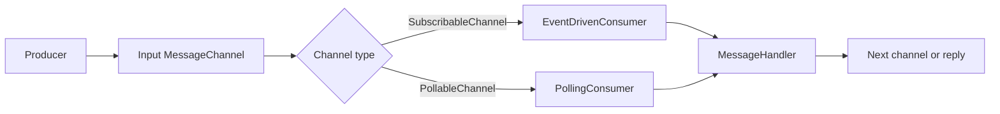
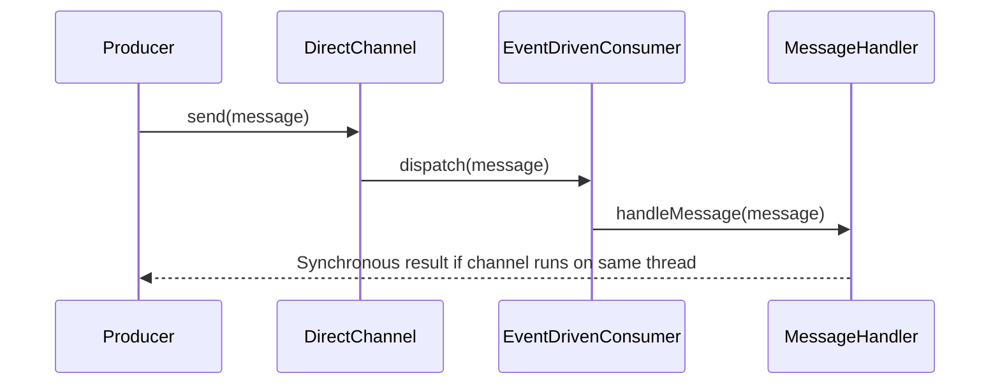
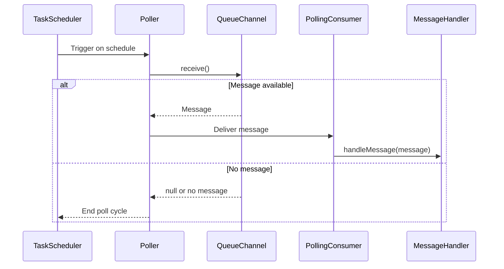
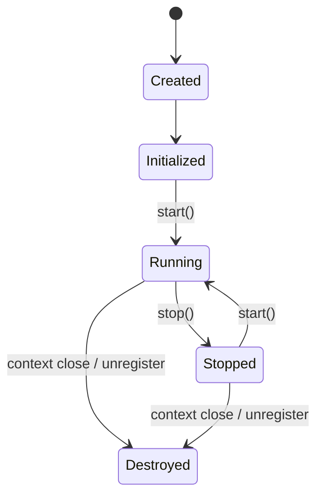

# EventDrivenConsumer and PollingConsumer

In Spring Integration, an endpoint connects a channel to message-processing logic. For message-consuming endpoints, the framework typically chooses one of two main mechanisms: **event-driven** or **polling**. These two mechanisms correspond to two different channel types and determine how the consumer is triggered.

- `EventDrivenConsumer` registers a handler with a `SubscribableChannel`. When the channel receives a message, it dispatches the message to the handler.
- `PollingConsumer` periodically calls `receive()` on a `PollableChannel`. Messages are retrieved when the poller triggers the consumer.

Understanding these two endpoints properly helps determine when messages are processed, which thread executes them, queue effects, start/stop lifecycle, transactions, and how errors are handled.

## 1. Message-consuming endpoints in an IntegrationFlow

An `IntegrationFlow` describes processing steps. When the flow is registered in the ApplicationContext, Spring Integration creates the corresponding channels and endpoints. A consuming endpoint typically pairs a `MessageHandler` with an input channel.



An endpoint is not a channel. A channel transports or stores messages; an endpoint binds a channel to processing behavior. A handler may be used by an endpoint, while the endpoint's lifecycle is also influenced by the ApplicationContext and the channel type.

Key abstractions:

| Abstraction | Role |
|---|---|
| `MessageChannel` | Contract for sending messages into a channel |
| `SubscribableChannel` | Channel allowing consumers to subscribe to receive dispatched messages |
| `PollableChannel` | Channel allowing consumers to retrieve messages via `receive()` |
| `MessageHandler` | Logic that processes a single message |
| `EventDrivenConsumer` | Endpoint connecting a handler to a subscribable channel |
| `PollingConsumer` | Endpoint connecting a handler to a pollable channel via a poller |
| `AbstractEndpoint` | Base class managing lifecycle for many endpoints |

Endpoint selection is usually determined by the input channel type and the endpoint configuration in the flow. `EventDrivenConsumer` and `PollingConsumer` should not be treated as two names for the same mechanism.

## 2. EventDrivenConsumer: subscribing and processing when messages arrive

`EventDrivenConsumer` is the endpoint used for a `SubscribableChannel`. During startup, the endpoint registers its `MessageHandler` with the channel. When a producer sends a message to the channel, the channel dispatches the message to the registered handler. When the endpoint stops, it unregisters the handler.



The notable point is that the consumer does not need to check the channel periodically. The channel notifies the subscriber when a message arrives. Therefore, event-driven flows generally have low latency and suit event sources or sequential steps in a flow.

### DirectChannel

`DirectChannel` is a common `SubscribableChannel`. Under typical configuration, the handler is invoked synchronously on the thread calling `send()`. If the handler takes a long time, the producer must wait too. If the handler throws an exception, the error can propagate back up the synchronous call chain toward the producer.

```java
@Bean
DirectChannel ordersEvents() {
    return new DirectChannel();
}

@Bean
IntegrationFlow eventDrivenOrders(OrderService orderService) {
    return IntegrationFlow.from("ordersEvents")
            .handle(orderService, "process")
            .get();
}
```

Here, the `ordersEvents` channel is a push-style input. The message-processing endpoint subscribes to the channel when the endpoint starts. No poller is needed because the channel actively dispatches messages to subscribers.

### PublishSubscribeChannel

`PublishSubscribeChannel` dispatches a single message to multiple subscribers. This is an appropriate choice when one event needs to trigger multiple branches, such as writing audit logs, updating metrics, and sending notifications.

If no executor is configured, subscribers are typically invoked synchronously during dispatch. If the channel uses an executor, branches can run asynchronously; in that case, completion times and processing order across branches may differ.

### ExecutorChannel

`ExecutorChannel` is still a subscribable channel, so the consuming endpoint operates under the event-driven model. The difference is that the channel uses a `TaskExecutor` to dispatch messages to worker threads.

This means:

- `EventDrivenConsumer` still subscribes to the channel.
- The thread sending the message is not necessarily the thread running the handler.
- Transactions bound to the sending thread do not automatically propagate to worker threads.
- Completion order can differ from send order when there are multiple workers.
- Executor queue capacity and task rejection policies affect load capacity.

Therefore, event-driven does not mean synchronous processing. The channel's dispatch mechanism determines whether the handler runs directly on the sending thread or via an executor.

## 3. PollingConsumer: retrieving messages on a schedule

`PollingConsumer` is used when the input is a `PollableChannel`. Instead of subscribing, the endpoint creates a polling task based on the poller configuration. When triggered by the scheduler, the task calls `receive()` to retrieve a message. If a message is received, the endpoint passes it to the handler; if there is no message, the poll cycle ends according to the receive policy.



Polling typically fits queues, data sources that require querying, or scenarios where the application wants to control the read cadence. With `QueueChannel`, producers can send messages into the queue beforehand; the consumer retrieves messages when the poller runs.

Example:

```java
@Bean
QueueChannel ordersQueue() {
    return new QueueChannel(500);
}

@Bean
IntegrationFlow pollingOrders(OrderService orderService) {
    return IntegrationFlow.from("ordersQueue",
                    endpoint -> endpoint.poller(
                            Pollers.fixedDelay(Duration.ofMillis(500))
                                    .maxMessagesPerPoll(10)))
            .handle(orderService, "process")
            .get();
}
```

In this example, the endpoint is configured with a poller to take at most 10 messages per cycle. `QueueChannel(500)` creates a queue with bounded capacity; when the queue is full, the send result depends on the channel's timeout and send policy. Bounding the queue helps the system surface overload earlier and avoids unbounded heap growth.

### Source polling differs from PollingConsumer

A common confusion is calling every polling task a `PollingConsumer`. Spring Integration also has `SourcePollingChannelAdapter`, an inbound adapter that polls a `MessageSource` on a schedule and then sends messages into a flow.

The two differ in where messages are retrieved from:

| Case | Object Being Polled | Typical Component |
|---|---|---|
| PollingConsumer | `PollableChannel` already holding messages | `PollingConsumer` |
| Source polling | `MessageSource` or external data source | `SourcePollingChannelAdapter` |

Source polling example:

```java
@Bean
IntegrationFlow pollExternalOrders(
        MessageSource<Order> orderSource,
        OrderService orderService) {

    return IntegrationFlow.from(orderSource,
                    endpoint -> endpoint.poller(
                            Pollers.fixedDelay(Duration.ofSeconds(2))
                                    .maxMessagesPerPoll(20)))
            .handle(orderService, "process")
            .get();
}
```

This snippet uses `MessageSource` as the source. The framework creates a source polling adapter to poll the source on a schedule; this is not a consumer calling `receive()` on a `QueueChannel`.

## 4. Poller controls timing and processing volume

A poller combines a trigger, message count limits, and execution options. Common configurations:

| Property | Meaning |
|---|---|
| `fixedDelay` | Schedules the next cycle after the previous cycle completes plus the delay interval |
| `fixedRate` | Schedules on a fixed time interval |
| `cron` | Triggers according to a cron schedule expression |
| `maxMessagesPerPoll` | Limits the number of messages processed in a single poll cycle |
| `receiveTimeout` | Wait duration when receiving a message from a pollable channel |
| `taskExecutor` | Executor configured to execute polling tasks |
| `Advice chain` | Wraps polling tasks with transactions, retries, or additional logic |

### fixedDelay and fixedRate

`fixedDelay` is suitable when you want a pause after the previous poll cycle finishes. If processing takes a long time, the effective cadence stretches to the processing duration plus the delay interval.

`fixedRate` is suitable when you want periodic triggers at fixed intervals. When tasks run long, understand how the scheduler and executor are configured to avoid unexpected queued work or overlaps.

`cron` is suitable for business schedules such as running at the top of the hour or on specific days.

Do not pick an overly short interval just to reduce latency. Polling too frequently increases empty checks, load on external sources, and scheduling overhead.

### maxMessagesPerPoll

`maxMessagesPerPoll` limits the number of messages a single poll cycle processes. Larger batches can raise throughput by reducing scheduling overhead, but can also:

- Lengthen the duration of a single poll cycle.
- Hold transactions and resources for longer.
- Make other consumers wait if resources are shared.
- Increase the number of messages that must be examined when a batch fails.

Small batches cap the duration per cycle at the cost of more frequent scheduler triggers. Choose a value based on processing time, downstream capacity, message size, and latency targets.

### receiveTimeout

For a pollable channel, `receiveTimeout` determines how long the consumer waits when receiving a message. If the queue is empty, a receive call may wait up to the timeout and then finish. Too long a timeout can tie up worker threads; too short a timeout can increase empty poll cycles. Consider it alongside the trigger interval and channel type.

## 5. Common endpoint lifecycle

Many Spring Integration endpoints extend `AbstractEndpoint`, implement `SmartLifecycle`, and have their lifecycle managed by Spring. Both `EventDrivenConsumer` and `PollingConsumer` participate in this mechanism, even though their internal start/stop behavior differs.



The states above describe the conceptual lifecycle. Bean state and endpoint state are not always identical: a bean may already exist and be initialized while the endpoint has not started yet.

Lifecycle properties worth paying attention to:

- `autoStartup`: whether the endpoint starts automatically during context startup.
- `phase`: start/stop order among `SmartLifecycle` components.
- `isRunning()`: indicates whether the endpoint is currently in the running lifecycle state.
- `start()` and `stop()`: control the endpoint when the application needs to pause or restart it.
- `stop(Runnable)`: supports notifying the lifecycle processor that the stop operation has completed.

For `SmartLifecycle` components, lower phases generally start earlier and stop later; higher phases start later and stop earlier. Phase can be used to order ingress and consumers appropriately, but dependencies among components must be understood before configuring it.

### EventDrivenConsumer on start and stop

When starting, `EventDrivenConsumer` subscribes the handler to the input channel. When stopping, it unsubscribes. After unsubscribing, the channel no longer dispatches new messages to the handler via that subscription.

If the channel is currently dispatching a message or the handler is running, stop is not a guarantee that work currently executing will be cancelled immediately. Coordinate with ingress, channels, and in-flight message handling policies when controlled shutdown is required.

### PollingConsumer on start and stop

When starting, `PollingConsumer` activates the polling task according to its configured trigger. When stopping, it halts the poll schedule so no new messages are retrieved. A currently executing poll cycle or running handler may need time to finish; stop should not be treated as draining the queue.

When the endpoint starts again, the poller resumes operating per configuration. With an in-memory queue, remaining messages can stay in the channel as long as the channel has not been destroyed. If the flow is unregistered and the channel is destroyed, unprocessed messages may be lost.

## 6. Threading: channel and poller determine which thread runs the handler

The endpoint determines how messages are consumed, while the execution thread also depends on the channel, poller, scheduler, and executor.

| Configuration | Typical Thread Running the Handler |
|---|---|
| EventDrivenConsumer + DirectChannel | Message-sending thread |
| EventDrivenConsumer + PublishSubscribeChannel without executor | Dispatching thread |
| EventDrivenConsumer + ExecutorChannel | Executor worker thread |
| PollingConsumer without dedicated executor | Poll task execution thread managed by scheduler |
| PollingConsumer with task executor | Worker thread assigned the poll task by the executor |

This is the general model; adapters and handlers can introduce additional thread boundaries. When debugging, include the thread name in logs alongside the component name and message ID.

### Do not confuse event-driven with asynchronous

Event-driven describes how the consumer is triggered: the channel dispatches messages when they arrive. Asynchronous describes whether the processing call is decoupled from the calling thread.

A `DirectChannel` is typically event-driven and synchronous. An `ExecutorChannel` is still event-driven, but dispatches asynchronously through an executor. Thus, to understand threading, inspect the actual channel rather than only looking at the endpoint name.

### Poller and executor play two different roles

The scheduler decides when the poller is triggered. The executor, if configured, decides which worker thread executes the poll task. Using an executor does not eliminate the need to configure a trigger and does not create backpressure on its own.

If a scheduler or executor is shared across multiple endpoints, a slow poller or blocking handler can affect other tasks. Use bounded pools, monitor queues, and avoid letting blocking I/O tasks occupy all workers.

## 7. Transactions, retries, and error handling

The endpoint mechanism affects error and transaction boundaries.

### Transactions

With `EventDrivenConsumer` on `DirectChannel`, the handler runs synchronously on the sending thread. If the producer is inside a transaction with an appropriate transaction manager, synchronous steps can participate in that transaction.

With `ExecutorChannel`, the handler runs on a worker thread, so the sending thread's transaction does not automatically propagate across. If the handler needs a transaction, configure transaction boundaries on the processing side or inside the invoked service.

With `PollingConsumer`, transaction advice is typically attached to the poller to wrap the polling task in a transaction for its configured scope. Determine how far the transaction covers the receive operation, handler, and external source acknowledgment. If a single poll cycle processes multiple messages, verify the actual transaction boundary instead of assuming each message gets a separate transaction.

A database transaction does not automatically turn an in-memory `QueueChannel` into a durable queue. If a handler fails after a message has been taken from the queue, whether the message is returned depends on the channel, transaction support, and application policy.

### Retries

Retries can be configured via an advice chain on the poller or appropriate endpoint. Cap the retry count, define retryable exception types, and set appropriate backoff intervals. Transient timeouts are often retryable; invalid data usually belongs in an error flow or dead-letter destination.

If a handler has side effects, a retry can re-run an operation that partially succeeded. Use idempotency keys, unique constraints, or deduplication mechanisms to prevent duplicate business records.

### Error channel

With synchronous processing over `DirectChannel`, exceptions can propagate back to the producer. With asynchronous processing via an executor or polling task, errors do not necessarily return to the original caller. Spring Integration can convert errors into error messages routed to an error channel according to the endpoint's configuration and error-handling mechanism.

Error messages typically carry the cause and may retain the failed message for investigation. When handling errors, log the component name, message ID, correlation ID, and root exception. Avoid logging raw sensitive payloads intact.

## 8. Backlogs and backpressure

Event-driven and polling consumers surface backlogs differently:

- With `DirectChannel`, producers slow down directly when handlers are slow.
- With `ExecutorChannel`, backlogs can build up in the executor's queue.
- With `QueueChannel`, backlogs build up in the channel queue when producers send faster than consumers poll and process.
- With source polling, data can accumulate at the external source between poll cycles.

Having no queue does not mean overload cannot happen; it can cause producers to block or sends to fail. Having a queue does not mean the system already has backpressure; an unbounded queue merely delays when overload becomes visible.

Metrics worth monitoring:

| Metric | Meaning |
|---|---|
| Queue depth | Number of messages waiting |
| Poll duration | Time to complete one poll cycle |
| Messages per poll | Number of messages processed in one cycle |
| Receive timeout count | Number of polls that failed to retrieve a message before timing out |
| Handler duration | Time to process a single message |
| Executor active threads | Worker utilization |
| Executor queue size | Volume of queued tasks waiting |
| Rejected task count | Tasks rejected due to executor overload |
| Error count and retry count | Error frequency and recovery level |

If the backlog grows continuously, increase consumer capacity, slow down producers, limit concurrency, or adjust the poll interval and batch size. Increasing threads arbitrarily can overload downstream systems or increase contention.

## 9. Choosing EventDrivenConsumer or PollingConsumer?

| Requirement | Suitable Mechanism | Reason |
|---|---|---|
| Producer can push messages immediately as they arise | EventDrivenConsumer | Consumer is called when the channel dispatches |
| Simple synchronous processing chain | EventDrivenConsumer + DirectChannel | Call flow is straightforward to trace |
| Need asynchronous dispatch via worker pool | EventDrivenConsumer + ExecutorChannel | Decouples producer and consumer threads |
| Messages need to be buffered in a channel | PollingConsumer + QueueChannel | Consumer retrieves messages on a schedule |
| Want to limit the number of messages per cycle | PollingConsumer | Controls batching through the poller |
| Source only supports scheduled querying | SourcePollingChannelAdapter | Polls `MessageSource` directly |
| Need to throttle read cadence to protect downstream | PollingConsumer or source polling | Trigger and batch size can be tuned |

Neither option is universally better. Choose based on source capabilities, latency requirements, ordering needs, delivery semantics, downstream capacity, and how the application wants to manage backlogs.

## 10. Diagnosing non-working endpoints

When messages are not being processed, trace the path from channel to endpoint:

| Symptom | Check |
|---|---|
| DirectChannel sends but no handler runs | Has the endpoint started and subscribed to the right channel? |
| QueueChannel holds messages without shrinking | Is the poller running? Does the endpoint have a poller configured? |
| Messages arrive slowly in periodic bursts | Trigger, `fixedDelay`/`fixedRate`, and `receiveTimeout` |
| Handler runs on an unexpected thread | Does the channel have an executor? Does the poller have a `taskExecutor`? |
| Endpoint exists but receives no messages | `autoStartup`, `isRunning()`, `phase`, and lifecycle context |
| Handler still seen running after stop | Is an in-flight dispatch or poll currently executing? |
| Messages processed multiple times | Retries, ack/commit, multiple consumers, and idempotency |
| Errors do not return to producer | Check error channel and asynchronous boundaries |
| Queue grows without shrinking | Consumer throughput, handler latency, batch size, and downstream |
| Endpoint gone after unregister | Check flow registration and component ownership |

A practical investigation workflow:

1. Determine whether the input channel is subscribable or pollable.
2. Identify whether the corresponding endpoint is `EventDrivenConsumer` or `PollingConsumer`.
3. Check whether the endpoint has been created, initialized, and started.
4. For event-driven, inspect subscribers and the channel's dispatch behavior.
5. For polling, inspect trigger, scheduler, executor, receive timeout, and queue depth.
6. Include component name, message ID, and correlation ID in logs.
7. Check transactions, retries, and the error channel if messages reach the handler but fail.
8. Inspect thread dumps and metrics when suspecting thread starvation or backlogs.

## 11. Endpoint design checklist

Before putting an endpoint into production, answer:

- Is the input channel a `SubscribableChannel` or a `PollableChannel`?
- Is the consumer triggered by push or poll?
- Which thread runs the handler?
- Is a dedicated executor or scheduler needed?
- Does the queue have a bound and a full-queue policy?
- Which trigger does the poller use, and at most how many messages does it process per cycle?
- Which operations fall inside the transaction boundary?
- Which errors are retried, and is retry count bounded?
- Where are error messages routed?
- Does stopping the endpoint affect in-flight messages?
- When unregistering a flow, how are remaining messages and dedicated resources handled?
- Which metrics help detect a stopped endpoint, growing queue, or slow handler?

Once `EventDrivenConsumer` and `PollingConsumer` are clearly distinguished, you can read Spring Integration configurations starting from channel types, determine the endpoint activation mechanism, predict execution threads, and design an appropriate lifecycle. That is the foundation for operating consumers reliably, handling errors in a controlled manner, and diagnosing message flow performance.
