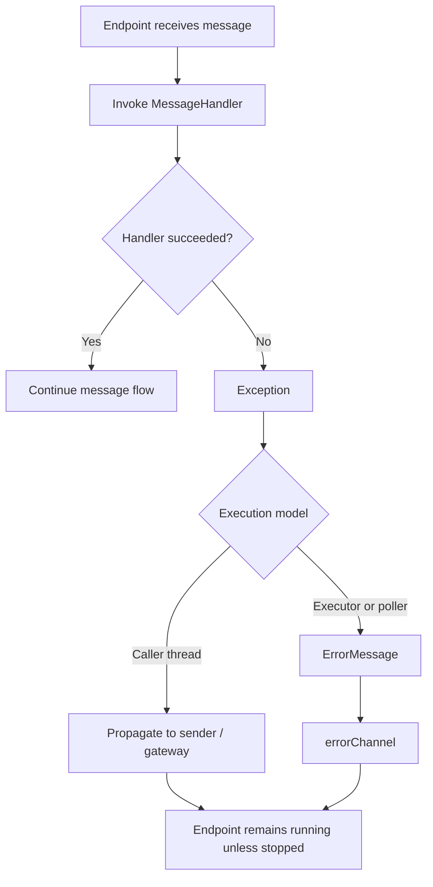
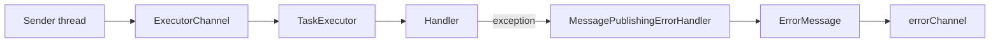
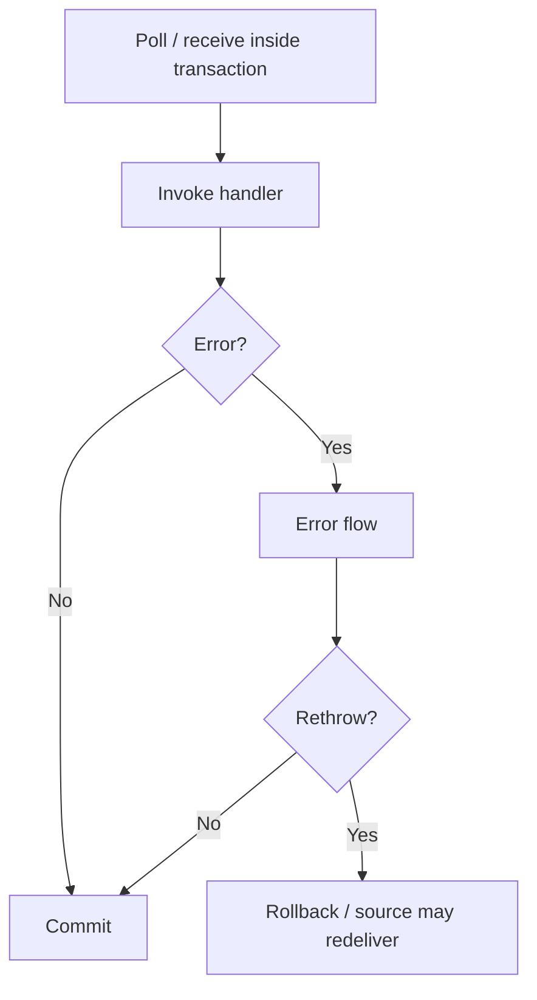

# Endpoints Stopping When a Handler Fails

In Spring Integration, a handler may throw an exception while processing a message due to invalid data, a temporarily unreachable external service, or a failed business operation. In that situation, we must distinguish between **a single failed message execution** and **the endpoint being stopped**. These two events are related through error handling and lifecycle, but they are not the same thing.

Ordinarily, a handler exception is propagated back to the caller or converted into an `ErrorMessage`, depending on whether the flow runs synchronously or asynchronously. An endpoint does not automatically transition to a stopped state just because a single handler invocation fails. An endpoint only stops when its lifecycle is controlled, the context closes, or a specific source/consumer component stops according to its own policy.

## 1. A handler exception does not mean endpoint stop

An endpoint is the component that connects a channel to a `MessageHandler` or `MessageSource`, while coordinating how the consumer receives messages. An event-driven endpoint typically registers a subscriber on a channel; a polling endpoint is triggered by a scheduler according to a trigger; an inbound adapter may use a listener container from a broker or external library.

When a handler throws an exception, the runtime must handle the outcome of that invocation:

1. Identify the offending message and the exception/cause.
2. Propagate the error back to the caller or route it to the error channel appropriate for the execution model.
3. Apply retry, recovery, transaction rollback, or redelivery if the flow is configured for them.
4. Continue receiving subsequent messages if the endpoint and message source are still active.



Therefore, when logs record `MessageHandlingException`, `MessagingException`, or an exception from a service method, you cannot immediately conclude that the endpoint has stopped. Check `isRunning()`, lifecycle start/stop logs, and the consumer's trigger source.

## 2. Execution model determines where errors go

Spring Integration creates event-driven or polling endpoints depending on the type of channel the endpoint connects to:

- A `SubscribableChannel` such as `DirectChannel` typically creates an `EventDrivenConsumer`.
- A `PollableChannel` such as `QueueChannel` typically creates a `PollingConsumer` requiring a poller.
- An inbound channel adapter can create a `SourcePollingChannelAdapter` to retrieve messages from a `MessageSource` on a schedule.
- A message-driven adapter uses the listener container or consumer of the source technology, such as JMS, AMQP, or Kafka.

### DirectChannel: errors travel back to the sender

With `DirectChannel`, the handler is invoked on the same thread calling `send()`. If the handler throws an exception and nothing catches it along the way, the exception can propagate back to the caller like a synchronous Java call.

```java
@Bean
MessageChannel ordersInput() {
    return new DirectChannel();
}

@Component
class OrderHandlerEndpoint {

    private final OrderService orderService;

    OrderHandlerEndpoint(OrderService orderService) {
        this.orderService = orderService;
    }

    @ServiceActivator(inputChannel = "ordersInput")
    public void handle(Order order) {
        orderService.process(order); // May throw an exception
    }
}
```

A producer sending a message can catch the exception right in the `send()` call:

```java
try {
    ordersInput.send(new GenericMessage<>(order));
}
catch (MessagingException ex) {
    // Handle or return error to the calling layer
}
```

A failed send does not automatically unsubscribe the subscriber from `DirectChannel`. Subsequent messages can still be sent to the endpoint unless the application proactively stops the endpoint or another component changes the subscription.

If the flow is invoked via a messaging gateway, the gateway propagates downstream errors back to the caller by default. You can configure `errorChannel` on the gateway to divert errors into an error flow instead of throwing them directly to the caller. When sending directly via `MessageChannel` or `MessagingTemplate`, the exception is still propagated to the caller.

### ExecutorChannel and asynchronous processing

With `ExecutorChannel`, messages are handed off to an executor so the handler runs on a worker thread. The sending thread has usually moved on, so it cannot receive exceptions directly via the normal call stack.

Spring Integration supports converting exceptions into an `ErrorMessage`. The error handler selects the destination channel in order:

1. The `errorChannel` header of the message being processed, if present.
2. The global channel with bean name `errorChannel`, if the message has no dedicated header.



This decouples worker errors from the sending thread. However, if the error flow also fails or cannot dispatch the `ErrorMessage`, errors may continue to be logged at the error handler/executor; monitor the error handling path as well.

### Polling endpoints: scheduler and worker executor

A polling endpoint has at least two thread roles to distinguish:

- `TaskScheduler` triggers polls according to the trigger.
- An optional `TaskExecutor` executes message processing work.

If the poller does not configure a separate executor, the poll operation and processing typically run on the thread triggered by the scheduler. If an executor is configured, the handler executes in that pool. When a scheduled poller task throws an exception, Spring Integration can wrap the error as an `ErrorMessage` and send it to `errorChannel` through the `MessagePublishingErrorHandler` attached to the global `taskScheduler`.

With a custom `TaskScheduler`, configure `MessagePublishingErrorHandler` if you want the same error-channel mechanism. If the scheduler uses an error handler that only logs and suppresses, subsequent polls may keep running while errors are merely logged. If the error handler propagates exceptions out of the scheduled task, the scheduler may cancel subsequent periodic runs according to scheduled executor semantics. Therefore, for a poller that appears to "stop on its own after a handler error," check the scheduler's error handler before concluding the endpoint stopped itself.

## 3. Global errorChannel and ErrorMessage

Spring Integration creates a default global `errorChannel` if the application has not declared its own channel. The default channel is a `PublishSubscribeChannel` with an `ERROR`-level `LoggingHandler` subscriber to log failures. The application can register additional endpoints to persist errors, classify exceptions, send alerts, or move messages to a dead-letter flow.

`ErrorMessage` carries the exception as its payload. It can also contain the original message that caused the failure so the error flow can inspect the payload, headers, and origin. In many cases, the framework wraps the exception in a `MessagingException` with `failedMessage`.

```java
@Bean
IntegrationFlow errorFlow(ErrorAuditService auditService) {
    return IntegrationFlow.from("errorChannel")
        .handle((MessageHandler) message -> {
            ErrorMessage errorMessage = (ErrorMessage) message;
            Throwable failure = errorMessage.getPayload();
            auditService.record(failure, errorMessage.getOriginalMessage());
        })
        .get();
}
```

The example above only illustrates recording errors. In production, the error flow should classify exceptions and have clear policies for retryable errors, permanent data errors, and infrastructure errors. Avoid letting the error handler itself throw exceptions repeatedly without a fallback path.

Since Spring Integration 5.4.3, the default `errorChannel` has `requireSubscribers = true`. When there are no subscribers to receive errors, sending an `ErrorMessage` can throw `MessageDispatchingException` instead of silently dropping it. This is useful when the application needs to know the error flow is no longer active, such as while the context is stopping.

### Per-message error channel

A message can carry an `errorChannel` header to route errors to a request-specific or tenant-specific flow:

```java
Message<Order> message = MessageBuilder.withPayload(order)
    .setHeader(MessageHeaders.ERROR_CHANNEL, tenantErrorChannel)
    .build();
```

Without this header, the error handler uses the global `errorChannel`. Ensure the custom channel still exists and has subscribers throughout the time the message might fail. This header only affects asynchronous error publishing mechanisms; it does not turn a `DirectChannel` exception into an error automatically sent to the error channel.

## 4. Configuring TaskScheduler for pollers

Spring Integration uses a default `ThreadPoolTaskScheduler` for scheduled tasks. If the application provides its own `taskScheduler` bean, pay attention to the error handler attached to the scheduler.

```java
@Configuration
class PollerSchedulerConfiguration {

    @Bean
    ThreadPoolTaskScheduler taskScheduler(
            @Qualifier("integrationMessagePublishingErrorHandler")
            ErrorHandler errorHandler) {
        ThreadPoolTaskScheduler scheduler = new ThreadPoolTaskScheduler();
        scheduler.setPoolSize(5);
        scheduler.setThreadNamePrefix("integration-poller-");
        scheduler.setErrorHandler(errorHandler);
        return scheduler;
    }
}
```

`integrationMessagePublishingErrorHandler` is the error handler bean provided by Spring Integration when configured appropriately. If the application creates its own scheduler without using this bean, proactively provide an equivalent `MessagePublishingErrorHandler` or an `ErrorHandler` with verified semantics. Do not configure a handler that propagates exceptions if you expect the poller to keep running after ordinary errors.

A poller may process only one message at a time or multiple messages via `maxMessagesPerPoll`. When `maxMessagesPerPoll` is greater than one, an exception on one message may terminate the current poll cycle early; that is still different from the periodic poll schedule being cancelled. Check logs by scheduler thread, poll timestamps, and number of messages processed in the poll cycle.

## 5. Retrying handlers instead of stopping endpoints

For transient errors such as timeouts, HTTP 503, or database connection resets, you can retry directly at the endpoint using `RequestHandlerRetryAdvice`. The advice wraps the handler invocation, so only the operation at the endpoint with the advice attached is retried.

```java
@Configuration
class OrderRetryConfiguration {

    @Bean
    RequestHandlerRetryAdvice orderRetryAdvice(MessageChannel recoveryChannel) {
        RequestHandlerRetryAdvice advice = new RequestHandlerRetryAdvice();
        advice.setRecoveryCallback(
            new ErrorMessageSendingRecoverer(recoveryChannel));
        return advice;
    }
}

@Component
class OrderHandlerEndpoint {

    private final OrderService orderService;

    OrderHandlerEndpoint(OrderService orderService) {
        this.orderService = orderService;
    }

    @ServiceActivator(inputChannel = "ordersInput", adviceChain = "orderRetryAdvice")
    public void handle(Order order) {
        orderService.process(order);
    }
}
```

`RequestHandlerRetryAdvice` uses a `RetryTemplate`-based retry mechanism, allowing you to define retry policy, backoff, and `RecoveryCallback`. When retries are exhausted, the recovery callback can send an `ErrorMessage` to a recovery channel to record or route to a dead-letter flow.

Several points to decide when designing retries:

- Only retry errors capable of self-recovery. Validation errors or business rule violations generally should not be retried.
- Choose bounded attempt counts and backoff. Retrying immediately without delay can amplify load when the target service is degraded.
- Ensure the handler is idempotent if an operation may have succeeded on the target system while the client timed out.
- Place retry at the specific endpoint to avoid re-running unrelated upstream steps.
- When the message source supports redelivery, consider stateful retry and letting the broker/adapter redeliver the message after rollback or nack.

Retry increases the number of handler invocations before declaring failure. It is not the endpoint's start/stop lifecycle.

## 6. Transactions, rollback, and redelivery

With a polling endpoint, transaction advice can wrap the poll and message processing operations. If an exception escapes the transaction boundary, the transaction manager can roll back the message receive or transactional data updates. If the exception is handled by an error flow and not rethrown, the flow may be treated as completing normally and the transaction commits.

With broker-based message sources, final behavior also depends on acknowledgment mode, listener container, and transaction configuration. For example with JMS, if an error channel is configured and the error flow handles the error without rethrowing, the transaction may commit and the message be acknowledged. If broker redelivery is required, the error flow must rethrow the exception or let the error propagate to the listener container according to the configured delivery policy.

Do not assume that sending an `ErrorMessage` to an error channel automatically triggers rollback. Identify where the transaction starts, whether exceptions cross the transaction boundary, and at what point the adapter acknowledges messages.



A poller's transaction does not automatically cross thread boundaries. When a flow goes through an `ExecutorChannel`, `QueueChannel`, or spawns a new thread, the transaction bound to the original thread does not automatically follow onto the worker thread. If a downstream processing step needs a transaction, place the transaction boundary at the endpoint executing that step.

## 7. When does an endpoint actually stop?

An endpoint can be stopped by several mechanisms:

| Cause | Symptom | Investigation Path |
| --- | --- | --- |
| Application calls `stop()` | Lifecycle logs show the endpoint transitioning to stopped. | Find where `stop()`, `SmartLifecycle`, Control Bus, or JMX is invoked. |
| Context closes or refreshes | Multiple endpoints stop together by lifecycle phase. | Check shutdown hooks, context close, and refresh events. |
| `autoStartup=false` | Endpoint does not auto-start when context starts. | Check endpoint/flow configuration and explicit start calls. |
| Poller schedule cancelled | Poll logs appear then stop; endpoint may still report running. | Check `TaskScheduler`, `ErrorHandler`, exceptions from scheduled tasks, and scheduler threads. |
| Listener container or source connection fails | JMS/AMQP/Kafka consumer logs disconnect, rebalance, or container stop. | Check logs and status of the specific container/adapter, broker, and reconnect policy. |
| Error flow causes errors to propagate back | Exceptions when sending `ErrorMessage` or in error channel subscribers. | Check subscribers, `requireSubscribers`, capacity, and errors inside the error flow itself. |

For specific adapters, stopping an endpoint may entail stopping a listener container or closing a connection. For example, `JmsMessageDrivenEndpoint` since Spring Integration 5.1 shuts down its listener container by default when the endpoint stops; the `shutdownContainerOnStop` property can alter that behavior. This is semantics specific to the JMS adapter and cannot be generalized into a rule for every endpoint.

When purposeful lifecycle control is needed, use `Lifecycle`/`SmartLifecycle`, `autoStartup`, `phase`, or an appropriate management mechanism. Do not call `stop()` inside a handler's catch block merely to avoid one bad message, unless the business requirement truly is to stop receiving all messages.

## 8. What should an error flow do?

A good error flow turns runtime failures into observable, actionable operational decisions. Typically, an error flow performs:

1. Recording the exception, failed message, flow/endpoint ID, correlation ID, and timestamp.
2. Classifying transient errors, data errors, configuration errors, and unknown errors.
3. Choosing retry, dead-lettering, alerting, or requiring manual intervention.
4. Preserving necessary payload/headers for replay while stripping sensitive data from logs.
5. Avoiding errors inside the error flow masking the original exception.

Do not simply log and drop a message if the source needs a nack or rollback for redelivery. Conversely, do not rethrow every error if the data is permanently invalid, as that creates an infinite redelivery loop. Define retry limits, dead-letter policies, and a clear replay procedure.

## 9. Diagnosing an endpoint that appears to stop after a handler error

When an endpoint stops processing messages after an exception, inspect in order:

1. **Confirm endpoint state:** retrieve the endpoint bean by ID if possible and check `isRunning()`. Distinguish a stopped endpoint from a running endpoint with no incoming messages.
2. **Identify consumer type:** `EventDrivenConsumer`, `PollingConsumer`, `SourcePollingChannelAdapter`, or message-driven adapter.
3. **Identify failing thread:** sender thread, executor worker, scheduler thread, or broker listener thread.
4. **Find the root exception:** inspect the cause chain and `failedMessage`; the outer wrapper exception is often just `MessageHandlingException`.
5. **Check error routing:** `errorChannel` header, global `errorChannel`, error flow subscribers, and `MessagePublishingErrorHandler` logs.
6. **For pollers:** check `taskScheduler`, `taskExecutor`, trigger, `maxMessagesPerPoll`, and whether the error handler propagates exceptions.
7. **For brokers:** check ack/nack, transactions, redelivery, listener container, and reconnect policies.
8. **Look for stop commands:** check lifecycle management, Control Bus, JMX, shutdown events, and `autoStartup`.

| Symptom | Likely Cause | How to Confirm |
| --- | --- | --- |
| Producer receives exception right at `send()` | Handler runs synchronously via `DirectChannel`. | Check if the stack trace passes through the sending thread. |
| Producer sees no error, but global errorChannel receives ErrorMessage | Asynchronous processing or scheduled task. | Inspect the `errorChannel` header, original message, and thread name. |
| Poller runs only once after handler error | Scheduler error handler propagates exceptions or scheduled task was cancelled. | Check `ErrorHandler` configuration and scheduler logs. |
| Poller keeps running, nothing appears on errorChannel | Custom scheduler does not use `MessagePublishingErrorHandler`, or failure is on another path. | Check the `taskScheduler` bean and injected error handler. |
| Endpoint `isRunning()` is still true, but no messages arrive | Producer is not sending, wrong subscription/channel topology, or poll source has no more data. | Check channel subscribers, poll trigger, source, and metrics. |
| Broker redelivers the same message repeatedly | Transaction rollback or exception keeps propagating back to the container. | Check retry count, ack mode, transactions, and dead-letter policy. |

At a minimum, track these metrics: messages received, handler failures, retries, `ErrorMessage`s published, error flow failures, endpoint start/stop counts, and last poll timestamp. For pollers, log both thread name and endpoint ID to distinguish the scheduler pool from the worker executor.

## 10. Failure policy design checklist

- Which exceptions can the handler throw? Which are transient and which are permanent?
- Does the endpoint run synchronously, asynchronously, via polling, or message-driven?
- Who receives errors: caller, request error channel, global error channel, or broker listener container?
- Are retries enabled? How many retries, what backoff, and is processing idempotent?
- After retries are exhausted, is the message dead-lettered, audited, or redelivered?
- Which scheduler does the poller use, and does the error handler keep the schedule running after failures?
- Where does the transaction start? Does the error flow swallow or rethrow exceptions?
- Who has authority to stop the endpoint and who is responsible for starting it again?
- Are there logs/metrics distinguishing a stopped endpoint from a running endpoint with no messages?

## 11. Key takeaways

- A handler exception is a failure of a single message execution; by itself it is not an endpoint stop command.
- `DirectChannel` typically propagates errors back to the sender; `ExecutorChannel` and scheduled pollers use asynchronous error publishing mechanisms.
- Scheduled pollers need `MessagePublishingErrorHandler` if errors should flow through `errorChannel`; custom schedulers must be configured accordingly.
- Retry advice, recovery callbacks, transaction rollbacks, and broker redelivery are distinct error-handling policies; they do not replace endpoint start/stop lifecycle.
- To determine whether an endpoint has actually stopped, inspect `isRunning()`, lifecycle logs, schedulers, and listener containers rather than relying solely on a stack trace.

## References

- [Spring Integration Reference — Error Handling](https://docs.spring.io/spring-integration/reference/error-handling.html)
- [Spring Integration Reference — Messaging Endpoints](https://docs.spring.io/spring-integration/reference/messaging-endpoints.html)
- [Spring Integration Reference — Poller](https://docs.spring.io/spring-integration/reference/endpoint.html)
- [Spring Integration Reference — Retry Advice](https://docs.spring.io/spring-integration/reference/handler-advice/classes.html)
- [Spring Integration Reference — Transaction Support](https://docs.spring.io/spring-integration/reference/transactions.html)
- [Spring Integration Reference — JMS Support](https://docs.spring.io/spring-integration/reference/jms.html)
