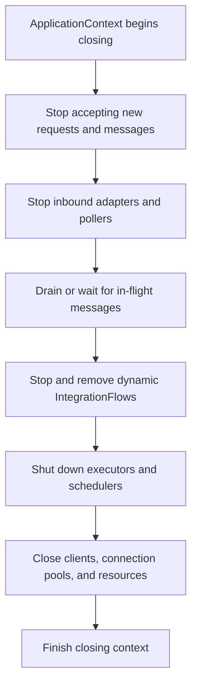

# Ensuring Cleanup of Executors, Schedulers, and Resources on Context Close

Spring Integration typically runs message flows over long periods. Endpoints may receive messages from adapters, pollers, or channels; executors run tasks on worker threads; schedulers trigger pollers and periodic jobs; and handlers may also use connection pools, HTTP clients, file handles, or external resources. When the application stops, all of these components need to terminate in a controlled sequence.

If you merely close the `ApplicationContext` while application-created threads remain unmanaged, the JVM can keep running even after the server stops accepting requests. Conversely, if executors or connection pools are closed too early, in-flight messages can fail mid-processing. Therefore, the goal of shutdown is **to stop accepting new work, give running work a chance to finish within a time budget, and only then release the resources they depend on**.

## 1. Resources that need management

A message flow can use many kinds of resources with different lifecycles:

| Component | Work Performed | Shutdown Concern |
|---|---|---|
| `MessageEndpoint`, consumer, adapter | Receives and routes messages into the flow | Stop endpoints so no new messages are accepted. |
| `TaskExecutor` / `ThreadPoolTaskExecutor` | Runs handlers on worker threads | Stop accepting new tasks and wait for running or queued tasks per policy. |
| `TaskScheduler` / `ThreadPoolTaskScheduler` | Triggers pollers and scheduled tasks | Stop new triggers, finish or cancel scheduled tasks. |
| `ExecutorChannel` | Hands off processing to an executor | Stop related producers/endpoints; executor is closed by its owner. |
| HTTP/JMS/Kafka clients and connection factories | Connect to external systems | Close connections, sessions, sockets, and background threads per client API. |
| `DataSource` / connection pool | Provides database connections | Close pool after handlers no longer need connections. |
| `MessageStore` | Holds messages or message groups | Close store resources if required by implementation; durable data is not automatically deleted on context close. |
| Self-scheduled tasks via `ScheduledFuture` | Runs work registered directly by the application | Cancel the schedule and release the scheduler if the application owns that scheduler. |

The key point is determining **who owns the resource**. If an executor is a shared Spring bean, the Spring container manages its lifecycle. An endpoint using that executor must not call `shutdown()` itself when the endpoint stops. If a service creates its own `ExecutorService` with `Executors.newFixedThreadPool(...)`, that service is responsible for closing the executor or turning it into a Spring-managed bean.

## 2. Sequence when ApplicationContext closes

When `ApplicationContext` closes, Spring coordinates bean lifecycles. Beans implementing `Lifecycle` or `SmartLifecycle` are instructed to stop; afterward, Spring destroys singletons and invokes callbacks such as `@PreDestroy`, `DisposableBean.destroy()`, or declared `destroyMethod`s.

Spring Integration integrates endpoints and message-receiving components into Spring's lifecycle mechanism. When the context stops, polling consumers, inbound endpoints, and endpoints managed by the Integration runtime are stopped by the lifecycle processor. Stopping endpoints prevents new messages from entering processing steps while dependencies are preparing to close.

A shutdown sequence can be designed as follows:



This is the operational target sequence. Actual order also depends on bean types, the dependency graph, and phases of `SmartLifecycle` components. Do not rely on `@Bean` method declaration order to infer shutdown order.

### Role of Lifecycle and SmartLifecycle

`Lifecycle` provides `start()` and `stop()`. `SmartLifecycle` adds `isAutoStartup()`, `getPhase()`, and the `stop(Runnable callback)` form so Spring can coordinate order as well as know when a component has finished stopping.

For `SmartLifecycle` beans, lower phases start earlier and higher phases start later. On shutdown, the order is reversed: higher phases stop earlier. This makes it possible to stop load-receiving components first while infrastructure components needed for in-flight work remain alive for a while. Beans that only have destroy callbacks are not ordered by phase in the same way; they are handled during the container's destroy phase.

`stop(Runnable callback)` must invoke the callback once the component has finished stopping. If stopping includes asynchronous draining, invoke the callback only after draining completes or after a timeout decision has concluded. Do not invoke the callback immediately and continue using resources in the background, because Spring may proceed to destroy dependencies while work is still running.

## 3. Let Spring manage executors as beans

Do not create anonymous thread pools inside a handler or flow configuration method and lose the reference. Declare the executor as a named bean with bounded size and explicit shutdown configuration.

```java
@Configuration
public class IntegrationTaskConfiguration {

    @Bean("integrationExecutor")
    public ThreadPoolTaskExecutor integrationExecutor() {
        ThreadPoolTaskExecutor executor = new ThreadPoolTaskExecutor();
        executor.setCorePoolSize(4);
        executor.setMaxPoolSize(12);
        executor.setQueueCapacity(200);
        executor.setThreadNamePrefix("si-worker-");
        executor.setWaitForTasksToCompleteOnShutdown(true);
        executor.setAwaitTerminationSeconds(30);
        return executor;
    }
}
```

`ThreadPoolTaskExecutor` is initialized and managed by Spring as a bean. The two shutdown settings have distinct meanings:

- `setWaitForTasksToCompleteOnShutdown(true)` instructs the executor to shut down in a way that allows already accepted tasks, including tasks waiting in the queue, to continue executing.
- `setAwaitTerminationSeconds(30)` sets the time limit to wait for the executor to terminate during destruction.

The wait limit does not cause a hung handler to finish automatically. If time expires while tasks are still running, the application should log and monitor that state; some threads may remain alive until the task exits on its own. Handlers should have I/O timeouts and never wait indefinitely.

`queueCapacity` is also part of the shutdown strategy. An overly large queue can stretch drain time far beyond the allowed stop window. An unbounded queue can hold an enormous amount of work and make application shutdown duration unpredictable. Choose queue capacity based on processing speed, peak load, and the shutdown window the system accepts.

In Spring Framework versions that support `setAcceptTasksAfterContextClose(false)`, this setting can be used to reject new tasks while the context is closing. Check the API of your Spring version before adding this setting to code shared across versions.

### Using an executor for ExecutorChannel

If a flow needs to shift processing onto worker threads, declare an `ExecutorChannel` using the executor bean:

```java
@Bean
public MessageChannel asyncOrdersChannel(
        @Qualifier("integrationExecutor") TaskExecutor executor) {
    return new ExecutorChannel(executor);
}
```

Flows can reference this channel by name. When the context closes, related endpoints and adapters are stopped via lifecycle; `integrationExecutor` is closed by Spring according to its own bean lifecycle.

Do not call `executor.shutdown()` inside a handler or in a single flow's stop callback if the executor is still used by other channels. A shared executor should only be closed by the owner of that bean, usually the ApplicationContext. If each flow has its own dedicated executor, the flow management service must retain a reference and close that specific executor when the flow is removed.

## 4. Managing schedulers and periodic tasks

Schedulers usually trigger pollers or time-based tasks. Declare `ThreadPoolTaskScheduler` as a bean so Spring can manage it alongside the context:

```java
@Bean("integrationScheduler")
public ThreadPoolTaskScheduler integrationScheduler() {
    ThreadPoolTaskScheduler scheduler = new ThreadPoolTaskScheduler();
    scheduler.setPoolSize(4);
    scheduler.setThreadNamePrefix("si-scheduler-");
    scheduler.setWaitForTasksToCompleteOnShutdown(true);
    scheduler.setAwaitTerminationSeconds(30);
    return scheduler;
}
```

Distinguish two types of work:

- **Scheduler trigger:** decides when a poller or task is triggered.
- **Executor worker:** executes message processing or tasks dispatched to another pool.

A configuration may use a scheduler to wake up pollers and a separate executor to process messages. Separating the two pools avoids long-running handlers starving the threads used to trigger other pollers. However, not every poller needs a dedicated executor; choose based on endpoint semantics and actual load.

When the context closes, the scheduler must stop creating new executions. For periodic jobs registered directly by the application, retain the `ScheduledFuture` so the schedule can be cancelled:

```java
@Component
public class HousekeepingJob {

    private final TaskScheduler scheduler;
    private ScheduledFuture<?> future;

    public HousekeepingJob(TaskScheduler scheduler) {
        this.scheduler = scheduler;
    }

    @PostConstruct
    public void start() {
        future = scheduler.scheduleAtFixedRate(
            this::runCleanup,
            Duration.ofMinutes(1)
        );
    }

    private void runCleanup() {
        // Periodic task with appropriate timeout and error handling.
    }

    @PreDestroy
    public void stop() {
        if (future != null) {
            future.cancel(false);
        }
    }
}
```

`cancel(false)` prevents future runs without requesting interruption of the currently running execution. With `cancel(true)`, the running thread may be interrupted; choose this only when the job and underlying I/O libraries handle interruption safely. In this example the scheduler is an injected dependency, so the component only cancels the schedule it registered rather than shutting down a shared scheduler.

For pollers managed by Spring Integration, prefer letting the endpoint/poller lifecycle stop the polling schedule. Do not create a second schedule to control the same poller unless the application has a specific need and takes responsibility for cancelling it.

## 5. Stopping dynamic IntegrationFlows

Flows registered via `IntegrationFlowContext` have their own runtime lifecycle. The flow management service should retain the registration ID or `IntegrationFlowRegistration` so the right flow can be removed.

```java
public void removeTenantFlow(String registrationId) {
    flowContext.remove(registrationId);
}
```

When removing a registration, Spring Integration stops and removes components belonging to that registration. However, if the flow is under load, the application still needs to decide how to handle running or pending messages. A safe procedure usually follows:

1. Mark the flow to stop accepting new requests or remove the tenant from the router.
2. Stop the associated message-emitting sources.
3. Wait for the in-flight message count to drop to 0 or until the drain period expires.
4. Remove the registration with `IntegrationFlowContext.remove(id)`.
5. Close flow-specific resources if the flow genuinely owns them.

Do not destroy a shared executor when removing a single registration. Also do not assume removing a flow preserves messages sitting in queues or guarantees every task already submitted to an executor completes. If messages must be preserved, a separate persistence/acknowledgment mechanism suited to the message source is required.

If dynamic flows need to be removed when the context closes, build a bean that manages them and performs cleanup during lifecycle shutdown. Avoid leaving registrations in a local map with no cleanup path; that easily leaves orphaned endpoints and threads when tenants are deleted or configurations are replaced.

## 6. Coordinating shutdown with SmartLifecycle

When an application needs to stop in a specific business sequence, you can create a coordinator implementing `SmartLifecycle`. The coordinator can stop accepting flow creation requests, instruct producers to stop, drain work, and remove dynamic flows before dependencies are destroyed.

The example below is a skeleton; `FlowDrainCoordinator` is an application component you implement using in-flight request counters or actual message state tracking:

```java
@Component
public class IntegrationShutdownCoordinator implements SmartLifecycle {

    private final FlowDrainCoordinator drainCoordinator;
    private volatile boolean running;

    public IntegrationShutdownCoordinator(
            FlowDrainCoordinator drainCoordinator) {
        this.drainCoordinator = drainCoordinator;
    }

    @Override
    public void start() {
        running = true;
    }

    @Override
    public void stop(Runnable callback) {
        try {
            drainCoordinator.stopAcceptingAndDrain(Duration.ofSeconds(20));
            drainCoordinator.removeDynamicFlows();
        }
        finally {
            running = false;
            callback.run();
        }
    }

    @Override
    public void stop() {
        stop(() -> { });
    }

    @Override
    public boolean isRunning() {
        return running;
    }

    @Override
    public boolean isAutoStartup() {
        return true;
    }

    @Override
    public int getPhase() {
        return 100;
    }
}
```

The phase value in the example is illustrative only. Choose the phase after checking the phases of inbound adapters, endpoints, and other lifecycle beans in your application. Higher phases stop before lower phases; the coordinator must properly stop components that depend on executors and resources, without closing a dependency before its consumers have stopped.

If `stop(Runnable)` performs asynchronous draining, invoke the callback only when draining ends. Also ensure the callback is always invoked in error branches so Spring does not wait indefinitely. A production implementation should have an explicit timeout, log remaining task counts, and define a policy when draining fails.

Do not perform an unbounded wait inside `stop()` or `@PreDestroy`. If shutdown is invoked from an executor's own worker thread and waits for that executor to finish, it can deadlock because the waiting thread is one of the threads that must exit.

## 7. Closing dependent clients and resources

Resources such as HTTP clients, connection pools, file watchers, or message broker clients also need an explicit lifecycle. If a library provides `close()`, declare a bean and let Spring invoke the destroy method:

```java
@Bean(destroyMethod = "close")
public PartnerClient partnerClient(PartnerClientFactory factory) {
    return factory.createClient();
}
```

When a handler injects `PartnerClient`, Spring knows the dependency relationship between the handler and the client. The dependent bean is destroyed before its dependency, giving the handler a chance to stop before the client closes. For shared resources, avoid calling `close()` manually from multiple consumers, as that can close connections while other consumers are still using them.

Several notes when closing resources:

- Set connect timeouts, read timeouts, and request timeouts for I/O so handlers do not hold threads indefinitely.
- Close producers/clients before closing the connection factory that the producers/clients use.
- Do not delete persistent data in a `MessageStore` just because the context closes. Closing a connection or store handle is different from deleting messages needed for recovery.
- For a Spring-managed `DataSource` or pool, let the pool-managing bean perform shutdown; do not close the connection pool inside individual message handlers.
- If a resource is created outside Spring, wrap it in a bean with a destroy callback or establish an explicit lifecycle owner.

## 8. Configuring graceful shutdown in Spring Boot

With Spring Boot, you can configure the wait duration per graceful shutdown phase:

```properties
spring.lifecycle.timeout-per-shutdown-phase=30s
```

For an embedded web server, enable graceful server shutdown using the setting appropriate for your Spring Boot version, for example:

```properties
server.shutdown=graceful
```

These two settings assist application shutdown, but do not replace shutdown settings on individual executors, schedulers, or clients. `timeout-per-shutdown-phase` sets the wait budget for a lifecycle phase; `awaitTerminationSeconds` on an executor sets how long to wait for the pool to terminate. Account for the total duration across phases and I/O timeouts so the shutdown budget is not exceeded.

For plain Spring Framework applications without Spring Boot, the application itself decides when to call `ConfigurableApplicationContext.close()` and can configure an appropriate lifecycle processor. Do not call `System.exit()` from a handler or endpoint to force the JVM to exit.

## 9. Common shutdown issues

| Symptom | Possible Cause | Resolution |
|---|---|---|
| JVM does not exit after context closes | Manually created thread pool was not shut down; scheduler still has periodic tasks | Make executors/schedulers beans or add a lifecycle owner; cancel `ScheduledFuture`. |
| In-flight messages fail during shutdown | Executor or client closed before handlers finished | Stop ingress, drain tasks, and only then close dependencies. |
| Removing one flow stops another flow | Two flows share an executor, and one flow shuts it down itself | Let the ApplicationContext own the shared executor. |
| Shutdown takes too long | Large queue, handler waiting indefinitely on I/O, or drain lacks timeout | Bound queues, set I/O timeouts, and bound drain timeouts. |
| Messages in queue disappear from processing | Non-durable in-memory channel or messages acked before error persistence | Use persistence/ack aligned with message durability requirements. |
| New tasks still submitted while context is closing | Producers not blocked or executor still accepting tasks | Stop ingress, close task intake, and handle `RejectedExecutionException`. |
| `RejectedExecutionException` appears during stop | Producers and executor stop in wrong order or pool already shut down | Coordinate phases and handle shutdown state in producers. |
| Client closes while handlers still use it | Dependency closed early or resource closed manually in multiple places | Use dependency injection and let the container coordinate destruction. |

## 10. Verifying shutdown truly completed

Do not rely solely on the `ApplicationContext closed` log line. Verify that threads and resources have actually terminated:

1. Produce a message whose handler runs for a deterministic duration.
2. Begin closing the context while the handler is executing.
3. Verify ingress stops accepting new messages.
4. Verify running tasks finish within budget or are handled per the configured timeout.
5. Verify the scheduler does not fire new cycles after stopping.
6. Verify connection pools/clients close after handlers are no longer using them.
7. Verify threads with prefixes such as `si-worker-` and `si-scheduler-` are no longer alive once shutdown finishes.

For example, in an integration test, use `AnnotationConfigApplicationContext` or an equivalent test context and call `close()` in teardown. Use `CountDownLatch` to control when the handler starts/finishes instead of fixed `Thread.sleep()` calls. If verifying thread termination, wait with a bounded timeout and fail clearly if it times out.

Test both normal shutdown and cases where handlers throw exceptions. A sound flow should retain the ability to close the context even if an error handler, poller, or client encounters an error during shutdown.

## 11. Design principles

- Declare critical executors, schedulers, and clients as Spring beans with explicit lifecycles.
- Stop producers, inbound adapters, and pollers before closing executors or resources required by handlers.
- Use bounded queues and I/O timeouts so drain duration is predictable.
- Only the owner shuts down an executor, scheduler, or client; shared consumers never close dependencies themselves.
- Cancel self-registered schedules and remove dynamic flows when no longer needed.
- Distinguish closing a resource from deleting persistent data in a message store.
- Use `SmartLifecycle` when stop ordering needs coordination; always invoke callbacks after truly completing or after deciding to finish on timeout.
- Test threads, running tasks, queues, and connections after `ApplicationContext.close()`.

When lifecycles are clearly designed, Spring Integration can stop message flows in an orderly manner: message-receiving sources stop first, running work is handled within the shutdown budget, executors and schedulers terminate next, and underlying resources are closed last. This prevents orphaned threads, interrupted messages, and dependencies being closed while still in use.
