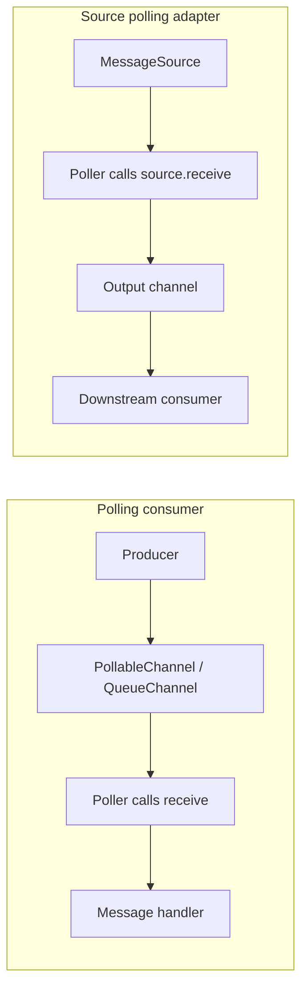
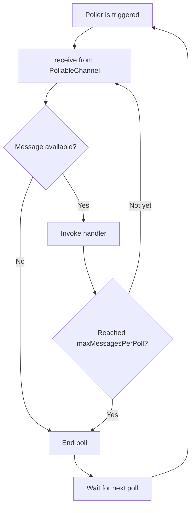

# Polling Consumers Reading Messages from a PollableChannel

In Spring Integration, a consumer can receive messages in two primary ways: having the channel push messages to it when a new message arrives, or actively pulling messages from a channel capable of storing and returning messages. The second approach is a polling consumer. It is commonly used with `QueueChannel` or another `PollableChannel` implementation when the producer and consumer need to decouple the time of sending from the time of processing.

A polling consumer does not continuously burn CPU polling the channel in a hand-written loop. Spring Integration uses a poller to schedule message-receiving attempts, limit how many messages are fetched in a single poll, and invoke the handler when data is available. Poller configuration directly affects latency, throughput, thread usage, transactions, and how errors are handled.

## 1. What Is a PollableChannel?

`PollableChannel` is a channel contract that allows a consumer to actively call `receive()` to retrieve a message. In addition to the no-argument `receive()`, the contract also provides a receive method with a timeout so the consumer can wait for a message for a specified duration.

Unlike `SubscribableChannel`, where the consumer registers a subscriber and the channel invokes the subscriber when a message is sent, `PollableChannel` holds messages for the consumer to pull later. `QueueChannel` is a common implementation of `PollableChannel`.

| Channel Type | How Consumers Receive Messages | Characteristics |
|---|---|---|
| `DirectChannel` | Subscriber is invoked during the send operation | Synchronous dispatch, not a channel for a polling consumer to call `receive()` |
| `ExecutorChannel` | Subscriber is dispatched via an executor | Offloads processing to an executor, not a queue for consumer polling |
| `QueueChannel` | Consumer calls `receive()` to retrieve messages | Buffered; producer and consumer can operate at different times |
| `PriorityChannel` | Consumer calls `receive()` in priority order | Messages are retrieved by priority instead of strictly FIFO |
| `RendezvousChannel` | Producer and consumer meet at the send/receive operation | Synchronous handoff; the producer may have to wait for the consumer to receive |

The concrete channel decides how messages are stored, ordered, or handed off. The poller decides when the consumer calls `receive()`. These two responsibilities are separate.

## 2. Polling Consumers Differ from SourcePollingChannelAdapter

Both components use a poller, but they start from two different contracts:

| Component | Data Source | How It Works |
|---|---|---|
| Polling consumer | A `PollableChannel` | Calls `receive()` on the channel and then passes the received message to a handler |
| `SourcePollingChannelAdapter` | A `MessageSource<?>` | Calls `receive()` on the source; if a message is returned, sends it to the output channel |

A polling consumer is used when a producer has already sent a message to a channel—for example, one service sends to a `QueueChannel` and another endpoint pulls messages for processing. A source polling adapter is used when the runtime must query a data source to produce messages—for example, reading files, querying a database table, or calling a pull source.



Do not confuse `MessageSource` with `PollableChannel`. A source creates or retrieves messages from a data source; a channel transports and can buffer messages between producers and consumers.

## 3. QueueChannel as a Buffer Between Producer and Consumer

A `QueueChannel` allows a producer to send messages without requiring the consumer to process them immediately at send time. Example:

```java
@Configuration
class OrderChannelConfiguration {

    @Bean
    PollableChannel ordersQueue() {
        return new QueueChannel(500);
    }
}
```

Here, the queue has a configured capacity of 500 messages. A producer can send messages to the channel via `MessagingTemplate` or a gateway:

```java
@Component
class OrderPublisher {

    private final MessageChannel ordersQueue;

    OrderPublisher(@Qualifier("ordersQueue") MessageChannel ordersQueue) {
        this.ordersQueue = ordersQueue;
    }

    void publish(Order order) {
        Message<Order> message = MessageBuilder
                .withPayload(order)
                .setHeader("tenantId", order.tenantId())
                .build();
        ordersQueue.send(message);
    }
}
```

`QueueChannel` implements `MessageChannel` and `PollableChannel`, so it can be injected under the type appropriate for where it is used. If you need to send with a timeout, use the corresponding send API and handle the case where sending fails because the queue is full or the wait times out.

Capacity is part of the backpressure policy. An unbounded queue can accumulate messages and increase memory usage when the producer is consistently faster than the consumer. A bounded queue creates a clear blocking point, though the producer must have a strategy when sends fail or block.

By default, `QueueChannel` stores messages in memory unless a persistent store is configured. Messages in an in-memory queue can be lost if the process stops abruptly. If recovery after a restart is required, consider a persistent message store or a broker with appropriate persistence and acknowledgements; an in-memory queue should not be treated as a durable queue.

## 4. Configuring a Polling Consumer with Annotations

An endpoint receiving from a `PollableChannel` needs a poller for the runtime to invoke message retrieval. You can configure the endpoint using `@ServiceActivator` and `@Poller`:

```java
@Component
class OrderConsumer {

    private final OrderService orderService;

    OrderConsumer(OrderService orderService) {
        this.orderService = orderService;
    }

    @ServiceActivator(inputChannel = "ordersQueue")
    @Poller(fixedDelay = "500", maxMessagesPerPoll = "10")
    public void handle(Order order) {
        orderService.process(order);
    }
}
```

The endpoint above actively pulls messages from `ordersQueue` on a schedule. For each message, the payload is resolved to the `Order` parameter, and then `handle` is invoked. If the endpoint also needs to read headers or inspect metadata, it can accept `Message<Order>` or declare additional `@Header` parameters.

This example assumes the `ordersQueue` channel has already been declared as a `PollableChannel`, as configured in the previous section. If the input channel is a `DirectChannel` or `ExecutorChannel`, the standard consumption model is registering a subscriber; do not attach a polling consumer to a channel that does not support `receive()`.

## 5. The Poller Controls the Message-Receiving Cadence

A poller is the schedule and policy configuration for a polling endpoint. Common attributes to pay attention to include:

| Attribute | Meaning | Impact |
|---|---|---|
| `fixedDelay` | Wait interval after one execution completes before scheduling the next | Poll cadence depends on actual processing time |
| `fixedRate` | Periodic rate at which executions start | Needs attention when one poll runs close to or exceeds the period |
| `cron` | Execution schedule defined by a cron expression | Suitable for hourly/daily business schedules |
| `maxMessagesPerPoll` | Maximum number of messages the consumer fetches in a single poll | Balances throughput against scheduler/thread occupancy time |
| `receiveTimeout` | How long a single receive call can wait for a message | Affects how long the poller blocks when the channel is empty |
| `taskExecutor` | Executor used to run the polling task as configured | Changes the execution thread and how polls contend for resources |

`fixedDelay` is usually more predictable when processing time varies: the delay is measured after the execution finishes. `fixedRate` aims for a steadier start cadence; if the previous execution has not finished, actual behavior also depends on the scheduler and executor. For polling tasks that may run long, avoid configurations that cause executions to overlap unintentionally.

`maxMessagesPerPoll` limits how many messages are retrieved in one poll. A small value helps the poller yield time to other work and reduces how long a single poll holds a thread; a large value can increase throughput, but also lengthens each poll and makes other tasks wait longer. Choose it based on producer rate, handler duration, and downstream system capacity.

`receiveTimeout` controls the wait time inside the receive operation. If the timeout is too long, a poller can hold a thread while the queue is empty. If the timeout is zero or very short, the consumer does not wait for a message and will retry on schedule at the next poll. Consider the timeout together with the fixed delay to avoid introducing unwanted latency.

## 6. Pollers with Java DSL

When using Java DSL, the poller is typically attached to the endpoint consuming the channel. The exact configuration depends on where the endpoint is created in the flow; the example below shows a service activator with a poller:

```java
@Bean
IntegrationFlow ordersPollingFlow(OrderService orderService) {
    return IntegrationFlow
            .from("ordersQueue")
            .handle(orderService, "process", endpoint -> endpoint
                    .poller(Pollers.fixedDelay(500)
                            .maxMessagesPerPoll(10)))
            .get();
}
```

In a real flow, verify that the endpoint is configured as a polling consumer and that the input channel resolves to a `PollableChannel`. If the flow starts from a channel with subscription semantics, do not assume that merely adding `.poller(...)` to an arbitrary endpoint will turn that channel into a queue.

In annotation-based applications, `@Poller` expresses the configuration right at the endpoint. In Java DSL, configuring the poller on the endpoint makes it clear where the consumer receives messages and what its polling policy is.

## 7. How Does a Single Poll Happen?

At a high level, a polling consumer performs these steps:

1. The scheduler triggers the polling task according to the configured trigger.
2. The polling consumer asks the input channel to return a message via a `receive` operation.
3. If a message is returned, the endpoint invokes the handler with that message.
4. The consumer continues receiving messages until `maxMessagesPerPoll` is reached or no more messages are available per the timeout/receive policy.
5. The polling task finishes; the scheduler schedules the next execution.



If the channel has no message, the handler is not invoked for that receive attempt. If the handler processes slowly, processing time contributes to the poll duration and affects when the next poll runs depending on the trigger. Thus, a poller is not just a timer; it also defines the batch size, wait time, and execution boundary of the consumer.

## 8. Threading and Executors

A polling endpoint needs a scheduler to trigger tasks. If no separate executor is configured for the poller, receiving and invoking the handler normally run on the thread executing the polling task. When an executor is configured, tasks can run on the designated thread pool; this changes parallelism and how resources are utilized.

Several points to control:

- Do not let handlers block for too long on a scheduler thread shared across multiple pollers.
- Size the pool adequately for the number of polling tasks that truly need to run concurrently.
- Avoid allowing multiple polls of the same endpoint to overlap if the handler is not thread-safe.
- Measure queue backlog, wait time, handler duration, and busy thread count.
- Determine whether the executor is owned by the endpoint or shared from the application context so it is shut down in the right place.

Increasing the number of threads does not automatically increase throughput. If the target system is rate-limiting or the database connection pool is exhausted, adding consumers can increase contention and retries. Concurrency tuning must be based on downstream capacity and handler semantics.

## 9. Transactions and Reliability When Pulling Messages

A poller can be configured with an advice chain, including transaction advice if an appropriate transaction manager is present. The transaction boundary must be designed around the resources that actually participate, such as a database or a transaction-capable message store.

Several questions to answer before enabling transactions:

- Does the transaction cover the message receive operation, the handler invocation, or both?
- Does the channel implementation participate in transactions, or does it only store messages in memory?
- If the handler throws an exception, is the message restored, redelivered, or already removed from the queue?
- Which database or messaging resource does the transaction manager manage?
- Is there an asynchronous boundary or executor causing downstream processing to run on a different thread?

With a standard in-memory `QueueChannel`, `receive()` removes the message from the queue. Do not assume that a database transaction will automatically put the message back into the queue when the handler fails. Rollback or recovery capability depends on the specific channel implementation, message store, and transaction integration.

If messages come from a broker, acknowledgement, redelivery, and transactions are usually controlled by the broker's adapter/container. If messages are held in a persistent store, verify the store's transaction support. Designing an idempotent consumer remains important because retries or redeliveries can cause the same business action to be executed again.

## 10. Error Handling in Polling Consumers

Errors can occur when receiving a message, converting parameters, or invoking the handler. A polling endpoint can use an error channel, advice chain, retry, or recovery flow depending on configuration. Determine whether errors are handled within the polling task or routed as an `ErrorMessage` to another endpoint.

| Error | Symptom | Resolution Direction |
|---|---|---|
| Handler throws an exception | Message is not processed successfully; the poll may terminate according to configured error handling | Inspect the root exception, error channel, and retry advice |
| Payload has unexpected type | Parameter resolution or conversion error | Verify runtime payload and handler contract |
| Queue full | Producer cannot send or must wait depending on timeout | Adjust capacity, producer/consumer rates, and send policy |
| Handler too slow | Backlog grows and latency increases | Measure processing time, review batch size and concurrency |
| Continuously repeating errors | Retries increase load or the same message repeatedly fails | Classify errors, bound retries, and route poison messages to a recovery flow |

Do not catch every exception inside the handler and ignore it. If errors are swallowed, the runtime cannot apply retries or error handling as the flow expects, and the message may be treated as successfully processed even though the business work did not complete.

For messages that cannot be processed due to invalid data, establish a poison message policy: record the cause, store or route the message to an appropriate error flow/dead-letter destination, and allow the consumer to continue with other messages according to the chosen semantics.

## 11. Capacity, Backpressure, and Throughput

A queue channel creates a buffer between producer and consumer. If the average send rate exceeds the average processing rate over an extended period, the backlog will grow until the queue is full or memory resources are exhausted.

A useful operational model is to monitor:

- `queue depth`: number of waiting messages.
- `arrival rate`: number of messages sent by producers per second.
- `consumption rate`: number of messages processed by consumers per second.
- `processing latency`: time from send until the handler completes.
- `poll duration`: time taken by one poll to process its batch.
- `send wait/failure`: producer wait time and number of failed sends.

When queue depth grows continuously, look for the root cause in the handler, downstream dependencies, poller schedule, or concurrency limits. Increasing capacity only buys additional buffer time; it does not fix a sustained throughput mismatch. For traffic bursts, an appropriately sized queue absorbs spikes; for sustained overload beyond capacity, throttle producers, scale processing capacity in a controlled way, or move to a broker with appropriate storage and consumer management.

## 12. Lifecycle of a Polling Consumer

A polling consumer is an endpoint managed by the Spring lifecycle. When the endpoint is started, the poller can begin triggering message receives. When the endpoint stops, new polls are halted according to endpoint semantics; an in-flight poll may need time to finish or be handled per shutdown policy.

As long as the `QueueChannel` remains in the context, unreceived messages can stay in the queue and be picked up when the consumer restarts. This only holds while the queue and process remain alive; an in-memory queue does not guarantee messages survive a JVM restart.

When the context closes, stop the polling endpoint, scheduler, and executor in the proper order. If a handler is currently processing, determine whether to wait for completion or enforce a timeout. For durable sources, verify acknowledgement/redelivery; for in-memory queues, consider how to handle the backlog before shutting down the process.

## 13. Diagnosing a Polling Consumer

When messages sit in the queue without being processed, check in this order:

1. Is the input channel actually a `PollableChannel`?
2. Has the polling endpoint been created and is `isRunning()` true?
3. Does the poller have a valid trigger and is the scheduler still active?
4. Do `maxMessagesPerPoll` and `receiveTimeout` produce the intended receiving cadence?
5. Is the handler blocking, throwing exceptions, or stuck in continuous retries?
6. Are errors recorded in the error channel, advice chain, and logs?
7. Are queue capacity, send timeout, and producer rate filling up the queue?
8. Has the executor or scheduler run out of threads or rejected tasks?

| Symptom | Check First |
|---|---|
| Queue depth grows but no messages are processed | Endpoint state, poller schedule, channel type |
| Messages are processed slowly in batches | `fixedDelay`, `maxMessagesPerPoll`, handler duration |
| Producer blocks when sending | Queue capacity, send timeout, and consumer throughput |
| CPU rises when the queue is empty | Poll interval, receive timeout, and scheduler configuration |
| Messages disappear after handler errors | Receive semantics, transaction/store support, and recovery strategy |
| Errors occur only when concurrency increases | Handler thread safety, downstream pools, and shared state |

Metrics and logs should include a correlation ID or message ID to link send, receive, processing, and error events. If Spring Integration Management/Actuator is available, use metrics and the Integration graph appropriate for your version to inspect endpoints and topology. Reconcile messages sent, messages processed successfully, and messages entering error flows to locate where messages are being dropped.

## 14. Configuration Principles

- **Use PollableChannel when buffering and pull consumption are needed:** `QueueChannel` is a common choice for an in-memory queue.
- **Attach the poller to the right polling endpoint:** do not use a poller to turn a `DirectChannel` into a queue.
- **Distinguish polling consumers from source polling adapters:** one reads from a channel, the other reads from a `MessageSource`.
- **Choose batch size and schedule deliberately:** balance `fixedDelay`/`fixedRate`, `maxMessagesPerPoll`, and handler duration.
- **Set explicit capacity and timeouts:** define whether the producer blocks, times out, or handles full-queue rejections.
- **Design error handling and transactions around channel semantics:** do not assume every channel rolls back or redelivers messages.
- **Manage threads and lifecycle:** size the scheduler/executor, avoid blocking shared threads in handlers, and stop endpoints orderly.
- **Monitor backlog and throughput:** capacity only absorbs bursts; address the root cause if backlog grows continuously.

Before deploying a polling consumer, determine whether the channel supports `receive()`, when the poller will run, how many messages it pulls per poll, which thread the handler runs on, and what happens when processing fails. These decisions form the consumer's operational contract and keep the flow predictable under increased load or system failures.
