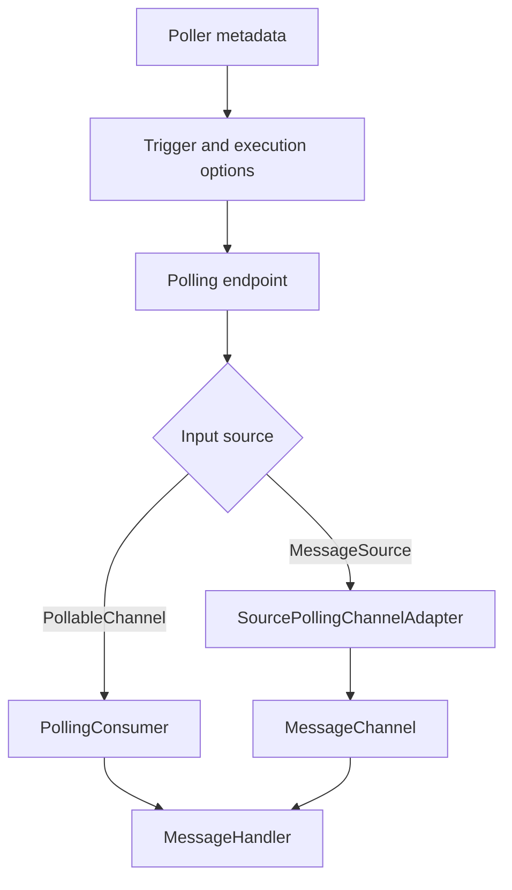
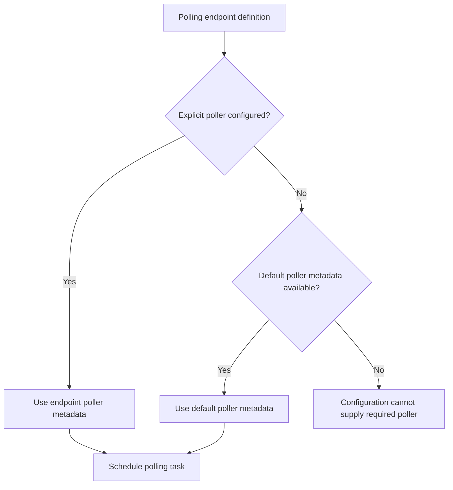

# PollerMetadata and DefaultPollerMetadata

In Spring Integration, a poller decides when an endpoint retrieves messages and how many messages a single poll processes. Settings such as the trigger, message limit, timeout, executor, transactions, and advice are grouped into **poller metadata**. `PollerMetadata` represents that configuration; **DefaultPollerMetadata** is the default configuration used as a fallback for endpoints that require polling but do not declare their own poller.

These two concepts help standardize how polling endpoints behave across an application. If the default poller configuration is too broad or ill-suited, many endpoints may end up inheriting an interval, batch size, or timeout that does not match their data source characteristics. Conversely, when you understand the metadata and its scope, you can establish a shared baseline policy and deliberately override it on individual endpoints.

## 1. Where Does the Poller Fit in the Consumer Runtime?

A poller is the mechanism that triggers a message-receiving task on a schedule. It typically appears in two places:

- **PollingConsumer** retrieves messages from a `PollableChannel`, such as a `QueueChannel`.
- **SourcePollingChannelAdapter** queries a `MessageSource` on a schedule and sends the retrieved message into a flow.

A poller is not a channel, message source, or handler. It describes how a polling task is scheduled and executed. The channel or source provides messages; the endpoint delivers messages to the handler.



An event-driven endpoint subscribes to a `SubscribableChannel` and is invoked when a message arrives. It does not need a poller. Therefore, do not apply a default poller indiscriminately to every endpoint in a flow; metadata is only relevant to endpoints that use a polling mechanism.

## 2. What Is PollerMetadata?

`PollerMetadata` is the configuration object describing how a poller behaves. The endpoint uses the metadata to create a polling task and wire that task to a scheduler, an executor, and additional behaviors.

Common configuration groups:

| Configuration Group | Operational Role |
|---|---|
| Trigger | Defines when polling occurs, such as fixed delay, fixed rate, or cron |
| `maxMessagesPerPoll` | Limits how many messages are processed in one poll |
| `receiveTimeout` | Wait duration when receiving a message from a pollable channel |
| `taskExecutor` | Executor that runs the polling task when configured |
| Advice chain | Wraps the polling task with retry, transaction, or additional behavior |
| Transaction settings | Defines the transaction manager and transaction definition for the poll |
| Error handling | Defines how errors occurring in the polling task are handled |
| Send timeout | Limits how long sending messages in related steps can wait, depending on configuration |

Exact property names and builder APIs may vary across Spring Integration versions. When configuring with Java DSL, `Pollers` is typically used to build metadata instead of initializing internal fields manually.

Crucially, `PollerMetadata` is purely **configuration**. It does not run a thread on its own, does not store messages, and is not a queue. The scheduler uses the trigger to schedule execution; the endpoint performs the receive operation; the handler processes the message.

## 3. DefaultPollerMetadata and the Default Poller

Within an application context, Spring Integration can provide default metadata for endpoints that need polling without specifying a dedicated poller. The default configuration is typically registered under the bean name:

```java
PollerMetadata.DEFAULT_POLLER_METADATA_BEAN_NAME
```

This constant provides a stable reference to the default poller bean name. In configuration examples, the bean is often referred to as `defaultPoller`. `DefaultPollerMetadata` refers to the default/fallback metadata role in poller configuration; the configuration point an application typically interacts with is a `PollerMetadata` bean under that standard name. This metadata is neither an independent scheduler nor a message-consuming endpoint.

Default metadata serves to supply a shared policy for polling endpoints that lack their own configuration. An endpoint with an explicitly declared poller uses its own configuration. Event-driven endpoints do not need a poller and are therefore unaffected by the default poller.

The configuration selection rule can be visualized as:



In an application, do not assume every endpoint shares the same default without checking the configuration and framework version. When explicit behavior is needed, declare the default poller bean under the standard name or configure the poller directly on the endpoint.

## 4. Declaring a Shared Default Poller

You can provide a `PollerMetadata` bean under the default name. Example:

```java
@Configuration
@EnableIntegration
public class PollerConfiguration {

    @Bean(name = PollerMetadata.DEFAULT_POLLER_METADATA_BEAN_NAME)
    public PollerMetadata defaultPollerMetadata() {
        return Pollers.fixedDelay(Duration.ofSeconds(1))
                .maxMessagesPerPoll(10)
                .get();
    }

}
```

This configuration describes a poller using a one-second fixed delay and a maximum of 10 messages per poll. The bean is named using the `PollerMetadata` constant, so endpoints needing a default poller can reference this shared configuration.

Key points to note:

- `@Bean` registers the metadata in the `ApplicationContext`.
- The bean name must match the default poller name that Spring Integration looks up.
- `Pollers.fixedDelay(...)` creates a trigger configuration based on a delay interval.
- `maxMessagesPerPoll(10)` caps the number of messages per poll.
- `.get()` retrieves the metadata object from the builder.

If you want to change the global policy, modifying this bean affects every endpoint using the default. Therefore, think carefully before setting a large batch size or a very short interval application-wide.

## 5. Declaring a Dedicated Poller for an Endpoint

When an endpoint has specific requirements for latency, throughput, or data source constraints, configure a poller directly on that endpoint. Example:

```java
@Bean
IntegrationFlow ordersPollingFlow(OrderService orderService) {
    return IntegrationFlow.from("ordersQueue",
                    endpoint -> endpoint.poller(
                            Pollers.fixedDelay(Duration.ofMillis(250))
                                    .maxMessagesPerPoll(5)))
            .handle(orderService, "process")
            .get();
}
```

Here, the polling endpoint uses a 250 ms interval and at most 5 messages per poll. This dedicated configuration gives the order flow a polling cadence suited to its requirements without altering the default policy for other endpoints.

Another example is a data source that only permits periodic queries:

```java
@Bean
IntegrationFlow externalOrderSource(
        MessageSource<Order> orderSource,
        OrderService orderService) {

    return IntegrationFlow.from(orderSource,
                    endpoint -> endpoint.poller(
                            Pollers.fixedDelay(Duration.ofSeconds(5))
                                    .maxMessagesPerPoll(50)))
            .handle(orderService, "process")
            .get();
}
```

The external source is queried after each delay interval and can return up to the configured number of messages per poll. The batch value should reflect source capacity, API limits, processing duration, and how much data may accumulate.

## 6. Precedence Between Dedicated Pollers and the Default Poller

Design rules to keep in mind:

1. If an endpoint has a dedicated poller, its own configuration governs that endpoint's polling behavior.
2. An endpoint that needs polling without its own declaration can use the default poller if the context provides the corresponding fallback configuration.
3. Event-driven endpoints do not use pollers.
4. If an endpoint requires polling without valid metadata, configuration must be added or the application must provide a default poller according to the framework's mechanism.

Do not use the default poller as a way to force all endpoints onto the same cadence. For instance, a file-reading endpoint may need large batches; an endpoint calling a quota-limited API may need a long interval; an endpoint reading an internal queue may need low latency. Shared configuration should only serve as a safe baseline, while flows with distinct characteristics should declare their own explicitly.

## 7. Triggers: fixedDelay, fixedRate, and cron

The trigger determines when the poller fires.

| Trigger | How It Works | Suitable When |
|---|---|---|
| `fixedDelay` | The next poll is scheduled after the previous one completes and the delay elapses | You want a rest interval after processing |
| `fixedRate` | Fires on a fixed time cadence | You want to adhere to a steady schedule |
| `cron` | Fires according to a cron expression | Business hours or specific days apply |

### fixedDelay

`fixedDelay` measures the pause after the previous poll completes. If a poll takes 800 ms and the delay is 200 ms, the next poll is typically scheduled about 200 ms after the previous one finishes. This is an easy-to-control choice when you do not want polls running back-to-back.

### fixedRate

`fixedRate` schedules on a fixed time interval. If processing takes longer than the period, how the scheduler and executor handle the next task depends on configuration. Do not assume all polls run concurrently; inspect the actual thread pool and scheduling mechanism.

### cron

`cron` is suited for schedules such as the start of every minute, 2 a.m., or business days. When using cron, pay attention to time zones and how the expression is evaluated in the deployment environment.

Choosing a trigger must account for both processing time and source capacity. Polling too frequently increases empty checks; polling too infrequently increases latency and backlog.

## 8. maxMessagesPerPoll: Limiting Messages per Poll

`maxMessagesPerPoll` controls how many messages a poller handles in one poll. A finite value bounds the duration of a single poll and gives the scheduler opportunities to serve other endpoints.

With a pollable channel, a single poll can repeatedly fetch messages until reaching the limit or until no messages remain. Some configurations allow a negative value to keep fetching until the source returns empty; verify the exact meaning for your Spring Integration version and endpoint. With a source that always returns messages, an unbounded limit can cause a single poll to run for a very long time.

| Batch Size | Common Impact |
|---|---|
| Small | Short polls, predictable latency, higher scheduling overhead |
| Moderate | Balances throughput and resource hold duration |
| Large | Higher throughput in some scenarios, but longer transactions and poll runs |
| Unbounded | Risks monopolizing the polling task for too long if the source always has data |

Do not increase batch size based solely on instantaneous throughput. Measure latency, queue depth, handler duration, and downstream utilization to see whether large batches unbalance the system.

## 9. receiveTimeout and Its Impact on Polling

With `PollingConsumer`, the poller retrieves messages via `receive()` on `PollableChannel`. `receiveTimeout` controls how long it waits when the queue does not yet have a message.

For example, if the queue is empty and the timeout is 100 ms, the consumer can wait up to that duration before ending the receive call. If the timeout is long, a worker may be held while waiting; if the timeout is short, the task quickly returns to the scheduler and generates many empty polls.

Distinguish between:

- **Trigger interval**: when the polling task is triggered.
- **Receive timeout**: how long a single receive call waits at most.
- **Handler duration**: how long it takes to process a message after receiving it.
- **Poll duration**: total duration of one poll, potentially spanning multiple receives and handler invocations.

These quantities combine to produce actual latency and throughput. Tuning only the trigger without measuring receive timeout or handler duration rarely resolves a backlog.

## 10. Executors and Schedulers in PollerMetadata

A poller requires a scheduler to schedule tasks. When an executor is also configured, polling tasks can execute on worker threads managed by that executor. The scheduler and executor have distinct roles:

- The scheduler decides when to trigger.
- The executor provides threads to run the task.
- The poller endpoint calls receive and dispatches messages to the handler.
- The handler executes business logic.

An executor shared across multiple pollers can become a bottleneck. If one handler blocks for a long time, a worker thread is occupied; other tasks may have to wait in the executor queue. Bound threads and queue sizes, and monitor active threads, queue size, and rejected tasks.

Example configuring a dedicated executor for a poller:

```java
@Bean
ThreadPoolTaskExecutor ordersPollExecutor() {
    ThreadPoolTaskExecutor executor = new ThreadPoolTaskExecutor();
    executor.setCorePoolSize(2);
    executor.setMaxPoolSize(4);
    executor.setQueueCapacity(100);
    executor.setThreadNamePrefix("orders-poll-");
    return executor;
}

@Bean
IntegrationFlow ordersWithExecutor(
        OrderService orderService,
        ThreadPoolTaskExecutor ordersPollExecutor) {

    return IntegrationFlow.from("ordersQueue",
                    endpoint -> endpoint.poller(
                            Pollers.fixedDelay(Duration.ofSeconds(1))
                                    .maxMessagesPerPoll(10)
                                    .taskExecutor(ordersPollExecutor)))
            .handle(orderService, "process")
            .get();
}
```

This is an illustrative configuration example. In real applications, declare the executor as a lifecycle-managed bean and let Spring handle shutdown. If the executor is shared, do not close it inside the cleanup of a single flow.

## 11. Advice Chains, Transactions, and Retries

Poller metadata can carry an advice chain to apply cross-cutting behavior to the polling task. Common advices include transaction advice and retry advice.

### Transactions

A transaction can wrap a polling task depending on configuration. With a pollable channel, clarify which transaction covers the receive operation and the handler. With source polling, check whether the source supports transactions or checkpoint/ack semantics.

Example configuring a transactional poller with the builder:

```java
@Bean
IntegrationFlow transactionalOrders(
        MessageSource<Order> orderSource,
        OrderService orderService,
        PlatformTransactionManager transactionManager) {

    return IntegrationFlow.from(orderSource,
                    endpoint -> endpoint.poller(
                            Pollers.fixedDelay(Duration.ofSeconds(2))
                                    .maxMessagesPerPoll(10)
                                    .transactional(transactionManager)))
            .handle(orderService, "process")
            .get();
}
```

The transaction manager must match the resources being protected. A database transaction does not automatically give an external message source rollback capability. If the source has already marked a message as read, rolling back the database does not necessarily cause the source to redeliver the message.

### Retries

Retries fit transient errors such as timeouts or brief downstream outages. Configure maximum attempts, backoff intervals, and retryable exception types. Do not infinitely retry data errors or configuration errors.

When a handler has side effects, retries can re-run operations that partially succeeded. Use idempotency keys, unique constraints, or deduplication to prevent duplicate business data. Once retries are exhausted, an error channel or dead-letter flow should accept the failure per policy.

## 12. Error Handling and Poller Observability

Errors in a polling task do not necessarily return to the original producer. The endpoint can convert the error into an error message or use an error handler per configuration. Retain the information needed to identify which poller and which message encountered the error:

- Component name or endpoint ID.
- Message ID and correlation ID.
- Trigger and poll timestamp.
- Number of messages processed in the poll.
- Root exception and failed message.
- Retry attempt count and final status.

Operational metrics to monitor:

| Metric | Question to Answer |
|---|---|
| Poll execution count | Is the poller being triggered consistently? |
| Poll duration | How long does each poll take? |
| Messages per poll | How many messages does each poll actually process? |
| Empty poll count | Are there too many empty polls? |
| Receive wait time | How long does the consumer wait on the queue? |
| Queue depth | Are messages accumulating? |
| Handler duration | Is business logic slow? |
| Executor active/queue | Is the thread pool congested? |
| Error/retry count | Are errors transient or persistent? |

If the poller is not running, check endpoint lifecycle, trigger, scheduler, and `ApplicationContext` state. If the poller runs but the queue does not drain, check receive, handler, batch size, and executor. If messages are processed but callers do not see errors, check the error channel and worker thread logs.

## 13. Common Configuration Mistakes

| Symptom | Possible Cause | Resolution |
|---|---|---|
| Pollable endpoint does not run | Missing dedicated poller and no suitable default poller | Declare an explicit poller or configure the default bean |
| Many endpoints poll too frequently | Default fixed delay is too short | Pick a safe default, override specialized endpoints |
| Queue grows continuously | Small batch size or slow handler | Measure throughput then adjust batch size/concurrency |
| A single poll runs very long | Unbounded batch or source always has data | Set a finite `maxMessagesPerPoll` |
| Worker thread held too long | Large `receiveTimeout` or blocking handler | Adjust timeout, executor, and I/O |
| Long-running transactions | Large batch or handler holds resources long | Reduce batch size or split transactions |
| Poller ignores new configuration | Endpoint already has a dedicated poller | Check precedence between endpoint metadata and default metadata |
| Flows interfere with each other | Shared executor or scheduler is too small | Partition pools and monitor queues |
| Unhandled errors | Missing appropriate error handler/error flow | Configure error channel and log context |

Another common mistake is using the default poller as a quick fix for one endpoint without evaluating its impact on the remaining endpoints. When changing the default, inspect every endpoint relying on that configuration, especially external sources with quotas or differing processing-time requirements.

## 14. Process for Selecting and Reviewing PollerMetadata

When designing a new poller, follow this sequence:

1. Identify whether the endpoint is a `PollingConsumer` or a `SourcePollingChannelAdapter`.
2. Identify whether the source is a `PollableChannel` or a `MessageSource`.
3. Choose a trigger based on latency requirements and source capacity.
4. Set a finite `maxMessagesPerPoll` if each poll's duration needs to be bounded.
5. Set `receiveTimeout` appropriate for the channel type and trigger.
6. Decide whether to use a shared or dedicated scheduler/executor.
7. Define transaction boundaries and retry policies.
8. Define error handling and where failed messages are stored.
9. Measure poll duration, queue depth, handler duration, and empty poll count.
10. Promote settings to the default poller only when multiple endpoints genuinely share the same requirements.

For endpoints with distinct characteristics, declare the poller directly in the corresponding DSL or annotation. For endpoints that only need a baseline policy, the default poller avoids configuration duplication. Treat the default as an intentional baseline, not a dumping ground for every performance tweak.

## 15. Operational Checklist

Before deployment:

- Does the default poller bean use the standard name?
- Which endpoints are using default metadata?
- Which endpoints declare a dedicated poller?
- Is any event-driven endpoint mistakenly assumed to need a poller?
- Does the trigger match latency goals and source limits?
- Is batch size bounded and aligned with handler duration?
- Does `receiveTimeout` hold workers for too long?
- Are the executor and scheduler resource-bounded?
- Are transactions, retries, and error handling clearly defined?

When investigating incidents:

- Is the poller being scheduled and executed?
- Is the endpoint running?
- Is the endpoint's effective metadata default or dedicated?
- Is the poller actually receiving messages?
- Are messages stuck in the handler or downstream?
- How are queue depth and executor queue changing?
- Are errors reaching the error channel or error handler?
- Did changing the default poller affect other endpoints?

`PollerMetadata` describes the execution policy of a polling endpoint; default metadata provides a baseline configuration for endpoints that do not declare their own. By separating configuration from the scheduler, endpoint, and message source, you can systematically control polling cadence, batching, threading, transactions, and errors while preventing default poller changes from unexpectedly affecting the entire consumer runtime.

