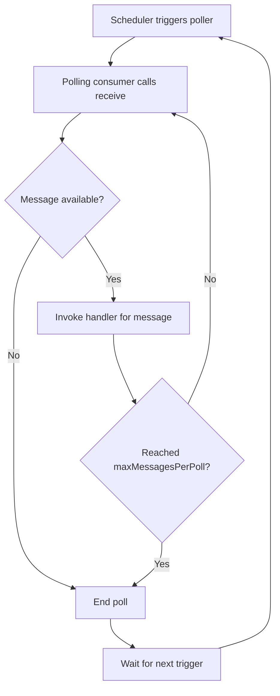

# maxMessagesPerPoll and Limiting a Single Poll

A polling endpoint in Spring Integration receives messages per poller execution. During such an execution, the consumer can retrieve one message and stop, or continue receiving multiple messages before yielding until the next poll. `maxMessagesPerPoll` sets the upper bound on the number of messages processed in a single poll.

This parameter affects throughput, latency, how long a scheduler thread is occupied, transaction boundaries, and fairness across multiple polling tasks. It is frequently confused with queue size, consumer concurrency, or handler batch size. Understanding its exact scope helps avoid configuring a consumer that processes too few messages, holds threads for too long, or lets backlog grow continuously.

## 1. What Is a Single Poll?

The poller schedules a polling task. When the task runs, the polling consumer calls `receive()` on the input `PollableChannel`, passes the received message to the handler, and may continue calling `receive()` to retrieve the next message. The poll ends when the message limit is reached, when the channel has no more messages within the receive timeout, or when processing stops due to an error or another condition.



`maxMessagesPerPoll` limits how many messages are received during one polling task execution. With a polling consumer, each message is normally passed to the handler individually. For example, a limit of 10 does not mean the handler receives a `List` of 10 messages; it means the consumer can invoke the handler at most 10 times during that poll.

If the channel becomes empty before reaching the limit, the consumer finishes the poll early once the receive operation returns no message. Thus, the limit is a maximum, not an amount guaranteed to be processed on every poll.

## 2. Meaning of maxMessagesPerPoll Values

In standard poller configurations, the default value is 1 unless overridden by `PollerMetadata` or another configuration. Each poll then processes at most one message. You can configure a positive integer to process more messages per poll, or use `-1` to keep receiving until the channel has no more messages.

| Value | Behavior |
|---|---|
| `1` | At most one message per poll; this is the typical default |
| Positive number greater than `1` | At most the configured number of messages in a single poll |
| `-1` | No limit on message count; continues polling until no message is received |

A value of `-1` does not mean one thread processes messages forever in every situation. The poll still stops when the receive operation reports no more messages. However, if producers continuously add messages faster than the consumer drains them, a single poll can run for a very long time. That reduces the scheduler time available to other tasks if they share execution resources.

When a predictable processing cadence is needed, a positive limit is usually preferable. Only use `-1` when the explicit goal is to drain the queue continuously and you have evaluated the impact on fairness, execution time, and shutdown.

## 3. Configuring with Annotations

For a polling consumer using `@ServiceActivator`, you can set `maxMessagesPerPoll` inside `@Poller`:

```java
@Component
class PaymentConsumer {

    private final PaymentService paymentService;

    PaymentConsumer(PaymentService paymentService) {
        this.paymentService = paymentService;
    }

    @ServiceActivator(inputChannel = "payments.queue")
    @Poller(fixedDelay = "500", maxMessagesPerPoll = "20")
    public void handle(Payment payment) {
        paymentService.process(payment);
    }
}
```

With the configuration above, the poller fires on a 500 ms fixed delay and receives at most 20 messages per poll from `payments.queue`. The handler is invoked for each `Payment` payload received. If the queue holds only 3 messages, that poll processes 3 messages and finishes when the next receive returns no data.

The input channel must support polling, such as a `QueueChannel`. Adding `@Poller` does not turn a `DirectChannel` or `ExecutorChannel` into a `PollableChannel`; those channels use subscription semantics.

## 4. Configuring with Java DSL

In Java DSL, the poller is attached to the endpoint consuming the channel:

```java
@Bean
IntegrationFlow paymentPollingFlow(PaymentService paymentService) {
    return IntegrationFlow
            .from("payments.queue")
            .handle(paymentService, "process", endpoint -> endpoint
                    .poller(Pollers.fixedDelay(500)
                            .maxMessagesPerPoll(20)))
            .get();
}
```

Verify that `payments.queue` resolves to a `PollableChannel` and that the endpoint is configured as a polling consumer. If using `Pollers` or a shared `PollerMetadata`, check whether the metadata sets its own `maxMessagesPerPoll`; endpoint-level configuration and default metadata must be understood in their actual order of precedence.

## 5. Distinguishing Polling Limits from Other Limits

Three parameters are frequently conflated even though they control three different parts:

| Parameter | Controls | Example |
|---|---|---|
| `maxMessagesPerPoll` | Maximum number of messages in a single polling task | Each poll processes up to 20 messages |
| Queue capacity | Number of messages that can wait in a bounded channel | `QueueChannel(500)` holds at most 500 messages |
| Consumer concurrency | Number of polling tasks/consumers that can process concurrently per endpoint and executor config | Multiple consumers reading from the same queue |

For instance, a queue capacity of 500 and `maxMessagesPerPoll` of 20 does not mean the system only processes 20 messages in existence. The queue can hold up to 500 messages; each polling task receives up to 20 messages. If there are multiple consumers, total concurrent processing also depends on consumer count, executor, scheduler, and handler duration.

`maxMessagesPerPoll` is also not a business API batch size. If you want the handler to receive a collection and process a batch at once, you need an aggregation step or a dedicated batch API. The poller only controls how many times messages are received within a single execution cycle.

## 6. Impact on Throughput and Latency

When the queue consistently has messages, a larger limit lets one polling task process more messages before ending. This can reduce the overhead of scheduling many polls and increase throughput. However, a longer poll holds the thread longer, making other polling tasks wait if they share a scheduler or executor with few threads.

Suppose a handler averages 10 ms per message; a poll of 20 messages takes around 200 ms for handler execution alone, excluding receive time, conversion, and overhead. With a 500 ms fixed delay, the time between two starts is not simply always 500 ms; fixed delay is measured after the previous execution finishes. When the queue has a backlog, the time from when a message is sent until it is processed also depends on its position in the queue and the number of reading consumers.

When the queue is frequently empty, increasing `maxMessagesPerPoll` does not make the handler run faster. The poller still has to wait for the trigger and the next receive. At low load, a value of 1 can be sufficient and easy to observe. At high load, measure handler duration, queue depth, and wait time to select a batch limit.

A simple approximation when the queue is always full is:

\[
\text{throughput} \approx \frac{\text{messages per poll}}{\text{poll execution time} + \text{delay between polls}}
\]

This is only a rough model for a single polling task. It does not account for concurrency, scheduler contention, receive timeout, retries, errors, or downstream limits. Use actual metrics to tune the configuration.

## 7. `fixedDelay`, `fixedRate`, and Poll Duration

`maxMessagesPerPoll` defines the maximum length by message count; the trigger determines when the next poll is scheduled.

| Trigger | Cadence Calculation | Consequence When Handler Is Slow |
|---|---|---|
| `fixedDelay` | Waits a delay interval after the previous poll completes | Time between two starts increases with processing duration |
| `fixedRate` | Schedules on a fixed time cadence | Long executions can cause the schedule to fall behind; check scheduler capacity |
| `cron` | Triggers at scheduled calendar points | Can miss target times if a poll runs long or execution resources are busy |

Do not use `maxMessagesPerPoll` as a substitute for a trigger. To increase messages per minute, you can adjust both messages per poll and the interval between polls, while accounting for total processing time and downstream load.

## 8. Receive Timeout and Empty Queues

A polling consumer calls `receive()` on a `PollableChannel`. The receive call can wait for a message up to the configured timeout. When no message is available, the timeout expires and the poll can stop before reaching `maxMessagesPerPoll`.

`receiveTimeout` and `maxMessagesPerPoll` solve two different problems:

- `receiveTimeout` limits how long a single message receive waits.
- `maxMessagesPerPoll` limits the total number of messages received across the entire polling task.

If the timeout is too long, a poll can hold a thread while the queue is empty. If the timeout is too short, the consumer may end the poll as soon as the queue is briefly empty and wait for the next trigger. Choose the timeout alongside fixed delay and producer burst characteristics.

With `maxMessagesPerPoll = -1`, the final receive typically ends the poll when the channel has no more messages and receive returns `null`. Consequently, receive timeout also affects when an unbounded poll finishes.

## 9. Continuous Polling and Risk of Monopolizing the Scheduler

`-1` is useful when draining a backlog: the consumer keeps receiving messages until the queue is empty. However, in a system with continuous producers, the queue may never become empty. In that case, a single poll can occupy a thread for an extended period and delay other pollers sharing the same scheduler.

A positive limit establishes an explicit yield point. For example, `maxMessagesPerPoll = 50` allows the consumer to process up to 50 messages and end the poll, letting the scheduler run other tasks. This does not guarantee strict fairness, but it bounds occupancy time by work volume.

If high throughput and multiple independent consumers are needed, size the executor/scheduler appropriately or scale consumer count by design. Do not simply add threads to compensate for a slow handler or an already overloaded downstream system.

## 10. Transactions and Advice Chains When Processing Multiple Messages

A poller can use an advice chain to apply transactions, retries, or cross-cutting behaviors to the polling task. When `maxMessagesPerPoll` is greater than 1, verify what the transaction advice wraps: the entire polling task, a single receive/handler call, or a boundary defined by the adapter and transaction manager.

Do not assume that a poll processing 20 messages is automatically a single atomic transaction. Likewise, do not assume a database transaction rolls back `receive()` on every `PollableChannel`. With an in-memory `QueueChannel`, a message is typically removed from the queue upon receive; recovery capability depends on the specific channel implementation, message store, and transaction support.

Before choosing a batch limit, determine:

- Does one failed message affect messages already processed earlier in the same poll?
- Does the transaction commit per message or at another scope?
- Does retry repeat a single message's handler or the entire polling task?
- How are messages that were received but not finished recovered when the process stops?
- Is the consumer idempotent when messages are redelivered?

If each message requires its own transaction, configure and test the corresponding transaction boundary. If you want to process a batch as a single business unit, design an explicit batch handler or aggregator rather than relying on `maxMessagesPerPoll`.

## 11. Error Handling Within a Single Poll

When a handler throws an exception, the outcome of the poll depends on configured error handling, advice chains, retries, and recovery. Do not assume the consumer will skip the failed message and continue fetching the next one. An error may terminate the current poll or be handled by an error flow according to the endpoint.

| Scenario | What to Determine |
|---|---|
| First message in the poll fails | Does the poller end the poll, retry, or send the error to an error channel? |
| The Nth message fails | Have previous messages already committed? Are subsequent messages still fetched? |
| Retry is configured | Does retry apply to the message handler or the polling task scope? |
| Poison message | Is there a recovery flow or dead-letter path to avoid infinite loops? |
| Error handler swallows exceptions | Does the runtime treat the message as successfully processed despite business failure? |

Log the message ID/correlation ID, flow ID, message index within the poll if measurable, root exception, and retry count. This helps determine whether an error affects a single message or the entire poll.

## 12. Tuning by Load Scenario

| Scenario | Configuration Direction to Test | What to Monitor |
|---|---|---|
| Low load, sparse messages | `maxMessagesPerPoll = 1` and suitable delay | Latency from send to processing start |
| Short bursts, fast handler | Positive limit greater than 1 | Queue depth after bursts and single-poll duration |
| Long backlog, fast drain desired | Increase positive limit or test `-1` if appropriate | Scheduler contention, fairness, and shutdown time |
| Many polling flows sharing a scheduler | Moderate positive limit | Delay of other pollers and queued task count |
| Handler slow due to I/O | Measure I/O time, consider bounded executor/concurrency | Busy threads, connection pool, and downstream timeouts |
| Downstream is rate-limited | Lower concurrency or batch limit, adjust delay | Retries, rate limits, and queue backlog |

There is no single `maxMessagesPerPoll` value optimal for every flow. Configuration should be guided by real load, processing time, latency requirements, and downstream system capacity.

## 13. Diagnosing Unexpected Polling Limits

When a consumer processes fewer or more messages than expected, check in this order:

1. Confirm the endpoint is actually a polling consumer and the input channel is a `PollableChannel`.
2. Check `maxMessagesPerPoll` in annotations, Java DSL, and shared `PollerMetadata`; identify which configuration is in effect.
3. Verify the poller has an active trigger and the endpoint is running.
4. Check queue depth before and after a poll to see whether the poll stopped due to hitting the limit or an empty channel.
5. Inspect `receiveTimeout`, handler duration, and mid-poll errors.
6. Check consumer count, scheduler/executor, and thread contention.
7. Cross-check retries, transactions, and the error channel to understand how received messages were handled.

| Symptom | Common Cause |
|---|---|
| Each poll processes only one message | `maxMessagesPerPoll` is at default 1 or overridden by metadata |
| Configured 20 but only 4 are processed | Queue only held 4 messages or receive returned empty before reaching the limit |
| A poll runs unusually long | Slow handler, long receive timeout, retries, or `maxMessagesPerPoll = -1` |
| Other pollers are delayed | One poll holds a shared scheduler/executor for too long |
| Throughput does not rise when increasing the limit | Bottleneck in handler, database, network, or downstream |
| Messages after a failed message are not processed immediately | Exception ended the poll or retry/recovery is taking precedence |

Useful metrics include queue depth, messages processed per poll, poll duration, handler duration, actual poll delay, retry count, error count, and busy thread count. Combine metrics with message ID/correlation ID to distinguish backlogs caused by fast producers, slow consumers, or unstarted endpoints.

## 14. Principles for Choosing maxMessagesPerPoll

- **Start small and measure:** the default of 1 is an easy-to-control starting point; increase it when metrics show noticeable polling overhead.
- **Use a positive limit to yield the scheduler:** bounding a single poll prevents one consumer from holding a thread too long under a continuous backlog.
- **Use `-1` only when draining is needed:** ensure the channel can become empty and evaluate the impact of a long-running poll.
- **Separate batch limit from queue capacity:** one limit governs messages per poll; the other governs messages waiting in the channel.
- **Separate batch limit from concurrency:** increasing parallelism requires configuring appropriate consumers/executors and ensuring handlers are thread-safe.
- **Evaluate transactions and retries:** do not assume the entire batch is one transaction or that a failed message will be skipped automatically.
- **Monitor downstream systems:** increasing the limit will not help if the database, API, or connection pool is already the bottleneck.
- **Test shutdown behavior:** determine what happens when stopping the endpoint in the middle of a poll processing multiple messages.

Before choosing a limit for a polling endpoint, answer: how long may one poll hold a thread, how quickly must a backlog drain, how must resources be shared with other pollers, and which messages are affected by a mid-poll error. `maxMessagesPerPoll` is an important tuning knob of the consumer runtime, but it is effective only when chosen alongside the trigger, timeout, concurrency, and error-handling policy.
